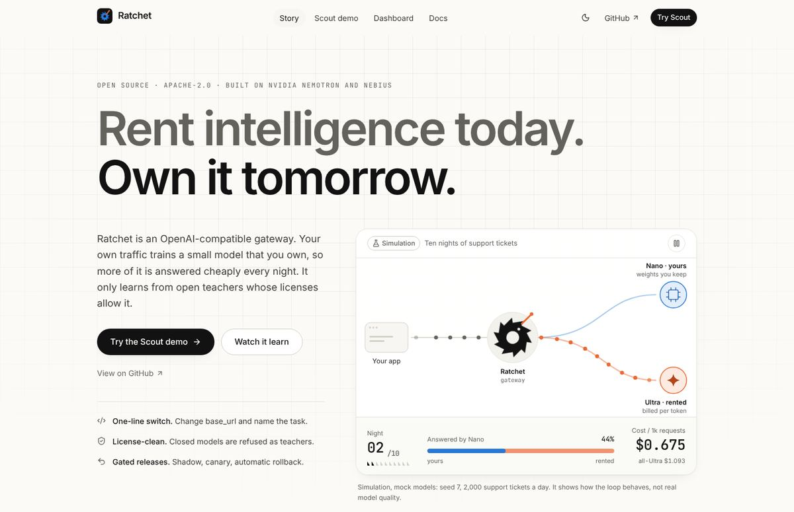
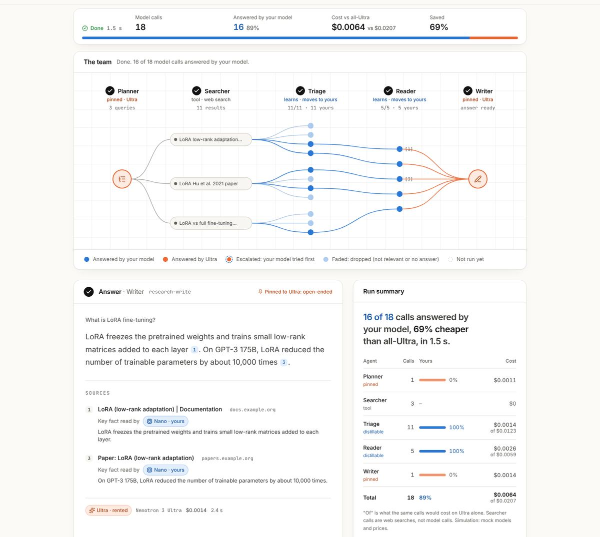
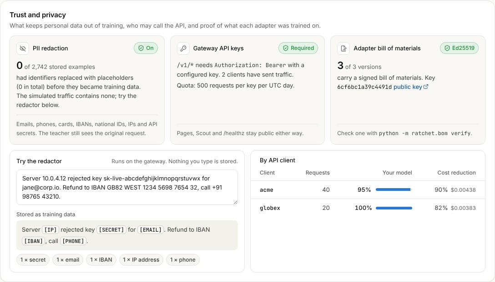

# Ratchet

**License-clean distillation on open models. Rent intelligence today, own it tomorrow.**

Ratchet is an OpenAI-compatible gateway. Change one line (your base URL) and:

1. A small model answers each request first: NVIDIA Nemotron 3 Nano 4B with a LoRA adapter **you own**, served by vLLM on a Nebius Serverless Endpoint.
2. If it is not confident, the request goes to the teacher, **NVIDIA Nemotron 3 Ultra on Nebius Token Factory**.
3. Every teacher answer is logged with its **provenance**: which teacher wrote it, and the license that permits training on it.
4. Every night, **Night School** fine-tunes a new student on a Nebius Serverless Job, evaluates it on a held-out golden set, and releases it safely: shadow mode, then canary 10% → 50% → 100%, with automatic rollback.

Your bill falls as your own model takes over, and Ratchet tells you when a GPU would cost more than it saves. You own the LoRA adapter and its signed training lineage; the Nano base stays under NVIDIA's Nemotron Open Model License.



The gateway serves a React web app ([web/](web/CLAUDE.md)):

- `/`: the story. How Ratchet works, why it is license-clean and why releases are safe, with an interactive replay of the reference simulation.
- `/scout`: the Scout multi-agent demo (below). Watch each call get answered by your model or by Ultra.
- `/dashboard`: savings, the release pipeline, economics (savings per token and by GPU-hours paid, break-even and a self-host recommendation), versions, per-task routing, the task registry (each task's comparators and spec, API tasks editable with an admin key), resilience (circuit breakers, fallbacks, recent failures and an outage drill), trust and privacy, release log and provenance, with demo controls in mock mode.

The original no-build pages stay at `/lite`, `/lite/scout` and `/lite/dashboard`.

| Scout | Dashboard |
|---|---|
|  |  |

## Scout: Ratchet on agent traffic

[Scout](docs/SCOUT.md) is a small multi-agent research demo. It answers a question from the web, and every one of its LLM calls goes through Ratchet with a task name:

| Agent | Task | Route |
|---|---|---|
| Planner | `research-plan` | **Pinned** to Nemotron 3 Ultra (open-ended) |
| Searcher | none (a tool) | [Tavily Search API](https://docs.tavily.com) in live mode, simulated results in mock mode |
| Triage | `source-triage` | **Distilled**: one short labelling call per search result |
| Reader | `page-read` | **Distilled**: one call per relevant result, pulls out the key fact |
| Writer | `research-write` | **Pinned** to Nemotron 3 Ultra (open-ended) |

Pinned tasks always go to the teacher and are never stored as training data. The many narrow triage and reader calls are where the student takes over. A public demo has a budget guard: a daily spend cap, a daily run cap and a per-IP hourly limit, kept in the ledger across restarts, with a share held back for hackathon judges and a paced Tavily credit budget; a run whose search fails still finishes, labelled.

## Why "license-clean"

OpenAI's [Business Terms §3.3(e)](https://openai.com/policies/business-terms/) and Anthropic's [Commercial Terms §D.4(a)](https://www.anthropic.com/legal/commercial-terms) forbid using their outputs to train competing models. A distillation tool that learns from GPT or Claude traffic puts its users at risk.

Ratchet only distills from teachers whose licenses allow it. Nemotron 3 Ultra is under [OpenMDW-1.1](https://huggingface.co/nvidia/NVIDIA-Nemotron-3-Ultra-550B-A55B-BF16), which places no restrictions on outputs. Closed models are refused as teachers in code (`ratchet/licenses.py`). `GET /ratchet/bom` exports a **model bill of materials**: every training source, its license, and a SHA-256 fingerprint of the dataset. Each trained adapter also gets **its own bill of materials, signed with Ed25519**, that anyone with your public key can check offline (`python -m ratchet.bom verify`). The licenses travel with the adapter: its BOM names the base model's license, and a `NOTICE.md` next to the weights lists the base model's and each teacher's license (see [License](#license)). An open teacher Ratchet does not list yet can be added in `RATCHET_TEACHER_LICENSES`, but only under an allowed open license and never for a closed model family or router alias Ratchet recognises; the adapter's BOM and NOTICE then mark that license as configured. *Not legal advice: check licenses yourself.*

In its own words, OpenMDW-1.1 "does not impose any restrictions or obligations with respect to any use, modification, or sharing of any outputs" ([license page](https://openmdw.ai/license/1-1/), last updated May 27, 2026; checked Oct 21, 2026). What you own at the end is the LoRA adapter Night School trains and its signed bill of materials. The student's base, Nemotron 3 Nano 4B, stays under the [NVIDIA Nemotron Open Model License](https://www.nvidia.com/en-us/agreements/enterprise-software/nvidia-nemotron-open-model-license/) (v. Dec 15, 2025), which asks you to give anyone you distribute it to a copy of that license.

## How it uses NVIDIA and Nebius

| Role | Model / service | Why |
|---|---|---|
| Teacher | `nvidia/Nemotron-3-Ultra-550b-a55b` on **Token Factory** | Best reasoning; OpenMDW license allows distillation |
| Judge (free-text eval) | `nvidia/nemotron-3-super-120b-a12b` on **Token Factory** | Fast, cheap, JSON mode |
| Fallback student | `nvidia/NVIDIA-Nemotron-3-Nano-30B-A3B` on **Token Factory** | Used when your endpoint is stopped |
| Student | `nvidia/NVIDIA-Nemotron-3-Nano-4B-BF16` + LoRA on a **Nebius Serverless Endpoint** (vLLM) | Cheap, fast; the adapter is yours |
| Night School | **Nebius Serverless Jobs** (L40S) with TRL + PEFT | Pay only while training |
| Dataset / adapters | **Nebius Object Storage** bucket mounted in jobs and endpoints | |
| Public demo host | **Nebius AI Cloud** CPU VM (`2vcpu-8gb`) | The gateway does no inference |
| Scout web search | Tavily Search API (not NVIDIA or Nebius) | Search tool for the Scout demo only |

Token Factory does not offer fine-tuning or LoRA serving for Nemotron yet (Oct 2026), so the student is trained and served on Nebius AI Cloud.

## NVIDIA lineage

NVIDIA Research's paper "Small Language Models are the Future of Agentic AI" ([arXiv 2506.02153](https://arxiv.org/abs/2506.02153), v3, Sep 22, 2026) estimates that about 40%, 60% and 70% of the LLM queries in three open agent systems could be handled by specialized small models, and gives a six-step conversion algorithm. S1, S2, S5 and S6 run automatically. S3 (task clustering) is manual: the caller or operator names each task. S4 (SLM selection) is manual: one base model.

| Step in the paper | In Ratchet | Automatic? |
|---|---|---|
| S1 "Secure usage data collection" | The gateway logs every request's metadata (task, route, confidence, cost); request text is kept only in training examples, redacted by default, and API keys only by name | Yes |
| S2 "Data curation and filtering" | PII redaction before storage; only complete teacher answers that are valid under the task's spec are kept | Yes |
| S3 "Task clustering" | Not clustered: the caller names each request's task (`X-Ratchet-Task` or `metadata.ratchet_task`) and the operator may give a task a typed field spec in the task registry; statistics are kept per task | No: manual, tasks are named, not clustered |
| S4 "SLM selection" | One base, Nemotron 3 Nano 4B, chosen by hand for size, license and serving cost; Ratchet does not compare bases | No: manual, one base model |
| S5 "Specialized SLM fine-tuning" | A LoRA fine-tune each night on a Nebius Serverless Job, from teacher answers only | Yes |
| S6 "Iteration and refinement" | Night School every night, gated by a held-out golden set (with an exact precision certificate in each signed BOM), shadow, canary and automatic rollback | Yes |

NVIDIA's [Data Flywheel Blueprint](https://developer.nvidia.com/blog/build-efficient-ai-agents-through-model-distillation-with-nvidias-data-flywheel-blueprint) (blog Jun 11, 2025) also distils production traffic into smaller models, but its README says "Promotion to production—as well as any deeper evaluation or dataset curation—remains a human decision" and "Think of the Flywheel as a flashlight, not an autopilot" ([repo](https://github.com/NVIDIA-AI-Blueprints/data-flywheel), marked deprecated in Apr 2026; read Oct 21, 2026). Ratchet is the autopilot, with statistical brakes: it makes the promotion decision with statistics on held-out rows and audited traffic, and writes each decision and its numbers to the release log.

The student's base has its own NVIDIA lineage: Nemotron 3 Nano 4B "has been compressed from NVIDIA-Nemotron-Nano-9B-v2 using the Nemotron Elastic framework", released Mar 16, 2026 ([model card](https://huggingface.co/nvidia/NVIDIA-Nemotron-3-Nano-4B-BF16), read Oct 21, 2026).

## Quick start (no keys, 1 minute)

```bash
pip install -e ".[dev]"            # or: make install
python -m sim.simulate --days 10 --requests 2000 --bad-deploy-version 3   # full loop, mock models
RATCHET_MODE=mock uvicorn ratchet.gateway:app --port 8000                # http://localhost:8000 (/, /scout, /dashboard)
make web                                                                 # optional: rebuild the React UI (Node 22)
RATCHET_MODE=mock RATCHET_MOCK_WARMUP_DAYS=4 uvicorn ratchet.gateway:app --port 8000   # same, starts with a trained student
python -m ratchet.scout "What is LoRA fine-tuning?" --base-url http://localhost:8000/v1   # Scout as an outside client
pytest -q                                                                # 1765 tests
```

`RATCHET_MOCK_WARMUP_DAYS=4` runs four simulated days and nights at startup (about 2 s), so the dashboard and Scout open on a student that is already live. The Scout CLI also takes `--api-key` and `--max-results` (default 4). Without `TAVILY_API_KEY` it uses simulated search results, which only cover the example questions and only work against a mock-mode gateway.

The simulation uses **mock models**: it shows how the loop behaves (cold start, drift, rollback), not real model quality. Typical run (seed 7, 2,000 tickets/day, product launch on day 5, corrupted deploy of v3):

```
day  student  escal. audit ok     $/1k all-Ultra  saved
  1       0%      0%        -    1.093     1.093     0%     <- cold start: all teacher
  3      98%      2%     100%    0.160     1.093    85%     <- first student live
  4      98%      2%      93%    0.160     1.093    85%     <- v3 deployed corrupted -> rolled back automatically
  5      86%     14%      97%    0.272     1.093    75%     <- product launch: new questions escalate
  9      98%      2%      97%    0.162     1.093    85%     <- learned overnight
 10      98%      2%      99%    0.147     1.093    87%
```

Success metrics for that run (PRD §8.1, computed by `ratchet/kpis.py` over the last three days; simulation, mock models, not real model quality):

| Metric | Target | Simulation (seed 7) |
|---|---|---|
| SM-1 cost reduction vs all-teacher | ≥ 70% | 84.5%, met |
| SM-2 audited precision (585 audits pooled) | ≥ 95% | 98.5%, met (Wilson 97.1–99.2%) |
| SM-3 student share | ≥ 80% | 96.9%, met |
| SM-4 bad deploys reaching 100% traffic | 0 | 0, met (v3 rolled back at 10%) |
| SM-5 time to recover from drift | ≤ 3 nights | 4 nights, **not met** |

`GET /ratchet/kpis` computes the same metrics from a live ledger, and `python -m sim.simulate` prints them. No live run has been measured yet.

`--workload research` sends Scout's triage and reader calls instead of tickets, and `--workload mixed` sends half of each. Simulation, mock models, seed 7, 8 days × 1,500 requests: the student answered 92% of research calls on day 8 (81% saved that day, 62% over all 8 days), and 94% of mixed calls (82% saved that day, 51% overall), with per-task calibration on (the default: each task held to its own threshold and golden check). With `RATCHET_PER_TASK_CALIBRATION=0` (one pooled threshold, as in v0.4) the same runs give 96% of research calls (85% that day, 63% overall) and 98% of mixed calls (86%, 54%). See [docs/TESTING.md](docs/TESTING.md#workloads-research-and-mixed). `--workload schema` sends structured-output requests and `--workload tools` support requests with tool definitions, from the generic mock world, which also answers any other request the mock gateway gets (free text, an instance of the request's JSON schema, or a mock tool call) instead of refusing it ([docs/TESTING.md](docs/TESTING.md#workloads-schema-and-tools)). Tool calls pass through to the teacher and come back as `message.tool_calls` (also streamed, and in the legacy `function_call` form); a tool request is answered by the teacher alone and never stored, so the `tools` workload saves nothing until tool-call distillation ([ADR 0043](docs/adr/0043-tool-calls-teacher-only-by-default.md)).

## Live mode (real Token Factory + Nebius)

```bash
export NEBIUS_API_KEY=...                       # Token Factory key
python scripts/day1_check.py                    # model IDs, logprobs, JSON mode

# Student endpoint (vLLM + runtime LoRA loading) and training job
export RATCHET_BUCKET_ID=... RATCHET_STUDENT_KEY=... RATCHET_TRAIN_IMAGE=...
bash deploy/student_endpoint.sh create          # once (DRY_RUN=1 first); later: stop when idle, start to resume
export RATCHET_STUDENT_BASE=https://<endpoint>/v1

RATCHET_MODE=live uvicorn ratchet.gateway:app --port 8000   # point your app at http://<host>:8000/v1
python -m ratchet.live night                                # nightly (cron)
python -m ratchet.live tick                                 # every few minutes (cron)
python -m ratchet.live seal                                 # hourly (cron): seal the savings receipts of days that ended
```

Use it from any OpenAI SDK:

```python
from openai import OpenAI

client = OpenAI(base_url="http://localhost:8000/v1", api_key="unused")
r = client.chat.completions.create(model="ratchet", messages=[...], extra_headers={"X-Ratchet-Task": "ticket-triage"})
print(r.ratchet)  # served_by, confidence, cost_usd, all_teacher_cost_usd, usage_breakdown ...
print(r.usage.total_tokens, r.system_fingerprint)  # the served answer's tokens; the fingerprint changes with the version
```

See [docs/DAY1.md](docs/DAY1.md) for the checks to run before relying on live mode.

### Measuring a live run

`python -m ratchet.liverun` ([ADR 0121](docs/adr/0121-live-measurement-method.md)) sends synthetic workload traffic through the live gateway in rounds with Night School between them, sends a small control sample straight to Ultra for a measured all-Ultra baseline, and writes one results file behind every live number in the docs. It runs on the gateway's host with its `.env`, under its own API key, and never spends past `--max-usd`:

```bash
export RATCHET_LIVERUN_KEY=...   # the key of liverun:<key> in RATCHET_API_KEYS; never a flag
make live-plan                   # free: requests per release stage, golden size, USD per round
make live-smoke                  # 20 requests, about 5 control calls, no nights: cents
make live-run MAX_USD=30         # results in evidence/live/<run id>/
```

The [runbook](docs/RUNBOOK.md#live-measurement-run) covers the prerequisites (the gateway runs `RATCHET_SEQUENTIAL=1` and `RATCHET_CANARY_AUDIT_RATE=0.5`), resuming, the repeat run, entering the Nebius bill and publishing.

## Proof, not promises

### Live numbers (after the live run)

| What | How |
|---|---|
| Every live number, with how it was computed and the run that measured it | `evidence/live/results.json` (`values` and `sources`, one `live.*` id per number; `docs/LIVE_RESULTS.md` is its readable form) |
| The client-side numbers, recomputed from the per-request records | `python -m ratchet.liverun verify evidence/live` |

## Hosting the demo

The public demo runs on one small Nebius CPU VM with Docker Compose and Caddy (automatic HTTPS). The gateway does no inference, so 2 vCPU / 8 GB is enough. Scripts are in `deploy/vm/`; the guide, with costs (estimate: about $72 for Oct 29 – Dec 15, 2026, before live-mode usage), security notes and teardown, is [docs/DEPLOY_NEBIUS_VM.md](docs/DEPLOY_NEBIUS_VM.md).

## How the economics work

Per token, a student answer costs a fraction of a teacher answer. But the self-hosted student runs on a GPU endpoint that bills by the hour whether requests arrive or not, so Ratchet also reports savings by the GPU-hours actually paid (`python -m ratchet.cost report`, `GET /ratchet/cost`), and says when self-hosting does not pay:

```
break-even student answers per endpoint hour = GPU price per hour ÷ teacher spend avoided per student answer
```

With **unverified list prices** (an L40S at about $1.55/hour, about $0.001 of Ultra spend avoided per ticket-triage answer in the simulation) that is about 1,500 student answers an hour, roughly 36,000 a day. At the demo's 1,500 requests a day a 24/7 endpoint loses money, and the report says so and recommends the hosted fallback or scaling the endpoint to zero. At customer volume (10M requests a month, about 14,000 an hour) the endpoint beats the teacher by a wide margin, but per answer the untuned hosted Nano is cheaper still below roughly 52,000 student answers an hour, so the report says "Self-hosting beats the teacher, but the hosted fallback would cost less per answer" and recommends `hosted_fallback`, adding that this assumes the hosted model serves as many requests as the tuned student. One GPU serving many LoRA adapters raises the volume per GPU-hour ([ADR 0023](docs/adr/0023-utilization-aware-cost-accounting.md)).

## How the safety works

- **Confidence** = token probability (vLLM logprobs) + agreement across 3 samples + format validity. Small models are poorly calibrated, so no single signal is trusted.
- **Per-version threshold**, calibrated on half the golden set (target 97% precision) and measured on the other half.
- **Golden gate:** a candidate must reach 95% precision and not regress against the live model, which is re-scored on the same golden set the same night (champion vs challenger).
- **Shadow:** the candidate runs silently on real traffic. Disagreements with the live student are arbitrated by the teacher, and the arbitration becomes training data.
- **Canary 10% → 50% → 100%**, gated on teacher audits of what it serves. **Rollback** fires when the 95% upper bound of audited precision falls below 92%.
- **Training data:** only teacher answers, never the student's own (avoids model collapse). Retrains from the base model on the cumulative set each night (limits forgetting). Requests that repeat 3+ times always go to training, so frequent questions are never held out forever.
- **No training while a release is in flight**, which saves GPU money.

## What a certificate means

Every adapter's golden eval, and so its signed bill of materials, carries a **certificate** ([ADR 0026](docs/adr/0026-certified-thresholds-and-a-paired-release-gate.md)): of the held-out golden rows the threshold was *not* tuned on, how many the version would serve and how many of those agree with the teacher, and an exact one-sided Clopper–Pearson lower bound on its precision. "Certified at 95% (lcb 96.4%, delta 0.05)" means: with probability at least 95%, the answers this version serves at its threshold agree with the teacher at least 96.4% of the time. That is a statement about agreement with the teacher, not ground truth, and it assumes the golden rows look like live traffic (they come from escalations, audits and arbitrations, so they lean towards requests the student found hard). A point estimate such as "99.2% precision" on 130 rows cannot tell 0.96 from 0.99; the bound can.

- **Frontier:** the same bound at every threshold from 0.95 down to 0.50, corrected so all ten hold at once: the certified trade-off between precision and the share of traffic served.
- **Per task:** the counts per task, so a weak task cannot hide inside a pooled number (a diagnostic; it does not change routing).
- **Paired gate (opt-in, `RATCHET_PAIRED_GATE=1`):** the candidate and the live version are compared row by row on the same golden rows with exact McNemar tests, so a difference within noise no longer rejects a better model, and a significant regression still does. In the reference run (simulation) v2 was rejected for serving 70 of 74 rows against live's 74: four discordant rows, p = 0.0625.
- **Learn-then-Test (opt-in, `RATCHET_CALIBRATION=ltt`):** the threshold itself is chosen so its precision is certified, over a fixed grid of thresholds.

```bash
python -m ratchet.stats plan --target 0.95 --delta 0.05        # 0 errors: 59 rows, 1: 93, 2: 124, 3: 153
curl -s localhost:8000/ratchet/versions/2/certificate          # signed and latest certificate, assumptions
curl -s localhost:8000/ratchet/versions/2/bom > bom.json
python -m ratchet.stats check bom.json --public-key <yours>     # recompute every number from the signed counts
```

## Proving what an adapter was trained on
A certificate holds only while traffic looks like what it was measured on. A **drift alarm** watches for that without labels ([ADR 0032](docs/adr/0032-label-free-drift-alarm.md)): for each version and task, a gambler bets against "traffic has not changed" using the rank of each new confidence score among the earlier ones. On unchanged traffic the bet's capital reaches 100 with probability at most 1% over the stream's whole life, however often anyone looks. When it does, a `drift` event says the traffic changed (not that the model got worse) and the version's certificate reads `suspended` (`curl -s localhost:8000/ratchet/drift`). In simulation (mock models), a product launch on day 5 raised the alarm on day 5 for six seeds out of six, and runs without the launch raised none.

Every adapter's signed bill of materials also commits to its exact training and golden sets ([ADR 0027](docs/adr/0027-committed-training-sets.md)): one sparse Merkle root per set, over each example's hash mapped to a hash of its label, teacher, license and redaction count. From the BOM alone, anyone can then check a short proof that one request was, or was not, in an adapter's training set, and a held-out certificate that **no golden example was trained on**: invariants 3 and 6 as something you verify, not something you are told. The proofs show the operator's signed commitment, at training time, to the dataset; they do not show that the weights came from it. With guessable texts the proof endpoint would tell anyone what was trained on, so it needs an admin key.

```bash
curl -s localhost:8000/ratchet/versions/2/bom > bom.json
curl -s "localhost:8000/ratchet/demo/sample-example?version=2" > ex.json                    # mock demo: a committed prompt
curl -s "localhost:8000/ratchet/versions/2/proof?split=train" -H 'content-type: application/json' -d @ex.json > proof.json
python -m ratchet.proof verify proof.json --bom bom.json --expect included
curl -s localhost:8000/ratchet/versions/2/heldout > heldout.json
python -m ratchet.proof heldout heldout.json --bom bom.json   # OK: all N golden examples provably absent from the training set
```

## Replaying past traffic at another threshold

Ratchet designs its own labelling, so it knows the chance of every teacher label it sees: 1 for a request the student escalated, the audit rate for an answer it served. Each request logs that probability, and the **ledger replay** ([ADR 0028](docs/adr/0028-designed-propensity-replay.md)) uses it to answer "what would last week's precision, coverage and cost have been at threshold t, or at audit rate a?" for one version, including thresholds below the live one, where audits alone see nothing. Coverage is exact; precision is a weighted estimate with an approximate interval (null when nothing labels the answers it would count); the frontier's suggested threshold is advice, never applied: thresholds change only through Night School. The replay also measures how far the baseline's 300-reasoning-token assumption is from what the teacher really costs. It adds no model call and no random draw to the request path.

```bash
curl -s "localhost:8000/ratchet/replay?threshold=0.4&audit_rate=0.05"     # what happened, and what would have
curl -s "localhost:8000/ratchet/replay/frontier?target=0.97"               # thresholds 0.30 to 1.00, an advisory suggestion
python -m sim.simulate --db sim.db && python -m ratchet.replay --db sim.db   # the same from a simulated run (simulation)
```

## Savings you can check

Ratchet is priced on savings, so the savings must be checkable by the customer, not just reported. Each day gets a **savings receipt** for the gateway and one per API client ([ADR 0029](docs/adr/0029-verified-savings-receipts.md)). The baseline of an answer the student served is calibrated on the audited answers' real teacher bills (a ratio estimator with a confidence bound), so a wrong reasoning-token assumption is measured and corrected, and the fee is a share of the one-sided 95% **lower bound** of the savings. Each receipt is an RFC 9162 Merkle tree over the day's request metadata (no text), signed and chained to the client's previous one: any request id a client got in `X-Ratchet-Request-Id` can be proven to be in it, and an edit after sealing shows. Receipts cannot prove the costs written at request time; reconcile them with the Token Factory bill.

```bash
curl -s localhost:8000/ratchet/receipts/3 > r3.json                            # one day's receipt (your own, with an API key)
curl -s localhost:8000/ratchet/receipts/3/proof/3006 > p.json                  # a row id you saw (ratchet.row_id) is in it
python -m ratchet.receipt verify r3.json --public-key <yours> --proof p.json  # OK: signature, OK: proof
python -m sim.simulate --receipts --teacher-reasoning-mean 420                 # the bound next to the true cost (simulation)
```
Every one of these numbers is agreement with the teacher, so the **teacher watch** checks the teacher too ([ADR 0033](docs/adr/0033-teacher-watch.md)). A request that repeats is labelled by the teacher again when it escalates or is audited; its first re-test in each check epoch is compared with the label stored for it, at no extra cost, and Night School adds 20 probes a night. A label a re-test disagrees with leaves training and the golden set until two more teacher answers settle it. When the disagreements pass 5% by enough that a stable teacher would get there at most 1% of the time, a `teacher_drift` event pauses Night School until an operator acknowledges (`curl -s localhost:8000/ratchet/teacher`); a new model id in the teacher's responses starts a fresh epoch. In simulation (mock models), a teacher that changed 15% of labels from day 5 froze training on day 5 to 7 for six seeds out of six, and a stable one never did.
## Privacy and security

Built for real traffic, not only the demo ([threat model](docs/THREAT_MODEL.md)):

- **PII redaction before training.** Emails, phone numbers, card numbers (Luhn-checked), IBANs, Aadhaar, SSNs, PANs, GSTINs, UPI ids, IP addresses and API secrets are replaced with placeholders like `[EMAIL]` before a request becomes a training example, so an adapter cannot memorise them. The teacher still sees the original. On by default. Extraction tasks can use numbered (`[EMAIL_1]`) or surrogate placeholders, consistent between the prompt and the answer, and names and addresses are covered when you plug in a detector such as Presidio ([ADR 0009](docs/adr/0009-pattern-based-pii-redaction.md), [ADR 0082](docs/adr/0082-placeholder-styles-detector-plugin-and-indian-identifiers.md)).
- **Gateway API keys** (`RATCHET_API_KEYS=acme:<key>,...`) with a daily quota per key, cost and savings per client, and each client's own signed savings receipts ([above](#savings-you-can-check)).
- **Private by default in live mode**: every route has an access level; the dashboard API needs an admin or read-only dashboard key unless you make it public, and then anonymous readers see client pseudonyms, not names. Live mode does not start without API keys, `/docs` is off, and every response carries `nosniff` and `no-referrer` ([ADR 0061](docs/adr/0061-endpoint-access-levels.md)).
- **Streaming** (`stream: true`) in the OpenAI chunk format, so streaming clients work unchanged.
- **Request ids, failures, logs and metrics** ([ADR 0062](docs/adr/0062-request-ids-failures-logs-and-metrics.md)): every response carries `x-request-id`, which also names the request's ledger row, its log line and its failures; failed requests are recorded with what they spent; live mode logs one JSON line per request with no prompt or answer text, and `/metrics` serves Prometheus metrics.
- **Signed bill of materials per adapter** ([ADR 0010](docs/adr/0010-signed-adapter-bom.md)): teachers, licenses, dataset and golden-set hashes, the evaluation and, since v0.5, a set commitment per split ([above](#proving-what-an-adapter-was-trained-on)), written at training time; in live mode a copy goes into the adapter's folder in the bucket.

```bash
python -m ratchet.bom keygen                       # signing key + public key to publish
RATCHET_API_KEYS="acme:$(openssl rand -hex 24)" RATCHET_BOM_SIGNING_KEY=... make demo
curl -s localhost:8000/ratchet/versions/2/bom | python -m ratchet.bom verify - --public-key <yours>
```

The dashboard's **Trust and privacy** panel shows all of it, including a box where you can paste any text and see what would be stored.



## Why not a router or a distillation API?

| | Cascade router | Distillation service ([OpenPipe](https://coreweave.com/news/coreweave-to-acquire-openpipe-leader-in-reinforcement-learning), [AWS Bedrock](https://aws.amazon.com/bedrock/model-distillation), [OpenAI](https://openai.com/index/api-model-distillation/)) | Ratchet |
|---|---|---|---|
| Who owns the student | Nobody: each call is rented | Usually stays on the provider's platform | You: a LoRA adapter and its signed lineage; the Nano base keeps NVIDIA's license |
| Teacher license recorded per example | Not recorded | Not stated | Recorded when the example is captured, and signed into the adapter's BOM |
| Automatic nightly retrain | None | You start each job | Every night, from teacher answers only |
| Statistical release gate | Nothing ships | Your own evaluation | Held-out certificate, shadow, canary and automatic rollback |
| Reports when it loses money | Per-token savings only | No | Savings by GPU-hours paid, the break-even volume and a recommendation |

The YC Summer 2026 teams Understudy and Experiential Labs, as cited in the [competitive analysis](docs/COMPETITIVE_ANALYSIS.md) (not re-checked here), sit between the columns: both say the customer owns the model, and neither page we found documents shadow, canary and automatic rollback.

## Prior art and what is new

We did not invent the pieces. Ratchet puts them in one loop that runs by itself. Sources and dates are in [docs/COMPETITIVE_ANALYSIS.md](docs/COMPETITIVE_ANALYSIS.md).

- **Table stakes:** an OpenAI-compatible gateway, routing, API keys and quotas ([LiteLLM](https://github.com/BerriAI/litellm), [Portkey](https://portkey.ai), [OpenRouter](https://openrouter.ai)).
- **Distillation services:** [OpenPipe](https://coreweave.com/news/coreweave-to-acquire-openpipe-leader-in-reinforcement-learning) (CoreWeave announced the acquisition Sep 3, 2025), [AWS Bedrock Model Distillation](https://aws.amazon.com/bedrock/model-distillation), [OpenAI distillation](https://openai.com/index/api-model-distillation/) ("Active existing customers will no longer be able to create new fine-tuning jobs" on Jan 6, 2027, [deprecations](https://developers.openai.com/api/docs/deprecations), read Oct 21, 2026), [Inference.net](https://inference.net/blog/introducing-inference-platform/) (a managed training loop whose new models are "staged for final review and deployment", Apr 14, 2026) and the YC Summer 2026 teams Understudy and Experiential Labs. Each turns traffic into a fine-tune; none we found records each example's teacher license at capture, releases automatically behind a statistical gate, and reports when the small model loses money.
- **Known ideas:** LLM cascades ([FrugalGPT](https://arxiv.org/abs/2305.05176), 2023) and cascades that distil the large model into the small one as traffic arrives ([Cache & Distil](https://arxiv.org/abs/2310.13561), ACL Findings 2024; [Online Cascade Learning](https://arxiv.org/abs/2402.04513), ICML 2024); distillation from production logs ([NVIDIA's Data Flywheel Blueprint](https://github.com/NVIDIA-AI-Blueprints/data-flywheel), 2025). License-aware teacher choice at request time: OpenRouter's [`enforce_distillable_text`](https://openrouter.ai/docs/guides/evaluate-and-optimize/distillation) restricts routing to models that allow distillation, with license data "on a best-effort basis", and NVIDIA's [license-compliant distillation tutorial](https://developer.nvidia.com/blog/how-to-build-license-compliant-synthetic-data-pipelines-for-ai-model-distillation/) (Feb 5, 2026) builds on it. Escalation with a provable agreement guarantee ([Trust or Escalate](https://arxiv.org/abs/2407.18370), ICLR 2025) and sequential tests for canary deploys ([Netflix](https://arxiv.org/abs/2205.14762), 2022).
- **New in Ratchet, together:** a per-request escalation, a nightly retrain and a gated release (golden gate, shadow, canary, rollback) in one loop; an exact Clopper–Pearson certificate in each signed BOM and an opt-in anytime-valid canary, both recomputable from their counts; each example's teacher and license recorded when it is captured and signed into every adapter's BOM; savings reported by GPU-hours actually paid, with the break-even volume and a recommendation; committed training sets ([PRD FR-16.4](docs/PRD.md#616-verifiable-evidence)): each BOM signs Merkle roots over the exact training and golden examples, with proofs of what an adapter was and was not trained on. On Nemotron and Nebius.

## Limitations

What breaks first:

- **Low volume does not pay.** Below break-even, a GPU endpoint running 24/7 costs more than the teacher spend it saves. The cost report says so and recommends the hosted fallback or scaling the endpoint to zero.
- **Without a GPU endpoint the student is a hosted, untuned model.** With `RATCHET_STUDENT_BASE` unset, a trained version's calls go to Nemotron 3 Nano 30B on Token Factory, and they are still reported as `served_by: student`. The response's `model` field names the model that wrote the answer.
- **Precision means agreement with Nemotron 3 Ultra,** not ground truth, and it assumes the golden rows look like live traffic. They come from escalations, audits and arbitrations, so they lean towards requests the student found hard.
- **The redactor is pattern-based.** Names and street addresses are not caught yet.
- **Scout's reader is checked on two labels.** page-read's precision covers its `answers_question` and `fact_type` fields only; the free-text `key_fact` the writer cites is not checked.
- **A signed BOM is the operator's signed statement** of the data and evaluation behind an adapter. It shows that nothing changed after signing, not that the weights were trained on that data.
- **One gateway process.** The ledger is one SQLite file behind one lock; a Postgres ledger for several workers is planned ([roadmap](docs/ROADMAP.md)).
- **Simulation numbers come from mock models.** They show how the loop behaves, not real model quality. As of Oct 21, 2026, Ratchet has not run on Nebius yet.
- **Token Factory's Terms of Service §5(f)** ("competing service") is broad. We asked Nebius support about it in writing on Oct 19, 2026; until the answer is final, treat the question as open. Not legal advice.

## How the repo was built

The git history starts on Oct 19, 2026; every change since then is a dated commit. No third-party source files are copied into the repository: outside code comes in only as the dependencies declared in `pyproject.toml` and `web/package.json`, and the model weights are downloaded, never committed. These files are generated rather than written by hand, and the command that regenerates each is in the repo:

- `ratchet/web/dist/`: the build of `web/` (`make web`).
- `docs/REQUIREMENTS.md`: the requirements matrix (`python scripts/reqtrace.py`).
- `tests/fixtures/sim_reference_seed7.json` and `tests/fixtures/reference.json`: the pinned reference runs (`python scripts/regen_sim_reference.py`, `python scripts/reference_check.py --write`).
- `web/package-lock.json`: npm's lock file.
- `docs/img/*.jpg`: screenshots of the pages in mock mode (simulation).

## Documentation

Start at [docs/README.md](docs/README.md). Highlights:

- [PRD](docs/PRD.md): problem, users, requirements, metrics, release plan
- [Architecture](docs/ARCHITECTURE.md), [API](docs/API.md), [Configuration](docs/CONFIGURATION.md), [Scout](docs/SCOUT.md)
- [Deployment on Nebius](docs/DEPLOYMENT.md), [Demo VM on Nebius](docs/DEPLOY_NEBIUS_VM.md), [Runbook](docs/RUNBOOK.md), [Threat model](docs/THREAT_MODEL.md)
- [Testing and simulation](docs/TESTING.md), [Architecture decisions](docs/adr/README.md)
- [Business](docs/BUSINESS.md), [Competitive analysis](docs/COMPETITIVE_ANALYSIS.md), [Roadmap](docs/ROADMAP.md)
- [Devpost submission draft](docs/HACKATHON_SUBMISSION.md), [Demo script](docs/DEMO_SCRIPT.md), [Day-1 checklist](docs/DAY1.md)

Working with Claude? Read [CLAUDE.md](CLAUDE.md). Contributing: [CONTRIBUTING.md](CONTRIBUTING.md).

## Repo map

```
ratchet/gateway.py      OpenAI-compatible API (keys, quotas, streaming), pages, demo controls, Scout endpoints
ratchet/router.py       the cascade, pinned tasks, audits, shadow arbitration, cost accounting
ratchet/tasks.py        task specs: typed fields, valid answers, answer cleaning, built-in tasks
ratchet/taskspec.py     task specs as data: RATCHET_TASKS_FILE and the admin API, every error with its path
ratchet/compare.py      field comparators (label, number, date, set, records, ...)
ratchet/confidence.py   confidence score (pairwise agreement) + threshold calibration
ratchet/release.py      golden gate, shadow, canary, rollback (Wilson bounds, or an anytime-valid e-process)
ratchet/certificate.py  certified precision: Clopper-Pearson certificates, frontier, paired McNemar comparison
ratchet/stats.py        exact statistics, `python -m ratchet.stats plan|bound|mcnemar|check`
ratchet/drift.py        label-free drift alarm: a conformal test martingale on each version's confidence stream
ratchet/teacher_watch.py teacher watch: free re-test checks, quarantine and adjudication, a training freeze by e-process
ratchet/ledger.py       SQLite: requests, provenance, versions, events
ratchet/licenses.py     teacher license registry; closed teachers refused
ratchet/redact.py       PII placeholders before examples are stored
ratchet/auth.py         gateway API keys (named, per-key quota in gateway.py)
ratchet/bom.py          per-adapter bill of materials, Ed25519 signing, `python -m ratchet.bom`
ratchet/proof.py        committed training sets: membership and held-out proofs, `python -m ratchet.proof`
ratchet/replay.py       ledger replay: past traffic at another threshold or audit rate, `python -m ratchet.replay`
ratchet/receipts.py     verified savings receipts: calibrated baseline, lower-bound billing, `python -m ratchet.receipt`
ratchet/nightschool/    dataset build, LoRA training (TRL + PEFT), golden eval, nightly orchestration
ratchet/live.py         live Night School on Nebius (job -> hot-load adapter -> eval -> gate)
ratchet/liverun.py      live-run harness: rounds of synthetic traffic, control arm, results file, `python -m ratchet.liverun`
ratchet/scout/          Scout agents, prompts, Tavily/mock search, budget guard, CLI
web/                    React app: story, Scout, dashboard (Vite, Tailwind, motion, recharts)
ratchet/web/dist/       committed build of web/, served by the gateway
ratchet/web/*.html      lite pages without a build step (/lite*)
deploy/                 Serverless Job / Endpoint scripts, training Dockerfile
deploy/vm/              demo VM on Nebius: cloud-init, Docker Compose, Caddy, update and backup scripts
sim/                    synthetic tickets + mock models for demos and tests
sim/research.py         mock research world for Scout (8 questions, simulated search results)
```

## License

Apache-2.0 for the code. Model weights are under their own licenses: Nemotron Nano under the [NVIDIA Nemotron Open Model License](https://www.nvidia.com/en-us/agreements/enterprise-software/nvidia-nemotron-open-model-license/), Nemotron 3 Ultra under OpenMDW-1.1. Include those licenses if you distribute adapters.

Ratchet does that part for you ([ADR 0090](docs/adr/0090-licenses-travel-with-the-adapter.md)). Every adapter folder gets a `NOTICE.md` next to its weights: the base model and its license, each teacher with its license and URL, the statement that the adapter was trained on teacher outputs only, and the Ratchet version. The adapter's signed BOM carries the same text and its SHA-256, so a recipient can check that the notice is the one written at training time. To hand an adapter over:

```bash
python -m ratchet.live export --version 3 --out ./student-v3-export   # weights (if local), ratchet_bom.json, NOTICE.md
```

Keep `NOTICE.md` with the adapter wherever you copy, share or deploy it, and keep the base model's license with any copy of the base model. For a base model Ratchet does not know, the notice says so instead of naming a license: add that license yourself. Not legal advice.
