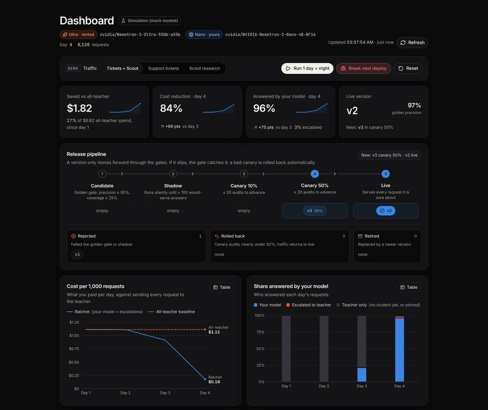

# Ratchet

**License-clean distillation on open models. Rent intelligence today, own it tomorrow.**

Ratchet is an OpenAI-compatible gateway. Change one line (your base URL) and:

1. A small model **you own** answers each request first (NVIDIA Nemotron 3 Nano 4B + LoRA, served by vLLM on a Nebius Serverless Endpoint).
2. If it is not confident, the request goes to the teacher, **NVIDIA Nemotron 3 Ultra on Nebius Token Factory**.
3. Every teacher answer is logged with its **provenance**: which teacher wrote it, and the license that permits training on it.
4. Every night, **Night School** fine-tunes a new student on a Nebius Serverless Job, evaluates it on a held-out golden set, and releases it safely: shadow mode, then canary 10% → 50% → 100%, with automatic rollback.

Your bill only goes down, and at the end you own the model weights.



## Why "license-clean"

OpenAI's [Business Terms §3.3(e)](https://openai.com/policies/business-terms/) and Anthropic's [Commercial Terms §D.4(a)](https://www.anthropic.com/legal/commercial-terms) forbid using their outputs to train competing models. A distillation tool that learns from GPT or Claude traffic puts its users at risk.

Ratchet only distills from teachers whose licenses allow it. Nemotron 3 Ultra is under [OpenMDW-1.1](https://huggingface.co/nvidia/NVIDIA-Nemotron-3-Ultra-550B-A55B-BF16), which places no restrictions on outputs. Closed models are refused as teachers in code (`ratchet/licenses.py`). `GET /ratchet/bom` exports a **model bill of materials**: every training source, its license, and a SHA-256 fingerprint of the dataset. *Not legal advice: check licenses yourself.*

## How it uses NVIDIA and Nebius

| Role | Model / service | Why |
|---|---|---|
| Teacher | `nvidia/Nemotron-3-Ultra-550b-a55b` on **Token Factory** | Best reasoning; OpenMDW license allows distillation |
| Judge (free-text eval) | `nvidia/nemotron-3-super-120b-a12b` on **Token Factory** | Fast, cheap, JSON mode |
| Fallback student | `nvidia/NVIDIA-Nemotron-3-Nano-30B-A3B` on **Token Factory** | Used when your endpoint is stopped |
| Student | `nvidia/NVIDIA-Nemotron-3-Nano-4B-BF16` + LoRA on a **Nebius Serverless Endpoint** (vLLM) | Cheap, fast, yours |
| Night School | **Nebius Serverless Jobs** (L40S) with Unsloth | Pay only while training |
| Dataset / adapters | **Nebius Object Storage** bucket mounted in jobs and endpoints | |

Token Factory does not offer fine-tuning or LoRA serving for Nemotron yet (Oct 2026), so the student is trained and served on Nebius AI Cloud.

## Quick start (no keys, 1 minute)

```bash
pip install -e ".[dev]"            # or: make install
python -m sim.simulate --days 10 --requests 2000 --bad-deploy-version 3   # full loop, mock models
RATCHET_MODE=mock uvicorn ratchet.gateway:app --port 8000                # dashboard at http://localhost:8000
pytest -q                                                                # 34 tests
```

The simulation uses **mock models**: it shows how the loop behaves (cold start, drift, rollback), not real model quality. Typical run (seed 7, 2,000 tickets/day, product launch on day 5, corrupted deploy of v3):

```
day  student  escal. audit ok     $/1k all-Ultra  saved
  1       0%      0%        -    1.093     1.093     0%     <- cold start: all teacher
  3      98%      2%     100%    0.160     1.093    85%     <- first student live
  4      98%      2%      93%    0.160     1.093    85%     <- v3 deployed corrupted -> rolled back automatically
  5      86%     14%      97%    0.272     1.093    75%     <- product launch: new questions escalate
  9      98%      2%      97%    0.162     1.093    85%     <- learned overnight
 10      98%      2%      99%    0.147     1.093    87%
```

## Live mode (real Token Factory + Nebius)

```bash
export NEBIUS_API_KEY=...                       # Token Factory key
python scripts/day1_check.py                    # model IDs, logprobs, JSON mode

# Student endpoint (vLLM + runtime LoRA loading) and training job
export RATCHET_BUCKET_ID=... RATCHET_STUDENT_KEY=... RATCHET_TRAIN_IMAGE=...
bash deploy/student_endpoint.sh
export RATCHET_STUDENT_BASE=https://<endpoint>/v1

RATCHET_MODE=live uvicorn ratchet.gateway:app --port 8000   # point your app at http://<host>:8000/v1
python -m ratchet.live night                                # nightly (cron)
python -m ratchet.live tick                                 # every few minutes (cron)
```

Use it from any OpenAI SDK:

```python
from openai import OpenAI

client = OpenAI(base_url="http://localhost:8000/v1", api_key="unused")
r = client.chat.completions.create(model="ratchet", messages=[...], extra_headers={"X-Ratchet-Task": "ticket-triage"})
print(r.ratchet)  # served_by, confidence, cost_usd, all_teacher_cost_usd ...
```

See [docs/DAY1.md](docs/DAY1.md) for the checks to run before relying on live mode.

## How the safety works

- **Confidence** = token probability (vLLM logprobs) + agreement across 3 samples + format validity. Small models are poorly calibrated, so no single signal is trusted.
- **Per-version threshold**, calibrated on half the golden set (target 97% precision) and measured on the other half.
- **Golden gate:** a candidate must reach 95% precision and not regress against the live model, which is re-scored on the same golden set the same night (champion vs challenger).
- **Shadow:** the candidate runs silently on real traffic. Disagreements with the live student are arbitrated by the teacher, and the arbitration becomes training data.
- **Canary 10% → 50% → 100%**, gated on teacher audits of what it serves. **Rollback** fires when the 95% upper bound of audited precision falls below 92%.
- **Training data:** only teacher answers, never the student's own (avoids model collapse). Retrains from the base model on the cumulative set each night (limits forgetting). Requests that repeat 3+ times always go to training, so frequent questions are never held out forever.
- **No training while a release is in flight**, which saves GPU money.

## Documentation

Start at [docs/README.md](docs/README.md). Highlights:

- [PRD](docs/PRD.md): problem, users, requirements, metrics, release plan
- [Architecture](docs/ARCHITECTURE.md), [API](docs/API.md), [Configuration](docs/CONFIGURATION.md)
- [Deployment on Nebius](docs/DEPLOYMENT.md), [Runbook](docs/RUNBOOK.md), [Threat model](docs/THREAT_MODEL.md)
- [Testing and simulation](docs/TESTING.md), [Architecture decisions](docs/adr/README.md)
- [Business](docs/BUSINESS.md), [Competitive analysis](docs/COMPETITIVE_ANALYSIS.md), [Roadmap](docs/ROADMAP.md)
- [Devpost submission draft](docs/HACKATHON_SUBMISSION.md), [Demo script](docs/DEMO_SCRIPT.md), [Day-1 checklist](docs/DAY1.md)

Working with Claude? Read [CLAUDE.md](CLAUDE.md). Contributing: [CONTRIBUTING.md](CONTRIBUTING.md).

## Repo map

```
ratchet/gateway.py      OpenAI-compatible API + dashboard + demo controls
ratchet/router.py       the cascade, audits, shadow arbitration, cost accounting
ratchet/confidence.py   confidence score + threshold calibration
ratchet/release.py      golden gate, shadow, canary, rollback (Wilson bounds)
ratchet/ledger.py       SQLite: requests, provenance, versions, events
ratchet/licenses.py     teacher license registry; closed teachers refused
ratchet/nightschool/    dataset build, LoRA training (Unsloth), golden eval, nightly orchestration
ratchet/live.py         live Night School on Nebius (job -> hot-load adapter -> eval -> gate)
deploy/                 Serverless Job / Endpoint scripts, training Dockerfile
sim/                    synthetic tickets + mock models for demos and tests
```

## License

Apache-2.0 for the code. Model weights are under their own licenses: Nemotron Nano under the [NVIDIA Nemotron Open Model License](https://www.nvidia.com/en-us/agreements/enterprise-software/nvidia-nemotron-open-model-license/), Nemotron 3 Ultra under OpenMDW-1.1. Include those licenses if you distribute adapters.
