<p align="center">
  <b><a href="JUDGES.md">For judges: start here</a></b> &nbsp;·&nbsp; <a href="https://ratchet.dualmindlab.tech/live">Try it live</a> &nbsp;·&nbsp; <a href="https://video.ratchet.dualmindlab.tech/?from=readme">Watch the video</a>
</p>

<p align="center">
  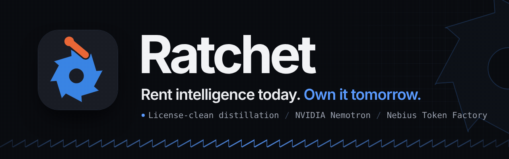
</p>

<p align="center">
  <b>License-clean distillation on open models.</b> An OpenAI-compatible gateway: a small NVIDIA Nemotron student model answers first, a teacher whose license allows distillation (NVIDIA Nemotron 3 Ultra on Nebius Token Factory) answers when the student is unsure, and the loop is built so that every night the student learns from the teacher's answers and ships only if it passes a statistical gate.
</p>

<p align="center">
  <a href="https://github.com/harshbhx/ratchet/actions/workflows/ci.yml"></a>
  <a href="https://github.com/harshbhx/ratchet/actions/workflows/ci.yml"></a>
  <a href="https://github.com/harshbhx/ratchet/releases"></a>
  <a href="https://github.com/harshbhx/ratchet/actions/workflows/deploy-pages-production.yml"></a>
  <a href="LICENSE"></a>
  <a href="https://huggingface.co/collections/harshbhx/ratchet"></a>
  <a href="https://live.ratchet.dualmindlab.tech"></a>
  <a href="https://video.ratchet.dualmindlab.tech/?from=readme"></a>
  <a href="https://docs.ratchet.dualmindlab.tech"></a>
  <a href="docs/WHERE_IT_RUNS.md#one-command-to-host-it-all-on-nebius"></a>
</p>

<p align="center">
  <a href="#in-30-seconds">30 seconds</a> &nbsp;·&nbsp;
  <a href="#try-it">Try it</a> &nbsp;·&nbsp;
  <a href="#how-it-works">How it works</a> &nbsp;·&nbsp;
  <a href="#results">Results</a> &nbsp;·&nbsp;
  <a href="#open-on-hugging-face">Hugging Face</a> &nbsp;·&nbsp;
  <a href="#what-is-real-what-is-ready-to-run">What is real</a> &nbsp;·&nbsp;
  <a href="#where-it-runs-and-how-to-host-it-on-nebius">Nebius</a> &nbsp;·&nbsp;
  <a href="#feedback-on-nebius-and-nvidia">Feedback</a> &nbsp;·&nbsp;
  <a href="#use-it">Use it</a> &nbsp;·&nbsp;
  <a href="#limitations">Limitations</a> &nbsp;·&nbsp;
  <a href="#repo-map">Repo map</a>
</p>

<p align="center">
  <picture>
    <source media="(prefers-reduced-motion: reduce)" srcset="docs/img/demo-reel-poster.png">
    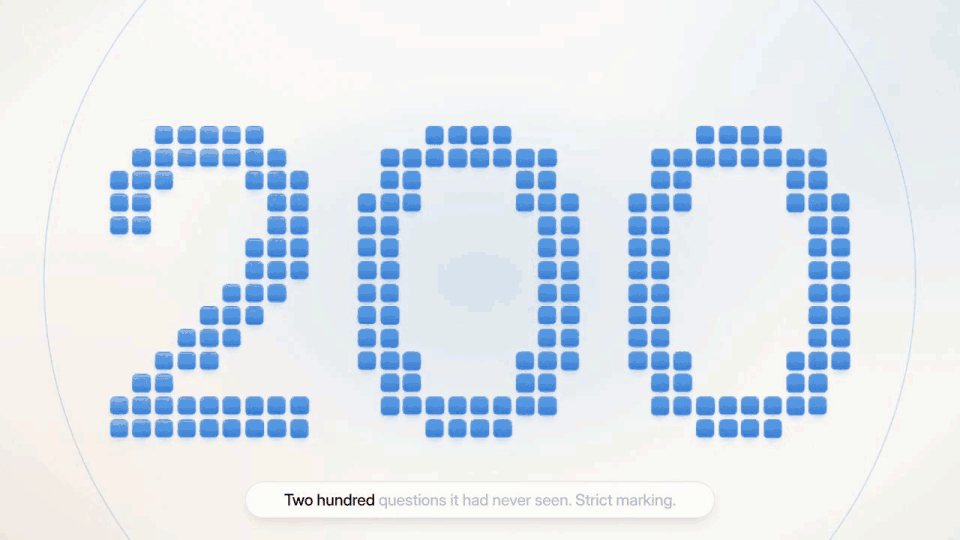
  </picture>
  <br><sub><b>Reel</b> (from the video). Exam numbers are measured; the Scout run is a recorded live run. <a href="https://video.ratchet.dualmindlab.tech/?from=readme">Watch the full video (2:59)</a></sub>
</p>

<p align="center">
  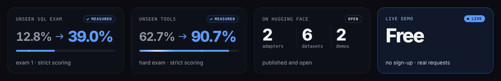
</p>

## In 30 seconds

- **Built on NVIDIA [Nemotron](https://docs.ratchet.dualmindlab.tech/guides/glossary/#nemotron) and Nebius:** every model call on the live site runs on Nebius [Token Factory](https://nebius.com/token-factory), the adapter was [retrained on Nebius AI Cloud](evidence/text2sql-round2-nebius), and the student was served from a Nebius [Serverless Endpoint](https://docs.ratchet.dualmindlab.tech/guides/glossary/#serverless-endpoint) [in a measured test](evidence/student-endpoint-nebius) (the live site is not connected to it).
- **What it is.** A drop-in OpenAI base URL. A small Nemotron 3 Nano 4B student answers each request first. When it is unsure, the request goes to Nemotron 3 Ultra on Nebius Token Factory, and the answer is logged with the teacher's name and license. Closed models (GPT, Claude, Gemini) are refused as teachers in code, because their terms forbid training competing models.
- **What is measured.** Real adapters on real models, strict scoring, exams the adapters never saw: text-to-SQL goes from 12.8% (untrained) to 39.0% on exam 1 and from 12.5% to 33.0% on exam 2, for about $17 on record. Every score recomputes from the saved answers ([Check it yourself](docs/VERIFY.md)).
- **What is not claimed.** Night School ran end to end once on Nebius, by hand (28 Oct 2026): the gateway on a Nebius CPU VM, the training job on a spot [L40S](https://docs.ratchet.dualmindlab.tech/guides/glossary/#l40s), the adapter served from a Nebius Serverless Endpoint. The golden gate rejected it (81.8% precision against the 95% target), so it was never made live. The loop has not run nightly on live traffic, and the live site's own gateway (on Cloudflare) is not connected to that endpoint ([evidence](evidence/nightschool-nebius/README.md)). The rest of the VM kit is tested offline. The original adapters were trained by hand on a borrowed GPU; the round-2 recipe was retrained once by hand on Nebius AI Cloud (a [Serverless Job](https://docs.ratchet.dualmindlab.tech/guides/glossary/#serverless-job), 27 Oct 2026). The student was served by hand, in two short sessions, on a Nebius Serverless Endpoint for speed tests (one spot L40S, 27 to 28 Oct 2026, [evidence](evidence/student-endpoint-nebius/README.md)); the endpoint was deleted afterwards and the live site is not connected to it. At a 95% precision bar the student still answers almost nothing, so in practice the teacher answers all live traffic. Details in [What is real](#what-is-real-what-is-ready-to-run) and [Limitations](#limitations).

<p align="center">
  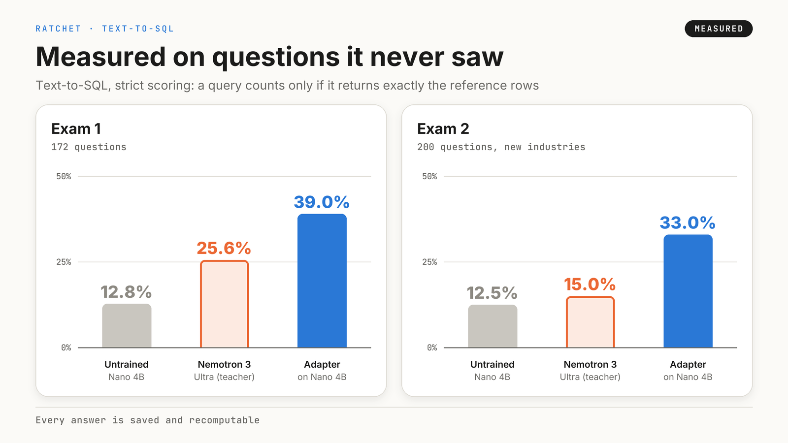
  <br><sub>Measured, 22 to 24 Oct 2026. Strict scoring: a query counts only if it returns exactly the reference rows.</sub>
</p>

## Try it

Judges get the access code for Scout runs on the Devpost page (it is not in this repository).

| | What it is | Status |
|---|---|---|
| [For judges](https://ratchet.dualmindlab.tech/judges) | Everything a judge needs on one page, with the checks to run. The main site (story, dashboard, judges) reads the live gateway; its ledger starts empty and resets on restart | Real |
| [Live gateway](https://live.ratchet.dualmindlab.tech) | Send a request, read the `ratchet` block in the reply. Real Token Factory calls under spend limits: Ultra teaches, and a random 40% of eligible requests are answered by the hosted Nano 30B | Real |
| [Scout](https://live.ratchet.dualmindlab.tech/scout) | A multi-agent research tool with real web searches; every model call is tagged with who answered it | Real |
| [Docs](https://docs.ratchet.dualmindlab.tech) | Guides, API, configuration, runbook, threat model | Documentation |
| [Hugging Face collection](https://huggingface.co/collections/harshbhx/ratchet) | The adapters, the synthetic training data, the exams with every saved answer | Real |
| [Exam explorer](https://huggingface.co/spaces/harshbhx/ratchet-toolcall-explorer) | Browse the tool-calling exam answers question by question | Real |
| [Nano and Ultra](https://ratchet.dualmindlab.tech) | Two small companions on the main site that tell the story and run a short tour; they say only what the pages say (Nano is the student, Ultra the teacher) | Real |
| [/live](https://ratchet.dualmindlab.tech/live) | Send a real request from the main site; it goes to the live gateway, which calls Token Factory and answers from the teacher | Real |
| [llms.txt](https://ratchet.dualmindlab.tech/llms.txt) | A plain-text summary of the project for language models, pointing to the docs' own [llms.txt](https://docs.ratchet.dualmindlab.tech/llms.txt) and [llms-full.txt](https://docs.ratchet.dualmindlab.tech/llms-full.txt) | Documentation |

<p align="center">
  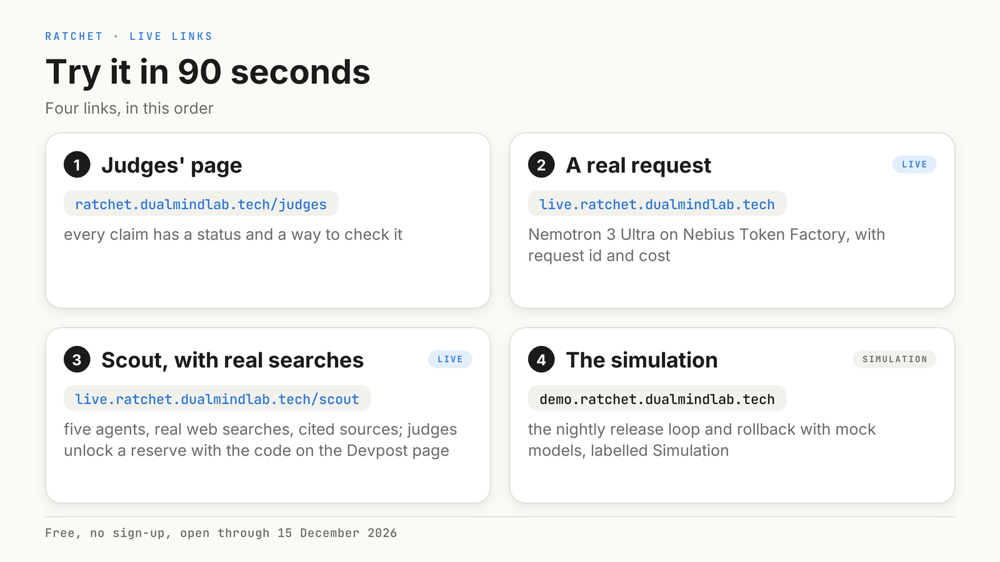
</p>

<details>
<summary>How judges unlock Scout runs</summary>

<p align="center">
  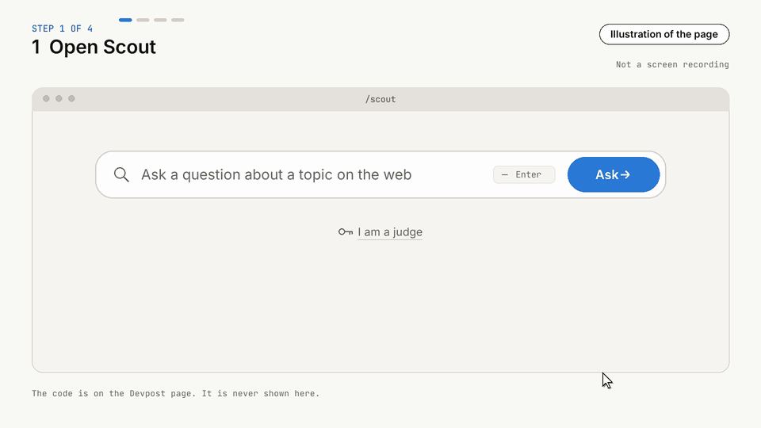
</p>

Type the code from the Devpost page into the box on the Scout page.

</details>

## How it works

Change one line, your base URL. The designed flow (Night School and the release gates are tested with mock models; Night School also ran end to end once on Nebius, by hand, and was rejected by the gate, and the loop has not run nightly on live traffic; see [What is real](#what-is-real-what-is-ready-to-run)):

1. **Student first.** NVIDIA Nemotron 3 Nano 4B with a [LoRA](https://docs.ratchet.dualmindlab.tech/guides/glossary/#lora) adapter **you own**, served by vLLM on a Nebius Serverless Endpoint, answers each request. Its confidence comes from token logprobs and [self-consistency](https://docs.ratchet.dualmindlab.tech/guides/glossary/#self-consistency).
2. **Teacher on doubt.** If the student is not confident enough, the request goes to **NVIDIA Nemotron 3 Ultra on Nebius Token Factory**, and its answer is served.
3. **[Provenance](https://docs.ratchet.dualmindlab.tech/guides/glossary/#provenance) ledger.** Each teacher answer is stored after personal-data redaction, with the teacher that wrote it and the license that permits training on it. Random audits check how often the student agrees with the teacher.
4. **Night School.** Every night it fine-tunes a new adapter on teacher answers only, grades it on a held-out golden set and signs a [bill of materials](https://docs.ratchet.dualmindlab.tech/guides/glossary/#bom) (BOM) for it.
5. **Release gates.** A new student runs silently in shadow, then takes 10%, 50% and 100% of traffic with teacher audits at each step, and rolls back by itself if its audited precision slips.

Your bill falls as your adapter takes over, and Ratchet tells you when a GPU would cost more than it saves. You own the LoRA adapter and its signed training lineage; the Nano base stays under NVIDIA's Nemotron Open Model License.

<p align="center">
  <picture>
    <source media="(prefers-color-scheme: dark)" srcset="docs/img/architecture-dark.png">
    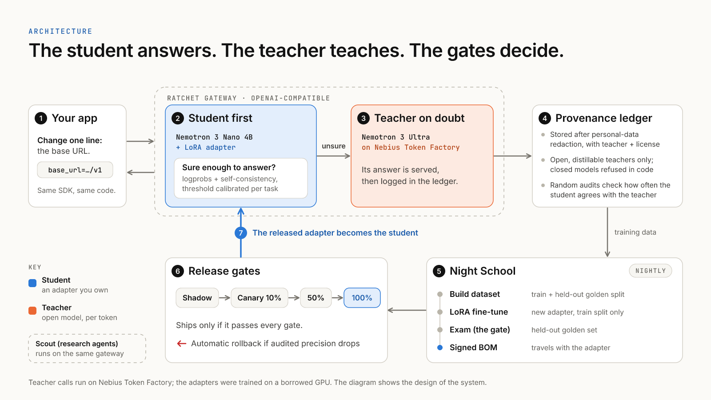
  </picture>
  <br><sub>The design, in one picture. <a href="docs/ARCHITECTURE.md">Architecture</a> has the details.</sub>
</p>

## Results

All of this is **measured** on real models, 22 to 24 Oct 2026, not estimated. Scoring is strict, and both exams were kept out of training. The headline is text-to-SQL; tool calling is a second result.

**Text-to-SQL (the headline).** A Nemotron 3 Nano 4B adapter, taught by Nemotron 3 Ultra, scores 2.6 to 3.0 times the untrained model on two exams. The teacher wrote one exam; a different model wrote the other (Claude Sonnet 5.5, for evaluation only; no Claude output was used for training). Teaching it cost about $17 on record: $12.16 of teacher answers plus $4.80 of GPU time for the training job, run on a borrowed GPU (estimates, not invoices; see [what it cost](docs/VERIFY.md#what-it-cost)). The round 2 adapter scores 39.0% on exam 1 (172 questions) and 33.0% on exam 2 (200 questions), against 12.8% and 12.5% untrained and 25.6% and 15.0% for the teacher, which loses points mostly on extra columns the strict scorer rejects. At a 95% precision bar the gate lets the adapter answer 1 of 86 measurement questions on exam 1 and none of the 100 on exam 2, so in practice all traffic still goes to the teacher.

**Retrained on Nebius AI Cloud.** The round-2 recipe was retrained on Nebius AI Cloud (one [preemptible](https://docs.ratchet.dualmindlab.tech/guides/glossary/#preemptible-gpu) L40S, Serverless Job) on 27 Oct 2026, from the same 4,322 examples: exam 1 40.7% (70 of 172), exam 2 34.5% (69 of 200) (original run on a borrowed GPU: 39.0% and 33.0%). The two adapters are statistically indistinguishable (row by row, 6 up and 3 down on exam 1, 7 up and 4 down on exam 2), and the Nebius run was interrupted twice by the platform and resumed from a [checkpoint](https://docs.ratchet.dualmindlab.tech/guides/glossary/#checkpoint). It cost about $2.16 in Nebius credits for the whole effort, failed attempts included. The original adapters were not trained on Nebius. Evidence: [`evidence/text2sql-round2-nebius`](evidence/text2sql-round2-nebius/README.md). The retrained adapter is on Hugging Face: [ratchet-nemotron-nano-4b-text2sql-nebius](https://huggingface.co/harshbhx/ratchet-nemotron-nano-4b-text2sql-nebius).

[Adapter](https://huggingface.co/harshbhx/ratchet-nemotron-nano-4b-text2sql) · [Adapter retrained on Nebius](https://huggingface.co/harshbhx/ratchet-nemotron-nano-4b-text2sql-nebius) · [Training data](https://huggingface.co/datasets/harshbhx/ratchet-text2sql-synthetic) · [Exams and every answer](https://huggingface.co/datasets/harshbhx/ratchet-text2sql-exams)

**Tool calling (round 3).** A second adapter (2,940 training rows, about $2.33 of GPU time), scored strictly on two exams it never saw. The gain is large on the hard exam and small on [BFCL](https://gorilla.cs.berkeley.edu/leaderboard.html), and on BFCL the adapter is lower than the teacher.

<p align="center">
  <picture>
    <source media="(prefers-reduced-motion: reduce)" srcset="docs/img/toolcall-results-16x9.png">
    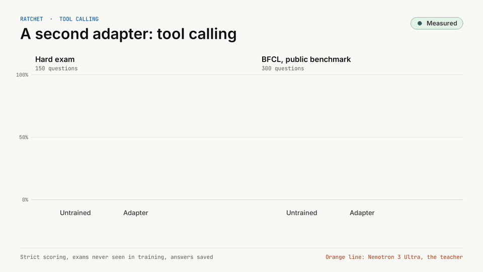
  </picture>
  <br><sub>Hard exam: 150 questions, 20 tools never in training. BFCL: 300 questions from the Berkeley Function Calling Leaderboard (Apache-2.0). <a href="docs/img/toolcall-results-16x9.png">Still with 95% ranges and exact counts</a>.</sub>
</p>

| | Hard exam (150) | BFCL exam (300) |
|---|---|---|
| Untrained Nano 4B | 94 of 150 (62.7%) | 232 of 300 (77.3%) |
| Tool-calling adapter | 136 of 150 (90.7%) | 241 of 300 (80.3%) |
| Teacher (Nemotron 3 Ultra) | 137 of 150 (91.3%) | 265 of 300 (88.3%) |

On the hard exam the adapter is above the untrained model (the 95% ranges do not overlap) and about the same as the teacher (the ranges overlap). On BFCL the gain over the untrained model is small and the exam cannot separate them (higher by point estimate, ranges overlap), and the adapter is lower than the teacher. We never claim the adapter is better than the teacher. Strict scoring means an answer counts only if it is one JSON object with the right tool and arguments; free-text arguments are a known weak spot in the training data. The hard exam was written by Claude Sonnet 5.5 for evaluation only and is never training data.

[Tool-calling adapter](https://huggingface.co/harshbhx/ratchet-nemotron-nano-4b-toolcall) · [Training data](https://huggingface.co/datasets/harshbhx/ratchet-toolcall-train) · [Hard exam](https://huggingface.co/datasets/harshbhx/ratchet-toolcall-exam-hard) · [BFCL exam](https://huggingface.co/datasets/harshbhx/ratchet-toolcall-exam-bfcl)

Every score recomputes from the saved answers: [Check it yourself](docs/VERIFY.md) lists each command and what it does not prove.

## Open on Hugging Face

Two adapters, six datasets and two Spaces, all public: the adapters, the synthetic training data, the exams with every saved answer, the recorded Scout runs and two viewers.

<p align="center">
  <a href="https://huggingface.co/collections/harshbhx/ratchet"></a>
</p>

<table align="center">
  <tr>
    <td align="center" width="33%">
      <a href="https://huggingface.co/harshbhx/models">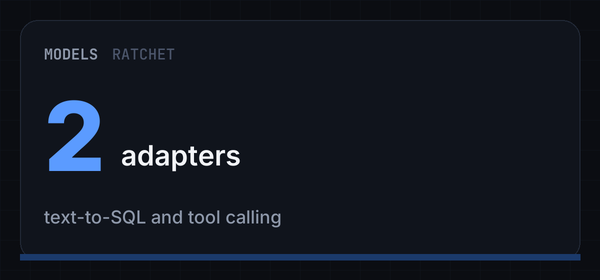</a>
      <br><sub><i>Models: 2 adapters</i></sub>
    </td>
    <td align="center" width="33%">
      <a href="https://huggingface.co/harshbhx/datasets">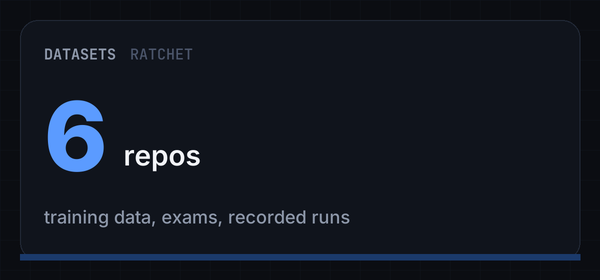</a>
      <br><sub><i>Datasets: 6 repos, training data, exams and recorded runs</i></sub>
    </td>
    <td align="center" width="33%">
      <a href="https://huggingface.co/harshbhx/spaces">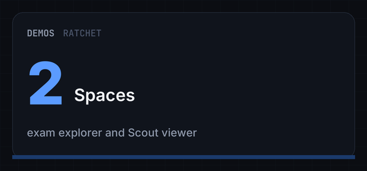</a>
      <br><sub><i>Spaces: 2</i></sub>
    </td>
  </tr>
</table>

<details>
<summary>Open each repo</summary>

- Models: [text-to-SQL adapter](https://huggingface.co/harshbhx/ratchet-nemotron-nano-4b-text2sql) (39.0% and 33.0% on two unseen exams), [the same recipe retrained on Nebius AI Cloud](https://huggingface.co/harshbhx/ratchet-nemotron-nano-4b-text2sql-nebius) (40.7% and 34.5%), [tool-calling adapter](https://huggingface.co/harshbhx/ratchet-nemotron-nano-4b-toolcall) (90.7% on the hard exam, 80.3% on BFCL)
- Datasets: [text-to-SQL training data](https://huggingface.co/datasets/harshbhx/ratchet-text2sql-synthetic) (4,322 synthetic rows labelled by Nemotron 3 Ultra), [text-to-SQL exams](https://huggingface.co/datasets/harshbhx/ratchet-text2sql-exams) (with every saved answer), [tool-calling training data](https://huggingface.co/datasets/harshbhx/ratchet-toolcall-train), [hard exam](https://huggingface.co/datasets/harshbhx/ratchet-toolcall-exam-hard), [BFCL exam](https://huggingface.co/datasets/harshbhx/ratchet-toolcall-exam-bfcl), [recorded Scout runs](https://huggingface.co/datasets/harshbhx/ratchet-scout-runs)
- Spaces: [exam explorer](https://huggingface.co/spaces/harshbhx/ratchet-toolcall-explorer) (browse the tool-calling answers question by question), [Scout viewer](https://huggingface.co/spaces/harshbhx/ratchet-scout) (replays recorded runs)

</details>

## What is real, what is ready to run

| Status | What |
|---|---|
| **Real** | The code (Apache-2.0) and its offline test suite; the live gateway and Scout, calling Nemotron 3 Ultra on Token Factory under spend limits; a 20-request live smoke run ([`evidence/live-smoke-2026-10-23`](evidence/live-smoke-2026-10-23), about $0.01) and three recorded Scout runs ([`evidence/scout`](evidence/scout)); the adapters, data and exams on Hugging Face |
| **Measured** | The text-to-SQL and tool-calling scores above, on real models; the original adapters were trained on a borrowed GPU, on synthetic data. The Nebius retraining scored 40.7% (70 of 172) on exam 1 and 34.5% (69 of 200) on exam 2, against 39.0% and 33.0% for the original adapter: the result reproduces (the row-by-row differences are within chance) |
| **Built and tested, not run nightly on live traffic** | The release gate (shadow, canary, rollback) and the nightly schedule: unit-tested with mock models. Night School itself ran end to end once, by hand (next rows). Ratchet's own adapter is not connected to the live gateway; on the live site a random 40% of eligible requests are answered by the hosted Nemotron 3 Nano 30B on Token Factory, a quarter of those re-checked by Ultra |
| **Real, on Nebius AI Cloud: Night School end to end, once, by hand (28 Oct 2026)** | The gateway on a Nebius CPU VM (`eu-west1`) imported 4,322 existing Ultra-labelled rows (no new teacher calls, no exam rows); a spot L40S training job trained on 3,864 of them (2 epochs, 966 steps, 1,478 s, loss about 0.15 to 0.08); the adapter (SHA-256 `dc9ad4b9d2575e7a41120cb30bb023ee7aec35e997f4735ac819b545baddd00b`) was hot-loaded into a Nebius Serverless Endpoint and graded on 458 golden rows, SQL compared as text. **The golden gate rejected it: 17.9% agreement; at its threshold the student would answer 4.8% of questions, with 81.8% precision (9 of 11) against the 95% target. It was never made live, and the live site is not connected to that endpoint.** Caveats: four job submissions (an accidental on-demand job, a missing `einops`, a save that failed and was recovered, then the one that saved); the night's own eval timed out at 15 s, so the gate result comes from re-running the eval on the saved adapter with a 120 s timeout through a one-off driver; five VM-only fixes, now in the repository; about 2.7 GPU-hours, at most about $4 at list prices (estimate, the Nebius bill decides). Evidence: [`evidence/nightschool-nebius`](evidence/nightschool-nebius/README.md) |
| **Real, on Nebius AI Cloud (27 Oct 2026)** | The round-2 text-to-SQL recipe (same 4,322 examples and settings: 4-bit QLoRA, rank 16, 2 epochs) retrained by hand as a Nebius Serverless Job on one preemptible (spot) L40S, with checkpoints in a Nebius Object Storage bucket and resume after spot interruptions; Mamba kernels built for the L40S (sm_89); training loss 0.346 to 0.088; adapter SHA-256 `68b9ed06d984a2ec38a32b58090c246a56ae12ba65f3277f66b5d74227ea25d5`; training took 28.6 minutes of GPU time (58.7 minutes wall clock across two spot interruptions); the whole Nebius effort, failed and interrupted attempts included, used 2.73 GPU-hours, about $2.16 at list prices (the Nebius bill decides). Evidence: [`evidence/text2sql-round2-nebius`](evidence/text2sql-round2-nebius) |
| **Real, on Nebius AI Cloud: the student served for speed tests (27 to 28 Oct 2026)** | The student (the published round-2 text-to-SQL adapter and the tool-calling adapter, loaded at runtime into vLLM v0.18.0 on Nemotron 3 Nano 4B) served by hand, in two short sessions, on a Nebius Serverless Endpoint on one preemptible (spot) L40S: cold start about 7.2 minutes from create to ready; with 16 requests at once the median answer took 1.6 s (SQL adapter) and 1.2 s (tool-calling adapter); about $0.67 of GPU time across both sessions (the Nebius bill decides). Speed only, no accuracy scored. A second session on 27 to 28 Oct 2026 measured a restart (stop, then start): about 7.1 minutes to the first answer, against 7.6 minutes for a cold start in the same session (pulling the image dominates both, and the adapters are loaded again after every restart); after it, 4 requests at once gave a median of 1.26 s (SQL adapter) and 1.08 s (tool-calling adapter). The endpoint was deleted afterwards. **The live site is not connected to it: every live model call runs on Token Factory (Ultra teaches, and a random 40% of eligible requests are answered by the hosted Nano 30B).** Evidence: [`evidence/student-endpoint-nebius`](evidence/student-endpoint-nebius/README.md) |
| **Scripted, ready to run** | The one-command Nebius host (`make nebius-plan`, `make nebius-up`) and the nightly schedule: tested offline against a fake `nebius` CLI; the VM, the job and the endpoint each ran once by hand. Connecting the live gateway to a student endpoint has not been done |

## Where it runs and how to host it on Nebius

The gateway does no inference, so it runs anywhere a container does. Only training and the student endpoint need a GPU. Today the live gateway and the website run on Cloudflare Workers with Containers, the teacher runs on Nebius Token Factory, and the round-2 adapter was retrained once on Nebius AI Cloud (a Serverless Job on one L40S).

<p align="center">
  <picture>
    <source media="(prefers-color-scheme: dark)" srcset="docs/img/where-it-runs-dark.png">
    
  </picture>
  <br><sub>What runs where, today and as designed. <a href="docs/WHERE_IT_RUNS.md">Where everything runs</a> has the table.</sub>
</p>

```bash
make nebius-plan                                               # prints every command, changes nothing
RATCHET_I_UNDERSTAND_THIS_COSTS_MONEY=1 make nebius-up YES=1   # a CPU VM with the gateway; add ARGS="--with-student" for the GPU student endpoint
RATCHET_I_UNDERSTAND_THIS_COSTS_MONEY=1 make nebius-down YES=1 # stops the endpoint, deletes the VM
```

Apart from the hand-run steps above (the training job, the endpoint speed test and the one Night School run, whose gateway ran on a Nebius CPU VM), scripted and tested offline against a fake CLI; **ready to run** with `make nebius-plan` and `make nebius-up`. Costs (estimates), flags and what each step does: [Where everything runs](docs/WHERE_IT_RUNS.md#one-command-to-host-it-all-on-nebius), [Deployment on Nebius](docs/DEPLOYMENT.md) and [VM on Nebius](docs/DEPLOY_NEBIUS_VM.md). Other hosts: any container host (`make docker`), Cloudflare (`deploy/cloudflare-live`; running) and a static Hugging Face Space that replays recorded Scout runs ([Space](https://huggingface.co/spaces/harshbhx/ratchet-scout)).

## Feedback on Nebius and NVIDIA

I built Ratchet on Nemotron 3 Ultra through Nebius Token Factory and on Nemotron 3 Nano 4B.

### What worked well

Token Factory speaks the OpenAI API, so the gateway calls Ultra with a normal client and nothing custom.

Paying per token made labelling cheap: the teacher answers cost about $2.87 for the first text-to-SQL round (with exam 1) and $9.18 for the second (estimates from the run records, see [what it cost](docs/VERIFY.md#what-it-cost)).

Ultra's license, [OpenMDW-1.1](https://openmdw.ai/license/1-1/), puts no restrictions on outputs ([license page](https://openmdw.ai/license/1-1/), checked Oct 21, 2026). That is what makes [license-clean distillation](https://docs.ratchet.dualmindlab.tech/guides/glossary/#license-clean-distillation) possible.

The thinking switch, `chat_template_kwargs: {"enable_thinking": false}`, works on Token Factory. I needed it: with thinking on, the reasoning used up my labelling calls' output limit ([`gen_sql_data.py`](scripts/text2sql/gen_sql_data.py)).

### Where I got stuck

Most of the pain was LoRA training on the Mamba-hybrid Nano, on a borrowed GPU:

- [PEFT](https://github.com/huggingface/peft)'s `all-linear` target failed on the [Mamba](https://docs.ratchet.dualmindlab.tech/guides/glossary/#mamba) layers, so I picked the target modules by hand.
- With 4-bit quantisation, `in_proj` and `out_proj` must stay unquantised, because the Mamba kernels read them directly.
- The first training step spent about 18 minutes compiling Triton kernels.
- Building the `mamba-ssm` and `causal-conv1d` wheels took up to 2.5 hours, and kernels built for CUDA 13 did not load on CUDA 12 machines.
- A hybrid-cache bug in Hugging Face's `generate()` recomputed the prompt for every token, so I wrote my own decoder for the exams.

On the Nebius side, Token Factory's [post-training model list](https://docs.tokenfactory.nebius.com/post-training/models.md) had no Nemotron model (read Oct 21, 2026), so I could not fine-tune Nano there. GPU access on AI Cloud asked me for a prepayment first (Oct 2026), a hurdle on a student budget. Serving my own weights on a dedicated endpoint is "currently in beta and available on request" ([docs](https://docs.tokenfactory.nebius.com/ai-models-inference/dedicated-endpoints/custom-weights.md), read Oct 21, 2026).

### What would help

- Hosted LoRA serving for Nemotron Nano on Token Factory, paid per token: upload an adapter, call it by name. Today a small fine-tuned model pays for itself only at high volume, because its GPU endpoint keeps running.
- Clear terms on training with outputs. The "competing service" clause, §5(f) of Token Factory's terms, is broad; one sentence allowing customers to fine-tune small models on an openly licensed model's outputs would settle it. I asked support on Oct 19, 2026 and have no final answer yet.
- A small GPU credit in the Builder Program, or managed fine-tuning for Nano, so the training side has a Nebius path too.
- Per-model docs on token logprobs, `n` choices and the thinking switch. Confidence routing depends on all three.
- From NVIDIA: prebuilt `mamba-ssm` and `causal-conv1d` wheels for common CUDA versions, and an official LoRA recipe for Nano that names the target modules that work.

## Use it

You need Python 3.10 or newer (text-to-SQL fixture tasks need 3.11; the Docker image uses 3.12). Installing and running the tests needs no key and no GPU.

```bash
git clone https://github.com/harshbhx/ratchet.git && cd ratchet
make install                            # pip install -e ".[dev]"
make test                               # the tests: no network, no GPU
```

**Windows, or no `make`.** The same steps in PowerShell:

```powershell
python -m pip install -e ".[dev]"
python -m pytest -q   # the tests; tests/test_watch.py needs a Unix host and skips itself
```

To run your own gateway, use live mode (below). Then point any OpenAI SDK at it by changing the base URL, and name the task in a header:

```python
from openai import OpenAI

client = OpenAI(base_url="http://localhost:8000/v1", api_key="<one of your RATCHET_API_KEYS>")
r = client.chat.completions.create(
    model="ratchet",
    messages=[{"role": "user", "content": "My order never arrived"}],
    extra_headers={"X-Ratchet-Task": "ticket-triage"},
)
print(r.ratchet)  # served_by, confidence, cost_usd, all_teacher_cost_usd, usage_breakdown ...
```

<details>
<summary>More commands</summary>

| I want to | Run |
|---|---|
| Run Scout as an outside client | `python -m ratchet.scout "What is LoRA fine-tuning?" --base-url http://localhost:8000/v1` (against a gateway in live mode) |
| Recompute the text-to-SQL scores | `python scripts/text2sql/exam_numbers.py --check` |
| Recompute the tool-calling scores | `python scripts/toolcall_results.py --check` |
| Run the tests (no network, no GPU) | `make test` |
| Check everything before a commit | `make lint test reference` |

</details>

**Live mode** (real Token Factory calls): set `NEBIUS_API_KEY` and `RATCHET_API_KEYS`, then `RATCHET_MODE=live uvicorn ratchet.gateway:app --port 8000` (PowerShell: `$env:RATCHET_MODE="live"; python -m uvicorn ratchet.gateway:app --port 8000`). The full setup is in [docs/LIVE_MODE.md](docs/LIVE_MODE.md); every setting is in [docs/CONFIGURATION.md](docs/CONFIGURATION.md).

## Under the hood

A new student never goes straight to full traffic. It is graded on rows it never trained on, runs silently next to the live one, then takes 10%, 50% and 100% of traffic, and rolls back if its audited precision slips:


- **Release statistics.** Exact [Clopper-Pearson](https://docs.ratchet.dualmindlab.tech/guides/glossary/#clopper-pearson) certificates on held-out rows, an opt-in [anytime-valid](https://docs.ratchet.dualmindlab.tech/guides/glossary/#anytime-valid) canary rule, a label-free [drift](https://docs.ratchet.dualmindlab.tech/guides/glossary/#drift) alarm and a teacher watch. See [Features in depth](docs/FEATURES.md).
- **Privacy.** [PII](https://docs.ratchet.dualmindlab.tech/guides/glossary/#pii-redaction) is redacted before anything is stored (pattern-based: names and street addresses are not caught yet), storage opt-outs and [erasure](https://docs.ratchet.dualmindlab.tech/guides/glossary/#erasure) exist, and API keys and end-user identifiers are never stored. See [Features in depth](docs/FEATURES.md) and the [threat model](docs/THREAT_MODEL.md).
- **License provenance.** Every example records its teacher and license when it is captured. Each trained adapter gets a bill of materials [signed with Ed25519](https://docs.ratchet.dualmindlab.tech/guides/glossary/#ed25519), which anyone with the public key can check offline (`python -m ratchet.bom verify`), and a `NOTICE.md` that travels with the weights.
- **Economics.** The cost report counts savings by GPU-hours actually paid and says so when a GPU endpoint would cost more than it saves.
- **Scout.** [Scout](docs/SCOUT.md) is a multi-agent research tool on the same gateway: its many narrow triage and reader calls are distilled, and its planner and writer calls are pinned to the teacher and never stored as training data.
- **Go deeper.** [Check it yourself](docs/VERIFY.md) · [Features in depth](docs/FEATURES.md) · [Live mode](docs/LIVE_MODE.md) · [Documentation index](docs/README.md).

### How it uses NVIDIA and Nebius

| Role | Model / service | Why |
|---|---|---|
| Teacher | `nvidia/Nemotron-3-Ultra-550b-a55b` on **Token Factory** | Largest Nemotron 3 model; OpenMDW-1.1 allows distillation |
| Judge (free-text eval) | `nvidia/nemotron-3-super-120b-a12b` on **Token Factory** | JSON mode; priced below the teacher in `config.py` |
| Fallback student | `nvidia/NVIDIA-Nemotron-3-Nano-30B-A3B` on **Token Factory** | Used when your endpoint is stopped |
| Student | `nvidia/NVIDIA-Nemotron-3-Nano-4B-BF16` + LoRA on a **Nebius Serverless Endpoint** (vLLM) | Small enough for one GPU; the adapter is the part you own |
| Night School | **Nebius Serverless Jobs** (L40S) with TRL + PEFT; one retraining job (27 Oct 2026) and one Night School run (28 Oct 2026, rejected by the gate) have run by hand | Billed per second while a job runs ([Serverless overview](https://docs.nebius.com/serverless/overview), read Oct 26, 2026) |
| Dataset / adapters | **Nebius Object Storage** bucket mounted in jobs and endpoints | |
| Designed gateway host (today: Cloudflare Workers with Containers) | **Nebius AI Cloud** CPU VM (`2vcpu-8gb`) | The gateway does no inference |
| Scout web search | Tavily Search API (not NVIDIA or Nebius) | Search tool for Scout only |

Rows 4 to 7 (the student endpoint, Night School, the object storage and the CPU VM) are the design: the scripts are written and tested offline, ready to run with `make nebius-plan`, except that one Serverless Job with a bucket ran by hand on 27 Oct 2026 (the round-2 retraining), the student was served by hand, in two short sessions, on an endpoint for speed tests on 27 to 28 Oct 2026 ([evidence](evidence/student-endpoint-nebius/README.md)), and Night School ran end to end once on Nebius on 28 Oct 2026 (a CPU VM, a spot L40S job, an endpoint), by hand, and was rejected by the golden gate ([evidence](evidence/nightschool-nebius/README.md)). Today the live gateway runs on Cloudflare Workers with Containers, and the adapters in [Real results](#results) were trained on a borrowed GPU. Token Factory's [post-training model list](https://docs.tokenfactory.nebius.com/post-training/models.md) names no Nemotron model (read Oct 26, 2026), and serving custom weights on a dedicated endpoint is "currently in beta and available on request" ([docs](https://docs.tokenfactory.nebius.com/ai-models-inference/dedicated-endpoints/custom-weights.md), read Oct 21, 2026), so the designed home of the student is Nebius AI Cloud.

## Why "license-clean"

OpenAI's [Business Terms §3.3(e)](https://openai.com/policies/business-terms/) and Anthropic's [Commercial Terms §D.4(a)](https://www.anthropic.com/legal/commercial-terms) forbid using their outputs to train competing models. A distillation tool that learns from GPT or Claude traffic puts its users at risk.

Ratchet only distills from teachers whose licenses allow it. Nemotron 3 Ultra is under [OpenMDW-1.1](https://huggingface.co/nvidia/NVIDIA-Nemotron-3-Ultra-550B-A55B-BF16), which places no restrictions on outputs. Closed models are refused as teachers in code (`ratchet/licenses.py`). `GET /ratchet/bom` exports a **model bill of materials**: every training source, its license, and a [SHA-256](https://docs.ratchet.dualmindlab.tech/guides/glossary/#sha-256) fingerprint of the dataset. Each trained adapter also gets **its own bill of materials, signed with Ed25519**, that anyone with your public key can check offline (`python -m ratchet.bom verify`). The licenses travel with the adapter: its BOM names the base model's license, and a `NOTICE.md` next to the weights lists the base model's and each teacher's license (see [License](#license)). An open teacher Ratchet does not list yet can be added in `RATCHET_TEACHER_LICENSES`, but only under an allowed open license and never for a closed model family or router alias Ratchet recognises; the adapter's BOM and NOTICE then mark that license as configured. *Not legal advice: check licenses yourself.*

In its own words, OpenMDW-1.1 "does not impose any restrictions or obligations with respect to any use, modification, or sharing of any outputs" ([license page](https://openmdw.ai/license/1-1/), last updated May 27, 2026; checked Oct 21, 2026). What you own at the end is the LoRA adapter Night School trains and its signed bill of materials. The student's base, Nemotron 3 Nano 4B, stays under the [NVIDIA Nemotron Open Model License](https://www.nvidia.com/en-us/agreements/enterprise-software/nvidia-nemotron-open-model-license/) (v. Dec 15, 2025), which asks you to give anyone you distribute it to a copy of that license.

## Why not a router or a distillation API?

| | Cascade router | Distillation service ([OpenPipe](https://coreweave.com/news/coreweave-to-acquire-openpipe-leader-in-reinforcement-learning), [AWS Bedrock](https://aws.amazon.com/bedrock/model-distillation), [OpenAI](https://openai.com/index/api-model-distillation/)) | Ratchet |
|---|---|---|---|
| Who owns the student | Nobody: each call is rented | On the pages we read, stays on the provider's platform | You: a LoRA adapter and its signed lineage; the Nano base keeps NVIDIA's license |
| Teacher license recorded per example | Not recorded | Not stated | Recorded when the example is captured, and signed into the adapter's BOM |
| Automatic nightly retrain | None | You start each job | Every night, from teacher answers only |
| Statistical release gate | Nothing ships | Your own evaluation | Held-out certificate, shadow, canary and automatic rollback |
| Reports when it loses money | Per-token savings only | No | Savings by GPU-hours paid, the break-even volume and a recommendation |

Cells describe the pages we read on 21 Oct 2026 ([sources](docs/COMPETITIVE_ANALYSIS.md)); "Not stated" and "Not recorded" mean we found no statement, not that the feature is absent. The Ratchet column describes the design, built and tested with mock models and in the scripts (see [Status](#what-is-real-what-is-ready-to-run)).

The YC Summer 2026 teams Understudy and Experiential Labs, as cited in the [competitive analysis](docs/COMPETITIVE_ANALYSIS.md) (not re-checked here), sit between the columns: both say the customer owns the model, and neither page we found documents shadow, canary and automatic rollback.

## Limitations

What breaks first:

- **Low volume does not pay.** Below [break-even](https://docs.ratchet.dualmindlab.tech/guides/glossary/#break-even), a GPU endpoint running 24/7 costs more than the teacher spend it saves. The cost report says so and recommends the hosted fallback or scaling the endpoint to zero.
- **Without a GPU endpoint the student is a hosted, untuned model.** With `RATCHET_STUDENT_BASE` unset, a trained version's calls go to Nemotron 3 Nano 30B on Token Factory, and they are still reported as `served_by: student`. The response's `model` field names the model that wrote the answer.
- **Precision means agreement with Nemotron 3 Ultra,** not ground truth, and it assumes the golden rows look like live traffic. They come from escalations, audits and arbitrations, so they lean towards requests the student found hard.
- **The redactor is pattern-based.** Names and street addresses are not caught yet.
- **Scout's reader is checked on two labels.** page-read's precision covers its `answers_question` and `fact_type` fields only; the free-text `key_fact` the writer cites is not checked.
- **A signed BOM is the operator's signed statement** of the data and evaluation behind an adapter. It shows that nothing changed after signing, not that the weights were trained on that data.
- **One gateway process.** The ledger is one SQLite file behind one lock; a Postgres ledger for several workers is planned ([roadmap](docs/ROADMAP.md)).
- **The nightly loop has not run nightly on live traffic.** Night School ran end to end once on Nebius, by hand (28 Oct 2026), on 4,322 rows that already existed; the golden gate rejected that student (81.8% precision against the 95% target) and it was never made live ([evidence](evidence/nightschool-nebius/README.md)). The loop's behaviour is otherwise shown by unit tests with mock models, which show how it behaves, not real model quality. As of Oct 28, 2026, the original adapters were trained on a borrowed GPU, the round-2 recipe was retrained once on a Nebius Serverless Job, and Ratchet's own adapter is not connected to the live gateway (a random 40% of eligible requests are answered by the hosted Nano 30B, a quarter of those re-checked by Ultra); the student was served by hand, in two short sessions, on a Nebius Serverless Endpoint for speed tests ([evidence](evidence/student-endpoint-nebius/README.md)), and the endpoint was deleted afterwards. Token Factory calls (the teacher) are real.
- **Token Factory's Terms of Service §5(f)** ("competing service") is broad. We asked Nebius support about it in writing on Oct 19, 2026 (no answer received as of 29 Oct 2026); until the answer is final, treat the question as open. Not legal advice.

## NVIDIA lineage

<details>
<summary>The paper's six steps, and what Ratchet automates</summary>

NVIDIA Research's paper "Small Language Models are the Future of Agentic AI" ([arXiv 2506.02153](https://arxiv.org/abs/2506.02153), v3, Sep 22, 2026) estimates that about 40%, 60% and 70% of the LLM queries in three open agent systems could be handled by specialized small models, and gives a six-step conversion algorithm. S1, S2, S5 and S6 run automatically. S3 (task clustering) is manual: the caller or operator names each task. S4 (SLM selection) is manual: one base model.

| Step in the paper | In Ratchet | Automatic? |
|---|---|---|
| S1 "Secure usage data collection" | The gateway logs every request's metadata (task, route, confidence, cost); request text is kept only in training examples, redacted by default, and API keys only by name | Yes |
| S2 "Data curation and filtering" | PII redaction before storage; only complete teacher answers that are valid under the task's spec are kept | Yes |
| S3 "Task clustering" | Not clustered: the caller names each request's task (`X-Ratchet-Task` or `metadata.ratchet_task`) and the operator may give a task a typed field spec in the task registry; statistics are kept per task | No: manual, tasks are named, not clustered |
| S4 "SLM selection" | One base, Nemotron 3 Nano 4B, chosen by hand for size, license and serving cost; Ratchet does not compare bases | No: manual, one base model |
| S5 "Specialized SLM fine-tuning" | A LoRA fine-tune each night, from teacher answers only: Night School ran end to end once on Nebius, by hand (28 Oct 2026), and the golden gate rejected that student, so it was never made live; the nightly schedule is scripted and tested offline and has not run on live traffic | Yes |
| S6 "Iteration and refinement" | Night School every night, gated by a held-out golden set (with an exact precision certificate in each signed BOM), shadow, canary and automatic rollback | Yes |

NVIDIA's [Data Flywheel Blueprint](https://developer.nvidia.com/blog/build-efficient-ai-agents-through-model-distillation-with-nvidias-data-flywheel-blueprint) (blog Jun 11, 2025) also distils production traffic into smaller models, but its README says "Promotion to production—as well as any deeper evaluation or dataset curation—remains a human decision" and "Think of the Flywheel as a flashlight, not an autopilot" ([repo](https://github.com/NVIDIA-AI-Blueprints/data-flywheel), marked deprecated in Apr 2026; read Oct 21, 2026). Ratchet makes the promotion decision itself, with statistics on held-out rows and audited traffic, and writes each decision and its numbers to the release log.

The student's base has its own NVIDIA lineage: Nemotron 3 Nano 4B "has been compressed from NVIDIA-Nemotron-Nano-9B-v2 using the Nemotron Elastic framework", released Mar 16, 2026 ([model card](https://huggingface.co/nvidia/NVIDIA-Nemotron-3-Nano-4B-BF16), read Oct 21, 2026).

</details>

## Prior art and what is new

<details>
<summary>What we did not invent, and what is new in putting it together</summary>

We did not invent the pieces. Ratchet puts them in one loop that runs by itself. Sources and dates are in [docs/COMPETITIVE_ANALYSIS.md](docs/COMPETITIVE_ANALYSIS.md).

- **Table stakes:** an OpenAI-compatible gateway, routing, API keys and quotas ([LiteLLM](https://github.com/BerriAI/litellm), [Portkey](https://portkey.ai), [OpenRouter](https://openrouter.ai)).
- **Distillation services:** [OpenPipe](https://coreweave.com/news/coreweave-to-acquire-openpipe-leader-in-reinforcement-learning) (CoreWeave announced the acquisition Sep 3, 2025), [AWS Bedrock Model Distillation](https://aws.amazon.com/bedrock/model-distillation), [OpenAI distillation](https://openai.com/index/api-model-distillation/) ("Active existing customers will no longer be able to create new fine-tuning jobs" on Jan 6, 2027, [deprecations](https://developers.openai.com/api/docs/deprecations), read Oct 21, 2026), [Inference.net](https://inference.net/blog/introducing-inference-platform/) (a managed training loop whose new models are "staged for final review and deployment", Apr 14, 2026) and the YC Summer 2026 teams Understudy and Experiential Labs. Each turns traffic into a fine-tune; none we found records each example's teacher license at capture, releases automatically behind a statistical gate, and reports when the small model loses money.
- **Known ideas:** LLM cascades ([FrugalGPT](https://arxiv.org/abs/2305.05176), 2023) and cascades that distil the large model into the small one as traffic arrives ([Cache & Distil](https://arxiv.org/abs/2310.13561), ACL Findings 2024; [Online Cascade Learning](https://arxiv.org/abs/2402.04513), ICML 2024); distillation from production logs ([NVIDIA's Data Flywheel Blueprint](https://github.com/NVIDIA-AI-Blueprints/data-flywheel), 2025). License-aware teacher choice at request time: OpenRouter's [`enforce_distillable_text`](https://openrouter.ai/docs/guides/evaluate-and-optimize/distillation) restricts routing to models that allow distillation, with license data "on a best-effort basis", and NVIDIA's [license-compliant distillation tutorial](https://developer.nvidia.com/blog/how-to-build-license-compliant-synthetic-data-pipelines-for-ai-model-distillation/) (Feb 5, 2026) builds on it. Escalation with a provable agreement guarantee ([Trust or Escalate](https://arxiv.org/abs/2407.18370), ICLR 2025) and sequential tests for canary deploys ([Netflix](https://arxiv.org/abs/2205.14762), 2022).
- **New in Ratchet, together:** a per-request escalation, a nightly retrain and a gated release (golden gate, shadow, canary, rollback) in one loop; an exact Clopper–Pearson certificate in each signed BOM and an opt-in anytime-valid canary, both recomputable from their counts; each example's teacher and license recorded when it is captured and signed into every adapter's BOM; savings reported by GPU-hours actually paid, with the break-even volume and a recommendation; committed training sets ([PRD FR-16.4](docs/PRD.md#616-verifiable-evidence)): each BOM signs [Merkle roots](https://docs.ratchet.dualmindlab.tech/guides/glossary/#merkle-root) over the exact training and golden examples, with proofs of what an adapter was and was not trained on. On Nemotron and Nebius.

</details>

## How the repo was built

<details>
<summary>What is generated, and how to regenerate it</summary>

The git history starts on Oct 19, 2026; every change since then is a dated commit. No third-party source files are copied into the repository except the files listed in [NOTICE](NOTICE): outside code comes in otherwise only as the dependencies declared in `pyproject.toml` and `web/package.json`, and the model weights are downloaded, never committed. These files are generated rather than written by hand, and the command that regenerates each is in the repo:

- `ratchet/web/dist/`: the build of `web/` (`make web`).
- `docs/REQUIREMENTS.md`: the requirements matrix (`python scripts/reqtrace.py`).
- `tests/fixtures/sim_reference_seed7.json` and `tests/fixtures/reference.json`: the pinned reference runs (`python scripts/regen_sim_reference.py`, `python scripts/reference_check.py --write`).
- `web/package-lock.json`: npm's lock file.
- `docs/img/*.jpg`: screenshots of the pages.

</details>

## Repo map

<details>
<summary>Where the code lives</summary>

| Path | What |
|---|---|
| `ratchet/gateway.py`, `ratchet/router.py` | The OpenAI-compatible API and the cascade: pinned tasks, audits, shadow arbitration, cost accounting |
| `ratchet/release.py`, `ratchet/stats.py`, `ratchet/certificate.py` | Golden gate, shadow, canary, rollback; the exact statistics and certificates behind them |
| `ratchet/ledger.py`, `ratchet/licenses.py`, `ratchet/redact.py`, `ratchet/bom.py` | The provenance ledger, the teacher license registry (closed teachers refused), redaction, the signed BOM |
| `ratchet/nightschool/`, `ratchet/live.py` | Dataset build, LoRA training (TRL + PEFT), golden eval, nightly orchestration (unit-tested with mock models; ran end to end once on Nebius, by hand, on 28 Oct 2026) |
| `ratchet/scout/` | Scout: agents, prompts, search, budget guard, CLI |
| `web/`, `ratchet/web/dist/` | The React app (story, Scout, dashboard) and its committed build |
| `sim/` | Synthetic tickets and mock models for the tests |
| `deploy/` | Nebius Serverless Job and Endpoint scripts, the Nebius VM kit, Cloudflare Workers |
| `evidence/`, `scripts/` | Saved answers, manifests and results behind every measured number, and the scripts that recompute them |
| `docs/`, `docs-site/` | The documentation and its site |

</details>

## Documentation

Start at [docs/README.md](docs/README.md). Highlights:

- [PRD](docs/PRD.md): problem, users, requirements, metrics, release plan
- [Architecture](docs/ARCHITECTURE.md), [API](docs/API.md), [Configuration](docs/CONFIGURATION.md), [Scout](docs/SCOUT.md)
- [Where everything runs](docs/WHERE_IT_RUNS.md), [Deployment on Nebius](docs/DEPLOYMENT.md), [VM on Nebius](docs/DEPLOY_NEBIUS_VM.md), [Runbook](docs/RUNBOOK.md), [Threat model](docs/THREAT_MODEL.md)
- [Testing](docs/TESTING.md), [Architecture decisions](docs/adr/README.md)
- [Business](docs/BUSINESS.md), [Competitive analysis](docs/COMPETITIVE_ANALYSIS.md), [Roadmap](docs/ROADMAP.md)

Contributing: [CONTRIBUTING.md](CONTRIBUTING.md) and the [code of conduct](CODE_OF_CONDUCT.md). Working with Claude? Read [AGENTS.md](AGENTS.md). Security reports: [SECURITY.md](SECURITY.md).

## License

Apache-2.0 for the code. Model weights are under their own licenses: Nemotron Nano under the [NVIDIA Nemotron Open Model License](https://www.nvidia.com/en-us/agreements/enterprise-software/nvidia-nemotron-open-model-license/), Nemotron 3 Ultra under OpenMDW-1.1. Include those licenses if you distribute adapters.

Ratchet does that part for you ([ADR 0090](docs/adr/0090-licenses-travel-with-the-adapter.md)). Every adapter folder gets a `NOTICE.md` next to its weights: the base model and its license, each teacher with its license and URL, the statement that the adapter was trained on teacher outputs only, and the Ratchet version. The adapter's signed BOM carries the same text and its SHA-256, so a recipient can check that the notice is the one written at training time. To hand an adapter over:

```bash
python -m ratchet.live export --version 3 --out ./student-v3-export   # weights (if local), ratchet_bom.json, NOTICE.md
```

Keep `NOTICE.md` with the adapter wherever you copy, share or deploy it, and keep the base model's license with any copy of the base model. For a base model Ratchet does not know, the notice says so instead of naming a license: add that license yourself. Not legal advice.

## Cite this repository

GitHub's "Cite this repository" button reads [`CITATION.cff`](CITATION.cff).

<p align="center">
  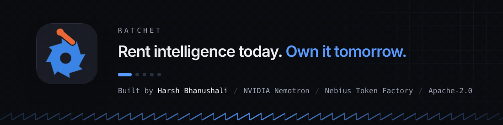
</p>
