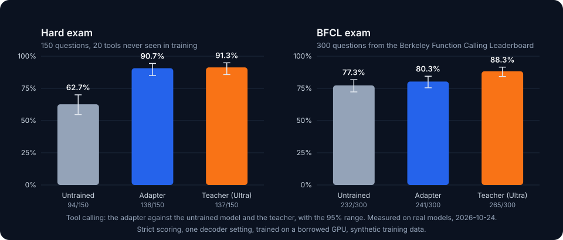
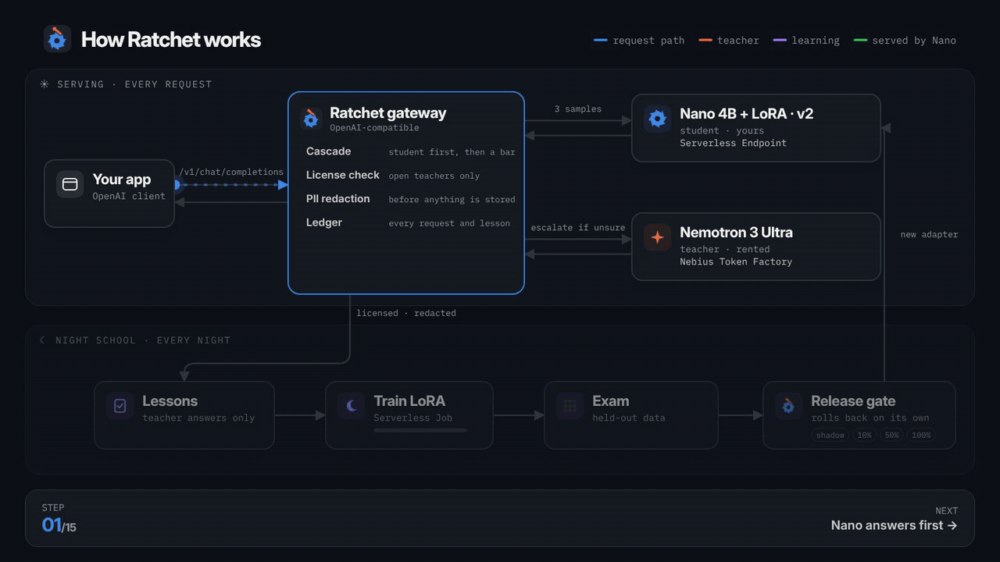
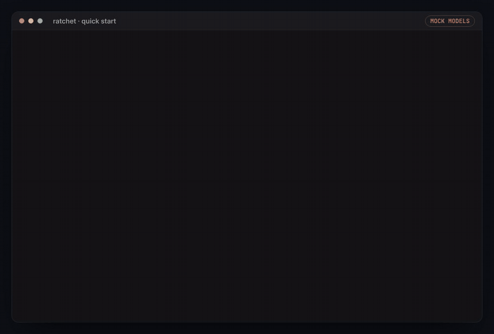
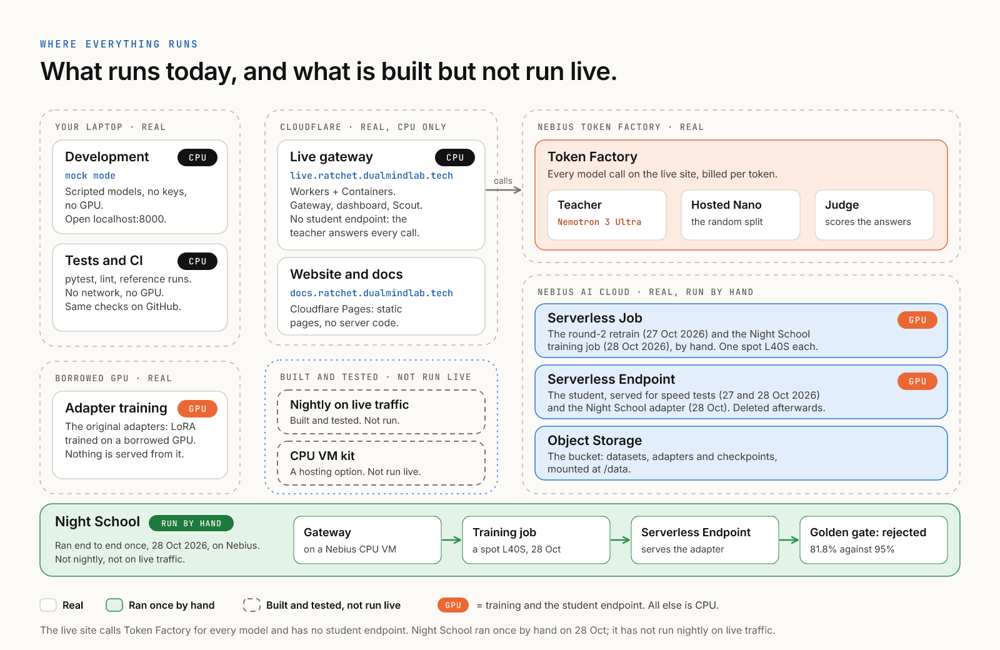
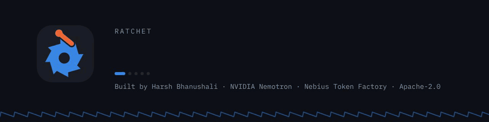

<p align="center">
  <picture>
    <source media="(prefers-color-scheme: dark)" srcset="docs/img/anim/ratchet-banner-dark.gif">
    <source media="(prefers-color-scheme: light)" srcset="docs/img/anim/ratchet-banner-light.gif">
    
  </picture>
</p>

<p align="center">
  <a href="https://ratchet.dualmindlab.tech"></a>
  <a href="https://live.ratchet.dualmindlab.tech"></a>
  <a href="https://huggingface.co/harshbhx/ratchet-nemotron-nano-4b-text2sql"></a>
  <a href="https://docs.ratchet.dualmindlab.tech"></a>
  <a href="docs/WHERE_IT_RUNS.md#one-command-to-host-it-all-on-nebius"></a>
  <a href="LICENSE"></a>
  <a href="https://github.com/harshbhx/ratchet/actions/workflows/ci.yml"></a>
  
  
</p>

<p align="center">
  <b>License-clean distillation on open models.</b><br>
  An OpenAI-compatible gateway: a small student model answers first, a teacher answers when the student is unsure,<br>
  and the loop is built so that every night the student learns from the teacher's answers and ships only if it passes a statistical gate (shown in simulation; the real adapters so far were trained by hand on rented T4 GPUs).
</p>

<p align="center">
  <a href="https://live.ratchet.dualmindlab.tech"><b>Live demo</b></a> &nbsp;·&nbsp;
  <a href="https://demo.ratchet.dualmindlab.tech">Simulation</a> &nbsp;·&nbsp;
  <a href="https://ratchet.dualmindlab.tech">The story</a> &nbsp;·&nbsp;
  <a href="https://ratchet.dualmindlab.tech/judges">For judges</a> &nbsp;·&nbsp;
  <a href="https://docs.ratchet.dualmindlab.tech">Docs</a> &nbsp;·&nbsp;
  <a href="https://huggingface.co/harshbhx/ratchet-nemotron-nano-4b-text2sql">Adapter</a>
</p>

<table>
  <tr>
    <td width="33%" valign="top">
      <b>The problem</b><br>
      Renting a frontier model for every request costs money for ever. And a small model cannot simply be trained on GPT or Claude answers: their terms forbid it.
    </td>
    <td width="33%" valign="top">
      <b>The idea</b><br>
      A small model answers first. A teacher whose license allows distillation answers the rest and teaches the small one every night. A statistical gate decides what ships.
    </td>
    <td width="33%" valign="top">
      <b>The proof</b><br>
      2.6 to 3.0 times the untrained model on two exams, for about $17 on record. Real models, and every score recomputes from the saved answers.
    </td>
  </tr>
</table>

> [!IMPORTANT]
> **What is real.** The exam scores are measured on real models (adapters trained on rented T4 GPUs, not on Nebius GPUs, on synthetic data). Everything from `sim/` is a labelled simulation with mock models. The live demo makes real Token Factory calls, and the teacher answers every request for now. [Details](#status-honestly) and [limitations](#limitations).

## Contents

| | |
|---|---|
| **Start** | [Try it](#try-it) · [Real results](#real-results) · [How it works](#how-it-works) · [Watch it work](#watch-it-work) · [Quick start](#quick-start) · [Run it on Nebius](#run-it-on-nebius-and-where-else-to-host-it) · [Where everything runs](docs/WHERE_IT_RUNS.md) |
| **Check it** | [For judges](#for-judges-a-five-minute-path) · [Status, honestly](#status-honestly) · [Limitations](#limitations) |
| **Why** | [Why license-clean](#why-license-clean) · [NVIDIA and Nebius](#how-it-uses-nvidia-and-nebius) · [Scout](#scout-ratchet-on-agent-traffic) · [Why not a router](#why-not-a-router-or-a-distillation-api) |
| **Background** | [NVIDIA lineage](#nvidia-lineage) · [Prior art](#prior-art-and-what-is-new) · [Go deeper](#go-deeper) · [Documentation](#documentation) · [How the repo was built](#how-the-repo-was-built) · [Repo map](#repo-map) · [License](#license) |

## Try it

| | | |
|---|---|---|
| **Live demo** | Real Token Factory calls under spend limits. The teacher answers every request for now. | [live.ratchet.dualmindlab.tech](https://live.ratchet.dualmindlab.tech) |
| **Simulation** | Mock models: run days, break a deploy, watch the rollback. | [demo.ratchet.dualmindlab.tech](https://demo.ratchet.dualmindlab.tech) |
| **The story** | How it works, the results, and the judges' page. Its dashboard and live chapters run on the simulation; its Scout page (`/scout`) runs on the live gateway. | [ratchet.dualmindlab.tech](https://ratchet.dualmindlab.tech) |
| **Scout, recorded** | Three real Scout runs replayed in your browser, on Hugging Face. | [huggingface.co/spaces/harshbhx/ratchet-scout](https://huggingface.co/spaces/harshbhx/ratchet-scout) |
| **Your machine** | No keys, no GPU. | [Quick start](#quick-start) |

## Real results

<p align="center">
  <picture>
    <source media="(prefers-reduced-motion: reduce)" srcset="docs/img/results.svg">
    <source media="(prefers-color-scheme: dark)" srcset="docs/img/anim/ratchet-results-dark.gif">
    <source media="(prefers-color-scheme: light)" srcset="docs/img/anim/ratchet-results-light.gif">
    
  </picture>
</p>

A small Nemotron 3 Nano 4B adapter, taught by Nemotron 3 Ultra for about $17 on record ($12.16 of teacher answers, from the two data manifests and the exam 2 self-check, plus $4.80 for the Modal training job; round 1 ran on a free Colab T4, and the Modal exam runs were not costed; estimates, not invoices; see [what it cost](docs/VERIFY.md#what-it-cost)), scores 2.6 to 3.0 times the untrained model on two exams, one written by the teacher and one by a different model (Claude Sonnet 5.5, for evaluation only; no Claude output was used for training). In absolute terms the round 2 adapter scores 39.0% on exam 1 (172 questions) and 33.0% on exam 2 (200 questions), against 12.8% and 12.5% untrained and 25.6% and 15.0% for the teacher, which loses points mostly on extra columns the strict scorer rejects. Every score recomputes from the saved answers: see [Check it yourself](docs/VERIFY.md). These are **measured** results on real models, 22 to 24 Oct 2026, not the simulation. They are strict (exact rows), and at a 95% precision bar the gate lets the round 2 adapter answer 1 of 86 measurement questions on exam 1 and none of the 100 on exam 2, so in practice all traffic still goes to the teacher. The adapter was trained on rented T4 GPUs (a free Colab T4 and a Modal T4), not on Nebius GPUs, on synthetic data.

[Adapter](https://huggingface.co/harshbhx/ratchet-nemotron-nano-4b-text2sql) · [Training data](https://huggingface.co/datasets/harshbhx/ratchet-text2sql-synthetic) · [Exams and every answer](https://huggingface.co/datasets/harshbhx/ratchet-text2sql-exams)

### Tool calling (round 3, a second result)

<p align="center">
  
</p>

A tool-calling adapter on Nemotron 3 Nano 4B (2,940 training rows, about $2.33 of Modal GPU time), scored strictly on two exams it never saw. This is a measured result on real models (24 Oct 2026); the text-to-SQL result above stays the headline.

| | Hard exam (150) | BFCL exam (300) |
|---|---|---|
| Untrained Nano 4B | 94 of 150 (62.7%, 95% range 54.7 to 70.0%) | 232 of 300 (77.3%, 95% range 72.3 to 81.7%) |
| Teacher (Nemotron 3 Ultra) | 137 of 150 (91.3%, 95% range 85.7 to 94.9%) | 265 of 300 (88.3%, 95% range 84.2 to 91.5%) |
| Tool-calling adapter | 136 of 150 (90.7%, 95% range 84.9 to 94.4%) | 241 of 300 (80.3%, 95% range 75.5 to 84.4%) |

On the hard exam the adapter is above the untrained model: 90.7% against 62.7%, and the 95% ranges do not overlap. It is about the same as the teacher: 90.7% against 91.3% (lower by point estimate, but the 95% ranges overlap, so the exam cannot tell them apart).

On the BFCL exam the adapter is about the same as the untrained model: 80.3% against 77.3% (higher by point estimate, but the 95% ranges overlap, so the exam cannot tell them apart). It is lower than the teacher: 80.3% against 88.3% (241/300 against 265/300; the 95% ranges overlap only slightly, so part of the gap could be chance).

Hard exam: question by question against the untrained model, the adapter fixed 42 and broke 0 (exact sign test p < 0.0001). BFCL exam: question by question against the untrained model, the adapter fixed 15 and broke 6 (exact sign test p = 0.0784).

Strict scoring: an answer counts only if it is one JSON object with the right tool and arguments; a reply with text around the JSON is wrong. Free-text arguments are a known weak spot in the training data: the strict scorer cannot agree on free text, so tools such as create_ticket (15 training rows), search_files, send_payment and search_inbox are thin. The hard exam uses 20 tools that were never in training. The adapter was trained on a rented Modal T4, not on Nebius GPUs, on synthetic data. The hard exam (150 questions, 20 new tools) was written by Claude Sonnet 5.5 for evaluation only and is never training data; the second exam (300 questions) is drawn from the Berkeley Function Calling Leaderboard (Apache-2.0).

Every score recomputes from the saved answers: see [Check it yourself](docs/VERIFY.md#tool-calling-round-3).

[Tool-calling adapter](https://huggingface.co/harshbhx/ratchet-nemotron-nano-4b-toolcall) · [Training data](https://huggingface.co/datasets/harshbhx/ratchet-toolcall-train) · [Hard exam](https://huggingface.co/datasets/harshbhx/ratchet-toolcall-exam-hard) · [BFCL exam](https://huggingface.co/datasets/harshbhx/ratchet-toolcall-exam-bfcl)

## How it works

Change one line (your base URL) and the designed flow is (simulation and scripts; see [Status](#status-honestly)):

1. A small model answers each request first: NVIDIA Nemotron 3 Nano 4B with a LoRA adapter **you own**, served by vLLM on a Nebius Serverless Endpoint.
2. If it is not confident, the request goes to the teacher, **NVIDIA Nemotron 3 Ultra on Nebius Token Factory**.
3. Every teacher answer is logged with its **provenance**: which teacher wrote it, and the license that permits training on it.
4. Every night, **Night School** fine-tunes a new student on a Nebius Serverless Job, evaluates it on a held-out golden set, and releases it safely.

Your bill falls as your own model takes over, and Ratchet tells you when a GPU would cost more than it saves. You own the LoRA adapter and its signed training lineage; the Nano base stays under NVIDIA's Nemotron Open Model License.

<p align="center">
  <picture>
    <source media="(prefers-color-scheme: dark)" srcset="docs/img/architecture-dark.png">
    
  </picture>
  <br><sub>The design, in one picture. <a href="docs/ARCHITECTURE.md">Architecture</a> has the details.</sub>
</p>

<p align="center">
  <picture>
    <source media="(prefers-color-scheme: dark)" srcset="docs/img/anim/ratchet-how-it-works-dark.gif">
    <source media="(prefers-color-scheme: light)" srcset="docs/img/anim/ratchet-how-it-works-light.gif">
    
  </picture>
  <br><sub>The whole loop in 23 seconds. The confidence numbers in it are an example, not a measurement.</sub>
</p>

A new student never goes straight to full traffic. It is graded on rows it never trained on, runs silently next to the live one, then takes 10%, 50% and 100% of traffic with teacher audits at each step, and rolls back by itself if its audited precision slips:


## Watch it work

| The story page | Scout | The dashboard |
|---|---|---|
|  |  |  |
| `/` the story, with a replay of the reference simulation | `/scout` the multi-agent demo | `/dashboard` savings, releases, trust |

The screenshots show the simulation (mock models, labelled as such on every page). The gateway serves the React app in [web/](web/CLAUDE.md); the original no-build pages stay at `/lite`, `/lite/scout` and `/lite/dashboard`.

<!--
  GIFS COMING: replace each screenshot above with a recording, same file names under docs/img/anim/:
    story.gif      the story page scrolling through the cascade and the replay
    scout.gif      a Scout run, every call tagged with who answered it
    dashboard.gif  a simulated day, a bad deploy, and the automatic rollback
  Use the same pattern as the banner: a <picture> with a dark and a light <source>, and the screenshot as the fallback .
-->

## Quick start

You need Python 3.10 or newer (text-to-SQL fixture tasks need 3.11; the Docker image uses 3.12). Nothing below needs a key or a GPU.

<p align="center">
  
  <br><sub>Simulation (mock models): the student answers what it has learned, and anything new goes to the teacher.</sub>
</p>

```bash
git clone https://github.com/harshbhx/ratchet.git && cd ratchet
pip install -e ".[dev]"                 # includes ruff for `make lint`; `make install` does the same
make demo                               # mock gateway with a trained student: http://localhost:8000
```

Open <http://localhost:8000> (the story), `/scout` and `/dashboard`. Then send it a request like any OpenAI endpoint:

```bash
curl -s localhost:8000/v1/chat/completions -H "Content-Type: application/json" \
  -d '{"model":"ratchet","messages":[{"role":"user","content":"My order never arrived"}]}'
```

| I want to | Run |
|---|---|
| See the whole loop, with a bad deploy rolled back | `python -m sim.simulate --days 10 --requests 2000 --bad-deploy-version 3` |
| Run the tests (1934 tests, no network, no GPU) | `make test` |
| Run Scout as an outside client | `python -m ratchet.scout "What is LoRA fine-tuning?" --base-url http://localhost:8000/v1` |
| Use the Docker image (mock mode) | `make docker && docker run -p 8000:8000 ratchet-gateway` |
| Rebuild the web UI (Node 22) | `make web` |
| Check everything before a commit | `make lint test reference` |

Point any OpenAI SDK at it by changing the base URL, and name the task in a header:

```python
from openai import OpenAI

client = OpenAI(base_url="http://localhost:8000/v1", api_key="unused")
r = client.chat.completions.create(
    model="ratchet", messages=[{"role": "user", "content": "..."}], extra_headers={"X-Ratchet-Task": "ticket-triage"}
)
print(r.ratchet)  # served_by, confidence, cost_usd, all_teacher_cost_usd, usage_breakdown ...
```

**Live mode** (real Token Factory calls): set `NEBIUS_API_KEY` and `RATCHET_API_KEYS`, then `RATCHET_MODE=live uvicorn ratchet.gateway:app --port 8000`. The full setup (student endpoint, nightly jobs, measuring a run) is in [docs/LIVE_MODE.md](docs/LIVE_MODE.md); every setting is in [docs/CONFIGURATION.md](docs/CONFIGURATION.md).

## Run it on Nebius, and where else to host it

The gateway does no inference, so it runs anywhere a container does. The student and the nightly training are what need a GPU.

<p align="center">
  <picture>
    <source media="(prefers-color-scheme: dark)" srcset="docs/img/where-it-runs-dark.png">
    
  </picture>
  <br><sub>What runs where, today and as designed. <a href="docs/WHERE_IT_RUNS.md">Where everything runs</a> has the table.</sub>
</p>

<a href="docs/WHERE_IT_RUNS.md#one-command-to-host-it-all-on-nebius"></a>

**Host it on Nebius, three commands.** Scripted and tested offline against a fake CLI; **not yet run on a real Nebius account**.

```bash
make nebius-plan                                            # prints every command, changes nothing
RATCHET_I_UNDERSTAND_THIS_COSTS_MONEY=1 make nebius-up YES=1   # a CPU VM with the gateway; add ARGS="--with-student" for the GPU student endpoint
RATCHET_I_UNDERSTAND_THIS_COSTS_MONEY=1 make nebius-down YES=1 # stops the endpoint, deletes the VM
```

The gateway and router are plain CPU software: today they run on Cloudflare's CPU containers for the public demos and on a laptop in mock mode. Only training and the student endpoint use a GPU. Costs (estimates), flags and what each step does: [Where everything runs](docs/WHERE_IT_RUNS.md#one-command-to-host-it-all-on-nebius).

| Where | How | State |
|---|---|---|
| **Nebius AI Cloud** (the student and Night School) | `bash deploy/student_endpoint.sh create` makes a Serverless Endpoint (vLLM with runtime LoRA loading), and `python -m ratchet.live night` runs the nightly Serverless Job. Add `DRY_RUN=1` to print the commands first. Steps: [docs/LIVE_MODE.md](docs/LIVE_MODE.md), [docs/DEPLOYMENT.md](docs/DEPLOYMENT.md). | Scripted and tested offline against a fake `nebius` CLI; not run on a Nebius account yet. Nebius has no one-click "Deploy" button that we could find (Oct 2026): it deploys with its CLI, and `deploy/nebius/nebius.sh` runs these scripts in order with one command. |
| **Nebius AI Cloud** (the demo host) | One CPU VM with Docker Compose and Caddy: `make nebius-plan`, then [docs/WHERE_IT_RUNS.md](docs/WHERE_IT_RUNS.md#one-command-to-host-it-all-on-nebius) and [docs/DEPLOY_NEBIUS_VM.md](docs/DEPLOY_NEBIUS_VM.md) | Scripted and tested offline; not run on a Nebius account yet (an alternative to Cloudflare) |
| **Cloudflare** | Workers with Containers, deployed by a manual workflow: `deploy/cloudflare-live` (live demo) and `deploy/cloudflare` (simulation) | Running: [live demo](https://live.ratchet.dualmindlab.tech), [simulation](https://demo.ratchet.dualmindlab.tech) |
| **Hugging Face** | A static Space that replays the recorded Scout runs, and a dataset with the recordings | Published: [Space](https://huggingface.co/spaces/harshbhx/ratchet-scout), [dataset](https://huggingface.co/datasets/harshbhx/ratchet-scout-runs) |
| **Any container host** | `make docker && docker run -p 8000:8000 ratchet-gateway` (mock mode; add the live settings from [Quick start](#quick-start)) | Works |

## For judges: a five-minute path

| Check | Where | Status |
|---|---|---|
| Open source with a license | [`LICENSE`](LICENSE), Apache-2.0 for the code | Real |
| A working demo that calls Token Factory | [live.ratchet.dualmindlab.tech](https://live.ratchet.dualmindlab.tech): send a request, read the `ratchet` block in the reply | Real |
| A real run on record | [`evidence/live-smoke-2026-10-23`](evidence/live-smoke-2026-10-23) (20 real requests, about $0.01) and three recorded Scout runs in [`evidence/scout`](evidence/scout), also [replayable on Hugging Face](https://huggingface.co/spaces/harshbhx/ratchet-scout) | Real |
| Results that recompute | [Real results](#real-results), [Check it yourself](docs/VERIFY.md), the data on [Hugging Face](https://huggingface.co/datasets/harshbhx/ratchet-text2sql-exams), `python scripts/text2sql/exam_numbers.py --check`, and for tool calling [`evidence/toolcall`](evidence/toolcall) with `python scripts/toolcall_results.py --check` | Measured |
| The loop, end to end | [Simulation](https://demo.ratchet.dualmindlab.tech) or `make demo` | Simulation |
| Everything on one page | [ratchet.dualmindlab.tech/judges](https://ratchet.dualmindlab.tech/judges) | |

## Status, honestly

> [!NOTE]
> - **Simulation numbers are mock.** Every figure from `python -m sim.simulate` comes from mock models and is labelled simulation. It shows how the loop behaves, not real model quality.
> - **Measured on real models:** the exam scores above, from two adapters trained on rented T4 GPUs (a free Colab T4 and a Modal T4).
> - **Scripted for Nebius, not run there:** the Serverless Job and Endpoint scripts are written and tested offline against a fake `nebius` CLI; no Nebius GPU has trained or served anything. See [Run it on Nebius](#run-it-on-nebius-and-where-else-to-host-it).
> - **The live demo calls Token Factory for real,** under spend limits, and the teacher answers every request: no trained student is served on a GPU yet, so a trained version's calls would go to a hosted, untuned Nano model (see [Limitations](#limitations)).
> - **Recorded live Scout runs** are in [evidence/scout](evidence/scout): real Token Factory and Tavily calls, every model call answered by the teacher.

## Why "license-clean"

OpenAI's [Business Terms §3.3(e)](https://openai.com/policies/business-terms/) and Anthropic's [Commercial Terms §D.4(a)](https://www.anthropic.com/legal/commercial-terms) forbid using their outputs to train competing models. A distillation tool that learns from GPT or Claude traffic puts its users at risk.

Ratchet only distills from teachers whose licenses allow it. Nemotron 3 Ultra is under [OpenMDW-1.1](https://huggingface.co/nvidia/NVIDIA-Nemotron-3-Ultra-550B-A55B-BF16), which places no restrictions on outputs. Closed models are refused as teachers in code (`ratchet/licenses.py`). `GET /ratchet/bom` exports a **model bill of materials**: every training source, its license, and a SHA-256 fingerprint of the dataset. Each trained adapter also gets **its own bill of materials, signed with Ed25519**, that anyone with your public key can check offline (`python -m ratchet.bom verify`). The licenses travel with the adapter: its BOM names the base model's license, and a `NOTICE.md` next to the weights lists the base model's and each teacher's license (see [License](#license)). An open teacher Ratchet does not list yet can be added in `RATCHET_TEACHER_LICENSES`, but only under an allowed open license and never for a closed model family or router alias Ratchet recognises; the adapter's BOM and NOTICE then mark that license as configured. *Not legal advice: check licenses yourself.*

In its own words, OpenMDW-1.1 "does not impose any restrictions or obligations with respect to any use, modification, or sharing of any outputs" ([license page](https://openmdw.ai/license/1-1/), last updated May 27, 2026; checked Oct 21, 2026). What you own at the end is the LoRA adapter Night School trains and its signed bill of materials. The student's base, Nemotron 3 Nano 4B, stays under the [NVIDIA Nemotron Open Model License](https://www.nvidia.com/en-us/agreements/enterprise-software/nvidia-nemotron-open-model-license/) (v. Dec 15, 2025), which asks you to give anyone you distribute it to a copy of that license.

## How it uses NVIDIA and Nebius

| Role | Model / service | Why |
|---|---|---|
| Teacher | `nvidia/Nemotron-3-Ultra-550b-a55b` on **Token Factory** | Largest Nemotron 3 model; OpenMDW-1.1 allows distillation |
| Judge (free-text eval) | `nvidia/nemotron-3-super-120b-a12b` on **Token Factory** | JSON mode; priced below the teacher in `config.py` |
| Fallback student | `nvidia/NVIDIA-Nemotron-3-Nano-30B-A3B` on **Token Factory** | Used when your endpoint is stopped |
| Student | `nvidia/NVIDIA-Nemotron-3-Nano-4B-BF16` + LoRA on a **Nebius Serverless Endpoint** (vLLM) | Small enough for one GPU; the adapter is the part you own |
| Night School | **Nebius Serverless Jobs** (L40S) with TRL + PEFT | Billed by the hour while a job runs (Nebius docs) |
| Dataset / adapters | **Nebius Object Storage** bucket mounted in jobs and endpoints | |
| Public demo host | **Nebius AI Cloud** CPU VM (`2vcpu-8gb`) | The gateway does no inference |
| Scout web search | Tavily Search API (not NVIDIA or Nebius) | Search tool for the Scout demo only |

Rows 4 to 6 (the student endpoint, Night School and the object storage) are the design: the scripts are written but have not run on Nebius, and the adapters in [Real results](#real-results) were trained on rented T4 GPUs. Token Factory does not offer fine-tuning or LoRA serving for Nemotron yet (Oct 2026), so the designed home of the student is Nebius AI Cloud.

## Scout: Ratchet on agent traffic

[Scout](docs/SCOUT.md) is a small multi-agent research demo. It answers a question from the web, and every one of its LLM calls goes through Ratchet with a task name:

| Agent | Task | Route |
|---|---|---|
| Planner | `research-plan` | **Pinned** to Nemotron 3 Ultra (open-ended) |
| Searcher | none (a tool) | [Tavily Search API](https://docs.tavily.com) in live mode, simulated results in mock mode |
| Triage | `source-triage` | **Distilled**: one short labelling call per search result |
| Reader | `page-read` | **Distilled**: one call per relevant result, pulls out the key fact |
| Writer | `research-write` | **Pinned** to Nemotron 3 Ultra (open-ended) |

Pinned tasks always go to the teacher and are never stored as training data. The many narrow triage and reader calls are where the student takes over. A public demo has a budget guard: a daily spend cap, a daily run cap and a per-IP hourly limit, kept in the ledger across restarts, with an opt-in share held back for hackathon judges (off on the current live demo) and a paced Tavily credit budget; a run whose search fails still finishes, labelled.

## Why not a router or a distillation API?

| | Cascade router | Distillation service ([OpenPipe](https://coreweave.com/news/coreweave-to-acquire-openpipe-leader-in-reinforcement-learning), [AWS Bedrock](https://aws.amazon.com/bedrock/model-distillation), [OpenAI](https://openai.com/index/api-model-distillation/)) | Ratchet |
|---|---|---|---|
| Who owns the student | Nobody: each call is rented | On the pages we read, stays on the provider's platform | You: a LoRA adapter and its signed lineage; the Nano base keeps NVIDIA's license |
| Teacher license recorded per example | Not recorded | Not stated | Recorded when the example is captured, and signed into the adapter's BOM |
| Automatic nightly retrain | None | You start each job | Every night, from teacher answers only |
| Statistical release gate | Nothing ships | Your own evaluation | Held-out certificate, shadow, canary and automatic rollback |
| Reports when it loses money | Per-token savings only | No | Savings by GPU-hours paid, the break-even volume and a recommendation |

Cells describe the pages we read on 21 Oct 2026 ([sources](docs/COMPETITIVE_ANALYSIS.md)); "Not stated" and "Not recorded" mean we found no statement, not that the feature is absent. The Ratchet column describes the design, shown in simulation and in the scripts (see [Status](#status-honestly)).

The YC Summer 2026 teams Understudy and Experiential Labs, as cited in the [competitive analysis](docs/COMPETITIVE_ANALYSIS.md) (not re-checked here), sit between the columns: both say the customer owns the model, and neither page we found documents shadow, canary and automatic rollback.

## Limitations

What breaks first:

- **Low volume does not pay.** Below break-even, a GPU endpoint running 24/7 costs more than the teacher spend it saves. The cost report says so and recommends the hosted fallback or scaling the endpoint to zero.
- **Without a GPU endpoint the student is a hosted, untuned model.** With `RATCHET_STUDENT_BASE` unset, a trained version's calls go to Nemotron 3 Nano 30B on Token Factory, and they are still reported as `served_by: student`. The response's `model` field names the model that wrote the answer.
- **Precision means agreement with Nemotron 3 Ultra,** not ground truth, and it assumes the golden rows look like live traffic. They come from escalations, audits and arbitrations, so they lean towards requests the student found hard.
- **The redactor is pattern-based.** Names and street addresses are not caught yet.
- **Scout's reader is checked on two labels.** page-read's precision covers its `answers_question` and `fact_type` fields only; the free-text `key_fact` the writer cites is not checked.
- **A signed BOM is the operator's signed statement** of the data and evaluation behind an adapter. It shows that nothing changed after signing, not that the weights were trained on that data.
- **One gateway process.** The ledger is one SQLite file behind one lock; a Postgres ledger for several workers is planned ([roadmap](docs/ROADMAP.md)).
- **Simulation numbers come from mock models.** They show how the loop behaves, not real model quality. As of Oct 25, 2026, no Nebius GPU has trained or served a student: the Serverless Job and Endpoint scripts have not run. Token Factory calls (the teacher) are real.
- **Token Factory's Terms of Service §5(f)** ("competing service") is broad. We asked Nebius support about it in writing on Oct 19, 2026; until the answer is final, treat the question as open. Not legal advice.

## NVIDIA lineage

<details>
<summary>The paper's six steps, and what Ratchet automates</summary>

NVIDIA Research's paper "Small Language Models are the Future of Agentic AI" ([arXiv 2506.02153](https://arxiv.org/abs/2506.02153), v3, Sep 22, 2026) estimates that about 40%, 60% and 70% of the LLM queries in three open agent systems could be handled by specialized small models, and gives a six-step conversion algorithm. S1, S2, S5 and S6 run automatically. S3 (task clustering) is manual: the caller or operator names each task. S4 (SLM selection) is manual: one base model.

| Step in the paper | In Ratchet | Automatic? |
|---|---|---|
| S1 "Secure usage data collection" | The gateway logs every request's metadata (task, route, confidence, cost); request text is kept only in training examples, redacted by default, and API keys only by name | Yes |
| S2 "Data curation and filtering" | PII redaction before storage; only complete teacher answers that are valid under the task's spec are kept | Yes |
| S3 "Task clustering" | Not clustered: the caller names each request's task (`X-Ratchet-Task` or `metadata.ratchet_task`) and the operator may give a task a typed field spec in the task registry; statistics are kept per task | No: manual, tasks are named, not clustered |
| S4 "SLM selection" | One base, Nemotron 3 Nano 4B, chosen by hand for size, license and serving cost; Ratchet does not compare bases | No: manual, one base model |
| S5 "Specialized SLM fine-tuning" | A LoRA fine-tune each night on a Nebius Serverless Job, from teacher answers only | Yes |
| S6 "Iteration and refinement" | Night School every night, gated by a held-out golden set (with an exact precision certificate in each signed BOM), shadow, canary and automatic rollback | Yes |

NVIDIA's [Data Flywheel Blueprint](https://developer.nvidia.com/blog/build-efficient-ai-agents-through-model-distillation-with-nvidias-data-flywheel-blueprint) (blog Jun 11, 2025) also distils production traffic into smaller models, but its README says "Promotion to production—as well as any deeper evaluation or dataset curation—remains a human decision" and "Think of the Flywheel as a flashlight, not an autopilot" ([repo](https://github.com/NVIDIA-AI-Blueprints/data-flywheel), marked deprecated in Apr 2026; read Oct 21, 2026). Ratchet is the autopilot, with statistical brakes: it makes the promotion decision with statistics on held-out rows and audited traffic, and writes each decision and its numbers to the release log.

The student's base has its own NVIDIA lineage: Nemotron 3 Nano 4B "has been compressed from NVIDIA-Nemotron-Nano-9B-v2 using the Nemotron Elastic framework", released Mar 16, 2026 ([model card](https://huggingface.co/nvidia/NVIDIA-Nemotron-3-Nano-4B-BF16), read Oct 21, 2026).

</details>

## Prior art and what is new

<details>
<summary>What we did not invent, and what is new in putting it together</summary>

We did not invent the pieces. Ratchet puts them in one loop that runs by itself. Sources and dates are in [docs/COMPETITIVE_ANALYSIS.md](docs/COMPETITIVE_ANALYSIS.md).

- **Table stakes:** an OpenAI-compatible gateway, routing, API keys and quotas ([LiteLLM](https://github.com/BerriAI/litellm), [Portkey](https://portkey.ai), [OpenRouter](https://openrouter.ai)).
- **Distillation services:** [OpenPipe](https://coreweave.com/news/coreweave-to-acquire-openpipe-leader-in-reinforcement-learning) (CoreWeave announced the acquisition Sep 3, 2025), [AWS Bedrock Model Distillation](https://aws.amazon.com/bedrock/model-distillation), [OpenAI distillation](https://openai.com/index/api-model-distillation/) ("Active existing customers will no longer be able to create new fine-tuning jobs" on Jan 6, 2027, [deprecations](https://developers.openai.com/api/docs/deprecations), read Oct 21, 2026), [Inference.net](https://inference.net/blog/introducing-inference-platform/) (a managed training loop whose new models are "staged for final review and deployment", Apr 14, 2026) and the YC Summer 2026 teams Understudy and Experiential Labs. Each turns traffic into a fine-tune; none we found records each example's teacher license at capture, releases automatically behind a statistical gate, and reports when the small model loses money.
- **Known ideas:** LLM cascades ([FrugalGPT](https://arxiv.org/abs/2305.05176), 2023) and cascades that distil the large model into the small one as traffic arrives ([Cache & Distil](https://arxiv.org/abs/2310.13561), ACL Findings 2024; [Online Cascade Learning](https://arxiv.org/abs/2402.04513), ICML 2024); distillation from production logs ([NVIDIA's Data Flywheel Blueprint](https://github.com/NVIDIA-AI-Blueprints/data-flywheel), 2025). License-aware teacher choice at request time: OpenRouter's [`enforce_distillable_text`](https://openrouter.ai/docs/guides/evaluate-and-optimize/distillation) restricts routing to models that allow distillation, with license data "on a best-effort basis", and NVIDIA's [license-compliant distillation tutorial](https://developer.nvidia.com/blog/how-to-build-license-compliant-synthetic-data-pipelines-for-ai-model-distillation/) (Feb 5, 2026) builds on it. Escalation with a provable agreement guarantee ([Trust or Escalate](https://arxiv.org/abs/2407.18370), ICLR 2025) and sequential tests for canary deploys ([Netflix](https://arxiv.org/abs/2205.14762), 2022).
- **New in Ratchet, together:** a per-request escalation, a nightly retrain and a gated release (golden gate, shadow, canary, rollback) in one loop; an exact Clopper–Pearson certificate in each signed BOM and an opt-in anytime-valid canary, both recomputable from their counts; each example's teacher and license recorded when it is captured and signed into every adapter's BOM; savings reported by GPU-hours actually paid, with the break-even volume and a recommendation; committed training sets ([PRD FR-16.4](docs/PRD.md#616-verifiable-evidence)): each BOM signs Merkle roots over the exact training and golden examples, with proofs of what an adapter was and was not trained on. On Nemotron and Nebius.

</details>

## Go deeper

| | |
|---|---|
| [Check it yourself](docs/VERIFY.md) | the commands that recompute every result, with the output to expect, and what none of it proves |
| [Features in depth](docs/FEATURES.md) | the reference simulation, economics, the safety rules, certificates, proofs of what an adapter was trained on, ledger replay, savings receipts, privacy |
| [Live mode](docs/LIVE_MODE.md) | the student endpoint, nightly jobs, measuring a live run |
| [Documentation index](docs/README.md) | PRD, architecture, API, configuration, runbook, threat model, ADRs |

## Documentation

Start at [docs/README.md](docs/README.md). Highlights:

- [PRD](docs/PRD.md): problem, users, requirements, metrics, release plan
- [Architecture](docs/ARCHITECTURE.md), [API](docs/API.md), [Configuration](docs/CONFIGURATION.md), [Scout](docs/SCOUT.md)
- [Where everything runs](docs/WHERE_IT_RUNS.md), [Deployment on Nebius](docs/DEPLOYMENT.md), [Demo VM on Nebius](docs/DEPLOY_NEBIUS_VM.md), [Runbook](docs/RUNBOOK.md), [Threat model](docs/THREAT_MODEL.md)
- [Testing and simulation](docs/TESTING.md), [Architecture decisions](docs/adr/README.md)
- [Business](docs/BUSINESS.md), [Competitive analysis](docs/COMPETITIVE_ANALYSIS.md), [Roadmap](docs/ROADMAP.md)

Working with Claude? Read [CLAUDE.md](CLAUDE.md). Contributing: [CONTRIBUTING.md](CONTRIBUTING.md).

## How the repo was built

<details>
<summary>What is generated, and how to regenerate it</summary>

The git history starts on Oct 19, 2026; every change since then is a dated commit. No third-party source files are copied into the repository: outside code comes in only as the dependencies declared in `pyproject.toml` and `web/package.json`, and the model weights are downloaded, never committed. These files are generated rather than written by hand, and the command that regenerates each is in the repo:

- `ratchet/web/dist/`: the build of `web/` (`make web`).
- `docs/REQUIREMENTS.md`: the requirements matrix (`python scripts/reqtrace.py`).
- `tests/fixtures/sim_reference_seed7.json` and `tests/fixtures/reference.json`: the pinned reference runs (`python scripts/regen_sim_reference.py`, `python scripts/reference_check.py --write`).
- `web/package-lock.json`: npm's lock file.
- `docs/img/*.jpg`: screenshots of the pages in mock mode (simulation).

</details>

## Repo map

<details>
<summary>Where each part lives</summary>

```
ratchet/gateway.py      OpenAI-compatible API (keys, quotas, streaming), pages, demo controls, Scout endpoints
ratchet/router.py       the cascade, pinned tasks, audits, shadow arbitration, cost accounting
ratchet/tasks.py        task specs: typed fields, valid answers, answer cleaning, built-in tasks
ratchet/taskspec.py     task specs as data: RATCHET_TASKS_FILE and the admin API, every error with its path
ratchet/compare.py      field comparators (label, number, date, set, records, ...)
ratchet/confidence.py   confidence score (pairwise agreement) + threshold calibration
ratchet/release.py      golden gate, shadow, canary, rollback (Wilson bounds, or an anytime-valid e-process)
ratchet/certificate.py  certified precision: Clopper-Pearson certificates, frontier, paired McNemar comparison
ratchet/stats.py        exact statistics, `python -m ratchet.stats plan|bound|mcnemar|check`
ratchet/drift.py        label-free drift alarm: a conformal test martingale on each version's confidence stream
ratchet/teacher_watch.py teacher watch: free re-test checks, quarantine and adjudication, a training freeze by e-process
ratchet/ledger.py       SQLite: requests, provenance, versions, events
ratchet/licenses.py     teacher license registry; closed teachers refused
ratchet/redact.py       PII placeholders before examples are stored
ratchet/auth.py         gateway API keys (named, per-key quota in gateway.py)
ratchet/bom.py          per-adapter bill of materials, Ed25519 signing, `python -m ratchet.bom`
ratchet/proof.py        committed training sets: membership and held-out proofs, `python -m ratchet.proof`
ratchet/replay.py       ledger replay: past traffic at another threshold or audit rate, `python -m ratchet.replay`
ratchet/receipts.py     verified savings receipts: calibrated baseline, lower-bound billing, `python -m ratchet.receipt`
ratchet/nightschool/    dataset build, LoRA training (TRL + PEFT), golden eval, nightly orchestration
ratchet/live.py         live Night School on Nebius (job -> hot-load adapter -> eval -> gate)
ratchet/liverun.py      live-run harness: rounds of synthetic traffic, control arm, results file, `python -m ratchet.liverun`
ratchet/scout/          Scout agents, prompts, Tavily/mock search, budget guard, CLI
web/                    React app: story, Scout, dashboard (Vite, Tailwind, motion, recharts)
ratchet/web/dist/       committed build of web/, served by the gateway
ratchet/web/*.html      lite pages without a build step (/lite*)
deploy/                 Serverless Job / Endpoint scripts, training Dockerfile
deploy/vm/              demo VM on Nebius: cloud-init, Docker Compose, Caddy, update and backup scripts
sim/                    synthetic tickets + mock models for demos and tests
sim/research.py         mock research world for Scout (8 questions, simulated search results)
evidence/               saved answers, manifests and results behind the measured numbers (text2sql-*, toolcall, scout, live-smoke-*)
scripts/text2sql/       text-to-SQL exam tooling; exam_numbers.py recomputes the exam scores
scripts/measure_adapter.py  re-scores one adapter's saved answers
scripts/toolcall_results.py recomputes the tool-calling results from evidence/toolcall
docs-site/              the docs site (docs.ratchet.dualmindlab.tech)
deploy/cloudflare*      Workers with Containers: the live demo (cloudflare-live) and the simulation (cloudflare)
```

</details>

## License

Apache-2.0 for the code. Model weights are under their own licenses: Nemotron Nano under the [NVIDIA Nemotron Open Model License](https://www.nvidia.com/en-us/agreements/enterprise-software/nvidia-nemotron-open-model-license/), Nemotron 3 Ultra under OpenMDW-1.1. Include those licenses if you distribute adapters.

Ratchet does that part for you ([ADR 0090](docs/adr/0090-licenses-travel-with-the-adapter.md)). Every adapter folder gets a `NOTICE.md` next to its weights: the base model and its license, each teacher with its license and URL, the statement that the adapter was trained on teacher outputs only, and the Ratchet version. The adapter's signed BOM carries the same text and its SHA-256, so a recipient can check that the notice is the one written at training time. To hand an adapter over:

```bash
python -m ratchet.live export --version 3 --out ./student-v3-export   # weights (if local), ratchet_bom.json, NOTICE.md
```

Keep `NOTICE.md` with the adapter wherever you copy, share or deploy it, and keep the base model's license with any copy of the base model. For a base model Ratchet does not know, the notice says so instead of naming a license: add that license yourself. Not legal advice.

<p align="center">
  <picture>
    <source media="(prefers-color-scheme: dark)" srcset="docs/img/anim/ratchet-footer-dark.gif">
    <source media="(prefers-color-scheme: light)" srcset="docs/img/anim/ratchet-footer-light.gif">
    
  </picture>
</p>
