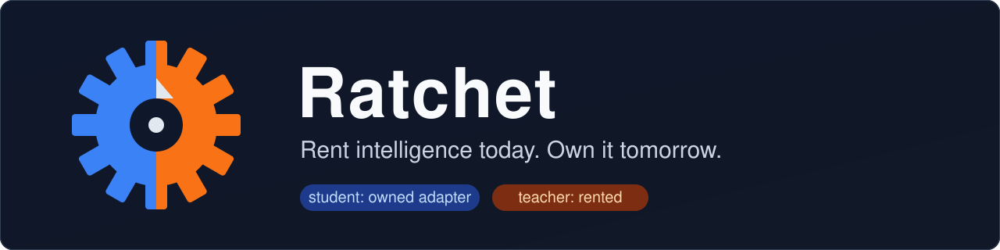
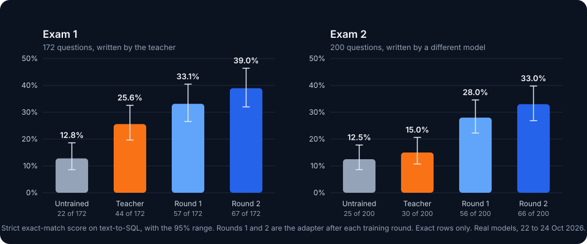
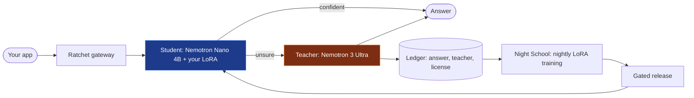
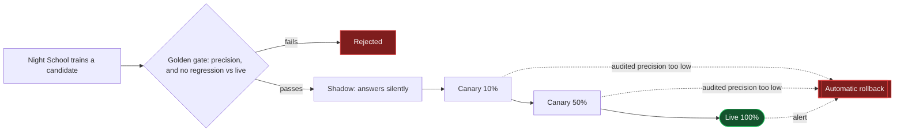

<p align="center">
  
</p>

<p align="center">
  <a href="https://ratchet.dualmindlab.tech"></a>
  <a href="https://live.ratchet.dualmindlab.tech"></a>
  <a href="https://huggingface.co/harshbhx/ratchet-nemotron-nano-4b-text2sql"></a>
  <a href="https://ratchet-docs.pages.dev"></a>
  <a href="LICENSE"></a>
  <a href="https://github.com/harshbhx/ratchet/actions/workflows/ci.yml"></a>
  
  
</p>

# Ratchet

**License-clean distillation on open models. Rent intelligence today, own it tomorrow.**

An OpenAI-compatible gateway: a small student model answers first, a teacher answers when the student is unsure, and every night the student learns from the teacher's answers and ships only if it passes a statistical gate.

<!--
  DEMO GIF: save your recording as docs/img/demo.gif, then replace this comment with:

  <p align="center"></p>
-->

| Try it | |
|---|---|
| **Live demo** (real Token Factory calls, every answer by the teacher for now) | [live.ratchet.dualmindlab.tech](https://live.ratchet.dualmindlab.tech) |
| **Simulation** (mock models: run days, break a deploy, watch the rollback) | [demo.ratchet.dualmindlab.tech](https://demo.ratchet.dualmindlab.tech) |
| **The story, results and judges' page** | [ratchet.dualmindlab.tech](https://ratchet.dualmindlab.tech) |
| **On your machine, no keys** | [Quick start](#quick-start) |

## Real results

<p align="center"></p>

A small Nemotron 3 Nano 4B adapter, taught by Nemotron 3 Ultra for about $23 (about $15 of teacher answers and about $8 of rented GPU), scores 2.6 to 3.0 times the untrained model on two exams, one written by the teacher and one by a different model. Every score recomputes from the saved answers. These are **measured** results on real models, 22 to 24 Oct 2026, not the simulation. They are strict (exact rows), and at a 95% precision bar the student answers about 2% of questions by itself, so most traffic still goes to the teacher. The adapter was trained on rented T4 GPUs (a free Colab T4 and a Modal T4), not on Nebius GPUs, on synthetic data.

[Adapter](https://huggingface.co/harshbhx/ratchet-nemotron-nano-4b-text2sql) · [Training data](https://huggingface.co/datasets/harshbhx/ratchet-text2sql-synthetic) · [Exams and every answer](https://huggingface.co/datasets/harshbhx/ratchet-text2sql-exams)

## How it works

Change one line (your base URL) and:

1. A small model answers each request first: NVIDIA Nemotron 3 Nano 4B with a LoRA adapter **you own**, served by vLLM on a Nebius Serverless Endpoint.
2. If it is not confident, the request goes to the teacher, **NVIDIA Nemotron 3 Ultra on Nebius Token Factory**.
3. Every teacher answer is logged with its **provenance**: which teacher wrote it, and the license that permits training on it.
4. Every night, **Night School** fine-tunes a new student on a Nebius Serverless Job, evaluates it on a held-out golden set, and releases it safely.

Your bill falls as your own model takes over, and Ratchet tells you when a GPU would cost more than it saves. You own the LoRA adapter and its signed training lineage; the Nano base stays under NVIDIA's Nemotron Open Model License.



A new student never goes straight to full traffic. It is graded on rows it never trained on, runs silently next to the live one, then takes 10%, 50% and 100% of traffic with teacher audits at each step, and rolls back by itself if its audited precision slips:



| The story page | Scout | The dashboard |
|---|---|---|
|  |  |  |
| `/` the story, with a replay of the reference simulation | `/scout` the multi-agent demo | `/dashboard` savings, releases, trust |

The screenshots show the simulation (mock models, labelled as such on every page). The gateway serves the React app in [web/](web/CLAUDE.md); the original no-build pages stay at `/lite`, `/lite/scout` and `/lite/dashboard`.

## Quick start

You need Python 3.10 or newer. Nothing below needs a key or a GPU.

```bash
git clone https://github.com/harshbhx/ratchet.git && cd ratchet
pip install -e ".[dev]"                 # or: make install
make demo                               # mock gateway with a trained student: http://localhost:8000
```

Open <http://localhost:8000> (the story), `/scout` and `/dashboard`. Then send it a request like any OpenAI endpoint:

```bash
curl -s localhost:8000/v1/chat/completions -H "Content-Type: application/json" \
  -d '{"model":"ratchet","messages":[{"role":"user","content":"My order never arrived"}]}'
```

| I want to | Run |
|---|---|
| See the whole loop, with a bad deploy rolled back | `python -m sim.simulate --days 10 --requests 2000 --bad-deploy-version 3` |
| Run the tests (1909 tests, no network, no GPU) | `make test` |
| Run Scout as an outside client | `python -m ratchet.scout "What is LoRA fine-tuning?" --base-url http://localhost:8000/v1` |
| Use the Docker image (mock mode) | `make docker && docker run -p 8000:8000 ratchet-gateway` |
| Rebuild the web UI (Node 22) | `make web` |
| Check everything before a commit | `make lint test reference` |

Point any OpenAI SDK at it by changing the base URL, and name the task in a header:

```python
from openai import OpenAI

client = OpenAI(base_url="http://localhost:8000/v1", api_key="unused")
r = client.chat.completions.create(model="ratchet", messages=[{"role": "user", "content": "..."}], extra_headers={"X-Ratchet-Task": "ticket-triage"})
print(r.ratchet)  # served_by, confidence, cost_usd, all_teacher_cost_usd, usage_breakdown ...
```

**Live mode** (real Token Factory calls): set `NEBIUS_API_KEY` and `RATCHET_API_KEYS`, then `RATCHET_MODE=live uvicorn ratchet.gateway:app --port 8000`. The full setup (student endpoint, nightly jobs, measuring a run) is in [docs/LIVE_MODE.md](docs/LIVE_MODE.md); every setting is in [docs/CONFIGURATION.md](docs/CONFIGURATION.md).

## Status, honestly

- **Simulation numbers are mock.** Every figure from `python -m sim.simulate` comes from mock models and is labelled simulation. It shows how the loop behaves, not real model quality.
- **Measured on real models:** the exam scores above, from two adapters trained on rented T4 GPUs. Nothing has run on Nebius GPUs yet: the Serverless Job and Endpoint scripts are written and tested offline, but not run (no compute credit).
- **The live demo calls Token Factory for real,** under spend limits, and the teacher answers every request: no trained student is served on a GPU yet, so a trained version's calls would go to a hosted, untuned Nano model (see [Limitations](#limitations)).
- **Recorded live Scout runs** are in [evidence/scout](evidence/scout): real Token Factory and Tavily calls, every model call answered by the teacher.

## More

| | |
|---|---|
| [Features in depth](docs/FEATURES.md) | the reference simulation, economics, the safety rules, certificates, proofs of what an adapter was trained on, ledger replay, savings receipts, privacy |
| [Live mode](docs/LIVE_MODE.md) | the student endpoint, nightly jobs, measuring a live run |
| [Documentation index](docs/README.md) | PRD, architecture, API, configuration, runbook, threat model, ADRs |

## Why "license-clean"

OpenAI's [Business Terms §3.3(e)](https://openai.com/policies/business-terms/) and Anthropic's [Commercial Terms §D.4(a)](https://www.anthropic.com/legal/commercial-terms) forbid using their outputs to train competing models. A distillation tool that learns from GPT or Claude traffic puts its users at risk.

Ratchet only distills from teachers whose licenses allow it. Nemotron 3 Ultra is under [OpenMDW-1.1](https://huggingface.co/nvidia/NVIDIA-Nemotron-3-Ultra-550B-A55B-BF16), which places no restrictions on outputs. Closed models are refused as teachers in code (`ratchet/licenses.py`). `GET /ratchet/bom` exports a **model bill of materials**: every training source, its license, and a SHA-256 fingerprint of the dataset. Each trained adapter also gets **its own bill of materials, signed with Ed25519**, that anyone with your public key can check offline (`python -m ratchet.bom verify`). The licenses travel with the adapter: its BOM names the base model's license, and a `NOTICE.md` next to the weights lists the base model's and each teacher's license (see [License](#license)). An open teacher Ratchet does not list yet can be added in `RATCHET_TEACHER_LICENSES`, but only under an allowed open license and never for a closed model family or router alias Ratchet recognises; the adapter's BOM and NOTICE then mark that license as configured. *Not legal advice: check licenses yourself.*

In its own words, OpenMDW-1.1 "does not impose any restrictions or obligations with respect to any use, modification, or sharing of any outputs" ([license page](https://openmdw.ai/license/1-1/), last updated May 27, 2026; checked Oct 21, 2026). What you own at the end is the LoRA adapter Night School trains and its signed bill of materials. The student's base, Nemotron 3 Nano 4B, stays under the [NVIDIA Nemotron Open Model License](https://www.nvidia.com/en-us/agreements/enterprise-software/nvidia-nemotron-open-model-license/) (v. Dec 15, 2025), which asks you to give anyone you distribute it to a copy of that license.

## How it uses NVIDIA and Nebius

| Role | Model / service | Why |
|---|---|---|
| Teacher | `nvidia/Nemotron-3-Ultra-550b-a55b` on **Token Factory** | Best reasoning; OpenMDW license allows distillation |
| Judge (free-text eval) | `nvidia/nemotron-3-super-120b-a12b` on **Token Factory** | Fast, cheap, JSON mode |
| Fallback student | `nvidia/NVIDIA-Nemotron-3-Nano-30B-A3B` on **Token Factory** | Used when your endpoint is stopped |
| Student | `nvidia/NVIDIA-Nemotron-3-Nano-4B-BF16` + LoRA on a **Nebius Serverless Endpoint** (vLLM) | Cheap, fast; the adapter is yours |
| Night School | **Nebius Serverless Jobs** (L40S) with TRL + PEFT | Pay only while training |
| Dataset / adapters | **Nebius Object Storage** bucket mounted in jobs and endpoints | |
| Public demo host | **Nebius AI Cloud** CPU VM (`2vcpu-8gb`) | The gateway does no inference |
| Scout web search | Tavily Search API (not NVIDIA or Nebius) | Search tool for the Scout demo only |

Token Factory does not offer fine-tuning or LoRA serving for Nemotron yet (Oct 2026), so the student is trained and served on Nebius AI Cloud.

## NVIDIA lineage

NVIDIA Research's paper "Small Language Models are the Future of Agentic AI" ([arXiv 2506.02153](https://arxiv.org/abs/2506.02153), v3, Sep 22, 2026) estimates that about 40%, 60% and 70% of the LLM queries in three open agent systems could be handled by specialized small models, and gives a six-step conversion algorithm. S1, S2, S5 and S6 run automatically. S3 (task clustering) is manual: the caller or operator names each task. S4 (SLM selection) is manual: one base model.

| Step in the paper | In Ratchet | Automatic? |
|---|---|---|
| S1 "Secure usage data collection" | The gateway logs every request's metadata (task, route, confidence, cost); request text is kept only in training examples, redacted by default, and API keys only by name | Yes |
| S2 "Data curation and filtering" | PII redaction before storage; only complete teacher answers that are valid under the task's spec are kept | Yes |
| S3 "Task clustering" | Not clustered: the caller names each request's task (`X-Ratchet-Task` or `metadata.ratchet_task`) and the operator may give a task a typed field spec in the task registry; statistics are kept per task | No: manual, tasks are named, not clustered |
| S4 "SLM selection" | One base, Nemotron 3 Nano 4B, chosen by hand for size, license and serving cost; Ratchet does not compare bases | No: manual, one base model |
| S5 "Specialized SLM fine-tuning" | A LoRA fine-tune each night on a Nebius Serverless Job, from teacher answers only | Yes |
| S6 "Iteration and refinement" | Night School every night, gated by a held-out golden set (with an exact precision certificate in each signed BOM), shadow, canary and automatic rollback | Yes |

NVIDIA's [Data Flywheel Blueprint](https://developer.nvidia.com/blog/build-efficient-ai-agents-through-model-distillation-with-nvidias-data-flywheel-blueprint) (blog Jun 11, 2025) also distils production traffic into smaller models, but its README says "Promotion to production—as well as any deeper evaluation or dataset curation—remains a human decision" and "Think of the Flywheel as a flashlight, not an autopilot" ([repo](https://github.com/NVIDIA-AI-Blueprints/data-flywheel), marked deprecated in Apr 2026; read Oct 21, 2026). Ratchet is the autopilot, with statistical brakes: it makes the promotion decision with statistics on held-out rows and audited traffic, and writes each decision and its numbers to the release log.

The student's base has its own NVIDIA lineage: Nemotron 3 Nano 4B "has been compressed from NVIDIA-Nemotron-Nano-9B-v2 using the Nemotron Elastic framework", released Mar 16, 2026 ([model card](https://huggingface.co/nvidia/NVIDIA-Nemotron-3-Nano-4B-BF16), read Oct 21, 2026).

## Scout: Ratchet on agent traffic

[Scout](docs/SCOUT.md) is a small multi-agent research demo. It answers a question from the web, and every one of its LLM calls goes through Ratchet with a task name:

| Agent | Task | Route |
|---|---|---|
| Planner | `research-plan` | **Pinned** to Nemotron 3 Ultra (open-ended) |
| Searcher | none (a tool) | [Tavily Search API](https://docs.tavily.com) in live mode, simulated results in mock mode |
| Triage | `source-triage` | **Distilled**: one short labelling call per search result |
| Reader | `page-read` | **Distilled**: one call per relevant result, pulls out the key fact |
| Writer | `research-write` | **Pinned** to Nemotron 3 Ultra (open-ended) |

Pinned tasks always go to the teacher and are never stored as training data. The many narrow triage and reader calls are where the student takes over. A public demo has a budget guard: a daily spend cap, a daily run cap and a per-IP hourly limit, kept in the ledger across restarts, with a share held back for hackathon judges and a paced Tavily credit budget; a run whose search fails still finishes, labelled.

## Why not a router or a distillation API?

| | Cascade router | Distillation service ([OpenPipe](https://coreweave.com/news/coreweave-to-acquire-openpipe-leader-in-reinforcement-learning), [AWS Bedrock](https://aws.amazon.com/bedrock/model-distillation), [OpenAI](https://openai.com/index/api-model-distillation/)) | Ratchet |
|---|---|---|---|
| Who owns the student | Nobody: each call is rented | Usually stays on the provider's platform | You: a LoRA adapter and its signed lineage; the Nano base keeps NVIDIA's license |
| Teacher license recorded per example | Not recorded | Not stated | Recorded when the example is captured, and signed into the adapter's BOM |
| Automatic nightly retrain | None | You start each job | Every night, from teacher answers only |
| Statistical release gate | Nothing ships | Your own evaluation | Held-out certificate, shadow, canary and automatic rollback |
| Reports when it loses money | Per-token savings only | No | Savings by GPU-hours paid, the break-even volume and a recommendation |

The YC Summer 2026 teams Understudy and Experiential Labs, as cited in the [competitive analysis](docs/COMPETITIVE_ANALYSIS.md) (not re-checked here), sit between the columns: both say the customer owns the model, and neither page we found documents shadow, canary and automatic rollback.


## Prior art and what is new

We did not invent the pieces. Ratchet puts them in one loop that runs by itself. Sources and dates are in [docs/COMPETITIVE_ANALYSIS.md](docs/COMPETITIVE_ANALYSIS.md).

- **Table stakes:** an OpenAI-compatible gateway, routing, API keys and quotas ([LiteLLM](https://github.com/BerriAI/litellm), [Portkey](https://portkey.ai), [OpenRouter](https://openrouter.ai)).
- **Distillation services:** [OpenPipe](https://coreweave.com/news/coreweave-to-acquire-openpipe-leader-in-reinforcement-learning) (CoreWeave announced the acquisition Sep 3, 2025), [AWS Bedrock Model Distillation](https://aws.amazon.com/bedrock/model-distillation), [OpenAI distillation](https://openai.com/index/api-model-distillation/) ("Active existing customers will no longer be able to create new fine-tuning jobs" on Jan 6, 2027, [deprecations](https://developers.openai.com/api/docs/deprecations), read Oct 21, 2026), [Inference.net](https://inference.net/blog/introducing-inference-platform/) (a managed training loop whose new models are "staged for final review and deployment", Apr 14, 2026) and the YC Summer 2026 teams Understudy and Experiential Labs. Each turns traffic into a fine-tune; none we found records each example's teacher license at capture, releases automatically behind a statistical gate, and reports when the small model loses money.
- **Known ideas:** LLM cascades ([FrugalGPT](https://arxiv.org/abs/2305.05176), 2023) and cascades that distil the large model into the small one as traffic arrives ([Cache & Distil](https://arxiv.org/abs/2310.13561), ACL Findings 2024; [Online Cascade Learning](https://arxiv.org/abs/2402.04513), ICML 2024); distillation from production logs ([NVIDIA's Data Flywheel Blueprint](https://github.com/NVIDIA-AI-Blueprints/data-flywheel), 2025). License-aware teacher choice at request time: OpenRouter's [`enforce_distillable_text`](https://openrouter.ai/docs/guides/evaluate-and-optimize/distillation) restricts routing to models that allow distillation, with license data "on a best-effort basis", and NVIDIA's [license-compliant distillation tutorial](https://developer.nvidia.com/blog/how-to-build-license-compliant-synthetic-data-pipelines-for-ai-model-distillation/) (Feb 5, 2026) builds on it. Escalation with a provable agreement guarantee ([Trust or Escalate](https://arxiv.org/abs/2407.18370), ICLR 2025) and sequential tests for canary deploys ([Netflix](https://arxiv.org/abs/2205.14762), 2022).
- **New in Ratchet, together:** a per-request escalation, a nightly retrain and a gated release (golden gate, shadow, canary, rollback) in one loop; an exact Clopper–Pearson certificate in each signed BOM and an opt-in anytime-valid canary, both recomputable from their counts; each example's teacher and license recorded when it is captured and signed into every adapter's BOM; savings reported by GPU-hours actually paid, with the break-even volume and a recommendation; committed training sets ([PRD FR-16.4](docs/PRD.md#616-verifiable-evidence)): each BOM signs Merkle roots over the exact training and golden examples, with proofs of what an adapter was and was not trained on. On Nemotron and Nebius.


## Limitations

What breaks first:

- **Low volume does not pay.** Below break-even, a GPU endpoint running 24/7 costs more than the teacher spend it saves. The cost report says so and recommends the hosted fallback or scaling the endpoint to zero.
- **Without a GPU endpoint the student is a hosted, untuned model.** With `RATCHET_STUDENT_BASE` unset, a trained version's calls go to Nemotron 3 Nano 30B on Token Factory, and they are still reported as `served_by: student`. The response's `model` field names the model that wrote the answer.
- **Precision means agreement with Nemotron 3 Ultra,** not ground truth, and it assumes the golden rows look like live traffic. They come from escalations, audits and arbitrations, so they lean towards requests the student found hard.
- **The redactor is pattern-based.** Names and street addresses are not caught yet.
- **Scout's reader is checked on two labels.** page-read's precision covers its `answers_question` and `fact_type` fields only; the free-text `key_fact` the writer cites is not checked.
- **A signed BOM is the operator's signed statement** of the data and evaluation behind an adapter. It shows that nothing changed after signing, not that the weights were trained on that data.
- **One gateway process.** The ledger is one SQLite file behind one lock; a Postgres ledger for several workers is planned ([roadmap](docs/ROADMAP.md)).
- **Simulation numbers come from mock models.** They show how the loop behaves, not real model quality. As of Oct 21, 2026, Ratchet has not run on Nebius yet.
- **Token Factory's Terms of Service §5(f)** ("competing service") is broad. We asked Nebius support about it in writing on Oct 19, 2026; until the answer is final, treat the question as open. Not legal advice.


## How the repo was built

The git history starts on Oct 19, 2026; every change since then is a dated commit. No third-party source files are copied into the repository: outside code comes in only as the dependencies declared in `pyproject.toml` and `web/package.json`, and the model weights are downloaded, never committed. These files are generated rather than written by hand, and the command that regenerates each is in the repo:

- `ratchet/web/dist/`: the build of `web/` (`make web`).
- `docs/REQUIREMENTS.md`: the requirements matrix (`python scripts/reqtrace.py`).
- `tests/fixtures/sim_reference_seed7.json` and `tests/fixtures/reference.json`: the pinned reference runs (`python scripts/regen_sim_reference.py`, `python scripts/reference_check.py --write`).
- `web/package-lock.json`: npm's lock file.
- `docs/img/*.jpg`: screenshots of the pages in mock mode (simulation).


## Documentation

Start at [docs/README.md](docs/README.md). Highlights:

- [PRD](docs/PRD.md): problem, users, requirements, metrics, release plan
- [Architecture](docs/ARCHITECTURE.md), [API](docs/API.md), [Configuration](docs/CONFIGURATION.md), [Scout](docs/SCOUT.md)
- [Deployment on Nebius](docs/DEPLOYMENT.md), [Demo VM on Nebius](docs/DEPLOY_NEBIUS_VM.md), [Runbook](docs/RUNBOOK.md), [Threat model](docs/THREAT_MODEL.md)
- [Testing and simulation](docs/TESTING.md), [Architecture decisions](docs/adr/README.md)
- [Business](docs/BUSINESS.md), [Competitive analysis](docs/COMPETITIVE_ANALYSIS.md), [Roadmap](docs/ROADMAP.md)
- [Devpost submission draft](docs/HACKATHON_SUBMISSION.md), [Demo script](docs/DEMO_SCRIPT.md), [Day-1 checklist](docs/DAY1.md)

Working with Claude? Read [CLAUDE.md](CLAUDE.md). Contributing: [CONTRIBUTING.md](CONTRIBUTING.md).


## Repo map

```
ratchet/gateway.py      OpenAI-compatible API (keys, quotas, streaming), pages, demo controls, Scout endpoints
ratchet/router.py       the cascade, pinned tasks, audits, shadow arbitration, cost accounting
ratchet/tasks.py        task specs: typed fields, valid answers, answer cleaning, built-in tasks
ratchet/taskspec.py     task specs as data: RATCHET_TASKS_FILE and the admin API, every error with its path
ratchet/compare.py      field comparators (label, number, date, set, records, ...)
ratchet/confidence.py   confidence score (pairwise agreement) + threshold calibration
ratchet/release.py      golden gate, shadow, canary, rollback (Wilson bounds, or an anytime-valid e-process)
ratchet/certificate.py  certified precision: Clopper-Pearson certificates, frontier, paired McNemar comparison
ratchet/stats.py        exact statistics, `python -m ratchet.stats plan|bound|mcnemar|check`
ratchet/drift.py        label-free drift alarm: a conformal test martingale on each version's confidence stream
ratchet/teacher_watch.py teacher watch: free re-test checks, quarantine and adjudication, a training freeze by e-process
ratchet/ledger.py       SQLite: requests, provenance, versions, events
ratchet/licenses.py     teacher license registry; closed teachers refused
ratchet/redact.py       PII placeholders before examples are stored
ratchet/auth.py         gateway API keys (named, per-key quota in gateway.py)
ratchet/bom.py          per-adapter bill of materials, Ed25519 signing, `python -m ratchet.bom`
ratchet/proof.py        committed training sets: membership and held-out proofs, `python -m ratchet.proof`
ratchet/replay.py       ledger replay: past traffic at another threshold or audit rate, `python -m ratchet.replay`
ratchet/receipts.py     verified savings receipts: calibrated baseline, lower-bound billing, `python -m ratchet.receipt`
ratchet/nightschool/    dataset build, LoRA training (TRL + PEFT), golden eval, nightly orchestration
ratchet/live.py         live Night School on Nebius (job -> hot-load adapter -> eval -> gate)
ratchet/liverun.py      live-run harness: rounds of synthetic traffic, control arm, results file, `python -m ratchet.liverun`
ratchet/scout/          Scout agents, prompts, Tavily/mock search, budget guard, CLI
web/                    React app: story, Scout, dashboard (Vite, Tailwind, motion, recharts)
ratchet/web/dist/       committed build of web/, served by the gateway
ratchet/web/*.html      lite pages without a build step (/lite*)
deploy/                 Serverless Job / Endpoint scripts, training Dockerfile
deploy/vm/              demo VM on Nebius: cloud-init, Docker Compose, Caddy, update and backup scripts
sim/                    synthetic tickets + mock models for demos and tests
sim/research.py         mock research world for Scout (8 questions, simulated search results)
```


## License

Apache-2.0 for the code. Model weights are under their own licenses: Nemotron Nano under the [NVIDIA Nemotron Open Model License](https://www.nvidia.com/en-us/agreements/enterprise-software/nvidia-nemotron-open-model-license/), Nemotron 3 Ultra under OpenMDW-1.1. Include those licenses if you distribute adapters.

Ratchet does that part for you ([ADR 0090](docs/adr/0090-licenses-travel-with-the-adapter.md)). Every adapter folder gets a `NOTICE.md` next to its weights: the base model and its license, each teacher with its license and URL, the statement that the adapter was trained on teacher outputs only, and the Ratchet version. The adapter's signed BOM carries the same text and its SHA-256, so a recipient can check that the notice is the one written at training time. To hand an adapter over:

```bash
python -m ratchet.live export --version 3 --out ./student-v3-export   # weights (if local), ratchet_bom.json, NOTICE.md
```

Keep `NOTICE.md` with the adapter wherever you copy, share or deploy it, and keep the base model's license with any copy of the base model. For a base model Ratchet does not know, the notice says so instead of naming a license: add that license yourself. Not legal advice.
