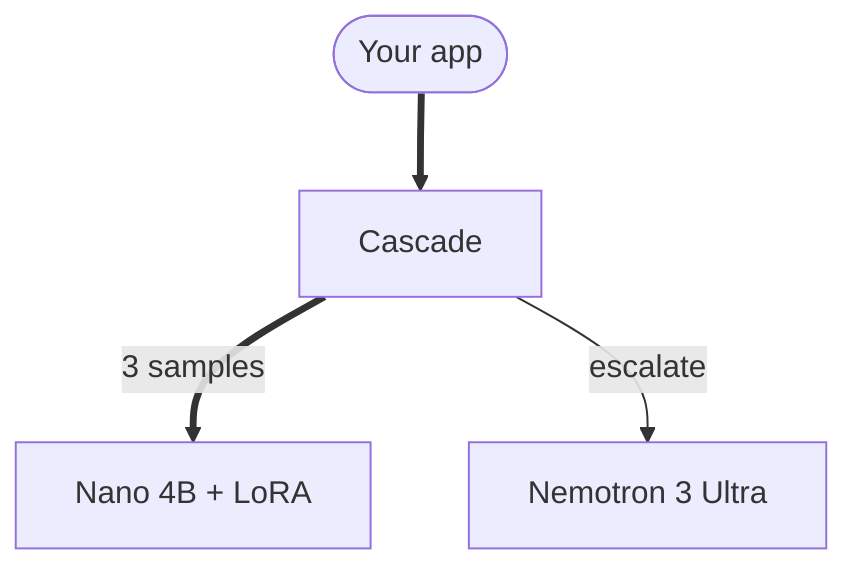

# Ratchet docs site

The documentation site for Ratchet, built with [Starlight](https://starlight.astro.build) (Astro) and the
[Lucode](https://github.com/lucas-labs/lucode-starlight-theme) theme, re-skinned with the landing page's palette and fonts.
It is published at https://docs.ratchet.dualmindlab.tech (Cloudflare Pages project `ratchet-docs`).

## Where the content comes from

| Content | Source | Committed? |
|---|---|---|
| Reference docs (`/reference/...`) | `../docs/**/*.md`, copied by `scripts/sync-docs.mjs` before every `dev` and `build` | No: `docs/` is the source of truth |
| Guides (`/guides/...`), home page, Python API | `src/content/docs/` | Yes |
| HTTP API (`/api/http/...`) | `openapi/ratchet.json`, rendered by `starlight-openapi` | Yes (generated) |
| Environment variables, Command line (`/api/...`) | `generated/*.json` plus `docs/CONFIGURATION.md`, rendered by the sync script | Data yes, pages no |

The sync script turns each doc's first `# ` heading into its title, rewrites links between docs to site routes and links to
code to GitHub, drops an anchor that matches no heading (and says so), and skips the per-folder contributor notes.

## Run it

Node 22.12 or newer (Astro 7.3). From this folder:

```bash
npm ci
npm run dev       # http://localhost:4321, with hot reload (re-run npm run sync after editing ../docs)
npm run build     # sync, build into dist/, check every internal link (the build fails on a broken one)
npm run preview   # serve dist/
```

After changing a route, a setting or a command line tool, regenerate the reference data (needs the Python package
installed, `make install` at the repo root) and commit it:

```bash
python docs-site/scripts/export-reference.py          # from the repo root
python docs-site/scripts/export-reference.py --check  # exit 1 if the committed data is stale (for CI)
```

## Regenerating reference data

Four committed files come from the code, by one script that imports the gateway in mock mode (no keys, no network) and
runs each command line tool with `--help`:

| File | What | Source |
|---|---|---|
| `openapi/ratchet.json` | every route, grouped by area | `app.openapi()` in `ratchet/gateway.py` |
| `generated/env.json` | every environment variable | `ratchet/config.py` (`KNOWN_ENV`, `DEPLOY_ENV`, ...) and `ratchet/release.py` |
| `generated/cli.json` | every `python -m ratchet.*` tool, script and Make target, with its `--help` | the `CLIS` list in the script |
| `generated/routes.json` | routes the schema leaves out | `ratchet/gateway.py` |

```bash
make install                                           # once, from the repo root
python docs-site/scripts/export-reference.py           # write the four files
python docs-site/scripts/export-reference.py --check   # exit 1 when they are stale (CI)
```

The script drops pointers to requirement ids and design records from the text the code wrote for maintainers, and
joins each usage line so the output does not depend on the Python version. A new command line tool needs an entry in
`CLIS`. The environment variable and command line pages are built from these files by `scripts/sync-docs.mjs`; the
endpoint map (`src/content/docs/api/endpoints.mdx`) is written by hand from `ratchet/access.py` and the schema.

## Deploy

```bash
npm run build
npx wrangler pages deploy dist --project-name ratchet-docs --branch main
```

The custom domain `docs.ratchet.dualmindlab.tech` is attached to the Pages project in the Cloudflare dashboard.

## Diagrams

Every diagram in a guide is a ` ```mermaid ` block. [astro-mermaid](https://github.com/joesaby/astro-mermaid) turns it into a
`<pre class="mermaid">`, and the build then replaces that with the finished SVG, so the browser runs no Mermaid (on a long page
Mermaid's text measuring froze the main thread for seconds). The one picture is the architecture overview on the big picture
page: `public/img/architecture-light.png` and `-dark.png`, copies of the exports that `scripts/render_architecture.py` renders
from `docs/img/architecture.svg`.

### Diagrams are drawn at build time

- `generated/mermaid/<key>.svg` holds one finished SVG per diagram, committed. The key is the first 16 hex characters of the
  SHA-256 of the diagram's source exactly as written in the block (the same hash astro-mermaid's client puts in
  `data-diagram`). Mermaid's random SVG id is replaced by `rt-m-<key>`, and `handDrawnSeed` is fixed in
  `src/config/mermaid.mjs`, so drawing a diagram twice gives the same bytes. `generated/mermaid/config.json` records the
  Mermaid version and a hash of the Mermaid configuration the SVGs were drawn with.
- `npm run build` calls `inlineDiagrams` (`scripts/mermaid-cache.mjs`, an integration in `astro.config.mjs`) after the pages
  are written, before the search index: each `<pre class="mermaid">` that has a saved SVG becomes
  `<div class="mermaid" data-processed="true" data-static="">` holding the SVG. A page whose diagrams are all inlined has no
  `pre.mermaid`, so astro-mermaid's script does not even load Mermaid there. A diagram without a saved SVG stays a `<pre>`,
  the browser draws it (the old behaviour), and the build warns.
- **After you add or change a diagram** (or change `src/config/mermaid.mjs` or the `mermaid` version), run

  ```bash
  npm run build && node scripts/mermaid-cache.mjs --write   # needs Chrome or Chromium; CHROME_PATH=/path/to/chrome if not installed as Chrome
  ```

  and commit `generated/mermaid`. `--write` opens each page that still has a `<pre class="mermaid">` in Chromium
  (`playwright-core`), waits for Mermaid, saves the SVGs, removes files no diagram uses and inlines them into `dist/`. After a change to the Mermaid
  configuration or version, delete `generated/mermaid` first so every diagram is drawn again (`--write` refuses to mix).
- CI runs `node scripts/mermaid-cache.mjs --check` after the build: it fails if a diagram has no saved SVG, a saved SVG belongs
  to no diagram, or the SVGs were drawn with another Mermaid version or configuration.
- `npm run dev` is unchanged: the browser draws the diagrams.

How it is themed:

- `src/config/mermaid.mjs` holds the whole Mermaid configuration (imported into the `mermaid({...})` block of
  `astro.config.mjs`): the `base` theme, Inter and JetBrains Mono, spacing, and `themeCSS`, a set of rules written in the
  site's CSS variables (`--rt-*` in `src/styles/theme.css`). Mermaid scopes those rules to each diagram, so they win over
  its own colours, and they follow the light and dark theme as soon as it changes, with no re-render.
- astro-mermaid's `autoTheme` is off on purpose: it would swap Mermaid to its own `default` and `dark` themes and drop
  `base` and the brand colours.
- `src/styles/diagrams.css` is the frame (it matches both the `<pre>` and the static `<div>`): the rounded card, the optional caption and key, scroll shadows, and sideways
  scrolling on a phone instead of shrinking the text.

### The class kit

One set of classes, defined once for the whole site. Tag a node with `A:::student` or `class A,B student`; no `classDef`
is needed.

| Class | Looks like | Use it for |
|---|---|---|
| `student` | owned blue | the student: Nano 4B with the adapter you own (and a version on trial: shadow, canary) |
| `teacher` | rented orange | the teacher you rent per token (Nemotron 3 Ultra on Token Factory) |
| `store` | grey, darker border | the ledger, a bucket, a file: anything that keeps data (pair it with the cylinder `[("...")]`) |
| `gate` | white, dark border | a check or a decision that can stop the flow (pair it with the hexagon `{{"..."}}`) |
| `ok` | green | a good outcome: live, served, in use |
| `danger` | red | a bad outcome: rejected, rolled back, refused |
| `pending` | amber, dashed | written but not run yet |
| `outline` | dashed outline | optional, off by default, or the untuned hosted fallback (never the owned blue) |
| `neutral` | the default node | when a class must be named |

Subgraphs take zone classes, which colour only the border: `studentZone`, `teacherZone`, `okZone`, `pendingZone`,
`outlineZone`. Edges carry meaning by their stroke: `==>` is the main path, `-->` a normal step, `-.->` optional or off.

In a sequence diagram, a participant whose id is `Student` (or `Endpoint`), `Teacher`, `Ledger` or `Bucket` gets the kit's
colours: `participant Student as Student<br/>vLLM`.

The copy-paste snippet below declares the kit's names at the end of a diagram. It sets only stroke widths and dashes,
never a colour: Mermaid writes a `classDef` inline with `!important`, so a fixed colour there would stay light in dark
mode (and a flowchart `classDef` cannot read a CSS variable). The colours come from `themeCSS` on this site; elsewhere
(GitHub, the Mermaid live editor) the dashes still show which boxes are optional or not run.

```text
  classDef student stroke-width:1.5px
  classDef teacher stroke-width:1.5px
  classDef store stroke-width:1.25px
  classDef gate stroke-width:1.5px
  classDef ok stroke-width:1.5px
  classDef danger stroke-width:1.5px
  classDef pending stroke-width:1.5px,stroke-dasharray:5 4
  classDef outline stroke-width:1.25px,stroke-dasharray:4 3
  classDef neutral stroke-width:1px
```

### A diagram with a caption

````mdx
<figure class="rt-diagram">



<figcaption>

**Reading this diagram.** Two to five plain sentences: where to start, what the thick path is, what is left out.

<ul class="rt-key">
  <li class="student">The student you own</li>
  <li class="teacher">Rented per token</li>
</ul>

</figcaption>
</figure>
````

Keep the blank lines around the block and inside `<figcaption>`, or MDX reads them as inline text. A bare block with no
`<figure>` gets the same card without a caption. The key's chips are the kit's classes plus `edge-main` and `edge-optional`.

### Rules of thumb

- Fit the column: at most about 730 px of diagram (the card leaves 734 px in the 48rem column), at the natural text size.
  Wider diagrams scroll sideways. A phone always scrolls, which is fine: a figure tells phone readers to scroll sideways.
- About 12 nodes at most. Split a bigger idea into two diagrams, or move detail into the caption.
- Short labels: two lines of three or four words. Put names in quotes (`A["..."]`), and never use parentheses, `<` or
  `>` in an unquoted label. `<br/>` breaks a line.
- `flowchart TB` for hierarchies and anything with more than four steps (it stays narrow); `LR` only for three or four
  boxes in a row.
- Subgraphs group what runs in one place. Mermaid's layout gets wide when many edges leave a subgraph from the nodes
  inside it: connect the subgraph itself (`vm ==> tf`), keep labels off long edges, and stack siblings with `~~~`
  (an invisible link) when a row gets too wide.
- Colour never stands alone: say "not run", "in use" or "rejected" in a label or the caption as well.
- Simulation numbers in a diagram say "simulation" next to them, as everywhere else.
- Check both themes and a 390 px wide window before you commit.

## Writing guides

Every guide follows the same shape: `<Summary>` (one sentence), `<Eli10>` (an everyday analogy), "How it really works"
(numbered steps and a diagram), "For engineers" (files, functions, settings, endpoints) and "Common questions". Plain English,
short sentences, no hype; simulation numbers say "simulation", costs say "estimate" with a source and date. Components live in
`src/components/` (`Who` badges use the landing page's words; diagrams use the owned blue for the student and the rented
orange for the teacher). Mermaid code blocks render in the browser from a bundled copy; nothing loads from a CDN.

## Components

Everything a page can use, with one import line each. Paths below are from a guide in `src/content/docs/guides/`
(use `../../components/...` from a page one folder up). [`COMPONENTS-PLAN.md`](COMPONENTS-PLAN.md) says which page should
use which.

Rules that hold for all of them:

- **Colour carries meaning.** `owned` (blue) is the student and what you own; `rented` (orange) is the teacher you rent;
  `neutral` is everything else. Status colours (green live, amber simulation or caution, red danger) always come with a word.
- **Honest numbers.** A number comes from the repository or a measured run. A simulation number uses `tone="sim"` (or the
  `rt-callout--sim` class) so it says "Simulation" next to it.
- **Motion is optional.** Nothing moves on its own for more than a moment, and nothing loops without a pause button. With
  `prefers-reduced-motion`, in print and without JavaScript every component shows its final state. Text is in the HTML
  before any script runs.
- **Cost.** The Astro components ship no JavaScript. The React Bits wrappers hydrate as islands when they come near the
  screen (`client:visible`); the first one on a page loads React once (about 66 KB gzipped), the rest add 1 to 2 KB each.
  A guide that uses none of them ships no React at all.

### Page building blocks (Astro, no JavaScript unless noted)

**`<Summary>`**: the first thing on every guide, one sentence. When: always, right after the imports.

```mdx
import Summary from '../../../components/Summary.astro';

<Summary>Ratchet is an OpenAI-compatible gateway: a small student answers what it is sure about, the teacher answers the rest.</Summary>
```

**`<PlainWords>`** (same as `<Eli10>`, same `title` prop): the everyday analogy. When: right after `<Summary>`.

```mdx
import PlainWords from '../../../components/PlainWords.astro';

<PlainWords>

Imagine your app is a busy restaurant, and every order is one request.

</PlainWords>
```

**`<Who>`**: who answered, in the landing page's words. `as`: `student`, `teacher`, `fallback`, `judge`, `tool`.

```mdx
import Who from '../../../components/Who.astro';

The student <Who as="student" /> answers first; the teacher <Who as="teacher" /> answers the rest.
```

**`<Stat>` in a `<StatRow>`**: a number or a short fact with a label and a note. A numeric `value` counts up once (React Bits
CountUp; set `count={false}` for small numbers). `tone`: `owned`, `rented`, `neutral` (default) or `sim`. `<StatRow cols={2|3|4}>`
follows its own width: one column when narrow. When: three to six headline facts at the top of a page.

```mdx
import Stat from '../../../components/Stat.astro';
import StatRow from '../../../components/StatRow.astro';

<StatRow cols={3}>
  <Stat value={1934} label="tests in the suite" note="They run offline, with no network and no GPU." />
  <Stat value={95} suffix="%" label="held-out precision floor" tone="owned" />
  <Stat value={0.42} decimals={2} prefix="$" label="per 1,000 requests" tone="sim" note="Simulation, seed 7." />
</StatRow>
```

**`<Flow>` and `<FlowStep>`**: up to four steps as connected cards (a numbered column when narrow); `loop` adds the way back.
When: a short sequence or cycle you want seen at a glance. For prose-heavy steps use Starlight's `<Steps>`; for a
click-through use `<Stepper>`.

```mdx
import Flow from '../../../components/Flow.astro';
import FlowStep from '../../../components/FlowStep.astro';

<Flow loop loopLabel="Every night, again">
  <FlowStep title="Student answers first" tone="owned" meta="Nano 4B + your LoRA">Sampled three times.</FlowStep>
  <FlowStep title="Teacher if unsure" tone="rented" meta="Ultra on Token Factory">Answers the rest.</FlowStep>
  <FlowStep title="Recorded" meta="the ledger">With the teacher and its license.</FlowStep>
</Flow>
```

**`<PathCard>` in a `<PathGrid>`**: link cards on a React Bits SpotlightCard (the light follows the pointer and keyboard
focus). The whole card is the link. `icon`: `start`, `book`, `loop`, `database`, `chart`, `server`, `code`, `check`, `shield`,
`coin`, `key`, `gate`, `scale`, `file`, `repo`, `external`, `search`, `spark`, `flask`, `layers`. When: "where next" grids
and reference indexes.

```mdx
import PathCard from '../../../components/PathCard.astro';
import PathGrid from '../../../components/PathGrid.astro';

<PathGrid cols={2}>
  <PathCard title="Quickstart" href="/guides/quickstart/" icon="start" eyebrow="No keys" description="Run the whole loop on your laptop." />
  <PathCard title="The release gate" href="/guides/release-gate/" icon="gate" tone="neutral" description="Shadow, canary and rollback." />
</PathGrid>
```

**`<Compare>`**: two sides, before and after (stacked when narrow). Left is rented orange and right owned blue by default;
set `beforeTone`/`afterTone` to `neutral` when the comparison is not about them. When: a cost, a contract or a behaviour
before and after Ratchet.

```mdx
import Compare from '../../../components/Compare.astro';

<Compare before="Every request to the teacher" after="With Ratchet">
  <div slot="before">You pay per token for every request, repeated or not.</div>
  <div slot="after">The student answers what it is sure about; the teacher answers the rest.</div>
</Compare>
```

**Callouts, badges, buttons and keys (CSS classes).** Starlight's `<Aside>` keeps its four types (note blue, tip green,
caution amber, danger red). For the project's own meanings use a class on a `<div>` or `<span>`:

```mdx
<div class="rt-callout rt-callout--sim"><p><strong>Simulation.</strong> These numbers come from mock models (seed 7).</p></div>
<div class="rt-callout rt-callout--live"><p><strong>Measured.</strong> From the published live run.</p></div>
<div class="rt-callout rt-callout--owned"><p><strong>You own this.</strong> The adapter and its bill of materials.</p></div>
<div class="rt-callout rt-callout--rented"><p><strong>You rent this.</strong> The teacher, per token.</p></div>

<span class="rt-badge rt-badge--sim">Simulation</span> <span class="rt-badge rt-badge--live">Live</span>
<span class="rt-badge rt-badge--owned">Nano</span> <span class="rt-badge rt-badge--rented">Ultra</span>

<a class="rt-button rt-button--primary" href="/guides/quickstart/">Run it</a>
<a class="rt-button rt-button--outline" href="/api/http/">API</a>

Press <kbd>Ctrl</kbd> + <kbd>K</kbd> to search.
```

Other variants: `rt-callout--note`, `rt-callout--warn`; `rt-badge--bad`; `rt-button--ghost`, `rt-button--owned`.

Tables need nothing: every Markdown table scrolls sideways inside the column when it is wide, has zebra rows, and a table
with 12 or more rows keeps its header row in view while it scrolls.

### React Bits components (`src/components/ui/`)

Adapted from [React Bits](https://reactbits.dev) (TS-CSS variants) into `src/components/rb/<Name>/`, recoloured with the
site's tokens and made server-rendered, reduced-motion safe and lighter (no motion or GSAP dependency). Each wrapper in
`src/components/ui/` hydrates it for you.

**`<BlurText>`**: words arrive out of a soft blur, once. When: a display heading on a landing-style page. Not for a guide's
`##` headings (they must stay plain to show in "On this page"). `trigger="load"` ships no JavaScript.

```mdx
import BlurText from '../../../components/ui/BlurText.astro';

<BlurText as="p" text="Every night, more of your traffic moves to the adapter you own." />
```

**`<ShinyText>`**: one band of light crosses a short label when it first comes into view, and on hover. When: an eyebrow or a
"new" tag. Never on body text. On the first screen use `trigger="load"`: it plays with CSS only and ships no JavaScript.

```mdx
import ShinyText from '../../../components/ui/ShinyText.astro';

<ShinyText text="New: text-to-SQL adapter" />
```

**`<GradientText>`**: a phrase painted with a gradient that glides once into place. `tone`: `owned`, `rented` or
`rent-to-own`. When: one emphasised phrase per page at most, in a lead or a closing line (not inside a `##` heading, whose
text feeds "On this page").

```mdx
import GradientText from '../../../components/ui/GradientText.astro';

At the end you own <GradientText text="the adapter and its signed lineage" tone="owned" />.
```

**`<CountUp>`**: a number that counts up once in view; the final number is in the HTML and holds its width. When: inside a
sentence or a custom tile (`<Stat>` already uses it).

```mdx
import CountUp from '../../../components/ui/CountUp.astro';

The suite has <CountUp to={1934} /> tests.
```

**`<SpotlightCard>`**: any card whose border and surface light up under the pointer or keyboard focus. `tone`: `owned`,
`rented`, `neutral`. When: a custom card that is clickable or focusable (`<PathCard>` already uses it).

```mdx
import SpotlightCard from '../../../components/ui/SpotlightCard.astro';

<SpotlightCard tone="rented">
  <div style="padding:1.25rem">The teacher: Nemotron 3 Ultra on Nebius Token Factory.</div>
</SpotlightCard>
```

**`<FadeContent>`**: a block fades and rises in once when it scrolls into view (it stays visible if it is on screen already
or if scripts are off). `stagger` animates direct children one after another. When: sections of a landing-style page; not
inside a guide's running text.

```mdx
import FadeContent from '../../../components/ui/FadeContent.astro';

<FadeContent distance={16}>
  ...a grid or a panel...
</FadeContent>
```

**`<Stepper>`**: a walk-through, one step at a time, with Back, Next and clickable step numbers. `body` is plain text with
`` `code` ``, `**bold**`, `[links](/path/)` and blank lines between paragraphs; `tone` per step. Print and no-script readers
get every step as a numbered list. When: a sequence that reads better one step at a time (release stages, one request's
journey).

```mdx
import Stepper from '../../../components/ui/Stepper.astro';

<Stepper
  label="Release stages"
  steps={[
    { title: 'Golden gate', body: 'Held-out precision of at least **95%** and coverage of at least 25%.' },
    { title: 'Shadow', body: 'The candidate answers silently next to the live version.', tone: 'owned' },
    { title: 'Canary', body: '10%, then 50%, then 100% of traffic, each with at least 20 audits.' },
  ]}
/>
```

**`<LogoLoop>`**: a slow row of names (text only, no logos) with a pause button; it also pauses on hover, focus and off screen.
When: one "built with" strip. Name only what the code uses.

```mdx
import LogoLoop from '../../../components/ui/LogoLoop.astro';

<LogoLoop items={[{ label: 'vLLM', note: 'student server' }, { label: 'Hugging Face PEFT', note: 'LoRA' }]} />
```

**`<ShapeGrid>`**: the home hero's grid background; cells light up in the owned blue under a mouse pointer after one short
intro ripple. It loads only on wide screens with a mouse and no reduced-motion preference (`client:media`); elsewhere it is
a static CSS grid. When: the home hero only.

### Page chrome

`src/components/overrides/` replaces four of Lucode's components: `Hero` (the home page's first screen,
`src/components/home/`), `PageTitle` (sidebar group as an eyebrow, title, the frontmatter `description` as the one-line
summary, reading time on guides, "Edit on GitHub"), `Footer` ("Was this page right?" with the edit and issue links,
previous and next pages, a credits line) and `Sidebar` (with `SidebarTree`: groups that fold, only the current page's
group open at first, open groups and the scroll position kept from page to page, one gliding hover pill). Styles:
`src/styles/theme.css` (tokens, light and dark), `chrome.css` (header, sidebar, "On this page", search), `content.css`
(the page body), `motion.css` (page changes in one cut, held until the new page is fully parsed; the reading-progress
bar; the theme switch's reveal) and `print.css`. Pages are prefetched on hover (Chromium prerenders them through
speculation rules). `ReadingAids.astro`, rendered by `Footer`, adds "Expand" to every diagram (and opens content images)
in a full-screen view, a back-to-top button below 1280px, a fade on tables that scroll sideways and copying a
section's address from its heading link.

### Credits

Built with [Starlight](https://starlight.astro.build), the [Lucode](https://github.com/lucas-labs/lucode-starlight-theme) theme
(MIT) and components adapted from [React Bits](https://reactbits.dev) by David Haz. The sidebar's hover pill, the
reading-progress bar, the theme switch's reveal and the full-screen view follow [beUI](https://beui.dev)'s Shared Layout
Background, Scroll Progress, Theme Toggle and Image Viewer (MIT, by Saurabh Chauhan), rewritten as CSS and a few lines
of script with no React. The React Bits files in
`src/components/rb/` keep their own license, MIT + Commons Clause (`src/components/rb/LICENSE.md`): they may be used and
changed as part of this website, but not sold or redistributed as components. They are not covered by the repository's
Apache-2.0 license.
