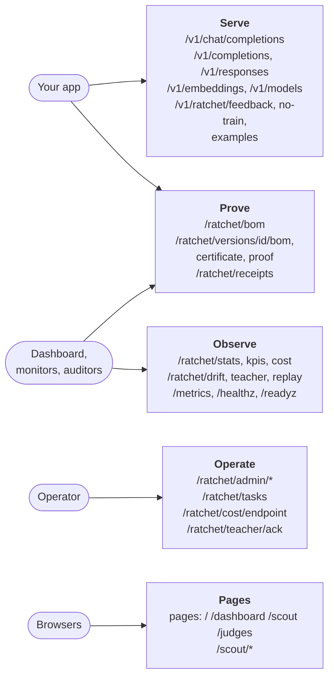
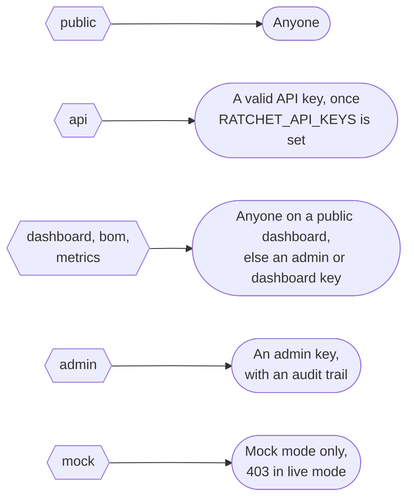
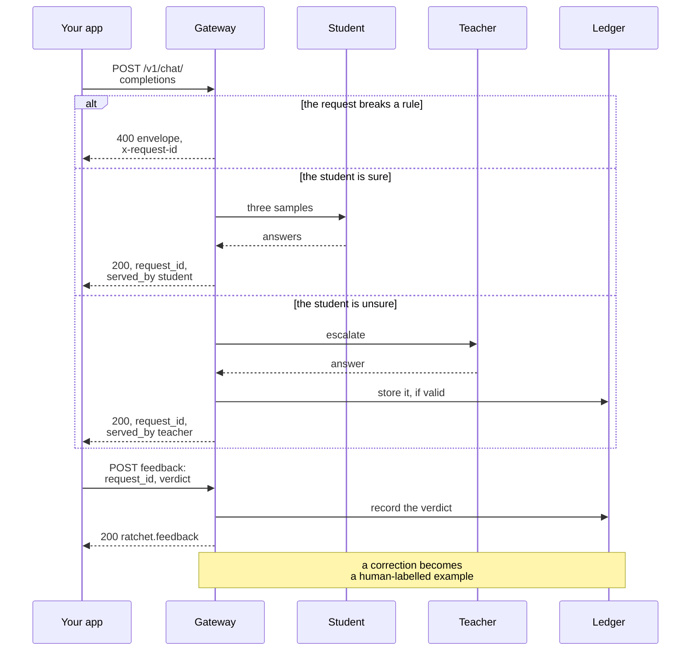
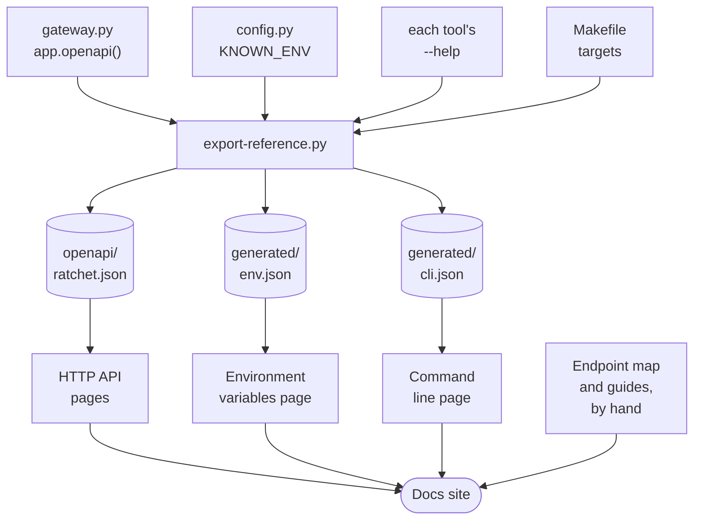

import { Aside } from '@astrojs/starlight/components';
import Summary from '../../../components/Summary.astro';
import PathCard from '../../../components/PathCard.astro';
import PathGrid from '../../../components/PathGrid.astro';

<Summary>The gateway serves 85 routes; this page groups them by purpose, says which key each one needs, and shows the three calls most people make first.</Summary>

The full schema of every route is in the generated [HTTP API reference](/api/http/). The long prose guide, with every field and error, is the [HTTP API guide](/reference/api/). This page is the map between them.

<PathGrid cols={2} label="Route groups">
  <PathCard title="OpenAI-compatible" href="#openai-compatible" icon="code" eyebrow="API key" description="Chat, completions, responses, embeddings and models: what your app calls." />
  <PathCard title="Stats, evidence and cost" href="#stats-and-provenance" icon="chart" eyebrow="Dashboard key" tone="neutral" description="Stats, bills of materials, certificates, cost, replay and receipts." />
  <PathCard title="Admin and tasks" href="#admin" icon="key" eyebrow="Admin key" tone="neutral" description="Versions, switches, task pins, erasure and the task registry, with an audit trail." />
  <PathCard title="Scout and pages" href="#scout" icon="search" eyebrow="Public" tone="neutral" description="The research agent behind its budget guard, and the web pages." />
</PathGrid>

## The routes by purpose

<figure class="rt-diagram">



<figcaption>

**Reading this diagram.** Read it from the left, from who calls to what they call. Your application only needs the first group, Serve: the OpenAI-shaped routes and the three Ratchet routes for feedback, no-train registrations and erasing its own examples. Prove holds the signed evidence: bills of materials, certificates, proofs and savings receipts. Observe is what the dashboard and your monitors read. Operate is for the person running the gateway: versions, switches, task pins and the task registry. Pages are the web pages and the Scout routes.

</figcaption>
</figure>

## Who may call a route

Every route has one access level. A key goes in `Authorization: Bearer <key>` or in `X-API-Key: <key>`.

<figure class="rt-diagram">



<figcaption>

**Reading this diagram.** Each row is one access level, on the left, and who may call a route at that level, on the right. Public routes never ask for a key. API routes ask for a key only when `RATCHET_API_KEYS` is set. The read-only management routes (dashboard, bill of materials, metrics) are open on a public dashboard, which is the default in mock mode; in live mode they need an admin or dashboard key, and a gateway with neither configured refuses them. Admin routes always need an admin key in live mode. A route nobody has classified counts as dashboard level, so a new route starts private. On a public dashboard, a reader without a key still gets an answer, with client names replaced by pseudonyms. A missing or wrong key is a 401 or 403; on `/v1/*` a missing API key is a 401 `invalid_api_key`.

</figcaption>
</figure>

<Aside type="note">
The bill of materials routes also open to anyone with `RATCHET_PUBLIC_BOM=1`, so auditors can read provenance from a private gateway. The metrics route also accepts `RATCHET_METRICS_TOKEN`, so a scraper needs no dashboard key. Savings receipts are API-level: a key reads its own, an admin key reads all.
</Aside>

## Every route

The Method and Path columns link to the generated reference for that operation.

### OpenAI-compatible

| Method | Path | Who | What it is for |
|---|---|---|---|
| GET | [`/v1/models`](/api/http/operations/models_v1_models_get/) | API key | The tasks as OpenAI model objects. |
| GET | [`/v1/models/{model_id}`](/api/http/operations/retrieve_model_v1_models__model_id__get/) | API key | One model object. |
| POST | [`/v1/chat/completions`](/api/http/operations/chat_v1_chat_completions_post/) | API key | The chat completion: student first, teacher when unsure. |
| POST | [`/openai/deployments/{deployment}/chat/completions`](/api/http/operations/azure_chat_openai_deployments__deployment__chat_completions_post/) | API key | The same chat route under an Azure-style path. |
| POST | [`/v1/embeddings`](/api/http/operations/embeddings_v1_embeddings_post/) | API key | Embeddings, passed through and never stored. |
| POST | [`/v1/completions`](/api/http/operations/completions_v1_completions_post/) | API key | Legacy text completions, run as chat. |
| POST | [`/v1/responses`](/api/http/operations/responses_v1_responses_post/) | API key | The stateless part of the Responses API, run as chat. |
| POST | [`/v1/moderations`](/api/http/operations/moderations_v1_moderations_post/) | API key | Not served: a typed 404. |
| GET | [`/v1/responses/{response_id}`](/api/http/operations/response_state_v1_responses__response_id__get/) | API key | Not served: a typed 404 (stored responses). |
| POST | [`/v1/responses/{response_id}`](/api/http/operations/response_state_v1_responses__response_id__post/) | API key | Not served: a typed 404. |
| DELETE | [`/v1/responses/{response_id}`](/api/http/operations/response_state_v1_responses__response_id__delete/) | API key | Not served: a typed 404. |

### End users and feedback

| Method | Path | Who | What it is for |
|---|---|---|---|
| POST | [`/v1/ratchet/feedback`](/api/http/operations/feedback_post_v1_ratchet_feedback_post/) | API key | A verdict on an answer, with an optional correction. |
| POST | [`/v1/ratchet/no-train`](/api/http/operations/no_train_add_v1_ratchet_no_train_post/) | API key | Register an end user whose requests are never stored. |
| DELETE | [`/v1/ratchet/no-train`](/api/http/operations/no_train_remove_v1_ratchet_no_train_delete/) | API key | Remove that registration. |
| DELETE | [`/v1/ratchet/examples`](/api/http/operations/erase_examples_v1_ratchet_examples_delete/) | API key | Erase the caller's stored examples (by end user, hashes or text). |
| GET | [`/v1/ratchet/requests/{request_id}`](/api/http/operations/own_request_v1_ratchet_requests__request_id__get/) | API key | The caller's own request record. |

### Health and metrics

| Method | Path | Who | What it is for |
|---|---|---|---|
| GET | [`/healthz`](/api/http/operations/healthz_healthz_get/) | Public | Liveness plus mode and version. |
| GET | [`/livez`](/api/http/operations/livez_livez_get/) | Public | Liveness (alias of `/healthz`). |
| GET | [`/readyz`](/api/http/operations/readyz_readyz_get/) | Public | Readiness: ledger, teacher and student probes. 503 when the gateway cannot serve. |
| GET | [`/metrics`](/api/http/operations/metrics_endpoint_metrics_get/) | Dashboard key or metrics token | Prometheus metrics. |

### Stats and provenance

| Method | Path | Who | What it is for |
|---|---|---|---|
| GET | [`/ratchet/stats`](/api/http/operations/stats_ratchet_stats_get/) | Dashboard key | The dashboard's numbers: routes, tasks, clients, versions, events. |
| GET | [`/ratchet/requests/{request_id}`](/api/http/operations/request_lookup_ratchet_requests__request_id__get/) | Dashboard key | One request's record (metadata, never text). |
| GET | [`/ratchet/kpis`](/api/http/operations/kpi_ratchet_kpis_get/) | Dashboard key | The success metrics computed from the ledger. |
| GET | [`/ratchet/drift`](/api/http/operations/drift_ratchet_drift_get/) | Dashboard key | The label-free drift alarm's state per version and task. |
| GET | [`/ratchet/bom`](/api/http/operations/bom_ratchet_bom_get/) | Dashboard key (public with `RATCHET_PUBLIC_BOM=1`) | The live adapter's signed bill of materials. |
| POST | [`/ratchet/redact`](/api/http/operations/redact_preview_ratchet_redact_post/) | Dashboard key | Preview what the redactor would store for a text. |
| GET | [`/ratchet/bom/public-key`](/api/http/operations/bom_public_key_ratchet_bom_public_key_get/) | Public | The public key that verifies bills of materials. |
| GET | [`/ratchet/teacher`](/api/http/operations/teacher_ratchet_teacher_get/) | Dashboard key | The teacher watch: check epoch, noise evidence, freeze state. |
| POST | [`/ratchet/teacher/ack`](/api/http/operations/teacher_ack_ratchet_teacher_ack_post/) | Admin key | Acknowledge a teacher drift freeze so training can resume. |

### Versions and evidence

| Method | Path | Who | What it is for |
|---|---|---|---|
| GET | [`/ratchet/versions/{vid}/bom`](/api/http/operations/version_bom_ratchet_versions__vid__bom_get/) | Dashboard key (public with `RATCHET_PUBLIC_BOM=1`) | One version's signed bill of materials. |
| GET | [`/ratchet/versions/{vid}/certificate`](/api/http/operations/version_certificate_ratchet_versions__vid__certificate_get/) | Dashboard key | One version's certified precision. |
| POST | [`/ratchet/versions/{vid}/proof`](/api/http/operations/version_proof_ratchet_versions__vid__proof_post/) | Admin key | A proof that an example is, or is not, in a version's training set. |
| GET | [`/ratchet/versions/{vid}/heldout`](/api/http/operations/version_heldout_ratchet_versions__vid__heldout_get/) | Admin key | A proof of absence from training for every golden row. |

### Cost

| Method | Path | Who | What it is for |
|---|---|---|---|
| GET | [`/ratchet/cost`](/api/http/operations/cost_ratchet_cost_get/) | Dashboard key | Savings per token and by GPU-hours paid, break-even, recommendation. |
| POST | [`/ratchet/cost/endpoint`](/api/http/operations/cost_endpoint_ratchet_cost_endpoint_post/) | Admin key | Record that the student endpoint went up or down. |

### Ledger replay

| Method | Path | Who | What it is for |
|---|---|---|---|
| GET | [`/ratchet/replay`](/api/http/operations/replay_version_ratchet_replay_get/) | Dashboard key | Replay a version's traffic at another threshold or audit rate. |
| GET | [`/ratchet/replay/frontier`](/api/http/operations/replay_frontier_ratchet_replay_frontier_get/) | Dashboard key | The same replay over a range of thresholds. |

### Savings receipts

| Method | Path | Who | What it is for |
|---|---|---|---|
| GET | [`/ratchet/receipts`](/api/http/operations/list_receipts_ratchet_receipts_get/) | API key | The caller's sealed savings receipts. |
| GET | [`/ratchet/receipts/{period}`](/api/http/operations/get_receipt_ratchet_receipts__period__get/) | API key | One day's receipt. |
| GET | [`/ratchet/receipts/{period}/proof/{request_id}`](/api/http/operations/receipt_proof_ratchet_receipts__period__proof__request_id__get/) | API key | An inclusion proof for one request in a receipt. |
| GET | [`/ratchet/receipts/{period}/leaves`](/api/http/operations/receipt_leaves_ratchet_receipts__period__leaves_get/) | API key | The leaves a receipt's root commits to. |

### Tasks

| Method | Path | Who | What it is for |
|---|---|---|---|
| GET | [`/ratchet/tasks`](/api/http/operations/list_tasks_ratchet_tasks_get/) | Dashboard key | Every registered task. |
| GET | [`/ratchet/tasks/{name}`](/api/http/operations/get_task_ratchet_tasks__name__get/) | Dashboard key | One task's spec. |
| PUT | [`/ratchet/tasks/{name}`](/api/http/operations/put_task_ratchet_tasks__name__put/) | Admin key | Add or change an API task. |
| DELETE | [`/ratchet/tasks/{name}`](/api/http/operations/delete_task_ratchet_tasks__name__delete/) | Admin key | Remove an API task. |
| POST | [`/ratchet/tasks/validate`](/api/http/operations/validate_tasks_ratchet_tasks_validate_post/) | Admin key | Check task specs without saving them. |

### Admin

| Method | Path | Who | What it is for |
|---|---|---|---|
| POST | [`/ratchet/admin/privacy/erase`](/api/http/operations/admin_erase_ratchet_admin_privacy_erase_post/) | Admin key | Erase stored examples for good (dry run by default). |
| GET | [`/ratchet/admin/export/{kind}`](/api/http/operations/admin_export_ratchet_admin_export__kind__get/) | Admin key | A ledger table as NDJSON. |
| GET | [`/ratchet/admin/versions`](/api/http/operations/admin_versions_ratchet_admin_versions_get/) | Admin key | Versions, runtime switches and task pins. |
| GET | [`/ratchet/admin/flags`](/api/http/operations/admin_flags_ratchet_admin_flags_get/) | Admin key | The runtime switches. |
| POST | [`/ratchet/admin/versions/{vid}/rollback`](/api/http/operations/admin_rollback_ratchet_admin_versions__vid__rollback_post/) | Admin key | Roll a canary back. |
| POST | [`/ratchet/admin/versions/{vid}/retire`](/api/http/operations/admin_retire_ratchet_admin_versions__vid__retire_post/) | Admin key | Retire a version. |
| POST | [`/ratchet/admin/versions/{vid}/promote`](/api/http/operations/admin_promote_ratchet_admin_versions__vid__promote_post/) | Admin key | Move a version to a canary stage or to live. |
| POST | [`/ratchet/admin/student/disable`](/api/http/operations/admin_student_disable_ratchet_admin_student_disable_post/) | Admin key | Switch the student off. |
| POST | [`/ratchet/admin/student/enable`](/api/http/operations/admin_student_enable_ratchet_admin_student_enable_post/) | Admin key | Switch the student on. |
| POST | [`/ratchet/admin/releases/freeze`](/api/http/operations/admin_releases_freeze_ratchet_admin_releases_freeze_post/) | Admin key | Freeze releases (rollbacks and alerts keep running). |
| POST | [`/ratchet/admin/releases/unfreeze`](/api/http/operations/admin_releases_unfreeze_ratchet_admin_releases_unfreeze_post/) | Admin key | Unfreeze releases. |
| POST | [`/ratchet/admin/training/pause`](/api/http/operations/admin_training_pause_ratchet_admin_training_pause_post/) | Admin key | Pause Night School training. |
| POST | [`/ratchet/admin/training/resume`](/api/http/operations/admin_training_resume_ratchet_admin_training_resume_post/) | Admin key | Resume training. |
| PUT | [`/ratchet/admin/settings`](/api/http/operations/admin_settings_ratchet_admin_settings_put/) | Admin key | Set a runtime setting such as the audit rate. |
| POST | [`/ratchet/admin/tasks/{name}/pin`](/api/http/operations/admin_pin_ratchet_admin_tasks__name__pin_post/) | Admin key | Pin a task to the teacher. |
| DELETE | [`/ratchet/admin/tasks/{name}/pin`](/api/http/operations/admin_unpin_ratchet_admin_tasks__name__pin_delete/) | Admin key | Remove a runtime pin. |
| POST | [`/ratchet/admin/tick`](/api/http/operations/admin_tick_ratchet_admin_tick_post/) | Admin key | Run the release gate's tick now. |
| GET | [`/ratchet/admin/audit-log`](/api/http/operations/admin_audit_log_ratchet_admin_audit_log_get/) | Admin key | The newest admin actions. |

### Scout

| Method | Path | Who | What it is for |
|---|---|---|---|
| GET | [`/scout/examples`](/api/http/operations/scout_examples_scout_examples_get/) | Public | Example questions for Scout. |
| GET | [`/scout/status`](/api/http/operations/scout_status_scout_status_get/) | Public | The budget guard's status. |
| POST | [`/scout/judge`](/api/http/operations/scout_judge_scout_judge_post/) | Public | Unlock judge access with a code. |
| DELETE | [`/scout/judge`](/api/http/operations/scout_judge_end_scout_judge_delete/) | Public | End judge access. |
| GET | [`/scout/stream`](/api/http/operations/scout_stream_scout_stream_get/) | Public | Run Scout and stream its events. |
| POST | [`/scout/run`](/api/http/operations/scout_run_scout_run_post/) | Public | Run Scout and return the result. |

### Pages

| Method | Path | Who | What it is for |
|---|---|---|---|
| GET | [`/`](/api/http/operations/landing__get/) | Public | The story page. |
| GET | [`/dashboard`](/api/http/operations/dashboard_dashboard_get/) | Public | The dashboard page. |
| GET | [`/scout`](/api/http/operations/scout_page_scout_get/) | Public | The Scout page. |
| GET | [`/judges`](/api/http/operations/judges_page_judges_get/) | Public | The judges' console (React app only; without the build, a placeholder page with links to the others). |
| GET | [`/lite`](/api/http/operations/lite_landing_lite_get/) | Public | The story page without a build step. |
| GET | [`/lite/dashboard`](/api/http/operations/lite_dashboard_lite_dashboard_get/) | Public | The dashboard page without a build step. |
| GET | [`/lite/scout`](/api/http/operations/lite_scout_lite_scout_get/) | Public | The Scout page without a build step. |

Routes the schema leaves out (listed in `docs-site/generated/routes.json`): `/docs`, `/docs/oauth2-redirect`, `/redoc` and `/openapi.json` (off in live mode unless `RATCHET_OPENAPI` is set), `/favicon.svg`, and the static files under `/assets/`.

## Three examples

The examples run against a gateway in mock mode, with no keys and no network:

```bash
RATCHET_MODE=mock uvicorn ratchet.gateway:app --port 8000
```

In live mode, add `Authorization: Bearer $KEY` with one of your API keys.

### 1. A chat completion with a task

`X-Ratchet-Task` says which task the request belongs to. Without it the request uses the `default` task (see [task selection](/reference/api/#task-resolution) for the other ways to name one).

```bash
curl -s localhost:8000/v1/chat/completions \
  -H "Content-Type: application/json" \
  -H "X-Ratchet-Task: ticket-triage" \
  -d '{"model": "ratchet",
       "messages": [{"role": "user", "content": "Where is my refund for order 1234?"}]}'
```

The same call with the OpenAI Python SDK:

```python
import openai

client = openai.OpenAI(base_url="http://localhost:8000/v1", api_key="not-needed-in-mock-mode")
msgs = [{"role": "user", "content": "Where is my refund for order 1234?"}]

resp = client.chat.completions.create(
    model="ratchet",
    messages=msgs,
    extra_headers={"X-Ratchet-Task": "ticket-triage"},
)
print(resp.choices[0].message.content)
```

### 2. Read `ratchet.request_id` and send feedback

Every chat response carries a `ratchet` block next to the usual fields. `request_id` names the request; `served_by` says whether the student or the teacher answered. A verdict on a request goes back with that id. An `incorrect` verdict may also carry the right answer, which then becomes a human-labelled training example (when the task and your opt-outs allow it).

```python
import httpx

meta = resp.model_extra["ratchet"]
print(meta["request_id"], meta["served_by"], meta["escalated"])

r = httpx.post(
    "http://localhost:8000/v1/ratchet/feedback",
    json={"request_id": meta["request_id"], "verdict": "correct"},  # add headers={"Authorization": ...} in live mode
)
print(r.status_code, r.json())
```

With curl, using the id from the response:

```bash
curl -s localhost:8000/v1/ratchet/feedback \
  -H "Content-Type: application/json" \
  -d '{"request_id": "req_...", "verdict": "correct"}'
```

The answer is `{"object": "ratchet.feedback", "request_id": "req_...", "verdict": "correct", "updated": false, "correction": null}`. `updated` is true when an earlier verdict on the same request was replaced. A key can give verdicts on its own requests only; any other id is a 404.

### 3. The error envelope

Errors on `/v1/*` use OpenAI's envelope, so the SDK raises its typed exceptions. Every response, errors included, carries an `x-request-id` header.

```python
import openai

try:
    client.with_options(max_retries=0).chat.completions.create(model="ratchet", messages=msgs, temperature=3)
except openai.BadRequestError as e:
    print(e.status_code, e.code, e.param, e.response.headers["x-request-id"])
    # 400 invalid_value temperature req_...
```

The body of that response:

```json
{
  "error": {"message": "Invalid value for 'temperature': expected a number from 0 to 2, but got 3 instead.",
            "type": "invalid_request_error", "param": "temperature", "code": "invalid_value"},
  "detail": "Invalid value for 'temperature': expected a number from 0 to 2, but got 3 instead.",
  "request_id": "req_0b6f3a7c2d1e4f5a8b9c0d1e2f3a4b5c"
}
```

`error` has OpenAI's four fields. `detail` repeats the message for older clients. Routes outside `/v1` answer `{"detail": ...}` and put the id in `x-request-id`.

<figure class="rt-diagram">



<figcaption>

**Reading this diagram.** A request is checked first, and a broken rule is a 400 in OpenAI's envelope before anything is spent. Otherwise the student answers when it is sure, and the teacher answers and has its answer stored when it is not. Either way the response names the request in `ratchet.request_id`. Feedback comes later, as a separate call to `/v1/ratchet/feedback` that quotes that id. The verdict is recorded in the ledger. It never promotes or rolls back a version; it is reported as human precision.

</figcaption>
</figure>

## Where the reference pages come from

The generated pages are not typed by hand, so they cannot drift from the code.

<figure class="rt-diagram">



<figcaption>

**Reading this diagram.** The script at the top imports the gateway in mock mode, reads the settings registry, runs every command line tool with `--help` and reads the Makefile. It writes four committed data files: the OpenAPI schema, the environment variables, the command line tools and the routes the schema leaves out. The site turns those files into the HTTP reference, the environment variable page and the command line page. This page and the guides are written by hand and link to the generated pages. After you change a route, a setting or a command, run `python docs-site/scripts/export-reference.py` and commit the result.

</figcaption>
</figure>

## Next steps

- [HTTP API guide](/reference/api/): every field, header and error code.
- [Generated HTTP reference](/api/http/): the schema of every operation.
- [Environment variables](/api/environment/) and [Command line](/api/cli/).
- [Python API](/api/python/): call the cascade without HTTP.
