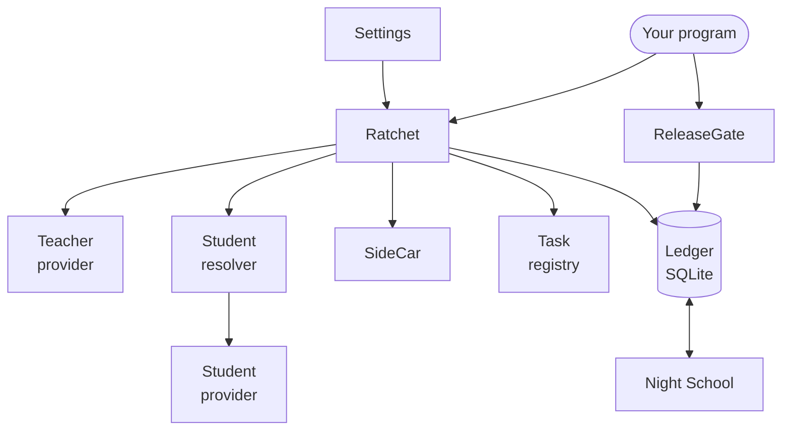
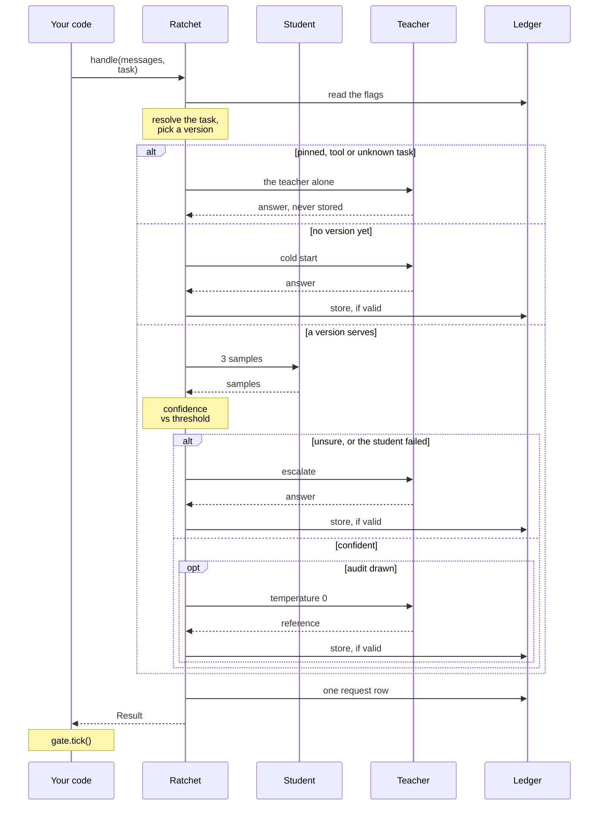

import { Steps, Aside } from '@astrojs/starlight/components';
import Summary from '../../../components/Summary.astro';
import Eli10 from '../../../components/Eli10.astro';
import Who from '../../../components/Who.astro';
import Stat from '../../../components/Stat.astro';
import StatRow from '../../../components/StatRow.astro';
import PathCard from '../../../components/PathCard.astro';
import PathGrid from '../../../components/PathGrid.astro';
import FadeContent from '../../../components/ui/FadeContent.astro';

<Summary>The Python API is the cascade the gateway runs, `Ratchet.handle`, called from your own Python code, so a batch job, a test or an agent in the same process can use the student and the teacher without an HTTP hop.</Summary>

<Eli10>

Most orders reach the kitchen through **the pass**, the counter where a waiter checks each guest. Does the guest have a membership card (an API key)? Has this table ordered too much today (quotas and rate limits)? Did the guest already order this exact dish a minute ago (idempotency)? Should the dish go out course by course (streaming)?

If you own the restaurant and you are cooking for your own staff, you can skip the counter and hand the order straight to the kitchen. The kitchen does not change. **The apprentice** <Who as="student" /> still tastes three times, **the head chef** <Who as="teacher" /> still steps in when the apprentice is unsure, **the inspector** still tastes random plates, and every head chef's dish still goes into **the recipe book** with its license note, with emails, phone numbers and card numbers blacked out first.

What you give up is the counter's checks. Nobody checks your card, because you are standing in the kitchen. So only bring your own orders this way. Two jobs the waiter used to do are now yours too: ask the manager to look at the inspector's notes now and then (tick the release gate), and close the kitchen properly at the end of the night, so plates still waiting for the inspector are finished (close the router).

</Eli10>

## How it really works

The gateway in [`ratchet/gateway.py`](https://github.com/harshbhx/ratchet/blob/main/ratchet/gateway.py) is a thin layer around a few Python objects. `Runtime.reset()` builds them once at startup, and every chat request ends in one call: `Ratchet.handle(messages, task, client=..., params=..., meta=..., n=...)`. Embedding Ratchet means building the same objects yourself and calling the same method. Scout's agents already do this inside the gateway process: each agent call is `Ratchet.handle(messages, task)`, with no HTTP in between.

<Steps>

1. **Build `Settings`.** `Settings()` in [`ratchet/config.py`](https://github.com/harshbhx/ratchet/blob/main/ratchet/config.py) reads every `RATCHET_*` variable (and `NEBIUS_API_KEY`) from the environment; keyword arguments override them, for example `Settings(mode="live")`. `Settings()` itself does not validate. `config.load()` returns the settings plus a list of variables that did not parse, and `config.check(settings)` lists every problem the gateway's startup would find, errors first. Run the check before you spend money.

2. **Open the ledger.** For live use, open it the way the gateway and `python -m ratchet.live` do: `Ledger(s.db_path, s.golden_fraction, auto_day=True, sync=s.ledger_sync())`. `auto_day=True` numbers days from the first logged request on the wall clock; without it the caller sets `ledger.day`, as simulations do. Then load the task registry with `taskspec.install(ledger, s.tasks_file)`: the built-in tasks, then `RATCHET_TASKS_FILE`'s, then the API and auto tasks stored in the ledger.

3. **Make the providers.** The teacher is an `OpenAICompatProvider` on Token Factory with the teacher's timeouts and retries (`s.teacher_timeout()`, `s.teacher_retry()`). The student is an `OpenAICompatProvider` on your vLLM endpoint with the student's timeouts and **no retry**: on the request path the teacher is the student's retry.

4. **Build `Ratchet` with a resolver for the student.** `Ratchet(s, ledger, teacher, resolver)`. The resolver is a function from a version (`ledger.Version`) to `(provider, model name)`. For vLLM with runtime LoRA the model name is the adapter's name, `v.adapter_uri`, so `lambda v: (student, v.adapter_uri)` is enough. The constructor installs the license registry, refuses a teacher that is not distillable (`licenses.require_distillable`), checks every setting it reads, and builds the off-path worker pool (`SideCar`) from `Settings.sidecar()`. A bad value raises here, before any request.

5. **Call `handle`.** `result = r.handle(messages, "ticket-triage")` runs the full cascade: task resolution, version pick (canary or live), three student samples, confidence against the threshold, escalation to the teacher, the random audit, the shadow, storage of valid teacher answers, and one ledger row. It returns a `Result`. On a teacher failure with nothing to stand in, it raises.

6. **Tick the release gate.** `gate = ReleaseGate(ledger, ReleasePolicy.from_env())`, then `gate.tick()` now and then. The tick decides shadow, canary stages, promotion and rollback from the audits in the ledger. The gateway ticks after every chat request and every Scout run, at most once per `RATCHET_TICK_INTERVAL_S` (5 s in live mode), and `python -m ratchet.live tick` can also run from cron. If nothing ticks, a canary never advances and never rolls back.

7. **Close.** Before the process exits, call `r.close(drain_s)` so queued off-path audits and shadows finish, then `ledger.close()`.

</Steps>

The objects and who owns what:

<figure class="rt-diagram">



<figcaption>

**Reading this diagram.** Your program owns two objects, `Ratchet` and `ReleaseGate`. `Ratchet` is built from the settings and holds the teacher, the student resolver, the off-path worker pool (`SideCar`), the task registry and the ledger. The release gate and Night School never talk to `Ratchet` directly: they meet it in the ledger, which is why nothing breaks if the gate ticks in another process.

</figcaption>
</figure>

One `handle` call, with the default inline checks (no `RequestMeta` passed):

<figure class="rt-diagram">



<figcaption>

**Reading this diagram.** Time runs downward. Before the student is asked, the call decides who may answer: a pinned, tool or unknown task goes to the teacher alone and is never stored, and a task with no trained version yet is a cold start. When a version serves, the student samples three times and the confidence score decides: unsure answers escalate to the teacher, confident ones are served, and a random share of those are audited by the teacher. One row is logged either way, and your code ticks the gate afterwards.

<ul class="rt-key">
  <li class="student">The student</li>
  <li class="teacher">The teacher</li>
</ul>

</figcaption>
</figure>

The [request journey](/guides/request-journey/) walks through the same cascade from the HTTP side, and [escalation and audits](/guides/escalation-and-audits/) covers what happens on each branch.

<Aside type="caution" title="Live mode is unverified">
As of Oct 22, 2026, the teacher runs on Nebius Token Factory, but the vLLM student endpoint and the training job have not run on a Nebius GPU, and live mode stays unverified until `scripts/day1_check.py` passes with a real key. The live example below follows the gateway's own wiring and is tested offline with fake HTTP transports; the mock example further down is the one verified to run.
</Aside>

## For engineers

<StatRow cols={2} label="Embedded or over HTTP">
  <Stat value="Embedded" label="your own trusted Python code" note="A batch job, a test, a notebook, a simulation or an agent in the same process. No HTTP hop, and the whole Result object." />
  <Stat value="Over HTTP" label="other services, languages or people" note="API keys, quotas, streaming and any OpenAI SDK unchanged. Put the gateway in front of anything untrusted." />
</StatRow>

### What to import

| Module | Names | Source |
|---|---|---|
| `ratchet.config` | `Settings`, `load`, `check`, `ERROR` | [config.py](https://github.com/harshbhx/ratchet/blob/main/ratchet/config.py) |
| `ratchet.ledger` | `Ledger`, `Version` | [ledger.py](https://github.com/harshbhx/ratchet/blob/main/ratchet/ledger.py) |
| `ratchet.providers` | `OpenAICompatProvider`, `GenParams`, `Completion`, `Provider`, `UpstreamError` | [providers.py](https://github.com/harshbhx/ratchet/blob/main/ratchet/providers.py) |
| `ratchet.router` | `Ratchet`, `Result`, `Choice`, `RequestMeta`, `ROUTES`, `USAGE_PARTS` | [router.py](https://github.com/harshbhx/ratchet/blob/main/ratchet/router.py) |
| `ratchet.release` | `ReleaseGate`, `ReleasePolicy` | [release.py](https://github.com/harshbhx/ratchet/blob/main/ratchet/release.py) |
| `ratchet.taskspec`, `ratchet.tasks` | `install`, `parse_spec`, `register`, `UnknownTask`, `TaskForbidden` | [taskspec.py](https://github.com/harshbhx/ratchet/blob/main/ratchet/taskspec.py), [tasks.py](https://github.com/harshbhx/ratchet/blob/main/ratchet/tasks.py) |
| `ratchet.resilience` | `UpstreamError`, `CircuitOpen` | [resilience.py](https://github.com/harshbhx/ratchet/blob/main/ratchet/resilience.py) |
| `ratchet.sidecar` | `SideCar` | [sidecar.py](https://github.com/harshbhx/ratchet/blob/main/ratchet/sidecar.py) |
| `ratchet.nightschool.orchestrate` | `run_night`, `NightReport` | [orchestrate.py](https://github.com/harshbhx/ratchet/blob/main/ratchet/nightschool/orchestrate.py) |

### A live program

This mirrors `Runtime.reset()` in live mode with a student endpoint. It needs `NEBIUS_API_KEY`, `RATCHET_STUDENT_BASE` and `RATCHET_STUDENT_KEY` in the environment ([environment variables](/api/environment/)).

```python
from ratchet import config, taskspec
from ratchet.config import Settings
from ratchet.ledger import Ledger
from ratchet.providers import OpenAICompatProvider
from ratchet.release import ReleaseGate, ReleasePolicy
from ratchet.router import Ratchet

s = Settings(mode="live")
# The gateway's startup check. An empty RATCHET_API_KEYS is an error for the gateway only: nothing here takes HTTP calls.
errors = [i for i in config.check(s) if i.level == config.ERROR and i.var != "RATCHET_API_KEYS"]
if errors:
    raise SystemExit("\n".join(i.message for i in errors))

ledger = Ledger(s.db_path, s.golden_fraction, auto_day=True, sync=s.ledger_sync())
taskspec.install(ledger, s.tasks_file)  # built-in tasks, RATCHET_TASKS_FILE, API tasks stored in the ledger

# Timeouts and retries per role: the teacher is retried within its deadline, the student never (the teacher is its retry).
teacher = OpenAICompatProvider(s.teacher_base, s.teacher_api_key, timeout=s.teacher_timeout(), retry=s.teacher_retry())
student = OpenAICompatProvider(s.student_base, s.student_api_key, timeout=s.student_timeout())

r = Ratchet(s, ledger, teacher, lambda v: (student, v.adapter_uri))  # vLLM serves each adapter under its own name
gate = ReleaseGate(ledger, ReleasePolicy.from_env())

try:
    result = r.handle([{"role": "user", "content": "I was charged twice for order 1234."}], "ticket-triage")
    gate.tick()
    print(result.route, result.served_by, result.text, result.cost_usd)
finally:
    r.close(s.sidecar()[2])  # RATCHET_SIDECAR_DRAIN_S, 10 s by default
    ledger.close()
```

Without a student endpoint (`RATCHET_STUDENT_BASE` empty), the gateway does not call an empty URL. Its resolver sends every version's calls to the untuned hosted fallback <Who as="fallback" /> on Token Factory, with the student's timeouts:

```python
fallback = OpenAICompatProvider(s.teacher_base, s.teacher_api_key, timeout=s.student_timeout())
r = Ratchet(s, ledger, teacher, lambda v: (fallback, s.fallback_student_model))  # RATCHET_FALLBACK_STUDENT
```

`Ratchet.threshold` gives that model `RATCHET_CONFIDENCE_THRESHOLD` (0.80 by default) instead of a version's calibrated threshold, because the fallback was never trained or tested on your golden set.

### A runnable example in mock mode

The mock models in [`sim/mock_models.py`](https://github.com/harshbhx/ratchet/blob/main/sim/mock_models.py) need no keys, no network and no GPU. `MockFleet` is the trainer, the golden evaluator and the student resolver at once, and `MockTeacher` plays Nemotron 3 Ultra. Everything this prints is **simulation (mock models)**. Save it as `embed_mock.py` and run `python embed_mock.py` after `make install`:

```python
"""Ratchet embedded in mock mode: mock models, no keys, no network (simulation)."""

from ratchet import taskspec
from ratchet.config import Settings
from ratchet.ledger import Ledger
from ratchet.nightschool.orchestrate import run_night
from ratchet.release import ReleaseGate, ReleasePolicy
from ratchet.router import Ratchet
from sim.mock_models import MockFleet, MockTeacher
from sim.world import make_stream

s = Settings(mode="mock")
ledger = Ledger(":memory:", s.golden_fraction)
taskspec.install(ledger, s.tasks_file)  # built-in tasks, RATCHET_TASKS_FILE, API tasks stored in the ledger

fleet = MockFleet(policy=s.gen_policy())  # the mock trainer, golden evaluator and student resolver
r = Ratchet(s, ledger, MockTeacher(), fleet.resolve, seed=7)
gate = ReleaseGate(ledger, ReleasePolicy.from_env(defaults={"min_audits": 15}))
stream = make_stream("tickets", seed=7)  # synthetic support tickets


def day(n: int, requests: int = 300) -> None:
    ledger.day = n  # simulations set the day; a live ledger (auto_day=True) counts days from the clock
    for _ in range(requests):
        t = stream.sample(n)
        result = r.handle(t.messages(), "ticket-triage")
        gate.tick()
    print(f"day {n}: last request route={result.route} served_by={result.served_by}")


day(1)  # no version yet: every request is a cold start, answered by the teacher and stored
report = run_night(ledger, fleet, fleet, gate, s.student_base_model, redact_pii=s.redact_pii)
print("night 1:", report.trained, report.version, report.admitted, report.reason)
day(2)  # version 1 starts as a 10% canary, so the student serves a small share
for d in ledger.stats_by_day():
    print(d["day"], d["requests"], round(d["student_share"], 2), d["p95_ms"])
print(r.close(0.0)["by_version"])
ledger.close()
```

On day 1 every request has route `cold_start`. Night 1 trains version 1 and admits it, and because there is no live version yet it goes straight to a 10% canary, so on day 2 only a small share of requests is served by the student. The mock gateway (`make demo`) and the simulator (`python -m sim.simulate`) are built from these same pieces.

### `Ratchet(...)` constructor

`Ratchet(settings, ledger, teacher, student_resolver, seed=None, *, clock=time.monotonic, on_adapter_missing=None, fallback_teacher=None, timer=time.perf_counter, sidecar=None, tasks_lock=None)`

| Argument | What it does |
|---|---|
| `settings` | The `Settings`. The constructor calls `check_reserved()` and the readers it needs (`unknown_task_policy`, `gen_policy`, `student_breaker`, `teacher_breaker`, `sidecar`, ...), so a bad value raises `ValueError` naming its variable |
| `ledger` | The `Ledger` every request is logged to and every example stored in |
| `teacher` | Any `Provider`. Checked against the license registry by its configured model (`RATCHET_TEACHER_MODEL`); a closed model raises `licenses.LicenseError` |
| `student_resolver` | `Callable[[Version], tuple[Provider, str]]`: the provider and model name for a version |
| `seed` | Seeds `Ratchet.rng`, which draws canary picks and audits. The gateway passes 7 |
| `clock` | Drives the circuit breakers. Tests pass a fake clock |
| `on_adapter_missing` | Called with the version when vLLM answers 404 for its adapter. The gateway passes `live.adapter_reloader(...).request`. A failing callback never fails the request |
| `fallback_teacher` | Provider for `RATCHET_TEACHER_FALLBACK_MODEL`; default the teacher's own. Used only when that model is set, and also license-checked |
| `timer` | The clock `Result.wall_ms` (`requests.wall_ms`) is measured on |
| `sidecar` | The off-path worker pool. Default `SideCar(*Settings.sidecar()[:2])`: 4 workers in live mode, none in mock mode. `SideCar(0)` keeps every check inline |
| `tasks_lock` | The lock auto-task registration takes. The gateway passes the lock its admin API takes, so the two never interleave |

One more attribute matters when you meter spend: `r.on_offpath_spend`, a callable `(client, usd)` the router calls when an off-path audit or shadow spends after its request returned. The gateway points it at its spend meter.

### `handle(...)` arguments

`handle(messages, task=None, client=None, params=None, meta=None, n=1)` returns a `Result`.

| Argument | Default | What it does |
|---|---|---|
| `messages` | required | OpenAI chat messages. The gateway validates and normalises them first (`validate_chat_request`, `normalize_messages`); embedded callers pass them as they are, so keep them plain |
| `task` | `None` | A task name or a `tasks.Task`. `None` or an invalid name means `default`. An unregistered name follows `RATCHET_UNKNOWN_TASKS`: `distill` (default) treats it like any task, `teacher` sends it to the teacher alone (route `unknown_task`), `reject` raises `tasks.UnknownTask` |
| `client` | `None` | The API key name the request came from. Recorded on the row and the example; `None` for internal callers |
| `params` | `None` | A `GenParams`: the client's generation parameters (`max_tokens`, `stop`, `temperature`, `response_format`, `tools`, `logprobs`, ...). Each role gets what its allowlist allows ([generation parameters](/reference/api/#generation-parameters)). A `response_format` binds the task to that schema; `tools` send the request to the teacher alone (route `tools`) |
| `meta` | `None` | A `RequestMeta`. Passing one also lets audits and shadows run off the request path (below) |
| `n` | `1` | Number of choices. The student draws at least `n` samples and serves only when `n` of them agree; otherwise route `n_choices` and the teacher writes them ([choices and logprobs](/reference/api/#choices-and-logprobs)) |

`teacher_only(messages, task=None, client=None, params=None, meta=None, n=1, route=None)` is the pinned path: the teacher answers (or the fallback teacher), the row is logged, nothing is stored, and no student, audit or shadow call runs. The gateway uses it with `route="multimodal"` for requests with a content part only the teacher reads.

Before a model call, two lookups help: `r.resolve(task, params)` returns the `tasks.Task` a request with those parameters would get, and `r.task_for(task, client, params)` adds the gateway's admission checks (the unknown-task policy, raising `UnknownTask`, and the task's `clients` allow-list, raising `TaskForbidden`). `handle` itself applies the unknown-task policy only, never the allow-list.

### `Result`

| Field | Meaning |
|---|---|
| `text`, `finish_reason` | Choice 0's answer after `tasks.clean_answer` (reasoning removed, structured answers as bare JSON) and why it ended: `stop`, `length`, `content_filter` or `tool_calls` |
| `choices` | Every choice, as `Choice` objects |
| `served_by` | `student` or `teacher` |
| `route` | Why it was served that way: one of `router.ROUTES` (`student`, `confidence`, `cold_start`, `pinned`, `student_error`, `student_breaker`, `degraded`, `fallback_teacher`, `n_choices`, `unknown_task`, `student_disabled`, `task_disabled`, `tools`, `multimodal`) |
| `version` | The student version that served it, or `None` when the teacher did |
| `confidence` | The student's confidence score, or `None` without student samples |
| `escalated` | True when the request went past the student: unsure (`confidence`, `n_choices`), failed (`student_error`, `student_breaker`) or held back for the task (`task_disabled`); also on a `degraded` answer. False on a cold start and on the teacher-only routes |
| `cost_usd`, `student_cost_usd`, `teacher_cost_usd` | Every model call of the request at configured prices, and its student and teacher parts |
| `baseline_usd` | What the teacher alone would have cost for this request |
| `latency_ms`, `wall_ms` | The providers' own time, and the whole cascade on the router's `timer`; the difference is Ratchet's overhead |
| `model` | The model that wrote the served answer |
| `prompt_tokens`, `completion_tokens`, `reasoning_tokens`, `cached_tokens`, `total_tokens` | The served answer's usage, as if its model had answered alone. `total_tokens` is a property |
| `usage_breakdown` | Tokens per model call, keyed by `router.USAGE_PARTS`: `student_samples`, `served`, `audit`, `shadow`, `arbitration`, `repair`. `None` for a call not made |
| `fingerprint` | The response's `system_fingerprint` |
| `degraded` | `"teacher_unavailable"` when the student's below-threshold answer stood in for a failed teacher (`RATCHET_ON_TEACHER_FAILURE=serve_student`), else `None` |
| `request_id` | The ledger row id (`requests.id`), what receipts and replays name the request by. Not `RequestMeta.request_id` |
| `stored`, `store_opt_out` | Whether a teacher answer became (or bumped) a training example, and if not allowed, why (`global`, `task`, `request`, `key`, `end_user`) |
| `audited` | Whether a teacher audit of the served answer counted |
| `overhead_pending` | True when the audit or shadow was queued to run after `handle` returned |
| `task`, `schema_valid` | The resolved task's name, and whether every choice meets the request's `response_format` (`None` without one) |

### `Choice` and `RequestMeta`

`Choice` is frozen: `text`, `finish_reason` (default `stop`), `logprobs` (OpenAI's `logprobs.content` entries when `params.logprobs` was set and they could be given, else `None`) and `tool_calls` (the teacher's tool calls for a tool request, else `None`).

`RequestMeta` is what the caller knows beyond the messages:

| Field | Default | Meaning |
|---|---|---|
| `request_id`, `client_request_id` | `None` | Your own ids for the request; `request_id` is recorded in `requests.request_id` |
| `retry_count` | `0` | The client's attempt number. Above 0, a stored duplicate's `seen` count is not bumped |
| `storable` | `True` | `False` keeps every teacher answer of this request out of the training set; the cascade is otherwise unchanged |
| `store_opt_out` | `None` | Why, when `storable` is `False` (`request` when not given) |
| `end_user` | `None` | The end user's hash (`privacy.EndUsers.hash`), never the raw id. A hash registered as no-train stores nothing |
| `end_user_aliases`, `end_user_secondary` | `()`, `None` | Other hashes of the same end user (looked up, never stored), and a second identifier's hash (logged only) |
| `idempotency_key` | `None` | The gateway acts on it before the cascade; the router never stores it |
| `offpath` | `True` | Lets this request's audit and shadow run after it returns, when the sidecar has workers |
| `student_only` | `False` | Serve only what the student answers alone; a request that needs the teacher raises `spend.BudgetExceeded`. The gateway sets it when `RATCHET_BUDGET_MODE=student_only` and the daily budget is spent |

Storage rules apply to every caller whether or not you pass a `RequestMeta`: `RATCHET_STORE_EXAMPLES=0`, `RATCHET_NO_STORE_TASKS`, pinned tasks and tool requests store nothing, and stored text is redacted first when `RATCHET_REDACT_PII` is on (the default).

### Errors

| Raised | When |
|---|---|
| `providers.UpstreamError` (an `httpx.HTTPError`) | The teacher's answer was needed (escalation, cold start, pinned, teacher-only) and the teacher failed after its retries, with no fallback teacher or degraded answer to stand in. `status` is the upstream status, or 504 for a timeout and 502 when Token Factory could not be reached; `type`, `code`, `param`, `message` and `retry_after` when the teacher sent them. Never the URL or headers |
| `resilience.CircuitOpen` (a subclass of `UpstreamError`) | The teacher's breaker is open: 503, code `teacher_circuit_open`, `retry_after` until the next probe. It opens after `RATCHET_TEACHER_BREAKER_FAILURES` (5) failed calls in a row |
| `tasks.UnknownTask` | An unregistered task under `RATCHET_UNKNOWN_TASKS=reject` |
| `tasks.TaskForbidden` | From `task_for` only: the task's `clients` do not name this client |
| `spend.BudgetExceeded` | With `RequestMeta(student_only=True)`, a request that needs the teacher |
| `ValueError`, `licenses.LicenseError` | From the constructor: a bad setting, or a teacher that is not distillable |

A student failure never raises: it is counted, and the teacher answers instead (routes `student_error` or `student_breaker`). A failed audit, shadow sample or arbitration never fails the request either. The gateway maps `UpstreamError` to its HTTP error codes; see [errors](/reference/api/#errors) in the HTTP guide.

### Tasks

The registry is module state in [`ratchet/tasks.py`](https://github.com/harshbhx/ratchet/blob/main/ratchet/tasks.py), shared by every `Ratchet` in the process. The built-in tasks are `default`, `ticket-triage`, `source-triage`, `page-read`, and the pinned `research-plan` and `research-write` (Scout's planner and writer).

- `taskspec.install(ledger, path)` builds the registry from the built-in tasks, the tasks file at `path` and the API and auto tasks stored in the ledger, and publishes it in one step. A bad file raises `taskspec.SpecError` listing every error. It returns a line for each stored task it skipped.
- `tasks.register(taskspec.parse_spec(spec, "api"))` adds one task in memory, for example `{"name": "invoice-fields", "format": "json", "fields": {"currency": {"type": "exact"}, "total": {"type": "number", "abs_tol": 0.01}}}`. It is not saved: put tasks that Night School (another process) must grade in `RATCHET_TASKS_FILE`, or create them through the [admin API](/reference/api/#put-ratchettasksname), which stores them in the ledger.
- Tests that register tasks should call `tasks.reset_builtin()` afterwards, as `tests/conftest.py` does.

See [training on your data](/guides/training-on-your-data/) for task specs for the rules.

### Off-path checks and `close`

A request's audit and shadow run **after** `handle` returns only when you pass a `RequestMeta` with `offpath=True` (the default) and the sidecar has workers. Then, if an audit was drawn or a shadow runs, `result.overhead_pending` is True, `cost_usd` covers serving only, `audited` is False, and the ledger row is finished when the job ends. A call without `meta`, with `RequestMeta(offpath=False)`, or on a `Ratchet(..., sidecar=SideCar(0))` keeps every check inline, so every cent is in the `Result`. Scout and the simulator call `handle(messages, task)` with no meta for exactly that reason: Scout's budget guard sums `cost_usd`.

| Setting | Default | Meaning |
|---|---|---|
| `RATCHET_SIDECAR_WORKERS` | 4 in live mode, 0 in mock mode | Worker threads for off-path checks |
| `RATCHET_SIDECAR_QUEUE` | 1000 | Jobs that may wait. When full, a drawn audit runs inline (an audit is never dropped) and a shadow is skipped |
| `RATCHET_SIDECAR_DRAIN_S` | 10 | How long the gateway's shutdown waits; pass the same to `close` |

`r.close(drain_s)` waits at most `drain_s` seconds, gives up on the rest and returns `r.sidecar_report()`: the queue's counts (`workers`, `queued`, `running`, `done`, `failed`, `full`, `abandoned`, ...) and, per version, `audits_inline`, `shadows_dropped`, `audits_abandoned` and `shadows_abandoned`. Rows of abandoned jobs stay pending, and the release gate ignores them.

`r.health()` returns the failure counters (`student_errors`, `audit_errors`, `shadow_errors`, `repair_errors`), the stand-in counts (`degraded_answers`, `fallback_answers`) and `breakers`: each breaker's `state` (`closed`, `open` or `half_open`), `failures`, `open_until` and `open_s`, by name (`teacher`, `fallback_teacher`, and `student` and `shadow` once used). The gateway does not serve this over HTTP.

### Reading the ledger

The read helpers the dashboard uses work from Python too:

```python
print(ledger.latency_percentiles(day=None, served_by="student", qs=(0.5, 0.95)))  # nearest rank over requests.wall_ms
print([(d["day"], d["p50_student_ms"], d["p95_ms"]) for d in ledger.stats_by_day()])
print(ledger.stats_by_task())   # per task: requests, student share, audits, threshold, precision, coverage
print(ledger.totals())          # whole-ledger totals
print(ledger.events(last=10))   # the release log, oldest first
print(ledger.live())            # the live Version, or None
```

What each table holds is on [the ledger](/guides/ledger/) page.

### Testing seams

Never call real APIs in tests. Every live piece takes its network and clocks as arguments:

- `OpenAICompatProvider(base_url, api_key, timeout=..., retry=..., transport=httpx.MockTransport(handler), sleep=lambda _: None, clock=..., rng=...)` runs live code paths against a fake server.
- A fake provider is any object with `complete(messages, model, n=1, temperature=0.0, logprobs=False, response_format=None, params=None, **_)` that returns a list of `Completion`. Give it a `base_url` attribute: breakers are kept per role and endpoint, and the endpoint is the provider's `base_url` (else its class).
- `Ratchet(..., seed=7)` fixes the random draws, `clock=` drives the breakers, `timer=` the wall time, and `sidecar=SideCar(0)` keeps checks inline. `Ledger(":memory:")` needs no file.
- `sim.mock_models`: `MockTeacher`, `MockStudent`, and `MockFleet` (trainer, evaluator and resolver).

A live-mode test with a fake teacher, verified to run:

```python
import json

import httpx

from ratchet.config import Settings
from ratchet.ledger import Ledger
from ratchet.providers import OpenAICompatProvider
from ratchet.router import Ratchet
from ratchet.sidecar import SideCar


def fake_teacher(request: httpx.Request) -> httpx.Response:
    body = json.loads(request.content)
    answer = {"category": "billing", "priority": "medium", "reply": "We are looking into the double charge."}
    return httpx.Response(200, json={
        "model": body["model"],
        "choices": [{"index": 0, "message": {"role": "assistant", "content": json.dumps(answer)}, "finish_reason": "stop"}],
        "usage": {"prompt_tokens": 60, "completion_tokens": 20, "total_tokens": 80},
    })


s = Settings(mode="live", teacher_api_key="test")  # live code paths, fake network
ledger = Ledger(":memory:")
teacher = OpenAICompatProvider(s.teacher_base, s.teacher_api_key, transport=httpx.MockTransport(fake_teacher), sleep=lambda _: None)
student = OpenAICompatProvider("http://student.invalid/v1", "", transport=httpx.MockTransport(lambda req: httpx.Response(503)))
r = Ratchet(s, ledger, teacher, lambda v: (student, v.adapter_uri), sidecar=SideCar(0))

result = r.handle([{"role": "user", "content": "I was charged twice for order 1234."}], "ticket-triage")
assert result.route == "cold_start" and result.served_by == "teacher" and result.stored
r.close(0.0)
ledger.close()
```

The test suite's own patterns are in [testing](/reference/testing/).

## Common questions

### When should I embed instead of calling the gateway over HTTP?

Embed when the caller is your own trusted Python code in the same process: a batch job over a backlog, a test, a notebook, a simulation, or an agent framework like Scout inside the gateway. You save the HTTP hop and get the `Result` object with every field. Use the gateway when callers are other services, other languages or other people, when you need API keys, quotas or streaming, or when you want any OpenAI SDK to work unchanged. If untrusted input can reach your program, put the gateway in front of it.

### Is `handle` thread-safe?

Yes. Scout's triage and reader agents call `Ratchet.handle` from a pool of 6 threads, and the gateway runs each chat request on a worker thread. The ledger guards every write, and every read the request path or the release gate makes, with one re-entrant lock over a shared SQLite connection; the router's counters and breakers have their own locks. Two things to know: `Ratchet.rng` is shared, so the order of random draws (canary picks, audits) is not reproducible across threads; and `gate.tick()` should run from one thread at a time, as the gateway does with a lock around it.

### Can two processes share one ledger file?

Run one serving process per ledger: one gateway, or one embedded program, never both on the same `RATCHET_DB`. The nightly job, the cron tick and the admin CLI may open the same file from other processes; the ledger's caches see their commits. A second serving process is not guarded against yet (a single-writer lease is planned): it would double every in-memory limit, and each process would keep its own breakers. Inside a process that already runs the gateway, use its `Ratchet` as Scout does instead of opening a second `Ledger` on the file. See [two gateway processes on one ledger](/reference/runbook/#two-gateway-processes-on-one-ledger).

### What do I lose compared with the gateway?

Everything that lives in the HTTP layer of `ratchet/gateway.py`: API keys and per-key task scopes, daily quotas and spend budgets, rate limits and in-flight caps, idempotency keys, streaming, body limits, OpenAI request validation and the error envelope, the `ratchet` response block and headers, end-user hashing from `user` and `safety_identifier`, the throttled gate tick, the adapter reloader, the hourly retention purge, `/ratchet/stats` and the dashboard, and Scout's budget guard. What stays is everything in the router: licenses, redaction before storage, storage opt-outs, pinned tasks, the unknown-task policy, breakers, the fallback teacher, parameter allowlists, structured outputs, cost accounting and the ledger row. The full HTTP surface is in the [HTTP API guide](/reference/api/) and the generated [OpenAPI reference](/api/http/).

### How do I run Night School from Python?

In live mode, run `python -m ratchet.live night` (see [command line](/api/cli/)): it opens the ledger, installs the tasks, builds the Nebius trainer and the golden evaluator, and calls `run_night`. From your own code, call `ratchet.nightschool.orchestrate.run_night(ledger, trainer, evaluator, gate, base_model, ...)` with any trainer and evaluator, as the mock example does with `MockFleet`. It returns a `NightReport` (`trained`, `version`, `admitted`, `reason`, `eval`). It never trains on student answers, keeps the golden set out of training, and skips while a release is in shadow or canary. See [Night School](/guides/night-school/) and [the release gate](/guides/release-gate/).

### Does the embedded path cost anything extra?

No. The model calls are the same as over HTTP, and `cost_usd` prices them with the prices in `ratchet/config.py`, which are unverified until `scripts/day1_check.py` passes with a real key. With off-path checks, the audit and shadow cost lands in the ledger row after `handle` returns, not in that `Result`. Whether self-hosting the student pays at all depends on volume; see [cost and savings](/guides/cost-and-savings/).

### What if the student is confidently wrong?

The same as over HTTP: the answer is served. A random audit (5% of student answers by default, `RATCHET_AUDIT_RATE`) may catch it, and audits drive canary promotion and rollback, but only if something calls `gate.tick()`. Precision means agreement with Nemotron 3 Ultra on held-out rows, not ground truth. See [confidence](/guides/confidence/).

## Related

<FadeContent distance={16}>
<PathGrid cols={3} label="Related pages">
  <PathCard title="HTTP API guide" href="/reference/api/" icon="book" eyebrow="Reference" tone="neutral" description="Every endpoint, field, header and error of the gateway." />
  <PathCard title="OpenAPI reference" href="/api/http/" icon="code" eyebrow="Generated" tone="neutral" description="The generated reference for every HTTP route." />
  <PathCard title="Command line" href="/api/cli/" icon="code" eyebrow="Generated" tone="neutral" description="python -m ratchet.live night, tick, reload and the other tools." />
  <PathCard title="Environment variables" href="/api/environment/" icon="layers" eyebrow="Generated" tone="neutral" description="Every setting Settings reads, with its default." />
  <PathCard title="One request's journey" href="/guides/request-journey/" icon="start" eyebrow="Over HTTP" tone="neutral" description="The same cascade, seen from the HTTP side." />
  <PathCard title="Scout" href="/guides/scout/" icon="search" eyebrow="Embedded" description="The research agents that call handle in-process." />
</PathGrid>
</FadeContent>
