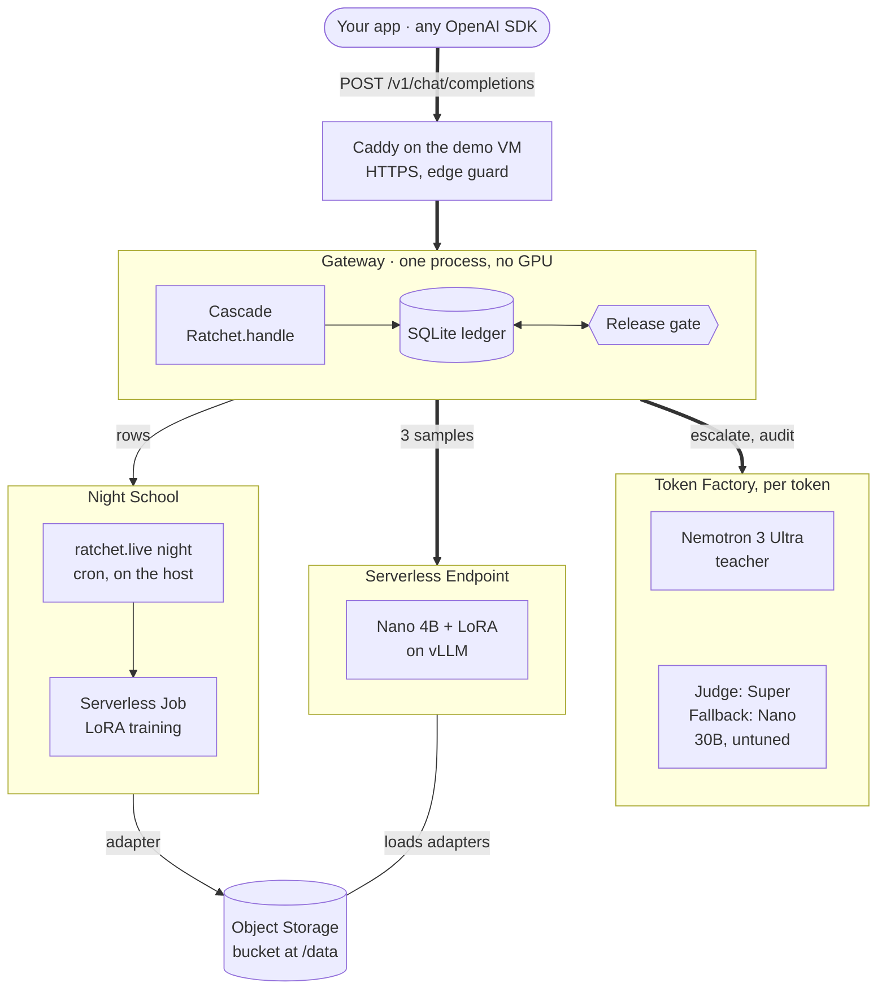
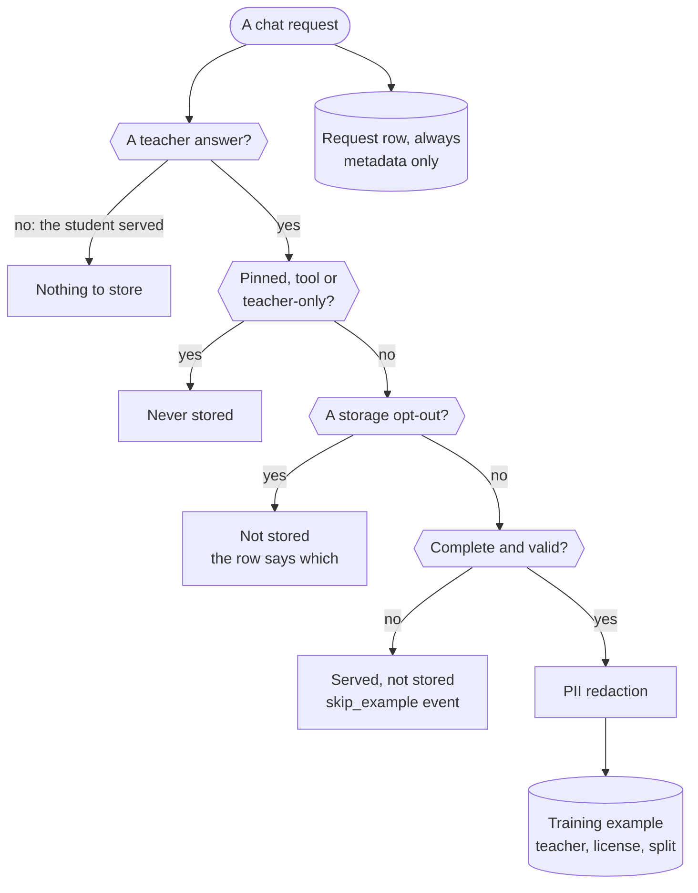
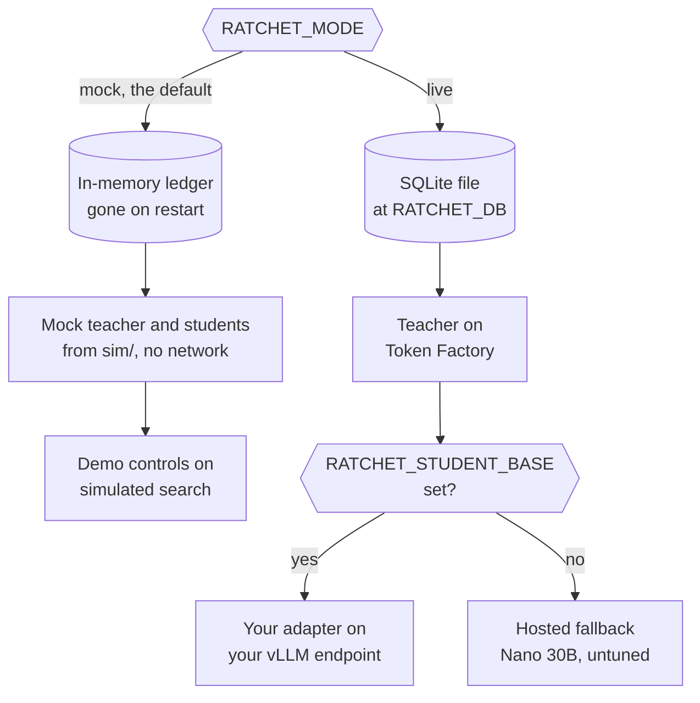
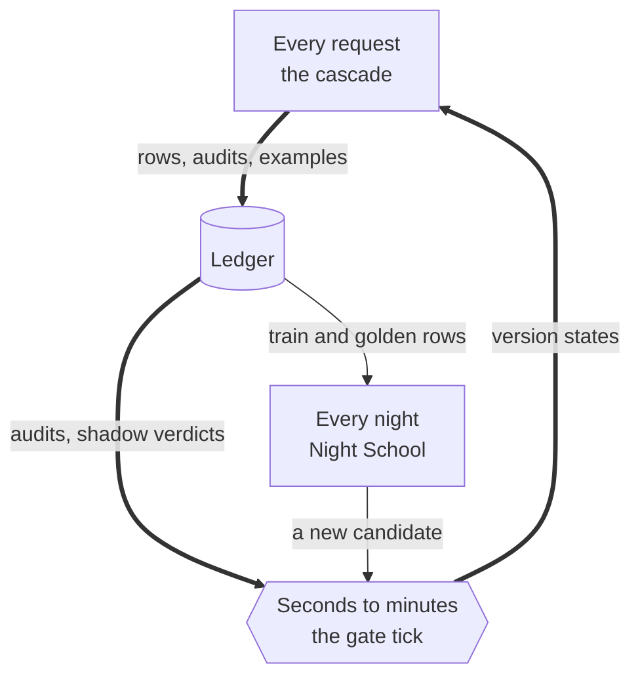

import { Steps, Aside, FileTree } from '@astrojs/starlight/components';
import Summary from '../../../components/Summary.astro';
import Eli10 from '../../../components/Eli10.astro';
import Who from '../../../components/Who.astro';
import Stat from '../../../components/Stat.astro';
import StatRow from '../../../components/StatRow.astro';
import Flow from '../../../components/Flow.astro';
import FlowStep from '../../../components/FlowStep.astro';
import PathCard from '../../../components/PathCard.astro';
import PathGrid from '../../../components/PathGrid.astro';
import FadeContent from '../../../components/ui/FadeContent.astro';
import GradientText from '../../../components/ui/GradientText.astro';

<Summary>Ratchet is <GradientText text="one small gateway process with one SQLite ledger" tone="owned" />, plus a few Nebius services it calls: Token Factory for the teacher, a GPU endpoint for the student, a nightly training job and a storage bucket that carries data and adapters between them.</Summary>

<Eli10>

Picture the whole restaurant from above.

- **The pass** (the gateway) is where every order arrives and every plate leaves. It decides who cooks each order. It never cooks anything itself, so it needs only a small room.
- **The apprentice's station** (the student endpoint) is a rented kitchen with a stove, the GPU. The apprentice cooks there, reading from the **notebook of techniques** (the LoRA adapter you own).
- **The agency** (Nebius Token Factory) sends the **head chef** (Nemotron 3 Ultra) for each hard dish and charges per plate. It also has a food critic (the judge, Nemotron 3 Super) and a spare, untrained cook (the hosted fallback, Nemotron 3 Nano 30B) for when the apprentice's station is closed to save money.
- **The recipe book** (the ledger) sits at the pass. Every order, every dish the head chef cooks and every exam result is written in it.
- **The storeroom** (the Object Storage bucket) holds the night's study pack and every notebook the apprentice ever wrote.
- **Night school** (a Serverless Job on a GPU) opens once a night, reads the study pack from the storeroom and writes a new notebook back into it.
- **The doorman** (Caddy on the demo machine) checks the front door and keeps the connection to guests private (HTTPS).

Three clocks run the place: one ticks for every order, one every few minutes to check how the newest notebook is doing, and one once a night for school.

</Eli10>

<StatRow cols={3} label="The big picture at a glance">
  <Stat value="One process" label="the gateway, with no GPU" note="It routes, scores and logs. A 2 vCPU, 8 GB VM is enough, because it never runs a model." />
  <Stat value="One file" label="the SQLite ledger" note="Request metadata, stored teacher answers with their licenses, versions and the release log." />
  <Stat value="Three loops" label="at three speeds" note="One for every request, one every few seconds to minutes, and one once a night." />
</StatRow>

## How it really works

The design in one picture. It shows the intended flow; the adapters so far were trained by hand on a borrowed GPU, and teacher calls run on Nebius Token Factory.

<figure>
  <picture>
    <source media="(prefers-color-scheme: dark)" srcset="/img/architecture-dark.png" />
    
  </picture>
</figure>

The detailed diagram, with the services each piece runs on:

<figure class="rt-diagram">



<figcaption>

**Reading this diagram.** Start at the top. The thick arrows are the request path: your app's call passes Caddy (only on the demo VM), then the cascade asks the student endpoint for 3 samples, and the teacher on Token Factory when the student is unsure, an audit is drawn or no student may answer (a cold start, a pinned task). Every request writes one row to the SQLite ledger; the release gate reads the audits there and writes version states back. At night, Night School reads the rows, a Serverless Job trains a new adapter into the Object Storage bucket, and the endpoint loads adapters from that bucket at `/data`. Not drawn, to keep it readable: the night also loads the candidate into vLLM, grades it there (the judge scores free-text rows) and hands it to the release gate. The hosted fallback answers student calls only when no endpoint is set.

<ul class="rt-key">
  <li class="student">The student: Nano plus your adapter</li>
  <li class="teacher">Rented per token</li>
  <li class="store">Keeps data</li>
  <li class="gate">Decides releases</li>
  <li class="outline">Optional or fallback</li>
  <li class="edge-main">Request path</li>
</ul>

</figcaption>
</figure>

### The components

<Flow label="One request">
  <FlowStep title="Your app" meta="any OpenAI SDK">Sends a chat request with a task name.</FlowStep>
  <FlowStep title="Gateway and cascade" meta="one process">Admission checks, then the student first.</FlowStep>
  <FlowStep title="Student" tone="owned" meta="Nano 4B + LoRA">Answers when it is confident.</FlowStep>
  <FlowStep title="Teacher" tone="rented" meta="Ultra on Token Factory">Answers the rest.</FlowStep>
</Flow>

| Component | What it does | Where it runs | Code |
|---|---|---|---|
| Your app | Sends OpenAI-style chat requests, with a task name | Anywhere | Any OpenAI SDK |
| Gateway | OpenAI-compatible API, admission checks, pages, Scout endpoints, the release gate's tick | One process, one uvicorn worker; in the demo, a Nebius CPU VM (`2vcpu-8gb`) | [`ratchet/gateway.py`](https://github.com/harshbhx/ratchet/blob/main/ratchet/gateway.py) (`Runtime`) |
| Cascade (router) | Student first, confidence, teacher on escalation, audits, shadow, cost | Inside the gateway | [`ratchet/router.py`](https://github.com/harshbhx/ratchet/blob/main/ratchet/router.py) (`Ratchet.handle`) |
| Student <Who as="student" /> | `nvidia/NVIDIA-Nemotron-3-Nano-4B-BF16` with the LoRA adapter you own, served by vLLM with runtime LoRA loading | A Nebius Serverless Endpoint (L40S by default) | [`deploy/student_endpoint.sh`](https://github.com/harshbhx/ratchet/blob/main/deploy/student_endpoint.sh) |
| Teacher <Who as="teacher" /> | `nvidia/Nemotron-3-Ultra-550b-a55b` answers escalations, cold starts, pinned tasks, audits and arbitrations | Nebius Token Factory | `RATCHET_TEACHER_MODEL` |
| Judge <Who as="judge" /> | `nvidia/nemotron-3-super-120b-a12b` scores free-text golden rows in JSON mode (a diagnostic, `judge_pass_rate`) | Nebius Token Factory | `RATCHET_JUDGE_MODEL` |
| Hosted fallback <Who as="fallback" /> | `nvidia/NVIDIA-Nemotron-3-Nano-30B-A3B`, untuned, plays the student when no endpoint is configured | Nebius Token Factory | `RATCHET_FALLBACK_STUDENT` |
| Ledger | Requests, examples with provenance, versions, events, failures, receipts | One SQLite file on the gateway's local disk | [`ratchet/ledger.py`](https://github.com/harshbhx/ratchet/blob/main/ratchet/ledger.py) |
| Night School | Builds the train and golden sets, trains, evaluates, signs a bill of materials, calls the gate | Driven by cron on the gateway host; training on a Nebius Serverless Job (`gpu-l40s-a`, `1gpu-8vcpu-32gb`) with TRL and PEFT | [`ratchet/live.py`](https://github.com/harshbhx/ratchet/blob/main/ratchet/live.py), [`ratchet/nightschool/`](https://github.com/harshbhx/ratchet/tree/main/ratchet/nightschool) |
| Bucket | Training rows, adapters, bills of materials | Nebius Object Storage, mounted at `/data` in the job and the endpoint | `RATCHET_BUCKET_ID`, `RATCHET_SYNC_CMD` |
| Release gate | Golden gate, shadow, canary 10%, 50%, 100%, rollback | Inside the gateway (and the cron tick) | [`ratchet/release.py`](https://github.com/harshbhx/ratchet/blob/main/ratchet/release.py) (`ReleaseGate`) |
| Web app | `/` (the story), `/scout`, `/dashboard`; no-build pages at `/lite*` | Served by the gateway from `ratchet/web/dist` | [`web/`](https://github.com/harshbhx/ratchet/tree/main/web) |
| Scout | A multi-agent research demo whose calls go through the cascade | Inside the gateway; Tavily for web search in live mode | [`ratchet/scout/`](https://github.com/harshbhx/ratchet/tree/main/ratchet/scout) |
| Caddy | Automatic HTTPS, security headers, an optional token guard on `/v1/*`, `/ratchet/demo/*` and `/ratchet/admin/*` | Next to the gateway on the demo VM (Docker Compose) | [`deploy/vm/Caddyfile`](https://github.com/harshbhx/ratchet/blob/main/deploy/vm/Caddyfile) |

Token Factory does not offer fine-tuning or LoRA serving for Nemotron yet (README, Oct 2026), so the student is trained and served on Nebius AI Cloud. The gateway itself does no inference, which is why a 2-vCPU machine is enough.

### How the pieces connect

<Steps>

1. **Your app calls the gateway** at `POST /v1/chat/completions` with an API key and a task name (`X-Ratchet-Task`). The gateway checks the body size, the key, rate limits, the request itself, the task and the quotas before any model is called.
2. **The cascade calls the student endpoint** over HTTPS with the OpenAI API. The model name it sends is the version's adapter name (`student-vN`), because vLLM serves each LoRA adapter under its own name. Three samples come back in one call.
3. **When the student is unsure, or for an audit, the cascade calls the teacher** on Token Factory. Each teacher answer that is complete and valid goes into the ledger as a training example, with the teacher's model id and license, after PII redaction.
4. **Every request writes one row** to the ledger: who served it, the route, confidence, cost and the all-teacher baseline. No prompt text is kept in that row; text is kept only in training examples, redacted.
5. **After requests, the release gate ticks**: it reads the audits and shadow verdicts from the ledger and moves versions between states (shadow, canary 10%, 50%, live, rolled back).
6. **At night, `python -m ratchet.live night` runs Night School**: it writes `night/train.jsonl` locally, uploads it to the bucket with `RATCHET_SYNC_CMD`, starts the training job with `RATCHET_TRAIN_CMD` (default `bash deploy/train_job.sh {version}`) and waits.
7. **The training job reads the bucket at `/data`** and writes the adapter to `/data/adapters/student-vN/`, with `NOTICE.md` and its training metadata beside the weights.
8. **The gateway host tells vLLM to load the new adapter** with `POST /v1/load_lora_adapter`, so no endpoint restart is needed. Night School then scores it on the golden set (the judge scores free-text rows), signs its bill of materials and hands the candidate to the gate. Last, the night writes the bill of materials and `NOTICE.md` into the adapter's folder and syncs the bucket again.
9. **The pages read the same ledger** through `GET /ratchet/stats`, `GET /ratchet/cost` and the other dashboard endpoints. Scout calls `Ratchet.handle` in the same process, once for each of its model calls.

</Steps>

<Aside type="caution" title="The GPU steps are scripted and ready to run">
As of Oct 25, 2026, the teacher runs on Nebius Token Factory. Steps 2 and 6 to 8 (the student endpoint and the training job) are scripted and tested against mock models and fake HTTP transports, ready to run with `make nebius-plan` and `make nebius-up`; the public demo has no student endpoint yet, so the teacher answers every request. The `nebius ai` commands in `deploy/` follow the CLI reference. Live mode itself runs on the public demo, where every request is a real Token Factory call. See the [deployment guide](/reference/deployment/) and [Host on Nebius](/guides/host-on-nebius/).
</Aside>

### What a request leaves behind

Every request leaves exactly one row of metadata. Text is kept only when a teacher answer passes every check below, and then only after PII redaction.

<figure class="rt-diagram">



<figcaption>

**Reading this diagram.** The short branch to the cylinder always happens: one request row with the route, cost, confidence and ids, never the prompt or the answer. The API key appears in it by name only, and an end user only as a keyed hash. The chain of checks down the middle decides whether any text is kept; each dashed box is a way out with nothing stored. A teacher answer exists after an escalation, a cold start, an audit or a shadow arbitration; the student's own answers are never stored. Pinned tasks, tool requests and other teacher-only requests are never stored (the one exception is an over-length request on a task that sets `store_ineligible`). Any storage opt-out stops it next: `store: false`, `X-Ratchet-Store: none`, `metadata.ratchet_store`, a key with `store=0`, a no-store task, a no-train end user or zero retention. Then the answer must be complete and valid under the task's spec. Only then are the messages, the stored conditions and the answer redacted and written as a training example with the teacher's model id and license, in the golden or the train split. An erased example's hash is refused from then on.

</figcaption>
</figure>

### Mock mode and live mode

`RATCHET_MODE` picks one of two runtimes, built in `Runtime.reset` in `ratchet/gateway.py`:

<figure class="rt-diagram">



<figcaption>

**Reading this diagram.** One setting picks the runtime when the gateway starts (`Runtime.reset`). The left branch needs no network and no keys, and every number it shows is simulation. The right branch keeps a real ledger file and calls the teacher on Token Factory. Its student is your adapter on your own vLLM endpoint when `RATCHET_STUDENT_BASE` is set, and otherwise the untuned Nano 30B on Token Factory, drawn dashed because it is a stand-in, not the adapter you own.

</figcaption>
</figure>

| | Mock mode | Live mode |
|---|---|---|
| Ledger | `:memory:`, gone on restart | SQLite file at `RATCHET_DB`, day 1 starts at the first request |
| Teacher and student | Mock models from `sim/` (deterministic, no network) | Token Factory teacher; vLLM endpoint, or the hosted fallback when `RATCHET_STUDENT_BASE` is empty |
| Night School | `MockFleet` trains and scores in memory; a simulated day runs from the dashboard (`POST /ratchet/demo/day`) or at startup (`RATCHET_MOCK_WARMUP_DAYS`) | `python -m ratchet.live night` from cron, with a real training job |
| Audit rate | At least 0.10 | `RATCHET_AUDIT_RATE`, default 0.05 |
| Canary audits needed per stage | 15 (unless `RATCHET_MIN_AUDITS` is set) | 20 (`ReleasePolicy.min_audits`) |
| Gate tick from requests | After every request | At most once every 5 s (`RATCHET_TICK_INTERVAL_S`) |
| Audits and shadow | Run before the response (0 sidecar workers) | Run after the response on 4 sidecar workers (`RATCHET_SIDECAR_WORKERS`) |
| API keys | Optional | Required (`RATCHET_API_KEYS`), unless `RATCHET_ALLOW_UNAUTHENTICATED=1` with a guard in front |
| Scout search | Simulated results | Tavily when `TAVILY_API_KEY` is set |
| Numbers it shows | **Simulation** | Live traffic |

With no `RATCHET_STUDENT_BASE`, a trained version's student calls go to the untuned hosted Nano 30B, held to the global threshold `RATCHET_CONFIDENCE_THRESHOLD` (0.80) instead of the version's calibrated one. Those answers are still reported as `served_by: student`; the response's `model` field names the model that wrote them, and the pages label them "Nano 30B · hosted", not as your adapter.

### Three loops at three speeds

<figure class="rt-diagram">



<figcaption>

**Reading this diagram.** The thick loop turns fastest: requests write rows, the gate tick reads the audits and shadow verdicts in them, and the version states it writes decide which student the next request meets. The thin path turns once a night: Night School reads the training and golden rows from the same ledger and hands a new candidate to the gate. In live mode cron can also run the tick, so a quiet gateway still moves its releases.

</figcaption>
</figure>

| Loop | How often | What it does | Entry point |
|---|---|---|---|
| The request | Every call; seconds at most | Pick a version, sample the student, serve or escalate, maybe audit, maybe shadow, log one row | `Ratchet.handle` |
| The gate tick | After requests (live: at most every 5 s) and from cron every 5 minutes | Shadow decisions, canary 10% to 50% to live, rollback, alerts | `ReleaseGate.tick`, `python -m ratchet.live tick` |
| The night | Once a night (02:30 on the demo VM's cron line) | Skip if a release is in flight, training is paused or fewer than 50 new examples arrived; otherwise build, train, evaluate, gate | `run_night`, `python -m ratchet.live night` |

Two more jobs run on the side: `python -m ratchet.live seal` seals the savings receipts of each ledger day that ended (hourly), and `deploy/vm/backup.sh` backs up the ledger (daily at 03:10 UTC). On the demo VM only the backup is switched on by default; the night, tick and seal lines in `/etc/cron.d/ratchet` are commented out until live mode works by hand.

The loops share only the ledger. The gate reads what requests wrote, and Night School does not train while a version is in shadow or canary, so a release finishes or fails before the next candidate is trained.

## For engineers

**`Runtime` wires it all.** [`ratchet/gateway.py`](https://github.com/harshbhx/ratchet/blob/main/ratchet/gateway.py) `Runtime.__init__` checks the whole configuration first (`config.check`, every error in one `ConfigError`), then `Runtime.reset` builds the ledger, the teacher provider, the student resolver (in live mode: the endpoint and `v.adapter_uri`, or the hosted fallback model), the `Ratchet` cascade and the `ReleaseGate`. A mock reset (`POST /ratchet/demo/reset`) rebuilds everything.

**Settings that shape the picture** (defaults from [`ratchet/config.py`](https://github.com/harshbhx/ratchet/blob/main/ratchet/config.py); all of them in the [configuration reference](/reference/configuration/)):

| Variable | Default | Meaning |
|---|---|---|
| `RATCHET_MODE` | `mock` | `mock` or `live` |
| `RATCHET_DB` | `ratchet.db` | Ledger file (live mode) |
| `RATCHET_TEACHER_BASE` | `https://api.tokenfactory.nebius.com/v1` | Token Factory, for the teacher, judge and hosted fallback |
| `RATCHET_TEACHER_MODEL` | `nvidia/Nemotron-3-Ultra-550b-a55b` | Must be licensed for distillation, or startup fails |
| `RATCHET_STUDENT_BASE` | empty | Your vLLM endpoint; empty means the hosted fallback |
| `RATCHET_STUDENT_BASE_MODEL` | `nvidia/NVIDIA-Nemotron-3-Nano-4B-BF16` | The base every adapter is trained on |
| `RATCHET_DATA_DIR` | `data` | Local folder laid out like the bucket |
| `RATCHET_TRAIN_CMD` | `bash deploy/train_job.sh {version}` | Starts training and waits for it |
| `RATCHET_ADAPTER_ROOT` | `/data/adapters` | Where vLLM finds adapters; also used to reload one vLLM forgot |

**The bucket's layout**, as the training job and the endpoint see it at `/data`:

<FileTree>
- data
  - night
    - train.jsonl the rows Night School built tonight
  - adapters
    - student-v3
      - adapter_model.safetensors written by the training job
      - ratchet_manifest.json base model, licenses, template arguments
      - NOTICE.md base model and teacher licenses
      - ratchet_bom.json the signed bill of materials
  - boms
    - student-v3.json a copy of the same bill of materials
</FileTree>

The ledger is not in the bucket. With the default WAL journal it must stay on the gateway host's local disk, because WAL needs shared memory between the processes that open the file (the gateway and the cron jobs); `RATCHET_DB_SYNC=FULL` is the setting for a network mount ([architecture](/reference/architecture/), section 11). On the demo VM it lives in a Docker volume.

**Commands:**

```bash
make demo                                    # mock gateway with a 4-day warm-up on :8000 (simulation)
bash deploy/student_endpoint.sh create       # once; DRY_RUN=1 first. Later: start, stop, status
python -m ratchet.live night                 # Night School (cron)
python -m ratchet.live tick                  # the release gate (cron, every 5 minutes)
python -m ratchet.live seal                  # savings receipts of days that ended (cron, hourly)
python -m ratchet.config check               # the startup config check: exit 0, 1 or 2
DRY_RUN=1 bash deploy/vm/create_vm.sh        # the demo VM, commands printed only
```

**Endpoints the pages use:** `GET /ratchet/stats`, `GET /ratchet/cost`, `GET /ratchet/tasks`, the Scout endpoints under `/scout/*`, and, in mock mode only, `/ratchet/demo/*`. See the [API reference](/reference/api/).

## Common questions

### Why does the gateway not need a GPU?

It never runs a model. It sends the student's samples to the vLLM endpoint and the teacher's calls to Token Factory, and does the rest (scoring, logging, the gate) in plain Python. The demo VM is 2 vCPU and 8 GB.

### Why one SQLite file and one process?

At demo scale (thousands to tens of thousands of requests a day) one file needs no setup, is easy to back up and inspect, and is fast enough. The price is one gateway process: run one uvicorn worker. A Postgres ledger for several workers is planned.

### What happens when the GPU endpoint is stopped?

If `RATCHET_STUDENT_BASE` still points at it, student calls fail, and after 5 failures in a row the student's circuit breaker sends requests straight to the teacher (route `student_breaker`) until a probe succeeds. To keep a student answering while the endpoint is off, leave `RATCHET_STUDENT_BASE` empty: student calls then go to the hosted, untuned Nano 30B on Token Factory, held to the 0.80 default threshold and not covered by the adapter's precision certificate. Nebius's docs say a stopped endpoint is not billed for compute or its own storage; a mounted bucket still is.

### Why not train and serve the student on Token Factory?

Token Factory does not offer fine-tuning or LoRA serving for Nemotron yet (README, Oct 2026). So training runs as a Serverless Job and serving on a Serverless Endpoint, both on Nebius AI Cloud.

### What does running it cost?

Estimates only. The demo VM: about $72.50 for Oct 29 to Dec 15, 2026, before live usage (prices as of Oct 20, 2026, [demo VM guide](/reference/deploy-nebius-vm/)). The student endpoint: about $32 per full day if left on, and a training run about $0.70 to $1.35 a night, at about $1.35 per L40S GPU-hour ([Nebius pricing](https://docs.nebius.com/compute/resources/pricing), read Oct 22, 2026; [deployment guide](/reference/deployment/#4-cost-estimates)). See [Cost and savings](/guides/cost-and-savings/).

### What runs on Nebius today?

The teacher: it runs on Nebius Token Factory, and the public demo calls it for real. As of Oct 25, 2026 the GPU side (the student endpoint and the training job) is scripted and covered by offline tests with fake transports, ready to run with `make nebius-plan` and `make nebius-up` after the day-1 checks. The text-to-SQL and tool-calling adapters were trained on a borrowed GPU.

## Related

<FadeContent distance={16}>
<PathGrid cols={2} label="Related guides">
  <PathCard title="One request's journey" href="/guides/request-journey/" icon="start" eyebrow="Every request" tone="neutral" description="The request loop, step by step, from admission to the ledger row." />
  <PathCard title="Night School" href="/guides/night-school/" icon="loop" eyebrow="Every night" description="The nightly loop that trains a fresh adapter you own." />
  <PathCard title="The release gate" href="/guides/release-gate/" icon="gate" eyebrow="Every few minutes" tone="neutral" description="The tick loop: shadow, canary 10%, 50%, live, and rollback." />
  <PathCard title="Host it on Nebius" href="/guides/host-on-nebius/" icon="server" eyebrow="Deploy" tone="neutral" description="Putting the pieces on real infrastructure, with costs." />
</PathGrid>
</FadeContent>
