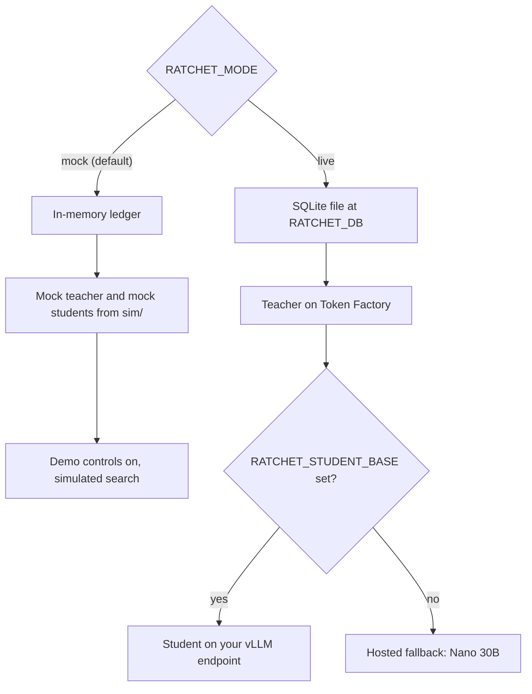
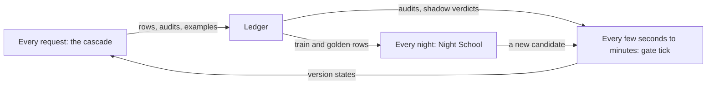

import { Steps, Aside, FileTree, LinkCard, CardGrid } from '@astrojs/starlight/components';
import Summary from '../../../components/Summary.astro';
import Eli10 from '../../../components/Eli10.astro';
import Who from '../../../components/Who.astro';
import BigPicture from '../../../components/diagrams/BigPicture.astro';

<Summary>Ratchet is one small gateway process with one SQLite ledger, plus a few Nebius services it calls: Token Factory for the teacher, a GPU endpoint for the student, a nightly training job and a storage bucket that carries data and adapters between them.</Summary>

<Eli10>

Picture the whole restaurant from above.

- **The pass** (the gateway) is where every order arrives and every plate leaves. It decides who cooks each order. It never cooks anything itself, so it needs only a small room.
- **The apprentice's station** (the student endpoint) is a rented kitchen with a stove, the GPU. The apprentice cooks there, reading from the **notebook of techniques** (the LoRA adapter you own).
- **The agency** (Nebius Token Factory) sends the **head chef** (Nemotron 3 Ultra) for each hard dish and charges per plate. It also has a food critic (the judge, Nemotron 3 Super) and a spare, untrained cook (the hosted fallback, Nemotron 3 Nano 30B) for when the apprentice's station is closed to save money.
- **The recipe book** (the ledger) sits at the pass. Every order, every dish the head chef cooks and every exam result is written in it.
- **The storeroom** (the Object Storage bucket) holds the night's study pack and every notebook the apprentice ever wrote.
- **Night school** (a Serverless Job on a GPU) opens once a night, reads the study pack from the storeroom and writes a new notebook back into it.
- **The doorman** (Caddy on the demo machine) checks the front door and keeps the connection to guests private (HTTPS).

Three clocks run the place: one ticks for every order, one every few minutes to check how the newest notebook is doing, and one once a night for school.

</Eli10>

## How it really works

<BigPicture />

### The components

| Component | What it does | Where it runs | Code |
|---|---|---|---|
| Your app | Sends OpenAI-style chat requests, with a task name | Anywhere | Any OpenAI SDK |
| Gateway | OpenAI-compatible API, admission checks, pages, Scout endpoints, the release gate's tick | One process, one uvicorn worker; in the demo, a Nebius CPU VM (`2vcpu-8gb`) | [`ratchet/gateway.py`](https://github.com/harshbhx/ratchet/blob/main/ratchet/gateway.py) (`Runtime`) |
| Cascade (router) | Student first, confidence, teacher on escalation, audits, shadow, cost | Inside the gateway | [`ratchet/router.py`](https://github.com/harshbhx/ratchet/blob/main/ratchet/router.py) (`Ratchet.handle`) |
| Student <Who as="student" /> | `nvidia/NVIDIA-Nemotron-3-Nano-4B-BF16` with the LoRA adapter you own, served by vLLM with runtime LoRA loading | A Nebius Serverless Endpoint (L40S by default) | [`deploy/student_endpoint.sh`](https://github.com/harshbhx/ratchet/blob/main/deploy/student_endpoint.sh) |
| Teacher <Who as="teacher" /> | `nvidia/Nemotron-3-Ultra-550b-a55b` answers escalations, cold starts, pinned tasks, audits and arbitrations | Nebius Token Factory | `RATCHET_TEACHER_MODEL` |
| Judge <Who as="judge" /> | `nvidia/nemotron-3-super-120b-a12b` scores free-text golden rows in JSON mode (a diagnostic, `judge_pass_rate`) | Nebius Token Factory | `RATCHET_JUDGE_MODEL` |
| Hosted fallback <Who as="fallback" /> | `nvidia/NVIDIA-Nemotron-3-Nano-30B-A3B`, untuned, plays the student when no endpoint is configured | Nebius Token Factory | `RATCHET_FALLBACK_STUDENT` |
| Ledger | Requests, examples with provenance, versions, events, failures, receipts | One SQLite file on the gateway's local disk | [`ratchet/ledger.py`](https://github.com/harshbhx/ratchet/blob/main/ratchet/ledger.py) |
| Night School | Builds the train and golden sets, trains, evaluates, signs a bill of materials, calls the gate | Driven by cron on the gateway host; training on a Nebius Serverless Job (`gpu-l40s-a`, `1gpu-8vcpu-32gb`) with TRL and PEFT | [`ratchet/live.py`](https://github.com/harshbhx/ratchet/blob/main/ratchet/live.py), [`ratchet/nightschool/`](https://github.com/harshbhx/ratchet/tree/main/ratchet/nightschool) |
| Bucket | Training rows, adapters, bills of materials | Nebius Object Storage, mounted at `/data` in the job and the endpoint | `RATCHET_BUCKET_ID`, `RATCHET_SYNC_CMD` |
| Release gate | Golden gate, shadow, canary 10%, 50%, 100%, rollback | Inside the gateway (and the cron tick) | [`ratchet/release.py`](https://github.com/harshbhx/ratchet/blob/main/ratchet/release.py) (`ReleaseGate`) |
| Web app | `/` (the story), `/scout`, `/dashboard`; no-build pages at `/lite*` | Served by the gateway from `ratchet/web/dist` | [`web/`](https://github.com/harshbhx/ratchet/tree/main/web) |
| Scout | A multi-agent research demo whose calls go through the cascade | Inside the gateway; Tavily for web search in live mode | [`ratchet/scout/`](https://github.com/harshbhx/ratchet/tree/main/ratchet/scout) |
| Caddy | Automatic HTTPS, security headers, an optional token guard on `/v1/*`, `/ratchet/demo/*` and `/ratchet/admin/*` | Next to the gateway on the demo VM (Docker Compose) | [`deploy/vm/Caddyfile`](https://github.com/harshbhx/ratchet/blob/main/deploy/vm/Caddyfile) |

Token Factory does not offer fine-tuning or LoRA serving for Nemotron yet (README, Oct 2026), so the student is trained and served on Nebius AI Cloud. The gateway itself does no inference, which is why a 2-vCPU machine is enough.

### How the pieces connect

<Steps>

1. **Your app calls the gateway** at `POST /v1/chat/completions` with an API key and a task name (`X-Ratchet-Task`). The gateway checks the body size, the key, rate limits, the request itself, the task and the quotas before any model is called.
2. **The cascade calls the student endpoint** over HTTPS with the OpenAI API. The model name it sends is the version's adapter name (`student-vN`), because vLLM serves each LoRA adapter under its own name. Three samples come back in one call.
3. **When the student is unsure, or for an audit, the cascade calls the teacher** on Token Factory. Each teacher answer that is complete and valid goes into the ledger as a training example, with the teacher's model id and license, after PII redaction.
4. **Every request writes one row** to the ledger: who served it, the route, confidence, cost and the all-teacher baseline. No prompt text is kept in that row; text is kept only in training examples, redacted.
5. **After requests, the release gate ticks**: it reads the audits and shadow verdicts from the ledger and moves versions between states (shadow, canary 10%, 50%, live, rolled back).
6. **At night, `python -m ratchet.live night` runs Night School**: it writes `night/train.jsonl` locally, uploads it to the bucket with `RATCHET_SYNC_CMD`, starts the training job with `RATCHET_TRAIN_CMD` (default `bash deploy/train_job.sh {version}`) and waits.
7. **The training job reads the bucket at `/data`** and writes the adapter to `/data/adapters/student-vN/`, with `NOTICE.md` and its training metadata beside the weights.
8. **The gateway host tells vLLM to load the new adapter** with `POST /v1/load_lora_adapter`, so no endpoint restart is needed. Night School then scores it on the golden set (the judge scores free-text rows), signs its bill of materials and hands the candidate to the gate. Last, the night writes the bill of materials and `NOTICE.md` into the adapter's folder and syncs the bucket again.
9. **The pages read the same ledger** through `GET /ratchet/stats`, `GET /ratchet/cost` and the other dashboard endpoints. Scout calls `Ratchet.handle` in the same process, once for each of its model calls.

</Steps>

<Aside type="caution" title="Written, not yet run on Nebius">
As of Oct 21, 2026, steps 2, 3 and 6 to 8 have run only against mock models and fake HTTP transports in the tests. The `nebius ai` commands in `deploy/` follow the CLI reference but have not run against a real account. See the [deployment guide](/reference/deployment/) and [Host on Nebius](/guides/host-on-nebius/).
</Aside>

### Mock mode and live mode

`RATCHET_MODE` picks one of two runtimes, built in `Runtime.reset` in `ratchet/gateway.py`:



| | Mock mode | Live mode |
|---|---|---|
| Ledger | `:memory:`, gone on restart | SQLite file at `RATCHET_DB`, day 1 starts at the first request |
| Teacher and student | Mock models from `sim/` (deterministic, no network) | Token Factory teacher; vLLM endpoint, or the hosted fallback when `RATCHET_STUDENT_BASE` is empty |
| Night School | `MockFleet` trains and scores in memory; a simulated day runs from the dashboard (`POST /ratchet/demo/day`) or at startup (`RATCHET_MOCK_WARMUP_DAYS`) | `python -m ratchet.live night` from cron, with a real training job |
| Audit rate | At least 0.10 | `RATCHET_AUDIT_RATE`, default 0.05 |
| Canary audits needed per stage | 15 (unless `RATCHET_MIN_AUDITS` is set) | 20 (`ReleasePolicy.min_audits`) |
| Gate tick from requests | After every request | At most once every 5 s (`RATCHET_TICK_INTERVAL_S`) |
| Audits and shadow | Run before the response (0 sidecar workers) | Run after the response on 4 sidecar workers (`RATCHET_SIDECAR_WORKERS`) |
| API keys | Optional | Required (`RATCHET_API_KEYS`), unless `RATCHET_ALLOW_UNAUTHENTICATED=1` with a guard in front |
| Scout search | Simulated results | Tavily when `TAVILY_API_KEY` is set |
| Numbers it shows | **Simulation** | Live traffic |

With no `RATCHET_STUDENT_BASE`, a trained version's student calls go to the untuned hosted Nano 30B, held to the global threshold `RATCHET_CONFIDENCE_THRESHOLD` (0.80) instead of the version's calibrated one. Those answers are still reported as `served_by: student`; the response's `model` field names the model that wrote them, and the pages label them "Nano 30B · hosted", not as your adapter.

### Three loops at three speeds



| Loop | How often | What it does | Entry point |
|---|---|---|---|
| The request | Every call; seconds at most | Pick a version, sample the student, serve or escalate, maybe audit, maybe shadow, log one row | `Ratchet.handle` |
| The gate tick | After requests (live: at most every 5 s) and from cron every 5 minutes | Shadow decisions, canary 10% to 50% to live, rollback, alerts | `ReleaseGate.tick`, `python -m ratchet.live tick` |
| The night | Once a night (02:30 on the demo VM's cron line) | Skip if a release is in flight, training is paused or fewer than 50 new examples arrived; otherwise build, train, evaluate, gate | `run_night`, `python -m ratchet.live night` |

Two more jobs run on the side: `python -m ratchet.live seal` seals the savings receipts of each ledger day that ended (hourly), and `deploy/vm/backup.sh` backs up the ledger (daily at 03:10 UTC). On the demo VM only the backup is switched on by default; the night, tick and seal lines in `/etc/cron.d/ratchet` are commented out until live mode works by hand.

The loops share only the ledger. The gate reads what requests wrote, and Night School does not train while a version is in shadow or canary (invariant 5), so a release finishes or fails before the next candidate is trained.

## For engineers

**`Runtime` wires it all.** [`ratchet/gateway.py`](https://github.com/harshbhx/ratchet/blob/main/ratchet/gateway.py) `Runtime.__init__` checks the whole configuration first (`config.check`, every error in one `ConfigError`), then `Runtime.reset` builds the ledger, the teacher provider, the student resolver (in live mode: the endpoint and `v.adapter_uri`, or the hosted fallback model), the `Ratchet` cascade and the `ReleaseGate`. A mock reset (`POST /ratchet/demo/reset`) rebuilds everything.

**Settings that shape the picture** (defaults from [`ratchet/config.py`](https://github.com/harshbhx/ratchet/blob/main/ratchet/config.py); all of them in the [configuration reference](/reference/configuration/)):

| Variable | Default | Meaning |
|---|---|---|
| `RATCHET_MODE` | `mock` | `mock` or `live` |
| `RATCHET_DB` | `ratchet.db` | Ledger file (live mode) |
| `RATCHET_TEACHER_BASE` | `https://api.tokenfactory.nebius.com/v1` | Token Factory, for the teacher, judge and hosted fallback |
| `RATCHET_TEACHER_MODEL` | `nvidia/Nemotron-3-Ultra-550b-a55b` | Must be licensed for distillation, or startup fails |
| `RATCHET_STUDENT_BASE` | empty | Your vLLM endpoint; empty means the hosted fallback |
| `RATCHET_STUDENT_BASE_MODEL` | `nvidia/NVIDIA-Nemotron-3-Nano-4B-BF16` | The base every adapter is trained on |
| `RATCHET_DATA_DIR` | `data` | Local folder laid out like the bucket |
| `RATCHET_TRAIN_CMD` | `bash deploy/train_job.sh {version}` | Starts training and waits for it |
| `RATCHET_ADAPTER_ROOT` | `/data/adapters` | Where vLLM finds adapters; also used to reload one vLLM forgot |

**The bucket's layout**, as the training job and the endpoint see it at `/data`:

<FileTree>
- data
  - night
    - train.jsonl the rows Night School built tonight
  - adapters
    - student-v3
      - adapter_model.safetensors written by the training job
      - ratchet_manifest.json base model, licenses, template arguments
      - NOTICE.md base model and teacher licenses
      - ratchet_bom.json the signed bill of materials
  - boms
    - student-v3.json a copy of the same bill of materials
</FileTree>

The ledger is not in the bucket. With the default WAL journal it must stay on the gateway host's local disk, because WAL needs shared memory between the processes that open the file (the gateway and the cron jobs); `RATCHET_DB_SYNC=FULL` is the setting for a network mount ([architecture](/reference/architecture/), section 11). On the demo VM it lives in a Docker volume.

**Commands:**

```bash
make demo                                    # mock gateway with a 4-day warm-up on :8000 (simulation)
bash deploy/student_endpoint.sh create       # once; DRY_RUN=1 first. Later: start, stop, status
python -m ratchet.live night                 # Night School (cron)
python -m ratchet.live tick                  # the release gate (cron, every 5 minutes)
python -m ratchet.live seal                  # savings receipts of days that ended (cron, hourly)
python -m ratchet.config check               # the startup config check: exit 0, 1 or 2
DRY_RUN=1 bash deploy/vm/create_vm.sh        # the demo VM, commands printed only
```

**Endpoints the pages use:** `GET /ratchet/stats`, `GET /ratchet/cost`, `GET /ratchet/tasks`, the Scout endpoints under `/scout/*`, and, in mock mode only, `/ratchet/demo/*`. See the [API reference](/reference/api/).

## Common questions

### Why does the gateway not need a GPU?

It never runs a model. It sends the student's samples to the vLLM endpoint and the teacher's calls to Token Factory, and does the rest (scoring, logging, the gate) in plain Python. The demo VM is 2 vCPU and 8 GB.

### Why one SQLite file and one process?

At demo scale (thousands to tens of thousands of requests a day) one file needs no setup, is easy to back up and inspect, and is fast enough. The price is one gateway process: run one uvicorn worker. A Postgres ledger for several workers is planned.

### What happens when the GPU endpoint is stopped?

If `RATCHET_STUDENT_BASE` still points at it, student calls fail, and after 5 failures in a row the student's circuit breaker sends requests straight to the teacher (route `student_breaker`) until a probe succeeds. To keep a student answering while the endpoint is off, leave `RATCHET_STUDENT_BASE` empty: student calls then go to the hosted, untuned Nano 30B on Token Factory, held to the 0.80 default threshold and not covered by the adapter's precision certificate. Nebius's docs say a stopped endpoint is not billed for compute or its own storage; a mounted bucket still is.

### Why not train and serve the student on Token Factory?

Token Factory does not offer fine-tuning or LoRA serving for Nemotron yet (README, Oct 2026). So training runs as a Serverless Job and serving on a Serverless Endpoint, both on Nebius AI Cloud.

### What does running it cost?

Estimates only, from the repo docs. The demo VM: about $72.50 for Oct 29 to Dec 15, 2026, before live usage (prices as of Oct 20, 2026, [demo VM guide](/reference/deploy-nebius-vm/)). The student endpoint: about $37 per full day if left on, and a training run about $0.80 to $1.60 a night, at an assumed $1.55 per L40S hour ([deployment guide](/reference/deployment/); unverified list prices). See [Cost and savings](/guides/cost-and-savings/).

### Has any of this run on Nebius?

Not yet, as of Oct 21, 2026. The live paths are covered by offline tests with fake transports; the first real run follows the day-1 checks.

## Related

<CardGrid>
  <LinkCard title="One request's journey" href="/guides/request-journey/" description="The request loop, step by step." />
  <LinkCard title="Night School" href="/guides/night-school/" description="The nightly loop." />
  <LinkCard title="The release gate" href="/guides/release-gate/" description="The tick loop." />
  <LinkCard title="Host on Nebius" href="/guides/host-on-nebius/" description="Putting the pieces on real infrastructure." />
</CardGrid>
