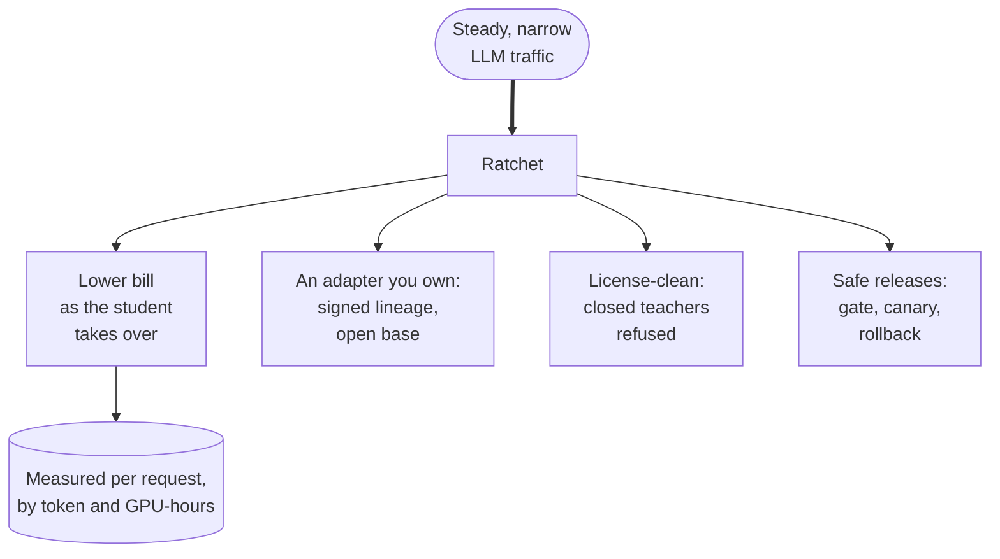
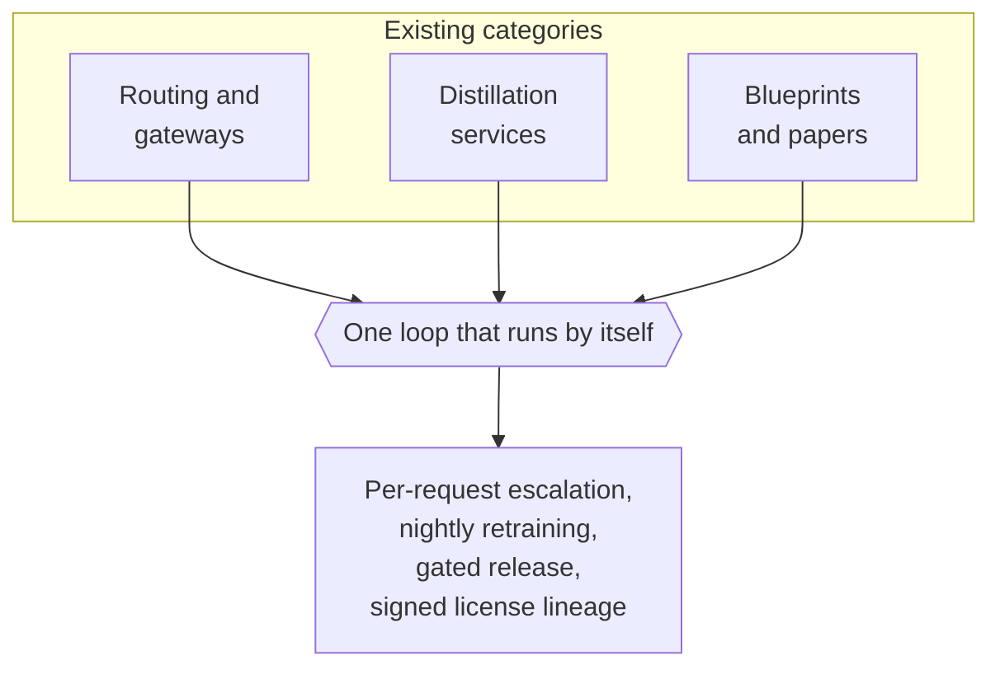

import { Aside } from '@astrojs/starlight/components';
import Summary from '../../../components/Summary.astro';
import Stat from '../../../components/Stat.astro';
import StatRow from '../../../components/StatRow.astro';
import Compare from '../../../components/Compare.astro';
import PathCard from '../../../components/PathCard.astro';
import PathGrid from '../../../components/PathGrid.astro';

Ratchet is for teams that pay frontier-model prices for narrow, repeated work. It moves that work to a small open model with an adapter they own, learns only from teachers whose license allows it, and ships each new model only if it passes a gate. Its savings are shown in simulation today, not on live traffic.

## The problem

- **LLM bills grow with traffic.** Enterprise spend on model APIs was $12.5B in 2025 ([Menlo Ventures](https://menlovc.com/perspective/2025-the-state-of-generative-ai-in-the-enterprise/), 2025 report). Much of what teams send is narrow and repetitive: classification, extraction, ticket triage, steps inside agents.
- **The obvious fix is often not allowed.** Training a cheaper model on a closed model's answers breaks the terms of the largest vendors: [OpenAI Business Terms §3.3(e)](https://openai.com/policies/business-terms/) and [Anthropic Commercial Terms §D.4(a)](https://www.anthropic.com/legal/commercial-terms) (both read Oct 21, 2026) forbid using outputs to train competing models. Not legal advice.
- **Doing it by hand is slow.** Logging, cleaning, fine-tuning, evaluating, deploying and watching for regressions are separate chores, and most tools cover one.

## Who it is for

Teams with steady, repetitive LLM traffic on tasks a small model can learn: support triage, field extraction, routing, classification, text-to-SQL, or the many small steps inside an agent. It is a poor fit for open-ended work where every request differs, and for very low volume, where a GPU endpoint costs more than it saves (see [Why it matters](/guides/why-it-matters/) and [Cost and savings](/guides/cost-and-savings/)).

## The value

<Compare before="Renting a frontier model for every call" after="With Ratchet">
  
Every narrow, repeated request is a paid call at frontier prices, the bill grows with traffic, and closed vendors forbid training a cheaper model on their answers.

  
A small open model with your adapter takes over the work it is sure about, learns only from teachers whose license allows it, and ships each new version only if it passes a gate.

</Compare>

<figure class="rt-diagram">

<figcaption>

**Reading this diagram.** One input, steady narrow traffic, produces four separate benefits, and the first is measured rather than assumed. Each request records what it cost and what the teacher alone would have cost, in two views: per token and by the GPU-hours actually paid. The other three benefits are about risk: who owns the model, whether its training data was allowed, and whether a bad version can reach everyone.

</figcaption>
</figure>

- **Cost falls as the student takes over.** Real savings depend on the traffic mix and on GPU utilization. The reference simulation (mock models, 2,000 support tickets a day, seed 7) shows the shape: once the student serves, and outside the days after a simulated product launch, its cost is about $0.15 to $0.16 per 1,000 requests, a saving of 85 to 87%.

<StatRow cols={3} label="The reference simulation's cost on day 10">
  <Stat value="$1.093" label="per 1,000 requests, all Ultra" tone="sim" note="What the teacher alone would have cost." />
  <Stat value="$0.147" label="per 1,000 requests, Ratchet" tone="sim" note="Day 10, with the student serving." />
  <Stat value="87%" label="saved on day 10" tone="sim" note="At unverified list prices." />
</StatRow>

- **You own the result.** A LoRA adapter on an open base model, plus a signed bill of materials listing the teacher and license of every training example.
- **Releases are gated.** A new student must beat the current one on held-out data, then pass shadow and canary stages. See [The release gate](/guides/release-gate/).

## How it could make money

The plan is an open-source core (Apache-2.0: gateway, ledger, Night School, release gate, dashboard) that anyone can self-host, plus a managed offering for teams that do not want to run the nightly loop and GPUs themselves. The managed idea is to charge a share of savings that Ratchet can verify, with no fee when there are none. The code already produces signed daily savings receipts for this (see [Evidence](/guides/evidence/)). This is a plan: nothing is sold today.

## Why now

- **A deadline for fine-tuning customers.** OpenAI lists no new self-serve fine-tuning jobs after Jan 6, 2027 ([OpenAI deprecations](https://developers.openai.com/api/docs/deprecations), checked Oct 21, 2026). Teams with fine-tunes there need somewhere else to run them.
- **Small models are being used for narrow tasks.** NVIDIA Research estimates that 40 to 70% of LLM calls in agent systems could go to small models ([arXiv 2506.02153](https://arxiv.org/abs/2506.02153), an estimate, not a measurement).

## How it differs from other categories

| Category | What it does well | What it does not do | Ratchet |
|---|---|---|---|
| Routers and gateways | Pick a model per request, log and govern traffic | Learn from the traffic; every call stays rented | Learns from the traffic and trains a student |
| Fine-tuning and distillation services | Train a model when you start a job | Run by themselves every night, or record each example's teacher license | Retrains nightly and signs the lineage into the adapter |
| Reference blueprints and tutorials | Show the pattern and its parts | Run unattended; promotion is left to a person | Gates, canaries and rolls back automatically |

<figure class="rt-diagram">

<figcaption>

**Reading this diagram.** Each category on top is real and useful, and Ratchet uses their ideas. The claim is only about the combination: routing, retraining and release safety joined in one loop, with each example's teacher license recorded. The README's [prior art section](https://github.com/harshbhx/ratchet#prior-art-and-what-is-new) names the work it builds on.

</figcaption>
</figure>

## Honest limits

<Aside type="caution" title="As of Oct 25, 2026">
- **Not proven on live traffic.** Real teacher calls on Nebius Token Factory built the text-to-SQL data (Oct 22, 2026), but the gateway's live mode is unverified until the day-1 checks pass, and the public demo has no student endpoint yet, so the teacher answers every request. Savings figures come from mock models and are labelled simulation. A text-to-SQL adapter trained on a borrowed GPU is the first real training result ([Results](/guides/results/)).
- **Early stage.** There is no customer and no revenue.
- **Savings depend on the traffic mix.** Per-token savings against the cheapest tiers of closed models are small. The large savings come from moving traffic off top-tier models, and only for tasks a small model can learn.
- **A Token Factory terms question is open.** A question about its Terms of Service §5(f) was sent to Nebius support on Oct 19, 2026. This is not legal advice.
</Aside>

## Related

<PathGrid cols={2} label="Related pages">
  <PathCard title="Why it matters" href="/guides/why-it-matters/" icon="scale" tone="neutral" description="The value in depth, by audience." />
  <PathCard title="Cost and savings" href="/guides/cost-and-savings/" icon="coin" tone="neutral" description="Per token and by GPU-hours paid, with the break-even." />
  <PathCard title="Licenses" href="/guides/licenses/" icon="key" description="Why only open teachers, and what you own." />
  <PathCard title="For judges" href="/guides/for-judges/" icon="start" tone="neutral" description="A ten-minute tour of the demo and the evidence." />
</PathGrid>

Also: [What is Ratchet](/guides/what-is-ratchet/).
