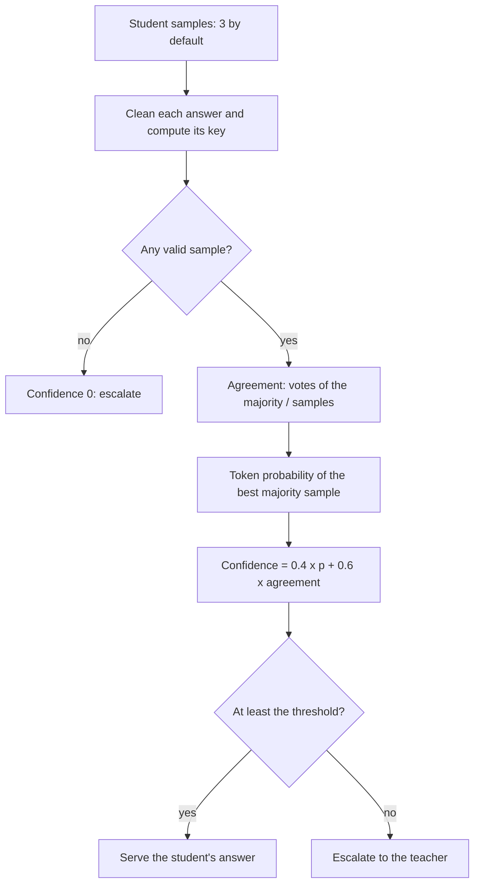
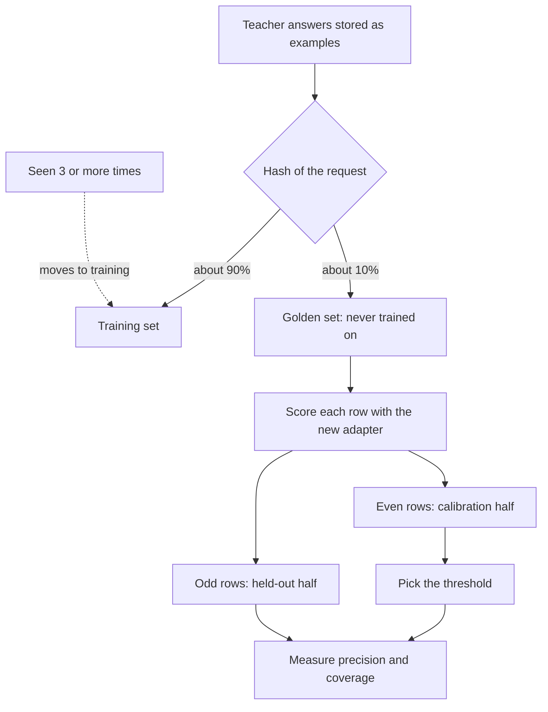

import { Steps, Aside } from '@astrojs/starlight/components';
import Summary from '../../../components/Summary.astro';
import Eli10 from '../../../components/Eli10.astro';
import Who from '../../../components/Who.astro';
import RequestJourney from '../../../components/diagrams/RequestJourney.astro';

<Summary>Confidence is the score that decides, on every request, whether the student's answer goes out or the teacher is asked, and each adapter version gets its own threshold, set on half of the golden set and checked on the other half.</Summary>

<Eli10>

The apprentice chef gets an order. Before anything leaves the kitchen, the apprentice cooks the dish **three times**. If all three plates come out the same, and the apprentice felt sure at every step while cooking, the plate goes out. If the plates differ, or one of them is burnt, the head chef from the agency cooks the order instead.

Why not just ask the apprentice "are you sure?" Because young cooks are often sure and wrong. So the pass looks at two things at once: did the three plates match, and how steady was the apprentice's hand while cooking.

How sure is sure enough? That bar is set with **the sealed exam**: recipes the apprentice never studied. Half of the exam sets the bar: the lowest bar at which at least 97 of every 100 plates the apprentice would send out match the head chef's. The other half grades the result. The apprentice never saw the grading half while the bar was set, so the grade is honest.

Every new notebook gets its own bar, and each kind of dish can get its own bar too: an apprentice can be great at salads and shaky at soufflés.

</Eli10>

## How it really works

<RequestJourney />

The student (<Who as="student" />) answers first. The gateway samples it several times, scores the samples, and compares the score with a threshold that belongs to the version that answered and, since per-task calibration, to the task.

<Steps>

1. **Sample.** The router asks the student for `RATCHET_SAMPLES` answers (default 3) at temperature 0.7 with token logprobs on. These sampling settings are one constant, `confidence.STUDENT_SAMPLING`, shared by production and both golden evaluators, so the eval scores the student exactly the way production does.

2. **Check each sample.** Each answer is cleaned (`tasks.clean_answer`: reasoning stripped, a code fence around JSON unwrapped) and turned into a key by the task's spec (`Task.key`). A sample gets **no vote** when it does not parse, misses a required field, has a label outside the task's vocabulary, is empty, or did not end by itself (a `finish_reason` other than `stop` or `tool_calls`, so a cut-off answer never counts). If no sample is valid, confidence is 0 and nothing is served, whatever the threshold, even 0.

3. **Count agreement.** Valid samples are compared pairwise with the task's field comparators (`Task.match`). Each sample's votes are the valid samples it matches, itself included. The majority is the first sample with the most votes, and `agreement` is its votes divided by the number of samples. With a tolerance, agreement is not always "all equal": under a number field with `abs_tol` 1, the answers 0, 0.6 and 1.2 all match 0.6, so 0.6 is served with agreement 1.0.

4. **Read token probability.** Among the majority's samples with the top vote count, the gateway picks the one with the highest token probability, `p = exp(mean token logprob)`, from the logprobs vLLM returns.

5. **Combine.** `confidence = 0.4 × p + 0.6 × agreement`. If the endpoint returned no logprobs, confidence is the agreement alone.

6. **Compare.** If the answer is valid and confidence is at least the threshold, the student's answer is served (route `student`), and a random share of such answers is audited by the teacher. Otherwise the request escalates to the teacher (route `confidence`), whose answer is served and, if valid, stored as training data with its provenance.

</Steps>



A worked toy example (arithmetic only, not a result): three samples that all agree, best token probability 0.9, give `0.4 × 0.9 + 0.6 × 1.0 = 0.96`. If only two of three agree, the same sample scores `0.4 × 0.9 + 0.6 × 2/3 = 0.76`. Agreement carries more weight than probability on purpose.

### Why one signal is not enough

Small models are poorly calibrated: a 4B model can put a high probability on a wrong answer. Token probability alone does not separate right from wrong, and agreement alone cannot tell three confident samples from three lucky ones. Ratchet combines them, because a single fixed bar was not enough: in early simulation runs, one global threshold of 0.80 let about 10% wrong answers through (simulation, mock models).

Validity is the third signal. A label outside the task's vocabulary, or a JSON answer missing a field, is not a vote at all, so the student cannot "agree with itself" on an answer the task would refuse.

### Precision and coverage, simply

Two numbers describe any threshold:

- **Precision**: of the answers the student would serve, the share that agree with the teacher (<Who as="teacher" />) under the task's comparators.
- **Coverage**: of all requests, the share the student would serve. Coverage is where the savings come from.

Raising the threshold usually serves fewer answers at higher precision. Usually, not always: one confidently wrong answer at the top can make precision fall as the threshold rises (which rules out some textbook methods).

<Aside type="note" title="Toy example">
The numbers below are made up to show the arithmetic. They are not results from Ratchet or from any simulation.
</Aside>

Take 20 golden rows. The ten **calibration** rows, sorted by the student's confidence, with whether its answer agreed with the teacher:

| Confidence | Agrees? | Served at this bar | Agreeing among served | Precision at this bar |
|---|---|---|---|---|
| 0.98 | yes | 1 | 1 | 100% |
| 0.95 | yes | 2 | 2 | 100% |
| 0.93 | yes | 3 | 3 | 100% |
| 0.90 | yes | 4 | 4 | 100% |
| 0.88 | yes | 5 | 5 | 100% |
| 0.85 | no | 6 | 5 | 83% |
| 0.80 | yes | 7 | 6 | 86% |
| 0.72 | no | 8 | 6 | 75% |
| 0.65 | yes | 9 | 7 | 78% |
| 0.55 | no | 10 | 7 | 70% |

The lowest bar where precision is still at least 97% is **0.88**. Now grade it on the ten **held-out** rows: confidences 0.99, 0.96, 0.94, 0.91 and 0.89 are at or above 0.88, and one of those five (the 0.89) disagrees with the teacher. So on held-out data this toy version has **coverage 50%** (5 of 10) and **precision 80%** (4 of 5), not the 100% the calibration half showed. That gap is why Ratchet never grades a threshold on the rows it was tuned on, and why this toy version would be rejected by the golden gate (80% is below the 95% floor). With only five served rows, its certified lower bound would also be weak: 34% (exact Clopper–Pearson at delta 0.05, from `ratchet/stats.py`).

## The threshold, per version

Each trained adapter version carries its own threshold in its eval (`versions.eval.threshold`). Night School sets it the night the version is trained, in `cascade_eval` ([`ratchet/nightschool/evaluate.py`](https://github.com/harshbhx/ratchet/blob/main/ratchet/nightschool/evaluate.py)):

<Steps>

1. **Score every golden row** with the new adapter, sampled exactly as in production, under the generation conditions stored with the row. Each row becomes a point: (confidence, agreed with the teacher's stored answer). A row whose stored reference is no longer valid under the task's spec is skipped (`golden_invalid_refs`), and so is a row of a task that is pinned now (`excluded_pinned`). A row the student endpoint refuses (HTTP 400, 413 or 422) counts as confidence 0 and wrong, because production would escalate it.

2. **Split by position.** Even-indexed scored rows form the calibration half; odd-indexed rows form the held-out half (invariant 6).

3. **Calibrate on the even half.** By default (`RATCHET_CALIBRATION=point`), `calibrate_threshold` sorts the points by confidence, highest first, walks down in groups of equal confidence (ties included before checking) and keeps the lowest confidence at which cumulative precision is still at least the target: 0.97 (`calibration.DEFAULT_TARGET_PRECISION`). If no confidence reaches it, the result is infinity.

4. **Clamp.** `threshold = min(1.01, max(0.5, calibrated))`. The floor 0.5 keeps the student from serving coin-flip answers. Scores are at most 1, so **1.01 means "serve nothing"** (`SERVE_NOTHING`); it is a finite number so the eval stays valid JSON. Since v0.5 the threshold is stored exactly, so the router serves at the threshold the eval measured.

5. **Measure on the odd half.** Coverage and precision at that threshold, plus the certificate, the frontier, the per-task bounds and the per-row outcomes (`test_vector`). These held-out numbers are what the [release gate](/guides/release-gate/) reads.

</Steps>



Which requests are golden is decided by a hash of the request (`RATCHET_GOLDEN_FRACTION`, default 0.10), which acts like a coin flip: it does not look at difficulty or at any model's answer. A request seen 3 or more times (`FREQUENT`) moves to training and leaves the golden set, so a frequent question is never held out forever.

Golden rows are teacher answers to escalations, audits and arbitrations, so they lean towards requests the student found hard. Precision measured on them means agreement with Nemotron 3 Ultra, not ground truth.

The router reads the threshold on every request with a dictionary lookup (`Ratchet.threshold`). Thresholds differ between versions because each adapter's confidence scale is its own; that is also why the ledger replay never pools two versions.

## Per-task thresholds

Several tasks can share one adapter: Scout's triage and reader calls next to support tickets, for example. One threshold calibrated over the pooled rows then serves the hardest task below its target (the easy tasks' right answers dilute its wrong ones) and holds the easy tasks back when the hard task pushes the bar up. So `cascade_eval` also writes one record per task, `eval['tasks'][name]`, split by the same global even/odd positions:

| Situation | The task's threshold |
|---|---|
| At least `RATCHET_MIN_TASK_GOLDEN` (20) calibration rows | Its own, calibrated to its spec's `policy.target_precision` (default 0.97), never below 0.5 (`calibrated: true`) |
| Fewer calibration rows | The higher of its own and the version's global threshold, so a few lucky rows cannot lower it (`calibrated: false`) |
| No calibration rows | The version's global threshold |
| No held-out row | 1.01: the teacher answers it until a night measures it |
| No golden row at all | No record: the version's global threshold |
| Disabled by the release gate | 1.01 for the life of that version |

When a task's record serves nothing, the router does not call the student for it at all (route `task_disabled`): its samples could never be served, so calling would only add cost and latency. With one task the record equals the global numbers.

Per-task calibration is on by default. `RATCHET_PER_TASK_CALIBRATION=0` makes Night School write no records, so new versions keep one pooled threshold, as in v0.4. In the README's research and mixed simulations (mock models, seed 7, 8 days of 1,500 requests), per-task calibration makes the student serve somewhat less (92% of research calls on day 8, against 96% with one pooled threshold) in exchange for holding each task to its own target (simulation, README).

### When a task's spec changes

Each per-task record stores the `spec_hash` it was scored under. If an operator changes the task's spec (its fields, its vocabulary, or its `target_precision` or `min_precision`), the hash no longer matches and `calibration.threshold` returns 1.01 for that task: the student is still sampled, but every request of the task escalates (route `confidence`) until a night re-scores the version under the new spec. A night with too few new examples to train still re-scores the live version when its recorded hashes are stale (event `rescored`, or `rescore_failed`, after which the task stays on the teacher and the next night tries again).

## Certified thresholds and Learn-then-Test

Every eval also carries a **certificate**: on the held-out half, how many answers the version would serve, how many of those agree with the teacher, and an exact one-sided Clopper–Pearson lower bound on its precision (`RATCHET_CERT_TARGET` 0.95, `RATCHET_CERT_DELTA` 0.05). [Evidence you can check](/guides/evidence/) explains how to read and recompute it.

The default point rule picks the threshold and the certificate checks it afterwards. With `RATCHET_CALIBRATION=ltt` (opt-in), the threshold itself is chosen so that its precision is certified, by **Learn-then-Test**:

<Steps>

1. Take a fixed grid of thresholds, decided in advance: 0.95, 0.90, 0.85, down to 0.50 (`stats.CERT_GRID`).

2. From the top, test "precision of the calibration answers at or above this threshold is at most the target" with an exact binomial p-value.

3. Keep going while that test is rejected at `delta`; stop at the first threshold where it is not.

4. Serve at the lowest threshold that passed, or serve nothing (1.01) if the first one already fails. The held-out certificate then checks the choice independently.

</Steps>

Testing a fixed order and stopping at the first failure spends the error budget once, so the chosen threshold has precision above the target with probability at least `1 − delta`. The grid must be fixed in advance: a grid built from the observed confidences would start with a one-row group, which cannot pass, and a grid picked after looking at the data breaks the guarantee.

Learn-then-Test is opt-in because it is conservative early on. Ten calibration rows cannot certify 95%, since `0.95^10 = 0.60`, far above 0.05. In the toy table above only two calibration rows are at 0.95 or more, so Learn-then-Test would serve nothing. In the seed-7 reference configuration it serves nothing from v1 and v3 and saves 55.4% instead of 69.2% (simulation, mock models, one seed).

## The hosted fallback's fixed threshold

When the student's GPU endpoint is off (`RATCHET_STUDENT_BASE` unset), a trained version's calls go to an untuned, hosted model instead: Nemotron 3 Nano 30B on Token Factory (<Who as="fallback" />). In the restaurant, a different cook from the agency takes the easy orders, and the menu says so: the response's `model` field names the model that wrote the answer, though `served_by` still says `student`.

That model never sat the exam, so no calibrated threshold or per-task record applies to it. `Ratchet.threshold` returns the fixed `Settings.confidence_threshold` (`RATCHET_CONFIDENCE_THRESHOLD`, default 0.80) for it, and its answers are **not covered by the adapter's certificate**. The same 0.80 is used for a version whose eval has no calibrated threshold.

<Aside type="caution" title="Not run on Nebius yet">
As of Oct 21, 2026, Ratchet has not run against a real Nebius account. The scoring, calibration and certificate code is tested offline, and every threshold, precision and coverage figure in the repository so far comes from mock models (simulation). No live threshold has been calibrated on real Nemotron 3 Nano 4B logprobs.
</Aside>

## For engineers

| What | Where |
|---|---|
| The score, validity, the sampling constant, `SERVE_NOTHING` | [`ratchet/confidence.py`](https://github.com/harshbhx/ratchet/blob/main/ratchet/confidence.py): `score`, `Scored`, `STUDENT_SAMPLING`, `majority` (the `n` choices) |
| Point calibration | `confidence.calibrate_threshold` |
| The golden eval | [`ratchet/nightschool/evaluate.py`](https://github.com/harshbhx/ratchet/blob/main/ratchet/nightschool/evaluate.py): `cascade_eval`, `_task_record`, `LiveEvaluator` |
| Per-task records and spec changes | [`ratchet/calibration.py`](https://github.com/harshbhx/ratchet/blob/main/ratchet/calibration.py): `threshold`, `held_back`, `spec_changed`, `keep_disabled`, `target_precision` |
| The threshold on the request path | [`ratchet/router.py`](https://github.com/harshbhx/ratchet/blob/main/ratchet/router.py): `Ratchet.threshold`, `Ratchet._sample`, `Ratchet._held_back` |
| Certificate and Learn-then-Test | [`ratchet/certificate.py`](https://github.com/harshbhx/ratchet/blob/main/ratchet/certificate.py), [`ratchet/stats.py`](https://github.com/harshbhx/ratchet/blob/main/ratchet/stats.py): `ltt_fixed_sequence`, `CERT_GRID`, `cp_lower` |
| Tests | `tests/test_core.py`, `tests/test_calibration.py`, `tests/test_contract.py`, `tests/test_nightschool.py` |

Settings (read in [`ratchet/config.py`](https://github.com/harshbhx/ratchet/blob/main/ratchet/config.py), documented in [Configuration](/reference/configuration/)):

| Variable | Default | Effect |
|---|---|---|
| `RATCHET_SAMPLES` | `3` | Student samples per request and per golden row (1 to 16) |
| `RATCHET_CONFIDENCE_THRESHOLD` | `0.80` | Used only for the hosted fallback student and for a version without a calibrated threshold |
| `RATCHET_GOLDEN_FRACTION` | `0.10` | Share of new examples hashed into the golden set |
| `RATCHET_PER_TASK_CALIBRATION` | `1` | `0`: one pooled threshold for new versions |
| `RATCHET_MIN_TASK_GOLDEN` | `20` | Calibration rows a task needs before its threshold may go below the global one |
| `RATCHET_CALIBRATION` | `point` | `ltt`: Learn-then-Test over the fixed grid |
| `RATCHET_CERT_TARGET` | `0.95` | The precision a certificate must show, and Learn-then-Test's target |
| `RATCHET_CERT_DELTA` | `0.05` | The certificate's error rate |
| `RATCHET_AUDIT_RATE` | `0.05` | Share of served student answers the teacher audits (mock mode raises it to at least 0.10) |

Constants in the code: weights 0.4 (token probability) and 0.6 (agreement); student temperature 0.7; calibration target 0.97 (a task's `policy.target_precision` overrides it); floor 0.5; `SERVE_NOTHING` 1.01; `CERT_GRID` 0.95 down to 0.50 in steps of 0.05.

Where to see it:

- Every chat response carries `ratchet.confidence` and `ratchet.served_by`; `system_fingerprint` changes with the version and the threshold the answer was held to.
- `GET /ratchet/stats` lists, per task, the threshold the router applies, the held-out precision and coverage, `calibrated` and `disabled` ([API](/reference/api/)).
- `GET /ratchet/versions/{id}/certificate` serves the signed and the latest certificate.
- `GET /ratchet/replay?threshold=0.4` replays a version's logged traffic at another threshold ([Evidence you can check](/guides/evidence/)).
- Routes in `requests.route`: `student`, `confidence`, `cold_start`, `task_disabled`, `n_choices` (the student was sure, but fewer than the client's `n` samples agreed).
- Events: `rescored`, `rescore_failed`, `task_disabled`.

```bash
python -m ratchet.stats plan --target 0.95 --delta 0.05   # 0 errors: 59 rows, 1: 93, 2: 124, 3: 153
curl -s localhost:8000/ratchet/versions/2/certificate     # the certificate behind a version's threshold
```

The full rules are in [Architecture §6](/reference/architecture/#6-confidence-and-calibration).

## Common questions

### What if the student is confidently wrong?

It happens: the target is 97% agreement on the calibration half, not 100%. Three things catch it. A random share of served answers (`RATCHET_AUDIT_RATE`, 5% by default) is re-answered by the teacher, and those audits feed the canary's rollback rule and the live alert ([the release gate](/guides/release-gate/)). An audit's teacher answer is also stored as a training example when it is valid, so the next night learns from what the student got wrong. And the threshold is re-set for every new version on rows it never trained on.

### Why sample three times? Isn't that three times the cost?

It triples the student's output tokens and adds a little latency. Ratchet accepts that as a small cost next to one teacher call. A judge model scoring every request was rejected because it costs a teacher-sized call every time.

### Can I set the threshold by hand?

Not for a trained version. Thresholds change only through Night School's held-out calibration. `RATCHET_CONFIDENCE_THRESHOLD` applies only to the hosted fallback and to a version without a calibrated threshold. The ledger replay can suggest a lower threshold, but its suggestion is advice and nothing applies it. The runbook says never to edit a version's threshold by hand.

### Does "precision" mean the answer is correct?

No. It means the student's answer agrees with Nemotron 3 Ultra's under the task's comparators. If the teacher is wrong, a student that copies it scores well. Precision is also measured on golden rows, which lean towards hard requests.

### What about free-text tasks with no fields?

A task without fields compares the whole answer: its canonical JSON when it is JSON, otherwise its text with reasoning removed, lower-cased and whitespace collapsed. That is strict, so free-text tasks escalate more. The live evaluator can add a judge score (Nemotron 3 Super) for such tasks, which is reported in the eval but does not gate anything.

### What happens before any version exists?

Nothing is scored. On a cold start there is no version, so every request goes to the teacher (route `cold_start`) and its answers become the first training and golden examples.

## Related

- [The request journey](/guides/request-journey/): where the confidence check sits in one request.
- [Escalation and audits](/guides/escalation-and-audits/): what happens after the threshold says no, and how audits are drawn.
- [The release gate](/guides/release-gate/): what the held-out precision and coverage are used for.
- [Evidence you can check](/guides/evidence/): the certificate and the replay in detail.
