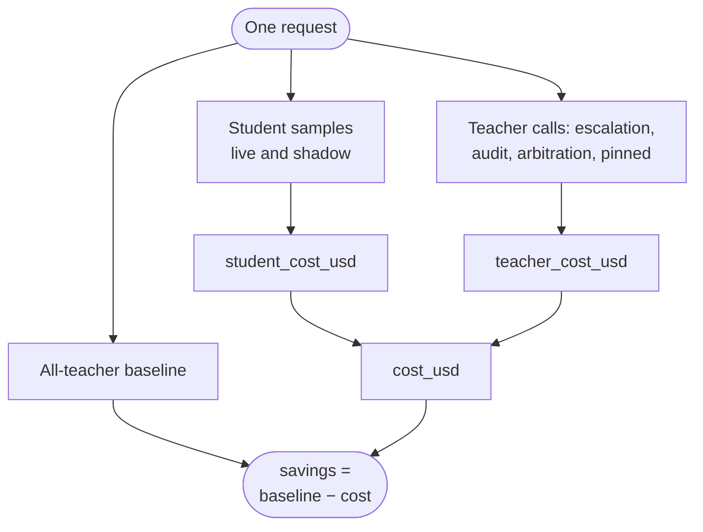
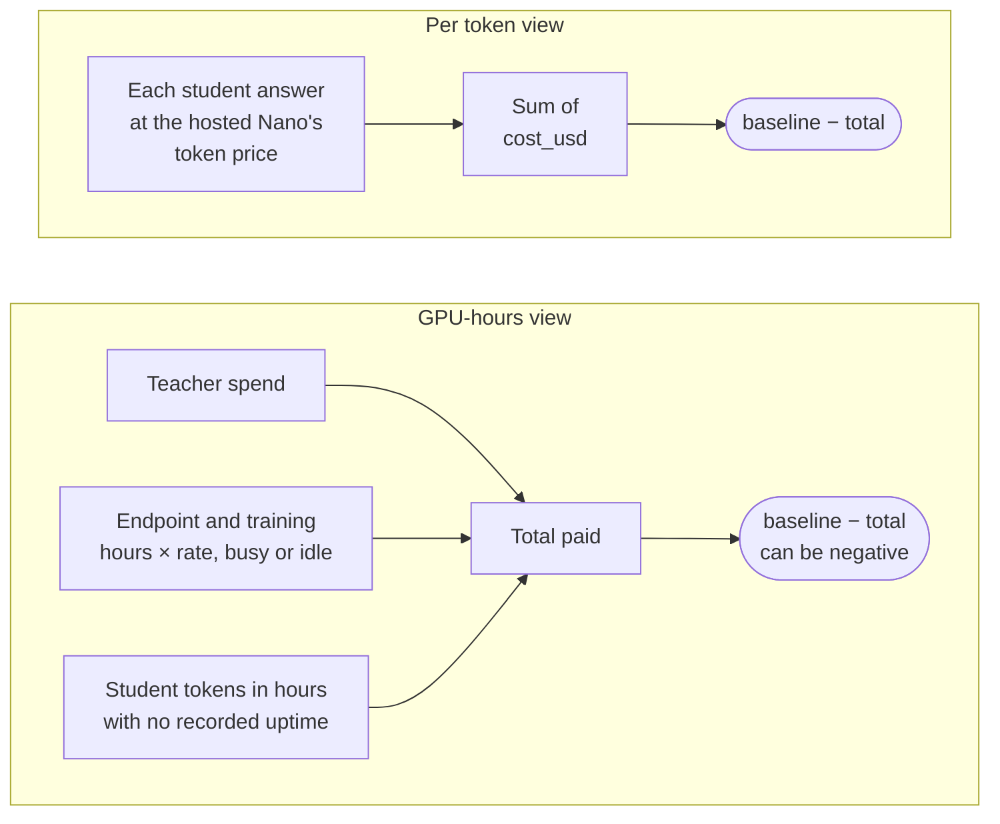
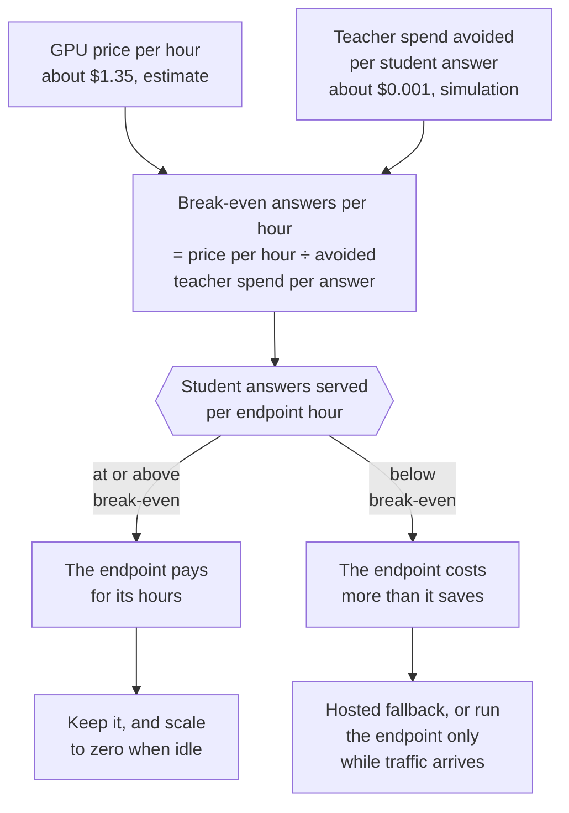
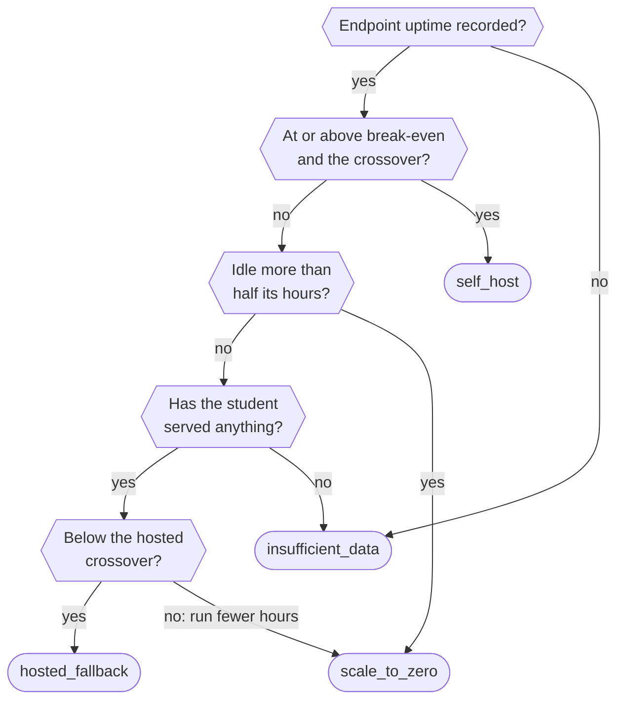

import { Steps, Aside } from '@astrojs/starlight/components';
import Summary from '../../../components/Summary.astro';
import Eli10 from '../../../components/Eli10.astro';
import Who from '../../../components/Who.astro';
import Stat from '../../../components/Stat.astro';
import StatRow from '../../../components/StatRow.astro';
import PathCard from '../../../components/PathCard.astro';
import PathGrid from '../../../components/PathGrid.astro';
import FadeContent from '../../../components/ui/FadeContent.astro';

<Summary>Ratchet prices every request twice, per token and by the GPU-hours actually paid, works out the traffic at which a self-hosted student endpoint breaks even, and tells you when it does not.</Summary>

<Eli10>

Every dish the head chef from the agency cooks shows up on the bill. When the apprentice chef cooks a dish instead, you skip that fee. That is the saving.

But the apprentice needs a kitchen station, and the station is rented by the hour. You pay for it while it is open, whether orders come in or not.

So the real question is not "is the apprentice cheaper per dish?" It is "does the apprentice cook enough dishes each hour to pay the station's rent?" Say the station costs $1.35 an hour and each dish the apprentice cooks saves about a tenth of a cent of head-chef fees. Then the apprentice has to cook about 1,350 dishes every hour just to break even.

On a quiet day that never happens. Then it is cheaper to close the station and let the agency's cheaper, untrained cook take the easy orders, paid per dish. Ratchet writes this on the receipt in plain words, even when the answer is "you are losing money".

</Eli10>

<StatRow cols={2} label="Two ways to count the same traffic">
  <Stat value="Per token" label="the default headline" note="The student priced like the hosted Nano: $0.06 in, $0.24 out per 1M tokens. Cheap per answer, but it ignores an idle GPU." />
  <Stat value="By GPU-hours paid" label="what you would pay" note="Teacher spend plus every hour the endpoint and the training jobs ran, busy or idle. It can be negative." />
</StatRow>

## How it really works

<Steps>

1. **Every request records what it cost, split in two.** Each model call is priced from its token counts at a price per million tokens (`config.DEFAULT_PRICES`). The **student part** (`student_cost_usd`) covers the student's samples, for the live version and for a shadow candidate. The **teacher part** (`teacher_cost_usd`) covers the escalation, the audit, the shadow arbitration and pinned calls. Their sum is the request's `cost_usd`, which the response also returns as `ratchet.cost_usd`. A failed call adds nothing.

2. **Every request also records an all-teacher baseline.** This is what the request would have cost if Nemotron 3 Ultra had answered alone (`ratchet.all_teacher_cost_usd`). When the teacher was called, the baseline is that call's price. When the student served, it is a formula: the teacher's price for the student's prompt tokens, plus the student's output tokens and an assumed 300 reasoning tokens (`RATCHET_TEACHER_REASONING_TOKENS`). Savings are baseline minus cost.

3. **The ledger records when GPUs ran.** A self-hosted endpoint bills while it runs, so per-token prices alone flatter the student. The `compute_intervals` table holds three kinds of interval: `student_endpoint`, `training_job` and `eval_job`. Each keeps the rate it was recorded at, so changing a setting never reprices history.

4. **The cost report prices the window two ways.** The per-token view sums `cost_usd`. The GPU-hour view adds teacher spend, the endpoint's hours, the training jobs' hours, and the per-token student spend in hours when no endpoint uptime was recorded. GPU-hour savings can be negative. They are never clamped to zero.

5. **It computes break-even and the hosted crossover.** Break-even is the number of student answers per endpoint hour at which the endpoint's hours cost exactly the teacher spend they avoid. The crossover is the volume above which the endpoint is cheaper per answer than the hosted fallback (Nemotron 3 Nano 30B on Token Factory).

6. **It recommends one of four things, in plain English.** `self_host`, `hosted_fallback`, `scale_to_zero` or `insufficient_data`, with an explanation that quotes the numbers and the price label ("unverified list prices" until an operator confirms them).

</Steps>

<figure class="rt-diagram">



<figcaption>

**Reading this diagram.** Every model call a request makes is priced and lands in one of two parts: the student's samples (for the live version and a shadow) or the teacher's calls. Their sum is the request's `cost_usd`. Next to it, the request records what the teacher alone would have cost, and the saving is the difference.

</figcaption>
</figure>

The response's `usage` field is not this bill. It counts only the tokens of the answer the client received, as if that model had answered alone. `ratchet.cost_usd` prices every call Ratchet made, which `ratchet.usage_breakdown` lists.

### Savings per token and savings by GPU-hours

The two views answer different questions.

| View | Total | What it assumes |
|---|---|---|
| Per token (`per_token`, the default headline) | Σ `cost_usd` | The student costs what the hosted Nano costs per token ($0.06 in, $0.24 out per 1M). Cheap per answer, but it ignores an idle GPU |
| By GPU-hours (`gpu_hours`) | teacher spend + endpoint GPU cost + training GPU cost + student per-token spend in hours with no recorded uptime | You pay for every hour the endpoint and the training jobs ran, busy or idle |

<figure class="rt-diagram">



<figcaption>

**Reading this diagram.** Both views start from the same baseline, what an all-teacher run would have cost, and subtract what you actually pay. They differ in what counts as paid. The per-token view charges only for tokens, so an idle GPU costs nothing in it. The GPU-hours view charges for every hour the endpoint and the training jobs ran, so at low traffic the same requests can show a saving in one view and a loss in the other. Neither is clamped to zero.

</figcaption>
</figure>

`RATCHET_STUDENT_COST_MODEL` picks which one is the report's `headline`. It changes nothing else: both views are always in the report, and each request's `cost_usd` stays per token, so history never moves.

### Where the GPU-hours come from

The report only knows the hours somebody recorded. Four writers record them:

- **The CLI**: `python -m ratchet.cost endpoint up` and `down` on the ledger file (`RATCHET_DB`). `close KIND` closes a job whose end was lost.
- **The API**: `POST /ratchet/cost/endpoint` with an admin key. Each change writes an `endpoint` event that names the admin, never the key.
- **The deploy script**: `deploy/student_endpoint.sh` runs `python -m ratchet.cost endpoint up|down --source deploy` after `create`, `start` and `stop`. It is best effort: run away from the ledger, the deploy still succeeds and prints the command to run there.
- **Night School** in live mode wraps the training run in a `training_job` interval (wall-clock time, so an upper bound on the job's billed time). The simulator records its own closed intervals: an endpoint up `RATCHET_MOCK_ENDPOINT_HOURS` (24) a day, and a training job of 600 s plus 0.05 s per training example from 22:00. Those are simulation assumptions, not measurements.

Overlapping records of one kind are merged and billed at the highest rate among them, so nothing is counted twice. An interval still open counts up to now. A training job open for more than 12 hours gets a warning, because it probably ended without anyone recording it.

Nebius words the billing like this: a stopped endpoint is not billed for compute or its own storage, but a mounted Object Storage bucket still is ([Nebius Serverless overview](https://docs.nebius.com/serverless/overview), read Oct 21, 2026).

### Break-even, first in one line

Here is the kid version again, with the numbers the docs use. The endpoint costs about $1.35 per GPU-hour (an L40S on demand, [Nebius pricing](https://docs.nebius.com/compute/resources/pricing), read Oct 22, 2026; an estimate until your bill confirms it). In the simulation, each ticket-triage answer the student serves avoids about $0.001 of Ultra spend. So:

```text
break-even student answers per endpoint hour = GPU price per hour ÷ teacher spend avoided per student answer
                                             ≈ $1.35 ÷ $0.001 ≈ 1,350
```

<StatRow cols={3} label="Break-even, estimated">
  <Stat value="$1.35" label="per GPU-hour" note="An L40S on demand, Nebius's pricing page, read Oct 22, 2026. An estimate until a bill confirms it." />
  <Stat value="$0.001" label="avoided per student answer" note="Ultra spend a ticket-triage answer avoids, from the reference simulation." tone="sim" />
  <Stat value="≈ 1,350" label="answers per endpoint hour" note="About 32,000 a day. Below that, a 24/7 endpoint costs more than it saves. An estimate." tone="sim" />
</StatRow>

That is **about 1,350 student answers an hour, roughly 32,000 a day** (estimate). Below that line, a 24/7 endpoint costs more than the teacher spend it saves. The reference simulation prices its endpoint at the code's default of 1.55 USD per GPU-hour and reports a break-even of 1,575; at $1.35 the same run's break-even is about 1,370 (estimate, from the formula below).

<figure class="rt-diagram">



<figcaption>

**Reading this diagram.** The top two boxes are the only inputs: what an hour of GPU costs and how much teacher money one student answer avoids. Dividing one by the other gives the number of answers an hour the student must serve before the endpoint is worth its rent. Everything after that is a comparison with the traffic you really have. Because the price sits on top of the division, a cheaper GPU lowers the bar in proportion. Both inputs are estimates until a bill confirms them.

</figcaption>
</figure>

### Break-even, precisely

With `R` the endpoint's price per hour as recorded in the window (`endpoint_usd_per_hour`: its GPU cost divided by its hours, or the configured `RATCHET_STUDENT_GPU_USD_PER_HOUR × RATCHET_STUDENT_GPUS` while no uptime is recorded) and `S` the student-served requests:

```text
s̄          = Σ over student-served requests (baseline − teacher spend) / S     avoided teacher spend per student answer
break-even = R / s̄                                                             student answers per endpoint hour (null when s̄ ≤ 0)
h̄          = fallback price × (all student calls' tokens) / S                  what the hosted fallback would bill per answer
crossover  = R / h̄                                                             above it, the endpoint is cheaper per answer
observed   = student answers in buckets with uptime / endpoint hours
idle hours = endpoint hours in buckets when no request reached the student
```

A bucket is an hour on a live ledger and a whole day on the simulator's synthetic clock. Break-even prices the endpoint's hours only, not training. So a window can be above break-even and still lose money by GPU-hours once the training jobs are added, and the explanation then says exactly that.

### The four recommendations

`ratchet/cost.py` has exactly four outcomes (`RECOMMENDATIONS`), decided in this order:

<figure class="rt-diagram">



<figcaption>

**Reading this diagram.** The checks run top to bottom in this order, and the first that settles it wins. Four answers are possible, and two of them can be reached in two ways: `insufficient_data` when nothing is recorded or the student has served nothing, and `scale_to_zero` when the endpoint is mostly idle or when neither it nor the hosted fallback pays at this volume. The table below says what to do for each.

</figcaption>
</figure>

| Recommendation | Means | What to do |
|---|---|---|
| `self_host` | The endpoint served at least the break-even volume per hour it ran, and more than the crossover | Keep it. If the explanation says it was often idle, scale it to zero between bursts |
| `hosted_fallback` | Below the crossover: per answer, the untuned hosted Nano would cost less than the endpoint. Below break-even the explanation opens "Self-hosting does not pay at this volume" | Leave `RATCHET_STUDENT_BASE` empty so the hosted Nano serves the student role per token, or run the endpoint only while traffic arrives |
| `scale_to_zero` | More than half the endpoint's hours (`IDLE_SHARE`, 0.5) saw no request reach the student, or neither the endpoint nor the hosted fallback pays at this volume | Stop the endpoint when idle (`bash deploy/student_endpoint.sh stop`) and start it for busy periods |
| `insufficient_data` | No uptime recorded in the window, or the student has not served a request yet | Record uptime, or wait for a trained version |

The explanation says two things separately so the words never contradict the figures: whether the observed volume covers the endpoint's hours, and whether the window lost money by GPU-hours. It never says "pays" when GPU-hour savings are negative.

### The hosted-fallback crossover, and its caveat

The hosted fallback is Nemotron 3 Nano 30B on Token Factory, untuned, paid per token. Answers it gives carry the <Who as="fallback" /> badge. With list prices and the simulation's token counts it costs about $0.00003 per answer, so a $1.35-an-hour endpoint beats it per answer only above roughly **45,000 student answers an hour** ($1.35 ÷ $0.00003, an estimate; the reference simulation reports 51,528 at the code's default 1.55).

That gives a middle band. Take a customer sending 10M requests a month, about 14,000 an hour. That is far above break-even: a GPU running all month costs about $990 at $1.35 an hour (730 hours), against about $9,300 of avoided Ultra spend (simulation-based estimate). The GPU-hour savings are positive. The report still says `hosted_fallback`, worded "Self-hosting beats the teacher, but the hosted fallback would cost less per answer".

The caveat is printed with every `hosted_fallback` explanation (`CROSSOVER_CAVEAT`): the crossover assumes the hosted fallback serves as many requests as the tuned student. It is untuned, so more of its requests may go to the teacher, and each of those costs about $0.001 of Ultra. Ratchet does not measure the hosted model's coverage, because the two are never served side by side. Before switching, run a day on each and compare the student's share of requests in `/ratchet/stats`.

### When self-hosting does not pay

Plainly: **at low volume, a self-hosted student endpoint loses money.**

- At the demo's 1,500 requests a day, a 24/7 endpoint runs at a small fraction of break-even. In the reference simulation (2,000 requests a day) it served about 66 student answers per hour it ran, against a break-even of 1,575 at the code's default rate (simulation).
- Per token the same traffic looks like a 69% saving. By GPU-hours it is a loss of hundreds of dollars over ten days (simulation). Both numbers are true; only the second is what you would pay.
- Below break-even the honest options are the hosted fallback (pay per token, no GPU running) or an endpoint that runs only while traffic arrives.
- Above break-even, the levers are more traffic per GPU (several tasks or customers as LoRA adapters on one vLLM endpoint) and fewer idle hours.

Ratchet never promises savings below break-even, and the cost report says so in its own words.

### Prices used

Token prices are Token Factory list prices from `DEFAULT_PRICES` in `ratchet/config.py`, Oct 2026, **unverified** until `scripts/day1_check.py` passes with a real key. Every report says "unverified list prices" until an operator sets `RATCHET_PRICES_VERIFIED=1`.

| Model (key in `DEFAULT_PRICES`) | Role | Input, USD per 1M tokens | Output, USD per 1M tokens |
|---|---|---|---|
| `nvidia/Nemotron-3-Ultra-550b-a55b` | Teacher | 1.00 | 3.00 |
| `nvidia/nemotron-3-super-120b-a12b` | Judge | 0.30 | 0.90 |
| `nvidia/NVIDIA-Nemotron-3-Nano-30B-A3B` | Hosted fallback student | 0.06 | 0.24 |
| `student` | Per-token proxy for the self-hosted student | 0.06 | 0.24 |

GPU rates come from `RATCHET_STUDENT_GPU_USD_PER_HOUR` and `RATCHET_TRAIN_GPU_USD_PER_HOUR` (with `RATCHET_STUDENT_GPUS` and `RATCHET_TRAIN_GPUS`, 1 each). Both default to 1.55 in the code. These docs use $1.35 per GPU-hour, the L40S on-demand price on Nebius's [Compute pricing page](https://docs.nebius.com/compute/resources/pricing) when read on Oct 22, 2026; that is an estimate until it matches your bill. Break-even scales with the rate. Set the variables to what Nebius actually bills you.

Estimates for running it, from the [deployment guide](/reference/deployment/#4-cost-estimates) (on-demand prices, read Oct 22, 2026):

| Item | Assumption | Estimate |
|---|---|---|
| Training run | L40S at about $1.35 per GPU-hour, 30 to 60 min a night | about $0.70 to $1.35 a night |
| Student endpoint | L40S at about $1.35 per GPU-hour | about $32 per full day if left on |
| Teacher calls | Ultra $1 / $3 per 1M tokens, about 150 input and 380 output tokens per call | about $1.30 per 1,000 calls |

### What it looks like in the simulation

<div class="rt-callout rt-callout--sim"><p><strong>Simulation.</strong> Every number in this section comes from mock models. It shows how the loop and the report behave, not real model quality. The reference run: seed 7, 2,000 support tickets a day, a product launch on day 5, a corrupted deploy of v3 (<code>python -m sim.simulate --days 10 --requests 2000 --bad-deploy-version 3</code>).</p></div>

<StatRow cols={3} label="The reference run in three numbers">
  <Stat value={69} suffix="%" count={false} label="saved per token" note="Over ten days, against an all-Ultra baseline of $21.86." tone="sim" />
  <Stat value="−$358.48" label="saved by GPU-hours paid" note="A loss: 240 endpoint hours cost far more than the teacher spend avoided." tone="sim" />
  <Stat value={66} count={false} label="student answers per endpoint hour" note="Against a break-even of 1,575 at the code's default 1.55 USD per GPU-hour." tone="sim" />
</StatRow>

| Day | Student share | Escalated | Audit agreement | $ per 1k requests | All-Ultra $ per 1k | Saved per token | What happened |
|---|---|---|---|---|---|---|---|
| 1 | 0% | 0% | none | 1.093 | 1.093 | 0% | Cold start: all teacher |
| 3 | 98% | 2% | 100% | 0.160 | 1.093 | 85% | First student live |
| 4 | 98% | 2% | 93% | 0.160 | 1.093 | 85% | v3 deployed corrupted, rolled back automatically |
| 5 | 86% | 14% | 97% | 0.272 | 1.093 | 75% | Product launch: new questions escalate |
| 9 | 98% | 2% | 97% | 0.162 | 1.093 | 85% | Learned overnight |
| 10 | 98% | 2% | 99% | 0.147 | 1.093 | 87% | |

The same run's cost report (simulation, the endpoint up 24 hours a day, token list prices and the code's default GPU rate of 1.55 USD per GPU-hour; pinned in `web/src/lib/sim.ts`):

| Figure | Value |
|---|---|
| Requests, student-served | 20,000, 15,848 |
| All-teacher baseline | $21.86 |
| Per-token total and savings | $6.74, saving $15.12 (69%) |
| GPU-hour total | $380.34 (teacher $6.26, endpoint 240 h $372.00, training 1.34 h $2.08) |
| GPU-hour savings | −$358.48 |
| Break-even | 1,575 student answers per endpoint hour |
| Observed | 66 student answers per endpoint hour |
| Hosted crossover | 51,528 per hour |
| Recommendation | `hosted_fallback` ("Self-hosting does not pay at this volume.") |

Recomputed at the $1.35 per GPU-hour these docs use (estimates, from the formulas above): the 240 endpoint hours would cost $324.00 instead of $372.00, the break-even would be about 1,370 student answers per endpoint hour and the hosted crossover about 44,900. The recommendation would not change: 66 answers an hour is still far below break-even.

<Aside type="caution" title="Not run on Nebius yet">
As of Oct 25, 2026, no student endpoint has been run on Nebius. Every cost figure on this page is either a simulation output or an estimate from list prices (the L40S at $1.35 per GPU-hour is from [docs.nebius.com/compute/resources/pricing](https://docs.nebius.com/compute/resources/pricing), read Oct 22, 2026). The text-to-SQL adapter's [results](/guides/results/) include an estimated token cost on its exam rows, and that estimate has no GPU-hour bill in it. Measured numbers will come from a published live run and replace the `[LIVE NUMBER]` placeholders.
</Aside>

### Spend and rate limits

The cost report looks back. Spend limits stop money going out in the first place. Per API key, `RATCHET_KEY_LIMITS` (over the `RATCHET_API_KEY_*` defaults) sets a daily request quota, daily and monthly US dollar budgets, requests a minute, requests in flight, the tasks the key may send, and whether its traffic may become training data. For the whole gateway, `RATCHET_DAILY_BUDGET_USD` caps `/v1` spend per UTC day; `RATCHET_BUDGET_MODE=block` then refuses every chat request, while `student_only` keeps serving confident student answers and refuses only what needs the teacher. By default a `budget` event fires at 50, 80 and 100% of every cap (`RATCHET_BUDGET_ALERT_PCT`). The counts live in memory and are read from the ledger at startup, so a restart does not reset them. Two limits on this: the dollars are per-token list prices, so endpoint GPU-hours are not part of them; and a request in flight can overshoot a cap by its own cost. Scout has its own budget guard ([Scout](/guides/scout/)).

### Savings receipts

The dashboard's savings come from the token formula, which assumes 300 reasoning tokens nobody measured. What would be billed comes from a **savings receipt** instead: one per ledger day for the gateway and one per API client, sealed after the day ends and never changed. The baseline of the answers the student served is calibrated on the audited answers' real teacher bills (a ratio estimator with a confidence bound), and the fee is `RATCHET_TAKE_RATE` (25% by default) of the one-sided 95% lower bound of the savings, never of the formula's estimate. A task with fewer than `RATCHET_RECEIPT_MIN_AUDITS` (30) audits that day is reported but not billed. Each receipt is a Merkle tree over the day's request metadata (no text), signed with the BOM key when one is set, so a client can prove any of its requests is in it and see any later edit. It cannot prove the costs logged at request time: reconcile those with the Token Factory bill. Details in [Evidence](/guides/evidence/).

## For engineers

**Code** (links to `main`):

| File | What to read |
|---|---|
| [`ratchet/cost.py`](https://github.com/harshbhx/ratchet/blob/main/ratchet/cost.py) | `cost_report` (both views, break-even, crossover, idle hours, daily rows, warnings), `segments` (merge intervals, highest rate wins), `split`, `_recommend`, `_explain`, `CROSSOVER_CAVEAT`, `RECOMMENDATIONS`, `IDLE_SHARE`, `record_endpoint` (shared by the CLI and the API), `record_simulated_day`, `stats_block`, `main` |
| [`ratchet/router.py`](https://github.com/harshbhx/ratchet/blob/main/ratchet/router.py) | `Ratchet.handle` adds each call's price to `cost_usd` and to its part; `_call_cost`; `_formula_baseline` (the student-served baseline) |
| [`ratchet/config.py`](https://github.com/harshbhx/ratchet/blob/main/ratchet/config.py) | `DEFAULT_PRICES`, `Price`, `GpuRate`, `CostPolicy`, `Settings.cost_policy()`, `COST_MODELS`, `MAX_USD_PER_GPU_HOUR` (1,000), `MAX_GPUS` (1,024) |
| [`ratchet/ledger.py`](https://github.com/harshbhx/ratchet/blob/main/ratchet/ledger.py) | `compute_start`, `compute_stop`, `compute_record`, `compute_intervals`, `cost_by_day`, `COMPUTE_KINDS` |
| [`ratchet/nightschool/orchestrate.py`](https://github.com/harshbhx/ratchet/blob/main/ratchet/nightschool/orchestrate.py) | `run_night(train_gpu=...)`: the live training interval |
| [`deploy/student_endpoint.sh`](https://github.com/harshbhx/ratchet/blob/main/deploy/student_endpoint.sh) | Records uptime after `create`, `start` and `stop` |

**Settings** (from `ratchet/config.py` and [CONFIGURATION.md](/reference/configuration/)):

| Variable | Default | Meaning |
|---|---|---|
| `RATCHET_STUDENT_COST_MODEL` | `per_token` | Headline view: `per_token` or `gpu_hours` |
| `RATCHET_STUDENT_GPU_USD_PER_HOUR` | `1.55` | Student endpoint, USD per GPU-hour (0 to 1,000). The code's default; these docs use 1.35, Nebius's on-demand price for an L40S. Set the rate on your bill |
| `RATCHET_STUDENT_GPUS` | `1` | GPUs the endpoint runs on |
| `RATCHET_TRAIN_GPU_USD_PER_HOUR` | `1.55` | Training job, USD per GPU-hour. The code's default; set 1.35 or the rate on your bill |
| `RATCHET_TRAIN_GPUS` | `1` | GPUs a training job runs on |
| `RATCHET_PRICES_VERIFIED` | `0` | `1` once the day-1 checks pass and the rates match your Nebius bill |
| `RATCHET_TEACHER_REASONING_TOKENS` | `300` | Reasoning tokens the student-served baseline assumes |
| `RATCHET_MOCK_ENDPOINT_HOURS` | `24` | Hours a day the simulated endpoint runs (simulation only) |

A bad value stops startup with an error that names the variable.

**Endpoints** ([API.md](/reference/api/#cost)):

- `GET /ratchet/cost?days=N`: the whole report as JSON. Access level `dashboard`: in live mode it needs an admin or dashboard key unless `RATCHET_PUBLIC_DASHBOARD=1`.
- `POST /ratchet/cost/endpoint`: body `{"state": "up"}` or `"down"`, with optional `usd_per_hour`, `gpus` and `note`. Admin key; open in mock mode without admin keys.
- `GET /ratchet/stats`: a compact `cost` block (`model`, `endpoint_hours`, `gpu_hours_savings_pct`, `break_even_student_requests_per_gpu_hour`, `recommendation`).

**CLI**:

```bash
python -m ratchet.cost report [--days 7] [--json]       # both views, break-even, crossover, recommendation
python -m ratchet.cost endpoint up --note "recording"   # also --usd-per-hour, --gpus, --at TIME
python -m ratchet.cost endpoint down
python -m ratchet.cost close training_job --at 2026-10-22T03:10:00Z   # a job whose end was lost
```

The CLI opens an existing ledger file only (`--db` or `RATCHET_DB`), exits 2 with `error: ...` on bad input, and refuses an `--at` in the future.

**Events and warnings**: an `endpoint` event on every recorded change; report warnings for a job open more than 12 hours, for student answers in hours with no recorded uptime (priced per token as the hosted fallback's), and for rows from before v0.5 that have no student/teacher split (counted as teacher spend).

## Common questions

### Why do the dashboard and the cost report show different savings?

The dashboard's figures are the per-token view: the student priced at the hosted Nano's token price. The cost report adds the GPU-hour view, which charges every hour the endpoint ran. At low volume the first is positive and the second negative. Both are correct; read the GPU-hour one before deciding to self-host.

### What does it cost to run Ratchet?

The gateway does no inference, so it runs on a small CPU VM (about $72 for Oct 29 to Dec 15, 2026, estimate, [demo VM guide](/reference/deploy-nebius-vm/)). On top of that: teacher calls per token, a training job per night (about $0.70 to $1.35, estimate), and the student endpoint while it runs (about $32 per full day, estimate), both at about $1.35 per GPU-hour. All of these are estimates until a live run measures them.

### At what traffic does self-hosting pay?

About 1,350 student-served answers per endpoint hour at about $1.35 per GPU-hour, roughly 32,000 a day (an estimate from list prices and the simulation's token counts). Below that, use the hosted fallback or run the endpoint only while traffic arrives.

### Is the hosted fallback just cheaper, then?

Per answer, often yes: below roughly 45,000 answers an hour it is (estimate). But it is untuned, so it may escalate more requests to Ultra, and those cost far more than the GPU-hours saved. The report always says the crossover assumes equal coverage. Compare a day on each before switching.

### What if nobody records the endpoint's uptime?

Then the report does not know the GPU cost. Student answers in hours with no recorded uptime are priced per token and counted in a warning. Use `deploy/student_endpoint.sh` next to the ledger, or record `up` and `down` yourself, and compare `endpoint_hours` with the Nebius bill weekly.

### Are these real numbers?

Not yet. The prices are list prices, unverified until the day-1 checks pass, and every figure on this page comes from the simulation or from estimates. As of Oct 25, 2026 the teacher runs on Nebius Token Factory, but no student endpoint has run on a Nebius GPU; the live-run harness will publish measured numbers, including the Nebius bill.

### Does the baseline overstate savings?

It can. The student-served baseline assumes the teacher would have written 300 reasoning tokens. Audits measure what the teacher really bills, and the savings receipts and the ledger replay correct the baseline with them. The dashboard's figures do not.

## Related

<FadeContent distance={16}>
<PathGrid cols={2} label="Related guides">
  <PathCard title="Evidence you can check" href="/guides/evidence/" icon="coin" eyebrow="Savings receipts" tone="neutral" description="Certificates, proofs and the signed savings receipts the fee is based on." />
  <PathCard title="Host it on Nebius" href="/guides/host-on-nebius/" icon="server" eyebrow="What it costs to run" tone="neutral" description="The VM, Token Factory and GPU windows, with estimates and dates." />
  <PathCard title="One request's journey" href="/guides/request-journey/" icon="start" eyebrow="Where cost comes from" tone="neutral" description="Every model call a request makes, and the ratchet block that prices it." />
  <PathCard title="Runbook: the self-host recommendation" href="/reference/runbook/#cost-and-the-self-host-recommendation" icon="book" eyebrow="Reference" tone="neutral" description="What to do with each of the cost report's four answers." />
</PathGrid>
</FadeContent>

The cost model in full: [Architecture, cost accounting](/reference/architecture/#7-cost-accounting).
