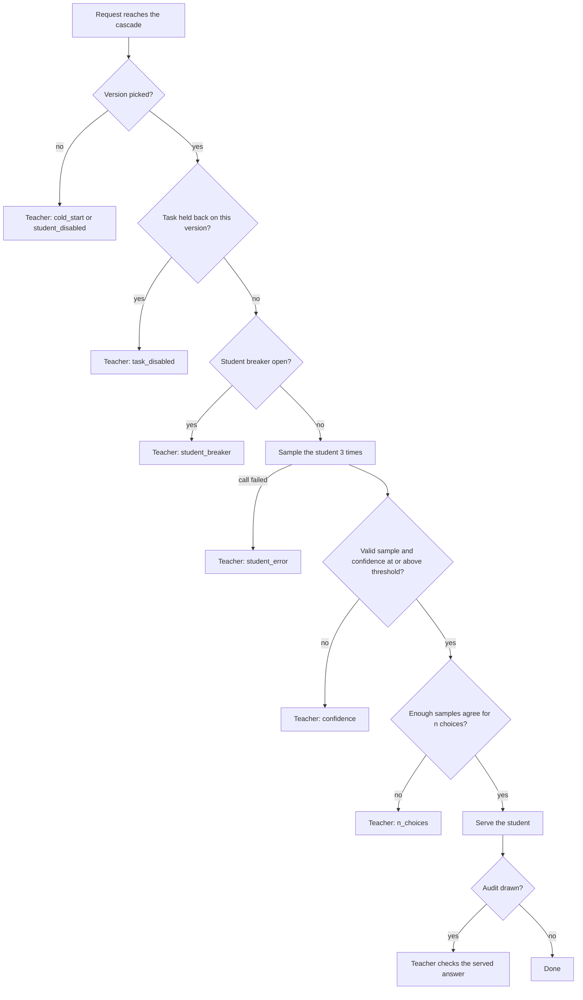
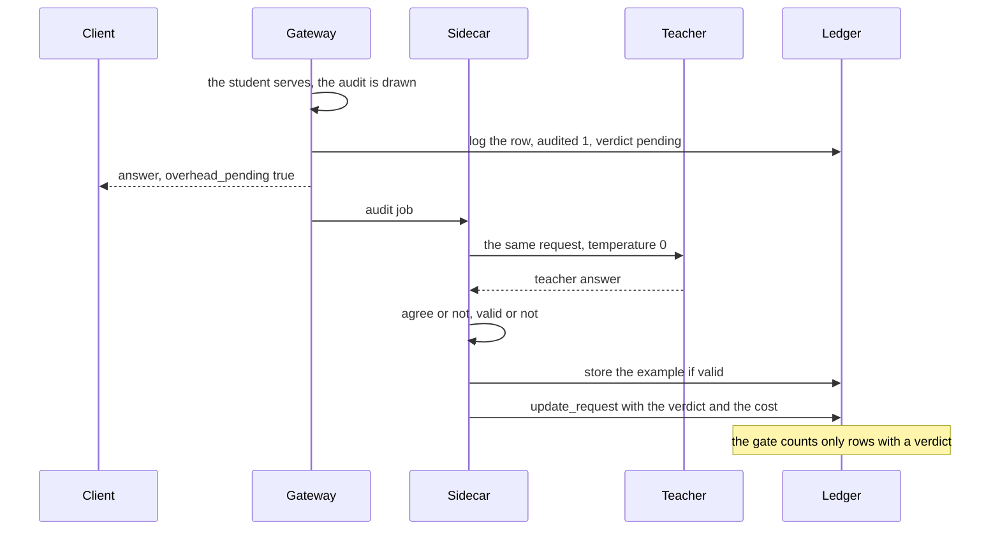
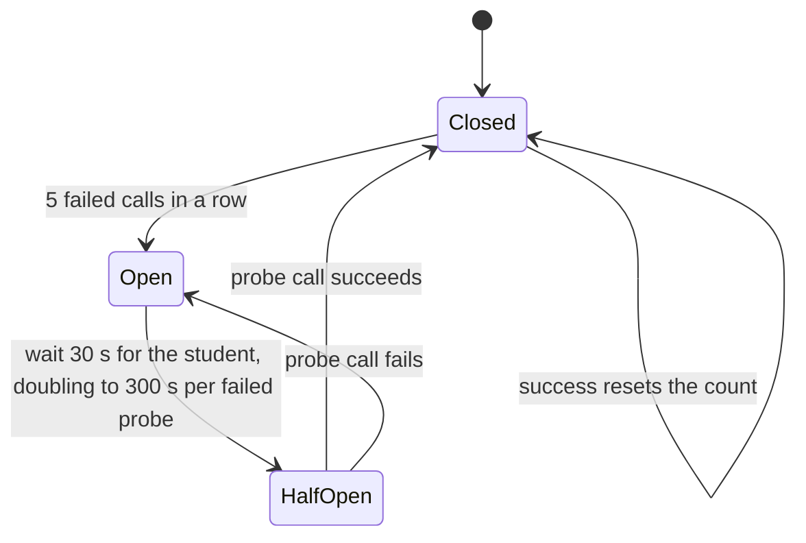
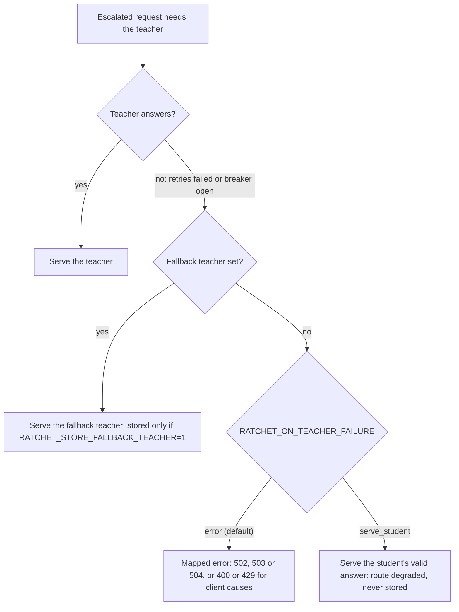
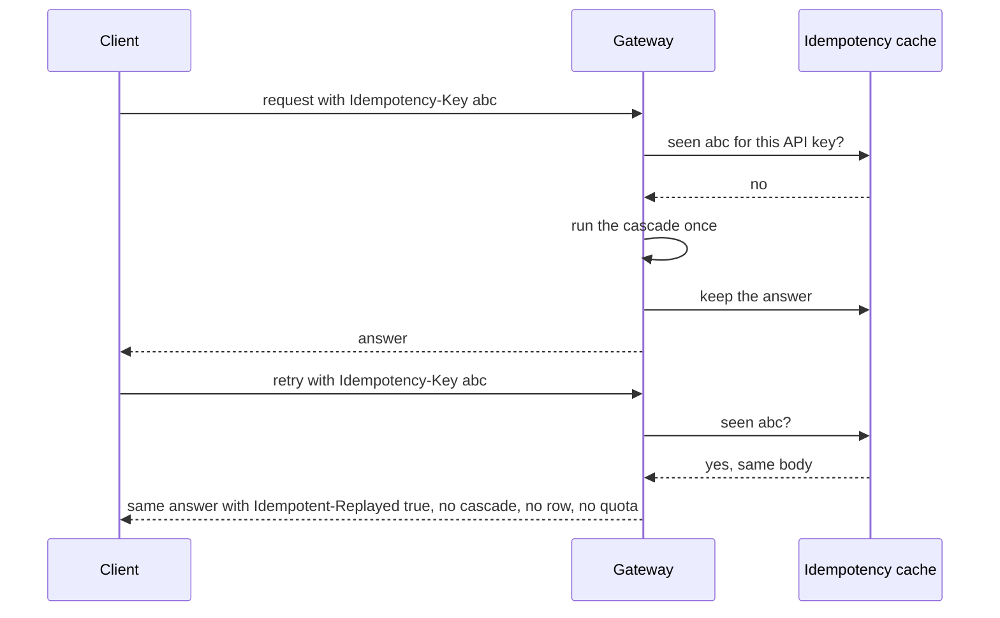

import { Steps, Aside, LinkCard, CardGrid } from '@astrojs/starlight/components';
import Summary from '../../../components/Summary.astro';
import Eli10 from '../../../components/Eli10.astro';
import Who from '../../../components/Who.astro';

Escalation sends a request to the teacher whenever the student cannot serve it safely, and audits send a random few of the student's own answers to the teacher as well, so Ratchet always has fresh, unbiased evidence of how often the student agrees with the teacher.

<Eli10>

**Escalation** is the apprentice saying "I'm not sure, chef". The apprentice cooked the dish three times and the plates did not match, or the stove broke, or this dish was taken off the apprentice's list. The **head chef** cooks it instead. The guest gets the head chef's plate, and the dish goes into the **recipe book**, so the apprentice can study it tonight.

**Audits** are the **inspector**. The inspector does not wait for the apprentice to ask for help. Now and then, at random, the inspector takes a plate the apprentice already sent out and asks the head chef to cook the same dish. Do the two plates match? The guest has already eaten, so nothing changes for them. But the inspector's tally is how the restaurant knows whether the apprentice is really as good as the exam said.

Why random? If the inspector only tasted plates the apprentice was unsure about, the tally would only show the hard dishes. Tasting at random shows how the apprentice does on the dishes it actually serves.

One more thing: the inspector compares the apprentice with the head chef, not with a perfect cookbook. If the head chef gets a dish wrong, the inspector will not notice.

</Eli10>

## How it really works

### When a request escalates

**Reading this diagram.** Follow one request down the left side. Each diamond is a reason the student might not answer, and each one ends in a teacher box named after the route written to the ledger. Only the last two diamonds happen after the student has produced something: confidence and `n` choices. If the student does serve, the only thing left is the audit draw.

Every teacher box after the version check is an escalation: a version was picked, but the teacher answers (`escalated` is true in the row and the response). The route says why:

| Trigger | Route | Student called? |
|---|---|---|
| Confidence below the version's threshold for this task | `confidence` | Yes |
| No valid sample: every sample empty, cut off, unparseable or invalid under the task's spec (confidence 0) | `confidence` | Yes |
| The task's spec changed since the version was scored: its threshold is 1.01 until a night re-scores it | `confidence` | Yes |
| Confident, but fewer than `n` samples agree for a request with `n` choices | `n_choices` | Yes |
| The student call failed (a vLLM 404 for the adapter also queues a reload) | `student_error` | Yes, it failed |
| The student's circuit breaker is open | `student_breaker` | No |
| The release gate disabled the task on this version, or it had no held-out rows | `task_disabled` | No |

The teacher also answers, without an escalation, on a cold start (`cold_start`), while an operator has the student turned off (`student_disabled`), and on the teacher-only paths (`pinned`, `unknown_task`, `tools`, `multimodal`). See the full [routes table](/guides/request-journey/#every-route).

If the gateway's daily budget is spent under `RATCHET_BUDGET_MODE=student_only`, an escalation is refused with a 429 `gateway_budget_exceeded` before any teacher call; confident student answers still go out.

### What the teacher's answer is used for

<Steps>

1. **It is served.** The client gets the teacher's answer, cleaned: reasoning removed (`<think>` blocks and the like) and, for a structured task, bare JSON. The teacher answers under the serving parameters: the client's temperature, or 0 when it set none (0.7 when the client asked for several choices).

2. **It is checked before it may become training data** (`Ratchet._store_example`). It is stored only when all of these hold: no storage opt-out applies; it is the primary teacher's answer (a fallback teacher's only with `RATCHET_STORE_FALLBACK_TEACHER=1`); it was not written under label-altering client sampling (`logit_bias`, a non-zero penalty, a temperature above 1, a vendor field); its `finish_reason` is `stop` or `tool_calls`; it is not empty once reasoning is stripped; and it is valid under the task's spec (it parses, every required field is present, a label is in its vocabulary). Anything else is still served, but skipped, with a `skip_example` event on the 1st, 10th, 100th and 1000th skip of each reason.

3. **It is redacted, then checked again.** Emails, phone numbers, Luhn-checked card numbers, IBANs, secrets and similar identifiers are replaced with placeholders such as `[EMAIL]` in the messages, the answer and the stored conditions. The teacher saw the original. If a placeholder breaks a structured answer, it is skipped (`invalid after redaction`).

4. **It is stored with its provenance** (`Ledger.add_example`): the teacher's model id, the license that allows training on it and its URL, the number of placeholders, the conditions it was written under (`response_format`, `tools`, `tool_choice`, `stop`), the API client and the end user's hash. Its split, golden or train, is fixed from a hash of the task and messages: about 10% golden (`RATCHET_GOLDEN_FRACTION`). A repeat of the same request bumps its `seen` count instead (a client's retry does not). For `n` choices only choice 0 is stored.

5. **It labels the student's own answer.** When the student had a valid answer and the teacher wrote its answer under the audit's conditions (one choice, no client sampling), the row records whether they agreed (`student_agree`). The ledger replay uses it.

6. **It is the shadow's reference.** If a version is in shadow, its answer for this request is compared with the teacher's.

</Steps>

The student's own answers are never stored as training targets (invariant 2), and pinned, tool and multimodal requests store nothing (invariant 10).

### Audits: what they are

When the student serves, one random draw (`rng.random()`, exactly one per served answer) decides an audit. The probability is:

- `RATCHET_AUDIT_RATE`: 0.05 by default; mock mode raises it to at least 0.10;
- for answers a **canary** serves, `RATCHET_CANARY_AUDIT_RATE` when set (audit focusing: the canary's evidence arrives sooner);
- an operator's runtime rate, when set, replaces both (`PUT /ratchet/admin/settings`, or `python -m ratchet.admin flag audit_rate 0.2`).

The rate the answer was drawn at is logged as `requests.label_p` (1.0 for a student answer that escalated). That makes every teacher label's probability known by design, so the ledger replay and the savings receipts can weight audited rows by `1 / label_p`.

If drawn, the teacher answers the same request under the audit's parameters: temperature 0, without the client's `top_p`, `seed`, penalties, `logit_bias` or logprobs (`_audit` → `_call_teacher(role="audit")`). Then:

- **The verdict.** `task.agree(student answer, teacher answer)` compares them on the task's fields. For `ticket-triage` that is `category` and `priority`; a task without fields compares whole answers, as canonical JSON or as lower-cased text with whitespace collapsed. The row gets `audited = 1` and `audit_agree` 1 or 0.
- **A training example too.** The audit's teacher answer goes through the same storage rules as an escalation's, so the money spent on the check also buys a label.
- **A better baseline.** The request's all-teacher baseline in the ledger (`baseline_cost_usd`) becomes what the audit actually cost, instead of the token-formula estimate. Audited rows are how the savings receipts calibrate that estimate for unaudited ones.
- **Not an audit** when the teacher's answer is cut off, empty or invalid for the task: it is priced, but measures nothing (`audited = 0`).

<Aside type="note" title="What an audit measures">
Agreement with Nemotron 3 Ultra, not ground truth. If the teacher is wrong and the student copies it, the audit says "agree". Precision everywhere in Ratchet means this agreement.
</Aside>

### How audits drive the release gate

Audits are the release gate's live signal. The gate counts, per version, the audits of answers that version served ([`ratchet/release.py`](https://github.com/harshbhx/ratchet/blob/main/ratchet/release.py), defaults from `ReleasePolicy`):

| Decision | Rule (default) |
|---|---|
| Canary moves from 10% to 50%, then to live | At least `min_audits` (20; 15 in mock mode) audits **in the current stage**, and audited precision at or above `live_floor` (0.92) |
| Canary holds | Enough audits, but precision below 0.92 without enough evidence to roll back |
| Canary is rolled back | At least 20 audits and the 95% Wilson upper bound of audited precision below 0.92. Traffic returns to the live version, or to the teacher on a cold start |
| Opt-in sequential rule (`RATCHET_SEQUENTIAL=1`) | Rollback when the e-value against "precision at least 0.92" over every audit of the canary's life reaches 20, with no minimum count; a stage with 400 audits and no decision retires the canary (`inconclusive`) |
| Live version alert | The e-value against "precision at least 0.92" over its audits since it went live reaches 100 (`alpha_alert` 0.01): one `alert` event, no automatic action |
| Per-task alert | The same rule per task for the live version and the canary: one `alert` per version and task |

Only audits with a verdict count: a pending off-path audit counts in neither the number of audits nor the precision. See [The release gate](/guides/release-gate/) for the whole state machine.

An operator can hold releases by setting the runtime audit rate to 0: no new canary starts, because it could neither advance nor roll back (setting 0 during a canary needs `force`). In live mode a configured rate below 1% is a startup warning, for the same reason.

Human feedback is different. Verdicts sent to `POST /v1/ratchet/feedback` are reported and alerted on, but never promote or roll back a version (invariant 26): clients report what they notice, so that sample is biased. Audits are random by design.

### Audits off the request path

An audit is a whole teacher call, seconds against a few hundred milliseconds for the student. In live mode the client should not wait for it, so the audit runs after the response on a small worker pool, the sidecar:

**Reading this diagram.** The client gets its answer at the fourth arrow, before the teacher is called. The row is written first with the verdict marked pending, then the sidecar fills it in once. Because the gate counts only rows with a verdict, a request whose audit has not finished yet cannot move a release in either direction.

### When the teacher or the student is down

Every upstream call goes through a circuit breaker. The student and the teacher each have their own, and the shadow has a third, so a failing candidate cannot close the live student's path.

**Reading this diagram.** While a breaker is closed, calls go through and a success resets the count. Five failures in a row open it: calls are refused at once, without waiting for a timeout. After a wait, one probe call is let through. A good probe closes the breaker, a bad one reopens it with a longer wait. The numbers shown are the student's; the teacher's breaker opens after 5 failures too and answers requests that need the teacher with a 503 `teacher_circuit_open` and `Retry-After`.

What the request gets when its teacher is not available:

**Reading this diagram.** The three outcomes are chosen by the operator, not by the request. The default is an honest error. A licensed fallback teacher (`RATCHET_TEACHER_FALLBACK_MODEL`) can answer instead and keeps its own license in the provenance. Degraded mode serves the student's answer even though it was below the threshold; it is marked in the response (`ratchet.degraded`, `X-Ratchet-Degraded`) and in the route, and is never stored, audited or shadowed. Audits and arbitrations never use the fallback: they fail open as described below.

### Retries do not pay twice

Clients retry. Two mechanisms keep a retry from costing a second teacher call or from counting as a second sighting of the same example.

**Reading this diagram.** The cache is per API key and lives in memory only, for `RATCHET_IDEMPOTENCY_TTL_S` (600 s by default), because answers contain request text and are never written to disk. A duplicate that arrives while the first is still running waits for the first's answer. The same key with a different body is a 400 `idempotency_key_reused`, and an error is never kept. Separately, a request marked as a retry (`x-stainless-retry-count` above 0) never adds to an example's `seen` count, and the same API client's repeat within `RATCHET_SEEN_DEDUP_S` (300 s live, 0 in mock mode) counts once, so retries cannot push a golden example to the frequent-request rule.

What keeps it honest:

- **The draw stays on the request path**, in the same order (the canary pick, then the audit draw), so the same requests are audited however the work runs.
- **A drawn audit is never dropped.** The last tenth of the queue is reserved for jobs that carry an audit; when even that is full, the audit runs before the response, as in mock mode. Dropping audits under load would leave the gate a sample of quiet hours.
- **Pending is explicit.** The row is logged with `audited` 1 and `audit_agree` NULL, and `Ledger.update_request` writes the verdict once when the job ends. The response says `"overhead_pending": true`, and its `cost_usd` is the serving cost only; the ledger gets the rest.
- **The audit keeps the teacher's full deadline** (180 s). If slow answers, often the hard requests, failed more often, the audited precision would be biased upward.
- **At shutdown** the gateway waits up to `RATCHET_SIDECAR_DRAIN_S` (10 s) for queued jobs, then gives up; those rows stay pending, which every statistic ignores.

Mock mode (0 sidecar workers by default), Scout and the simulator keep audits inline, so the reference simulation does not move.

### Shadow arbitration

While a version is in shadow, it is sampled and scored on every request without serving anything. The reference it is judged against is chosen in this order ([architecture](/reference/architecture/#shadow-reference-and-arbitration)):

1. the teacher's answer, if this request has one (the escalation's, or a counted audit's);
2. otherwise, if the shadow would serve and disagrees with the answer the live student served, the teacher **arbitrates**: it answers the request, that answer becomes the reference, and it is stored as a training example when valid;
3. otherwise the served answer itself, so agreements with the live student are accepted as they are.

Disagreements are always settled by the teacher, or counted against the shadow when they cannot be. Once the shadow would have served 100 answers, it needs precision of at least 0.95 and coverage no more than 2 points below the live student's to move to canary.

### When an audit or arbitration fails

These calls are optional: the client already has an answer (invariant 15).

| Failure | What the client gets | What is recorded |
|---|---|---|
| The audit call raises | The student's answer, as usual | `audited = 0`, `audit_agree` NULL, nothing billed for the call; `audit_errors` + 1; an `audit_error` event on the 1st, 10th, 100th and 1000th failure, naming the error class and status, never the message; a `failures` row |
| The teacher's breaker is open | The student's answer | The audit is skipped, not counted as an error |
| The audit answer is cut off or invalid | The student's answer | Priced, not an audit, not stored |
| The arbitration fails, or is skipped because this request's audit already failed | The live answer | `shadow_agree` NULL: the gate counts it as a disagreement, and the rejection reason says how many |

A failed audit is simply not an audit. Audits are a random sample, so losing one shrinks the sample without biasing it. A failed arbitration is different: arbitration only runs when the shadow disagrees, so dropping those rows would hide exactly the cases where the shadow may be wrong. Counting them against the shadow means a flaky teacher can get a candidate rejected, never promoted.

### What audits cost

Each audit is one extra teacher call at the teacher's price, added to the request's `cost_usd` and `teacher_cost_usd` and listed in `usage_breakdown.audit`. At the default rate that is one teacher call for about every 20 answers the student serves, so audits add roughly 5% of what the teacher would have charged for those answers. A shadow adds its own samples on every request, plus any arbitration. Ratchet counts all of this in its savings; nothing is left out of the bill.

The teacher's list price in `ratchet/config.py` is $1.00 per million input tokens and $3.00 per million output tokens for Nemotron 3 Ultra (Token Factory list price, Oct 2026, unverified until the day-1 checks pass).

## For engineers

| Where | What |
|---|---|
| [`ratchet/router.py`](https://github.com/harshbhx/ratchet/blob/main/ratchet/router.py) `Ratchet.handle` | The escalation branches, the audit draw, `label_p`, `student_agree` |
| `Ratchet._audit` | One audit: the call, the verdict, failures (`AuditOutcome`) |
| `Ratchet._call_teacher` | The teacher's answer in the `serve`, `audit` or `arbitrate` role, then `_store_example` |
| `Ratchet._store_example` | The only caller of `Ledger.add_example` for teacher answers: the storage rules, redaction, provenance |
| `Ratchet._shadow`, `Ratchet._arbitrate` | The shadow's samples, its verdict and the arbitration |
| `Ratchet._finish_offpath` | The audit and shadow after the response, then `Ledger.update_request` |
| `router.answer_problem` | Why a teacher answer can be neither an example nor a reference |
| [`ratchet/sidecar.py`](https://github.com/harshbhx/ratchet/blob/main/ratchet/sidecar.py) | The bounded queue: `reserve`, `submit`, `drain`, `close` |
| [`ratchet/release.py`](https://github.com/harshbhx/ratchet/blob/main/ratchet/release.py) | `ReleaseGate.tick`: the canary, rollback and alert rules over audit counts |

| Setting | Default | Meaning |
|---|---|---|
| `RATCHET_AUDIT_RATE` | 0.05 | Audit probability for a served student answer; mock mode uses at least 0.10 |
| `RATCHET_CANARY_AUDIT_RATE` | unset | A canary's own audit rate, more than 0 and at most 1 |
| `RATCHET_MIN_AUDITS` | 20 (15 in mock mode) | Audits a canary stage needs before it can advance or roll back |
| `RATCHET_LIVE_FLOOR` | 0.92 | Audited precision floor for canary and live |
| `RATCHET_SEQUENTIAL` | 0 | 1 turns on the anytime-valid canary rule |
| `RATCHET_STORE_FALLBACK_TEACHER` | 0 | 1 stores the fallback teacher's answers, under its own license |
| `RATCHET_GOLDEN_FRACTION` | 0.10 | Share of new examples held out as golden |
| `RATCHET_SIDECAR_WORKERS` | 4 live, 0 mock | Workers for audits and shadows after the response |
| `RATCHET_SIDECAR_QUEUE` | 1000 | Jobs that may wait |
| `RATCHET_SIDECAR_DRAIN_S` | 10 | Seconds shutdown waits for queued jobs |

The `ReleasePolicy` fields read `RATCHET_<FIELD>` (see the [release policy settings](/reference/configuration/#release-policy-ratchetreleasepy)). The live-run harness expects the planned gate profile `RATCHET_SEQUENTIAL=1` and `RATCHET_CANARY_AUDIT_RATE=0.5`.

Where to look: each row's `audited`, `audit_agree`, `label_p` and `stored` columns (`GET /ratchet/requests/{id}`); `audit_agreement` per day and each task's audits in `GET /ratchet/stats`; the `evidence` of the canary and the live version (counts, e-value, confidence sequence) in the same payload's `versions` list; events `audit_error`, `skip_example`, `rollback`, `alert`, `sidecar_inline` and `sidecar_dropped` in the release log. `Ratchet.health()` holds the in-process counters (`audit_errors`, `shadow_errors`).

## Common questions

### Is 5% enough to catch a bad model?

It is enough to catch a badly broken one quickly, because a canary only serves 10% and then 50% of traffic and needs at least 20 audits per stage before it can move. In the seed-7 reference run (**simulation**, mock models), a deliberately corrupted v3 with 41.2% audited precision was rolled back after 17 audits and 145 served answers. To get evidence faster, raise `RATCHET_CANARY_AUDIT_RATE` for canaries only, or turn on the sequential rule, which can roll back after a couple of disagreeing audits.

### What if the teacher is wrong?

Then the audit agrees with a wrong student, or flags a right one. Ratchet cannot see that: every precision number is agreement with Nemotron 3 Ultra. Human feedback (`POST /v1/ratchet/feedback`) is reported next to it so you can spot a gap, but it never moves a release.

### Do audits slow my requests down?

Not in live mode: they run after the response, unless the queue is full, in which case a drawn audit runs before the response rather than being dropped. In mock mode they run inline.

### Why not audit only the answers the student was unsure about?

Those already go to the teacher. The point of an audit is to check answers the student was confident about, at random, so the sample describes what users actually got.

### Can I turn audits off?

You can set `RATCHET_AUDIT_RATE=0`, but then no canary can collect evidence, so nothing is promoted or rolled back on evidence; live mode warns about any rate below 1%. A runtime audit rate of 0 is treated as an operator hold on releases.

### Are audit answers stored even when a client opted out of storage?

No. Under an opt-out the audit still runs (release safety does not depend on storage) and its verdict counts, but nothing is stored.

### Has the audit path run against Token Factory?

Not yet. As of Oct 21, 2026 it is tested offline, including the off-path sidecar, which a test compares row for row with an inline run.

## Related

<CardGrid>
  <LinkCard title="One request's journey" href="/guides/request-journey/" description="The whole path a request takes." />
  <LinkCard title="Confidence" href="/guides/confidence/" description="How the student decides it is sure." />
  <LinkCard title="The release gate" href="/guides/release-gate/" description="Shadow, canary and rollback in full." />
  <LinkCard title="The ledger" href="/guides/ledger/" description="Where examples and their provenance live." />
</CardGrid>
