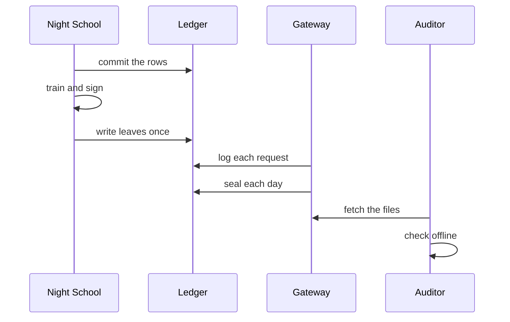
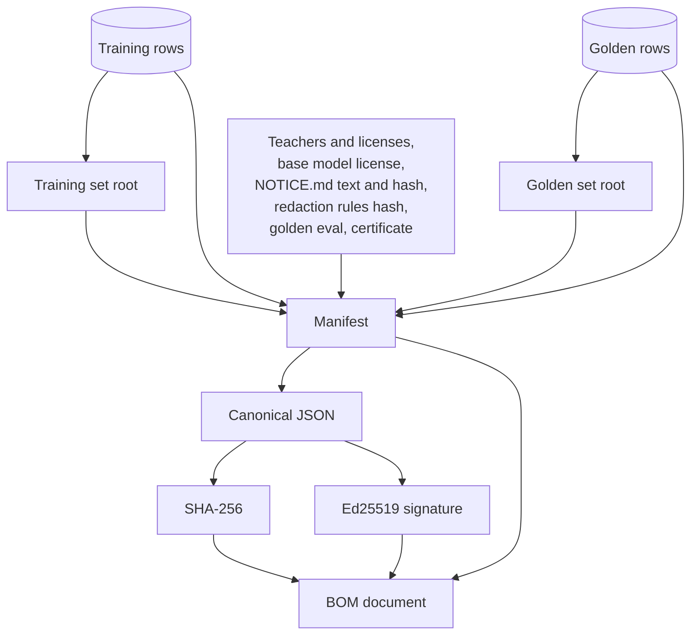
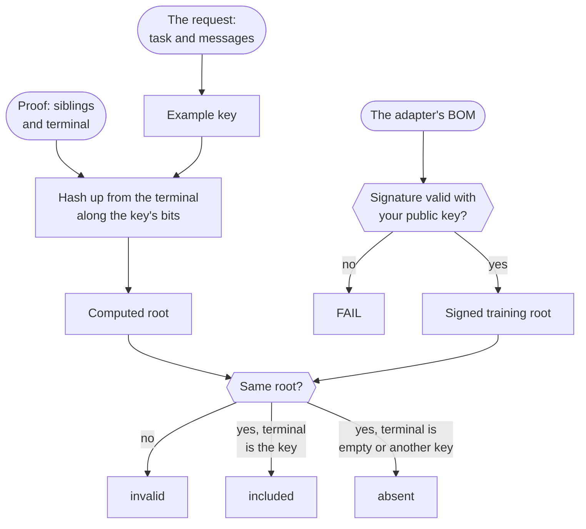
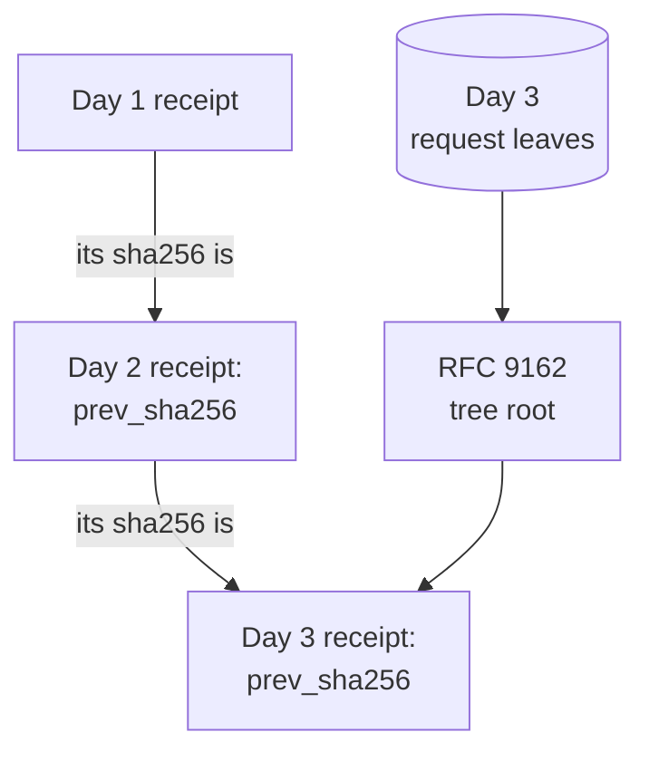

import { Steps, Aside } from '@astrojs/starlight/components';
import Summary from '../../../components/Summary.astro';
import Eli10 from '../../../components/Eli10.astro';
import Who from '../../../components/Who.astro';
import PathCard from '../../../components/PathCard.astro';
import PathGrid from '../../../components/PathGrid.astro';

<Summary>Ratchet writes its claims about each adapter and each day's savings into signed documents whose numbers can be recomputed offline, so a customer or auditor can check them instead of trusting the gateway that served them.</Summary>

<Eli10>

A restaurant can say anything about itself. Ratchet hands you things you can check yourself, at home, without asking the restaurant again.

- **The certificate on the wall** (the signed bill of materials) lists which chefs taught the apprentice, under which licenses, how many recipes were studied and how the apprentice did on the sealed exam. It carries the restaurant's stamp. Anyone with a copy of the stamp's pattern can tell if a single word was changed after stamping.
- **The exam score with a safety margin** (certified precision) does not say "the apprentice got 99%". It says "even if we were unlucky with the exam questions, the real score is at least this".
- **The fingerprint of the recipe book** (a committed training set) lets you check that one recipe was in the study pile, or was not, without seeing the whole book. It also proves that no dish from the sealed exam was ever studied.
- **The time machine** (the ledger replay) answers "what would last week have looked like with a different bar?".
- **The receipt** (the savings receipt) is each day's bill, counted on the cautious side, with a fingerprint of every order on it. Each receipt includes yesterday's fingerprint, so changing an old receipt breaks the chain.

Each piece also says plainly what it cannot prove. A stamp shows nobody changed the certificate; it does not show the certificate was true when it was written.

</Eli10>

<PathGrid cols={2} label="The five kinds of evidence">
  <PathCard title="Signed bills of materials" href="#signed-bills-of-materials" icon="file" eyebrow="Per adapter" description="Every training source and license, signed at training time." />
  <PathCard title="Certified precision" href="#certified-precision" icon="check" tone="neutral" eyebrow="Per adapter" description="An exact lower bound on how often served answers agree with the teacher." />
  <PathCard title="Committed training sets" href="#committed-training-sets" icon="layers" tone="neutral" eyebrow="Per adapter" description="Prove one example was, or was not, trained on." />
  <PathCard title="Ledger replay" href="#ledger-replay" icon="loop" tone="neutral" eyebrow="Any time" description="Last week's traffic at another threshold: an estimate, not signed." />
  <PathCard title="Verified savings receipts" href="#verified-savings-receipts" icon="coin" tone="neutral" eyebrow="Per day" description="Each day's bill, signed and chained to the day before." />
  <PathCard title="Proof you can run" href="/guides/proof/" icon="start" tone="neutral" eyebrow="Commands" description="One command per check, and what a failure looks like." />
</PathGrid>

## How it really works

The evidence is written at fixed moments, by code that draws no random numbers and calls no model, so it never changes a release decision.

<Steps>

1. **The night, before training.** Night School builds a set commitment (a sparse Merkle root) over the exact training rows and another over the golden rows, before the paid training job starts, so a problem fails the night before any GPU time.

2. **The night, after training.** Right after the new version is created, the leaves behind both roots are written once to the ledger's `version_leaves` table, which refuses any later change. The adapter is scored on the golden set (with its certificate), the live version is re-scored on the same rows, the paired comparison is added, and only then is the bill of materials written and signed. In live mode a copy goes into the adapter's folder in the bucket, with its `NOTICE.md`.

3. **Every request.** Each request the student answers logs the threshold it was held to, the probability that the teacher labels it (`label_p`), whether the student agreed with that label, and the token formula's baseline. This is what the replay and the receipts read.

4. **After each ledger day ends.** The day's savings receipts are sealed, once: one for the whole gateway and one per API client, each signed and chained to that client's previous receipt.

5. **Any time later, anywhere.** A customer downloads the documents and checks them with the command-line tools in this repository, using only the files and a public key the operator published.

</Steps>

| Evidence | What it proves | What it does not prove | Check it with `python -m` |
|---|---|---|---|
| Signed BOM | The operator signed these claims about this adapter at training time, and nothing changed since | That the weights were trained on that data | `ratchet.bom verify` |
| Certificate | With probability at least 95%, what this version serves agrees with the teacher at least `lcb` of the time, on traffic like the golden rows | Correctness, or behaviour on traffic unlike the golden rows | `ratchet.stats check` |
| Committed training set | This example was, or was not, in the committed training or golden set | That the weights came from that set | `ratchet.proof verify` and `heldout` |
| Ledger replay | An estimate of precision, coverage and cost at another threshold or audit rate | Anything signed: it reads the ledger as it is, and its interval is approximate | `ratchet.replay` |
| Savings receipt | The day's leaves were not edited after sealing, and the bill follows from them | That the costs written at request time were right | `ratchet.receipt verify` |

<figure class="rt-diagram">



<figcaption>

**Reading this diagram.** The first three arrows happen once a night: Night School commits the training and golden rows (their Merkle roots), trains, scores the adapter with its certificate, re-scores the live version, signs the bill of materials, and writes the leaves once (append-only). The next two happen all day: the gateway logs every request with its label probability and seals each ended day into a signed receipt. So the evidence is made by the same system that does the work, but at fixed moments that cannot change a decision. The last two arrows are the point: a customer or auditor fetches the BOM, proofs, receipts and public key, and checks them offline without calling the gateway again. [Proof you can run](/guides/proof/) lists the one command for each check.

</figcaption>
</figure>

A separate, simpler check exists for the text-to-SQL adapter: its exam is scored by running queries, and `measure_adapter.py verify` recomputes every number from the raw answers. That one does not need a gateway at all. See [A text-to-SQL adapter you can check](/guides/text-to-sql/) and [Results](/guides/results/).

All the arithmetic comes from two standard-library modules, [`ratchet/stats.py`](https://github.com/harshbhx/ratchet/blob/main/ratchet/stats.py) and [`ratchet/merkle.py`](https://github.com/harshbhx/ratchet/blob/main/ratchet/merkle.py), checked against hand-computed values and seeded Monte Carlo runs in `tests/test_stats.py` and `tests/test_provenance.py`.

## Signed bills of materials

**In one sentence for a 10-year-old:** a bill of materials is a list of everything that went into one adapter, signed so that anyone with the public key can tell if a single character was changed after it was written.

**Precisely.** For every adapter it trains, Night School writes one document, schema `ratchet.bom/v2`, from the exact rows it used:

- `adapter`: the version, the adapter's name, its base model (`nvidia/NVIDIA-Nemotron-3-Nano-4B-BF16`) and the ledger day.
- `training`: the number of examples, the dataset hash, examples per task, `targets` (`teacher answers only`, or with customer-attested human labels), how many examples had PII redacted, where the examples came from, and the training set's commitment (`{alg: ratchet.smt/v1, root, size}`).
- `golden`: the number of golden rows, their hash, `held_out: true`, golden rows with a human reference, and the golden set's commitment.
- `sources`: each teacher with its license, license URL, whether it allows distillation and whether the license entry is Ratchet's own (`builtin`) or added by the operator (`config`); `label_sources` lists human labels apart, because a person is not a teacher.
- `base_model_license`: the NVIDIA Nemotron Open Model License and its URL for the Nano base (or a warning for a base model Ratchet does not know).
- `notices`: the exact text of the `NOTICE.md` that sits next to the adapter's weights, with its SHA-256.
- `redactor`: a SHA-256 over the redaction rules, how many there are, and whether redaction was on.
- `eval`: the golden eval at training time: precision, coverage, threshold, and since v0.5 the certificate, the frontier, the per-task bounds, the per-row outcomes and the paired comparison with the live version.

The manifest is serialised as canonical JSON (sorted keys, no whitespace, UTF-8). The document carries the SHA-256 of those bytes and, when `RATCHET_BOM_SIGNING_KEY` is set, an **Ed25519** signature with the public key and a key id. It is written once and never rewritten: a later re-check changes `/ratchet/stats`, not the signed document. Versions trained before v0.4 have no BOM; v1 documents still verify.

<figure class="rt-diagram">



<figcaption>

**Reading this diagram.** Everything at the top goes into one manifest: the counts and hashes of the exact rows, the roots that commit to each set, and the facts about the adapter. The manifest is written as canonical JSON, and that one byte string is both hashed and signed. The document you receive carries the manifest, its SHA-256 and the signature, so changing any byte of it breaks the check.

</figcaption>
</figure>

**Check it:**

```bash
python -m ratchet.bom keygen                                          # once: the signing key, and the public key to publish
curl -s localhost:8000/ratchet/bom/public-key                         # the key the gateway signs with
curl -s localhost:8000/ratchet/versions/2/bom > bom.json
python -m ratchet.bom verify bom.json --public-key <yours>            # OK: signature valid (Ed25519, key ..., trusted key)
python -m ratchet.bom verify bom.json --public-key <yours> --notice NOTICE.md   # and the NOTICE.md next to the adapter
python -m ratchet.live export --version 3 --out ./student-v3-export   # hand an adapter over with its BOM and NOTICE.md
```

Pass the public key you published somewhere you control (a README, a website). Without `--public-key`, `verify` uses the key embedded in the document, which only shows the document is consistent with itself. Without a signing key, the document carries only its SHA-256: `verify` reports it as unsigned. Rotating the key does not invalidate old BOMs; keep every public key you have published listed.

**What it does not prove.** A signed BOM is the operator's signed statement of the data and evaluation behind an adapter. It shows that nothing changed after signing, not that the weights were trained on that data, and not that the claims were true: a compromised signing key can sign anything. When examples are erased later, the versions that may have been trained on them are reported, and their BOMs stay exactly as written.

## Certified precision

**In one sentence for a 10-year-old:** a certificate is the exam score with a safety margin: "even if we were unlucky with the exam questions, the real score is at least this".

**Precisely**. The golden eval picks the threshold on the even half of the golden rows and measures on the odd half (see [Confidence](/guides/confidence/)). The odd half played no part in choosing the threshold, so its count of agreeing answers among the `m` it would serve is one exact binomial experiment. The one-sided Clopper–Pearson lower bound is the precision `p` at which getting `s` or more agreeing answers out of `m` would happen only `delta` of the time:

```text
lcb       = cp_lower(s, m, delta)   # the p with P(X >= s) = delta, X ~ Binomial(m, p)
certified = lcb >= target           # RATCHET_CERT_TARGET 0.95, RATCHET_CERT_DELTA 0.05
```

"Certified at 95% (lcb 96.4%, delta 0.05)" means: with probability at least 95%, the answers this version serves at its threshold agree with the teacher at least 96.4% of the time. For example, 129 agreeing out of 130 served held-out rows gives a point estimate of 99.2% and a lower bound of 96.4% (checked with `stats.cp_lower`). The point estimate alone cannot tell 0.96 from 0.99 on that many rows; the bound can.

The eval also carries:

- **The frontier:** the same counts and bound at every threshold of the fixed grid 0.95, 0.90, down to 0.50, each bound at `delta / 10`, so all ten hold at once (Bonferroni) and an operator may read any row afterwards: a certified trade-off between precision and the share of traffic served.
- **Per task:** the counts and bound per task, so a weak task cannot hide inside a pooled number. A diagnostic, not corrected for the number of tasks, and never used for routing.
- **The test vector:** one letter per held-out row (`S` served and right, `W` served and wrong, `E` escalated), which the paired comparison with the live version reads, and which `check` uses to recount everything.

How many rows a certificate needs, from `stats.required_rows`:

| Target (delta 0.05) | 0 wrong answers | 1 | 2 | 3 |
|---|---|---|---|---|
| 0.90 | 29 | 46 | 61 | 76 |
| 0.95 | 59 | 93 | 124 | 153 |
| 0.97 | 99 | 157 | 208 | 257 |

Only served held-out rows count, so certifying 95% with one wrong answer takes about `2 × 93 / coverage` golden rows.

**Check it:**

```bash
python -m ratchet.stats plan --target 0.95 --delta 0.05      # 0 errors: 59 rows, 1: 93, 2: 124, 3: 153
python -m ratchet.stats bound --successes 127 --n 128         # one bound by hand: 0.9635
curl -s localhost:8000/ratchet/versions/2/certificate         # signed and latest certificate, the gate's evidence, assumptions
curl -s localhost:8000/ratchet/versions/2/bom > bom.json
python -m ratchet.stats check bom.json --public-key <yours>   # recompute every number from the signed counts
```

`check` verifies the signature, then recomputes every bound, verdict, frontier row, per-task row, Learn-then-Test step and paired p-value from the signed counts, and the counts from the test vector. It exits 1 on any difference above 1e-9. The certificate endpoint's `status` is `certified` or `not certified` from the latest certificate (the nightly re-score's, else the signed one), `suspended` while a drift alarm is open on the version, or `no certificate` for a version evaluated before v0.5.

**What it does not prove.** Precision means agreement with Nemotron 3 Ultra (<Who as="teacher" />) under the task's comparators, not ground truth. The bound assumes the golden rows look like live traffic, and they lean towards requests the student found hard (they come from escalations, audits and arbitrations). The guarantee is about the traffic the golden rows were drawn from, when they were drawn; drift breaks it. Every certificate is served with these assumptions in plain words.

## Committed training sets

**In one sentence for a 10-year-old:** a Merkle root is a fingerprint of a whole list that lets you prove one item is on it, or is not, without showing the list.

**Precisely**. Every BOM since v0.5 signs one root per split, over exactly the rows Night School handed to the trainer and to the golden eval:

- **Key:** the example's hash, a SHA-256 over the task, the redacted messages and any stored generation conditions. Anyone holding the request can recompute it.
- **Value:** the SHA-256 of `{completion, teacher, license, redactions}`: the stored teacher answer the student trained on, who wrote it, its license and the number of PII placeholders. A proof therefore binds what an example was trained on, not only that its key was there.
- **Tree:** a collapsed sparse Merkle tree split on the key's bits. An empty node is 32 zero bytes, a node with one key is `sha256(0x00 || key || value)`, any other node is `sha256(0x01 || left || right)`. The root depends on the set alone, never on insertion order.
- **Proof:** the sibling hashes along the key's path, plus where the path ends: the key's own leaf (included), an empty node, or another key's leaf that shares the path (absent).

The **held-out certificate** is the golden set's leaves plus, for every golden key, a proof of absence from the training root: two of the loop's rules (golden rows are never trained on; precision is measured on rows the model did not see) as something you verify, not something you are told.

Absence is sound even against whoever built the tree: a key's path is fixed by its bits, so a proof of inclusion and a proof of absence for the same key against the same root would need a SHA-256 collision. A Merkle tree over a sorted list is not used for absence, because a verifier cannot check that the list was really sorted.

<figure class="rt-diagram">



<figcaption>

**Reading this diagram.** Two roots meet at the bottom. On the left the verifier rebuilds a root from the request and the proof, hashing up from the terminal one level at a time, deepest sibling first. On the right it takes the training root from the BOM, but only after the BOM's signature checks out with your public key. If the two roots are the same, where the proof's path ends says whether the example was included or is absent.

<ul class="rt-key">
  <li class="gate">A check</li>
  <li class="ok">A valid answer: included or absent</li>
  <li class="danger">The proof fails</li>
</ul>

</figcaption>
</figure>

The verifier never trusts the root, result or value written in the proof file; it checks against the root the signed BOM names.

**Check it:**

```bash
curl -s localhost:8000/ratchet/versions/2/bom > bom.json
# ex.json: the body of a request that was stored as an example (task and messages)
curl -s "localhost:8000/ratchet/versions/2/proof?split=train" -H 'content-type: application/json' -d @ex.json > proof.json
python -m ratchet.proof verify proof.json --bom bom.json --expect included
curl -s localhost:8000/ratchet/versions/2/heldout > heldout.json
python -m ratchet.proof heldout heldout.json --bom bom.json   # OK: all N golden examples provably absent from the training set
python -m ratchet.proof key --task ticket-triage --messages request.json                    # the key a request is stored under
```

Add `--public-key <yours>` to `verify` and `heldout` to trust the signer, not just the document. The proof (`POST /ratchet/versions/{id}/proof`) and held-out (`GET /ratchet/versions/{id}/heldout`) endpoints need an admin key in live mode (`Authorization: Bearer $ADMIN_KEY`); They are admin-only on purpose: for a text someone can guess, a yes-or-no answer about the training set is a leak.

A proof is about log2 of the set's size in siblings. A held-out certificate for 133 golden rows against 1,288 training leaves is about 113 KB of JSON.

**What it does not prove.** The proofs show the operator's binding commitment, signed at training time, to the dataset an adapter was trained and graded on. They do not show that the weights came from that dataset: an operator who signs one set and trains on another is not caught by a Merkle proof. A proof of absence also names the neighbouring training example's key and value hashes, so held-out certificates go to auditors, not to the public.

## Ledger replay

**In one sentence for a 10-year-old:** because Ratchet decides which plates the inspector tastes by a coin flip with known odds, each tasted plate can stand in for the untasted plates like it, so last week can be replayed with a different bar.

**Precisely**. Ratchet designs its own labelling, so it knows the chance of every teacher label it sees: 1 for a request the student answered and escalated, the audit rate for an answer it served. Each request logs that probability (`label_p`), the threshold it was held to, and whether the student's answer agreed with the teacher's when the teacher answered under an audit's conditions (`student_agree`). For one version, the replay then computes at any threshold `t` or audit rate `a`:

- **coverage:** exact, from the logged confidences, no label needed;
- **precision:** a weighted mean of `student_agree` over labelled served requests, each weighted by `1 / label_p` (Hajek), with an approximate interval (Wilson at Kish's effective sample size); null, with a reason, when nothing could label the answers it would count (an audit rate of 0);
- **cost and savings:** student spend, plus the all-teacher cost of every request not served, plus the audit rate times that of every request served;
- **a frontier** from 0.30 to 1.00 in steps of 0.01, and an advisory suggested threshold, which nothing applies: thresholds change only through Night School;
- **a calibrated baseline:** the ratio of what the teacher really billed on audited answers to the token formula's estimate (which assumes 300 reasoning tokens, `RATCHET_TEACHER_REASONING_TOKENS`).

**Check it:**

```bash
curl -s "localhost:8000/ratchet/replay?threshold=0.4&audit_rate=0.05"     # what happened, and what would have
curl -s "localhost:8000/ratchet/replay/frontier?target=0.97"               # thresholds 0.30 to 1.00, an advisory suggestion
python -m ratchet.replay --db ratchet.db                                   # the same offline, from a ledger file
```

**What it does not prove.** The replay is an analysis of the ledger as it stands, not a signed document. Its interval is approximate and computed on the same traffic the operator is looking at, so it is never a certificate and never a release decision. An escalation answered under a client's own sampling parameters, or for more than one choice, gives no label. A request whose escalation failed outright was never logged, so it is not in the replay. It replays one version at a time, because each adapter's confidence scale is its own.

## Verified savings receipts

**In one sentence for a 10-year-old:** a receipt is the day's bill with a fingerprint of every order on it, and each receipt carries yesterday's fingerprint, so changing an old receipt breaks the chain.

**Precisely**. The plan for a managed offering is to charge a share of verified savings (nothing is sold today), so the savings must be checkable by the customer. For each ledger day there is one receipt for the whole gateway and one per API client:

<Steps>

1. **Leaves.** Each request of the day becomes one leaf of metadata, never text: `id`, `ts_ms`, `day`, `task`, `client` (the API key's name, never the key), `served_by`, `route`, `student_version`, `escalated`, `audited`, `label_p_ppb` and the amounts (`cost_nusd`, `student_cost_nusd`, `teacher_cost_nusd`, `baseline_nusd`, `baseline_est_nusd`). Amounts are whole nano-USD, so sums are exact and the signed JSON holds no floating-point number.

2. **Groups.** A request is **measured** when the teacher answered it (its bill is the baseline), **served** when the student served it on the audit design, and **unverified** when a stand-in answered (route `degraded` or `fallback_teacher`).

3. **Calibration per task.** For each task, the audited served answers give a ratio `R` between the real teacher bills and the formula's estimates (weighted by `1 / label_p`), with a variance by the normal approximation. A task needs `RATCHET_RECEIPT_MIN_AUDITS` (30) audits that day; below that it is `insufficient_audits` and its savings are reported but not billed.

4. **The bill.** The billable savings (measured requests plus the calibrated tasks' served answers, minus any stand-in losses) less a margin of `ceil(1.645 × sqrt(sum of variances))` give the one-sided 95% **lower bound**. The fee is `RATCHET_TAKE_RATE` (0.25) of that bound, after the day's spend outside requests, when it is positive, rounded down to a nano-USD. With no calibrated task the basis is `formula` and the fee is 0.

5. **Seal.** The leaves form an RFC 9162 Merkle tree (the Certificate Transparency kind). The receipt names its root and size, its totals, the calibration and the bill, and `prev_sha256`, the hash of the same client's previous receipt (64 zeros for the first). It is signed with the BOM key and written once, after the day has ended (on a live ledger, 5 minutes after). The ledger refuses any later change.

</Steps>

<figure class="rt-diagram">



<figcaption>

**Reading this diagram.** Each receipt names the hash of the same client's previous receipt, so the receipts form a chain: change day 1 and day 2's `prev_sha256` no longer matches. Each receipt also names the root of a Merkle tree over that day's request metadata, which is what lets one request be proved to be in it.

</figcaption>
</figure>

Every chat response carries its ledger row id in `X-Ratchet-Request-Id` and `ratchet.row_id`, so a client can later ask for a proof that its request is in that day's receipt. With API keys on, a key reads only its own receipts and proofs and an admin key reads all of them; live mode without any keys serves no receipts, because the leaves list every request's time, task and cost. The gateway-wide receipt also shows the day's savings by GPU-hours paid, which are often negative at low volume. That view is informational (billing uses the per-token view); the [cost report](/guides/cost-and-savings/) is what says when self-hosting does not pay.

When the teacher's real reasoning differs from the formula's assumed 300 tokens, the receipts measure the ratio `R` from audited answers and correct the baseline.

**Check it:**

```bash
curl -s localhost:8000/ratchet/receipts/3 > r3.json                            # one day's receipt (your own, with an API key)
curl -s localhost:8000/ratchet/receipts/2 > r2.json                            # the day before, for the chain
curl -s localhost:8000/ratchet/receipts/3/proof/3006 > p.json                  # a row id you saw (ratchet.row_id) is in it
curl -s localhost:8000/ratchet/receipts/3/leaves > leaves.jsonl                # every leaf: recompute everything
python -m ratchet.receipt verify r3.json --public-key <yours> --prev r2.json --proof p.json --rows leaves.jsonl
python -m ratchet.live seal                                                    # live: seal every day that ended (hourly cron)
```

`verify` checks the hash and signature, that no floating-point number is in the document, the chain (it recomputes the previous receipt's hash rather than reading it), the request's inclusion against the signed root and size, and with `--rows` rebuilds the root and recomputes every total, estimate and the fee. It exits 0 when everything holds, 1 when anything fails, 2 on bad input.

**What it does not prove.** Receipts make edits after sealing detectable and tie the baseline to audited teacher bills. They cannot prove the costs written at request time: reconcile the summed teacher spend (`totals.teacher_cost_nusd` over the days) with the Token Factory bill for the same API key. The interval is a normal approximation, and heavier-tailed real bills may need more than 30 audits. The chain shows that a receipt was changed; it does not stop an operator from withholding one, so clients should keep the receipts they receive. Request ids are the ledger's global row ids, so a client can infer the gateway's total volume between two of its own requests.

<Aside type="caution" title="Not run on live traffic yet">
As of Oct 28, 2026, no adapter has been signed and no day has been sealed on a live gateway; the GPU side is scripted and tested offline, ready to run with `make nebius-up`. Real teacher calls on Token Factory built the text-to-SQL data, but no BOM, certificate, proof, replay or receipt has been produced on live traffic. The formats, the signatures and the verifiers are tested offline.
</Aside>

## For engineers

| What | Where |
|---|---|
| BOM, signing and verification | [`ratchet/bom.py`](https://github.com/harshbhx/ratchet/blob/main/ratchet/bom.py): `manifest`, `canonical`, `document`, `verify`, `check_notice`, `commitment`, `Signer`, `keygen`; `python -m ratchet.bom keygen` or `verify` |
| NOTICE.md | [`ratchet/nightschool/notices.py`](https://github.com/harshbhx/ratchet/blob/main/ratchet/nightschool/notices.py): `render`, `bom_notice`, `write_adapter_files` |
| Certificates | [`ratchet/certificate.py`](https://github.com/harshbhx/ratchet/blob/main/ratchet/certificate.py): `certificate`, `frontier`, `per_task`, `outcome_vector`, `paired`, `recheck`, `status`, `ASSUMPTIONS` |
| Exact statistics | [`ratchet/stats.py`](https://github.com/harshbhx/ratchet/blob/main/ratchet/stats.py): `cp_lower`, `required_rows`, `mcnemar_one_sided`, `ltt_fixed_sequence`, `CERT_GRID`, `hajek_mean`, `kish_n_eff`, `ratio_estimate`; `python -m ratchet.stats plan`, `bound`, `mcnemar`, `check` |
| Merkle trees | [`ratchet/merkle.py`](https://github.com/harshbhx/ratchet/blob/main/ratchet/merkle.py): `KeySet`, `verify` (sparse tree), `LogTree`, `verify_inclusion` (RFC 9162) |
| Set commitments | [`ratchet/nightschool/dataset.py`](https://github.com/harshbhx/ratchet/blob/main/ratchet/nightschool/dataset.py): `leaf_value`, `commitment`; [`ratchet/proof.py`](https://github.com/harshbhx/ratchet/blob/main/ratchet/proof.py): `request_key`, `resolve_key`, `verify_proof`, `verify_heldout`; `python -m ratchet.proof key`, `verify`, `heldout` |
| Replay | [`ratchet/replay.py`](https://github.com/harshbhx/ratchet/blob/main/ratchet/replay.py): `load`, `at`, `sweep`, `frontier`, `ratio`, `suggest`; `python -m ratchet.replay` |
| Receipts | [`ratchet/receipts.py`](https://github.com/harshbhx/ratchet/blob/main/ratchet/receipts.py): `leaf`, `calibrate`, `compute`, `seal_due`, `seal`, `verify_receipt`, `verify_chain`, `verify_proof`, `recheck`; `python -m ratchet.receipt verify` or `seal` |
| Append-only tables | [`ratchet/ledger.py`](https://github.com/harshbhx/ratchet/blob/main/ratchet/ledger.py): `version_leaves` and `receipts`, refused UPDATE and DELETE by trigger |
| Tests | `tests/test_stats.py`, `tests/test_provenance.py`, `tests/test_licensing.py`, `tests/test_receipts.py`, `tests/test_nightschool.py` |

| Variable | Default | Effect |
|---|---|---|
| `RATCHET_BOM_SIGNING_KEY` | empty | Base64 of a 32-byte Ed25519 seed; signs every BOM and every receipt. Empty: unsigned documents |
| `RATCHET_PUBLIC_BOM` | `0` | `1`: the BOMs stay public while the dashboard API is private, so auditors need no key |
| `RATCHET_ADMIN_KEYS` | empty | Admin keys; needed for the proof and held-out endpoints and for every receipt in live mode |
| `RATCHET_CERT_TARGET`, `RATCHET_CERT_DELTA` | `0.95`, `0.05` | The certificate's target and error rate |
| `RATCHET_CALIBRATION` | `point` | `ltt`: the threshold itself is certified (Learn-then-Test) |
| `RATCHET_REDACT_PII` | `1` | Redaction before storage; an example's key is computed on the redacted text (`python -m ratchet.proof key --no-redact` for a gateway with it off) |
| `RATCHET_TAKE_RATE` | `0.25` | The fee's share of a receipt's billable lower bound |
| `RATCHET_RECEIPT_MIN_AUDITS` | `30` | Audits a task needs in one receipt before its baseline is calibrated and billed |
| `RATCHET_TEACHER_REASONING_TOKENS` | `300` | The formula's assumed teacher reasoning, which the replay and the receipts measure |

Endpoints ([API](/reference/api/)): `GET /ratchet/bom` (the whole ledger's provenance), `GET /ratchet/versions/{id}/bom`, `GET /ratchet/bom/public-key` (always public), `GET /ratchet/versions/{id}/certificate`, `POST /ratchet/versions/{id}/proof?split=train` (admin), `GET /ratchet/versions/{id}/heldout` (admin), `GET /ratchet/replay`, `GET /ratchet/replay/frontier`, `GET /ratchet/receipts`, `GET /ratchet/receipts/{period}`, `GET /ratchet/receipts/{period}/proof/{request_id}`, `GET /ratchet/receipts/{period}/leaves`. See [API: committed training sets](/reference/api/#committed-training-sets), [ledger replay](/reference/api/#ledger-replay) and [savings receipts](/reference/api/#savings-receipts).

Events: `integrity` (stored leaves or request rows no longer rebuild a signed root: the endpoint answers 500 and never serves a proof that would fail), `receipt_skipped` (a day's request rows were folded by retention before it was sealed). The runbook covers [checking a certificate](/reference/runbook/#checking-a-certificate) and [proving what an adapter was trained on](/reference/runbook/#proving-what-an-adapter-was-trained-on).

## Common questions

### What does a customer need to check all this?

The documents (a BOM, a proof file, a receipt and its neighbours), the public key the operator published somewhere other than the gateway, and this repository's command-line tools. No access to the gateway, the ledger or the training data.

### Can the operator fake it?

The operator can sign false claims: a signature shows who signed and that nothing changed afterwards, not that the claims are true. What the operator cannot do is change a document after signing without the change showing, prove both that an example was and was not in one committed set, or alter a sealed receipt without breaking the chain. The weakest links are named on this page: the BOM and the commitments are statements about data, not about the weights, and receipts trust the costs written at request time.

### What if no signing key is set?

BOMs and receipts are still written, with their SHA-256 but no signature. `verify` reports them as unsigned. That shows a document is internally consistent, not who wrote it; set `RATCHET_BOM_SIGNING_KEY` before handing documents to anyone.

### Why are the training-set proofs admin-only?

Because the proof endpoint is a membership oracle: for a text someone can guess (a customer's email template, say), "was this in the training set?" leaks it. Proofs go to auditors through an operator with an admin key. Held-out certificates also disclose neighbouring examples' hashes, so they are shared with auditors, not published.

### Does any of this cost money or slow requests down?

Not on the request path beyond logging a few values per request: no model call, no extra random draw. The work happens at night (building the trees and signing) and when a day is sealed. Certificates add about 2 KB to each eval at the reference run's golden sizes.

### Has any of it run on real traffic?

Not the signed documents on this page. As of Oct 28, 2026, the signed BOMs, proofs, certificates and receipts described here have been produced only by the tests, with mock models. The real-model measurements are the text-to-SQL and tool-calling adapters' exams, scored by standalone scripts (see [Results](/guides/results/)). The live-run harness (`python -m ratchet.liverun`) has not run its measured mode.

## Related

- [Verify: the commands](/reference/verify/): a copy-and-run sheet for the checks, with the output to expect.
- [Confidence](/guides/confidence/): where the threshold and the held-out half come from.
- [The release gate](/guides/release-gate/): how the certificate and the paired comparison are used.
- [Licenses](/guides/licenses/): why only open teachers, and what the NOTICE.md says.
- [Cost and savings](/guides/cost-and-savings/): the formula baseline, break-even and when self-hosting does not pay.
- The sections on [what a certificate means](https://github.com/harshbhx/ratchet/blob/main/docs/FEATURES.md#what-a-certificate-means), [proving what an adapter was trained on](https://github.com/harshbhx/ratchet/blob/main/docs/FEATURES.md#proving-what-an-adapter-was-trained-on), [replaying past traffic](https://github.com/harshbhx/ratchet/blob/main/docs/FEATURES.md#replaying-past-traffic-at-another-threshold), [savings you can check](https://github.com/harshbhx/ratchet/blob/main/docs/FEATURES.md#savings-you-can-check) and [limitations](https://github.com/harshbhx/ratchet/blob/main/README.md#limitations).
