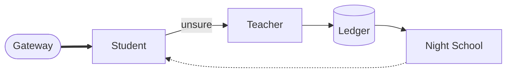

import { Steps, Aside } from '@astrojs/starlight/components';
import Summary from '../../../components/Summary.astro';
import Eli10 from '../../../components/Eli10.astro';
import Who from '../../../components/Who.astro';

<Summary>This page answers the questions people ask most about Ratchet in a few honest sentences each, including what is not built or not proven yet, and links to the page that tells the whole story.</Summary>

<Eli10>

Imagine the waiter's notebook of questions guests always ask. Is the restaurant allowed to copy the head chef's recipes? Is the apprentice already cooking for real guests? What if the apprentice gets a dish wrong? How much does all this cost?

Each answer here is short, like a waiter's answer at the table. If you want the long version, every answer points to the page that has it.

</Eli10>

## How it really works

The whole loop in four steps; [the big picture](/guides/big-picture/) has every component.

<Steps>

1. **Your app sends a request** to the gateway, in the OpenAI chat-completions format.
2. **The student tries first** <Who as="student" />: it samples three answers, scores its confidence and serves the answer if the confidence reaches the version's threshold.
3. **Otherwise the teacher answers** <Who as="teacher" />, and its answer is stored with its provenance (which teacher, which license). A random 5% of the student's answers are also checked by the teacher (audits).
4. **Every night, Night School** trains a new adapter on the teacher's answers, tests it on held-out data, and releases it through shadow, canary and live, with automatic rollback of a bad canary.

</Steps>

<figure class="rt-diagram">



<figcaption>

**Reading this diagram.** Every request reaches the gateway, which asks the student first; a confident student answers at once. Unsure requests go to the teacher, whose answers are stored in the ledger. Each night Night School trains a new student from them, and the dotted line is the gated release that may replace the current one.

</figcaption>
</figure>

<Aside type="caution" title="Status as of Oct 25, 2026">
Nothing has run on Nebius GPUs yet. Teacher calls to Nemotron 3 Ultra on Token Factory are real (they built the text-to-SQL data on Oct 22, 2026), and the adapters (two text-to-SQL, one tool-calling) were trained on a free Colab T4 and a rented Modal T4, outside Night School. The full loop is complete and tested in simulation with mock models; live mode, the student endpoint, the training job and the demo VM kit are written and tested offline, and live mode stays unverified until `scripts/day1_check.py` passes with a real key. Every number on this site is simulation, an estimate, or read from the text-to-SQL and tool-calling results files, and says which.
</Aside>

## For everyone

### What is Ratchet, in one sentence?

An OpenAI-compatible gateway that answers each request with a small open model when it is confident, asks a large open model when it is not, and every night trains the small model on the large model's answers, so the share of traffic it can handle grows. [What is Ratchet?](/guides/what-is-ratchet/)

### Is this legal?

Ratchet only learns from teachers whose licenses allow training on their outputs. The default teacher, Nemotron 3 Ultra, is under [OpenMDW-1.1](https://openmdw.ai/license/1-1/), which "does not impose any restrictions or obligations with respect to any use, modification, or sharing of any outputs" (license page last updated May 27, 2026; checked Oct 21, 2026). The student's base, Nemotron 3 Nano 4B, stays under the NVIDIA Nemotron Open Model License, which asks you to pass a copy of that license on when you distribute it. One question is open: Token Factory's Terms of Service §5(f) ("competing service") is broad, and it was put to Nebius support in writing on Oct 19, 2026, with no final answer yet. This is not legal advice; check the licenses yourself. [Licenses](/guides/licenses/)

### Can I use GPT as the teacher?

No, and the code refuses it. Every teacher goes through `licenses.require_distillable` at startup, which rejects closed model families. Closed models such as GPT come with terms that forbid using their outputs to develop competing models ([OpenAI Business Terms §3.3(e)](https://openai.com/policies/business-terms/)). You can add another open teacher in `RATCHET_TEACHER_LICENSES`, but only under an allowed open license, and never for a closed family or router alias Ratchet recognises. The README's ["Why license-clean"](https://github.com/harshbhx/ratchet#why-license-clean) section has the full reasoning. [Licenses](/guides/licenses/)

### Do I own the model?

No. You own the LoRA adapter Night School trains and its signed training lineage (its bill of materials). The student is NVIDIA's Nemotron 3 Nano 4B with that adapter on top, and the Nano base stays under NVIDIA's Nemotron Open Model License. When you hand an adapter on, `python -m ratchet.live export` writes it with its BOM and a `NOTICE.md` naming every license. [Licenses](/guides/licenses/)

### What if the student is wrong?

Sometimes it will be, and Ratchet is built to keep that rare and visible:

- The student serves only when its confidence reaches its version's threshold, which is set on half of a held-out golden set for 97% precision and measured on the other half. A new version must reach at least 95% there before it serves anyone.
- 5% of the answers it serves are audited by the teacher (`RATCHET_AUDIT_RATE`), and every disagreement becomes training data.
- A canary is rolled back automatically when the 95% upper bound of its audited precision falls below 92%. A live version is never rolled back automatically: an anytime-valid alert tells the operator, who can retire it or turn the student off in one admin command.

"Precision" means agreement with Nemotron 3 Ultra, not ground truth. [Release gate](/guides/release-gate/), [escalation and audits](/guides/escalation-and-audits/)

### Does it work on real traffic yet?

Not yet. As of Oct 25, 2026 the teacher side has run for real (Token Factory calls built the text-to-SQL data), but the full loop has not served real traffic and no student has run on a Nebius GPU, so there are no live numbers. Live figures will come only from a published live-run results file. The measured results are the text-to-SQL and tool-calling adapters' exams, on [Results](/guides/results/); the only live run is a 20-request smoke run that measures no savings; everything else is simulation with mock models, which shows how the loop behaves, not how good a real model is. [Evidence](/guides/evidence/)

### What does it cost?

All of these are estimates or simulation, with their sources:

- **A Nebius demo VM, if you run one** (the public demo is on Cloudflare today): about $72.50 for 48 days (`cpu-e2`, prices as of Oct 20, 2026).
- **The teacher**: Ultra at $1 per million input tokens and $3 per million output tokens (list price, Oct 2026, unverified until the day-1 checks pass), roughly $1.30 per 1,000 teacher calls.
- **The GPU endpoint**: about $32 for every full day it runs (an L40S at $1.35 a GPU-hour on [Nebius pricing](https://docs.nebius.com/compute/resources/pricing), read Oct 22, 2026; an estimate).
- **In simulation** (mock models, seed 7, the reference run in `docs/TESTING.md`), day 10 cost $0.147 per 1,000 ticket requests against $1.093 if Ultra had answered all of them.

[Cost and savings](/guides/cost-and-savings/), [Host it on Nebius](/guides/host-on-nebius/)

### When does self-hosting lose money?

When too few requests reach the student. A GPU endpoint bills every hour it runs, whether requests arrive or not. Break-even is the GPU price per hour divided by the teacher spend each student answer avoids: with estimated prices ($1.35 a GPU-hour for an L40S, about $0.001 avoided per ticket-triage answer in simulation), that is about 1,350 student answers an hour, roughly 32,000 a day. At the demo's 1,500 requests a day, a 24/7 endpoint loses money, and Ratchet's own cost report says so and recommends the hosted fallback or scaling the endpoint to zero. [Cost and savings](/guides/cost-and-savings/)

### What happens when the GPU endpoint is off?

Leave `RATCHET_STUDENT_BASE` empty and the student's calls go to the hosted fallback <Who as="fallback" />: the untuned Nemotron 3 Nano 30B on Token Factory, paid per token. It is held to the default confidence threshold (0.80) and no certificate covers it. Responses still say `served_by: student`, but the `model` field names Nano 30B, and the pages show the hosted badge and hide the adapter's precision. [Host it on Nebius](/guides/host-on-nebius/)

### How is this different from a router or a distillation service?

A cascade router saves money on each call but learns nothing: every call stays rented. Distillation services turn traffic into a fine-tune, but the student usually stays on the provider's platform, you start each job yourself, and none of the services we found records each example's teacher license when the example is captured. Ratchet does the loop by itself: the license is recorded when each example is captured and signed into the adapter's BOM, a new adapter is trained every night, a statistical gate decides each release, and the cost report says when the small model loses money. The pieces are prior art (FrugalGPT, Cache & Distil, NVIDIA's Data Flywheel Blueprint and others); putting them in one loop is what is new. [What is Ratchet?](/guides/what-is-ratchet/)

## For evaluators

### What should I look at first?

The story page at https://ratchet.dualmindlab.tech, then `/scout` (ask an example question and watch each call get answered by the student or the teacher), then `/dashboard`. [For judges](/guides/for-judges/)

### Is the demo live or simulated?

Mock mode is simulation, and the pages label it so. The hosted demo is meant to run in live mode, calling the real teacher on Token Factory, and live mode stays unverified until the day-1 checks pass. It has no GPU and no trained student yet, so the teacher answers every request (README, Oct 2026). Once a version exists, student calls go to the hosted, untuned Nano 30B <Who as="fallback" /> and carry that badge. The story page's replay and savings figures are simulation. `GET /healthz` reports the `mode` the gateway runs in. [Host it on Nebius](/guides/host-on-nebius/)

### Which numbers are real?

The text-to-SQL results (the headline) and the smaller tool-calling results, both read from their results files on [Results](/guides/results/); the 20-request live smoke run measures cost only and no savings. None of the loop's numbers are live yet. Simulation numbers come from mock models and say "simulation" with their source; costs from the docs say "estimate" with their date. Live numbers will come only from a published, non-smoke live-run results file (`evidence/live/results.json`), which does not exist yet. [Evidence](/guides/evidence/)

### Which NVIDIA models and Nebius services does it use?

| Role | Model or service |
|---|---|
| Teacher | `nvidia/Nemotron-3-Ultra-550b-a55b` on Token Factory |
| Judge (free-text grading) | `nvidia/nemotron-3-super-120b-a12b` on Token Factory |
| Hosted fallback student | `nvidia/NVIDIA-Nemotron-3-Nano-30B-A3B` on Token Factory |
| Student | `nvidia/NVIDIA-Nemotron-3-Nano-4B-BF16` with a LoRA adapter, vLLM on a Serverless Endpoint |
| Night School | Serverless Jobs on an L40S, with TRL and PEFT |
| Datasets and adapters | An Object Storage bucket mounted in the job and the endpoint |
| Public demo host | Cloudflare Workers with Containers today; a Nebius CPU VM (`2vcpu-8gb`) is scripted and ready to run, not deployed |
| Scout web search | Tavily Search API (not NVIDIA or Nebius) |

Token Factory did not offer fine-tuning or LoRA serving for Nemotron (Oct 2026), so the student is trained and served on Nebius AI Cloud. [Host it on Nebius](/guides/host-on-nebius/)

### Where are the Token Factory and Tavily calls?

In live mode, every teacher call goes to Token Factory: cold starts, escalations, audits, shadow arbitrations, and Scout's planner and writer, which are pinned to the teacher. Scout's searcher calls the Tavily Search API. Mock mode makes neither call. [Scout](/guides/scout/)

### Can I check the claims myself?

Yes, offline. `make test` runs the 1,900 tests with no network and no GPU; `make sim` reproduces the reference simulation exactly; `python -m ratchet.bom verify` checks an adapter's signed BOM and its `NOTICE.md`; `python -m ratchet.stats check` recomputes a certificate from its signed counts; `python -m ratchet.proof heldout` checks that no golden example was trained on; `python -m ratchet.receipt verify` checks a savings receipt. [Evidence](/guides/evidence/)

### Why does a Scout run say "search unavailable"?

The day's public share of Tavily credits ran out, or a search failed. The run still finishes, labelled: the planner has already called Token Factory, and the writer answers without (more) sources. Runs held for judges keep searching from their own reserve. [Scout](/guides/scout/)

### Is anything held back for judges?

Yes, on the server side. `RATCHET_SCOUT_JUDGE_CODE` and `RATCHET_SCOUT_JUDGE_RUNS_PER_DAY` hold part of each day's Scout runs, spend and Tavily credits back from the public; the code is shared with evaluators directly, never published, and opens a session through `POST /scout/judge` and a signed cookie. A field on the Scout page to type the code in is planned. [Scout](/guides/scout/)

## For engineers

The design is in [ARCHITECTURE.md](/reference/architecture/) and a file-by-file map in the README's [repo map](https://github.com/harshbhx/ratchet#repo-map); endpoints are in [API.md](/reference/api/) and settings in [CONFIGURATION.md](/reference/configuration/). The answers below point to the guide pages.

### How do I point my app at Ratchet?

Change the base URL of your OpenAI SDK to the gateway's `/v1` and use the model name `ratchet`:

```python
from openai import OpenAI

client = OpenAI(base_url="http://localhost:8000/v1", api_key="unused")  # or your RATCHET_API_KEYS key
resp = client.chat.completions.create(
    model="ratchet",
    messages=[{"role": "user", "content": "I was charged twice this month."}],
    extra_headers={"X-Ratchet-Task": "ticket-triage"},
)
print(resp.model_extra["ratchet"])  # served_by, confidence, cost_usd, ...
```

[Quickstart](/guides/quickstart/)

### How do I tell Ratchet what kind of request this is?

Name the task in the `X-Ratchet-Task` header or in `metadata.ratchet_task`. A task's spec says which answer fields must agree and which answers are valid; you can register your own in a tasks file (`RATCHET_TASKS_FILE`) or through the admin API. An unregistered name is distilled by default (`RATCHET_UNKNOWN_TASKS=distill`; `teacher` and `reject` are the other choices). [Training on your data](/guides/training-on-your-data/)

### Do streaming, tools and structured outputs work?

Yes, with limits. Streaming works in the OpenAI chunk format, but the whole answer is ready before the first chunk, because confidence needs the whole answer. Tool calls pass through to the teacher alone and are never stored, so tool requests are not distilled yet. A `response_format` is checked on every answer, and a JSON schema without a registered task gets an automatic one. [The request journey](/guides/request-journey/)

### What happens when the teacher is down?

The gateway retries the teacher (up to 2 more attempts within 180 seconds). After 5 failed calls in a row its circuit breaker opens, and requests that need the teacher get a 503 `teacher_circuit_open` with `Retry-After` at once instead of waiting. Two opt-in stand-ins exist: a second licensed teacher (`RATCHET_TEACHER_FALLBACK_MODEL`), and degraded mode (`RATCHET_ON_TEACHER_FAILURE=serve_student`), which serves the student's own answer, marked and never stored. Student failures never fail a request: they fall back to the teacher. [Escalation and audits](/guides/escalation-and-audits/)

### What data is stored?

The `requests` table holds metadata only (task, route, confidence, cost, tokens), never prompt or answer text. Training examples hold the prompt and the teacher's answer, after PII redaction, with the teacher, its license and the number of placeholders. API keys are recorded by name only, end users only as keyed hashes, and live-mode logs carry no prompt or answer text. The student's own answers are never stored as training data. [The ledger](/guides/ledger/), [security](/guides/security/)

### Can I delete data?

Yes. Stored examples can be erased for good by client, end user, hash or text (`DELETE /v1/ratchet/examples` for a client's own end users, `POST /ratchet/admin/privacy/erase` and `python -m ratchet.admin erase`, both dry runs unless told otherwise). An erased example leaves only a hash, so it is never stored again. Versions that may have trained on it are reported, and their signed BOMs are left as written; the next nights retrain from the base without it. Retention windows and storage opt-outs keep data from piling up or being stored at all. [Security](/guides/security/)

### Which key do I need for which route?

Four kinds of key exist. An API key (`RATCHET_API_KEYS`) calls `/v1/*`. A dashboard key (`RATCHET_DASHBOARD_KEYS`) reads stats, costs and other management data. An admin key (`RATCHET_ADMIN_KEYS`) also writes: versions, switches, tasks, erasure. Mock-only demo controls need no key and answer 403 in live mode. The [endpoint map](/api/endpoints/) lists every route with its level.

### How do I send feedback on an answer?

Every chat response carries `ratchet.request_id`. Send it to `POST /v1/ratchet/feedback` with a verdict, `correct` or `incorrect`, and for `incorrect` optionally the right answer and the request's messages. A stored correction becomes a human-labelled training example. A verdict never promotes or rolls back a version. See the [examples](/api/endpoints/#three-examples).

### How do I retry a request safely?

Send an `Idempotency-Key` header. The first answer is kept in memory for a short time (`RATCHET_IDEMPOTENCY_TTL_S`) and sent again, marked `Idempotent-Replayed: true`, without a second cascade, a second charge or a second row. Retries also never push an example toward the frequent-request rule that moves it out of the golden set.

### What is the difference between a pinned task and an auto task?

A pinned task always goes to the teacher and is never stored as training data. Only an operator can pin one, never a request. An auto task is made by the gateway from a request's `response_format` JSON schema when the request names no registered task; it is stored and distilled like any other task. Both are listed in the [glossary](/guides/glossary/).

### How does Ratchet notice that things have changed?

Three watchers, none of them a release signal on its own. The audits measure precision against the teacher. The drift alarm watches the student's confidence scores without any labels. The teacher watch compares the teacher's new answers with its stored ones and freezes training if they disagree too much, until an operator acknowledges it. See [evidence](/guides/evidence/) and the [release gate](/guides/release-gate/).

### Why SQLite?

Zero setup, easy backups, easy to inspect, and fast enough for one gateway process at demo scale. It runs in WAL mode so dashboard reads do not block writes. The price is one gateway process with one worker; a Postgres ledger is planned. [The ledger](/guides/ledger/)

### Why Nemotron?

The teacher's license allows training on its outputs, which is the whole point. Nemotron 3 Nano 4B is an open model that fits a single L40S and that vLLM serves with LoRA adapters. Choosing the base is a manual decision: Ratchet does not compare base models. [Licenses](/guides/licenses/)

### Can I run more than one gateway process?

Not on one ledger. Run one process with one uvicorn worker: the ledger is one SQLite file behind one lock, and the release gate is not built for concurrent writers. Detecting a second process is planned. [Host it on Nebius](/guides/host-on-nebius/)

### How do I run the tests, and do they call real APIs?

`make test` (pytest) needs no network and no GPU and takes about two minutes; real APIs are never called (the tests use `httpx.MockTransport` and fakes). `make lint` and `make reference` are the other checks to run before a commit. [Quickstart](/guides/quickstart/)

## For buyers

### How is it priced?

The core is open source under Apache-2.0 and free to self-host. A managed offering is a plan, not a product: the idea is a share of verified monthly savings (see [the business case](/guides/business/)), with no fee when there are no savings. In the code, a receipt's fee is `RATCHET_TAKE_RATE` (25% by default) of the one-sided 95% lower bound of the savings.

### Can I check the savings I would be billed for?

Yes. Every ledger day gets a signed savings receipt for the gateway and for each API client. It calibrates the teacher baseline on audited teacher bills, bills only the lower bound, chains to the previous receipt, and proves every request id you received. `python -m ratchet.receipt verify` checks it offline. It cannot prove the costs written at request time, so reconcile its teacher spend with your Token Factory bill. [Cost and savings](/guides/cost-and-savings/)

### What do I take with me if I leave?

The adapter you own: `python -m ratchet.live export --version N --out DIR` writes its files (when they are on that machine), its signed BOM and its `NOTICE.md`, and anyone with your public key can verify them. The ledger's tables export as NDJSON (`GET /ratchet/admin/export/{kind}`). The Nano base model stays under NVIDIA's license, wherever you take the adapter. [Licenses](/guides/licenses/)

### Do I need a GPU running all the time?

No. Below break-even, the hosted fallback on Token Factory is cheaper: you pay per token and no GPU runs. Ratchet records the endpoint's uptime and says which option pays at your traffic. [Cost and savings](/guides/cost-and-savings/)

### Is it ready for production?

Not yet, and it says so. No student has run on a Nebius GPU and live mode is unverified until the day-1 checks pass; it runs as one gateway process; PII redaction is pattern-based, so names and street addresses are not caught; precision means agreement with the teacher, not ground truth; and Scout's reader is checked on its labels only, not on the free-text fact it extracts. The README's [limitations](https://github.com/harshbhx/ratchet#limitations) list is the full picture. [Security](/guides/security/)

### Where does my data go?

Everything runs in your own Nebius project: the gateway and ledger on your VM, adapters in your bucket, teacher calls to Token Factory with your key. The teacher sees the original request; redaction happens before anything is stored as training data. Tavily is called only by the Scout demo. [Host it on Nebius](/guides/host-on-nebius/)

## Related

- [Glossary](/guides/glossary/): every term in one line.
- [Quickstart](/guides/quickstart/): run it locally in mock mode.
- [For judges](/guides/for-judges/): what to look at and how to check it.
