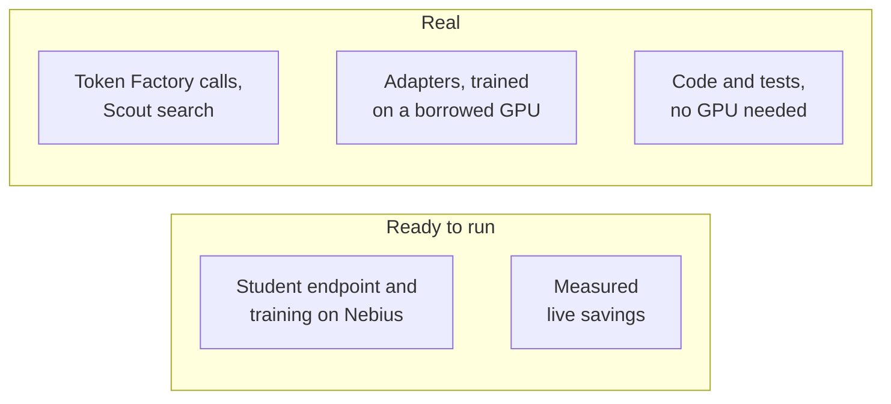

import { Aside, LinkCard, CardGrid } from '@astrojs/starlight/components';
import Summary from '../../../components/Summary.astro';
import Who from '../../../components/Who.astro';
import PathCard from '../../../components/PathCard.astro';
import PathGrid from '../../../components/PathGrid.astro';
import Stepper from '../../../components/ui/Stepper.astro';

<Summary>You have ten minutes. Open the live site, run one Scout question, look at the dashboard, then read the proof and results pages and run one command to check a number yourself. This page says what each step shows and what is real.</Summary>

Short on time? Start with [the video](https://video.ratchet.dualmindlab.tech/?from=docs) (2:59, public on YouTube), then come back for the steps below.

## Where things are

<PathGrid cols={2} label="The live gateway and the code">
  <PathCard title="Live gateway" href="https://live.ratchet.dualmindlab.tech" icon="spark" eyebrow="Start here" description="Real Token Factory calls under spend limits. The teacher answers every request for now; no trained student is served yet." />
  <PathCard title="The story site" href="https://ratchet.dualmindlab.tech" icon="search" tone="neutral" eyebrow="Live gateway" description="How Ratchet works, why it is license-clean and why releases are safe. Its dashboard and Scout read the live gateway." />
  <PathCard title="The code" href="https://github.com/harshbhx/ratchet" icon="repo" tone="neutral" eyebrow="Apache-2.0" description="The gateway, Night School, the release gate and the tests, on GitHub." />
</PathGrid>

These docs are at https://docs.ratchet.dualmindlab.tech. The main site has a [judges' console](https://ratchet.dualmindlab.tech/judges) that puts the same path, the results and the checks to run on one page.

Adapters and data on Hugging Face: [text-to-SQL adapter](https://huggingface.co/harshbhx/ratchet-nemotron-nano-4b-text2sql), [the same recipe retrained on Nebius AI Cloud](https://huggingface.co/harshbhx/ratchet-nemotron-nano-4b-text2sql-nebius), [tool-calling adapter](https://huggingface.co/harshbhx/ratchet-nemotron-nano-4b-toolcall), [text-to-SQL exams and every answer](https://huggingface.co/datasets/harshbhx/ratchet-text2sql-exams), the tool-calling [hard exam](https://huggingface.co/datasets/harshbhx/ratchet-toolcall-exam-hard) and [BFCL exam](https://huggingface.co/datasets/harshbhx/ratchet-toolcall-exam-bfcl), the [exam explorer](https://huggingface.co/spaces/harshbhx/ratchet-toolcall-explorer) (the tool-calling answers, question by question) and [recorded Scout runs](https://huggingface.co/spaces/harshbhx/ratchet-scout). Evidence folders in the repository: `evidence/live-smoke-2026-10-23`, `evidence/scout`, `evidence/text2sql-round2`, `evidence/text2sql-exam2`, `evidence/toolcall`.

## Try it in five steps

<figure class="rt-diagram">


<figcaption>

**Reading this diagram.** The three rounded steps are on the live site and the two square ones are in these docs. The order goes from the idea, to a running system, to the books, to evidence you can recompute, to the measured text-to-SQL (headline) and tool-calling adapters, trained on synthetic data. Each step is about two minutes; the walk-through below has the detail.

</figcaption>
</figure>

<Stepper
  label="A ten-minute tour"
  steps={[
    { title: 'The story page', body: 'Open [ratchet.dualmindlab.tech](https://ratchet.dualmindlab.tech). Look at "The catch" (why closed models cannot be distilled) and "One way only" (the release gate).' },
    { title: 'Scout', body: 'Open `/scout`, ask a question and watch five agents work. Each call shows who answered it, what it cost and what the teacher alone would have cost.\n\nThe planner and the writer are pinned to the teacher by design; triage and reader calls are the repetitive ones the student learns to take over.', tone: 'owned' },
    { title: 'The dashboard', body: 'Open `/dashboard`. Read the by-task table, the versions with their signed bills of materials, the release log and the economics panel (savings per token and by GPU-hours, the break-even, a recommendation).\n\nPaste an email and a card number into the redactor in the trust panel.' },
    { title: 'Proof you can run', body: 'Read [Proof you can run](/guides/proof/): commands that recompute a number from a signed record.' },
    { title: 'The results', body: 'Read [Results](/guides/results/): the measured text-to-SQL (headline) and tool-calling adapters, trained on synthetic data (see [Text-to-SQL](/guides/text-to-sql/)).' },
  ]}
/>

## What is real and what is not yet

<figure class="rt-diagram">



<figcaption>

**Reading this diagram.** Two rows: what runs for real (green) and what is scripted and ready to run (amber, dashed). The teacher side runs for real, and one hand-run Nebius training job, one hand-run speed test of the student and one hand-run Night School (a CPU VM, a spot L40S job and an endpoint, rejected by the golden gate) have run; the nightly schedule and the one-command VM kit are scripted and tested offline, ready to run with `make nebius-up`. The two notes below say the same in words.

<ul class="rt-key">
  <li class="ok">Real</li>
  <li class="pending">Ready to run</li>
</ul>

</figcaption>
</figure>

<div class="rt-callout rt-callout--note">

**Real, as of Oct 28, 2026.** Built on NVIDIA Nemotron and Nebius: every model call on the live site runs on Nebius Token Factory, the adapter was [retrained on Nebius AI Cloud](https://github.com/harshbhx/ratchet/tree/main/evidence/text2sql-round2-nebius), and the student was served from a Nebius Serverless Endpoint [in a measured test](https://github.com/harshbhx/ratchet/tree/main/evidence/student-endpoint-nebius). Real calls to the teacher, Nemotron 3 Ultra on Nebius Token Factory, built the text-to-SQL data on Oct 22, 2026. The original published adapters were trained on a borrowed GPU, and their results are read from their own results files. On 27 Oct 2026 the round-2 text-to-SQL recipe (the same 4,322 examples and settings: 4-bit QLoRA, rank 16, 2 epochs, the same library versions) was retrained on Nebius AI Cloud, by hand, as a Nebius Serverless Job on one preemptible (spot) L40S, with checkpoints in a Nebius Object Storage bucket so it resumed after spot interruptions and with the Mamba kernels built for the L40S. Training loss went from 0.346 to 0.088 and the new adapter's SHA-256 is `68b9ed06d984a2ec38a32b58090c246a56ae12ba65f3277f66b5d74227ea25d5`. It scored 40.7% (70 of 172) on exam 1 and 34.5% (69 of 200) on exam 2, against 39.0% and 33.0% for the original adapter: the result reproduces (the row-by-row differences are within chance); training took 28.6 minutes of GPU time (58.7 minutes wall clock across two spot interruptions); the whole Nebius effort, failed and interrupted attempts included, used 2.73 GPU-hours, about $2.16 at list prices (the Nebius bill decides) ([evidence](https://github.com/harshbhx/ratchet/tree/main/evidence/text2sql-round2-nebius)). On 27 to 28 Oct the student was served by hand, in two short sessions, on a Nebius Serverless Endpoint (one spot L40S) for speed tests: cold start about 7.2 minutes to ready; with 16 users at once the median answer took 1.6 s (SQL adapter) and 1.2 s (tool-calling adapter); about $0.45 of GPU time; speed only, no accuracy scored; the endpoint was deleted afterwards and the live gateway is not connected to it ([evidence](https://github.com/harshbhx/ratchet/tree/main/evidence/student-endpoint-nebius)). On 28 Oct 2026 Night School ran end to end once on Nebius, by hand: the gateway on a Nebius CPU VM, the training job on a spot L40S, the adapter served from a Nebius Serverless Endpoint. The golden gate rejected it (81.8% precision against the 95% target), so it was never made live. The live site's own gateway is still on Cloudflare and is not connected to that endpoint, and the loop has not run nightly on live traffic ([evidence](https://github.com/harshbhx/ratchet/tree/main/evidence/nightschool-nebius)). The code and its roughly 1,900 tests run with no GPU. Since Oct 24, 2026 the live gateway runs in live mode, and every request there is a real Token Factory call.

</div>

<div class="rt-callout rt-callout--note">

**Not yet.** The live gateway has no student endpoint yet, so the teacher answers every request (no trained version exists on that ledger yet). With a trained version and no GPU endpoint, student calls would go to a hosted, untuned Nano model, and the pages would say so with a badge. A random split already sends a share of eligible calls to that hosted model, labelled as a random split. Night School has not run nightly on live traffic: it ran once, by hand, on Nebius, and the golden gate rejected that student. Live savings numbers do not exist yet and are not shown.

</div>

### Measured on Nebius: Night School, 28 Oct 2026

<div class="rt-callout rt-callout--note">

**Measured on Nebius, 28 Oct 2026, by hand, once.** Night School ran end to end once on Nebius, by hand (28 Oct 2026): the gateway on a Nebius CPU VM, the training job on a spot L40S, the adapter served from a Nebius Serverless Endpoint. The golden gate rejected it (81.8% precision against the 95% target), so it was never made live. The live site's own gateway is still on Cloudflare and is not connected to that endpoint, and the loop has not run nightly on live traffic. No saving is claimed.

</div>

| What | Result |
|---|---|
| Gateway | A Nebius CPU VM in `eu-west1` (2 vCPU), in live mode |
| Data | 4,322 existing Ultra-labelled text-to-SQL rows imported (no new teacher calls, no exam rows): 3,864 to train on, 458 held out as the golden set |
| Training | A spot L40S Serverless Job: 2 epochs, 966 steps, 1,478 s; loss about 0.15 to 0.08; token accuracy about 0.975 |
| Serving | The adapter (SHA-256 `dc9ad4b9...`) hot-loaded into a Nebius Serverless Endpoint |
| Golden gate | SQL compared as text: agreement 17.9%; at the gate's threshold the student would answer 4.8% of questions with 81.8% precision (9 of 11) against the 95% target. **Rejected**, never shadow, canary or live |

The caveats, all of them, are in the [evidence](https://github.com/harshbhx/ratchet/tree/main/evidence/nightschool-nebius): four job submissions (an accidental on-demand job that was cancelled, a missing `einops`, a save that failed with `EPERM` and whose weights were recovered, then the job that saved); the night's own evaluation timed out at 15 s, so the gate result comes from running the eval and the gate again on the saved adapter with a 120 s timeout, through a one-off driver; five problems fixed by hand on the VM, now fixed in the repository (spot by default, `einops` pinned, the adapter saved locally and then copied, a clear stop when `aws` is missing, a separate student timeout for the night); and cost estimates (about 2.7 GPU-hours, at most about $4 at list prices) where the Nebius bill decides.

Every answer on Scout and the dashboard carries a badge:

| Badge | Means |
|---|---|
| <Who as="student" /> | Nemotron 3 Nano 4B with the Night School adapter |
| <Who as="fallback" /> | The untuned Nemotron 3 Nano 30B on Token Factory, used while the GPU endpoint is off. Not covered by the adapter's precision certificate |
| <Who as="teacher" /> | Nemotron 3 Ultra on Nebius Token Factory |

Scout has a daily run cap. If it is used up you get a polite refusal; evaluators receive an access code with their instructions, never on a public page.

## Verify a result with two commands

On the repository as cloned, these two commands recompute the published exam numbers from the saved answers:

```bash
python scripts/text2sql/exam_numbers.py --check
python scripts/toolcall_results.py --check
```

For a real signed bill of materials from your own gateway, `python -m ratchet.stats check bom.json --public-key <key>` recomputes its certificate from the signed counts, and `python -m ratchet.bom verify bom.json --public-key <key>` checks only the signature and the data lineage. No real BOM is published in the repository yet. The [proof page](/guides/proof/) walks through every check; only the exam checks run on real files, and the others on documents the tests write with mock models.

## What to look at in the code

| Claim | Where it is enforced |
|---|---|
| Only open teachers are distilled; closed models are refused | [`ratchet/licenses.py`](https://github.com/harshbhx/ratchet/blob/main/ratchet/licenses.py) `require_distillable` |
| The student answers first and escalates when unsure | [`ratchet/router.py`](https://github.com/harshbhx/ratchet/blob/main/ratchet/router.py) `Ratchet.handle` |
| Releases go shadow, canary 10%, 50%, 100%, with rollback | [`ratchet/release.py`](https://github.com/harshbhx/ratchet/blob/main/ratchet/release.py) `ReleaseGate` |
| Each adapter has a signed bill of materials and a certificate | [`ratchet/bom.py`](https://github.com/harshbhx/ratchet/blob/main/ratchet/bom.py), [`ratchet/certificate.py`](https://github.com/harshbhx/ratchet/blob/main/ratchet/certificate.py) |
| The cost report says when self-hosting does not pay | [`ratchet/cost.py`](https://github.com/harshbhx/ratchet/blob/main/ratchet/cost.py) `cost_report` |

## Honest limits

<Aside type="caution" title="As of Oct 28, 2026">
- The live gateway has no student endpoint yet, so the teacher answers every request; the nightly schedule and the one-command VM kit are scripted and tested offline, ready to run with `make nebius-up`; the student was served by hand, in two short sessions, on a Nebius endpoint for speed tests and then deleted ([evidence](https://github.com/harshbhx/ratchet/tree/main/evidence/student-endpoint-nebius)); Night School ran end to end once, by hand, on Nebius on 28 Oct 2026 and the golden gate rejected it, so it was never made live ([evidence](https://github.com/harshbhx/ratchet/tree/main/evidence/nightschool-nebius)), and the nightly loop has not run on live traffic. The original adapters were trained on a borrowed GPU.
- No live savings figure exists yet; the measured results are the exam scores on [Results](/guides/results/).
- Precision means agreement with the teacher, not ground truth.
- The redactor is pattern-based: names and street addresses are not caught yet.
- One gateway process per ledger (SQLite).
- Token Factory Terms of Service §5(f) ("competing service") is an open question, asked of Nebius support on Oct 19, 2026. Not legal advice.
</Aside>

## Where to read more

<CardGrid>
  <LinkCard title="What is Ratchet" href="/guides/what-is-ratchet/" description="The two-minute explanation." />
  <LinkCard title="Why it matters" href="/guides/why-it-matters/" description="The value, by audience." />
  <LinkCard title="The business case" href="/guides/business/" description="Who it is for and why now." />
  <LinkCard title="Scout" href="/guides/scout/" description="The multi-agent research app in detail." />
</CardGrid>
