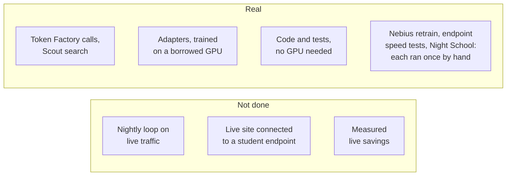

import { Aside, LinkCard, CardGrid, Steps, Tabs, TabItem } from '@astrojs/starlight/components';
import Summary from '../../../components/Summary.astro';
import Who from '../../../components/Who.astro';
import PathCard from '../../../components/PathCard.astro';
import PathGrid from '../../../components/PathGrid.astro';

<Summary>You have five minutes. Send one real request on the live site, read the exam results, run one command against an evidence folder, and watch the video. This page puts the proof, every link and the honest limits in one place.</Summary>

<div class="rt-callout rt-callout--note">

**Built on NVIDIA Nemotron and Nebius: every model call on the live site runs on Nebius Token Factory, the adapter was [retrained on Nebius AI Cloud](https://github.com/harshbhx/ratchet/tree/main/evidence/text2sql-round2-nebius), and the student was served from a Nebius Serverless Endpoint [in a measured test](https://github.com/harshbhx/ratchet/tree/main/evidence/student-endpoint-nebius).** The live site is not connected to that endpoint.

</div>

Ratchet is an OpenAI-compatible gateway for license-clean distillation on open models. A small NVIDIA Nemotron 3 Nano 4B student answers first. When it is unsure, the request goes to the teacher, Nemotron 3 Ultra on Nebius Token Factory, and the answer is logged with the teacher's name and license; closed models are refused as teachers, in code. Night School is built to train a new student from those answers and release it only if it passes a statistical gate. Measured: a Nano adapter taught by Ultra goes from 12.8% to 39.0% on a text-to-SQL exam it never saw, for about $17 on record, and every score recomputes from the saved answers.

<PathGrid cols={3} label="Three ways in">
  <PathCard title="Try it live" href="https://ratchet.dualmindlab.tech/live" icon="spark" eyebrow="Start here" description="Send a real request. Nemotron 3 Ultra on Nebius Token Factory answers; no key needed." />
  <PathCard title="Check the evidence" href="https://github.com/harshbhx/ratchet/tree/main/evidence" icon="check" tone="neutral" eyebrow="Run a command" description="Saved answers, logs and signed records, with one command per claim." />
  <PathCard title="Watch the video" href="https://video.ratchet.dualmindlab.tech/?from=docs" icon="start" tone="rented" eyebrow="2:59" description="The whole project in under three minutes." />
</PathGrid>

## Check it in 5 minutes

<Steps>

1. **Use it.** Open [ratchet.dualmindlab.tech/live](https://ratchet.dualmindlab.tech/live) and send a real request. A badge says who answered. Send a few at most; your text is not stored.

2. **Read the exam results.** The proof tabs below, or [Results](/guides/results/).

3. **Check one result.** Clone the repository and run one command against an evidence folder:

   ```bash
   git clone https://github.com/harshbhx/ratchet.git && cd ratchet && pip install -e ".[dev]"
   python scripts/text2sql/exam_numbers.py --check
   ```

4. **Watch the video** (2:59): [video.ratchet.dualmindlab.tech](https://video.ratchet.dualmindlab.tech/?from=docs).

</Steps>

For the console version of this page, with live chapters read from the gateway, open the [judges page](https://ratchet.dualmindlab.tech/judges). A one-page copy for GitHub is [JUDGES.md](https://github.com/harshbhx/ratchet/blob/main/JUDGES.md).

## The proof, with links

Every number is read from saved files in the repository. Commands are from [Check it yourself](https://github.com/harshbhx/ratchet/blob/main/docs/VERIFY.md) and need no GPU and no key.

<Tabs>
<TabItem label="Models">

| What | Result | Evidence | Check it |
|---|---|---|---|
| Text-to-SQL exams (22 to 24 Oct) | Adapter **39.0%** / **33.0%**; untrained 12.8% / 12.5%; teacher (Ultra) 25.6% / 15.0% | [round 1](https://github.com/harshbhx/ratchet/tree/main/evidence/text2sql-round1), [round 2](https://github.com/harshbhx/ratchet/tree/main/evidence/text2sql-round2), [exam 2](https://github.com/harshbhx/ratchet/tree/main/evidence/text2sql-exam2) | `python scripts/text2sql/exam_numbers.py --check` |
| Tool calling (24 Oct) | **90.7%** hard exam (Ultra 91.3%), **80.3%** BFCL | [evidence/toolcall](https://github.com/harshbhx/ratchet/tree/main/evidence/toolcall) | `python scripts/toolcall_results.py --check` |
| Scout runs (23 to 24 Oct) | Three recorded live runs, about $0.02 each | [evidence/scout](https://github.com/harshbhx/ratchet/tree/main/evidence/scout), [replay](https://huggingface.co/spaces/harshbhx/ratchet-scout) | replay in the browser |

</TabItem>
<TabItem label="On Nebius">

| What | Result | Evidence | Check it |
|---|---|---|---|
| Retrain on Nebius AI Cloud (27 Oct) | **40.7% / 34.5%**: the original result reproduces; about **$2.16** | [evidence/text2sql-round2-nebius](https://github.com/harshbhx/ratchet/tree/main/evidence/text2sql-round2-nebius) | `python evidence/text2sql-round2-nebius/score_nebius.py verify` |
| Endpoint speed tests (27 to 28 Oct) | Cold start about **7.2 to 7.6 min**, restart **7.1 min**; 16 users: p50 **1.6 s** / **1.2 s** | [evidence/student-endpoint-nebius](https://github.com/harshbhx/ratchet/tree/main/evidence/student-endpoint-nebius) | the folder's `results/` |
| Night School on Nebius (28 Oct) | Gate **rejected**: 81.8% against 95% | [evidence/nightschool-nebius](https://github.com/harshbhx/ratchet/tree/main/evidence/nightschool-nebius) | the folder's README and logs |

</TabItem>
<TabItem label="Signed and priced">

| What | Result | Evidence | Check it |
|---|---|---|---|
| Signed BOM (signed 29 Oct, after the run) | Ed25519 key `81b0a086250a81d0` | [evidence/keys](https://github.com/harshbhx/ratchet/tree/main/evidence/keys), [signed BOM](https://github.com/harshbhx/ratchet/blob/main/evidence/nightschool-nebius/ratchet_bom.signed.json) | `python -m ratchet.bom verify evidence/nightschool-nebius/ratchet_bom.signed.json --public-key Gh68hnDDlRSjBRxmc5dTo4l+rvqkftUsH7B2Nm72gpc= --notice evidence/nightschool-nebius/NOTICE.md` |
| Prices verified (29 Oct) | Token Factory list prices match the config | [evidence/day1](https://github.com/harshbhx/ratchet/tree/main/evidence/day1) | read `day1.json` |
| Live smoke run (23 Oct) | 20 real requests, about $0.01 | [evidence/live-smoke-2026-10-23](https://github.com/harshbhx/ratchet/tree/main/evidence/live-smoke-2026-10-23) | `python -m ratchet.liverun verify evidence/live-smoke-2026-10-23` |

</TabItem>
</Tabs>

## All the links

### Live and video

<PathGrid cols={3} label="Live links">
  <PathCard title="Story site" href="https://ratchet.dualmindlab.tech" icon="book" tone="neutral" description="How Ratchet works." />
  <PathCard title="Send a request" href="https://ratchet.dualmindlab.tech/live" icon="spark" eyebrow="/live" description="A real call to Token Factory." />
  <PathCard title="Judges page" href="https://ratchet.dualmindlab.tech/judges" icon="check" tone="neutral" eyebrow="/judges" description="The console version of this page." />
  <PathCard title="Dashboard" href="https://ratchet.dualmindlab.tech/dashboard" icon="chart" tone="neutral" eyebrow="/dashboard" description="Operator console on the live gateway." />
  <PathCard title="Scout" href="https://ratchet.dualmindlab.tech/scout" icon="search" tone="rented" eyebrow="/scout" description="A multi-agent research run. The access code for extra runs is on the Devpost page." />
  <PathCard title="Video" href="https://video.ratchet.dualmindlab.tech/?from=docs" icon="start" tone="rented" eyebrow="2:59" description="Public on YouTube." />
</PathGrid>

### Docs

<CardGrid>
  <LinkCard title="Docs home" href="/" />
  <LinkCard title="Quickstart" href="/guides/quickstart/" />
  <LinkCard title="Proof you can run" href="/guides/proof/" />
  <LinkCard title="llms.txt" href="https://docs.ratchet.dualmindlab.tech/llms.txt" description="Every page as plain text. The story site has one too: ratchet.dualmindlab.tech/llms.txt." />
</CardGrid>

### Code

<CardGrid>
  <LinkCard title="GitHub repository" href="https://github.com/harshbhx/ratchet" />
  <LinkCard title="README" href="https://github.com/harshbhx/ratchet/blob/main/README.md" />
  <LinkCard title="Apache-2.0 license" href="https://github.com/harshbhx/ratchet/blob/main/LICENSE" />
  <LinkCard title="Changelog" href="https://github.com/harshbhx/ratchet/blob/main/CHANGELOG.md" />
  <LinkCard title="Latest release" href="https://github.com/harshbhx/ratchet/releases/latest" />
  <LinkCard title="Check it yourself (VERIFY.md)" href="https://github.com/harshbhx/ratchet/blob/main/docs/VERIFY.md" />
</CardGrid>

### Evidence folders

[`text2sql-round1`](https://github.com/harshbhx/ratchet/tree/main/evidence/text2sql-round1) · [`text2sql-round2`](https://github.com/harshbhx/ratchet/tree/main/evidence/text2sql-round2) · [`text2sql-exam2`](https://github.com/harshbhx/ratchet/tree/main/evidence/text2sql-exam2) · [`toolcall`](https://github.com/harshbhx/ratchet/tree/main/evidence/toolcall) · [`text2sql-round2-nebius`](https://github.com/harshbhx/ratchet/tree/main/evidence/text2sql-round2-nebius) · [`student-endpoint-nebius`](https://github.com/harshbhx/ratchet/tree/main/evidence/student-endpoint-nebius) · [`nightschool-nebius`](https://github.com/harshbhx/ratchet/tree/main/evidence/nightschool-nebius) · [`keys`](https://github.com/harshbhx/ratchet/tree/main/evidence/keys) · [`day1`](https://github.com/harshbhx/ratchet/tree/main/evidence/day1) · [`live-smoke-2026-10-23`](https://github.com/harshbhx/ratchet/tree/main/evidence/live-smoke-2026-10-23) · [`scout`](https://github.com/harshbhx/ratchet/tree/main/evidence/scout) · [`hosted-nano`](https://github.com/harshbhx/ratchet/tree/main/evidence/hosted-nano)

### Hugging Face

<CardGrid>
  <LinkCard title="The collection" href="https://huggingface.co/collections/harshbhx/ratchet" />
  <LinkCard title="ratchet-nemotron-nano-4b-text2sql" href="https://huggingface.co/harshbhx/ratchet-nemotron-nano-4b-text2sql" />
  <LinkCard title="ratchet-nemotron-nano-4b-toolcall" href="https://huggingface.co/harshbhx/ratchet-nemotron-nano-4b-toolcall" />
  <LinkCard title="ratchet-nemotron-nano-4b-text2sql-nebius" href="https://huggingface.co/harshbhx/ratchet-nemotron-nano-4b-text2sql-nebius" description="The Nebius retrain." />
  <LinkCard title="Text-to-SQL exams and answers" href="https://huggingface.co/datasets/harshbhx/ratchet-text2sql-exams" />
  <LinkCard title="Tool-calling hard exam" href="https://huggingface.co/datasets/harshbhx/ratchet-toolcall-exam-hard" />
  <LinkCard title="BFCL exam" href="https://huggingface.co/datasets/harshbhx/ratchet-toolcall-exam-bfcl" />
  <LinkCard title="Scout replay Space" href="https://huggingface.co/spaces/harshbhx/ratchet-scout" />
  <LinkCard title="Tool-calling explorer Space" href="https://huggingface.co/spaces/harshbhx/ratchet-toolcall-explorer" />
</CardGrid>

### Nebius and NVIDIA: what runs where

| Where | What runs there |
|---|---|
| Nebius Token Factory | Every model call on the live site: the teacher (Nemotron 3 Ultra), the hosted Nano for the random split, the judge |
| Nebius AI Cloud | The round-2 retrain (27 Oct) and the Night School training job (28 Oct), as Serverless Jobs on a spot L40S; the Serverless Endpoint for the speed tests and the Night School adapter; a CPU VM for the Night School gateway; an Object Storage bucket. By hand; the endpoint and VM were deleted afterwards |
| NVIDIA Nemotron | Ultra (teacher), Nano 4B (student, with a LoRA adapter), hosted Nano 30B (random split) |
| Cloudflare | The story site, the docs and the live gateway, CPU only |
| A borrowed GPU | Training of the two original adapters |

## Hackathon checklist

| | Requirement | Link |
|---|---|---|
| ✓ | Nebius Token Factory and AI Cloud, with NVIDIA open models | [Where everything runs](/reference/where-it-runs/) |
| ✓ | Video, 2:59 | [video](https://video.ratchet.dualmindlab.tech/?from=docs) |
| ✓ | Public repository with license and README | [repository](https://github.com/harshbhx/ratchet), [Apache-2.0](https://github.com/harshbhx/ratchet/blob/main/LICENSE), [README](https://github.com/harshbhx/ratchet/blob/main/README.md) |
| ✓ | Working URL | [ratchet.dualmindlab.tech](https://ratchet.dualmindlab.tech), [/live](https://ratchet.dualmindlab.tech/live) |
| ✓ | Feedback on Nebius and NVIDIA | [README, Feedback](https://github.com/harshbhx/ratchet#feedback-on-nebius-and-nvidia) |

The track is the one chosen on the Devpost page.

## What is real and what is not yet

<figure class="rt-diagram">



<figcaption>

**Reading this diagram.** Two rows: what runs for real (green) and what has not been done (amber, dashed). The teacher side runs for real, and one hand-run Nebius training job, one hand-run speed test of the student and one hand-run Night School (a CPU VM, a spot L40S job and an endpoint, rejected by the golden gate) have run (green); the nightly loop on live traffic, the live site's connection to a student endpoint and a measured saving have not (amber); the one-command VM kit is scripted and tested offline. The two notes below say the same in words.

<ul class="rt-key">
  <li class="ok">Real</li>
  <li class="pending">Not done</li>
</ul>

</figcaption>
</figure>

<div class="rt-callout rt-callout--note">

**Real, as of 29 Oct 2026.** Built on NVIDIA Nemotron and Nebius: every model call on the live site runs on Nebius Token Factory, the adapter was [retrained on Nebius AI Cloud](https://github.com/harshbhx/ratchet/tree/main/evidence/text2sql-round2-nebius), and the student was served from a Nebius Serverless Endpoint [in a measured test](https://github.com/harshbhx/ratchet/tree/main/evidence/student-endpoint-nebius). Real calls to the teacher, Nemotron 3 Ultra on Nebius Token Factory, built the text-to-SQL data on Oct 22, 2026. The original published adapters were trained on a borrowed GPU, and their results are read from their own results files. On 27 Oct 2026 the round-2 text-to-SQL recipe (the same 4,322 examples and settings: 4-bit QLoRA, rank 16, 2 epochs, the same library versions) was retrained on Nebius AI Cloud, by hand, as a Nebius Serverless Job on one preemptible (spot) L40S, with checkpoints in a Nebius Object Storage bucket so it resumed after spot interruptions and with the Mamba kernels built for the L40S. Training loss went from 0.346 to 0.088 and the new adapter's SHA-256 is `68b9ed06d984a2ec38a32b58090c246a56ae12ba65f3277f66b5d74227ea25d5`. It scored 40.7% (70 of 172) on exam 1 and 34.5% (69 of 200) on exam 2, against 39.0% and 33.0% for the original adapter: the result reproduces (the row-by-row differences are within chance); training took 28.6 minutes of GPU time (58.7 minutes wall clock across two spot interruptions); the whole Nebius effort, failed and interrupted attempts included, used 2.73 GPU-hours, about $2.16 at list prices (the Nebius bill decides) ([evidence](https://github.com/harshbhx/ratchet/tree/main/evidence/text2sql-round2-nebius)). On 27 to 28 Oct the student was served by hand, in two short sessions, on a Nebius Serverless Endpoint (one spot L40S) for speed tests: cold start about 7.2 minutes to ready; with 16 users at once the median answer took 1.6 s (SQL adapter) and 1.2 s (tool-calling adapter); about $0.45 of GPU time; speed only, no accuracy scored; the endpoint was deleted afterwards and the live gateway is not connected to it ([evidence](https://github.com/harshbhx/ratchet/tree/main/evidence/student-endpoint-nebius)). On 28 Oct 2026 Night School ran end to end once on Nebius, by hand: the gateway on a Nebius CPU VM, the training job on a spot L40S, the adapter served from a Nebius Serverless Endpoint. The golden gate rejected it (81.8% precision against the 95% target), so it was never made live. The live site's own gateway is still on Cloudflare and is not connected to that endpoint, and the loop has not run nightly on live traffic ([evidence](https://github.com/harshbhx/ratchet/tree/main/evidence/nightschool-nebius)). The code and its roughly 1,900 tests run with no GPU. Since Oct 24, 2026 the live gateway runs in live mode, and every request there is a real Token Factory call.

</div>

<div class="rt-callout rt-callout--note">

**Not yet.** Ratchet's own adapter is not connected to the live site, and no trained version exists on that ledger yet. On the live site a random 40% of eligible requests are answered by the hosted, untuned Nemotron 3 Nano 30B on Token Factory, a quarter of those re-checked by Ultra, and the pages label them as a random split. With a trained version and no GPU endpoint, student calls would go to that hosted model and the pages would say so with a badge. Night School has not run nightly on live traffic: it ran once, by hand, on Nebius, and the golden gate rejected that student. Live savings numbers do not exist yet and are not shown.

</div>

### Measured on Nebius: Night School, 28 Oct 2026

<div class="rt-callout rt-callout--note">

**Measured on Nebius, 28 Oct 2026, by hand, once.** Night School ran end to end once on Nebius, by hand (28 Oct 2026): the gateway on a Nebius CPU VM, the training job on a spot L40S, the adapter served from a Nebius Serverless Endpoint. The golden gate rejected it (81.8% precision against the 95% target), so it was never made live. The live site's own gateway is still on Cloudflare and is not connected to that endpoint, and the loop has not run nightly on live traffic. No saving is claimed.

</div>

| What | Result |
|---|---|
| Gateway | A Nebius CPU VM in `eu-west1` (2 vCPU), in live mode |
| Data | 4,322 existing Ultra-labelled text-to-SQL rows imported (no new teacher calls, no exam rows): 3,864 to train on, 458 held out as the golden set |
| Training | A spot L40S Serverless Job: 2 epochs, 966 steps, 1,478 s; loss about 0.15 to 0.08; token accuracy about 0.975 |
| Serving | The adapter (SHA-256 `dc9ad4b9...`) hot-loaded into a Nebius Serverless Endpoint |
| Golden gate | SQL compared as text: agreement 17.9%; at the gate's threshold the student would answer 4.8% of questions with 81.8% precision (9 of 11) against the 95% target. **Rejected**, never shadow, canary or live |

The caveats, all of them, are in the [evidence](https://github.com/harshbhx/ratchet/tree/main/evidence/nightschool-nebius): four job submissions (an accidental on-demand job that was cancelled, a missing `einops`, a save that failed with `EPERM` and whose weights were recovered, then the job that saved); the night's own evaluation timed out at 15 s, so the gate result comes from running the eval and the gate again on the saved adapter with a 120 s timeout, through a one-off driver; five problems fixed by hand on the VM, now fixed in the repository (spot by default, `einops` pinned, the adapter saved locally and then copied, a clear stop when `aws` is missing, a separate student timeout for the night); and cost estimates (about 2.7 GPU-hours, at most about $4 at list prices) where the Nebius bill decides.

Every answer on Scout and the dashboard carries a badge:

| Badge | Means |
|---|---|
| <Who as="student" /> | Nemotron 3 Nano 4B with the Night School adapter |
| <Who as="fallback" /> | The untuned Nemotron 3 Nano 30B on Token Factory, used while the GPU endpoint is off. Not covered by the adapter's precision certificate |
| <Who as="teacher" /> | Nemotron 3 Ultra on Nebius Token Factory |

Scout has a daily run cap. If it is used up you get a polite refusal; evaluators receive an access code with their instructions, never on a public page.

## What it cost

All of these are estimates recorded by the scripts, not invoices; the Nebius bill decides.

| Item | About |
|---|---|
| Labelling by the teacher, round 1 / round 2 | $2.87 + $9.18 |
| Nebius retrain, 27 Oct (2.73 GPU-hours, failed attempts included) | $2.16 |
| Endpoint speed tests, 27 to 28 Oct | $0.67 |
| Night School run, 28 Oct | about 2.7 GPU-hours, at most about $4 at list prices |
| One real request on the live site | $0.0002 |
| One Scout run | $0.02 |

Request and Scout costs are from the [29 Oct day-1 check](https://github.com/harshbhx/ratchet/tree/main/evidence/day1). The GPU-hour rate used in estimates does not appear on the price list Token Factory serves and is unverified.

## Verify a result with two commands

On the repository as cloned, these two commands recompute the published exam numbers from the saved answers:

```bash
python scripts/text2sql/exam_numbers.py --check
python scripts/toolcall_results.py --check
```

For a real signed bill of materials from your own gateway, `python -m ratchet.stats check bom.json --public-key <key>` recomputes its certificate from the signed counts, and `python -m ratchet.bom verify bom.json --public-key <key>` checks only the signature and the data lineage. The Night School BOM, signed on 29 Oct 2026, is published in the repository (see the proof tabs above). The [proof page](/guides/proof/) walks through every check; only the exam checks run on real files, and the others on documents the tests write with mock models.

## What to look at in the code

| Claim | Where it is enforced |
|---|---|
| Only open teachers are distilled; closed models are refused | [`ratchet/licenses.py`](https://github.com/harshbhx/ratchet/blob/main/ratchet/licenses.py) `require_distillable` |
| The student answers first and escalates when unsure | [`ratchet/router.py`](https://github.com/harshbhx/ratchet/blob/main/ratchet/router.py) `Ratchet.handle` |
| Releases go shadow, canary 10%, 50%, 100%, with rollback | [`ratchet/release.py`](https://github.com/harshbhx/ratchet/blob/main/ratchet/release.py) `ReleaseGate` |
| Each adapter has a signed bill of materials and a certificate | [`ratchet/bom.py`](https://github.com/harshbhx/ratchet/blob/main/ratchet/bom.py), [`ratchet/certificate.py`](https://github.com/harshbhx/ratchet/blob/main/ratchet/certificate.py) |
| The cost report says when self-hosting does not pay | [`ratchet/cost.py`](https://github.com/harshbhx/ratchet/blob/main/ratchet/cost.py) `cost_report` |

## Honest limits

<Aside type="tip" title="Ran on Nebius">
- **Live site, as of 29 Oct 2026:** every model call on the live site runs on Nebius <Term t="token-factory">Token Factory</Term>. Nemotron 3 Ultra teaches, and a <Term t="random-split">random</Term> 40% of eligible requests are answered by the hosted Nemotron 3 Nano 30B, with a quarter of those re-checked by Ultra ([live stats](https://live.ratchet.dualmindlab.tech/ratchet/stats)).
- **27 Oct 2026:** the text-to-SQL adapter was retrained on Nebius AI Cloud, by hand, as one spot <Term t="l40s">L40S</Term> Serverless Job: 40.7% on exam 1 and 34.5% on exam 2 (originally 39.0% and 33.0%) ([evidence](https://github.com/harshbhx/ratchet/tree/main/evidence/text2sql-round2-nebius)).
- **27 to 28 Oct 2026:** the student was served from a Nebius Serverless Endpoint with 16 users at once: median 1.6 s for SQL and 1.2 s for tool calling. The endpoint was deleted afterwards, so no GPU sits idle ([evidence](https://github.com/harshbhx/ratchet/tree/main/evidence/student-endpoint-nebius)).
- **28 Oct 2026:** Night School ran end to end once, by hand. The golden gate rejected the candidate at 81.8% precision against the 95% target, so it was never made live: the safety check doing its job ([evidence](https://github.com/harshbhx/ratchet/tree/main/evidence/nightschool-nebius)).
</Aside>

<Aside type="note" title="Ready, not switched on yet">
- **Ratchet's own adapter on the live site.** The live site is not connected to a student endpoint. The fine-tuned Nano 4B adapter goes live only after it passes the golden gate.
- **The nightly schedule on live traffic.** Night School has not run nightly on live traffic; it runs by hand today and the timer is scripted.
- **The one-command host** (`make nebius-plan`, `make nebius-up`) is ready and dry-run by default; it has not yet run as one command. The VM and GPU scripts follow the Nebius docs and CLI reference and are tested offline.

Run every script with `DRY_RUN=1` first.
</Aside>

Other limits:

- No live savings figure exists yet; the measured results are the exam scores on [Results](/guides/results/). The original adapters were trained on a borrowed GPU.
- Precision means agreement with the teacher, not ground truth.
- The redactor is pattern-based: names and street addresses are not caught yet.
- One gateway process per ledger (SQLite).
- Token Factory Terms of Service §5(f) ("competing service") is an open question, asked of Nebius support on Oct 19, 2026; no answer received as of 29 Oct 2026. Not legal advice.

## Where to read more

<CardGrid>
  <LinkCard title="What is Ratchet" href="/guides/what-is-ratchet/" description="The two-minute explanation." />
  <LinkCard title="Why it matters" href="/guides/why-it-matters/" description="The value, by audience." />
  <LinkCard title="The business case" href="/guides/business/" description="Who it is for and why now." />
  <LinkCard title="Scout" href="/guides/scout/" description="The multi-agent research app in detail." />
</CardGrid>
