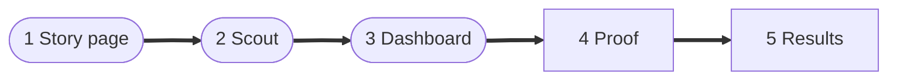
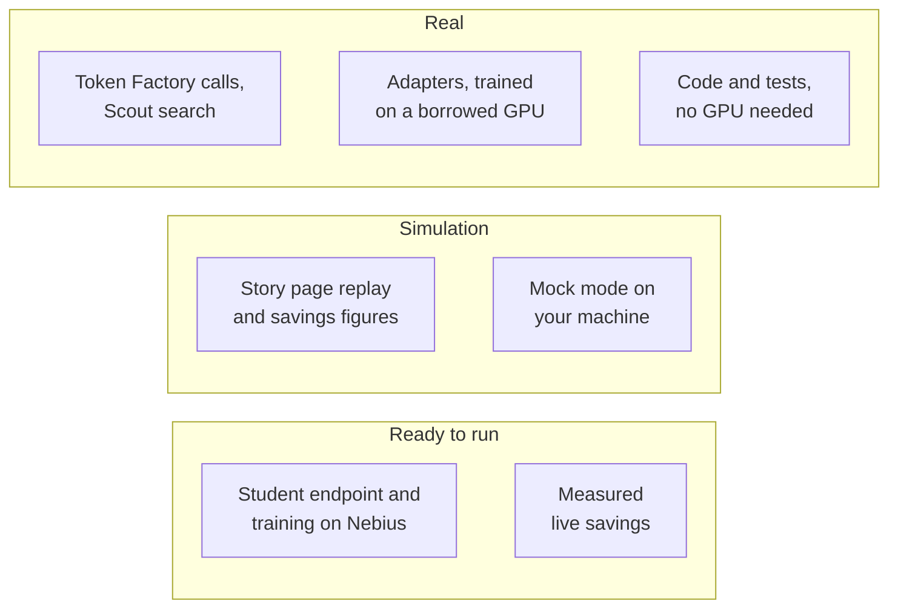

import { Aside, LinkCard, CardGrid } from '@astrojs/starlight/components';
import Summary from '../../../components/Summary.astro';
import Who from '../../../components/Who.astro';
import PathCard from '../../../components/PathCard.astro';
import PathGrid from '../../../components/PathGrid.astro';
import Stepper from '../../../components/ui/Stepper.astro';

<Summary>You have ten minutes. Open the live site, run one Scout question, look at the dashboard, then read the proof and results pages and run one command to check a number yourself. This page says what each step shows and what is simulation.</Summary>

Short on time? Start with [the demo video](https://video.ratchet.dualmindlab.tech/?from=docs) (2:59, public on YouTube), then come back for the steps below.

## Where things are

<PathGrid cols={2} label="The live demo and the code">
  <PathCard title="Live demo" href="https://live.ratchet.dualmindlab.tech" icon="spark" eyebrow="Start here" description="Real Token Factory calls under spend limits. The teacher answers every request for now; no trained student is served yet." />
  <PathCard title="Simulation" href="https://demo.ratchet.dualmindlab.tech" icon="chart" tone="neutral" eyebrow="Mock models" description="Run days, break a deploy and watch the rollback. Every number is simulation." />
  <PathCard title="The story site" href="https://ratchet.dualmindlab.tech" icon="search" tone="neutral" eyebrow="Live gateway" description="How Ratchet works, why it is license-clean and why releases are safe. Its dashboard and Scout read the live gateway; reference numbers are labelled Simulation." />
  <PathCard title="The code" href="https://github.com/harshbhx/ratchet" icon="repo" tone="neutral" eyebrow="Apache-2.0" description="The gateway, Night School, the release gate and the tests, on GitHub." />
</PathGrid>

These docs are at https://docs.ratchet.dualmindlab.tech. The main site has a [judges' console](https://ratchet.dualmindlab.tech/judges) that puts the same path, the results and the checks to run on one page.

Adapters and data on Hugging Face: [text-to-SQL adapter](https://huggingface.co/harshbhx/ratchet-nemotron-nano-4b-text2sql), [tool-calling adapter](https://huggingface.co/harshbhx/ratchet-nemotron-nano-4b-toolcall), [text-to-SQL exams and every answer](https://huggingface.co/datasets/harshbhx/ratchet-text2sql-exams), the tool-calling [hard exam](https://huggingface.co/datasets/harshbhx/ratchet-toolcall-exam-hard) and [BFCL exam](https://huggingface.co/datasets/harshbhx/ratchet-toolcall-exam-bfcl), the [exam explorer](https://huggingface.co/spaces/harshbhx/ratchet-toolcall-explorer) (the tool-calling answers, question by question) and [recorded Scout runs](https://huggingface.co/spaces/harshbhx/ratchet-scout). Evidence folders in the repository: `evidence/live-smoke-2026-10-23`, `evidence/scout`, `evidence/text2sql-round2`, `evidence/text2sql-exam2`, `evidence/toolcall`.

## Try it in five steps

<figure class="rt-diagram">



<figcaption>

**Reading this diagram.** The three rounded steps are on the live site and the two square ones are in these docs. The order goes from the idea, to a running system, to the books, to evidence you can recompute, to the measured text-to-SQL (headline) and tool-calling adapters, trained on synthetic data. Each step is about two minutes; the walk-through below has the detail.

</figcaption>
</figure>

<Stepper
  label="A ten-minute tour"
  steps={[
    { title: 'The story page', body: 'Open [ratchet.dualmindlab.tech](https://ratchet.dualmindlab.tech). Look at "The catch" (why closed models cannot be distilled), "One way only" (the release gate) and "The honest bill" (when self-hosting does not pay).\n\n"Watch it learn" is a replay of the reference **simulation**.' },
    { title: 'The Scout demo', body: 'Open `/scout` and pick an example question to watch five agents work. Each call shows who answered it, what it cost and what the teacher alone would have cost.\n\nThe planner and the writer are pinned to the teacher by design; triage and reader calls are the repetitive ones the student learns to take over.', tone: 'owned' },
    { title: 'The dashboard', body: 'Open `/dashboard`. Read the by-task table, the versions with their signed bills of materials, the release log and the economics panel (savings per token and by GPU-hours, the break-even, a recommendation).\n\nPaste an email and a card number into the redactor in the trust panel.' },
    { title: 'Proof you can run', body: 'Read [Proof you can run](/guides/proof/): commands that recompute a number from a signed record.' },
    { title: 'The results', body: 'Read [Results](/guides/results/): the measured text-to-SQL (headline) and tool-calling adapters, trained on synthetic data (see [Text-to-SQL](/guides/text-to-sql/)).' },
  ]}
/>

## What is simulation and what is live

<figure class="rt-diagram">



<figcaption>

**Reading this diagram.** Three rows: what runs for real (green), what is simulation (dashed outline) and what is scripted and ready to run (amber, dashed). The teacher side runs for real, and one hand-run Nebius training job has run; serving the student is scripted and tested offline, ready to run with `make nebius-up`. The two notes below say the same in words.

<ul class="rt-key">
  <li class="ok">Real</li>
  <li class="outline">Simulation</li>
  <li class="pending">Ready to run</li>
</ul>

</figcaption>
</figure>

<div class="rt-callout rt-callout--note">

**Real, as of Oct 27, 2026.** Built on NVIDIA Nemotron and Nebius: the teacher runs on Nebius Token Factory, and the round-2 adapter was retrained on Nebius AI Cloud (one L40S, Serverless Job). The web front end and the live demo run on Cloudflare. Real calls to the teacher, Nemotron 3 Ultra on Nebius Token Factory, built the text-to-SQL data on Oct 22, 2026. The original published adapters were trained on a borrowed GPU, and their results are read from their own results files. On 27 Oct 2026 the round-2 text-to-SQL recipe (the same 4,322 examples and settings: 4-bit QLoRA, rank 16, 2 epochs, the same library versions) was retrained on Nebius AI Cloud, by hand, as a Nebius Serverless Job on one preemptible (spot) L40S, with checkpoints in a Nebius Object Storage bucket so it resumed after spot interruptions and with the Mamba kernels built for the L40S. Training loss went from 0.346 to 0.088 and the new adapter's SHA-256 is `68b9ed06d984a2ec38a32b58090c246a56ae12ba65f3277f66b5d74227ea25d5`. It scored 40.7% (70 of 172) on exam 1 and 34.5% (69 of 200) on exam 2, against 39.0% and 33.0% for the original adapter: the result reproduces (the row-by-row differences are within chance); training took 28.6 minutes of GPU time (58.7 minutes wall clock across two spot interruptions); the whole Nebius effort, failed and interrupted attempts included, used 2.73 GPU-hours, about $2.16 at list prices (the Nebius bill decides) ([evidence](https://github.com/harshbhx/ratchet/tree/main/evidence/text2sql-round2-nebius)). The code and its roughly 1,900 tests run with no GPU. The only live run on record is a 20-request smoke run (`evidence/live-smoke-2026-10-23`): the teacher answered everything, no student was served and nothing was audited, so it measures no savings. Since Oct 24, 2026 the public live demo runs in live mode, and every request there is a real Token Factory call.

</div>

<div class="rt-callout rt-callout--sim">

**Simulation.** The numbers on the story page come from mock models that show how the loop behaves, not how good a real model is. The public demo has no student endpoint yet, so the teacher answers every request (no trained version exists on that ledger yet). With a trained version and no GPU endpoint, student calls would go to a hosted, untuned Nano model, and the pages would say so with a badge. Live savings numbers do not exist yet and are not shown.

</div>

Every answer on Scout and the dashboard carries a badge:

| Badge | Means |
|---|---|
| <Who as="student" /> | Nemotron 3 Nano 4B with the Night School adapter |
| <Who as="fallback" /> | The untuned Nemotron 3 Nano 30B on Token Factory, used while the GPU endpoint is off. Not covered by the adapter's precision certificate |
| <Who as="teacher" /> | Nemotron 3 Ultra on Nebius Token Factory |

The Scout demo has a daily run cap. If it is used up you get a polite refusal; evaluators receive an access code with their instructions, never on a public page.

## Verify a result with two commands

On the repository as cloned, these two commands recompute the published exam numbers from the saved answers:

```bash
python scripts/text2sql/exam_numbers.py --check
python scripts/toolcall_results.py --check
```

For a real signed bill of materials from your own gateway, `python -m ratchet.stats check bom.json --public-key <key>` recomputes its certificate from the signed counts, and `python -m ratchet.bom verify bom.json --public-key <key>` checks only the signature and the data lineage. No real BOM is published in the repository yet. The [proof page](/guides/proof/) walks through every check; only the exam checks run on real files, and the others on documents the mock gateway writes.

To see the loop move without any keys, run the mock demo (simulation, about a minute):

```bash
git clone https://github.com/harshbhx/ratchet && cd ratchet
pip install -e ".[dev]"
make demo        # http://localhost:8000, with four simulated warm-up days
```

On `/dashboard` there click **Run 1 day + night** a few times, then **Break next deploy** and run two or three more days to watch a corrupted version roll back by itself. These controls work only in mock mode.

## What to look at in the code

| Claim | Where it is enforced |
|---|---|
| Only open teachers are distilled; closed models are refused | [`ratchet/licenses.py`](https://github.com/harshbhx/ratchet/blob/main/ratchet/licenses.py) `require_distillable` |
| The student answers first and escalates when unsure | [`ratchet/router.py`](https://github.com/harshbhx/ratchet/blob/main/ratchet/router.py) `Ratchet.handle` |
| Releases go shadow, canary 10%, 50%, 100%, with rollback | [`ratchet/release.py`](https://github.com/harshbhx/ratchet/blob/main/ratchet/release.py) `ReleaseGate` |
| Each adapter has a signed bill of materials and a certificate | [`ratchet/bom.py`](https://github.com/harshbhx/ratchet/blob/main/ratchet/bom.py), [`ratchet/certificate.py`](https://github.com/harshbhx/ratchet/blob/main/ratchet/certificate.py) |
| The cost report says when self-hosting does not pay | [`ratchet/cost.py`](https://github.com/harshbhx/ratchet/blob/main/ratchet/cost.py) `cost_report` |

## Honest limits

<Aside type="caution" title="As of Oct 26, 2026">
- The public demo has no student endpoint yet, so the teacher answers every request; the student endpoint and the nightly loop's jobs are scripted and tested offline, ready to run with `make nebius-up`; the one Nebius job that has run was started by hand, and the nightly loop itself is still simulated. The original adapters were trained on a borrowed GPU.
- Savings and precision figures on the story page, in the README and in most of these docs are **simulation**.
- Precision means agreement with the teacher, not ground truth.
- The redactor is pattern-based: names and street addresses are not caught yet.
- One gateway process per ledger (SQLite).
- Token Factory Terms of Service §5(f) ("competing service") is an open question, asked of Nebius support on Oct 19, 2026. Not legal advice.
</Aside>

## Where to read more

<CardGrid>
  <LinkCard title="What is Ratchet" href="/guides/what-is-ratchet/" description="The two-minute explanation." />
  <LinkCard title="Why it matters" href="/guides/why-it-matters/" description="The value, by audience." />
  <LinkCard title="The business case" href="/guides/business/" description="Who it is for and why now." />
  <LinkCard title="Scout" href="/guides/scout/" description="The multi-agent demo in detail." />
</CardGrid>
