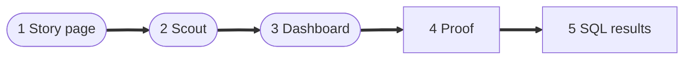
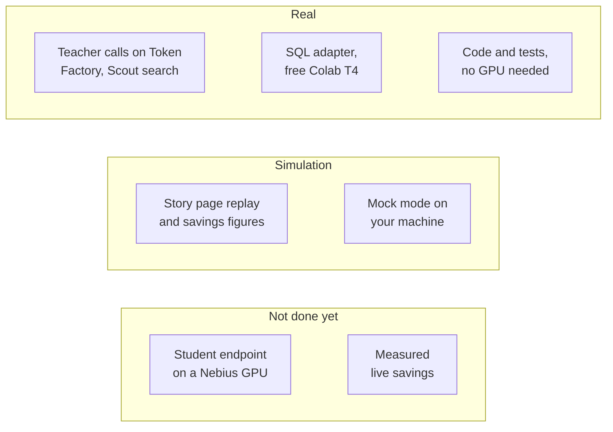

import { Aside, LinkCard, CardGrid } from '@astrojs/starlight/components';
import Summary from '../../../components/Summary.astro';
import Who from '../../../components/Who.astro';
import PathCard from '../../../components/PathCard.astro';
import PathGrid from '../../../components/PathGrid.astro';
import Stepper from '../../../components/ui/Stepper.astro';

<Summary>You have ten minutes. Open the live site, run one Scout question, look at the dashboard, then read the proof and results pages and run one command to check a number yourself. This page says what each step shows and what is simulation.</Summary>

## Where things are

<PathGrid cols={2} label="The live demo and the code">
  <PathCard title="The live site" href="https://ratchet.dualmindlab.tech" icon="spark" eyebrow="Start here" description="The story page: how Ratchet works, why it is license-clean and why releases are safe." />
  <PathCard title="Scout" href="https://ratchet.dualmindlab.tech/scout" icon="search" tone="neutral" eyebrow="/scout" description="Five agents answer one research question; each call shows who answered it." />
  <PathCard title="The dashboard" href="https://ratchet.dualmindlab.tech/dashboard" icon="chart" tone="neutral" eyebrow="/dashboard" description="Versions, releases, economics, and a redactor you can try." />
  <PathCard title="The code" href="https://github.com/harshbhx/ratchet" icon="repo" tone="neutral" eyebrow="Apache-2.0" description="The gateway, Night School, the release gate and the tests, on GitHub." />
</PathGrid>

These docs are at https://docs.ratchet.dualmindlab.tech.

{/* TODO: add the Hugging Face model link here once the text-to-SQL adapter is published. */}

## Try it in five steps

<figure class="rt-diagram">



<figcaption>

**Reading this diagram.** The three rounded steps are on the live site and the two square ones are in these docs. The order goes from the idea, to a running system, to the books, to evidence you can recompute, to the one real training result. Each step is about two minutes; the walk-through below has the detail.

</figcaption>
</figure>

<Stepper
  label="A five-minute tour"
  steps={[
    { title: 'The story page', body: 'Open [ratchet.dualmindlab.tech](https://ratchet.dualmindlab.tech). Look at "The catch" (why closed models cannot be distilled), "One way only" (the release gate) and "The honest bill" (when self-hosting does not pay).\n\n"Watch it learn" is a replay of the reference **simulation**.' },
    { title: 'The Scout demo', body: 'Open `/scout` and pick an example question to watch five agents work. Each call shows who answered it, what it cost and what the teacher alone would have cost.\n\nThe planner and the writer are pinned to the teacher by design; triage and reader calls are the repetitive ones the student learns to take over.', tone: 'owned' },
    { title: 'The dashboard', body: 'Open `/dashboard`. Read the by-task table, the versions with their signed bills of materials, the release log and the economics panel (savings per token and by GPU-hours, the break-even, a recommendation).\n\nPaste an email and a card number into the redactor in the trust panel.' },
    { title: 'Proof you can run', body: 'Read [Proof you can run](/guides/proof/): commands that recompute a number from a signed record.' },
    { title: 'Text-to-SQL results', body: 'Read [Results](/guides/results/): the one adapter trained on real data (see [Text-to-SQL](/guides/text-to-sql/)).' },
  ]}
/>

## What is simulation and what is live

<figure class="rt-diagram">



<figcaption>

**Reading this diagram.** Three rows: what runs for real (green), what is simulation (dashed outline) and what is not done yet (amber, dashed). The teacher side runs for real; the student side has not run on a Nebius GPU. The two notes below say the same in words.

<ul class="rt-key">
  <li class="ok">Real</li>
  <li class="outline">Simulation</li>
  <li class="pending">Not done yet</li>
</ul>

</figcaption>
</figure>

<div class="rt-callout rt-callout--note">

**Real, as of Oct 22, 2026.** Real calls to the teacher, Nemotron 3 Ultra on Nebius Token Factory, built the text-to-SQL data on Oct 22, 2026. The text-to-SQL adapter was trained on a free Colab T4, not on Nebius, and its results are read from its own results file. The code and its 1,900 tests run with no GPU. No live run of the full loop has been published yet, and live mode stays unverified until `scripts/day1_check.py` passes with a real key.

</div>

<div class="rt-callout rt-callout--sim">

**Simulation.** The numbers on the story page come from mock models that show how the loop behaves, not how good a real model is. The student endpoint has not been served on a Nebius GPU, so on the live demo student calls go to a hosted, untuned Nano model, and the pages say so with a badge. Live savings numbers do not exist yet and are not shown.

</div>

Every answer on Scout and the dashboard carries a badge:

| Badge | Means |
|---|---|
| <Who as="student" /> | Nemotron 3 Nano 4B with the Night School adapter |
| <Who as="fallback" /> | The untuned Nemotron 3 Nano 30B on Token Factory, used while the GPU endpoint is off. Not covered by the adapter's precision certificate |
| <Who as="teacher" /> | Nemotron 3 Ultra on Nebius Token Factory |

The Scout demo has a daily run cap. If it is used up you get a polite refusal; evaluators receive an access code with their instructions, never on a public page.

## Verify a result with one command

Every adapter has a signed bill of materials. This recomputes its certificate from the signed counts:

```bash
python -m ratchet.stats check bom.json --public-key <key>
```

To check only the signature and the data lineage use `python -m ratchet.bom verify bom.json --public-key <key>`. The [proof page](/guides/proof/) walks through both with real files.

To see the loop move without any keys, run the mock demo (simulation, about a minute):

```bash
git clone https://github.com/harshbhx/ratchet && cd ratchet
pip install -e ".[dev]"
make demo        # http://localhost:8000, with four simulated warm-up days
```

On `/dashboard` there click **Run 1 day + night** a few times, then **Break next deploy** and run two or three more days to watch a corrupted version roll back by itself. These controls work only in mock mode.

## What to look at in the code

| Claim | Where it is enforced |
|---|---|
| Only open teachers are distilled; closed models are refused | [`ratchet/licenses.py`](https://github.com/harshbhx/ratchet/blob/main/ratchet/licenses.py) `require_distillable` |
| The student answers first and escalates when unsure | [`ratchet/router.py`](https://github.com/harshbhx/ratchet/blob/main/ratchet/router.py) `Ratchet.handle` |
| Releases go shadow, canary 10%, 50%, 100%, with rollback | [`ratchet/release.py`](https://github.com/harshbhx/ratchet/blob/main/ratchet/release.py) `ReleaseGate` |
| Each adapter has a signed bill of materials and a certificate | [`ratchet/bom.py`](https://github.com/harshbhx/ratchet/blob/main/ratchet/bom.py), [`ratchet/certificate.py`](https://github.com/harshbhx/ratchet/blob/main/ratchet/certificate.py) |
| The cost report says when self-hosting does not pay | [`ratchet/cost.py`](https://github.com/harshbhx/ratchet/blob/main/ratchet/cost.py) `cost_report` |

## Honest limits

<Aside type="caution" title="As of Oct 22, 2026">
- The student endpoint has not been served on a Nebius GPU. The text-to-SQL adapter was trained on a free Colab T4.
- Savings and precision figures on the story page, in the README and in most of these docs are **simulation**.
- Precision means agreement with the teacher, not ground truth.
- The redactor is pattern-based: names and street addresses are not caught yet.
- One gateway process per ledger (SQLite).
- Token Factory Terms of Service §5(f) ("competing service") is an open question, asked of Nebius support on Oct 19, 2026. Not legal advice.
</Aside>

## Where to read more

<CardGrid>
  <LinkCard title="What is Ratchet" href="/guides/what-is-ratchet/" description="The two-minute explanation." />
  <LinkCard title="Why it matters" href="/guides/why-it-matters/" description="The value, by audience." />
  <LinkCard title="The business case" href="/guides/business/" description="Who it is for and why now." />
  <LinkCard title="Scout" href="/guides/scout/" description="The multi-agent demo in detail." />
</CardGrid>
