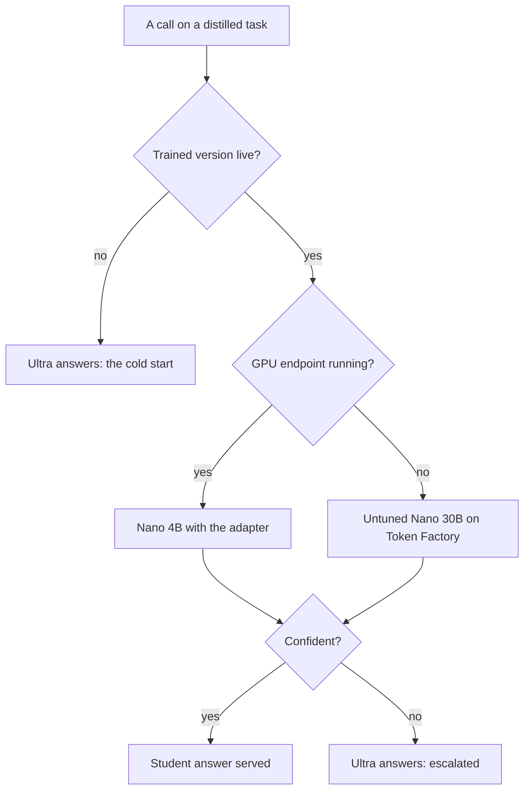

import { Steps, Tabs, TabItem, Card, CardGrid, LinkCard, Aside, Badge, FileTree } from '@astrojs/starlight/components';
import Summary from '../../../components/Summary.astro';
import Eli10 from '../../../components/Eli10.astro';
import Who from '../../../components/Who.astro';
import BigPicture from '../../../components/diagrams/BigPicture.astro';

<Summary>This page is a guide for the judges of the Nebius x NVIDIA Global AI Hackathon: where the demo is, what to look at, which numbers are simulation and which are live, and what is not done yet.</Summary>

<Eli10>

You are a food critic visiting a restaurant that is teaching an apprentice chef to cook like the head chef from the agency.

- **The front window** (`/`) tells the story: why the restaurant wants its own apprentice, how the apprentice learns at night school, and how a bad apprentice gets sent back to class.
- **The catering kitchen** (`/scout`) lets you place an order and watch five helpers work on it. Each dish carries a tag saying who cooked it: the apprentice, the head chef, or the agency's untrained cook.
- **The manager's office** (`/dashboard`) shows the books: how many dishes each cook made, what they cost, and every time an apprentice was promoted or sent back.

Some pictures on the walls are from a rehearsal with pretend cooks. Those are always labelled "Simulation". A few tables are kept free for critics; the key to them is in your testing instructions, not on the menu.

</Eli10>

## How it really works

The whole system, as it runs on Nebius:

<BigPicture />

<Steps>

1. **One small Nebius CPU VM hosts the demo.** It runs the Ratchet gateway and Caddy (automatic HTTPS) with Docker Compose. The gateway does no inference; it routes requests, keeps the ledger and serves the pages.

2. **During judging the demo runs in live mode.** The hackathon's pass/fail Stage One needs a runtime call to Token Factory (or running on Nebius AI Cloud), and mock mode makes none, so the VM guide switches the demo to live mode before submission and keeps it there until judging ends on Dec 15, 2026 ([VM guide](/reference/deploy-nebius-vm/#switching-from-mock-to-live), [Stage One readiness](/reference/hackathon-submission/#stage-one-passfail-readiness)).

3. **The teacher is real.** In live mode NVIDIA Nemotron 3 Ultra answers on Nebius Token Factory, and Scout searches the web with Tavily.

4. **The student is whatever is trained and running.** With a trained version and the GPU endpoint running, Nemotron 3 Nano 4B with the adapter answers student calls. With the endpoint off, student calls go to the untuned Nemotron 3 Nano 30B on Token Factory, and every page labels them as such. With no trained version yet, every call goes to the teacher (the cold start).

5. **A budget guard protects the public demo.** Scout has a daily spend cap, a daily run cap and a per-IP hourly limit, with a share held back for judges behind an access code. The paid `/v1` API is closed to the public.

</Steps>



### Where the demo is

<Aside type="note" title="Placeholders">
The demo address and the video link are not known yet. They will replace the placeholders below before submission.
</Aside>

- **Demo**: `[DEMO URL]` (placeholder), hosted on a Nebius CPU VM from Oct 29 to Dec 15, 2026.
- **Video**: `[VIDEO URL]` (placeholder), under 3 minutes: the story page, a Scout run, then the dashboard ([demo script](/reference/demo-script/)).
- **Code**: [github.com/harshbhx/ratchet](https://github.com/harshbhx/ratchet), Apache-2.0.

### What each page shows

| Page | What you see |
|---|---|
| `/` | The story in ten chapters: the rent, the catch (why closed models cannot be distilled), how it turns, the one-way release gate, "Watch it learn" (a replay of the reference simulation), the honest bill (savings per token and by GPU-hours, the break-even), things you can check yourself, agent traffic, the Nebius and NVIDIA stack, and how to run it |
| `/scout` | Ask a research question and watch five agents work. Each call shows who answered it, what it cost and what Ultra alone would have cost, then a savings bar for the whole run |
| `/dashboard` | Savings, the release pipeline, economics (per token and by GPU-hours paid, break-even, a recommendation), versions with their signed bills of materials, routing per task, the task registry, resilience (circuit breakers, fallbacks, recent failures), trust and privacy (with a live redactor), the release log and provenance |

### What is simulation and what is live

- **Mock mode numbers are simulation.** Mock models play the teacher and the student so the whole loop runs with no keys. They show how the loop behaves (cold start, drift, rollback), not real model quality. Every such number is labelled "Simulation", and Scout shows "Simulated search results".
- **The story page always shows the reference simulation** for "Watch it learn", labelled with its source (seed 7, 2,000 support tickets a day, a product launch on day 5, a corrupted deploy of v3). The honest-bill chapter uses the live gateway's cost report once that gateway has requests, endpoint hours and a break-even, and the simulation otherwise, with a toggle between them.
- **In live mode the dashboard reads the live ledger.** It starts empty and grows with real traffic. Anonymous readers of the public dashboard see client pseudonyms (`client-1`, ...), not names.
- **No live run has happened yet.** As of Oct 21, 2026 Ratchet has not run on Nebius. Measured results will come from one published live run; until then the submission's live figures read `[LIVE NUMBER]`.

### Who answered: the badges

Every answer on the Scout page and the dashboard carries one badge:

| Badge | Means |
|---|---|
| <Who as="student" /> | Nemotron 3 Nano 4B with the Night School adapter, on a Nebius Serverless Endpoint |
| <Who as="fallback" /> | The untuned Nemotron 3 Nano 30B on Token Factory, used while the GPU endpoint is off. Held to a default confidence threshold, and not covered by the adapter's precision certificate |
| <Who as="teacher" /> | Nemotron 3 Ultra on Nebius Token Factory |
| Tavily, or Search | A tool call, not a model |

While the hosted fallback serves, the pages say so: the dashboard header reads "Nano 30B · hosted on Token Factory (endpoint off)", the live version's golden precision is hidden ("not covered by the certificate"), and Scout's totals say "Answered by the student" rather than claiming the adapter answered. `GET /ratchet/stats` and `GET /scout/status` report the same thing in `student_serving`.

### How to try Scout

1. Open `/scout` and pick an example question, such as "What is LoRA fine-tuning?" or "How does a model cascade cut LLM costs?". In live mode you can also type your own, up to 300 characters.
2. Watch the lanes. The planner and the writer are pinned to <Who as="teacher" /> and never become training data. Triage and reader calls are the many short, repetitive ones the student learns to take over.
3. Read the totals: calls answered by the student, the run's cost, and what Ultra alone would have cost.

The public demo has a daily run cap. If today's public runs are used up, you get a polite refusal. Judges have a reserve: the access code comes in the submission's **testing instructions only**, never on the public page or in the video. The Scout page has no field for the code yet, so open the browser console on the demo's `/scout` page and send it once:

```js
fetch('/scout/judge', { method: 'POST', headers: { 'content-type': 'application/json' }, body: JSON.stringify({ code: 'THE CODE FROM THE TESTING INSTRUCTIONS' }) })
```

That sets a signed cookie (it lasts 7 days by default). `GET /scout/status` then shows `"session": true` under `judge`. Without the code you still get the public pool, and a run whose search is unavailable still finishes, labelled "search unavailable", after a real Token Factory call. More in [Scout](/guides/scout/).

### How to try the dashboard

Open `/dashboard`. In live mode it shows the live gateway's numbers. The demo controls (**Run 1 day + night**, **Break next deploy**, and **Take the student down** in the Resilience panel) are **mock-only**: they call `/ratchet/demo/*`, which answers only in mock mode, so the dashboard hides them on the live demo. To try them, run the mock demo on your machine. It needs no keys and takes about a minute:

```bash
git clone https://github.com/harshbhx/ratchet && cd ratchet
pip install -e ".[dev]"
make demo        # mock gateway with 4 simulated warm-up days on http://localhost:8000
```

Then on `/dashboard`: click **Run 1 day + night** a few times to watch new versions move through shadow, canary 10%, 50% and live; click **Break next deploy**, then run two or three more days (the corrupted version must be trained and reach canary first) to watch it roll back automatically; click **Take the student down** and run a day to watch the circuit breaker open and close. All of it is simulation.

### A five-minute tour

| Minute | Where | Look for |
|---|---|---|
| 0 to 1 | `/` | "The catch" (why distilling closed models breaks their terms), "One way only" (the release gate), "The honest bill" (when self-hosting does not pay) |
| 1 to 2 | `/scout` | One run: the pinned planner and writer, the student's badges on triage and reader calls, an escalation, the run's savings |
| 2 to 3 | `/dashboard` | The by-task table (triage and reading move to the student; planning and writing stay on Ultra by design), versions and the release log |
| 3 to 4 | `/dashboard` | Economics (savings per token and by GPU-hours, the break-even, the recommendation), then trust and privacy: paste an email and a card number into the redactor |
| 4 to 5 | The code | `ratchet/licenses.py` (closed teachers refused), `ratchet/router.py` (the cascade), `ratchet/release.py` (the gate and rollback), `ratchet/cost.py` (break-even) |

### What to look at in the code

| Claim | Where it is enforced |
|---|---|
| Only open teachers are distilled; closed models such as GPT are refused | [`ratchet/licenses.py`](https://github.com/harshbhx/ratchet/blob/main/ratchet/licenses.py) `require_distillable` |
| The student answers first and escalates when unsure | [`ratchet/router.py`](https://github.com/harshbhx/ratchet/blob/main/ratchet/router.py) `Ratchet.handle`, [`ratchet/confidence.py`](https://github.com/harshbhx/ratchet/blob/main/ratchet/confidence.py) |
| Training data is teacher answers only, with provenance | [`ratchet/nightschool/dataset.py`](https://github.com/harshbhx/ratchet/blob/main/ratchet/nightschool/dataset.py), [`ratchet/ledger.py`](https://github.com/harshbhx/ratchet/blob/main/ratchet/ledger.py) |
| Releases go shadow, canary 10%, 50%, 100%, with automatic rollback | [`ratchet/release.py`](https://github.com/harshbhx/ratchet/blob/main/ratchet/release.py) `ReleaseGate` |
| Each adapter has a signed bill of materials and a precision certificate | [`ratchet/bom.py`](https://github.com/harshbhx/ratchet/blob/main/ratchet/bom.py), [`ratchet/certificate.py`](https://github.com/harshbhx/ratchet/blob/main/ratchet/certificate.py) |
| The cost report says when self-hosting does not pay | [`ratchet/cost.py`](https://github.com/harshbhx/ratchet/blob/main/ratchet/cost.py) `cost_report`, `_recommend` |
| Scout's planner and writer are pinned | [`ratchet/tasks.py`](https://github.com/harshbhx/ratchet/blob/main/ratchet/tasks.py), [`ratchet/scout/agents.py`](https://github.com/harshbhx/ratchet/blob/main/ratchet/scout/agents.py) |
| The whole loop runs without GPUs | [`sim/simulate.py`](https://github.com/harshbhx/ratchet/blob/main/sim/simulate.py), [`tests/`](https://github.com/harshbhx/ratchet/tree/main/tests) (1412 tests) |
| Every requirement and invariant maps to code and tests | [Requirements matrix](/reference/requirements/) |

<Aside type="caution" title="Honest status, as of Oct 21, 2026">
Ratchet has **not run on Nebius yet**. Live mode, the student endpoint, the training job and the demo VM kit are written and tested offline against fake endpoints, but not against a real account. The day-1 checks (model ids, logprobs, JSON mode on Token Factory) come first, then a live run whose results fill the `[LIVE NUMBER]` placeholders in the [submission](/reference/hackathon-submission/). Model ids and prices stay unverified until then. A question about Token Factory's Terms of Service §5(f) ("competing service") was sent to Nebius support on Oct 19, 2026 and is still open; not legal advice.
</Aside>

## For engineers

**Run it yourself**: `make demo` (above) for the mock demo, or `python -m sim.simulate --days 10 --requests 2000 --bad-deploy-version 3` for the reference simulation in the terminal. `pytest -q` runs the test suite with no network and no GPU. The [quickstart](/guides/quickstart/) has more.

**Check the live demo from a terminal** (replace the placeholder with the demo address):

```bash
curl -s https://[DEMO URL]/readyz                                  # ready, or degraded with the reason
curl -s https://[DEMO URL]/scout/status | jq '{mode, student_serving, judge, search}'
curl -s https://[DEMO URL]/ratchet/stats | jq .student_serving      # who answers student calls now
curl -s https://[DEMO URL]/ratchet/cost | jq '{recommendation, explanation}'
```

`/ratchet/stats` and `/ratchet/cost` answer without a key only while the demo's dashboard is public (`RATCHET_PUBLIC_DASHBOARD=1`, which the VM's settings use so judges can see it). `/v1/chat/completions` is closed to the public in live mode: the VM guide requires API keys or the Caddy guard.

**Reference**:

- [API reference](/reference/api/): every endpoint, with its access level.
- [Hackathon submission](/reference/hackathon-submission/): the Devpost text, the Stage One checklist and the live-number placeholders.
- [Demo VM on Nebius](/reference/deploy-nebius-vm/): how the demo is hosted, its costs (estimates) and its security notes.
- [Deployment](/reference/deployment/): mock mode, live mode on Nebius, and keeping the demo alive for judging.

## Common questions

### Is anything here real, or is it all simulation?

The code, the tests and the live demo's teacher calls are real. The numbers you see in mock mode, on the story page's replay and in the README tables are simulation, from mock models, and are labelled. Measured live numbers do not exist yet; the live run will publish them.

### Why does a badge say "Nano 30B · hosted"?

The GPU endpoint that runs the trained adapter costs money every hour it is up, busy or idle. At demo traffic it would lose money, and Ratchet's own cost report says so. So while it is off, the untuned Nano 30B on Token Factory answers student calls, per token, and the page says exactly that instead of crediting the adapter.

### What if the student is wrong?

When the student is unsure, Ultra answers instead. When it is sure but wrong, random audits by Ultra catch a share of those answers. A version in canary is rolled back automatically when its audited precision falls too far; a live version that slips raises an alert for an operator to roll it back. The certificate and the precision figures measure agreement with Ultra, not ground truth.

### Do I need the judge code?

No. Without it you get the public pool, which has a daily cap. The code holds runs back for judges so that public visitors cannot use them up first.

### Why can I not click "Break next deploy" on the live demo?

The demo controls are mock-only by design: in live mode they would change real versions. Run `make demo` locally to try them; it needs no keys.

### What does the customer end up owning?

A LoRA adapter on NVIDIA's open Nemotron 3 Nano 4B base, plus its signed training lineage. The base model stays under the NVIDIA Nemotron Open Model License.

### What is not built or not run yet?

Ratchet has not run on Nebius (as of Oct 21, 2026), so there are no measured results. Name and address redaction, a Postgres ledger for several workers, and tool-call distillation are not built. Night School's cron is off on the demo VM by default, because the stock gateway image does not contain the Nebius and AWS command-line tools it needs to start a training job.

## Related

- [What is Ratchet](/guides/what-is-ratchet/)
- [Scout](/guides/scout/)
- [Cost and savings](/guides/cost-and-savings/)
- [Security and safety](/guides/security/)
- [FAQ](/guides/faq/)
