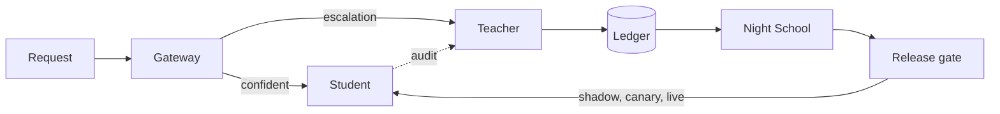

import { Aside } from '@astrojs/starlight/components';
import Summary from '../../../components/Summary.astro';
import Eli10 from '../../../components/Eli10.astro';

This page gives every word Ratchet uses one plain line and a link to the page that explains it, so you can read any other page without getting stuck on a term.

<Eli10>

Every page in these docs uses the same restaurant. If you remember the cast, most terms explain themselves:

- the **apprentice chef** is the student, and the **apprentice's notebook** is the adapter you own;
- the **head chef from the agency** is the teacher;
- **the pass** is the gateway, which decides who cooks each order;
- **the inspector** tastes random plates (audits), and **the recipe book** is the ledger;
- **night school** trains a new notebook, the **sealed exam** is the golden set, and the **trial shift**, **serving a few tables first** and **sending the apprentice back to class** are shadow, canary and rollback.

</Eli10>

<Aside type="note" title="The longer glossary">
The repository keeps its own glossary with longer definitions, synced into these docs at [Reference: Glossary](/guides/glossary/).
</Aside>

## Terms

How the main terms connect, in one picture:

### A

- **Adapter**: the small set of LoRA weights one student version adds on top of the Nano base; it is the part you own, together with its signed training lineage. ([Night School](/guides/night-school/))
- **Admin key**: a key from `RATCHET_ADMIN_KEYS` for management calls (the admin API, task writes, training-set proofs); recorded by name only, never stored. ([Security](/guides/security/))
- **All-teacher baseline**: what a request would have cost if the teacher had answered it alone (`all_teacher_cost_usd` in each response); savings are measured against it. ([Cost and savings](/guides/cost-and-savings/))
- **Anytime-valid**: a statistical guarantee that holds however often you look at the data; the live alert uses it by default, and the canary gate with `RATCHET_SEQUENTIAL=1`. ([Release gate](/guides/release-gate/))
- **API client**: the name of a gateway API key (`RATCHET_API_KEYS=name:key`); requests, cost, savings and receipts are reported per name, never per key. ([Security](/guides/security/))
- **Arbitration**: when a shadow candidate disagrees with the live student's served answer, the teacher decides who was right, and its answer becomes training data. ([Release gate](/guides/release-gate/))
- **Audit**: the teacher answers again a random share of the requests the student served, to measure live quality; a failed audit never fails the request. ([Escalation and audits](/guides/escalation-and-audits/))
- **Audit rate**: the share of student answers that are audited, `RATCHET_AUDIT_RATE`, 0.05 by default; each audit is a paid teacher call. ([Escalation and audits](/guides/escalation-and-audits/))
- **Auto task**: a task Ratchet derives from a request's `response_format` JSON schema when the request names no registered task. ([Training on your data](/guides/training-on-your-data/))

### B

- **Bill of materials (BOM)**: the record of every training source and its license; `GET /ratchet/bom` covers the whole ledger, and each adapter gets its own, written once at training time and signed with Ed25519 when a key is set. ([Evidence](/guides/evidence/))
- **Break-even**: the number of student answers per endpoint hour at which a GPU endpoint pays for itself: the GPU price per hour divided by the teacher spend each student answer avoids. ([Cost and savings](/guides/cost-and-savings/))
- **Budget guard**: Scout's limits in live mode (a daily spend cap, a daily run cap and a per-IP hourly limit), kept in the ledger across restarts and required in live mode by invariant 11. ([Scout](/guides/scout/))

### C

- **Calibrated baseline**: the ratio of what the teacher really cost on audited answers to the token formula's estimate, used to correct the savings in receipts. ([Cost and savings](/guides/cost-and-savings/))
- **Calibration**: choosing a version's threshold: the lowest confidence at which its served answers reach 97% precision on the calibration half of the golden set. ([Confidence](/guides/confidence/))
- **Canary**: a new version serving a slice of real traffic, 10% and then 50%, while audits check it, before it goes live. ([Release gate](/guides/release-gate/))
- **Cascade**: try the cheap model first and send the request to the expensive one only when needed. ([The request journey](/guides/request-journey/))
- **Certificate**: an exact lower bound (one-sided Clopper–Pearson) on how often a version's served answers agree with the teacher, computed on held-out golden rows and signed in its BOM. ([Evidence](/guides/evidence/))
- **Champion and challenger**: the live version (champion) is scored again on the same golden set as the new candidate (challenger) before the two are compared (invariant 4). ([Night School](/guides/night-school/))
- **Circuit breaker**: after 5 failed calls in a row the gateway stops calling the student endpoint (or the teacher) for 30 seconds, doubling up to 300 seconds while probes fail; student traffic then goes to the teacher. ([The request journey](/guides/request-journey/))
- **Cold start**: the time before any student version exists, when the teacher answers every request. ([The request journey](/guides/request-journey/))
- **Comparator (field comparator)**: how one field of a task's answer is normalised and compared (`label`, `number`, `date`, `set`, `records`, ...); a missing required field makes the whole answer invalid. ([Confidence](/guides/confidence/))
- **Confidence**: a score from 0 to 1: 0.4 × the token probability of the best majority sample plus 0.6 × the agreement among the student's samples; an invalid sample gets no vote. ([Confidence](/guides/confidence/))
- **Confidence sequence**: a range for a rate that holds at every sample size at once, so it can be checked after every audit; release events show a 95% one. ([Release gate](/guides/release-gate/))
- **Coverage**: the share of requests a student serves, or would serve; more coverage means more savings. ([Release gate](/guides/release-gate/))

### D

- **Dashboard key**: a read-only key from `RATCHET_DASHBOARD_KEYS` that reads the dashboard API in live mode and writes nothing. ([Security](/guides/security/))
- **Day-1 checks**: the checks to run with a real Token Factory key before trusting live mode (`scripts/day1_check.py` and its checklist); model IDs and prices stay unverified until they pass. ([Host it on Nebius](/guides/host-on-nebius/))
- **Degraded mode**: an opt-in (`RATCHET_ON_TEACHER_FAILURE=serve_student`): when the teacher cannot answer an escalation, the student's own below-threshold answer is served, marked `degraded`, and never stored. ([Escalation and audits](/guides/escalation-and-audits/))
- **Distillation**: training a small model to copy a larger model's answers. ([What is Ratchet?](/guides/what-is-ratchet/))
- **Drift**: new kinds of requests the student has never seen, for example after a product launch; escalations rise, then fall as Night School learns them. ([Night School](/guides/night-school/))

### E

- **E-process and e-value**: a running measure of evidence against "precision is at least the floor"; the sequential canary rolls back at an e-value of 20 and the live alert fires at 100, however often they look. ([Release gate](/guides/release-gate/))
- **Edge guard**: Caddy's opt-in `RATCHET_API_GUARD=guarded` on the demo VM, which blocks `/v1/*`, the demo controls and the admin API without the `X-Ratchet-Admin-Token` header. ([Host it on Nebius](/guides/host-on-nebius/))
- **Erasure**: removing stored examples for good, by client, end user, hash or text; the example's hash stays behind as a tombstone so it is never stored again. ([Security](/guides/security/))
- **Escalation**: a request the student was not confident about, sent to the teacher; the teacher's answer is served and, if valid, stored as training data. ([Escalation and audits](/guides/escalation-and-audits/))

### F

- **Fallback student**: another name for the hosted fallback (`RATCHET_FALLBACK_STUDENT`). ([Host it on Nebius](/guides/host-on-nebius/))
- **Fallback teacher**: an opt-in second licensed teacher (`RATCHET_TEACHER_FALLBACK_MODEL`) that answers when the primary teacher is unavailable; its answers are stored only with `RATCHET_STORE_FALLBACK_TEACHER=1`. ([Escalation and audits](/guides/escalation-and-audits/))
- **FREQUENT rule**: a request seen 3 or more times leaves the golden set and goes to training, so frequent questions are never held out forever. ([Night School](/guides/night-school/))
- **Frontier**: the certificate at every threshold from 0.95 down to 0.50, corrected so all of them hold at once: the certified trade-off between precision and coverage. ([Evidence](/guides/evidence/))

### G

- **Golden gate**: the first release check: at least 95% precision and 25% coverage on held-out golden rows, and no drop of more than 2 points against the live version. ([Release gate](/guides/release-gate/))
- **Golden set**: about 10% of unique requests (`RATCHET_GOLDEN_FRACTION`), chosen by hash, held out from training and used only to test versions. ([Night School](/guides/night-school/))

### H

- **Held-out**: data a version never trained on; the even-numbered golden rows set its threshold and the odd-numbered rows measure its precision (invariant 6). ([Night School](/guides/night-school/))
- **Held-out certificate**: every golden example's proof of absence from an adapter's committed training set, checkable from the BOM alone. ([Evidence](/guides/evidence/))
- **Hosted fallback**: the untuned Nemotron 3 Nano 30B on Token Factory that answers student calls while no student endpoint is set; paid per token, held to the default threshold of 0.80, and covered by no certificate. ([Host it on Nebius](/guides/host-on-nebius/))
- **Human label**: a customer's correction (`POST /v1/ratchet/feedback`) or an attested import, stored as a training example with the provenance `human`; a verdict on its own stores nothing. ([Training on your data](/guides/training-on-your-data/))

### I

- **Idempotency key**: an `Idempotency-Key` header that makes a retried request get the first answer back without running the cascade again. ([The request journey](/guides/request-journey/))
- **Inconclusive**: under the sequential rule, a canary stage that reached 400 audits without enough evidence either way; the version is retired, not rolled back. ([Release gate](/guides/release-gate/))
- **Invariant**: one of the numbered rules the code must never break, such as "never train on student outputs"; each one is mapped to code and tests. (Requirements matrix)

### J

- **Judge**: Nemotron 3 Super on Token Factory, which scores free-text answers in the golden eval; tasks with typed fields are compared field by field instead, with no judge. ([Night School](/guides/night-school/))
- **Judges' reserve**: Scout runs, spend and Tavily credits held back each day for evaluators, unlocked by a code sent once to `POST /scout/judge`. ([Scout](/guides/scout/))

### L

- **label_p (labelling probability)**: the designed chance that the teacher labels a student answer (1 for an escalation, the audit rate for a served answer), logged with every request so the replay can weight each label. ([Evidence](/guides/evidence/))
- **Learn-then-Test**: an opt-in calibration (`RATCHET_CALIBRATION=ltt`) that picks the threshold from a fixed grid so its precision is certified. ([Evidence](/guides/evidence/))
- **Ledger**: the SQLite file that records every request's metadata, every stored training example with its provenance, every version and every event. ([The ledger](/guides/ledger/))
- **License-clean distillation**: distilling only from teachers whose licenses allow training on their outputs; closed models whose terms forbid it are refused in code. ([Licenses](/guides/licenses/))
- **Live mode**: running against real Token Factory, a real student endpoint and real web search; every teacher call costs money. ([Host it on Nebius](/guides/host-on-nebius/))
- **Live version**: the version that serves all student traffic after its canary passed; it is alerted on, never rolled back automatically. ([Release gate](/guides/release-gate/))
- **Live-run harness**: `python -m ratchet.liverun`, which sends rounds of traffic through a live gateway under a spending cap and writes the results file every live number must come from; not run yet. ([Evidence](/guides/evidence/))
- **LoRA**: Low-Rank Adaptation: training a small set of extra weights (an adapter) on top of a frozen base model, cheap to train and to swap. ([Night School](/guides/night-school/))

### M

- **Merkle root**: one hash that commits to a whole set; an adapter's BOM signs one over its training set and one over its golden set, and a savings receipt signs one over a day's request metadata. ([Evidence](/guides/evidence/))
- **Mock mode**: running with simulated models, traffic and search, with no keys and no GPU; its numbers show how the loop behaves, not how good a real model is. ([Quickstart](/guides/quickstart/))

### N

- **Night School**: the nightly job: build the dataset, retrain the adapter from the base on all teacher answers so far, evaluate it on the golden set, and hand it to the release gate. ([Night School](/guides/night-school/))
- **No-train end user**: an end user registered with `POST /v1/ratchet/no-train`, whose requests are never stored as training examples. ([Security](/guides/security/))
- **NOTICE.md**: the file next to each adapter's weights that names the base model's license and each teacher's license and says the targets were teacher outputs only; its SHA-256 is in the signed BOM. ([Licenses](/guides/licenses/))

### O

- **Object Storage**: Nebius's S3-compatible storage; one bucket is mounted at `/data` in both the training job and the student endpoint. ([Host it on Nebius](/guides/host-on-nebius/))
- **Off-path checks**: in live mode, audits and shadow checks run after the answer is sent (`RATCHET_SIDECAR_WORKERS`, 4 by default there), so the client does not wait for the teacher. ([Escalation and audits](/guides/escalation-and-audits/))
- **OpenMDW-1.1**: the license of Nemotron 3 Ultra; it places no restrictions on outputs, so its answers may be used to train a student. ([Licenses](/guides/licenses/))
- **Opt-out**: a way to keep a request's teacher answers out of training (`store: false`, `X-Ratchet-Store: none`, a key's `store=0`, no-store tasks, no-train end users); opt-outs only ever reduce storage. ([Security](/guides/security/))

### P

- **Paired gate**: an opt-in golden-gate rule (`RATCHET_PAIRED_GATE=1`) that compares the candidate and the live version row by row on the same golden rows with exact McNemar tests. ([Release gate](/guides/release-gate/))
- **Per-task calibration**: when several tasks share one adapter, each gets its own threshold and held-out numbers, and a task that fails its golden check is disabled on that version. ([Confidence](/guides/confidence/))
- **PII redaction**: replacing emails, phone numbers, card numbers, IBANs, national IDs, IP addresses and secrets with placeholders such as `[EMAIL]` before anything becomes a training example; names and street addresses are not caught yet. ([Security](/guides/security/))
- **Pinned task**: a task that always goes to the teacher and is never stored as training data, such as Scout's `research-plan` and `research-write`; only an operator's spec pins a task. ([Scout](/guides/scout/))
- **Precision**: of the answers a student serves (or would serve), the share that agree with the teacher; agreement with Nemotron 3 Ultra, not ground truth. ([Release gate](/guides/release-gate/))
- **Provenance**: where a training example came from: which teacher wrote it and under which license, recorded when it is stored. ([The ledger](/guides/ledger/))

### R

- **Readiness and liveness**: `/readyz` says whether the gateway can answer requests (for load balancers and uptime monitors); `/healthz` says only that the process is up (for restarts). ([Host it on Nebius](/guides/host-on-nebius/))
- **Receipt (savings receipt)**: a signed record per ledger day, for the gateway and for each API client, of what was saved, with a Merkle tree over the day's request metadata and the fee taken on the 95% lower bound of the savings. ([Cost and savings](/guides/cost-and-savings/))
- **Release gate**: the checks a new version must pass before it serves traffic: the golden gate, shadow, canary at 10% and 50%, then live, with automatic rollback of a bad canary. ([Release gate](/guides/release-gate/))
- **Replay (ledger replay)**: recomputing one version's coverage, precision and cost from its logged traffic at another threshold or audit rate, with no new model call. ([Evidence](/guides/evidence/))
- **Retention**: how long stored examples and request rows are kept (`RATCHET_EXAMPLE_RETENTION_DAYS`, `RATCHET_REQUEST_RETENTION_DAYS`; 0 keeps them forever). ([Security](/guides/security/))
- **Rollback**: pulling a canary automatically when the 95% upper bound of its audited precision falls below 92% (or, with the sequential rule, when its e-value reaches 20). ([Release gate](/guides/release-gate/))
- **Route**: the recorded reason a request was answered the way it was: `student`, `confidence` (escalated), `cold_start`, `pinned`, `tools`, `student_breaker` and others. ([The request journey](/guides/request-journey/))

### S

- **Scout**: the multi-agent research demo: a planner and a writer pinned to the teacher, a web searcher, and many small triage and reader calls the student learns. ([Scout](/guides/scout/))
- **Self-consistency (agreement)**: how many of the student's samples (3 by default) give the same answer, compared with the task's comparators. ([Confidence](/guides/confidence/))
- **Serverless Endpoint**: a Nebius service that serves a container at a URL; Ratchet runs vLLM with the student there on one L40S, billed while it runs. ([Host it on Nebius](/guides/host-on-nebius/))
- **Serverless Job**: a Nebius service that runs a container to completion; Night School trains each adapter in one, on one L40S. ([Host it on Nebius](/guides/host-on-nebius/))
- **Set commitment**: the Merkle root in an adapter's BOM that fixes its exact training (or golden) set, so a single example can be proved in or out of it. ([Evidence](/guides/evidence/))
- **Shadow**: a candidate version answering real traffic silently next to the live student; nothing it says is served, and disagreements go to the teacher. ([Release gate](/guides/release-gate/))
- **Spec hash**: a hash of the rules in a task's spec that decide agreement; when it changes, the task goes to the teacher until a night scores the version again. ([Training on your data](/guides/training-on-your-data/))
- **Student**: the small model that answers first: NVIDIA Nemotron 3 Nano 4B with the adapter you own, served by vLLM. ([The big picture](/guides/big-picture/))

### T

- **Take rate**: the share of the savings' billable lower bound that is the fee in a receipt (`RATCHET_TAKE_RATE`, 25% by default). ([Cost and savings](/guides/cost-and-savings/))
- **Task**: a named kind of request, such as `ticket-triage`, that says which answer fields must match, which answers are valid and whether it is pinned; set with the `X-Ratchet-Task` header. ([Training on your data](/guides/training-on-your-data/))
- **Task registry**: the tasks a request can name: the built-in ones, those in `RATCHET_TASKS_FILE` and those written through the admin API. ([Training on your data](/guides/training-on-your-data/))
- **Teacher**: the large model that answers what the student cannot: NVIDIA Nemotron 3 Ultra on Token Factory; only its answers and attested human labels become training data. ([The big picture](/guides/big-picture/))
- **Threshold**: the confidence at or above which a student answer is served, calibrated per version and per task. ([Confidence](/guides/confidence/))
- **Token Factory**: Nebius's OpenAI-compatible inference service for open models, billed per token; Ratchet's teacher, judge and hosted fallback run there. ([Host it on Nebius](/guides/host-on-nebius/))
- **Tombstone**: the hash an erased example leaves behind, so the same example is refused from then on, from any client. ([Security](/guides/security/))

### V

- **Version**: one trained student adapter (`student-v1`, `student-v2`, ...) with its own eval, threshold and state: `candidate`, `rejected`, `shadow`, `canary`, `live`, `retired` or `rolled_back`. ([Release gate](/guides/release-gate/))
- **vLLM**: the open-source model server that runs the student on the endpoint and loads each new LoRA adapter without a restart. ([Host it on Nebius](/guides/host-on-nebius/))

### W

- **Warm-up**: in mock mode, simulated days and nights run at startup (`RATCHET_MOCK_WARMUP_DAYS`), so the demo opens with a trained student. ([Quickstart](/guides/quickstart/))
- **Wilson bound**: an interval for a proportion that behaves well on small samples; the default canary rollback uses its upper bound, and it is valid for one look at a fixed sample. ([Release gate](/guides/release-gate/))
- **Workload**: the kind of simulated traffic: `tickets`, `research`, `mixed`, `schema` or `tools`. ([Quickstart](/guides/quickstart/))

## For engineers

Where the names live in the code (links go to GitHub):

| Term | Where in the code |
|---|---|
| Cascade, route, escalation, audit | [`ratchet/router.py`](https://github.com/harshbhx/ratchet/blob/main/ratchet/router.py): `Ratchet.handle`, `ROUTES`, `Ratchet.threshold` |
| Confidence, calibration, sampling | [`ratchet/confidence.py`](https://github.com/harshbhx/ratchet/blob/main/ratchet/confidence.py): `score`, `calibrate_threshold`, `STUDENT_SAMPLING`; per task in [`ratchet/calibration.py`](https://github.com/harshbhx/ratchet/blob/main/ratchet/calibration.py) |
| Release gate, shadow, canary, rollback, states | [`ratchet/release.py`](https://github.com/harshbhx/ratchet/blob/main/ratchet/release.py): `ReleaseGate`, `ReleasePolicy`, `CANARY_STEPS` |
| Wilson, e-values, confidence sequences, certificates | [`ratchet/stats.py`](https://github.com/harshbhx/ratchet/blob/main/ratchet/stats.py), [`ratchet/certificate.py`](https://github.com/harshbhx/ratchet/blob/main/ratchet/certificate.py) |
| Golden set, FREQUENT rule, held-out eval | [`ratchet/nightschool/dataset.py`](https://github.com/harshbhx/ratchet/blob/main/ratchet/nightschool/dataset.py) (`FREQUENT`), [`ratchet/nightschool/evaluate.py`](https://github.com/harshbhx/ratchet/blob/main/ratchet/nightschool/evaluate.py) (`cascade_eval`) |
| Night School | [`ratchet/nightschool/orchestrate.py`](https://github.com/harshbhx/ratchet/blob/main/ratchet/nightschool/orchestrate.py) (`run_night`), [`ratchet/live.py`](https://github.com/harshbhx/ratchet/blob/main/ratchet/live.py) |
| Ledger, provenance, tombstones | [`ratchet/ledger.py`](https://github.com/harshbhx/ratchet/blob/main/ratchet/ledger.py): `Ledger`, `add_example` |
| Licenses, license-clean | [`ratchet/licenses.py`](https://github.com/harshbhx/ratchet/blob/main/ratchet/licenses.py): `require_distillable`, `BUILTIN`, `BASE_MODELS` |
| BOM, NOTICE.md | [`ratchet/bom.py`](https://github.com/harshbhx/ratchet/blob/main/ratchet/bom.py), [`ratchet/nightschool/notices.py`](https://github.com/harshbhx/ratchet/blob/main/ratchet/nightschool/notices.py) |
| Merkle roots, set commitments, proofs | [`ratchet/merkle.py`](https://github.com/harshbhx/ratchet/blob/main/ratchet/merkle.py), [`ratchet/proof.py`](https://github.com/harshbhx/ratchet/blob/main/ratchet/proof.py) |
| Receipts, take rate | [`ratchet/receipts.py`](https://github.com/harshbhx/ratchet/blob/main/ratchet/receipts.py) |
| Replay, label_p | [`ratchet/replay.py`](https://github.com/harshbhx/ratchet/blob/main/ratchet/replay.py) |
| Break-even, cost report | [`ratchet/cost.py`](https://github.com/harshbhx/ratchet/blob/main/ratchet/cost.py): `cost_report` |
| Circuit breakers | [`ratchet/resilience.py`](https://github.com/harshbhx/ratchet/blob/main/ratchet/resilience.py): `Breaker`, `BreakerPolicy` |
| Tasks, comparators, spec hash | [`ratchet/tasks.py`](https://github.com/harshbhx/ratchet/blob/main/ratchet/tasks.py), [`ratchet/taskspec.py`](https://github.com/harshbhx/ratchet/blob/main/ratchet/taskspec.py), [`ratchet/compare.py`](https://github.com/harshbhx/ratchet/blob/main/ratchet/compare.py) |
| Redaction, opt-outs, erasure, retention | [`ratchet/redact.py`](https://github.com/harshbhx/ratchet/blob/main/ratchet/redact.py), [`ratchet/privacy.py`](https://github.com/harshbhx/ratchet/blob/main/ratchet/privacy.py) |
| API, admin and dashboard keys | [`ratchet/auth.py`](https://github.com/harshbhx/ratchet/blob/main/ratchet/auth.py): `KeyRing` |
| Readiness and liveness | [`ratchet/readiness.py`](https://github.com/harshbhx/ratchet/blob/main/ratchet/readiness.py), `/healthz` in [`ratchet/gateway.py`](https://github.com/harshbhx/ratchet/blob/main/ratchet/gateway.py) |
| Scout, budget guard, judges' reserve | [`ratchet/scout/`](https://github.com/harshbhx/ratchet/tree/main/ratchet/scout): `guard.py`, `judge.py`, `credits.py` |
| Settings and list prices | [`ratchet/config.py`](https://github.com/harshbhx/ratchet/blob/main/ratchet/config.py): `Settings`, `DEFAULT_PRICES` |
| Invariants | Listed as `INV-1` to `INV-26`, each with the code and tests that hold it |

Environment variables are listed in [CONFIGURATION.md](/reference/configuration/) and endpoints in [API.md](/reference/api/).

## Common questions

### Is "the student" the base model or the adapter?

Both together: the student is Nemotron 3 Nano 4B with one version's adapter on top. You own the adapter and its signed lineage; the Nano base stays under the NVIDIA Nemotron Open Model License.

### What is the difference between the hosted fallback and the fallback teacher?

The hosted fallback stands in for the **student** when no GPU endpoint is set: an untuned Nano 30B, paid per token. The fallback teacher stands in for the **teacher** when it is down: a second licensed model you opt into. Neither is the tuned student, and the pages say so.

### Why are so many terms statistical?

Because Ratchet makes release decisions by itself, and each decision rests on counts: audited answers that agree, held-out rows served correctly. Terms like Wilson bound, e-value and certificate are the rules that turn those counts into a decision you can recompute. The [release gate](/guides/release-gate/) and [evidence](/guides/evidence/) pages explain them with examples.

### A term is missing. Where else can I look?

The repository's own glossary at [Reference: Glossary](/guides/glossary/), the [FAQ](/guides/faq/), and the [architecture](/reference/architecture/) reference.
