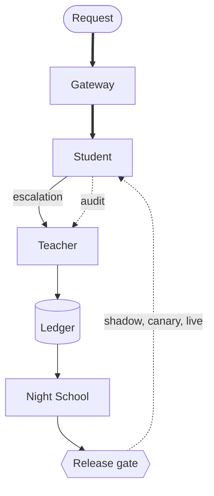

import Summary from '../../../components/Summary.astro';
import Eli10 from '../../../components/Eli10.astro';
import Glossary from '../../../components/Glossary.astro';

This page gives every word Ratchet uses one plain line and a link to the page that explains it, so you can read any other page without getting stuck on a term.

<Eli10>

Every page in these docs uses the same restaurant. If you remember the cast, most terms explain themselves:

- the **apprentice chef** is the student, and the **apprentice's notebook** is the adapter you own;
- the **head chef from the agency** is the teacher;
- **the pass** is the gateway, which decides who cooks each order;
- **the inspector** tastes random plates (audits), and **the recipe book** is the ledger;
- **night school** trains a new notebook, the **sealed exam** is the golden set, and the **trial shift**, **serving a few tables first** and **sending the apprentice back to class** are shadow, canary and rollback.

</Eli10>

## Terms

How the main terms connect, in one picture:

<figure class="rt-diagram">

<figcaption>

**Reading this diagram.** A request reaches the gateway, which asks the student first. An unsure student's request is an escalation to the teacher; an audit is the teacher checking an answer the student already served. The teacher's answers go to the ledger, Night School trains a new adapter from them, and the release gate decides, through shadow and canary, whether it goes live. Each bold word is defined below.

</figcaption>
</figure>

<Glossary />

## For engineers

Where the names live in the code (links go to GitHub):

| Term | Where in the code |
|---|---|
| Cascade, route, escalation, audit | [`ratchet/router.py`](https://github.com/harshbhx/ratchet/blob/main/ratchet/router.py): `Ratchet.handle`, `ROUTES`, `Ratchet.threshold` |
| Confidence, calibration, sampling | [`ratchet/confidence.py`](https://github.com/harshbhx/ratchet/blob/main/ratchet/confidence.py): `score`, `calibrate_threshold`, `STUDENT_SAMPLING`; per task in [`ratchet/calibration.py`](https://github.com/harshbhx/ratchet/blob/main/ratchet/calibration.py) |
| Release gate, shadow, canary, rollback, states | [`ratchet/release.py`](https://github.com/harshbhx/ratchet/blob/main/ratchet/release.py): `ReleaseGate`, `ReleasePolicy`, `CANARY_STEPS` |
| Wilson, e-values, confidence sequences, certificates | [`ratchet/stats.py`](https://github.com/harshbhx/ratchet/blob/main/ratchet/stats.py), [`ratchet/certificate.py`](https://github.com/harshbhx/ratchet/blob/main/ratchet/certificate.py) |
| Golden set, FREQUENT rule, held-out eval | [`ratchet/nightschool/dataset.py`](https://github.com/harshbhx/ratchet/blob/main/ratchet/nightschool/dataset.py) (`FREQUENT`), [`ratchet/nightschool/evaluate.py`](https://github.com/harshbhx/ratchet/blob/main/ratchet/nightschool/evaluate.py) (`cascade_eval`) |
| Night School | [`ratchet/nightschool/orchestrate.py`](https://github.com/harshbhx/ratchet/blob/main/ratchet/nightschool/orchestrate.py) (`run_night`), [`ratchet/live.py`](https://github.com/harshbhx/ratchet/blob/main/ratchet/live.py) |
| Ledger, provenance, tombstones | [`ratchet/ledger.py`](https://github.com/harshbhx/ratchet/blob/main/ratchet/ledger.py): `Ledger`, `add_example` |
| Licenses, license-clean | [`ratchet/licenses.py`](https://github.com/harshbhx/ratchet/blob/main/ratchet/licenses.py): `require_distillable`, `BUILTIN`, `BASE_MODELS` |
| BOM, NOTICE.md | [`ratchet/bom.py`](https://github.com/harshbhx/ratchet/blob/main/ratchet/bom.py), [`ratchet/nightschool/notices.py`](https://github.com/harshbhx/ratchet/blob/main/ratchet/nightschool/notices.py) |
| Merkle roots, set commitments, proofs | [`ratchet/merkle.py`](https://github.com/harshbhx/ratchet/blob/main/ratchet/merkle.py), [`ratchet/proof.py`](https://github.com/harshbhx/ratchet/blob/main/ratchet/proof.py) |
| Receipts, take rate | [`ratchet/receipts.py`](https://github.com/harshbhx/ratchet/blob/main/ratchet/receipts.py) |
| Replay, label_p | [`ratchet/replay.py`](https://github.com/harshbhx/ratchet/blob/main/ratchet/replay.py) |
| Break-even, cost report | [`ratchet/cost.py`](https://github.com/harshbhx/ratchet/blob/main/ratchet/cost.py): `cost_report` |
| Circuit breakers | [`ratchet/resilience.py`](https://github.com/harshbhx/ratchet/blob/main/ratchet/resilience.py): `Breaker`, `BreakerPolicy` |
| Tasks, comparators, spec hash | [`ratchet/tasks.py`](https://github.com/harshbhx/ratchet/blob/main/ratchet/tasks.py), [`ratchet/taskspec.py`](https://github.com/harshbhx/ratchet/blob/main/ratchet/taskspec.py), [`ratchet/compare.py`](https://github.com/harshbhx/ratchet/blob/main/ratchet/compare.py) |
| Redaction, opt-outs, erasure, retention | [`ratchet/redact.py`](https://github.com/harshbhx/ratchet/blob/main/ratchet/redact.py), [`ratchet/privacy.py`](https://github.com/harshbhx/ratchet/blob/main/ratchet/privacy.py) |
| API, admin and dashboard keys | [`ratchet/auth.py`](https://github.com/harshbhx/ratchet/blob/main/ratchet/auth.py): `KeyRing` |
| Readiness and liveness | [`ratchet/readiness.py`](https://github.com/harshbhx/ratchet/blob/main/ratchet/readiness.py), `/healthz` in [`ratchet/gateway.py`](https://github.com/harshbhx/ratchet/blob/main/ratchet/gateway.py) |
| Scout, budget guard, judges' reserve | [`ratchet/scout/`](https://github.com/harshbhx/ratchet/tree/main/ratchet/scout): `guard.py`, `judge.py`, `credits.py` |
| Settings and list prices | [`ratchet/config.py`](https://github.com/harshbhx/ratchet/blob/main/ratchet/config.py): `Settings`, `DEFAULT_PRICES` |
| The rules the loop never breaks | Each one has code that enforces it and tests that check it; see [Security](/guides/security/#the-safety-rules-the-loop-never-breaks) |

Environment variables are listed in [CONFIGURATION.md](/reference/configuration/) and endpoints in [API.md](/reference/api/).

## Common questions

### Is "the student" the base model or the adapter?

Both together: the student is Nemotron 3 Nano 4B with one version's adapter on top. You own the adapter and its signed lineage; the Nano base stays under the NVIDIA Nemotron Open Model License.

### What is the difference between the hosted fallback and the fallback teacher?

The hosted fallback stands in for the **student** when no GPU endpoint is set: an untuned Nano 30B, paid per token. The fallback teacher stands in for the **teacher** when it is down: a second licensed model you opt into. Neither is the tuned student, and the pages say so.

### Why are so many terms statistical?

Because Ratchet makes release decisions by itself, and each decision rests on counts: audited answers that agree, held-out rows served correctly. Terms like Wilson bound, e-value and certificate are the rules that turn those counts into a decision you can recompute. The [release gate](/guides/release-gate/) and [evidence](/guides/evidence/) pages explain them with examples.

### A term is missing. Where else can I look?

The [FAQ](/guides/faq/), the [architecture](/reference/architecture/) reference, and the search box at the top of every page.
