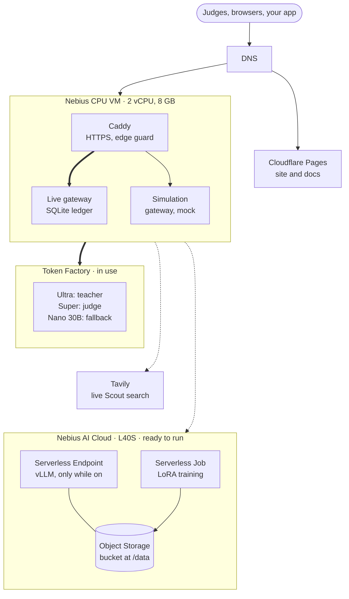
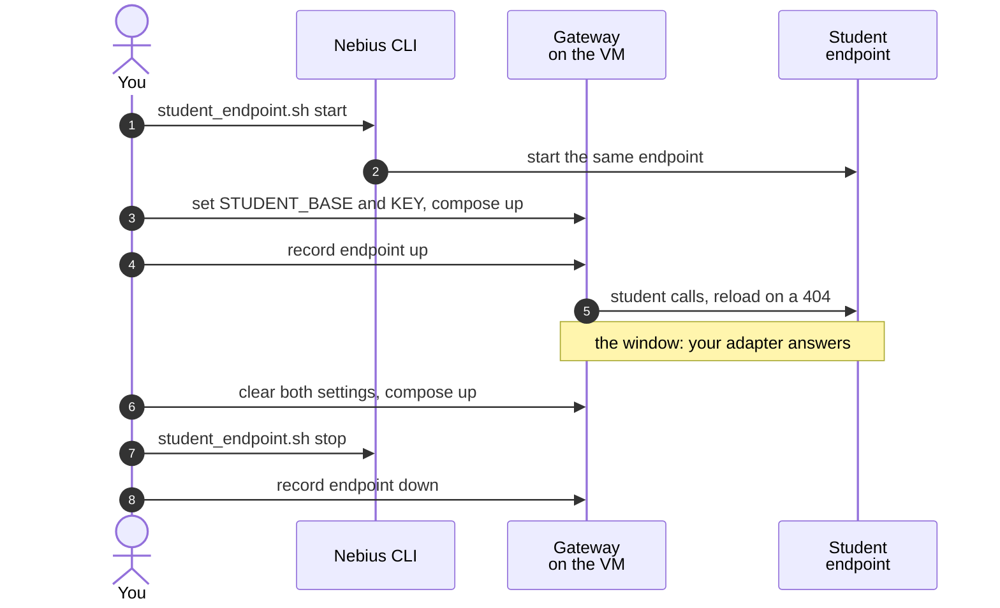

import { Steps, Tabs, TabItem, Aside, FileTree } from '@astrojs/starlight/components';
import Summary from '../../../components/Summary.astro';
import Eli10 from '../../../components/Eli10.astro';
import Who from '../../../components/Who.astro';
import Stat from '../../../components/Stat.astro';
import StatRow from '../../../components/StatRow.astro';
import PathCard from '../../../components/PathCard.astro';
import PathGrid from '../../../components/PathGrid.astro';
import FadeContent from '../../../components/ui/FadeContent.astro';

<Summary>Ratchet's Nebius deploy kit runs it on one small CPU VM that does no model inference, calls its teacher, judge and hosted fallback on Token Factory, and rents an L40S GPU only while you serve or train the student, so GPU money is spent only when you decide to spend it.</Summary>

<Aside type="tip" title="One command, and a map of where everything runs">
Everything below is wrapped in one script. `make nebius-plan` prints every command and changes nothing; `deploy/nebius/nebius.sh up --yes` (with `RATCHET_I_UNDERSTAND_THIS_COSTS_MONEY=1`) creates the CPU VM, adds the GPU student endpoint only with `--with-student`, wires the VM's `.env` and runs a smoke check, and `down` stops the endpoint first and then deletes the VM. It is scripted and tested offline, **ready to run with `make nebius-plan` and `make nebius-up`**. The commands, the flags and the costs (estimates) are in [Where everything runs](/reference/where-it-runs/#one-command-to-host-it-all-on-nebius), which also says what runs where today.

```bash
make nebius-plan
RATCHET_I_UNDERSTAND_THIS_COSTS_MONEY=1 make nebius-up YES=1 ARGS="--with-student"
RATCHET_I_UNDERSTAND_THIS_COSTS_MONEY=1 make nebius-down YES=1
```
</Aside>

<Eli10>

Think of the whole restaurant as a set of rented rooms.

- **The front room** is a small CPU VM. It holds the pass (the gateway), the recipe book on a shelf (the SQLite ledger), a doorman who checks guests and puts a proper lock on the door (Caddy, with HTTPS), and an alarm clock on the wall (cron) that rings for the nightly backup.
- **The head chef from the agency** works in another building (Token Factory). You phone each order in and pay per dish. The same agency sends the examiner who grades written answers (the judge) and the untrained cook who covers easy orders when the apprentice's station is closed (the hosted fallback).
- **The apprentice's station** (a Serverless Endpoint with one GPU) is rented by the hour. While the lights are on the meter runs, even if no orders come in. So you switch it on for busy times and off afterwards.
- **The night school classroom** (a Serverless Job) is rented only for the lesson, then handed back.
- **The pantry** (an Object Storage bucket) is shared: the classroom puts each new notebook of techniques there, and the station reads it from there. The pantry's rent keeps running even while the station is closed.
- Scout also phones a **librarian** (Tavily) for web searches.

</Eli10>

<Aside type="caution" title="The GPU side is scripted and ready to run">
The teacher runs on Nebius Token Factory. As of Oct 26, 2026 the GPU parts (the student endpoint and the training job) are scripted and ready to run with `make nebius-plan` and `make nebius-up`; the adapters so far were trained on a borrowed GPU. The VM and GPU scripts follow the Nebius docs and CLI reference and are tested offline against a fake `nebius` command. Run every script with `DRY_RUN=1` first (the one-command script above does that by default).
</Aside>

## How it really works

### The pieces and how they connect

| Piece | Nebius product and size | What runs there | How it bills |
|---|---|---|---|
| Front room | Compute VM, platform `cpu-e2`, preset `2vcpu-8gb`, region `eu-north1` | Docker Compose with Caddy (`caddy:2.11.7-alpine`), the gateway (one uvicorn worker), a second gateway in mock mode for the simulation at `sim.<domain>` (capped at 1 vCPU and 1 GiB, no keys), the SQLite ledger in the `ratchet-data` volume at `/data/ratchet.db`, and cron | While it runs. A stopped VM keeps billing for its disk |
| Teacher, judge, hosted fallback | Token Factory | Nemotron 3 Ultra (`nvidia/Nemotron-3-Ultra-550b-a55b`), Nemotron 3 Super (`nvidia/nemotron-3-super-120b-a12b`), Nemotron 3 Nano 30B (`nvidia/NVIDIA-Nemotron-3-Nano-30B-A3B`) | Per token |
| Student | Serverless Endpoint, platform `gpu-l40s-a`, preset `1gpu-8vcpu-32gb` | vLLM `v0.18.0` serving `nvidia/NVIDIA-Nemotron-3-Nano-4B-BF16`, with LoRA adapters loaded at runtime | While it runs. A stopped endpoint is not billed for compute or its own storage |
| Night School training | Serverless Job, platform `gpu-l40s-a` | `python -m ratchet.nightschool.train` (Transformers, PEFT and TRL), capped at 2 hours | While it runs |
| Pantry | Object Storage bucket, mounted at `/data` in both the job and the endpoint | The training file, adapters, BOMs and `NOTICE.md`; optionally ledger backups | Per GiB-month, also while the endpoint is stopped |
| Scout's web search | Tavily (not a Nebius product) | Scout's searcher, live mode only | Credits; the free plan has 1,000 a month ([Tavily credits](https://docs.tavily.com/documentation/api-credits), checked Oct 20, 2026) |

The gateway does no inference. It routes requests, writes the ledger and serves the web pages, so a 2 vCPU / 8 GB VM is enough. The models run elsewhere: the teacher on Token Factory, the student on the endpoint, or the hosted fallback when the endpoint is off.

<figure class="rt-diagram">



<figcaption>

**Reading this diagram.** Green is in use today: Cloudflare Pages serves the static site and these docs (the public demos run on Cloudflare Workers with Containers; the Nebius VM in this guide is scripted and tested offline, ready to run), and the teacher runs on Nebius Token Factory, paid per token. Amber and dashed is the GPU side, scripted and tested offline and ready to run with `make nebius-up` (the adapters so far were trained on a borrowed GPU). Plain boxes are the CPU VM this guide sets up: Caddy in front, the live gateway with its SQLite ledger, and a second gateway in mock mode for the simulation at `sim.<domain>`. The thick arrow is the paid path every live request can take; the dotted ones are optional: Tavily only for live Scout runs, the endpoint only while you run it, and the training job only once the Night School cron is turned on.

<ul class="rt-key">
  <li class="ok">In use</li>
  <li class="pending">Scripted, ready to run</li>
  <li class="outline">Optional</li>
  <li class="neutral">Set up by this guide</li>
</ul>

</figcaption>
</figure>

### What lives in the bucket

The bucket is mounted at `/data` in the training job and in the endpoint, laid out like this:

<FileTree>
- night/
  - train.jsonl
- boms/
  - student-vN.json
- adapters/
  - student-vN/
    - adapter_config.json
    - adapter_model.safetensors
    - versions.json
    - ratchet_manifest.json
    - NOTICE.md
    - ratchet_bom.json
</FileTree>

- `python -m ratchet.live night` writes `night/train.jsonl` locally under `RATCHET_DATA_DIR` and uploads it with `RATCHET_SYNC_CMD`. That command must only upload: `aws s3 sync` with `--delete` would remove the weights the job wrote.
- The training job writes the adapter weights, `versions.json` (Python, CUDA and every pinned package), `ratchet_manifest.json` and a first `NOTICE.md`.
- After the golden eval, `ratchet.live` writes the adapter's signed BOM (`boms/student-vN.json` and `adapters/student-vN/ratchet_bom.json`) and the exact `NOTICE.md` text the BOM signed, then syncs again. A failed second sync writes a `sync_failed` event and exits non-zero; the night still counts.
- vLLM reads `/data/adapters/student-vN` when the gateway asks it to load the adapter.

### The order of work

<Steps>

1. **Install the Nebius CLI and log in**, on macOS, Ubuntu, WSL or the console's Cloud Shell.
2. **Create the VM in mock mode.** Simulated models, no keys, no usage cost: a public demo that cannot run up a model bill.
3. **Give it a web address and check the pages.**
4. **Run the day-1 checks** with a Token Factory key (`scripts/day1_check.py`, a few cents).
5. **Create the bucket, the training image, the student endpoint and one training job by hand**, each with `DRY_RUN=1` first.
6. **Switch the VM to live mode** with the edge guard and the Scout budget guard on.
7. **Keep it running** until judging ends: GPU only in planned windows, updates, backups, monitoring.
8. **Tear it down**: the VM, its boot disk, the endpoint and the keys.

</Steps>

Each step in detail follows.

### 1. Install the Nebius CLI

```bash
curl -sSL https://artifacts.nebius.cloud/cli/install.sh | bash
exec -l $SHELL && nebius version
export NEBIUS_PROJECT_ID=<project ID from the console>
nebius profile create --parent-id $NEBIUS_PROJECT_ID     # opens a browser login
```


<Aside type="tip" title="On Windows">
The Nebius CLI runs on Ubuntu and macOS only. On Windows, use WSL (Ubuntu) or Cloud Shell in the Nebius console. The deploy scripts are bash scripts and also need `jq`, so WSL is the easier choice for the whole guide.
</Aside>

You also need:

- **`jq`** on the machine that runs `create_vm.sh` (it reads the public IP with it).
- **An SSH key**, for example `~/.ssh/id_ed25519.pub` (`ssh-keygen -t ed25519`).
- **The repo public** at `https://github.com/harshbhx/ratchet`, because the VM clones it on first boot. For a private repo, `RATCHET_REPO_URL` can carry a read-only token; it stays in the VM's cloud-init user data, so revoke it after first boot.
- **A region.** The default platform `cpu-e2` exists only in `eu-north1`, which also has L40S GPUs. In other regions set `RATCHET_VM_PLATFORM=cpu-d3`.

### 2. Create the VM in mock mode

```bash
export NEBIUS_PROJECT_ID=<project ID>
export SSH_PUBLIC_KEY_PATH=~/.ssh/id_ed25519.pub
DRY_RUN=1 bash deploy/vm/create_vm.sh    # prints the commands, creates nothing
bash deploy/vm/create_vm.sh
```

What [`create_vm.sh`](https://github.com/harshbhx/ratchet/blob/main/deploy/vm/create_vm.sh) does:

<Steps>

1. Refuses to go on if a VM with the name already exists (`ratchet-demo` by default).
2. Finds the first subnet in the project (`nebius vpc subnet list`), unless you set `NEBIUS_SUBNET_ID`.
3. Creates a 30 GiB `network_ssd` boot disk from the image family `ubuntu24.04-driverless`. The disk is created on its own, so it survives deleting the VM; you delete it yourself at teardown.
4. Creates the VM with that disk, a **static** public IP (kept while the VM is stopped) and [`cloud-init.yaml`](https://github.com/harshbhx/ratchet/blob/main/deploy/vm/cloud-init.yaml) as user data.
5. Prints the public IP, the VM and disk IDs, the next steps and the two teardown commands.

</Steps>

On first boot, cloud-init installs Docker Engine and the Compose plugin, turns on unattended security upgrades and the `ufw` firewall (ports 22, 80 and 443), creates a `ratchet` service user that cannot log in, clones the repo to `/opt/ratchet`, writes `deploy/vm/.env` from `.env.vm.example` (mode 0600), and runs `docker compose up -d --build`. That takes 5 to 10 minutes:

```bash
ssh ubuntu@<ip> 'sudo tail -f /var/log/ratchet-bootstrap.log'
```

Optional settings for `create_vm.sh`: `RATCHET_VM_NAME`, `RATCHET_VM_PLATFORM`, `RATCHET_VM_PRESET` (for example `4vcpu-16gb`), `RATCHET_VM_DISK_GB`, `RATCHET_SSH_USER` (default `ubuntu`; Nebius reserves `root` and `admin`), `RATCHET_REPO_URL` and `RATCHET_DOMAIN`.

### 3. Give it a web address and check the pages

- **Fastest: sslip.io.** If `RATCHET_DOMAIN` is not set, first boot sets it to `<public-ip>.sslip.io`. That name resolves to the IP inside it, so Caddy gets a real certificate without any DNS work. The VM finds its public IP by asking `api.ipify.org` (verify on day 1).
- **Your own name.** Add a DNS A record pointing at the public IP, wait until `dig +short <name>` returns it, then on the VM:

  ```bash
  cd /opt/ratchet/deploy/vm
  sudo -u ratchet sed -i 's|^RATCHET_DOMAIN=.*|RATCHET_DOMAIN=ratchet.dualmindlab.tech|' .env
  sudo -u ratchet docker compose up -d
  ```

  Set the DNS record first: repeated failed certificate requests can hit Let's Encrypt's rate limits.

| URL | Expect |
|---|---|
| `https://<domain>/` | The story page |
| `https://<domain>/scout` | Scout. In mock mode it shows "Simulated search results" and only the example questions work |
| `https://<domain>/dashboard` | The dashboard (simulation in mock mode) |
| `https://<domain>/healthz` | `{"status":"ok",...}`, always public |
| `https://<domain>/readyz` | 200 `ready` (or `degraded`, with the reason under `checks`); 503 `not_ready` when the ledger cannot be written or no teacher can answer |
| `https://<domain>/v1/models` | The model list; 403 when the Caddy guard is on, 401 when API keys are on and you send none |

### 4. Run the day-1 checks

Live mode spends real money on every Scout run and every chat request. Before it, check the model IDs and features with a real Token Factory key:

```bash
export NEBIUS_API_KEY=...        # a Token Factory key from its console
python scripts/day1_check.py     # or: make day1
```

The script confirms that the four model IDs exist and that the teacher answers, returns logprobs and supports JSON mode. It also prints each model's `finish_reason` and whether the teacher takes the strict `json_schema` format. If an ID differs, set `RATCHET_TEACHER_MODEL` (and update `ratchet/licenses.py` and `DEFAULT_PRICES`). Model IDs and prices in `ratchet/config.py` stay unverified until this passes. Every check, and how to run it, is described at the top of [`scripts/day1_check.py`](https://github.com/harshbhx/ratchet/blob/main/scripts/day1_check.py) (`teacher`, `choices`, `reasoning`, `student`, `tavily`, `cli` or `all`).

The Nebius Builder Program's terms say $25 of Token Factory credit, expiring after 90 days (research notes, Oct 25, 2026; [DEPLOYMENT.md](/reference/deployment/)). Re-check the program terms before relying on it.

### 5. Bucket, training image, student endpoint and training job

Do these from your laptop (or WSL), where the `nebius` and `aws` CLIs are. Stop the endpoint after each check.

<Steps>

1. **Bucket.** Create one in the same region as the GPUs (`eu-north1`), then:

   ```bash
   export RATCHET_BUCKET_ID=<bucket id>                 # for --volume
   export RATCHET_BUCKET_S3=s3://<bucket name>          # for polling in train_job.sh
   export RATCHET_S3_ENDPOINT=https://storage.eu-north1.nebius.cloud   # verify on day 1: copy it from the console
   export RATCHET_DATA_DIR=./data
   export RATCHET_SYNC_CMD="aws s3 sync ./data s3://<bucket name> --endpoint-url $RATCHET_S3_ENDPOINT"
   ```

2. **Training image.** Build from the repository root and push it to a registry:

   ```bash
   docker build -f deploy/Dockerfile.train -t <registry>/ratchet-train:0.1 .
   docker push <registry>/ratchet-train:0.1
   export RATCHET_TRAIN_IMAGE=<registry>/ratchet-train:0.1
   ```

   The image is CUDA 12.8 with exact versions of torch, Transformers, PEFT, TRL, Accelerate, datasets and the Mamba kernels, pinned in `deploy/train-versions.txt`. The versions are candidates read on Oct 21, 2026, to be confirmed by the first smoke job's `versions.json`.

3. **Student endpoint.** Create it once, then stop and start the same endpoint (same URL, same token):

   ```bash
   export RATCHET_STUDENT_KEY=$(openssl rand -hex 24)
   DRY_RUN=1 bash deploy/student_endpoint.sh create   # nebius validates the request, creates nothing
   bash deploy/student_endpoint.sh create             # once
   export RATCHET_STUDENT_BASE=https://<endpoint host>/v1
   bash deploy/student_endpoint.sh status             # prints "<id> <state>", for example RUNNING
   bash deploy/student_endpoint.sh stop               # when idle
   bash deploy/student_endpoint.sh start              # the same endpoint again
   ```

4. **One training job by hand.** `deploy/train_job.sh <version>` submits `nebius ai job create` with the bucket at `/data`, a 200 GiB disk and a 2-hour timeout. With `RATCHET_BUCKET_S3` set it then waits, polling every 30 seconds for up to 2 hours, until `adapters/<version>/adapter_model.safetensors` exists, which is what lets Night School use it as `RATCHET_TRAIN_CMD`:

   ```bash
   DRY_RUN=1 bash deploy/train_job.sh test   # nebius validates the request, submits nothing
   bash deploy/train_job.sh test             # the day-1 smoke job, on about 200 rows
   ```

5. **Smoke test the whole path.** With the day-1 checks passed and the endpoint up, `make live-smoke` sends 20 requests through a live gateway with about 5 control calls to Ultra and no nights (cents).

</Steps>

What `student_endpoint.sh create` sets: the image `vllm/vllm-openai:v0.18.0-cu130` (`RATCHET_VLLM_IMAGE`), container port 8000, `--shm-size 16Gi`, the bucket at `/data`, token auth with `RATCHET_STUDENT_KEY`, `VLLM_ALLOW_RUNTIME_LORA_UPDATING=True`, and vLLM arguments from the model card: `--enable-lora --max-lora-rank 16 --max-loras 4 --mamba_ssm_cache_dtype float32 --max-model-len 8192 --max-num-seqs 64`, with thinking off by default. Training defaults (`train.py`): 2 epochs, learning rate 2e-4, LoRA rank 16 (alpha 32), max sequence 2048, batch 8, bf16, loss on the assistant's tokens only.

<Aside type="note" title="Adapters vanish when the endpoint restarts">
Adapters loaded at runtime are lost when the endpoint stops. The gateway notices vLLM's 404 for an adapter and loads it again by itself, at most once per adapter per minute (`adapter_reloaded` events), and `/readyz` queues a reload for any routed adapter the endpoint no longer lists. Until then those student calls fall back to the teacher: they still succeed, at teacher cost. `python -m ratchet.live reload` reloads every live, canary and shadow adapter by hand.
</Aside>

### 6. Switch the VM to live mode

The VM's settings live in `/opt/ratchet/deploy/vm/.env` (mode 0600, owned by `ratchet`, never in git). Keep comments on their own lines: Docker Compose and the scripts read this file.

<Tabs>
<TabItem label="Mock (the default)">

```bash
RATCHET_MODE=mock
RATCHET_MOCK_WARMUP_DAYS=4
RATCHET_API_GUARD=open
RATCHET_PUBLIC_DASHBOARD=1
```

Simulated models, no keys, no model calls, no usage cost. Four simulated days and nights run at startup, so the dashboard opens on a trained student. The dashboard's demo buttons work, and every visitor shares one simulated state: one visitor's Reset affects everyone. Every number is simulation.

Mock mode makes no Token Factory or Tavily call. So the public demo has to run in live mode.

</TabItem>
<TabItem label="Live">

```bash
RATCHET_MODE=live
NEBIUS_API_KEY=<Token Factory key>
TAVILY_API_KEY=<Tavily key>
# Empty: the hosted fallback answers student calls. Set both only while the endpoint runs.
RATCHET_STUDENT_BASE=
RATCHET_STUDENT_KEY=
# Caddy blocks /v1/*, /ratchet/demo/* and /ratchet/admin/* without this token (hex, 32+ characters).
RATCHET_API_GUARD=guarded
RATCHET_ADMIN_TOKEN=<output of: openssl rand -hex 32>
# Only because Caddy guards /v1/*. Or set RATCHET_API_KEYS instead (or as well).
RATCHET_ALLOW_UNAUTHENTICATED=1
# The Scout budget guard: keep it on in live mode.
RATCHET_SCOUT_DAILY_BUDGET_USD=0.50
RATCHET_SCOUT_RUNS_PER_HOUR=6
RATCHET_SCOUT_MAX_RUNS_PER_DAY=30
RATCHET_AUDIT_RATE=0.05
RATCHET_PUBLIC_DASHBOARD=1
```

Remove the `RATCHET_MOCK_WARMUP_DAYS` line: it does nothing in live mode, and the config check warns about it.

</TabItem>
</Tabs>

Then apply it:

<Steps>

1. Edit: `sudo -u ratchet nano /opt/ratchet/deploy/vm/.env`.
2. Check every setting at once, in the image, without starting anything:

   ```bash
   cd /opt/ratchet/deploy/vm
   sudo -u ratchet docker compose run --rm --no-deps -T ratchet python -m ratchet.config check
   ```

   Exit 0 is clean, 1 is warnings, 2 means the gateway would refuse to start.
3. Apply: `sudo -u ratchet docker compose up -d` (or `update.sh`, which runs the same check first).
4. Confirm: `curl -s https://<domain>/readyz` says `ready` (or `degraded`, with the reason). The ledger now lives at `/data/ratchet.db` in the `ratchet-data` volume and survives restarts and rebuilds.
5. Watch the Token Factory usage page and the Tavily dashboard daily for the first week, and check that `curl -s https://<domain>/scout/status | jq .search` shows `"available": true`.

</Steps>

What each guard is for:

- **`/v1/*` is a paid endpoint.** Without a guard anyone could send unlimited requests on your Token Factory credit. Live mode refuses to start without `RATCHET_API_KEYS`, unless `RATCHET_ALLOW_UNAUTHENTICATED=1` says that something in front checks callers. On the VM that something is Caddy's edge guard: `RATCHET_API_GUARD=guarded` with a hex `RATCHET_ADMIN_TOKEN` of at least 32 characters. An empty or shorter token blocks the guarded paths for everyone, and Caddy strips the header before it reaches the gateway. To use the API yourself: `curl -H "X-Ratchet-Admin-Token: $TOKEN" https://<domain>/v1/models`, or `default_headers` in the OpenAI SDK.
- **The Scout budget guard stays on in live mode**. Every Scout run is admitted against a daily dollar cap, a daily run cap and a per-IP hourly limit, and its spend is added after it ends, also on failure. The counters are kept in the ledger, so a restart, a crash or `update.sh` does not reset them. The code's default cap is $3.00 a day; the VM example sets $0.50, so the worst case over the 48 days from Oct 29 to Dec 15 is about $24 (estimate, [DEPLOY_NEBIUS_VM.md](/reference/deploy-nebius-vm/#switching-from-mock-to-live)). The budget guard does not cover `/v1/chat/completions`; the edge guard or API keys do.
- **A reserve for judges.** `RATCHET_SCOUT_JUDGE_CODE` (generate it with `openssl rand -hex 16`) and `RATCHET_SCOUT_JUDGE_RUNS_PER_DAY` hold part of each day's runs, spend and Tavily credits back from the public. `RATCHET_TAVILY_MONTHLY_CREDITS` and `RATCHET_TAVILY_PACE_UNTIL=2026-12-15` spread the credits over the judging period. The code goes in the submission's testing instructions only, never on a public page, in the video or in a URL.
- **The dashboard.** With `RATCHET_PUBLIC_DASHBOARD=1` judges see the live dashboard, and anonymous readers get client pseudonyms and events without URLs or error messages.
- **Signed BOMs (optional).** Run `python -m ratchet.bom keygen` on your laptop, put the `RATCHET_BOM_SIGNING_KEY=` line in `.env`, and publish the public key it prints.

<Aside type="caution" title="A fresh live ledger starts cold">
Switching to live mode starts a new ledger file, so there is no trained version yet: every request is a cold start and the teacher answers it, at teacher prices. The hosted fallback stands in only for a version that exists. A student appears on the VM only after Night School trains and releases one on this ledger, and on the stock demo kit Night School does not run (step 7 below).
</Aside>

### 7. Keep it running until judging ends

#### GPU windows

The student endpoint is the largest cost: about $32 for every full day it runs (an estimate, below). So:

- **Most of the time, keep the endpoint stopped** and leave `RATCHET_STUDENT_BASE` and `RATCHET_STUDENT_KEY` empty. Student calls for a trained version then go to the hosted fallback, Nemotron 3 Nano 30B on Token Factory, paid per token. Be honest about it in the demo: it is untuned, it is held to the default threshold (`RATCHET_CONFIDENCE_THRESHOLD`, 0.80) instead of a calibrated one, and no certificate covers it. The pages say so: student answers carry the <Who as="fallback" /> badge, the dashboard header reads "Nano 30B · hosted on Token Factory (endpoint off)", and the live version's golden precision is hidden. `curl -s https://<domain>/ratchet/stats | jq .student_serving` shows what the pages read.
- **Start the endpoint for fixed windows** (`bash deploy/student_endpoint.sh start`), such as recording the video or a judging window you announced, and stop it right after (`bash deploy/student_endpoint.sh stop`). A stopped endpoint is not billed for compute or its own storage; the mounted bucket still is.
- **Never stop the endpoint while `RATCHET_STUDENT_BASE` still points at it.** Student calls would fail, the student's circuit breaker would open after 5 failures in a row, and the teacher would answer those requests at Ultra prices instead of the cheaper hosted fallback. `/readyz` reports `degraded` meanwhile.
- **Record the uptime for the cost report.** `student_endpoint.sh` runs `python -m ratchet.cost endpoint up|down` after `create`, `start` and `stop`, but that needs the ledger file; on your laptop it prints a note instead. Record it where the ledger is, on the VM, from `/opt/ratchet/deploy/vm`: `sudo -u ratchet docker compose exec -T ratchet python -m ratchet.cost endpoint up --usd-per-hour <your rate>` (and `down` after), or `POST /ratchet/cost/endpoint` with an admin key. `GET /ratchet/cost` then reports savings by GPU-hours actually paid.

<figure class="rt-diagram">



<figcaption>

**Reading this diagram.** A GPU window is eight manual steps, in this order. Start the endpoint you created once (1, 2), so its URL and token stay the same. Point the gateway at it with `RATCHET_STUDENT_BASE` and `RATCHET_STUDENT_KEY` and recreate the container (3), then record the uptime for the cost report (4). During the window the student calls go to your adapter, and an adapter vLLM lost on a restart is loaded again on its first 404 (5). To close the window, clear both settings before you stop the endpoint (6, 7), so student calls fall back to the hosted Nano 30B and not to the teacher at Ultra prices, and record the downtime (8).

</figcaption>
</figure>

Automatic daily endpoint windows (`student_serving.window`) are referenced in the web app's copy but not built yet: they are planned. Until then a window is the manual procedure above.

#### The Night School cron (off by default)

`/etc/cron.d/ratchet` on the VM runs the backup every day at 03:10 UTC. It also holds three commented-out lines: `python -m ratchet.live night` at 02:30 UTC, `... tick` every 5 minutes and `... seal` hourly, each through `docker compose exec -T ratchet`. Leave them off unless all of these hold:

- live mode works, and the student endpoint and a training job have been run by hand (step 5);
- the gateway image contains the `nebius` and `aws` CLIs, their credentials and the `deploy/` scripts, because `night` runs `RATCHET_TRAIN_CMD` (`deploy/train_job.sh`) inside the container. **The stock [`Dockerfile`](https://github.com/harshbhx/ratchet/blob/main/Dockerfile) does not include them yet**;
- the endpoint is running during the night: without `RATCHET_STUDENT_BASE`, `night` stops before it syncs or starts a training job.

To turn them on, remove the leading `# ` from those lines with `sudo nano /etc/cron.d/ratchet`. Logs go to `/var/log/ratchet/`. The ledger must stay on the VM's local disk: it runs in SQLite's WAL journal, so every process that opens it has to be on that one host, and never on the bucket mount.

#### Updates

```bash
sudo -u ratchet /opt/ratchet/deploy/vm/update.sh
```

[`update.sh`](https://github.com/harshbhx/ratchet/blob/main/deploy/vm/update.sh) pulls (`git pull --ff-only`), builds the new image, and runs `python -m ratchet.config check` in it with your `.env`. On errors (exit 2) it stops and leaves the running gateway as it is, so a typo in `.env` never takes the demo down. Then it runs `docker compose up -d`, waits for the Docker health check (`/healthz`) and for `/readyz` to answer 200 inside the container, fetches `/`, `/healthz`, `/readyz`, `/dashboard` and `/scout` over HTTPS (and `/ratchet/stats` when the dashboard is public), and exits non-zero if any of them fail.

#### Backups

[`backup.sh`](https://github.com/harshbhx/ratchet/blob/main/deploy/vm/backup.sh) runs daily at 03:10 UTC. In live mode it copies the ledger with SQLite's online backup API inside the container, checks the copy with `PRAGMA integrity_check`, and keeps the newest 14 as `/var/backups/ratchet/ratchet-<UTC time>.db.gz`. In mock mode the ledger is in memory and the script does nothing. To also copy each backup to Object Storage, install the `aws` CLI on the VM, configure it as the `ratchet` user, and set `RATCHET_BUCKET_S3` and `RATCHET_S3_ENDPOINT` in `.env`.

To restore, stop the gateway, remove the old `ratchet.db-wal` and `ratchet.db-shm` files (a stale WAL file would be replayed onto the restored copy), copy the backup into the volume and start it again; the commands are in [DEPLOY_NEBIUS_VM.md](/reference/deploy-nebius-vm/). Never copy the live file with `cp`.

#### Monitoring

```bash
cd /opt/ratchet/deploy/vm
sudo -u ratchet docker compose ps                         # both running, ratchet healthy
sudo -u ratchet docker compose logs -f --tail=100 ratchet
sudo -u ratchet docker compose logs -f --tail=100 caddy   # certificate problems show here
curl -s https://<domain>/scout/status                     # live: spend today vs budget, judges' reserve, search, credits
```

- **Restarts use `/healthz`.** The ratchet container's Docker health check calls it every 30 seconds, and both containers restart automatically, also after a VM reboot. `/healthz` only says the process answers.
- **Uptime monitors and load balancers use `/readyz`.** It is 200 while requests can be answered and 503 when they cannot. Never restart on `/readyz`: a teacher outage would become a restart loop.
- Container logs rotate at 10 MB × 5 files each. Live mode logs one JSON line per chat request, with no prompt or answer text.
- One gateway process per ledger: the compose file pins `--workers 1`.

### 8. Tear it down

On Dec 16, or whenever judging ends. Deleting the VM does **not** delete its boot disk, because the disk was created on its own; delete both.

```bash
# Optional: keep a last copy of the ledger
scp ubuntu@<ip>:/var/backups/ratchet/*.db.gz ./ratchet-backups/

VM_ID=$(nebius compute instance get-by-name --parent-id $NEBIUS_PROJECT_ID --name ratchet-demo --format json | jq -r .metadata.id)
nebius compute instance delete --id $VM_ID
nebius compute disk list --parent-id $NEBIUS_PROJECT_ID     # find ratchet-demo-boot (verify the flags on day 1)
nebius compute disk delete --id <disk ID>
```

Then remove the DNS record and stop the student endpoint if it still runs. The bucket keeps billing for what it stores until you remove it, so export the adapters you want to keep first (`python -m ratchet.live export --version N --out DIR`). Rotate `NEBIUS_API_KEY`, `TAVILY_API_KEY`, `RATCHET_STUDENT_KEY`, `RATCHET_ADMIN_TOKEN`, `RATCHET_API_KEYS`, `RATCHET_ADMIN_KEYS` and `RATCHET_DASHBOARD_KEYS`, and revoke any GitHub token used for cloning. Keep `RATCHET_BOM_SIGNING_KEY` (or at least its public key) if old BOMs should stay verifiable.

### What it costs (estimates)

Every figure here is an **estimate** from the repo docs or the Nebius pricing page, with its date. Check the pricing pages again before you rely on them.

<StatRow cols={3} label="The main costs, estimated">
  <Stat value="≈ $72.50" label="the CPU VM, Oct 29 to Dec 15" note="cpu-e2, 2 vCPU and 8 GB, with its disk. Prices as of Oct 20, 2026." />
  <Stat value="≈ $32" label="per full day of GPU endpoint" note="An L40S at about $1.35 per GPU-hour. Stop it when idle." tone="owned" />
  <Stat value="$0.70 to $1.35" label="per training night" note="30 to 60 minutes on one L40S. Skipped nights cost nothing." tone="owned" />
</StatRow>

**The VM**, from [DEPLOY_NEBIUS_VM.md](/reference/deploy-nebius-vm/#cost-estimate), prices as of Oct 20, 2026, USD before tax, for Oct 29 to Dec 15, 2026 (48 days, 1,152 hours):

| Item | Rate | Oct 29 to Dec 15 |
|---|---|---|
| VM `cpu-e2` `2vcpu-8gb` (eu-north1) | $0.012 per vCPU-hour + $0.0045 per GiB-hour = $0.060 an hour | $69.12 |
| Boot disk, 30 GiB network SSD | $0.071 per GiB per 730 hours | $3.36 |
| Public IP, network egress | Free | $0 |
| Backups in Object Storage (Standard) | $0.0147 per GiB-month | under $0.01 |
| **Total** | | **about $72.50** (about $79.40 on `cpu-d3`) |

**Usage in live mode**, on top of the VM ([DEPLOY_NEBIUS_VM.md](/reference/deploy-nebius-vm/#cost-estimate)):

| Item | How it is bounded | Estimate |
|---|---|---|
| Token Factory, Scout | `RATCHET_SCOUT_DAILY_BUDGET_USD` per UTC day | About $0.10 to $0.90 a day for 10 to 30 runs; worst case the cap × 48 days: $24 at $0.50, $144 at $3.00 |
| Token Factory, `/v1/chat/completions` | Not covered by the Scout budget: the edge guard or API keys with a daily quota | $0 with the guard on and no shared keys |
| Tavily | 3 basic searches a run, 1 credit each | 1,000 free credits a month, about 330 runs |

**The GPU.** Nebius's [compute pricing page](https://docs.nebius.com/compute/resources/pricing) listed the L40S at about $1.35 per GPU-hour on demand when read on Oct 22, 2026. Every GPU figure below is an estimate at that price ([deployment guide](/reference/deployment/#4-cost-estimates)):

| Item | At about $1.35 per GPU-hour |
|---|---|
| Student endpoint left on for a full day | about $32 |
| One training run, 30 to 60 minutes | about $0.70 to $1.35 |

The code still defaults `RATCHET_STUDENT_GPU_USD_PER_HOUR` and `RATCHET_TRAIN_GPU_USD_PER_HOUR` to 1.55. Set them (or pass `--usd-per-hour`) to the rate on your bill so the cost report prices the hours right, and set `RATCHET_PRICES_VERIFIED=1` only once the bill confirms them.

A rough estimate for a short evaluation period is about **$35 to $75**: 6 to 8 training runs, the endpoint on a few hours a day, and $20 to $30 of teacher calls (estimate, [deployment guide](/reference/deployment/#4-cost-estimates)). Whether a 24/7 endpoint pays at all depends on volume; see [cost and savings](/guides/cost-and-savings/).

## For engineers

**Files**

| File | What it does |
|---|---|
| [`deploy/vm/create_vm.sh`](https://github.com/harshbhx/ratchet/blob/main/deploy/vm/create_vm.sh) | Boot disk, VM with a static public IP, cloud-init user data. `DRY_RUN=1` prints the `nebius` commands (with the user data shown as a placeholder) and creates nothing |
| [`deploy/vm/cloud-init.yaml`](https://github.com/harshbhx/ratchet/blob/main/deploy/vm/cloud-init.yaml) | First boot: Docker, `ufw`, unattended upgrades, the `ratchet` user, clone, `.env`, the sslip.io default, `docker compose up -d --build`, `/etc/cron.d/ratchet` |
| [`deploy/vm/docker-compose.yml`](https://github.com/harshbhx/ratchet/blob/main/deploy/vm/docker-compose.yml) | The gateway (1 worker, `--proxy-headers`, health check on `/healthz`, port 8000 exposed only to Caddy) and Caddy (ports 80 and 443) |
| [`deploy/vm/Caddyfile`](https://github.com/harshbhx/ratchet/blob/main/deploy/vm/Caddyfile) | HTTPS for `RATCHET_DOMAIN`, security headers, no buffering for `/scout/stream`, the opt-in edge guard, the admin token deleted from access logs |
| [`deploy/vm/update.sh`](https://github.com/harshbhx/ratchet/blob/main/deploy/vm/update.sh), [`deploy/vm/backup.sh`](https://github.com/harshbhx/ratchet/blob/main/deploy/vm/backup.sh) | Pull, build, config check, restart, readiness wait; SQLite online backup with an integrity check |
| [`deploy/vm/.env.vm.example`](https://github.com/harshbhx/ratchet/blob/main/deploy/vm/.env.vm.example) | Every VM setting with comments; starts in mock mode |
| [`deploy/student_endpoint.sh`](https://github.com/harshbhx/ratchet/blob/main/deploy/student_endpoint.sh) | `create`, `start` (the default), `stop`, `status` for the vLLM endpoint; finds the id by name in `nebius ai endpoint list --format json` and never guesses |
| [`deploy/train_job.sh`](https://github.com/harshbhx/ratchet/blob/main/deploy/train_job.sh) | `nebius ai job create` for one training run, then polls the bucket for the adapter |
| [`deploy/Dockerfile.train`](https://github.com/harshbhx/ratchet/blob/main/deploy/Dockerfile.train), [`deploy/train-versions.txt`](https://github.com/harshbhx/ratchet/blob/main/deploy/train-versions.txt) | The training image and its pinned versions; change both together |
| [`ratchet/live.py`](https://github.com/harshbhx/ratchet/blob/main/ratchet/live.py) | `python -m ratchet.live night`, `tick`, `reload`, `purge`, `export`, `seal` |
| [`scripts/day1_check.py`](https://github.com/harshbhx/ratchet/blob/main/scripts/day1_check.py) | The Token Factory checks before live mode |

**Settings that matter on Nebius** (full list in [CONFIGURATION.md](/reference/configuration/#deploy-scripts-deploy))

| Variable | Default | Meaning |
|---|---|---|
| `RATCHET_MODE` | `mock` | `live` calls Token Factory, the endpoint and Tavily |
| `NEBIUS_API_KEY` | empty | Token Factory key: teacher, judge and hosted fallback |
| `RATCHET_STUDENT_BASE`, `RATCHET_STUDENT_KEY` | empty | The endpoint's `/v1` URL and token; empty means the hosted fallback |
| `RATCHET_FALLBACK_STUDENT` | `nvidia/NVIDIA-Nemotron-3-Nano-30B-A3B` | The hosted fallback model |
| `RATCHET_API_GUARD`, `RATCHET_ADMIN_TOKEN` | `open`, empty | Caddy's edge guard and its hex token (32+ characters) |
| `RATCHET_SCOUT_DAILY_BUDGET_USD` | `3.00` (the VM example sets `0.50`) | Scout's daily spend cap |
| `RATCHET_AUDIT_RATE` | `0.05` | Share of student answers the teacher re-checks; each audit is a paid Ultra call |
| `RATCHET_BUCKET_ID`, `RATCHET_BUCKET_S3`, `RATCHET_S3_ENDPOINT` | empty | The bucket for `--volume`, for polling and backups, and its S3 URL |
| `RATCHET_SYNC_CMD`, `RATCHET_TRAIN_CMD`, `RATCHET_DATA_DIR` | empty, `bash deploy/train_job.sh {version}`, `data` | How a night uploads data and runs (and waits for) training |
| `RATCHET_ENDPOINT_NAME`, `RATCHET_ENDPOINT_ID` | `ratchet-student`, empty | How `student_endpoint.sh` finds the endpoint |
| `RATCHET_STUDENT_GPU_USD_PER_HOUR`, `RATCHET_TRAIN_GPU_USD_PER_HOUR` | `1.55` | GPU rates the cost report uses. The code's default; these docs use 1.35, Nebius's on-demand price for an L40S. Set the rate on your bill |
| `DRY_RUN` | `0` | `1` validates without creating; any value but 0 or 1 is refused, so a typo never starts a paid GPU |

**Endpoints**: `GET /healthz` and `/livez` (liveness), `GET /readyz` (readiness, [API reference](/reference/api/#get-readyz)), `GET /ratchet/stats` (`student_serving`, `cost`), `GET /ratchet/cost?days=N`, `POST /ratchet/cost/endpoint` (admin key), `GET /scout/status`.

**Events to watch**: `adapter_reloaded`, `circuit` (breakers), `endpoint` (uptime recorded), `sync_failed`, `tavily_exhausted`, `search_error`, `budget`.

**Tests**: `tests/test_live.py` runs `bash -n` on every script, `DRY_RUN=1 bash deploy/vm/create_vm.sh`, and both GPU scripts against a fake `nebius` on `PATH`, asserting the exact commands; `tests/test_cost.py` checks that `start` and `stop` record uptime. They check the commands against the CLI reference as read.

## Common questions

### What runs on Nebius today?

Token Factory: the teacher runs there, and the live demo calls it for real. The GPU endpoint and the training job are scripted and tested offline, ready to run with `make nebius-plan` and `make nebius-up`; as of Oct 26, 2026 the adapters were trained on a borrowed GPU. The scripts follow the Nebius docs and CLI reference (read Oct 20 and 21, 2026) and are tested offline, and the lines that could not be checked are marked "verify on day 1" in the scripts. Run each with `DRY_RUN=1` first and compare with `nebius ... --help`.

### Do I need a GPU to host the demo?

No. The gateway does no inference, so the demo runs on a 2 vCPU / 8 GB CPU VM. In mock mode nothing calls a model; in live mode the teacher and the hosted fallback are paid per token on Token Factory. A GPU is needed only to serve the tuned student or to train it.

### What happens if I forget to stop the endpoint?

It bills for every hour it runs: about $32 a day at about $1.35 per GPU-hour (an estimate). `bash deploy/student_endpoint.sh status` shows its state, and the cost report's `idle_hours` shows paid hours in which no request reached the student.

### Why would a live demo VM serve no student at all?

A new live ledger has no trained version, so every request is a cold start answered by the teacher. A student appears only after Night School trains and releases one on that ledger, and the stock VM image cannot run Night School because it lacks the `nebius` and `aws` CLIs. Until that is wired up, a live VM is honest but all-teacher.

### Can I use a region other than eu-north1?

For the VM, yes: set `RATCHET_VM_PLATFORM=cpu-d3`, which has the same `2vcpu-8gb` preset. The repo docs assume `eu-north1` for the GPUs (L40S and H100) and the bucket, which should sit in the same region as the GPUs.

### Why only one gateway worker?

The ledger is one SQLite file behind one lock, and the release gate is not built for concurrent writers. A Postgres ledger for several workers is planned.

### Is the edge guard enough security?

It closes the paid API, the demo controls and the admin API to anyone without the token, and it is enough for a demo. For real clients use gateway API keys (`RATCHET_API_KEYS`) with quotas, and read the [security page](/guides/security/) and the [threat model](/reference/threat-model/).

## Related

<FadeContent distance={16}>
<PathGrid cols={3} label="Related guides">
  <PathCard title="Quickstart" href="/guides/quickstart/" icon="start" eyebrow="No keys" tone="neutral" description="The same gateway in mock mode on your laptop." />
  <PathCard title="Cost and savings" href="/guides/cost-and-savings/" icon="coin" eyebrow="When it pays" tone="neutral" description="Break-even, the cost report and when self-hosting does not pay." />
  <PathCard title="The big picture" href="/guides/big-picture/" icon="layers" eyebrow="Every part" tone="neutral" description="Every component and how a request moves between them." />
</PathGrid>
</FadeContent>

Reference: the [demo VM guide](/reference/deploy-nebius-vm/), [deployment](/reference/deployment/) and the [runbook](/reference/runbook/).
