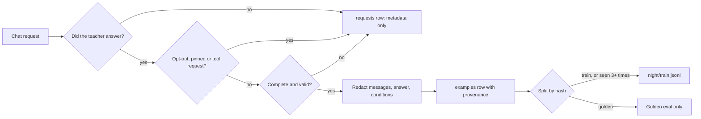
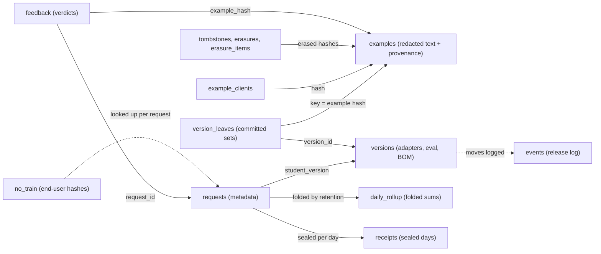

import { Steps, Aside } from '@astrojs/starlight/components';
import Summary from '../../../components/Summary.astro';
import Eli10 from '../../../components/Eli10.astro';

<Summary>The ledger is one SQLite file that logs every request's metadata, keeps every stored teacher answer with its provenance (teacher, license, hash, redactions), and records every adapter version and release decision, so the training data behind an adapter can be checked later.</Summary>

<Eli10>

The ledger is the kitchen's **recipe book**, plus an **order log**.

The order log gets one line for every order: when it came in, who cooked it, how sure the apprentice was, and what it cost. It never says what the customer asked for.

The recipe book only gets a page when the **head chef from the agency** cooks a dish. The page says what was ordered, what the head chef cooked, and a note: "this chef's contract lets you copy this recipe." Before the page is written, a clerk blacks out phone numbers, email addresses and card numbers. (The clerk does not recognise people's names yet, and the page says how many things were blacked out.)

The **apprentice chef's** own dishes are never copied into the book. A customer can also say "please don't keep my order": the dish is cooked as usual, but no page is written. And a page can be torn out on request: a stub with a fingerprint stays behind, so the same recipe is never written again.

</Eli10>

## How it really works

### One request on its way into the ledger

<Steps>

1. **The request arrives.** The gateway validates it and works out whether it may be stored at all. If the request names an end user (`user` or `safety_identifier`), that value is turned into a keyed hash at once (HMAC-SHA256 under the deployment's key, scoped to the API key's name, 16 hex digits). The raw value goes no further. The broadest storage opt-out that applies is settled here (see [opt-outs](#storage-opt-outs-and-no-train-end-users) below).

2. **The cascade runs** (student first, teacher when needed; see [the request journey](/guides/request-journey/)). Whatever happens, the request gets **one row in `requests`**: task, route, who served it, which version, confidence and the threshold it was held to, the audit and shadow flags, costs (with the student and teacher split), latency, the API key's *name*, the end user's hash, the opt-out reason and whether anything was stored. There is no message text and no answer text in this row.

3. **No teacher answer, nothing more.** When the student served the request and the teacher was not called (no audit drawn, no shadow disagreement to settle), the request row is all that is written. The student's text is not kept anywhere.

4. **Every teacher answer goes through one function**, `Ratchet._store_example`. That covers escalations, cold starts, audits and shadow arbitrations. It is the only caller of `Ledger.add_example` on the request path (feedback corrections and imports have their own single writer, `feedback.store_label`). It asks again whether an opt-out applies, so an end user who opted out while the request waited for the teacher is still kept out.

5. **The answer is checked.** It is skipped (served, but not stored) when its `finish_reason` is not `stop` or `tool_calls`, when it is empty once reasoning is stripped, when it is not valid under the task's spec (a missing field, a label outside the vocabulary), or when the client sent sampling that could choose the label (`logit_bias`, a non-zero penalty, a temperature above 1, a vendor field). Each skip writes a throttled `skip_example` event that names the task and the reason, never the answer.

6. **The text is redacted.** With `RATCHET_REDACT_PII=1` (the default) the messages, the answer and every string in the stored conditions get `[LABEL]` placeholders. The answer is checked once more: if a placeholder broke a structured answer, it is skipped as `invalid after redaction`. The teacher always saw the original request.

7. **The example is stored with its provenance**: the teacher model that wrote it, that teacher's license and license URL, the number of placeholders, the conditions it was answered under (`response_format`, `tools`, `tool_choice`, `stop`), the client and the end user's hash. Its golden or train split comes from a hash of the task and the redacted messages. An identical request bumps `seen` instead of adding a row (a client's retry does not count), and a hash that an erasure tombstoned is refused.

8. **Later, other parts write their own rows.** Night School reads `examples` every night and writes `versions` (with each adapter's bill of materials, signed when a key is set) and `version_leaves`. The release gate moves versions and writes `events`. Retention, erasure and receipts write their own tables.

</Steps>

### The privacy path, in one picture



Every path writes the metadata row. Only the bottom path writes text, and that text is redacted first.

### The main tables



### What is stored

| Table | One row per | Holds text? |
|---|---|---|
| `requests` | Gateway call | No. Metadata only: task, route, version, confidence, threshold, costs, flags, key name, end-user hash, opt-out reason |
| `examples` | Distinct teacher-labelled request | Yes, **redacted**: the prompt, the teacher's answer and the stored conditions, with teacher, license, license URL, split, `seen`, redaction count, client, end-user hash and `origin` |
| `versions` | Adapter | No. Base model, adapter name, train size, dataset hash, eval, state, traffic share and the adapter's signed BOM |
| `events` | Release decision or notable event | No. A kind (`trained`, `skip`, `canary`, `rollback`, ...) and a short detail; never request text or keys |
| `version_leaves` | Example in an adapter's training or golden set | No. The example hash and a hash of its label, teacher, license and redaction count; append-only |
| `receipts` | Ledger day and API client | No. A signed savings receipt over request metadata; append-only |
| `spend` | Spend outside requests | No. Scout's runs and Tavily credits keep `usd` 0 here (their model calls are already in `requests`) |
| `failures` | Failed call | No. The stage, the exception's class and status, what it spent |
| `example_clients`, `no_train`, `tombstones`, `erasures`, `erasure_items`, `daily_rollup`, `feedback` | Governance records | No. Hashes, key names, counts and flags |

The `origin` of an example says where it came from. Teacher answers from the gateway are recorded without one and read as `live`; human labels carry `feedback` (a correction) or `import` (an attested file). Each example's provenance travels into Night School's rows and from there into the adapter's [signed BOM](/guides/licenses/), so the license of every training target can be checked offline.

### What is never stored

| Never stored | Why | Where it is enforced |
|---|---|---|
| The student's answers, as training targets or at all | Training on a model's own outputs causes collapse ([ADR 0004](/reference/adr/0004-retrain-from-base-cumulative/)) | Invariant 2: only `_store_example` (teacher answers) and `feedback.store_label` (attested human labels) may call `add_example`; a test fails on any other caller |
| Pinned tasks' answers | Open-ended tasks (Scout's planner and writer) stay on the teacher for good | Invariant 10: `_teacher_only` never calls `add_example`, and Night School leaves out rows of a task that is pinned now |
| Tool requests, multimodal requests | A tool request is answered by the teacher alone (route `tools`) until tool-call distillation exists | [ADR 0043](/reference/adr/0043-tool-calls-teacher-only-by-default/) |
| Opted-out requests | The client, its key, the task, the end user or the operator said so | Invariant 22: opt-outs only reduce storage |
| Incomplete or invalid teacher answers | A cut-off or malformed answer would teach the wrong thing | Invariant 16, [ADR 0016](/reference/adr/0016-store-only-complete-valid-teacher-answers/) |
| Answers written under label-altering client sampling | A client may choose its own answer, not the label everyone's student learns | `GenParams.unstorable`, threat model T2 |
| Raw end-user identifiers, API keys | Privacy and key safety | Invariants 13 and 23: key names and keyed hashes only |
| Request text in `requests`, `failures`, logs or `/metrics` | Metadata is enough to run the system | Invariant 12 |

A fallback teacher's answers are stored only with `RATCHET_STORE_FALLBACK_TEACHER=1`, and then under that model's own license. A request for `n` choices stores only the teacher's choice 0.

### PII redaction

`ratchet/redact.py` ([ADR 0009](/reference/adr/0009-pattern-based-pii-redaction/)) replaces identifiers with placeholders before anything is stored. It runs in a fixed order, so the specific formats with checksums win over the broad phone pattern:

| Placeholder | Matches | Extra check |
|---|---|---|
| `[SECRET]` | API secrets such as `sk-…`, `AKIA…`, `ghp_…`, `tvly-…`, `xox…-…`, and the token after `Bearer ` | |
| `[EMAIL]` | `name@domain.tld` | |
| `[IBAN]` | Country code, 2 check digits, then groups | mod-97 |
| `[CARD]` | 13 to 19 digits with optional spaces or dashes | Luhn |
| `[AADHAAR]` | 12 digits, first digit 2 to 9 | Verhoeff |
| `[SSN]` | `123-45-6789` style, invalid areas excluded | |
| `[PAN]` | Indian PAN, `ABCPE1234F` style | |
| `[IP]` | IPv4 addresses | |
| `[PHONE]` | Optional country code and area code, digit groups | 10 to 15 digits |

For example, this text:

```text
Hi, I am Priya. Email priya.k@example.com, phone +91 98765 43210, card 4111 1111 1111 1111, order 1234.
```

is stored as:

```text
Hi, I am Priya. Email [EMAIL], phone [PHONE], card [CARD], order 1234.
```

with `redactions` = 3. The name stays: **names and street addresses are not detected yet**. That needs a named-entity model (Presidio is the planned option), which would add a large dependency and latency, so v0 uses patterns. Redaction covers message content (strings and text parts), `name`, an assistant's `refusal`, tool and function call arguments, and every string value in the stored conditions. It is **on by default**; `RATCHET_REDACT_PII=0` stores examples verbatim. You can test it on your own text with `POST /ratchet/redact` or the dashboard's **Try the redactor** box; nothing is stored by the preview.

Two consequences worth knowing. The example hash, the golden split and the frequent-request count are computed on the redacted text, so two requests that differ only in an email address become one example. And the student learns to write a placeholder where the teacher repeated an identifier from the request; for label tasks that does not matter, for free-text replies it can.

### Storage opt-outs and no-train end users

[ADR 0080](/reference/adr/0080-storage-opt-outs-and-pseudonymous-end-users/). Five opt-outs, broadest first. The first one that applies is logged in `requests.store_opt_out` and returned in the response as `ratchet.store_opt_out`:

| Reason | Set by |
|---|---|
| `global` | `RATCHET_STORE_EXAMPLES=0` (zero retention; Night School then skips every night) |
| `task` | `store: false` in the task's spec, or `RATCHET_NO_STORE_TASKS` |
| `key` | `store=0` for the key's name in `RATCHET_KEY_LIMITS` |
| `request` | `store: false`, the header `X-Ratchet-Store: none` (or `0`, `false`), or `metadata.ratchet_store` set to `"false"` (or `"0"`) |
| `end_user` | A no-train registration: `POST /v1/ratchet/no-train` with `{"end_user": "..."}` |

An opted-out request is handled exactly like any other: the student may serve it, audits still run and shadows are still arbitrated, so release decisions never depend on what was stored. Only the write to `examples` is skipped, and a duplicate does not bump `seen`. Nothing in a request can undo an opt-out: `store: true` is the default spelled out. An unknown header value is a 400, so a typo cannot store by accident. Ratchet's default is to store, the opposite of OpenAI's `store` default, because distilling is its purpose.

A no-train registration keeps only the hash, scoped to the caller's API key name, so the same identifier from two clients is two people as far as the ledger can tell. An admin key can register an end user for every client at once (scope `*`), which also covers keys added later. `DELETE /v1/ratchet/no-train` removes a registration (an API key cannot remove one an admin made). Events record counts and names, never the end user or its hash.

### Retention, tombstones, erasure and export

[ADR 0081](/reference/adr/0081-retention-tombstones-erasure-and-export/). Opt-outs keep new data out; these remove or hand over what is there.

- **Tombstones, not deletes.** A purge sets an example's `messages`, `completion` and `params` to NULL and keeps the row: hash, task, split, `seen`, teacher, license and client stay. That matters because Night School's rules read more than text: the frequent-request count adds `seen` over every variant of a prompt, and the new-data count compares with past versions. A purged row is in neither training set, but its `seen` still counts, so a purge never moves another variant of a frequent request back to golden.
- **Retention windows.** `RATCHET_EXAMPLE_RETENTION_DAYS` purges examples not seen again for that many days (reason `retention`; a later storable duplicate brings the text back). `RATCHET_REQUEST_RETENTION_DAYS` folds old request rows into `daily_rollup` sums and deletes them; every statistic adds the sums back, so figures stay the same except the count of distinct end users. Rows that a release in flight still needs as evidence are never folded. Both default to 0 (keep forever). Retention runs at most hourly in the live gateway on a background thread, at the start of every live night, and on demand with `python -m ratchet.live purge`.
- **Erasure is final.** `privacy.erase` selects by `client`, `end_user`, `hashes` or `contains` (each narrows the scope), purges the text and the end-user hash, and writes each hash to `tombstones`: `add_example` refuses it from then on, from any client. The record (`erasures`, `erasure_items`, an `erase` event) holds hashes, counts, names and a redacted reason, never text. `RATCHET_ERASURE_SHARED` decides what happens to an example another client also sent (`delete`, the default, or `keep` and unlink). Admin erasures are dry runs unless asked otherwise.
- **Adapters are reported, never edited.** An erasure lists `affected_versions`: exactly, from a version's committed training set when it has one; otherwise every version created after the example was stored while it counted as a training row. Their signed BOMs stay as written. Ratchet cannot remove what an existing adapter memorised; the next night trains without the purged rows, and retiring an affected version is the operator's decision.
- **Export.** `GET /ratchet/admin/export/{kind}` (admin key) or `python -m ratchet.admin export` streams NDJSON: examples that still have text with their provenance and every client that sent them, request metadata, versions with their BOMs, events, erasures. End-user hashes are left out.

### SQLite, WAL and one process

The ledger is a single SQLite file (`RATCHET_DB`, default `ratchet.db`; mock mode uses an in-memory ledger) behind the `Ledger` class ([ADR 0006](/reference/adr/0006-sqlite-ledger-for-v0/)). Every write commits at once. One re-entrant lock serialises writes, because Scout's agents call the router from several threads over one connection.

Since [ADR 0060](/reference/adr/0060-hot-path-caches-and-throttled-tick/) a file ledger runs in SQLite's WAL journal with `synchronous=NORMAL` (`RATCHET_DB_SYNC=NORMAL`, the default). Readers no longer block the writer, dashboard reads use a second, read-only connection, and the gateway and a `python -m ratchet.live` cron job on the same file only contend writer against writer for one commit. The price: a power cut or OS crash can lose the last commits (the file is not corrupted). WAL needs every process on the same host with the file on a local disk; never put `RATCHET_DB` on the bucket mount or another network filesystem (if you must, set `RATCHET_DB_SYNC=FULL` for every process).

<Aside type="caution" title="One gateway process">
Run the gateway with **one uvicorn worker**. The ledger's caches and the release gate are per process, and SQLite is not designed here for several writers. A Postgres ledger is planned in the [roadmap](/reference/roadmap/).
</Aside>

### Backups

The ledger is the source of truth for provenance, versions and training data. Back it up daily with SQLite's backup API, never `cp`: in WAL mode recent commits live in `ratchet.db-wal` until a checkpoint, and a copy of the main file alone misses them.

```bash
sqlite3 /var/lib/ratchet/ratchet.db ".backup '/var/backups/ratchet-$(date +%F).db'"
```

On the demo VM, `deploy/vm/backup.sh` does the same with an integrity check, keeps 14 copies and can upload them to Object Storage. To restore: stop the gateway and cron jobs, remove any `ratchet.db-wal` and `ratchet.db-shm`, copy the backup over `RATCHET_DB`, start the gateway, then reload the live adapter. A backup taken before an erasure still holds the erased text, so run every later erasure again after a restore. See the [runbook](/reference/runbook/#backups).

## For engineers

### Code

| File | What to read |
|---|---|
| [`ratchet/ledger.py`](https://github.com/harshbhx/ratchet/blob/main/ratchet/ledger.py) | `SCHEMA` (every table), `MIGRATIONS`, `INDEXES`; `Ledger.add_example` (dedup, split, tombstone refusal, retries), `_split`, `log_request`, `purge_examples`, `record_erasure`, `fold_requests`, `export_page`, `bill_of_materials` |
| [`ratchet/router.py`](https://github.com/harshbhx/ratchet/blob/main/ratchet/router.py) | `Ratchet._store_example` (the checks, redaction and provenance), `Ratchet.store_opt_out` |
| [`ratchet/redact.py`](https://github.com/harshbhx/ratchet/blob/main/ratchet/redact.py) | `PATTERNS`, `redact`, `redact_messages`, `redact_json` |
| [`ratchet/privacy.py`](https://github.com/harshbhx/ratchet/blob/main/ratchet/privacy.py) | `OPT_OUTS`, `EndUsers.hash`, `erase`, `apply_retention`, `export_lines` |
| [`ratchet/feedback.py`](https://github.com/harshbhx/ratchet/blob/main/ratchet/feedback.py) | `store_label`, the only writer of human and imported labels |

Schema changes add the column to `SCHEMA` **and** `MIGRATIONS`; an old file is migrated on open. `version_leaves` and `receipts` are append-only: triggers refuse UPDATE, DELETE and a replacing INSERT on every connection.

### Settings

| Variable | Default | Meaning |
|---|---|---|
| `RATCHET_DB` | `ratchet.db` | The ledger file (live mode) |
| `RATCHET_DB_SYNC` | `NORMAL` | `NORMAL`: WAL with `synchronous=NORMAL`. `FULL`: rollback journal with `synchronous=FULL` |
| `RATCHET_GOLDEN_FRACTION` | `0.10` | Share of new examples assigned to the golden split (above 0, at most 0.5) |
| `RATCHET_REDACT_PII` | `1` | Redact before storing; `0` stores verbatim |
| `RATCHET_STORE_EXAMPLES` | `1` | `0` is zero retention: nothing stored, Night School skips |
| `RATCHET_NO_STORE_TASKS` | empty | Comma-separated tasks whose answers are never stored |
| `RATCHET_KEY_LIMITS` | empty | Per-key settings by key name; `store=0` keeps a key's requests out |
| `RATCHET_END_USER_KEY` | empty | HMAC key for end-user hashes (16+ characters). Empty: a random key is generated once and kept in the ledger's `meta` table |
| `RATCHET_EXAMPLE_RETENTION_DAYS` | `0` | Days an example is kept after it was last seen; 0 keeps it |
| `RATCHET_REQUEST_RETENTION_DAYS` | `0` | Days a request row is kept before folding; 0 keeps it |
| `RATCHET_ERASURE_SHARED` | `delete` | `delete` or `keep` for examples another client also sent |
| `RATCHET_SEEN_DEDUP_S` | 300 s live, 0 mock | A repeat from the same client within this window counts once toward `seen` |
| `RATCHET_STORE_FALLBACK_TEACHER` | `0` | `1` stores a fallback teacher's answers, under its own license |
| `RATCHET_FEEDBACK_CORRECTIONS` | `1` | `0` keeps verdicts but stores no human correction |

Full list: [Configuration, privacy and security](/reference/configuration/#privacy-and-security).

### Endpoints

| Endpoint | Access | What |
|---|---|---|
| `GET /ratchet/bom` | admin or dashboard key in live mode; public with `RATCHET_PUBLIC_BOM=1` | Ledger-wide bill of materials: counts by teacher, license and split, `examples_sha256`, `purged_examples` |
| `GET /ratchet/versions/{id}/bom` | as above | One adapter's signed BOM |
| `POST /ratchet/redact` | dashboard | Preview redaction; stores nothing |
| `POST` and `DELETE /v1/ratchet/no-train` | API key (admin for every client) | Register or remove a no-train end user |
| `DELETE /v1/ratchet/examples` | API key (admin for any client) | Erase one end user's stored examples |
| `POST /ratchet/admin/privacy/erase` | admin | Erase by client, end user, hashes or text; dry run by default |
| `GET /ratchet/admin/export/{kind}` | admin | NDJSON export of `examples`, `requests`, `versions`, `events` or `erasures` |

Details: [End users and storage](/reference/api/#end-users-and-storage) and [Erasure and export](/reference/api/#erasure-and-export).

### CLI

```bash
python -m ratchet.admin erase --reason "contract ended" --client acme            # dry run: counts and affected versions
python -m ratchet.admin erase --reason "contract ended" --client acme --apply    # do it
python -m ratchet.admin export examples --client acme --out acme.ndjson
python -m ratchet.live purge --dry-run                                           # what the retention windows would remove
```

### Events

`skip_example` (a teacher answer not stored, with the reason), `no_train`, `no_train_unmatched`, `end_user_key`, `erase`, `purge`, `purge_failed`. Meanings are in the [runbook](/reference/runbook/).

## Common questions

### Does Ratchet keep my users' prompts?

Only the prompts of requests the teacher answered (an escalation, a cold start, an audit or an arbitration), only when no opt-out applies, and only after redaction. Requests the student served without an audit leave a metadata row and nothing else.

### Is the student's answer ever stored?

No. Not as a training target, and not as text anywhere. Training on the student's own outputs would make it collapse onto its own mistakes.

### What about names and street addresses?

They are not caught by the redactor yet. If that matters for your traffic, use an opt-out for those requests or tasks, set a retention window, and erase anything that leaked ([PII leak playbook](/reference/runbook/#pii-leak)). Named-entity detection is planned.

### A customer asks us to delete their data. Can we?

Yes. Erase by client or end user; the text is gone for good and its hash can never be stored again. The adapters that may have been trained on it are listed, but Ratchet cannot make an existing adapter forget. The next night trains without the rows, and taking an affected version out of service is your decision. Backups made before the erasure still hold the text.

### Can I run two gateway workers on one ledger?

No. Run one gateway process with one worker. Night School's cron job may share the file on the same host. A Postgres ledger for several workers is planned, not built.

### Does request retention change my statistics?

No, except the count of distinct end users. Folded rows become daily sums that every statistic adds back, and rows a release in flight still needs are never folded.

### Can someone tell whether a text was stored or erased?

Not from a live gateway's public endpoints: the training-set proof endpoints need an admin key, and a keyless call to the erasure endpoint gets its counts as `null`. Whoever holds both the database file and a candidate text can test it against the stored hashes, which is also what makes erasures checkable. Keep the file and its backups private, and set `RATCHET_END_USER_KEY` outside the file.

## Related

- [The request journey](/guides/request-journey/): where the teacher answers come from
- [Night School](/guides/night-school/): how the stored examples become an adapter
- [Licenses](/guides/licenses/): why every example records its teacher's license
- [Security](/guides/security/) and the [threat model](/reference/threat-model/)
- [Architecture: data model](/reference/architecture/#4-data-model-sqlite)
