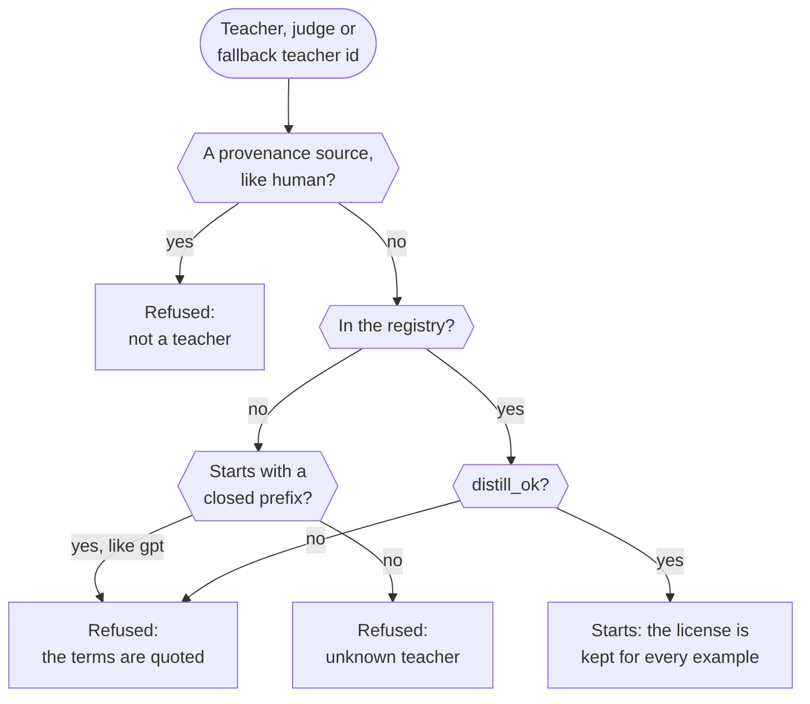
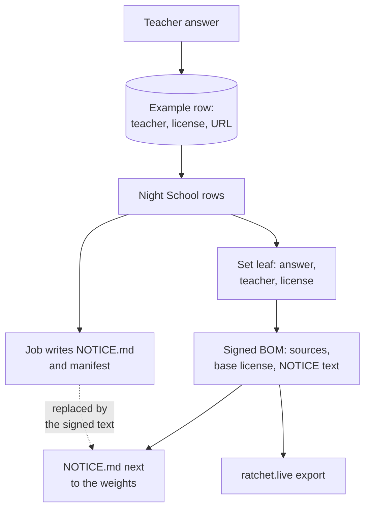
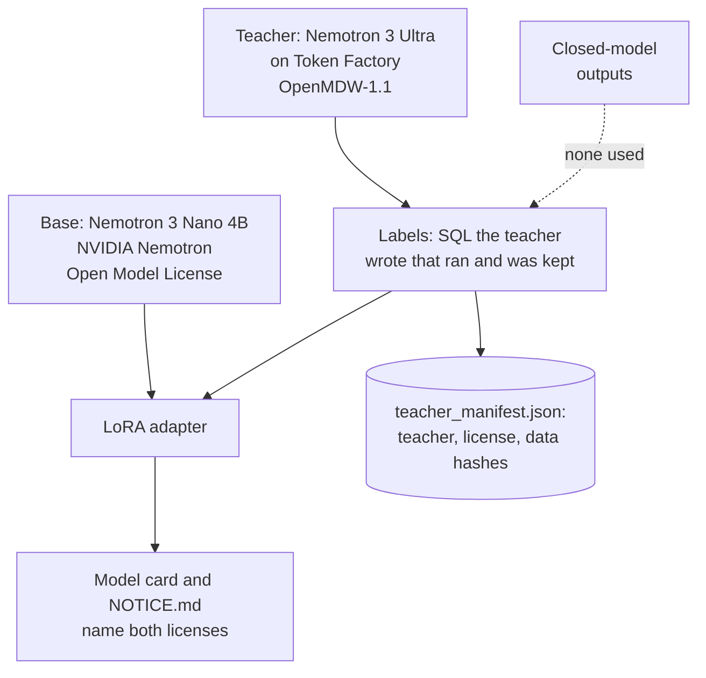

import { Steps, Aside } from '@astrojs/starlight/components';
import Summary from '../../../components/Summary.astro';
import Eli10 from '../../../components/Eli10.astro';
import Who from '../../../components/Who.astro';
import Stat from '../../../components/Stat.astro';
import StatRow from '../../../components/StatRow.astro';
import Term from '../../../components/Term.astro';

<Summary>Ratchet distills only from teachers whose license allows training other models on their outputs, refuses closed models in code, records the license on every training example, and ships the licenses with every adapter, because the terms of closed models such as GPT forbid using their outputs to train competing models.</Summary>

<Aside type="note" title="Not legal advice">
This page explains what the code does and what the license texts say, as the repo quotes them. Check each license yourself before you rely on it.
</Aside>

<Eli10>

Some agency chefs have a contract that says: "**you may not copy my recipes to train a rival kitchen**." If the apprentice learned from that chef, the restaurant would be breaking the contract. So Ratchet only hires head chefs whose contract says copying is allowed. The **head chef from the agency** that Ratchet uses, Nemotron 3 Ultra, has exactly such a contract.

The pass checks every chef's contract **before the restaurant opens**. A chef with a "no copying" contract, or a chef nobody has checked, is turned away at the door, and the restaurant does not open until that is fixed.

Every page of the **recipe book** says which chef cooked the dish and which contract allows copying it. When the apprentice finishes night school, the new **notebook** gets a **certificate on the wall** that lists every chef and contract it learned from, plus a slip of paper that goes everywhere the notebook goes, saying whose rules apply.

The apprentice's own schooling came from NVIDIA, under NVIDIA's license. The notebook is yours; the apprentice's original training stays under NVIDIA's rules.

</Eli10>

## How it really works

<Steps>

1. **The registry is built at startup.** `ratchet/licenses.py` holds the built-in teachers (`BUILTIN`, read-only). If `RATCHET_TEACHER_LICENSES` names a file, its entries are checked and merged into a copy, published as `licenses.REGISTRY`. A bad file stops startup with every error listed. This runs at every entry point: the gateway, `python -m ratchet.live` and `python -m ratchet.admin`.

2. **Every model that writes or judges answers must be distillable.** The startup check runs `licenses.require_distillable` on the teacher (`RATCHET_TEACHER_MODEL`), the judge (`RATCHET_JUDGE_MODEL`) and the fallback teacher (`RATCHET_TEACHER_FALLBACK_MODEL`, when set). An unknown model, or one in a closed family, raises `LicenseError` and the gateway does not start.

3. **Each stored answer records its license.** When a teacher answer is stored, the ledger row gets `teacher_model`, `license` and `license_url`: the license Ratchet holds for the configured model that answered (the teacher, or the fallback teacher), never one read from the response's `model` string.

4. **Night School re-checks <Term t="provenance">provenance</Term>.** `dataset.rows` reads each row's license with `licenses.lookup_source` and drops any row whose provenance is unknown or not distillable.

5. **The adapter's <Term t="bom">bill of materials</Term> names every license.** The signed BOM lists each source (teacher, license, URL, `distill_ok`, number of examples, and `license_origin`: `builtin` or `config`), the base model's license, and the exact text of `NOTICE.md` with its <Term t="sha-256">SHA-256</Term>. Each set-commitment leaf binds an example's answer to its teacher, license and redaction count.

6. **The licenses travel with the weights.** The training job writes `NOTICE.md` and `ratchet_manifest.json` next to the adapter. After the night, `python -m ratchet.live night` replaces `NOTICE.md` with the text the BOM signed and syncs both into the adapter's bucket folder. `python -m ratchet.live export` bundles the adapter, the BOM and that `NOTICE.md`.

</Steps>

### The startup check

<figure class="rt-diagram">



<figcaption>

**Reading this diagram.** Every model that writes or judges answers passes these checks before the gateway starts. There is one way through: a registered model whose license allows distillation. Every other path ends in a refusal, and a refusal stops startup with the reason; for a closed family such as GPT the reason quotes the terms that forbid it.

<ul class="rt-key">
  <li class="gate">A check</li>
  <li class="danger">Refused: the gateway does not start</li>
  <li class="ok">Starts</li>
</ul>

</figcaption>
</figure>

### From a teacher answer to the adapter's paperwork

<figure class="rt-diagram">



<figcaption>

**Reading this diagram.** The license is written down once, when the teacher's answer is stored, and then carried forward: into the rows Night School trains on, into each leaf of the committed training set, and into the signed bill of materials. The training job writes a first `NOTICE.md`; after the night it is replaced by the exact text the BOM signed, and `python -m ratchet.live export` hands over the adapter with both.

<ul class="rt-key">
  <li class="teacher">The teacher's answer</li>
  <li class="store">The ledger row</li>
  <li class="student">The signed lineage you own</li>
</ul>

</figcaption>
</figure>

### Why closed teachers are refused

<StatRow cols={2} label="Closed and open teachers">
  <Stat value="Refused" label="a closed teacher" note="Terms such as OpenAI's Business Terms §3.3(e) (read Oct 21, 2026) forbid training competing models on the outputs. Ratchet refuses these teachers in code." />
  <Stat value="Allowed" label="an open teacher" tone="owned" note="Nemotron 3 Ultra is released under OpenMDW-1.1, which places no restrictions on outputs. Each stored example records the teacher and its license." />
</StatRow>

The terms of the most used closed models forbid using their outputs to train competing models. OpenAI's [Business Terms §3.3(e)](https://openai.com/policies/business-terms/) (read Oct 21, 2026) forbid using Output "to develop artificial intelligence models that compete with OpenAI". A distillation tool that learns from GPT traffic would put its users in breach of terms like these. The README's [Why "license-clean"](https://github.com/harshbhx/ratchet#why-license-clean) section lists the other closed vendors' clauses.

So the rule is hard, not a warning: the teacher must be in the registry with `distill_ok=True`, and an override needs a reviewed code change. The cost is real: traffic that runs on closed models today cannot become training data. It has to go through an open teacher first.

### The teacher Ratchet uses: Nemotron 3 Ultra under OpenMDW-1.1

<Who as="teacher" /> is `nvidia/Nemotron-3-Ultra-550b-a55b` on Nebius Token Factory, under [OpenMDW-1.1](https://huggingface.co/nvidia/NVIDIA-Nemotron-3-Ultra-550B-A55B-BF16). In its own words, <Term t="openmdw">OpenMDW-1.1</Term> "does not impose any restrictions or obligations with respect to any use, modification, or sharing of any outputs" ([license page](https://openmdw.ai/license/1-1/), last updated May 27, 2026; checked Oct 21, 2026).

### The license registry

The built-in entries in `ratchet/licenses.py`:

| Model id | Used as | License | Note in the code |
|---|---|---|---|
| `nvidia/Nemotron-3-Ultra-550b-a55b` | Teacher (default) | OpenMDW-1.1 | Places no restrictions or obligations on outputs |
| `nvidia/nemotron-3-super-120b-a12b` | Judge (default) | NVIDIA Nemotron Open Model License | Commercial use and derivative works allowed; NVIDIA claims no ownership of outputs |
| `nvidia/NVIDIA-Nemotron-3-Nano-30B-A3B` | Hosted fallback student | NVIDIA Nemotron Open Model License | As above |
| `nvidia/Nemotron-3_5-Lightning` | Listed, not used by default | OpenMDW-1.1 | Verify on the model card |
| `mock-teacher` | Tests and mock mode only | mock (tests only) | |

`CLOSED` maps name prefixes of closed model families to the terms that forbid distillation. Every OpenAI family (`gpt`, `o1`, `o3`, `o4`) carries the Business Terms §3.3(e) note, so a refusal can quote it. For a model that is not in the registry, `lookup` reads the last part of the id after `/`, in lower case, and returns the closed terms when it starts with one of those prefixes. `require_distillable` then refuses it with the license name and the clause, and refuses any other unknown model as unknown. Matching on names is a heuristic, not legal review.

### Adding an open teacher by configuration

An open teacher that Ratchet does not list yet can be added without a code change, but only within strict limits. `RATCHET_TEACHER_LICENSES` names a JSON file:

```json
[
  {"model": "example-org/open-model-7b", "license": "Apache-2.0",
   "url": "https://huggingface.co/example-org/open-model-7b", "note": "Checked on the model card"}
]
```

An entry is accepted only when:

- its license is one of `ALLOWED_LICENSES`: **OpenMDW-1.1, Apache-2.0, MIT, <Term t="nemotron-license">NVIDIA Nemotron Open Model License</Term>** (any case; stored in the canonical spelling);
- its model id belongs to **no closed family** (`closed_family`): the id is split at every character that is not a letter or digit, and no part may start with a closed prefix or with `o` and a digit, or contain a closed prefix of three letters or more such as `gpt` (so `chatgpt-4o-latest` is refused), a closed model's name such as `davinci` or `codex`, or a closed vendor's name such as `openai`. This is stricter than the startup lookup, and it also refuses an open model under a closed vendor's name, which has to be added in code after its license is read;
- it is **no router alias** (a router's name such as `openrouter` anywhere in the id, or a last segment of `auto`): the model that answers an alias is chosen per request and may be closed;
- it does not name a built-in teacher, does not repeat an earlier entry, has an `https://` URL, and has no other keys (at most 100 entries).

Any problem stops startup with every error and its place, for example `[2].license: 'CC-BY-NC-4.0' is not an allowed license; ...`. Configured entries carry `origin` `config`: every BOM records it per source (`license_origin`), and NOTICE.md marks the license "(configured)".

<Aside type="caution" title="What configuration can and cannot do">
Configuration **cannot relabel a closed model Ratchet knows of**. But `closed_family` only knows the names it lists: a closed model from a vendor it does not list, under a new name, would pass the check and be admitted on the operator's claim alone. The `config` mark in the BOM and NOTICE is the safeguard there: it shows whoever receives the adapter that the license was the operator's claim, not Ratchet's reviewed registry. Widening the allowlist or loosening the check needs a reviewed code change.
</Aside>

### The student's base: the NVIDIA Nemotron Open Model License

The student is <Who as="student" />: `nvidia/NVIDIA-Nemotron-3-Nano-4B-BF16` plus a <Term t="lora">LoRA</Term> adapter. The base model is under the [NVIDIA Nemotron Open Model License](https://www.nvidia.com/en-us/agreements/enterprise-software/nvidia-nemotron-open-model-license/) (v. Dec 15, 2025), which asks you to give anyone you distribute it to a copy of that license. `licenses.BASE_MODELS` maps the known Nano bases (4B BF16 and FP8, and the 30B-A3B variants) to that license, so the BOM can name it (`base_model_license`). For a base model Ratchet does not know, the BOM and NOTICE carry a warning instead of a license name: then you find and ship its license yourself.

### What you own

<div class="rt-callout rt-callout--owned">

**You own this.** The LoRA adapter and its signed bill of materials are yours; the Nano base keeps the NVIDIA Nemotron Open Model License.

</div>

- **The LoRA adapter** Night School trains: the files in `adapters/student-vN/` in your bucket.
- **Its signed training lineage**: the bill of materials, signed with your <Term t="ed25519">Ed25519</Term> key (`RATCHET_BOM_SIGNING_KEY`), which commits to the exact training and golden sets, every teacher and license, and the evaluation.

You do **not** own the base model: Nemotron 3 Nano 4B stays under NVIDIA's license, and the adapter runs on top of it. The code is Apache-2.0. A signed BOM is your signed statement of the data and evaluation behind an adapter: it shows that nothing changed after signing, not that the weights were trained on that data.

### Licenses travel with the adapter

Every adapter folder gets a `NOTICE.md` next to its weights:

- the base model and its license, with the license URL (or a warning for an unknown base);
- a table of teachers with their licenses, license URLs and example counts, configured ones marked;
- the statement that the adapter was trained on teacher outputs only and that the student's own answers were never training targets (or, with human labels, that it was trained on teacher answers and customer-attested labels);
- a **Human labels** section when there are any;
- the Ratchet version, a pointer to the BOM, and "Not legal advice".

The BOM carries the exact NOTICE text and its SHA-256 (`notices`), so a recipient can check that the file is the one written at training time: `python -m ratchet.bom verify ratchet_bom.json --public-key <yours> --notice NOTICE.md`. An export never re-renders the notice: it writes the text the BOM signed, so a later Ratchet that words the notice differently still ships the original. Keep `NOTICE.md` with the adapter wherever you copy, share or deploy it, and keep the base model's license with any copy of the base model.

### Human labels: a provenance source, not a teacher

Labels a person wrote (a correction sent with `POST /v1/ratchet/feedback`, or a file imported with `python -m ratchet.importer --source human --attest "..."`) are stored with provenance `human`, license "customer-provided labels" and the note "Written or approved by the customer; the customer attests ownership."

- `human` lives in `licenses.SOURCES`, not in the teacher registry. `require_distillable` refuses it by name, so no teacher can be called `human`, and a `RATCHET_TEACHER_LICENSES` entry may not use it.
- Readers of stored rows (Night School, the BOM) use `lookup_source`, which knows both.
- The BOM lists human labels apart from the teachers (`label_sources`), and NOTICE.md gets its Human labels section.
- An import of a teacher's outputs (`--source teacher:<model>`) must pass `require_distillable` and the closed-family check; a closed model is refused with its clause quoted, and Ratchet's own `train.jsonl` rows cannot be re-imported as human labels.

### A worked example: the text-to-SQL adapter

The [text-to-SQL adapter](/guides/text-to-sql/) is the clearest case of the chain, because every link is a file you can read.

<figure class="rt-diagram">



<figcaption>

**Reading this diagram.** Two licenses meet in the adapter. The base model's license comes with the weights it sits on, so a copy of it ships with the adapter. The teacher's license covers the labels, and its terms place no restrictions on using the outputs. The dotted line is the rule that matters: no output from a closed model is in the data, so there is no closed-model clause to breach. The manifest and the model card are where a reader can check each claim.

</figcaption>
</figure>

The adapters were trained on a borrowed GPU. The teacher ran on Nebius Token Factory, so the Token Factory terms question below applies to the labels, not to the training.

### The open question: Token Factory's terms

Token Factory's Terms of Service §5(f) is about using the service to "Develop a product or service that competes with the Service" (as quoted in the [threat model](/reference/threat-model/), T7). That wording is broad. The project asked Nebius support about it in writing on **Oct 19, 2026**; no answer received as of 29 Oct 2026, so treat the question as **open**. Ratchet's teacher runs on Token Factory and its student was trained and served on Nebius AI Cloud in hand-run tests, which is how it is positioned, but that is not a legal answer. Not legal advice.

## For engineers

### Code

| File | What |
|---|---|
| [`ratchet/licenses.py`](https://github.com/harshbhx/ratchet/blob/main/ratchet/licenses.py) | `BUILTIN`, `REGISTRY`, `CLOSED`, `OPENAI_TERMS`, `SOURCES`, `BASE_MODELS`, `ALLOWED_LICENSES`, `closed_family`, `lookup`, `lookup_source`, `require_distillable`, `parse_entries`, `install` |
| [`ratchet/router.py`](https://github.com/harshbhx/ratchet/blob/main/ratchet/router.py) | `Ratchet.__init__` licenses the teacher and fallback teacher; `_store_example` writes the license with each example |
| [`ratchet/config.py`](https://github.com/harshbhx/ratchet/blob/main/ratchet/config.py) | The startup check: teacher, judge and fallback teacher must pass `require_distillable` |
| [`ratchet/nightschool/notices.py`](https://github.com/harshbhx/ratchet/blob/main/ratchet/nightschool/notices.py) | `render` (NOTICE.md), `bom_notice`, `write_adapter_files` |
| [`ratchet/bom.py`](https://github.com/harshbhx/ratchet/blob/main/ratchet/bom.py) | The BOM manifest, Ed25519 signing, `verify`, `check_notice` |
| [`ratchet/importer.py`](https://github.com/harshbhx/ratchet/blob/main/ratchet/importer.py), [`ratchet/feedback.py`](https://github.com/harshbhx/ratchet/blob/main/ratchet/feedback.py) | Human labels and imported teacher outputs |

Tests: `tests/test_licensing.py` (licenses that travel with the adapter, `RATCHET_TEACHER_LICENSES`), `tests/test_contract.py` (the license rules clients rely on).

### Settings

| Variable | Default | Meaning |
|---|---|---|
| `RATCHET_TEACHER_MODEL` | `nvidia/Nemotron-3-Ultra-550b-a55b` | Must pass `require_distillable` |
| `RATCHET_JUDGE_MODEL` | `nvidia/nemotron-3-super-120b-a12b` | Must pass it too |
| `RATCHET_TEACHER_FALLBACK_MODEL` | empty | Opt-in fallback teacher; must pass it |
| `RATCHET_STORE_FALLBACK_TEACHER` | `0` | `1` stores the fallback teacher's answers, under its own license |
| `RATCHET_TEACHER_LICENSES` | empty | Path to the JSON file of configured open teachers |
| `RATCHET_STUDENT_BASE_MODEL` | `nvidia/NVIDIA-Nemotron-3-Nano-4B-BF16` | Its license goes into every BOM and NOTICE |
| `RATCHET_BOM_SIGNING_KEY` | empty | Ed25519 seed (base64) that signs every BOM; empty means unsigned, with a SHA-256 |

Details: [Configuration, teacher licenses](/reference/configuration/#teacher-licenses).

### Endpoints and commands

| What | How |
|---|---|
| Ledger-wide BOM (teachers, licenses, counts, fingerprint) | `GET /ratchet/bom` |
| One adapter's signed BOM | `GET /ratchet/versions/{id}/bom` |
| The public key to publish | `GET /ratchet/bom/public-key` |
| Make a signing key | `python -m ratchet.bom keygen` |
| Check a BOM and its NOTICE | `python -m ratchet.bom verify bom.json --public-key <key> --notice NOTICE.md` |
| Hand an adapter over | `python -m ratchet.live export --version N --out DIR` |
| Import labels | `python -m ratchet.importer FILE --task T --source human --attest "..."` or `--source teacher:<open model>` |

The BOM endpoints need an admin or dashboard key in live mode unless `RATCHET_PUBLIC_BOM=1`. Without `--public-key`, `verify` only shows that the document is consistent with the key embedded in it; publish your public key somewhere you control.

## Common questions

### Can I use my GPT traffic as training data?

No. Closed models such as GPT have terms that forbid using their outputs to train competing models, and Ratchet refuses them as teachers at startup. Route that traffic through an open teacher first; from then on, the teacher's answers are the training data.

### Can I add another open model as a teacher?

Yes, if its license is OpenMDW-1.1, Apache-2.0, MIT or the NVIDIA Nemotron Open Model License, through `RATCHET_TEACHER_LICENSES`. Any other license, or a model whose name matches a closed family even though it is open, needs a reviewed change to `ratchet/licenses.py`.

### What stops someone from configuring a closed model?

The closed-family check refuses every closed family, model name, vendor and router alias it knows. It cannot recognise names it does not list; such an entry is admitted on the operator's claim and marked `config` in every BOM and NOTICE, so the claim is visible to whoever receives the adapter.

### What exactly do I own?

The LoRA adapter and its signed training lineage. Not the base model, which stays under the NVIDIA Nemotron Open Model License.

### Do I need to ship anything with the adapter?

Yes: `NOTICE.md`, which Ratchet writes for you, and the base model's license with any copy of the base model. `python -m ratchet.live export` puts the adapter, the BOM and the notice in one folder.

### Does the judge's license matter?

The judge only scores free-text answers in the <Term t="golden-set">golden eval</Term> and never writes training data, but the startup check still requires it to be distillable. Super is under the NVIDIA Nemotron Open Model License.

### Is Nebius itself fine with this?

That is the open §5(f) question above: asked in writing on Oct 19, 2026; no answer received as of 29 Oct 2026.

### Is this legal advice?

No. The registry matches names and records the licenses you configure; it is not a legal review. Check each license yourself.

## Related

- [The ledger](/guides/ledger/): where each example's license is stored
- [Night School](/guides/night-school/): where the BOM is written
- [Training on your data](/guides/training-on-your-data/): the export and the bucket folder
- [Evidence](/guides/evidence/): set commitments and <Term t="certificate">certificates</Term> in the BOM
