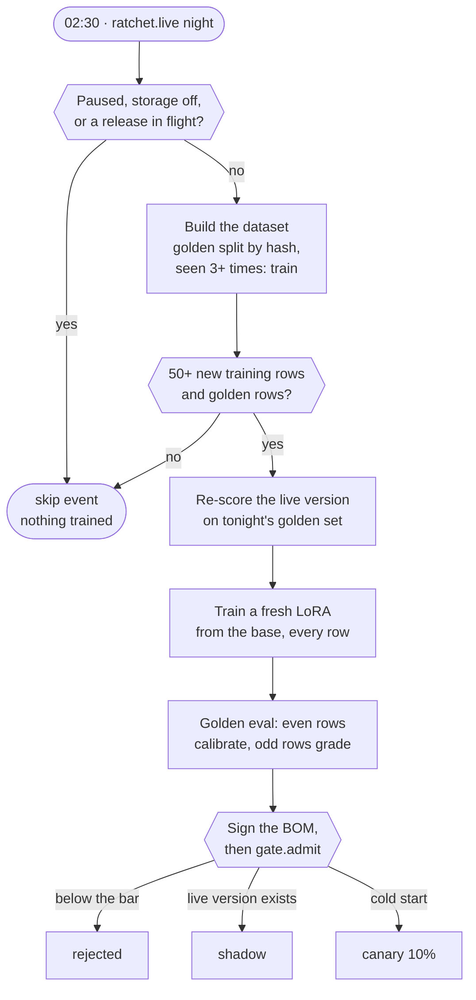
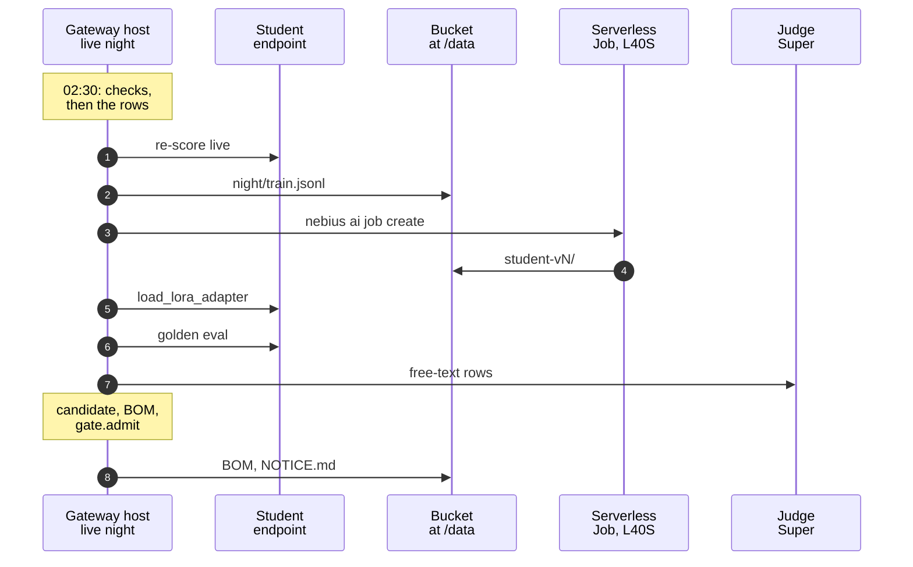
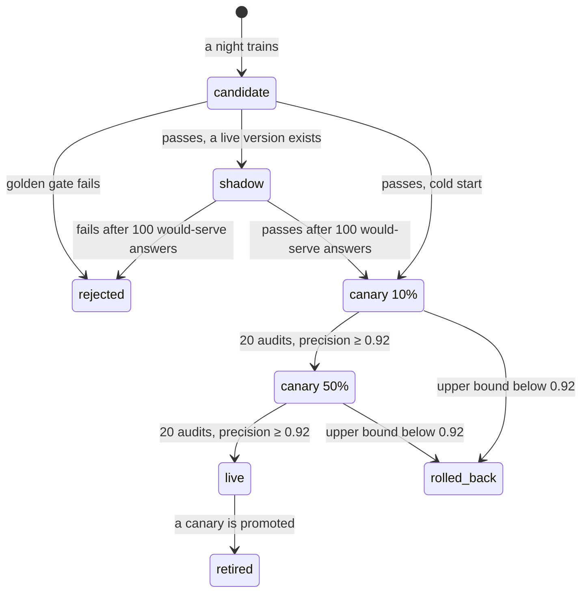
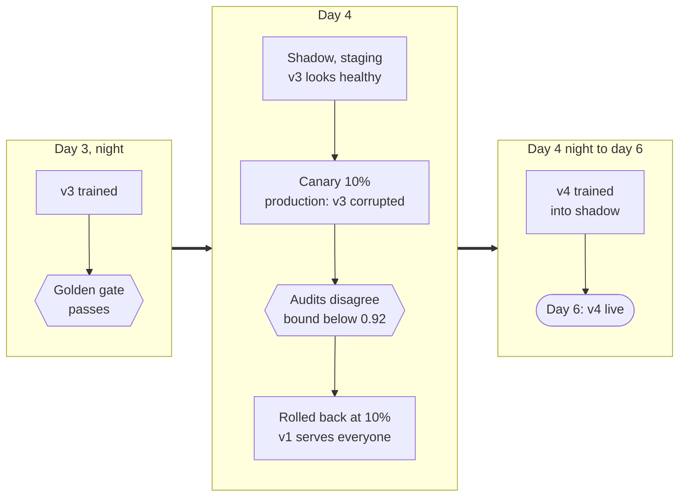

import { Steps, Aside } from '@astrojs/starlight/components';
import Summary from '../../../components/Summary.astro';
import Eli10 from '../../../components/Eli10.astro';
import Who from '../../../components/Who.astro';
import Stat from '../../../components/Stat.astro';
import StatRow from '../../../components/StatRow.astro';
import Flow from '../../../components/Flow.astro';
import FlowStep from '../../../components/FlowStep.astro';
import PathCard from '../../../components/PathCard.astro';
import PathGrid from '../../../components/PathGrid.astro';
import FadeContent from '../../../components/ui/FadeContent.astro';
import GradientText from '../../../components/ui/GradientText.astro';

<Summary>Night School is the nightly job that trains <GradientText text="a fresh LoRA adapter" tone="owned" /> from the base model on every teacher answer stored so far, grades it on a sealed golden set it never studied, and hands it to the release gate.</Summary>

<Eli10>

Every night after the restaurant closes, the **apprentice chef** goes to **night school**.

The apprentice does not just read today's new pages. They study the **whole recipe book** from the start, and write a brand new **notebook of techniques**. Starting fresh each night means yesterday's mistakes do not pile up.

Some recipes are kept in a **sealed exam** envelope. The apprentice never studies them. After studying, the apprentice takes the exam: half of the exam decides how sure the apprentice must be before serving a dish, the other half grades them. One rule bends this: a dish customers order **three or more times** is too important to keep sealed, so it moves into the study pile.

Night school is skipped when there is nothing new to learn, when the new apprentice from last night is still on a **trial shift**, or when the manager says "no class tonight". If the apprentice passes the exam, they start their trial shift. If not, the notebook goes in the bin.

</Eli10>

<Flow loop loopLabel="Every night, again" label="One night">
  <FlowStep title="Build the sets" meta="dataset.build">Training rows and the sealed golden rows, split by a hash of each request.</FlowStep>
  <FlowStep title="Train from the base" tone="owned" meta="Nano 4B + a new LoRA">A fresh adapter on every training row so far, never on student answers.</FlowStep>
  <FlowStep title="Grade on the golden set" meta="cascade_eval">Even rows set the threshold, odd rows it never saw grade it.</FlowStep>
  <FlowStep title="Sign and hand over" meta="BOM, then gate.admit">A bill of materials, signed when a key is set, then shadow, canary or rejected.</FlowStep>
</Flow>

## How it really works

One night is `run_night()` in [`ratchet/nightschool/orchestrate.py`](https://github.com/harshbhx/ratchet/blob/main/ratchet/nightschool/orchestrate.py). In live mode a cron job starts it with `python -m ratchet.live night`. Each check below can end the night early with a `skip` event in the release log.

<figure class="rt-diagram">



<figcaption>

**Reading this diagram.** Two checks can end the night before any GPU time: the first (training paused, storage turned off, or a version still in shadow or canary) and the data check (fewer than 50 new training rows, or no golden rows yet). The dataset step is where the golden split happens: a row's hash puts about 10% of examples in the sealed golden set, and the FREQUENT rule moves a request seen 3 or more times into training. The live version, the champion, is graded again on tonight's golden rows before the challenger trains, so both are compared on the same data. The new adapter is trained from the base model on every training row, calibrated on the even golden rows and graded on the odd ones it never saw. The release gate's `admit` decides what happens next. Not drawn: the retention purge right after the pause check, the Merkle commitment before training, and the paperwork a live night writes back to the bucket.

</figcaption>
</figure>

<Steps>

1. **Training paused?** If an operator turned on `training_paused` (`POST /ratchet/admin/training/pause` or `python -m ratchet.admin flag training_paused on`), the night writes `skip` (`training paused by an admin; no training tonight`) and stops before anything else.

2. **Retention first.** In live mode, if a retention window is set, expired example text is purged now, so the night never reads text that should be gone ([the ledger](/guides/ledger/)).

3. **Storage off?** With `RATCHET_STORE_EXAMPLES=0` (zero retention) the night skips (`storage disabled`). Examples kept from before are not trained on. One thing still runs when no release is in flight: a task whose spec changed is re-scored on the stored golden rows, so it does not stay on the teacher for good.

4. **Release in flight?** If any version is in `shadow` or `canary`, the night skips (`vN still in shadow; no training tonight (saves GPU time)`). A candidate trained now could not be released anyway, and the GPU time would be wasted.

5. **Build the dataset** (`dataset.build`): the training rows and the golden rows, with the license check and every rule in [Rows left out of training](#rows-left-out-of-training) below.

6. **Enough new data?** New examples = training rows now, minus the most training rows any past version was trained on that are still stored (`Ledger.train_rows_kept`, so a deletion neither stops nor starts training). Below **50** (`min_new_examples`), the night skips (`only N new examples ... no training tonight`). With no golden rows at all, it skips too (`no golden examples yet`). A skipped night still re-scores the live version if a task's spec changed since it was scored.

7. **Re-score the champion.** The live version is evaluated again on **tonight's** golden set, under tonight's task specs, and its eval is overwritten. The candidate will be compared with this score, not with an old one (champion against challenger on the same data).

8. **Commit to the rows.** The training and golden sets are each turned into a Merkle root (`dataset.commitment`), before the paid job starts, so the signed BOM can later prove what was and was not trained on ([evidence](/guides/evidence/)).

9. **Train.** `trainer.train(train_rows, base_model, "student-vN")` trains a new adapter **from the base model** on **every** training row so far. In live mode the wall-clock time is recorded as a `training_job` compute interval for the cost report, also when training fails.

10. **Register the candidate.** A `candidate` version is created and its committed leaves are written once (append-only).

11. **Golden eval.** The candidate is sampled on each golden row exactly as production samples it (3 samples at temperature 0.7 with token logprobs). The confidence threshold is calibrated on the **even** rows (target precision 0.97), and precision and coverage are measured on the **odd** rows it never saw. The eval also carries an exact precision certificate, and, when a version is live, a row-by-row comparison with tonight's re-score. Free-text tasks also get a judge score from <Who as="judge" />, recorded as `judge_pass_rate`; it does not gate the release.

12. **Sign the BOM.** The adapter's bill of materials is written from the exact rows: sources and licenses, the base model's license, the NOTICE.md text, the eval, the set roots. It is signed with Ed25519 when `RATCHET_BOM_SIGNING_KEY` is set.

13. **Admit.** A `trained` event is written, then `gate.admit(vN)` decides: **rejected**, **shadow** (a live version exists), or **canary 10%** (cold start, no live version). See [the release gate](/guides/release-gate/).

14. **Ship the paperwork (live mode).** `python -m ratchet.live night` writes the BOM and NOTICE.md into the adapter's folder and runs `RATCHET_SYNC_CMD` again, so the bucket copy of the adapter carries its licenses. A failed sync is a `sync_failed` event and a non-zero exit; the version still stands.

</Steps>

### One live night, step by step

<figure class="rt-diagram">



<figcaption>

**Reading this diagram.** Everything starts on the gateway host, where cron runs `python -m ratchet.live night` next to the ledger and the release gate. The live version is graded again first, on the student endpoint (1). Then the night uploads the training file to the bucket (2) and starts a Serverless Job (3), which reads it from `/data` and writes the new adapter's folder back (4); `deploy/train_job.sh` waits until the weights are there. The night tells vLLM to load the adapter at runtime (5), grades it with 3 samples per golden row (6) and has the judge score free-text rows (7). It records the candidate, its eval and its signed bill of materials in the ledger and calls the gate. Last, it writes the BOM and the signed `NOTICE.md` into the adapter's folder and syncs the bucket again (8).

</figcaption>
</figure>

The live commands, file paths and polling are on [Training on your data](/guides/training-on-your-data/).

### The golden set: the sealed exam

<div class="rt-callout rt-callout--note"><p><strong>Golden examples are never trained on.</strong> The one exception is a request seen 3 or more times, which moves to training and leaves the golden set.</p></div>

<StatRow cols={3} label="The night's numbers">
  <Stat value={10} suffix="%" count={false} label="held out as golden" note="RATCHET_GOLDEN_FRACTION: a hash of each request decides, not a model." />
  <Stat value={3} count={false} label="sightings move a row to training" note="The FREQUENT rule: common questions are learned, not held out forever." />
  <Stat value={50} count={false} label="new training rows to train" note="Below that the night skips and spends no GPU time." />
</StatRow>

- **Split by hash.** When an example is first stored, its split is fixed: `golden` if the first 8 hex digits of its hash, divided by `0xFFFFFFFF`, are below `RATCHET_GOLDEN_FRACTION` (default 0.10), else `train`. The hash is over the task and the redacted messages, so the split never changes and nothing leaks from re-splitting.
- **Variants share a split.** The same prompt stored under other conditions (a `stop`, a JSON schema) is another example, but it lands in the same split. The trainer only sees the messages, so a golden prompt stored again in train would be trained on.
- **Never trained on**, with one exception, the FREQUENT rule below. Golden rows are only ever used to calibrate and grade.
- **Half calibrates, half grades.** `cascade_eval` picks the lowest threshold whose served answers reach the target precision on the even-indexed golden rows, and reports precision and coverage on the odd-indexed rows. Each task also gets its own threshold; with fewer than `RATCHET_MIN_TASK_GOLDEN` (20) calibration rows it is never below the global one. Thresholds are clamped between 0.5 and 1.01, and 1.01 means "serve nothing".
- **Human-verified golden rows.** An operator can import a golden set that is held out for good, even past FREQUENT, with every variant of its prompt (`python -m ratchet.importer ... --golden-only`).

The golden set comes from teacher-labelled traffic (escalations, audits, arbitrations), so it leans toward requests the student found hard. Its coverage is a conservative estimate of live coverage, and its precision means agreement with the teacher, not ground truth.

### The FREQUENT rule

A request whose `seen` count reaches **3** (`dataset.FREQUENT`) is treated as a training row even if its hash put it in the golden set, and it leaves the golden set. Without this rule the most common questions, if they happened to hash into golden, would never be learned, and the student would keep escalating them.

`seen` counts real traffic only. It is summed over every variant of a prompt. A client's retry does not count (the SDK's `x-stainless-retry-count`), the same client repeating a request within `RATCHET_SEEN_DEDUP_S` (300 s in live mode) counts once, and an imported label or a correction never adds an occurrence. Purged rows keep their count, so a deletion never moves a frequent request back to golden.

### What LoRA is

**Simply:** the base model, NVIDIA Nemotron 3 Nano 4B, stays frozen. LoRA trains a small set of extra weights that sit beside some of its layers and nudge their output. Those extra weights are the adapter: a few files, cheap to train, quick to load and easy to swap. The adapter is yours; the base stays under NVIDIA's license.

**Precisely:** for a frozen weight matrix W, LoRA learns two thin matrices B and A of rank r, and the layer computes W·x + (α / r)·B·A·x. With rank 16 and alpha 32, the update is scaled by 2. Ratchet's training script, [`ratchet/nightschool/train.py`](https://github.com/harshbhx/ratchet/blob/main/ratchet/nightschool/train.py), uses Transformers, PEFT and TRL's `SFTTrainer` with these defaults:

| Setting | Default | Flag |
|---|---|---|
| Base model | `nvidia/NVIDIA-Nemotron-3-Nano-4B-BF16` | `--base` |
| Epochs | 2 | `--epochs` |
| Learning rate | 2e-4 | `--lr` |
| LoRA rank | 16 | `--rank` |
| LoRA alpha | 32 (twice the rank) | follows `--rank` |
| Max sequence length | 2048 tokens | `--max-seq` |
| Batch size per device | 8 | `--batch` |
| Precision | bf16 | |
| Loss | On the answer only (`completion_only_loss=True`) | |
| Target modules | `q_proj, k_proj, v_proj, o_proj` (attention), `up_proj, down_proj` (MLP), `in_proj, out_proj` (Mamba) | `--targets` |

Nemotron-H mixes attention, Mamba and MLP layers. The default targets include the Mamba projections. Whether vLLM loads and applies LoRA on them is checked on day 1; if it refuses, the fallback is `--targets q_proj,k_proj,v_proj,o_proj,up_proj,down_proj` (`TARGETS_ATTENTION_MLP`). The student endpoint is started with `--max-lora-rank 16`, so a higher rank needs that flag raised too.

### Retrain from the base every night

Each night trains a **new** adapter from the **base model** on **all** training rows so far. Adapters are never stacked or continued.

- No drift compounds from one adapter to the next, and each version is one dataset snapshot, named by its `dataset_hash`.
- Replay of old data is built in, which limits forgetting.
- Rollback is simple: the previous adapter is still there, unchanged.
- The cost: training time grows with the dataset. Deduplication, sampling or recency-weighted replay are the later fixes.

Training targets are teacher answers (and customer-attested human labels), never the student's own outputs. Training on its own outputs would make the student collapse onto its own mistakes.

### Train on the prompt the student is served

Nemotron 3 Nano's chat template turns "thinking" on unless told otherwise. The student endpoint serves with thinking off, so its prompt ends in an empty think block. If training rendered the prompt with thinking on, the student would learn answers after a prompt it never sees, and TRL would only log a warning.

So `train.jsonl` uses TRL's conversational **prompt-completion** format:

- `prompt`: the stored request messages.
- `completion`: one assistant message, the teacher's stored answer.
- `chat_template_kwargs`: `{"enable_thinking": false}`, the same value the endpoint uses (`--default-chat-template-kwargs`). A test keeps the three copies of this value equal.

Before the model loads, `train.py` checks every row (`check_rows`) and stops on one that is not prompt-completion, lacks the arguments, holds a think tag or has no provenance. After the tokenizer loads, it renders every row as TRL will and stops when the prompt is not a prefix of prompt plus answer, or differs from what the endpoint renders (`check_prefix`, `TemplateMismatch`). A drift stops the job in seconds instead of training a quietly worse adapter.

### Rows left out of training

`dataset.rows` reads every stored example and applies these rules. The ledger keeps every row; only the training file changes.

| Row | Left out of | Why | Counted as |
|---|---|---|---|
| Purged by retention or erasure | Both sets | No text left; its `seen` still counts toward FREQUENT | |
| Task pinned now | Both sets | Pinned tasks never train the student, even when pinned after rows were stored | `excluded_pinned` |
| Teacher unknown or not distillable | Both sets | Only distillable provenance is used ([licenses](/guides/licenses/)) | |
| Stored with a client's `stop` | Training (stays golden) | `train.py` renders messages only, so the cut answer would teach the bare prompt to stop there | |
| Answer invalid under the task's current spec | Training (stays golden; the eval skips an invalid reference) | The spec tightened since it was stored | `skipped_invalid`, `golden_invalid_refs` |
| Answer holds a literal `<think>` or `</think>` | Training (stays golden) | The template renders such an answer without the empty think block | `skipped_think_tag` |
| Golden-only import, and every variant of its prompt | Training | Held out for good | |

Teacher answers that were incomplete or invalid when they arrived were never stored in the first place ([the ledger](/guides/ledger/)).

### Mock trainer and live trainer

Both implement the same two interfaces, `Trainer.train(rows, base_model, name)` and `Evaluator.evaluate(adapter, golden_rows)`, and both grade with the same `cascade_eval` and the same student sampling (`confidence.STUDENT_SAMPLING`), so mock, live and production agree on how a student is scored.

| | Mock: `sim.mock_models.MockFleet` | Live: `ratchet.live.NebiusTrainer` + `LiveEvaluator` |
|---|---|---|
| Used by | The simulator, the mock gateway's demo days, the tests | `python -m ratchet.live night` |
| Training | Counts each row's template and remembers its texts; no GPU, no weights | Writes `train.jsonl`, syncs it to the bucket, runs a Nebius Serverless Job, hot-loads the adapter into vLLM |
| Evaluation | A deterministic mock student | The real adapter on the student endpoint, plus <Who as="judge" /> for free text |
| Bad deploys | `corrupt_on_deploy` breaks a version on purpose for the rollback demo | Real |

Simulation numbers come from the mock fleet. In the README's reference run (simulation, mock models, seed 7, 2,000 tickets a day) the first student is live on day 3, and a deliberately corrupted v3 is rolled back automatically on day 4.

### After admit: the release states

Night School ends at `gate.admit`. From there the [release gate](/guides/release-gate/) moves the version on its own, one tick at a time:

<figure class="rt-diagram">



<figcaption>

**Reading this diagram.** A candidate is graded on the golden set first: it needs precision of at least 0.95, coverage of at least 0.25 and no regression against the live version's re-score. With a live version it then runs in shadow, answering every request silently, until it has 100 answers it would have served. A canary serves 10%, then 50% of requests; each stage needs 20 audits (15 in mock mode) with audited precision of at least 0.92, and the 50% stage then becomes live while the old live version is retired. A canary whose Wilson upper bound falls below 0.92 is rolled back, and traffic returns to the live version, or to the teacher on a cold start. Not drawn: a shadow or canary is also retired when a newer candidate is admitted (rare, because no night trains during a release), and the opt-in anytime-valid rule (`RATCHET_SEQUENTIAL=1`) decides the canary with an e-value instead. The release gate guide has every rule.

<ul class="rt-key">
  <li class="student">Your adapter on trial</li>
  <li class="ok">Serving everyone</li>
  <li class="danger">Stopped</li>
  <li class="outline">Replaced</li>
</ul>

</figcaption>
</figure>

### A bad deploy, rolled back (simulation)

The reference run breaks v3 on purpose (`--bad-deploy-version 3`): the mock fleet corrupts it only on the production endpoint, so it looks healthy in shadow and fails once it serves real traffic. Simulation, mock models, seed 7:

<figure class="rt-diagram">



<figcaption>

**Reading this diagram.** Simulation, mock models, seed 7. Read left to right, one box per stretch of the run, and down inside each. v3 passed every check that does not need live traffic: the golden gate on day 3, then the shadow comparison on day 4. The canary is where its answers met real requests and real audits. While v3 served 1 request in 10, v1 stayed live for the rest; when the audits showed v3's precision could not reach the 0.92 floor, the gate rolled it back the same day, and v3 never reached 100% of traffic. The loop went on: v4 was trained that night and went live on day 6.

</figcaption>
</figure>

<Aside type="caution" title="Scripted and tested offline">
As of Oct 26, 2026, live Night School is written and tested offline (`tests/test_live.py`, against fake endpoints and a fake `nebius` CLI), ready to run as a Nebius Serverless Job with `make nebius-up`. The three original adapters (two text-to-SQL, one tool-calling) were trained on a borrowed GPU, outside Night School. On 27 Oct 2026 the round-2 recipe was retrained once, by hand, as a Nebius Serverless Job on one preemptible L40S; the nightly loop did not start it. The day-1 checks (`scripts/day1_check.py`) come first.
</Aside>

## For engineers

### Code

| File | What |
|---|---|
| [`ratchet/nightschool/orchestrate.py`](https://github.com/harshbhx/ratchet/blob/main/ratchet/nightschool/orchestrate.py) | `run_night`, `rescore`, `paired_evidence`, `spec_hashes`, the `Trainer` and `Evaluator` protocols |
| [`ratchet/nightschool/dataset.py`](https://github.com/harshbhx/ratchet/blob/main/ratchet/nightschool/dataset.py) | `rows` (every rule above), `FREQUENT`, `effective_split`, `counts_as_train`, `commitment`, `write_training`, `TRAIN_TEMPLATE_KWARGS`, `build` |
| [`ratchet/nightschool/evaluate.py`](https://github.com/harshbhx/ratchet/blob/main/ratchet/nightschool/evaluate.py) | `cascade_eval` (calibrate on even rows, measure on odd rows, certificate, frontier, per-task records), `LiveEvaluator`, `REFUSED` |
| [`ratchet/nightschool/train.py`](https://github.com/harshbhx/ratchet/blob/main/ratchet/nightschool/train.py) | The GPU script: `parse_args`, `check_rows`, `check_prefix`, `columns`, `write_metadata`, `versions` |
| [`ratchet/nightschool/notices.py`](https://github.com/harshbhx/ratchet/blob/main/ratchet/nightschool/notices.py) | NOTICE.md rendering |
| [`ratchet/live.py`](https://github.com/harshbhx/ratchet/blob/main/ratchet/live.py) | `main` (the `night` command), `NebiusTrainer`, `write_boms`, `load_adapter` |
| [`sim/mock_models.py`](https://github.com/harshbhx/ratchet/blob/main/sim/mock_models.py) | `MockFleet` |

The rules are tested one by one in `tests/test_nightschool.py` (skip reasons, held-out golden rows, variants sharing a split, stop rows held out, cumulative retraining, champion re-score, the certificate, the training rows' template arguments, `train.py`'s loss and checks, the pinned image).

### Settings

| Setting | Default | Meaning |
|---|---|---|
| `min_new_examples` | 50 | Argument of `run_night`; no environment variable |
| `RATCHET_GOLDEN_FRACTION` | `0.10` | Share of new examples that go to the golden split |
| `RATCHET_SAMPLES` | `3` | Student samples per request, also in the golden eval |
| `RATCHET_MIN_TASK_GOLDEN` | `20` | Calibration rows a task needs for its own threshold |
| `RATCHET_PER_TASK_CALIBRATION` | `1` | `0` keeps one pooled threshold |
| `RATCHET_CALIBRATION` | `point` | `ltt` picks the threshold by Learn-then-Test |
| `RATCHET_CERT_TARGET`, `RATCHET_CERT_DELTA` | `0.95`, `0.05` | The certificate's target and error rate |
| `RATCHET_JUDGE_MODEL` | `nvidia/nemotron-3-super-120b-a12b` | Judge for free-text tasks |
| `RATCHET_STUDENT_BASE_MODEL` | `nvidia/NVIDIA-Nemotron-3-Nano-4B-BF16` | The base every adapter is trained from |
| `RATCHET_BOM_SIGNING_KEY` | empty | Signs each BOM (Ed25519); empty means unsigned with a SHA-256 |
| `RATCHET_TRAIN_GPU_USD_PER_HOUR`, `RATCHET_TRAIN_GPUS` | `1.55`, `1` | Prices the training interval for the cost report. The code's default; these docs use 1.35 USD per GPU-hour, Nebius's list price for an L40S. Set the rate on your bill |

The live-mode variables (`RATCHET_DATA_DIR`, `RATCHET_SYNC_CMD`, `RATCHET_TRAIN_CMD`, `RATCHET_ADAPTER_ROOT`) are on [Training on your data](/guides/training-on-your-data/). The release policy's thresholds are on [the release gate](/guides/release-gate/).

### Commands

```bash
python -m ratchet.live night                                      # one live night (cron)
python -m ratchet.admin flag training_paused on --reason "..."    # skip nights until turned off
python -m sim.simulate --days 10 --requests 2000 --bad-deploy-version 3   # nights with the mock fleet (simulation)
```

### Events

`skip` (with the reason), `rescored`, `rescore_failed`, `trained`, then the gate's `rejected`, `shadow` or `canary` (and `task_disabled` for a task that fails its own check), and in live mode `sync_failed`. Meanings: [runbook, event kinds](/reference/runbook/).

## Common questions

### Why retrain from scratch every night instead of continuing yesterday's adapter?

Continuing piles up drift and forgetting, and makes rollback harder. Retraining from the base on the whole set means every adapter is one dataset snapshot and can be reproduced. The price is that training takes longer as the data grows.

### What does a night cost?

An estimate from the repo's [deployment guide](/reference/deployment/#4-cost-estimates): an L40S at about $1.35 per GPU-hour on demand ([Nebius pricing](https://docs.nebius.com/compute/resources/pricing), read Oct 22, 2026) for 30 to 60 minutes is about $0.70 to $1.35 per training night. Skipped nights cost nothing. Night School also needs the student endpoint running while it loads and grades the new adapter. Real costs are recorded once it runs: `python -m ratchet.cost report`.

### What happens if training fails halfway?

No version is created. The compute interval is closed with a "training failed" note (the GPU time was still paid), the error ends the command with a non-zero exit, and the next night tries again from scratch.

### Why not train while a canary is running?

The new adapter could not be released until the current one finishes, and by then a newer night would replace it. Skipping saves GPU money.

### Can the student learn its own mistakes?

No. Its answers are never stored. When the teacher audits a served answer, the teacher's answer is stored, not the student's.

### How big must the golden set be?

Big enough for the certificate to mean something. With about 200 golden rows, precision is only known to a few points. `python -m ratchet.stats plan --target 0.95 --delta 0.05` says how many held-out rows a certificate needs (59 with no errors, 93 with one, per the README). Shadow and canary exist partly because the golden set is small.

### Has a real adapter been trained yet?

Three, outside Night School: two text-to-SQL rounds and one tool-calling round, all trained on a borrowed GPU; the round-2 recipe was later retrained once by hand on Nebius AI Cloud (see [Text-to-SQL](/guides/text-to-sql/) and [Results](/guides/results/)). As of Oct 26, 2026, Night School's loop is tested in simulation and its live path offline, ready to run with `make nebius-up`; the first real night follows the day-1 checks.

## Related

<FadeContent distance={16}>
<PathGrid cols={2} label="Related guides">
  <PathCard title="The release gate" href="/guides/release-gate/" icon="gate" eyebrow="After admit" tone="neutral" description="Shadow, canary 10%, 50%, live, and the rollback that guards them." />
  <PathCard title="Training on your data" href="/guides/training-on-your-data/" icon="server" eyebrow="Live mode" description="The live commands, the bucket and the endpoint that loads each adapter." />
  <PathCard title="The ledger" href="/guides/ledger/" icon="database" eyebrow="Where rows come from" tone="neutral" description="The stored teacher answers, their provenance and what is never kept." />
  <PathCard title="Confidence" href="/guides/confidence/" icon="scale" eyebrow="The threshold" tone="neutral" description="What the threshold the night calibrates means on every request." />
</PathGrid>
</FadeContent>

The nightly loop in full: [Architecture, nightly loop](/reference/architecture/#3-nightly-loop-night-school).
