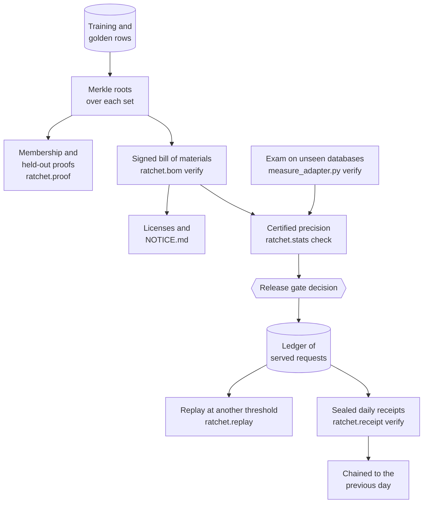
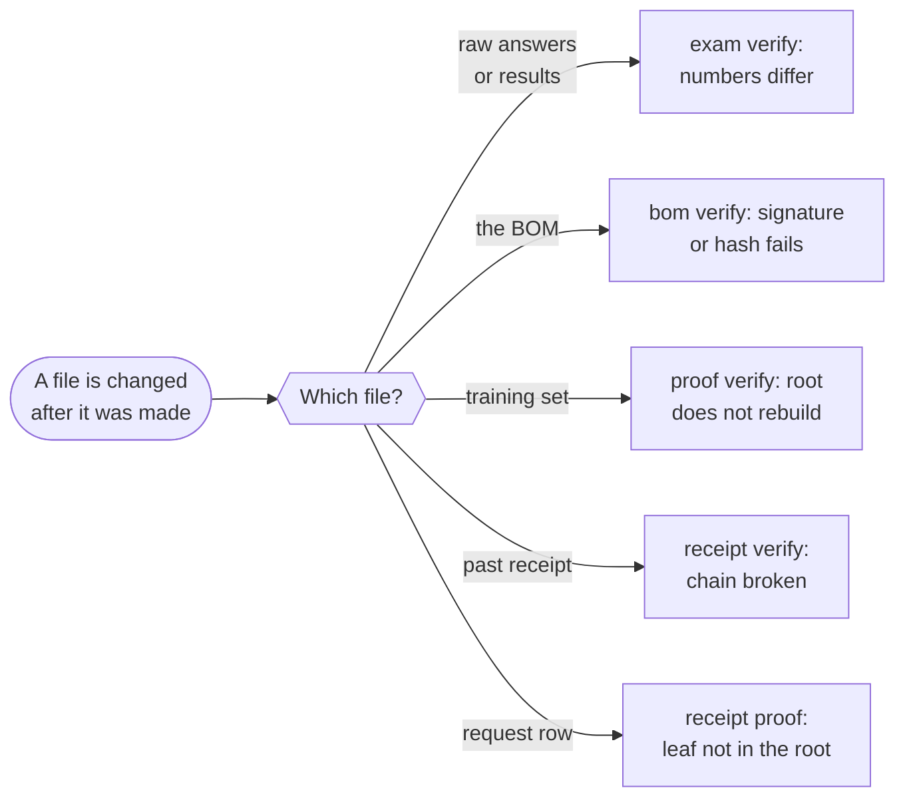

import { Steps, Aside } from '@astrojs/starlight/components';
import Summary from '../../../components/Summary.astro';
import Eli10 from '../../../components/Eli10.astro';
import Stat from '../../../components/Stat.astro';
import StatRow from '../../../components/StatRow.astro';
import Stepper from '../../../components/ui/Stepper.astro';

<Summary>Each claim about an adapter or a bill has a document and a command that checks it on your own machine, so you do not have to trust the gateway that made it.</Summary>

<Eli10>

"Trust me" is cheap. A better deal is "here is the receipt, here is how to add it up yourself".

Ratchet gives you a chain of such receipts. The first says how well the model did on a sealed exam. The next says who signed the list of ingredients. The next lets you check that one recipe was, or was not, in the study pile. The next gives a safety margin on the exam score. The last shows each day's bill with a fingerprint of every order, chained to the day before.

Each link has one command. When a link is broken, the command says `FAIL` and why.

</Eli10>

<StatRow cols={3} label="The chain at a glance">
  <Stat value={6} count={false} label="links in the chain" note="Each with one command you run on your own machine." />
  <Stat value={1} count={false} label="run on a real model" tone="owned" note="The text-to-SQL exam and its verify step." />
  <Stat value="No gateway" label="needed to check" note="Only the documents, a public key and this repository's tools." />
</StatRow>

## How it really works

<Steps>

1. **The exam.** The adapter answers questions about databases it never trained on, and a CPU-only script recomputes the score from the raw answers (`measure_adapter.py verify`). This is the one check that has been run on a real model, for the text-to-SQL adapter.

2. **The signed bill of materials.** When Night School trains a version it writes a document that lists the teachers and their licenses, the base model's license, the data counts and the eval, and signs it with an Ed25519 key. `python -m ratchet.bom verify` checks the signature and every hash in it.

3. **The committed training set.** The same document signs a Merkle root over the exact training rows and another over the golden rows. `python -m ratchet.proof verify` shows that one example is in a set, or is not, without the whole set. `python -m ratchet.proof heldout` shows that no golden example is in the training root.

4. **Certified precision.** The eval carries an exact Clopper-Pearson lower bound on how often the served answers match the teacher. `python -m ratchet.stats check` recomputes it from the counts in the signed BOM.

5. **The time machine.** `python -m ratchet.replay` replays one version's logged traffic at another threshold or audit rate and estimates precision, coverage and cost. It reads the ledger, so it is an estimate, not a signed document.

6. **The savings receipts.** After each ledger day, the gateway seals one receipt per client: a Merkle tree over request metadata (no text), signed and chained to the previous day. `python -m ratchet.receipt verify` checks the signature, the chain and, with a proof, that one request is in a receipt.

</Steps>

<figure class="rt-diagram">



<figcaption>

**Reading this diagram.** Follow the arrows from the data. The training and golden rows are committed first, then the signed document is built on top of those commitments, and the certificate is read from the signed document. Once the version is serving, the ledger fills with request metadata, and both the replay and the receipts read from the ledger. A command sits on every box (each `ratchet.*` one runs as `python -m ratchet.*`), so each step down the chain can be checked on its own, and a change anywhere above breaks the checks below it. The blue box is the one link that has run on a real model.

<ul class="rt-key">
  <li class="store">Stored data</li>
  <li class="gate">A release decision</li>
  <li class="student">Run on a real model</li>
</ul>

</figcaption>
</figure>

## What exists today, and what has run for real

<Aside type="caution" title="Read this before quoting a number">
Only the text-to-SQL adapter has been run on real models, and only its exam and its `verify` step. Every other link on this page is code in the repository, tested offline, and shown by the mock gateway and the simulator. None of it has run on real production traffic.
</Aside>

| Link | In the repository | Shown by | Run on a real model |
|---|---|---|---|
| Exam and `verify` | Standalone scripts, published next to the adapter | The [Results](/guides/results/) page, when the run's file is added | Yes: the text-to-SQL adapter |
| Signed BOM | `ratchet/bom.py` | Tests and the mock gateway | No |
| Committed sets and proofs | `ratchet/proof.py`, `ratchet/merkle.py` | Tests and the mock gateway | No |
| Certified precision | `ratchet/certificate.py`, `ratchet/stats.py` | Tests, seeded Monte Carlo runs and simulation | No |
| Replay | `ratchet/replay.py` | Simulation (`python -m sim.simulate --db`) | No |
| Savings receipts | `ratchet/receipts.py`, `ratchet/receipt.py` | Tests and simulation | No |

## The checks, one by one

The short version, one claim at a time; the full text for each follows below.

<Stepper
  label="Check it yourself"
  steps={[
    { title: 'The exam score', body: 'Run `measure_adapter.py verify` with the raw answers, the results, the exam and its databases.\n\nIt prints `OK` when every number is recomputed and matches, or a line starting `FAIL:` that names the file that changed or the numbers that differ.', tone: 'owned' },
    { title: 'The signed bill of materials', body: 'Run `python -m ratchet.bom verify bom.json --public-key <key>`, and add `--notice NOTICE.md` to check the notice next to the adapter.\n\nA failure starts with `FAIL:`: a signature that does not match, or a hash that differs.' },
    { title: 'The training set', body: 'Run `python -m ratchet.proof verify` for one example, or `python -m ratchet.proof heldout` for every golden example.\n\nA failure starts with `FAIL:`, for example when a proof does not rebuild the signed root.' },
    { title: 'Certified precision', body: 'Run `python -m ratchet.stats check bom.json --public-key <key>`.\n\nIt recomputes the bound from the signed counts and prints a line for each number that differs from the signed one.' },
    { title: 'The time machine', body: 'Run `python -m ratchet.replay --db ratchet.db --version 3`.\n\nIt is an estimate, not a signed document: a `null` column means the logged data cannot support an estimate at that setting.' },
    { title: 'The savings receipts', body: 'Run `python -m ratchet.receipt verify r.json --public-key <key> --prev p.json`.\n\nA changed receipt fails with a line such as `FAIL: chain: prev_sha256 is not the sha256 of day N\'s receipt`.' },
  ]}
/>

### 1. The exam: `measure_adapter.py verify`

- **What it proves.** Every number in `results.json` is recomputed from the raw answers, the exam file and the exam databases, and each of those files is the one the results were computed from (SHA-256).
- **The command.**

```bash
python measure_adapter.py verify --raw raw.jsonl --results results.json --golden golden.jsonl --dbs dbs.json
```

- **Success.** `OK: every number in results.json was recomputed from raw.jsonl and matches`.
- **Failure.** `FAIL: raw.jsonl is not the file the results were computed from`, or `FAIL: golden.jsonl or dbs.json is not the file ...`, or `FAIL: recomputed numbers differ in [...]` with the names of the differing keys.
- **What it does not prove.** That the teacher's answers are what a user wanted, or that the exam is like your data.

### 2. The signed bill of materials: `ratchet.bom verify`

- **What it proves.** The operator signed these claims about this adapter at training time, and no byte changed since. With `--notice`, the `NOTICE.md` next to the adapter is the text the BOM signed.
- **The command.**

```bash
python -m ratchet.bom verify bom.json --public-key <key> [--notice NOTICE.md]
```

- **Failure.** A line starting `FAIL:` with the reason, such as a signature that does not match or a hash that differs. A BOM written without a signing key verifies as unsigned: consistent, but not tied to anyone.
- **What it does not prove.** That the weights were trained on the listed data. The BOM is a statement about the data.

### 3. Committed training sets: `ratchet.proof`

- **What it proves.** An example's key is, or is not, a leaf of the root the BOM signs for the training or golden set. `heldout` proves every golden key is absent from the training root.
- **The commands.**

```bash
python -m ratchet.proof key --messages messages.json                     # the key a request is stored under
python -m ratchet.proof verify proof.json --bom bom.json --public-key <key>
python -m ratchet.proof heldout heldout.json --bom bom.json --public-key <key>
```

- **Failure.** One or more lines starting `FAIL:`, for example when the proof does not rebuild the signed root or the BOM itself does not verify.
- **What it does not prove.** That the weights came from that set. The proof endpoints are admin only on a gateway, because they can reveal whether a guessable text was in the data.

### 4. Certified precision: `ratchet.stats check`

- **What it proves.** The certificate in the BOM's eval follows from the counts it signs: an exact Clopper-Pearson lower bound, a Bonferroni frontier over a fixed grid of thresholds, per-task bounds and the paired comparison with the previous version.
- **The command.**

```bash
python -m ratchet.stats check bom.json --public-key <key>
python -m ratchet.stats plan --target 0.95 --delta 0.05   # how many golden rows a certificate needs
```

- **Failure.** `FAIL:` from the BOM check, or a line for each recomputed number that differs from the signed one.
- **What it does not prove.** Correctness, or behaviour on traffic that does not look like the golden rows.

### 5. The time machine: `ratchet.replay`

- **What it proves.** Nothing signed. It estimates what one version's logged traffic would have given at another threshold or audit rate, from the probabilities that were logged with each request.
- **The command.**

```bash
python -m ratchet.replay --db ratchet.db --version 3 --sweep 0.3:0.95:0.05
```

- **Failure.** A column that is `null` where the data does not support an estimate (for example when no request could have been labelled at that setting).
- **What it does not prove.** Anything about requests the ledger did not log. Its interval is approximate.

### 6. Savings receipts: `ratchet.receipt verify`

- **What it proves.** The day's receipt was not edited after sealing, it follows the previous day's receipt, and with a proof file one request is in it.
- **The command.**

```bash
python -m ratchet.receipt verify r.json --public-key <key> [--prev p.json] [--proof x.json] [--rows leaves.jsonl]
```

- **Failure.** Lines starting `FAIL:` such as `FAIL: chain: prev_sha256 is not the sha256 of day N's receipt (one of them was changed)`.
- **What it does not prove.** That the costs written at request time were right. Compare them with the Token Factory bill.

## What a failure looks like, in one picture

<figure class="rt-diagram">



<figcaption>

**Reading this diagram.** Each file has its own alarm, and every alarm prints a line starting `FAIL:`. Changing a file never goes unnoticed by the check next to it, and because later documents commit to earlier ones, a change to an old receipt shows up in the next day's receipt as well. The failure text names the file and the reason, so you know where to look.

</figcaption>
</figure>

## For engineers

| Check | Code | Tests |
|---|---|---|
| BOM and signing | [`ratchet/bom.py`](https://github.com/harshbhx/ratchet/blob/main/ratchet/bom.py) | `tests/test_provenance.py`, `tests/test_licensing.py` |
| Merkle trees | [`ratchet/merkle.py`](https://github.com/harshbhx/ratchet/blob/main/ratchet/merkle.py) | `tests/test_provenance.py` |
| Training-set proofs | [`ratchet/proof.py`](https://github.com/harshbhx/ratchet/blob/main/ratchet/proof.py) | `tests/test_provenance.py` |
| Exact statistics and certificate | [`ratchet/stats.py`](https://github.com/harshbhx/ratchet/blob/main/ratchet/stats.py), [`ratchet/certificate.py`](https://github.com/harshbhx/ratchet/blob/main/ratchet/certificate.py) | `tests/test_stats.py` |
| Replay | [`ratchet/replay.py`](https://github.com/harshbhx/ratchet/blob/main/ratchet/replay.py) | `tests/test_system.py`, `tests/test_core.py` |
| Receipts | [`ratchet/receipts.py`](https://github.com/harshbhx/ratchet/blob/main/ratchet/receipts.py) | `tests/test_receipts.py` |

Signing uses an Ed25519 key from `RATCHET_BOM_SIGNING_KEY`. Generate one with `python -m ratchet.bom keygen`, keep the seed secret and publish the public key somewhere other than the gateway. The tables that hold committed leaves and sealed receipts refuse `UPDATE` and `DELETE` by trigger.

## Common questions

### What do I need to check all of this?

The documents, the operator's public key, and this repository's command-line tools. You do not need the gateway, the ledger or the training data.

### Which check should I run first?

The exam's `verify`, since it is the one that touches a real model. Then the BOM, since the later checks start from it.

### If everything says OK, is the model good?

It means the claims were not altered and the arithmetic follows from the inputs. Whether the inputs describe your use is a separate question. Read the "does not prove" line under each check.

### Why is there no real BOM or receipt for the SQL adapter yet?

The SQL run used standalone scripts and a free Colab T4 rather than a nightly Night School run on a gateway, so the BOM, proofs and receipts have so far only been exercised by tests and the simulator.

## Related

- [Verify: the commands](/reference/verify/): the same checks as a copy-and-run sheet, with the output to expect
- [Evidence you can check](/guides/evidence/) for the long form of each link
- [A text-to-SQL adapter you can check](/guides/text-to-sql/)
- [Results](/guides/results/)
- [Licenses](/guides/licenses/)
