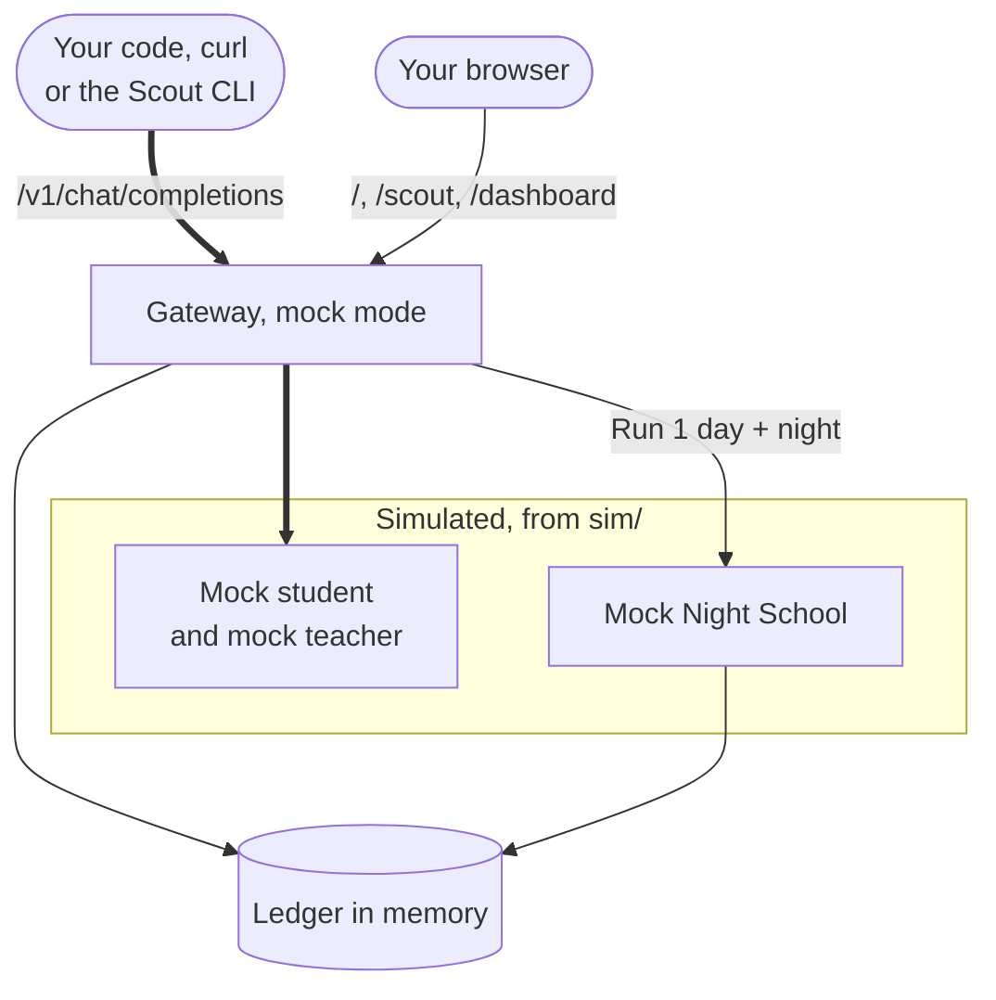

import { Steps, Tabs, TabItem } from '@astrojs/starlight/components';
import Summary from '../../../components/Summary.astro';
import Eli10 from '../../../components/Eli10.astro';
import Who from '../../../components/Who.astro';
import Stat from '../../../components/Stat.astro';
import StatRow from '../../../components/StatRow.astro';
import PathCard from '../../../components/PathCard.astro';
import PathGrid from '../../../components/PathGrid.astro';

<Summary>Mock mode runs the whole Ratchet loop on your laptop with simulated models, so you can watch every part of it work in a few minutes without API keys, a GPU or a bill.</Summary>

<Eli10>

Mock mode is a practice kitchen with play food.

Every cook in it is a wind-up toy that follows a script: the apprentice chef, the head chef from the agency, the inspector. Orders still come in, the apprentice still tastes each dish three times, the head chef still steps in when the apprentice is unsure, every head-chef dish still goes into the recipe book, and night school still happens. It all runs fast, and nobody pays for anything.

"Four days of warm-up" means the toy apprentice has already been to night school four times when you open the doors, so you meet a trained apprentice instead of one on its first day.

The **Break next deploy** button secretly swaps the next notebook of techniques for a bad one, so you can watch the inspector catch it and send the apprentice back to class.

Nothing in the practice kitchen tells you how good a real chef is. Every number it shows is labelled simulation.

</Eli10>

<StatRow cols={3} label="What mock mode needs">
  <Stat value="No keys" label="no API keys" note="Mock models stand in for the student and the teacher." />
  <Stat value="No GPU" label="runs on a laptop" note="Python 3.10 or newer and git; no Node." />
  <Stat value="No bill" label="no paid calls" note="Mock mode calls no model and no web search." />
</StatRow>

## The one-minute path

You need Python 3.10 or newer and `git`. Nothing else: no keys, no GPU, no Node.

```bash
git clone https://github.com/harshbhx/ratchet.git && cd ratchet
pip install -e ".[dev]"
python -m sim.simulate --days 3 --requests 300      # three simulated days, about ten seconds
RATCHET_MODE=mock RATCHET_MOCK_WARMUP_DAYS=4 uvicorn ratchet.gateway:app --port 8000
```

The simulation prints a table of days, who answered, what it cost and the release log. The gateway then serves on `http://localhost:8000`. In a second terminal, send it a request with the OpenAI SDK:

```python
from openai import OpenAI

client = OpenAI(base_url="http://localhost:8000/v1", api_key="unused")
resp = client.chat.completions.create(
    model="ratchet",
    messages=[{"role": "user", "content": "I was charged twice this month."}],
    extra_headers={"X-Ratchet-Task": "ticket-triage"},
)
print(resp.choices[0].message.content)
print(resp.model_extra["ratchet"]["served_by"])  # student or teacher
```

Then open `http://localhost:8000/` (the story), `/scout` (the research demo) and `/dashboard` (savings, releases, versions). Everything below explains these steps in more detail. Every number in mock mode is a simulation.

## How it really works

<Steps>

1. **Check Python.** You need Python 3.10 or newer (`python --version`). Node is not needed: the web app's build is committed.
2. **Get the code** and make a virtual environment.
3. **Install**: `make install`.
4. **Start the mock gateway**: `make demo`. It runs four simulated days and nights at startup, then serves on `http://localhost:8000`.
5. **Open the pages**: the story at `/`, Scout at `/scout`, the dashboard at `/dashboard`.
6. **Send your own request** with the OpenAI SDK, curl or Node, and read the `ratchet` block in the answer.
7. **Run the 10-day simulation**: `make sim`, with a corrupted deploy on day 4.
8. **Try Scout from the command line**: `python -m ratchet.scout "What is LoRA fine-tuning?" --base-url http://localhost:8000/v1`.

</Steps>

What is running on your machine:

<figure class="rt-diagram">



<figcaption>

**Reading this diagram.** Everything here runs on your machine. Requests come in at the top, from your code or your browser, and reach the same gateway code that live mode runs. Only what sits in the dashed box is simulated: the models and the nightly training. The ledger lives in memory, so a restart starts over.

</figcaption>
</figure>

The gateway is the same code as in live mode. Only the models are swapped: in mock mode the student, the teacher and the trainer are simulations from [`sim/`](https://github.com/harshbhx/ratchet/tree/main/sim), and the ledger is an in-memory SQLite database, so every restart starts over.

### Install

<Tabs>
<TabItem label="macOS and Linux">

```bash
git clone https://github.com/harshbhx/ratchet.git && cd ratchet
python -m venv .venv && source .venv/bin/activate
make install
```

</TabItem>
<TabItem label="Windows (PowerShell)">

```powershell
git clone https://github.com/harshbhx/ratchet.git; cd ratchet
python -m venv .venv
.venv\Scripts\Activate.ps1
pip install -e ".[dev]" ruff
```

Windows has no `make`, so run the command `make install` stands for (the last line). See [On Windows](#on-windows) below.

</TabItem>
</Tabs>

`make install` runs `pip install -e ".[dev]" ruff`. The `dev` extra brings pytest, the OpenAI Python SDK (used by the tests and the example below), `cryptography` for signed BOMs, PyYAML and Jinja2. The gateway itself needs only FastAPI, uvicorn, httpx, pydantic and anyio.

### Start the demo

```bash
make demo
```

That runs:

```bash
RATCHET_MODE=mock RATCHET_MOCK_WARMUP_DAYS=4 uvicorn ratchet.gateway:app --port 8000
```

`RATCHET_MOCK_WARMUP_DAYS=4` runs four simulated days of mixed traffic, each followed by a night of training, before the gateway answers (about 2 seconds). So the dashboard and Scout open on a student that is already live. Leave it out to start from a cold start, where the teacher answers everything.

### Open the pages

| Page | What you see |
|---|---|
| `http://localhost:8000/` | The story: how Ratchet works, why it is license-clean and why releases are safe, with a replay of the reference simulation |
| `http://localhost:8000/scout` | Scout, the multi-agent research demo. Pick an example question and watch each call get answered by the student or the teacher. Search results are simulated |
| `http://localhost:8000/dashboard` | Savings, the release pipeline, economics, versions, per-task routing, the task registry, resilience, trust and privacy, and the release log (simulation) |
| `http://localhost:8000/lite` | The original pages without a build step (also `/lite/scout`, `/lite/dashboard`) |
| `http://localhost:8000/docs` | FastAPI's interactive API docs (mock mode only, unless `RATCHET_OPENAPI=1`) |
| `http://localhost:8000/ratchet/stats` | Everything the dashboard shows, as JSON |

On the dashboard, try this:

<Steps>

1. Click **Run 1 day + night** a few times. Each click sends a day of simulated traffic through the cascade, then runs one night of Night School. The **Traffic** selector picks tickets, Scout research calls, or both.
2. Click **Break next deploy**, then keep running days. Once the next version reaches its canary, some of its answers become confidently wrong, the audits catch it, and the release gate rolls it back by itself; the release log says why.
3. In the **Resilience** panel, click **Take the student down**, then run a day. The student's circuit breaker opens, requests go straight to the teacher, and the breaker closes again once the outage ends.
4. **Reset** starts over (at most once every 30 seconds). The demo state is shared by everyone using this gateway.

</Steps>

### Send your own request

The gateway speaks the OpenAI chat-completions format, so any OpenAI SDK works. Name the task with the `X-Ratchet-Task` header (or `metadata.ratchet_task`); without one, the request belongs to the task `default`. These are the examples from the [API reference](/reference/api/#examples).

<Tabs>
<TabItem label="Python">

```python
from openai import OpenAI

client = OpenAI(base_url="http://localhost:8000/v1", api_key="unused")  # or your RATCHET_API_KEYS key
resp = client.chat.completions.create(
    model="ratchet",
    messages=[{"role": "user", "content": "I was charged twice this month."}],
    extra_headers={"X-Ratchet-Task": "ticket-triage"},
)
print(resp.choices[0].message.content)
print(resp.model_extra["ratchet"])  # served_by, confidence, cost_usd, ...
```

</TabItem>
<TabItem label="curl">

```bash
curl -s http://localhost:8000/v1/chat/completions \
  -H 'content-type: application/json' \
  -H 'X-Ratchet-Task: ticket-triage' \
  -d '{"model":"ratchet","messages":[
        {"role":"system","content":"You triage customer support tickets. Reply with JSON only ..."},
        {"role":"user","content":"I was charged twice for my Pro plan this month. Order #48213."}]}'
```

</TabItem>
<TabItem label="Node">

```js
import OpenAI from "openai";
const client = new OpenAI({ baseURL: "http://localhost:8000/v1", apiKey: "unused" });
const r = await client.chat.completions.create(
  { model: "ratchet", messages: [{ role: "user", content: "Where is my order #48213?" }] },
  { headers: { "X-Ratchet-Task": "ticket-triage" } },
);
```

Install the SDK first with `npm install openai`.

</TabItem>
</Tabs>

Every answer is a standard `chat.completion` plus a `ratchet` block. The fields you will read most:

<div class="rt-callout rt-callout--sim">

**Simulation.** In mock mode every number in the response comes from mock models.

</div>

| Field | Meaning |
|---|---|
| `served_by` | `student` or `teacher` |
| `student_version` | The version that answered, or `null` when the teacher did |
| `confidence` | The student's confidence, if it was tried |
| `escalated` | `true` when the student was tried and was below its threshold |
| `cost_usd`, `all_teacher_cost_usd` | What this request cost, and what the teacher alone would have cost (simulated prices in mock mode) |
| `stored` | Whether a teacher answer of this request became, or matched, a training example |
| `request_id`, `row_id` | The request's id and its ledger row |

### What mock mode answers

Mock models answer everything, deterministically (simulation; nothing here measures a real model). The demo's own requests, the synthetic support tickets (`sim/tickets.py`) and Scout's calls for its example questions (`sim/research.py`), get their scripted answers, and those are what the student learns in the warm-up. A request you write yourself is answered by the generic mock world (`sim/generic.py`), the same way every time for the same text:

| Your request | The mock teacher's answer |
|---|---|
| Plain text, such as `hello` | `[mock teacher] You asked: "hello". ...`: a restatement of the prompt (at most 12 words) and one of four closing sentences |
| `response_format` with a `json_schema` | JSON that validates against the schema |
| `response_format` with `json_object` | `{"answer": "[mock teacher] You asked: ..."}` |
| Ending with a `tool` message | `[mock teacher] The tool returned: "...". ...` |
| Offering `tools` | A tool call in `message.tool_calls`: `lookup_order` or `refund` from the mock catalogue, or a call to your own tool |

So the free-text examples above come back as a mock restatement, and `served_by` tells you who answered. To see the student <Who as="student" /> take over from the teacher <Who as="teacher" />, use the dashboard's **Run 1 day + night**, the Scout page or the Scout CLI, which send requests the mock world was built around. `RATCHET_MOCK_STRICT=1` restores the old behaviour, a 400 for anything but the demo's own requests. Details: [API reference, mock mode answers](/reference/api/#mock-mode-answers).

### Run the simulation

```bash
make sim
```

That runs `python -m sim.simulate --days 10 --requests 2000 --bad-deploy-version 3`: ten days of 2,000 support tickets a day through the real cascade, the real release gate and Night School, with mock models. A product launch on day 5 brings questions the student has never seen, and version 3 is deployed corrupted. It prints a day table and the event log, and writes `sim_results.json`.

<div class="rt-callout rt-callout--sim">

**Simulation, mock models, seed 7.** This is the pinned reference run ([TESTING.md](/reference/testing/)), so it reproduces exactly:

</div>

```text
day  student  escal. audit ok     $/1k all-Ultra  saved
  1       0%      0%        -    1.093     1.093     0%
  2      44%      1%     100%    0.675     1.093    38%
  3      98%      2%     100%    0.160     1.093    85%
  4      98%      2%      93%    0.160     1.093    85%   v3 canary → rolled back (41% audited precision)
  5      86%     14%      97%    0.272     1.093    75%   product launch
  6      88%     12%      92%    0.246     1.093    77%
  7      88%     12%      97%    0.255     1.093    77%
  8      95%      5%      99%    0.200     1.093    82%
  9      98%      2%      97%    0.162     1.093    85%
 10      98%      2%      99%    0.147     1.093    87%
total saved 69%
```

How to read it: day 1 is the cold start, when the teacher answers everything. The first student starts answering on day 2 and serves 98% of tickets on day 3. On day 4 the corrupted v3 reaches its canary and is rolled back automatically. On day 5 the new questions escalate, and over the next nights the student learns them (98% again on day 9). "$/1k" is the cost per 1,000 requests at list prices, "all-Ultra" what the teacher alone would have cost. These numbers show how the loop behaves, not how good a real model is: the mock student's skill is a formula in `sim/`, and the mock teacher is always right.

Other workloads: `python -m sim.simulate --workload research --days 8 --requests 1500` sends Scout's triage and reader calls; `--workload mixed` sends half of each.

### Try Scout from the command line

```bash
python -m ratchet.scout "What is LoRA fine-tuning?" --base-url http://localhost:8000/v1
```

Scout runs as an outside client against the gateway: a planner and a writer pinned to the teacher, a searcher, and many small triage and reader calls the student learns. It also takes `--api-key` and `--max-results` (default 4). Without `TAVILY_API_KEY` it uses simulated search results, which cover only the eight example questions (such as "What is knowledge distillation?" and "How does a model cascade cut LLM costs?") and work only against a mock-mode gateway. See [Scout](/guides/scout/).

### On Windows

`make` is not part of Windows. Either run the guide in **WSL** (Ubuntu), where every command above works as written, or use **Git Bash** (it does not include `make` by default: install it, or type the commands each target stands for). In Git Bash the inline form `RATCHET_MODE=mock uvicorn ...` works as on Linux.

PowerShell sets environment variables differently. The equivalent of `make demo`:

```powershell
.venv\Scripts\Activate.ps1
$env:RATCHET_MODE="mock"; $env:RATCHET_MOCK_WARMUP_DAYS="4"
uvicorn ratchet.gateway:app --port 8000
```

The variables stay set for that PowerShell window; `Remove-Item Env:RATCHET_MOCK_WARMUP_DAYS` clears one. The equivalent of `make sim` is `python -m sim.simulate --days 10 --requests 2000 --bad-deploy-version 3`.

## For engineers

**Make targets** ([Makefile](https://github.com/harshbhx/ratchet/blob/main/Makefile))

| Target | Runs |
|---|---|
| `make install` | `pip install -e ".[dev]" ruff` |
| `make demo` | `RATCHET_MODE=mock RATCHET_MOCK_WARMUP_DAYS=4 uvicorn ratchet.gateway:app --port 8000` |
| `make sim` | `python -m sim.simulate --days 10 --requests 2000 --bad-deploy-version 3` |
| `make test` | `pytest -q`: no network, no GPU, about two minutes; real APIs are never called |
| `make lint` | `ruff check`, `ruff format --check` and the repository's consistency checks |
| `make reference` | The three pinned workloads must reproduce v0.4.0's behaviour |
| `make web`, `make web-dev` | Rebuild the React app into `ratchet/web/dist` (needs Node), or hot reload on port 5173 against the gateway on 8000 |
| `make clean` | Remove caches, build output, `sim_results.json` and `ratchet.db` |

**Mock-mode settings** (read in [`ratchet/config.py`](https://github.com/harshbhx/ratchet/blob/main/ratchet/config.py), documented in [CONFIGURATION.md](/reference/configuration/#mock-mode-demo))

| Variable | Default | Meaning |
|---|---|---|
| `RATCHET_MODE` | `mock` | `live` needs keys; see [Host it on Nebius](/guides/host-on-nebius/) |
| `RATCHET_MOCK_WARMUP_DAYS` | `0` | Simulated days and nights at startup and after every reset; `make demo` sets 4 |
| `RATCHET_MOCK_WARMUP_REQUESTS` | `1500` | Requests per warm-up day |
| `RATCHET_MOCK_PACE` | `0.25` | Share of each call's simulated latency `/scout/stream` waits, so the page shows agents working |
| `RATCHET_MOCK_STRICT` | `0` | `1`: anything but the demo's own requests is a 400 |
| `RATCHET_MOCK_ENDPOINT_HOURS` | `24` | Hours a day the simulated student endpoint runs, for the cost report (a simulation assumption) |
| `RATCHET_API_KEYS` | empty | Turn on gateway API keys locally too: `RATCHET_API_KEYS="me:$(openssl rand -hex 24)" make demo` |

**Endpoints used here** ([API reference](/reference/api/)): `POST /v1/chat/completions`, `GET /v1/models`, `GET /ratchet/stats`, `GET /ratchet/cost`, `GET /healthz`, and the mock-only demo controls `POST /ratchet/demo/day?requests=1500&workload=tickets`, `POST /ratchet/demo/break-next`, `POST /ratchet/demo/student-outage?seconds=60` and `POST /ratchet/demo/reset`, which answer 403 in live mode.

**Files**: the gateway is [`ratchet/gateway.py`](https://github.com/harshbhx/ratchet/blob/main/ratchet/gateway.py) (FastAPI app `ratchet.gateway:app`); the cascade is `Ratchet.handle` in [`ratchet/router.py`](https://github.com/harshbhx/ratchet/blob/main/ratchet/router.py); the simulator is [`sim/simulate.py`](https://github.com/harshbhx/ratchet/blob/main/sim/simulate.py), with traffic in `sim/tickets.py`, `sim/research.py` and `sim/generic.py`. To keep a simulated run's ledger for the replay tools, run `python -m sim.simulate --db sim.db`.

## Common questions

### Do I need an API key, a GPU or Node?

No. Mock mode calls no model and no web search, so it needs no keys and no GPU, and costs nothing. Node is needed only to rebuild the web app (`make web`); the build is committed.

### Why does my own request come back as "[mock teacher] You asked: ..."?

Because it is not one of the requests the mock world was scripted for. The generic mock world answers it deterministically so nothing breaks, but there is no real model behind it. Use the dashboard, the Scout page or the Scout CLI to watch the student learn.

### Are the numbers real?

No. Every number in mock mode, `make sim` included, comes from mock models and shows how the loop behaves: cold start, drift, rollback, savings over time. As of Oct 25, 2026 the only measured model results are the text-to-SQL and tool-calling adapters' exam scores, read from their results files on [Results](/guides/results/); the only live run on record is a 20-request smoke run (`evidence/live-smoke-2026-10-23`) that measures no savings. See [evidence](/guides/evidence/).

### Where is my data?

In memory. Mock mode keeps the ledger in an in-memory SQLite database, so stopping the gateway or pressing **Reset** starts over. `make sim` writes its results to `sim_results.json`, and `--db sim.db` keeps the simulated ledger.

### Port 8000 is taken. What now?

Run the line `make demo` stands for with another port, for example `--port 8001`, and use that port in the URLs and examples.

### How do I go from here to real models?

Run the day-1 checks with a Token Factory key, then follow [Host it on Nebius](/guides/host-on-nebius/). Live mode spends money on every request the teacher answers, so start with the guards described there.

## Next steps

- Send a verdict back on an answer, and see every route: the [endpoint map](/api/endpoints/).
- Run the loop on your own tasks: [Training on your data](/guides/training-on-your-data/) and the task registry (see the [glossary](/guides/glossary/)).
- Read the other tools you have now: [Command line](/api/cli/) and [environment variables](/api/environment/).
- Embed the cascade in a Python program: [Python API](/api/python/).
- Move to real models: [Host it on Nebius](/guides/host-on-nebius/).

## Related

<PathGrid cols={2} label="Related pages">
  <PathCard title="What is Ratchet?" href="/guides/what-is-ratchet/" icon="book" tone="neutral" description="The idea in plain words." />
  <PathCard title="The request journey" href="/guides/request-journey/" icon="loop" description="What happens to one request, step by step." />
  <PathCard title="Night School" href="/guides/night-school/" icon="layers" description="How a new student is trained every night." />
  <PathCard title="Host it on Nebius" href="/guides/host-on-nebius/" icon="server" tone="neutral" eyebrow="Ready to run" description="The demo VM, the GPU endpoint and training, written and tested offline." />
</PathGrid>
