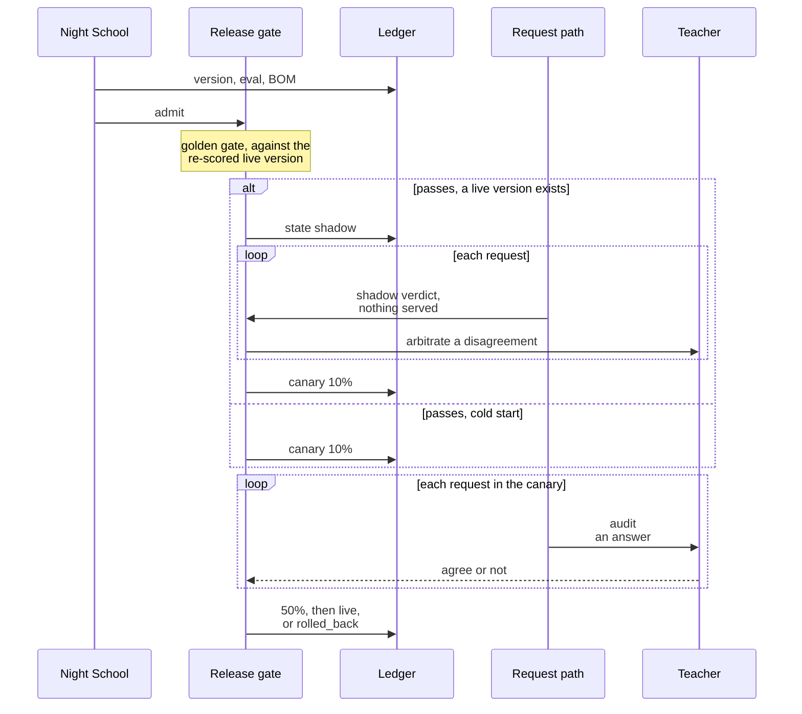
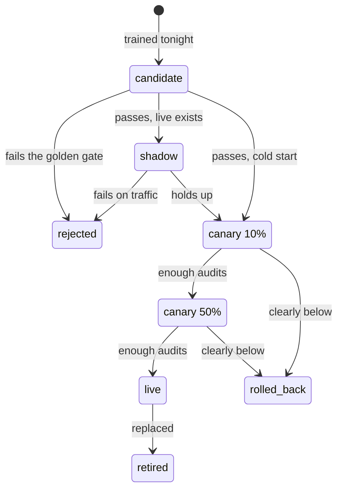
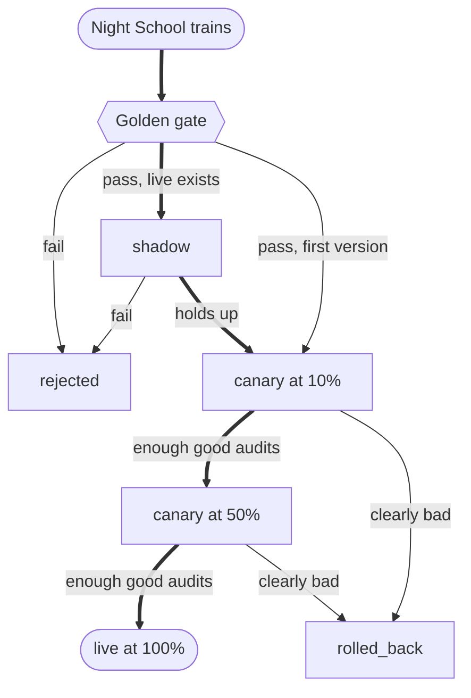
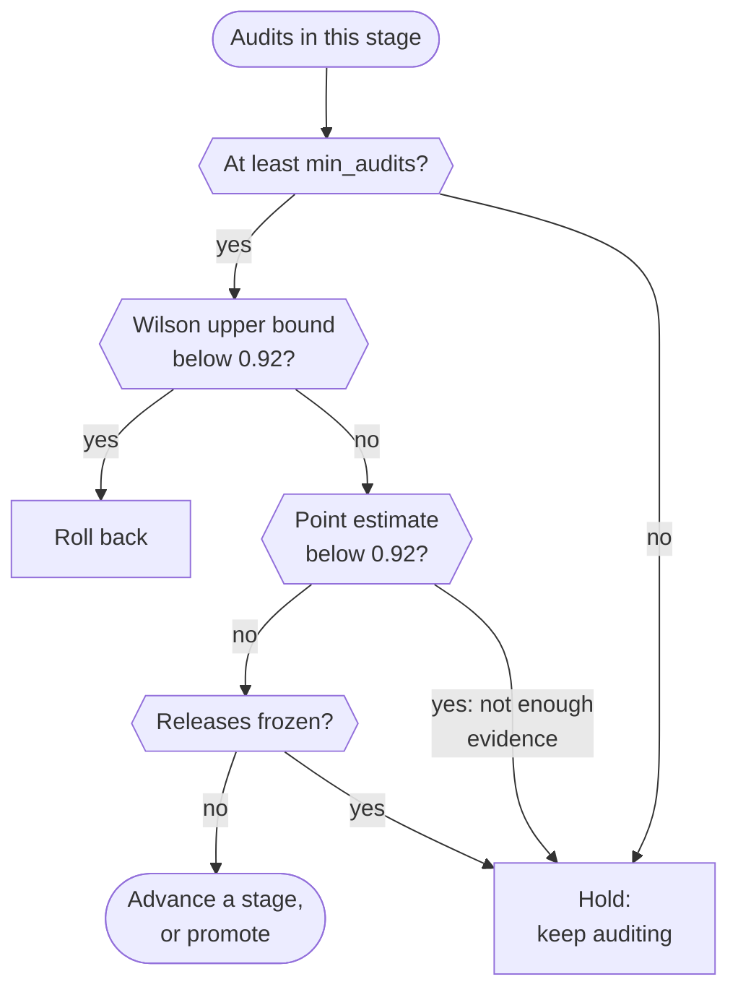
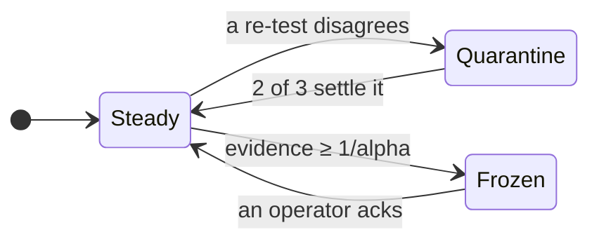

import { Steps, Aside } from '@astrojs/starlight/components';
import Summary from '../../../components/Summary.astro';
import Eli10 from '../../../components/Eli10.astro';
import Who from '../../../components/Who.astro';
import Stat from '../../../components/Stat.astro';
import StatRow from '../../../components/StatRow.astro';
import PathCard from '../../../components/PathCard.astro';
import PathGrid from '../../../components/PathGrid.astro';
import FadeContent from '../../../components/ui/FadeContent.astro';
import Stepper from '../../../components/ui/Stepper.astro';

<Summary>The release gate decides, from held-out golden rows and teacher audits, whether a newly trained adapter may take traffic, how much, and when to send it back, so a bad night never quietly replaces a good student.</Summary>

<Eli10>

After night school, the apprentice has a new notebook. Nobody lets it near customers yet.

1. **The sealed exam.** The new notebook is tested on recipes it never studied. At least 95 of every 100 dishes it chooses to send out must match the head chef's, it must be willing to cook at least a quarter of the orders, and it must not do worse than the current apprentice. To keep that fair, the current apprentice re-takes the very same exam the same night.
2. **The trial shift.** The new notebook cooks silently next to the current apprentice. Nothing it cooks leaves the kitchen. When the two disagree, the head chef decides who was right. After 100 dishes it would have sent out, it either passes or goes back.
3. **Serving a few tables first.** It serves 10% of the tables, then half, then all of them. The inspector tastes a few random plates at each step, and each step needs at least 20 tastings.
4. **Sending the apprentice back to class.** If the tastings show quality clearly below 92 of 100, the new notebook is taken off the line automatically and the previous one cooks again.

"Clearly" matters. If the inspector tasted 20 plates and 17 were right, that is 85%, which looks bad. But 20 tastings is not many; maybe it was a few unlucky plates. So the inspector asks: **giving the apprentice the benefit of the doubt, how good could it really be?** With 17 of 20, that generous ceiling is about 95%, above 92, so the inspector keeps tasting. With 7 right out of 17, even the generous ceiling is 64%. Even being generous, the score is too low: back to class.

The apprentice who already serves every table is never sent back automatically. If the inspector finds a problem there, an alarm goes off and a person decides.

</Eli10>

## How it really works

<figure class="rt-diagram">



<figcaption>

**Reading this diagram.** Night School hands over a trained candidate and the gate does the rest. The first judge is the golden exam, run the same night for the candidate and the current live version. Then real traffic does the judging: first silently in shadow, then in the canary, where the teacher audits a random sample of what the canary served. Every state change is a write to the ledger, which is why the whole history can be replayed from the events table.

</figcaption>
</figure>

A version moves through a small set of states, stored in the ledger's `versions` table. The golden gate, the shadow decision, the default canary rule and every admin action write their moves with a compare-and-set, so two processes deciding at once make each decision only once.

<figure class="rt-diagram">



<figcaption>

**Reading this diagram.** Every version is born as a candidate and ends in one of three resting places: `rejected` (never served anyone), `rolled_back` (served some, then failed its audits) or `retired` (replaced). Only a canary can become live, and the only way out of live is to be replaced: there is no automatic arrow out of `live`, on purpose. "Enough audits" means at least 20 in the stage with audited precision at or above 0.92; "clearly below" means the Wilson upper bound is under 0.92. Not drawn: a shadow or canary is also `retired` when it is replaced or cancelled, or when the opt-in sequential rule finds a stage inconclusive.

<ul class="rt-key">
  <li class="student">Your adapter on trial</li>
  <li class="ok">Serving everyone</li>
  <li class="danger">Stopped</li>
  <li class="outline">Replaced</li>
</ul>

</figcaption>
</figure>

| State | Traffic | Meaning |
|---|---|---|
| `candidate` | 0 | Trained and scored tonight, not yet judged |
| `rejected` | 0 | Failed the golden gate or the shadow |
| `shadow` | 0 | Scores real traffic silently next to the live version |
| `canary` | 10, then 50 | Serves a share of requests; the teacher audits a sample |
| `live` | 100 | Serves every request the student is confident on |
| `retired` | 0 | Replaced by a newer version, cancelled by an operator, or (sequential rule only) inconclusive |
| `rolled_back` | 0 | Taken off the line because its audits were clearly below the floor |

`inconclusive` is an event, not a state: under the opt-in sequential rule, a canary stage that reaches `max_stage_audits` without a decision is `retired` with an `inconclusive` event.

Step through the rollout one stage at a time; the numbered list under it keeps every rule.

<Stepper
  label="Rollout stages"
  steps={[
    { title: 'Golden gate', body: 'Held-out precision at least **95%** and coverage at least **25%**, and no regression of more than 2 points against the live version, graded on the same golden rows the same night.' },
    { title: 'Shadow', body: 'The candidate answers silently next to the live version. After it would have served **100** answers: precision at least 95% and coverage within 2 points, or it is rejected.', tone: 'owned' },
    { title: 'Canary 10%', body: 'One request in ten. With at least **20** audits in the stage, it advances, holds, or is rolled back when the 95% Wilson upper bound of audited precision is below **0.92**.', tone: 'owned' },
    { title: 'Canary 50%', body: 'The same rule, with the audit count starting again.', tone: 'owned' },
    { title: 'Live', body: 'One transaction makes the canary live at 100% and retires the old version. The live version is watched and alerts, but is never rolled back automatically.', tone: 'owned' },
  ]}
/>

<Steps>

1. **Golden gate** (`ReleaseGate.admit`, right after training). Read the candidate's held-out numbers from its eval, in this order:
   - precision at least `min_precision` (0.95), else `rejected`;
   - coverage at least `min_coverage` (0.25), else `rejected`;
   - with `RATCHET_MIN_CERTIFIED_PRECISION` set (opt-in), the certified lower bound at least that floor, else `rejected`;
   - if a version is live: no regression against it. By default, the candidate is rejected if its precision or coverage is more than `tolerance` (0.02) below the live version's. With the opt-in paired gate, a row-by-row test instead (below);
   - per task: a task that fails its own check is disabled on the candidate (or, with `RATCHET_TASK_MODE=reject`, rejects it).

   The live version's numbers come from a re-score on the **same golden rows the same night** (champion against challenger), so both are graded on one exam.

2. **First stage.** With no live version (cold start), the candidate goes straight to canary at 10%: there is nothing to shadow against, so the teacher's audits judge it. Otherwise it enters **shadow**. Any older shadow or canary still in flight is retired first (rare, because Night School does not train while a release is in flight).

3. **Shadow** (`_tick_shadow`). On each request the shadow version is sampled and scored like a real student, against its own threshold. Nothing it says is served. Its answer is compared with the teacher's when the teacher answered that request (an escalation or an audit). Otherwise, when it would serve and disagrees with the served answer, the teacher arbitrates, and the arbitration is stored as training data; an arbitration that fails counts as a disagreement. When it agrees with the live student's served answer, that agreement is accepted as it is. Once the shadow would have served `min_shadow` (100) answers:
   - shadow precision below 0.95: `rejected`;
   - shadow coverage more than 0.02 below the live student's coverage on the same requests: `rejected`;
   - otherwise canary at 10%.

4. **Canary** (`_tick_canary`, default Wilson rule). The teacher audits a random share of the canary's served answers. With at least `min_audits` (20) audits **in the current stage**:
   - if the upper end of the 95% Wilson interval of audited precision is below `live_floor` (0.92): `rolled_back`, and traffic returns to the live version (or the teacher on cold start);
   - else if the point estimate is below 0.92: hold and keep auditing;
   - else advance 10 to 50, or 50 to live. The move starts a new stage, so the audit count starts again.

5. **Promotion.** Under the default rule, one transaction (`Ledger.promote_live`) makes the canary live at 100% and retires the old live version, with a `live_retired` event then a `live` event, so two versions are never live.

6. **Live watch** (`_tick_live`). The live version is never rolled back automatically. By default an e-process over its audits since it went live raises one `alert` event per version when the evidence that precision is below 0.92 reaches 100 (`alpha_alert` 0.01). The runbook says what to do.

</Steps>

Ticks run from the request path at most every `RATCHET_TICK_INTERVAL_S` seconds (5 in live mode, every request in mock mode) and from cron (`python -m ratchet.live tick`).

<figure class="rt-diagram">



<figcaption>

**Reading this diagram.** The same story as the state diagram, as a pipeline from Night School at the top; the thick path is the way to live. The shadow stage is skipped only on a cold start, when there is no live student to compare with. Both canary stages can end in a rollback, but only the 50% stage can lead to live.

</figcaption>
</figure>

One canary tick under the default rule:

<figure class="rt-diagram">



<figcaption>

**Reading this diagram.** Three of the exits lead to the same hold. The only way to move forward is to have enough audits, a point estimate at or above the floor and no operator freeze. A rollback needs the strongest evidence of all: not "the average looks bad" but "even the generous end of the interval is below the floor". A freeze is checked last, so it never blocks a rollback.

</figcaption>
</figure>

## The Wilson bound, precisely

<StatRow cols={3} label="The canary's defaults">
  <Stat value={20} count={false} label="audits per stage" note="min_audits: before a canary can advance, or be rolled back by the Wilson rule (15 in mock mode)." />
  <Stat value={0.92} decimals={2} count={false} label="audited precision floor" note="live_floor: rolled back when even the Wilson upper bound is below it." />
  <Stat value={100} count={false} label="would-serve shadow answers" note="min_shadow: before the shadow is judged against the live version." />
</StatRow>

The Wilson score interval for `s` agreeing audits out of `n`, with `z = 1.96`:

```text
p      = s / n
denom  = 1 + z^2 / n
centre = (p + z^2 / (2n)) / denom
half   = z * sqrt( p(1 - p)/n + z^2/(4n^2) ) / denom
bounds = [max(0, centre - half), min(1, centre + half)]
```

It is the two-sided 95% interval; the rule uses its upper end, so a rollback needs strong evidence that the version is worse, not just a bad-looking average. Checked with `stats.wilson`:

| Audits agreeing | Point estimate | Wilson upper bound | Decision at a 0.92 floor |
|---|---|---|---|
| 19 of 20 | 95% | 99.1% | Advance |
| 17 of 20 | 85% | 94.8% | Hold: below the floor, but not clearly |
| 10 of 20 | 50% | 70.1% | Roll back |
| 7 of 17 | 41.2% | 64.0% | Roll back (the simulator's and mock mode's `min_audits` is 15) |

The last row is the reference run's corrupted v3: audited precision 41.2% at n = 17, rolled back on day 4 after serving 145 answers (simulation, mock models, seed 7). A plain point-estimate rule was not used because at 20 audits, a healthy canary at 96% true precision shows a point estimate below 92% about 19% of the time.

## The anytime-valid rule (opt-in)

The Wilson interval keeps its error rate for **one look** at a fixed sample. The gate looks after every request. When true precision sits exactly on the floor, checking Wilson after every audit falsely rolls back about 22% of such versions within 400 audits, against a nominal 2.5% (simulation, counts only, 2,000 seeded runs). And `min_audits` lets a broken deploy keep serving until it has 15 to 20 audits.

**Explained simply.** Think of a running bet against "quality is fine". You start with one coin. Before each audit you bet a little that the answer will be wrong. If quality really is fine, this bet cannot grow on average: it is a fair game or worse for you. So if your pile ever reaches 20 coins, that is strong evidence quality is not fine. Because a fair game cannot grow on average, it does not matter how often you look at your pile: checking after every single audit is allowed. That is what "anytime-valid" means.

**Precisely.** With `RATCHET_SEQUENTIAL=1`, `_tick_canary` hands over to `_sequential_canary`, which reads two integers per version, audits `n` and agreements `s` (`Ledger.audit_counts`):

<Steps>

1. **Rollback.** The mixture e-value against "precision is at least the floor", over **every** audit of the canary's life, reaches `1/alpha_rollback` (20). It mixes likelihood ratios over a fixed grid of alternatives below the floor; under the null each audit multiplies it by a factor whose expected value is at most 1, so it is a nonnegative supermartingale and Ville's inequality gives P(it ever reaches 20) at most 5%, however often the gate looks. There is no minimum count: 0 agreeing out of 2 already gives 29.8.

2. **Promotion,** on the current stage's audits once there are `min_audits`: the point estimate at or above the floor, or with `RATCHET_PROMOTE_EVIDENCE=1` an e-value that precision is **above** the floor reaching `1/alpha_promote` (20). That needs 56 agreeing audits per stage at a 0.92 floor (55 give 19.996).

3. **Futility.** A stage with `max_stage_audits` (400) audits and no decision is retired, with an `inconclusive` event. It counts audits, not time.

</Steps>

Every event carries the counts, the e-value and its threshold, and an anytime-valid 95% confidence sequence, for example `v3 rolled back: 3/7 audits agree; e-value 64.9 >= 20 (anytime-valid, alpha 5%); 95% CS [0.041, 0.908]; traffic back to live v1`. Anyone can recompute those numbers from the two counts.

| True precision (floor 0.92) | Sequential rule | Wilson after every audit |
|---|---|---|
| 0.92: false rollback within 400 audits | 2.9% to 3.5% | 22.1% to 22.6% |
| 0.41: median audits to rollback | 4 | 20 |
| 0.70: median audits to rollback | 18 | 20 |
| 0.85: median audits to rollback | about 115 | about 35 |

Simulation, counts only, from the gate's operating characteristics. The price is power against small drops: a version at 0.85 to 0.88 is caught later than by the Wilson rule, which catches it sooner only because it also rolls back good versions far more often. On the reference configuration, `python -m sim.simulate --bad-deploy-version 3 --compare-release` rolls the corrupted v3 back after 7 audits and 48 served answers under the sequential rule, against 17 audits and 145 answers under Wilson (simulation, mock models).

The sequential canary is opt-in so the pinned reference runs do not move. The **live alert** already uses the e-process by default (`RATCHET_ALERT_EPROCESS=1`, threshold 100). The live-run harness's planned gate profile turns the sequential rule on (`RATCHET_SEQUENTIAL=1`, `RATCHET_CANARY_AUDIT_RATE=0.5`).

## The paired gate (opt-in)

The default regression check compares two point estimates within 0.02, but the candidate and the live version were scored on the same rows, so the comparison can be done row by row. With `RATCHET_PAIRED_GATE=1`, the gate reads the candidate's `paired` record against the re-scored live version:

- **Coverage:** `b` rows only live serves, `c` rows only the candidate serves, and McNemar's exact one-sided p-value `p_cov = P(X at least b)` with `X ~ Binomial(b + c, 1/2)`.
- **Wrong answers as a client sees them:** negative flips (the candidate serves a wrong answer where live was right, served or escalated) against positive flips, with `p_err`.
- **Negative flip rate:** answers live served right that the candidate serves wrong, with a 95% Wilson interval.

It rejects only a regression that is both large and significant: more than `tolerance` of the rows lost from coverage with `p_cov` below `RATCHET_REGRESSION_ALPHA` (0.05), more than `tolerance` of the rows newly answered wrong with `p_err` below it, or, with `RATCHET_MAX_NFR` below 1, a flip rate whose lower bound is above it. Without a paired record against the current live version it falls back to the default rule.

In plain words: only rows where the two versions differ count, and four lost rows with none won is like four coin flips all landing heads, which happens one time in 16. In the reference run, v2 was rejected under the default rule for serving 70 of 74 golden rows against live's 74: four discordant rows, p = 0.0625, not significant at 5% (simulation, README). With the paired gate, v2 is admitted and the run takes another path (simulation, one seed).

## Per-task checks

When several tasks share one adapter, the golden gate also checks each task with at least `min_task_test_n` (10) held-out rows. A task fails when its held-out precision is below its floor (its spec's `policy.min_precision`, else 0.95), more than `tolerance` below the live version's precision on that task, or unmeasured because it answers none of its held-out rows.

- `task_mode` `disable` (default): the task's threshold becomes 1.01 on that candidate, a `task_disabled` event is written, the teacher answers that task, and the version ships for its other tasks. The task stays disabled for the version's life, through every re-score.
- `task_mode` `reject`: the candidate is rejected.
- Either way, a candidate that would answer less than `min_coverage` of its held-out rows once its failing tasks are off is rejected: it would sit in shadow or canary forever, and no night would train meanwhile.

On the live and canary versions, one `alert` per (version, task) fires when that task's audited precision has a Wilson upper bound below 0.92 with at least `min_audits` audits. Nothing is disabled automatically on a live version; pinning a task to the teacher is an operator's decision.

## Two watchers beside the gate: drift and the teacher

The gate's tick has two more steps that never promote or roll back a version. They watch for changes the golden exam cannot see.

**The drift alarm** (`_tick_drift`) watches each (version, task) stream of the student's confidence scores for a shift, with no labels needed. When it alarms (`RATCHET_DRIFT_ALARM`, default 100, so at most a 1% false alarm per stream over its life), it writes a `drift` event and suspends that version's certificate, because the certificate no longer describes the traffic. Two opt-in actions can follow: a higher audit rate for the alarmed version (`RATCHET_DRIFT_AUDIT_BOOST`) and an earlier night (`RATCHET_DRIFT_EARLY_NIGHT`). How the score is built is in [Confidence](/guides/confidence/#watching-the-confidence-scores-over-time-the-drift-alarm).

**The teacher watch** (`_tick_watchers`) asks whether the teacher itself is steady. The golden set and the audits both measure agreement with the teacher, so a teacher whose answers wander would make every number meaningless. Each stored label gets at most one re-test per check epoch (a repeated request that the teacher labels again, or one of the `RATCHET_TEACHER_PROBES` probes Night School sends each night, 20 by default). A disagreement puts the label in quarantine (`contested`): it is left out of both the training and the golden split until Night School adjudicates it, by asking the teacher twice more and keeping the strict majority of three. When the evidence that the teacher disagrees with itself more than `RATCHET_TEACHER_NOISE_MAX` (0.05) reaches 1/`RATCHET_ALPHA_TEACHER` (100), the gate writes a `teacher_drift` event and Night School stops training until an operator acknowledges it with `POST /ratchet/teacher/ack`. A new model id in the teacher's responses starts a new epoch. `GET /ratchet/teacher` shows the state, and `RATCHET_TEACHER_WATCH=0` turns the actions off while the free checks are still recorded.

<figure class="rt-diagram">



<figcaption>

**Reading this diagram.** One disagreement is not an emergency: it only quarantines one label until two more teacher answers settle it by a majority of 3. Training stops only when many disagreements add up to strong evidence (1/`RATCHET_ALPHA_TEACHER`, 100 by default), and it stays stopped until a person acknowledges it. The freeze affects training, not serving: the live student keeps answering. Not drawn: re-tests that agree leave the watch steady, and a new teacher model id starts a new check epoch.

<ul class="rt-key">
  <li class="ok">Training as usual</li>
  <li class="pending">One label held out</li>
  <li class="danger">Training stopped</li>
</ul>

</figcaption>
</figure>

## No training while a release is in flight

Night School skips the night while any version is in `shadow` or `canary`, with a `skip` event such as `v4 still in canary; no training tonight (saves GPU time)`. A new candidate would replace the one being judged and waste both the GPU time and the evidence gathered so far. An operator who wants tonight's training can retire the shadow first.

## Operator holds and the admin API

Every manual change goes through `ratchet/admin.py`, shared by the HTTP admin API (`/ratchet/admin/*`, admin key from `RATCHET_ADMIN_KEYS`) and the CLI (`python -m ratchet.admin`). Each change needs a reason (3 to 500 characters), is checked against an explicit table of allowed moves, and writes the change, an `admin_actions` row (who, what, why, before and after) and an `admin` event in one transaction.

| Switch or action | Effect on the gate |
|---|---|
| `releases_frozen` | No version starts taking traffic or takes more: no shadow to canary, no canary advance or promotion, and a cold-start candidate shadows the teacher instead of taking 10%. Rollbacks, rejections and the live alert keep running |
| `audit_rate` set to 0 | Same hold: a canary without audits could neither advance nor be rolled back, so no new canary starts. Setting 0 during a canary needs `force` |
| `student_disabled` | Kill switch: no student or shadow call; the teacher answers everything (route `student_disabled`). No version changes state |
| `training_paused` | Every night writes `skip` and trains nothing |
| `rollback`, `retire` | Roll a canary back; retire a canary, shadow or live version |
| `promote` | A canary to another share or to live; a shadow to canary. A rejected, rolled-back or retired version (or a candidate) to canary only with `force`. Nothing becomes live except a canary, and a version without a golden eval is never promoted |

A hold never blocks a rollback, a rejection or an alert. The admin's moves and the gate's (the golden gate, the shadow decision and the default canary rule) use the same compare-and-set (`Ledger.transition`, `Ledger.promote_live`): a move into shadow or canary is refused while another version is in flight, a decision made on a state someone else just changed is dropped, and a candidate an admin moved while it was being scored is left alone with a `conflict` event.

<Aside type="note" title="The sequential rule's writes">
In the current code, the opt-in sequential canary rule (`_sequential_canary`) moves versions with `Ledger.set_version`, an unconditional update, rather than the compare-and-set writers, and its promotion writes no `live_retired` event. The "each decision is made once" guarantee therefore covers the default rule, not the sequential one, until that path uses `transition` and `promote_live` too.
</Aside>

## The release log

Every decision writes an event (the `events` table, shown in the dashboard's release log and in `GET /ratchet/stats`):

| Event | Written when |
|---|---|
| `trained` | Night School trained and scored a new version |
| `skip` | No training tonight (release in flight, too few new examples, paused, no golden set) |
| `rejected` | Golden gate or shadow failed, with the reason |
| `shadow` | Passed the golden gate; shadowing the live version (appends the paired counts and the certificate when there are any) |
| `canary` | Started or advanced a canary stage |
| `live_retired`, `live` | The old live version retired; the canary promoted to 100% |
| `retired` | An in-flight version replaced by a newer candidate |
| `rollback` | The canary rolled back, with the evidence |
| `inconclusive` | Sequential rule only: a stage hit `max_stage_audits` without a decision |
| `alert` | The live version (or one task of the live or canary version) is clearly below the floor |
| `task_disabled` | One task of a candidate failed its own golden check |
| `drift` | The drift alarm fired for a (version, task) stream |
| `teacher_drift` | The teacher watch froze Night School |
| `conflict` | A candidate changed by another process while the gate decided |
| `admin` | An operator's change, with the actor and the reason |

<Aside type="caution" title="Only simulated releases so far">
As of Oct 22, 2026, the release gate has decided only on mock models: every promotion and rollback quoted here is simulation. No trained student has been served from a Nebius GPU, so no live canary has run. Live mode, the cron tick and the admin CLI are tested offline.
</Aside>

## For engineers

| What | Where |
|---|---|
| The gate | [`ratchet/release.py`](https://github.com/harshbhx/ratchet/blob/main/ratchet/release.py): `ReleaseGate.admit`, `tick` (six steps: `_tick_drift`, `_tick_live`, `_tick_tasks`, `_tick_shadow`, `_tick_canary`, `_tick_watchers`), `_sequential_canary`, `task_failures`, `_paired_regression`, `evidence`, `ReleasePolicy`, `CANARY_STEPS` |
| Statistics | [`ratchet/stats.py`](https://github.com/harshbhx/ratchet/blob/main/ratchet/stats.py): `wilson`, `log_e_bernoulli`, `e_bernoulli`, `confidence_sequence`, `mcnemar_one_sided`, `cp_lower` |
| Paired comparison | [`ratchet/certificate.py`](https://github.com/harshbhx/ratchet/blob/main/ratchet/certificate.py): `paired`, `paired_stats` |
| Moves and counts | [`ratchet/ledger.py`](https://github.com/harshbhx/ratchet/blob/main/ratchet/ledger.py): `transition`, `promote_live`, `transaction`, `audit_counts`, `version_live_quality`, `shadow_quality`, `flags` |
| Manual changes | [`ratchet/admin.py`](https://github.com/harshbhx/ratchet/blob/main/ratchet/admin.py): `rollback`, `retire`, `promote` (`MOVES`), `set_flag`, `pin_task`, `tick` |
| The night that feeds it | [`ratchet/nightschool/orchestrate.py`](https://github.com/harshbhx/ratchet/blob/main/ratchet/nightschool/orchestrate.py): `run_night` (champion re-score, paired evidence, BOM, then `admit`) |
| Tests | `tests/test_release.py`, `tests/test_admin.py`, `tests/test_stats.py`, `tests/test_calibration.py` |

`ReleasePolicy` fields, each set with `RATCHET_<FIELD>` ([Configuration](/reference/configuration/#release-policy-ratchetreleasepy)):

| Variable | Default | Meaning |
|---|---|---|
| `RATCHET_MIN_PRECISION` | 0.95 | Golden gate and shadow precision floor |
| `RATCHET_MIN_COVERAGE` | 0.25 | Golden gate coverage floor |
| `RATCHET_TOLERANCE` | 0.02 | Largest drop against live (0 to 0.2) |
| `RATCHET_MIN_SHADOW` | 100 | Would-serve shadow answers before a decision |
| `RATCHET_MIN_AUDITS` | 20 (15 in mock mode) | Audits per canary stage before promotion, and before a Wilson rollback or alert |
| `RATCHET_LIVE_FLOOR` | 0.92 | Audited precision floor; must be at most `RATCHET_MIN_PRECISION` |
| `RATCHET_MIN_TASK_TEST_N` | 10 | Held-out rows a task needs before its own golden check |
| `RATCHET_TASK_MODE` | `disable` | Or `reject` |
| `RATCHET_SEQUENTIAL` | 0 | 1: the anytime-valid canary rule |
| `RATCHET_ALPHA_ROLLBACK` | 0.05 | Sequential rollback threshold 1/alpha = 20 |
| `RATCHET_PROMOTE_EVIDENCE` | 0 | 1: promote on evidence (needs `RATCHET_SEQUENTIAL=1`) |
| `RATCHET_ALPHA_PROMOTE` | 0.05 | Evidence-based promotion threshold 20 |
| `RATCHET_MAX_STAGE_AUDITS` | 400 | Sequential futility cap; 0 means never |
| `RATCHET_ALERT_EPROCESS` | 1 | Live alert by e-process (0: Wilson) |
| `RATCHET_ALPHA_ALERT` | 0.01 | Live alert threshold 100 |
| `RATCHET_MIN_CERTIFIED_PRECISION` | 0.0 | Certified floor in the golden gate; 0 is off |
| `RATCHET_PAIRED_GATE` | 0 | 1: row-by-row regression check |
| `RATCHET_REGRESSION_ALPHA` | 0.05 | The paired gate's McNemar level |
| `RATCHET_MAX_NFR` | 1.0 | Negative flip rate cap; 1 is off |

The drift alarm and the teacher watch add `RATCHET_DRIFT_ALARM` (100), `RATCHET_DRIFT_AUDIT_BOOST` (1), `RATCHET_DRIFT_EARLY_NIGHT` (0), `RATCHET_TEACHER_WATCH` (1), `RATCHET_TEACHER_NOISE_MAX` (0.05), `RATCHET_ALPHA_TEACHER` (0.01), `RATCHET_TEACHER_PROBES` (20) and `RATCHET_ADJUDICATE_MAX` (50). A typo or an out-of-range value stops startup with a message naming the variable. Related settings: `RATCHET_AUDIT_RATE` (0.05; mock mode at least 0.10), `RATCHET_CANARY_AUDIT_RATE` (unset: a canary's own audit rate, so its evidence arrives sooner), `RATCHET_TICK_INTERVAL_S`.

Endpoints ([API](/reference/api/)):

- `GET /ratchet/stats`: `versions[].evidence` for the canary and live versions (`ReleaseGate.evidence`: the rule in force, counts over the life and the stage, e-values, the confidence sequence, the Wilson interval), `controls` (the switches), and the events.
- `GET /ratchet/versions/{id}/certificate`: the golden certificate and the gate's `live` evidence.
- `/ratchet/admin/*`: `versions`, `flags`, `audit-log`, `versions/{id}/rollback`, `.../retire`, `.../promote`, `releases/freeze`, `student/disable`, `training/pause`, `PUT settings`, `tasks/{name}/pin`, `tick` ([API: Admin](/reference/api/#admin)).

```bash
python -m ratchet.live tick                                      # run the gate now (cron does it every few minutes)
python -m ratchet.admin versions                                 # states, traffic, golden numbers, this stage's audits
python -m ratchet.admin rollback 7 --reason "refund labels are wrong since 09:00"
python -m ratchet.admin flag releases_frozen on --reason "holiday freeze"
python -m sim.simulate --bad-deploy-version 3 --compare-release  # Wilson against the anytime-valid rule (simulation)
RATCHET_MODE=mock RATCHET_SEQUENTIAL=1 uvicorn ratchet.gateway:app --port 8000   # the demo with the sequential canary
```

The state machine with every threshold is in [Architecture §5](/reference/architecture/#5-version-state-machine); what to do on each event is in the [runbook](/reference/runbook/), including [reading an e-value event](/reference/runbook/#reading-an-e-value-event) and [manual interventions](/reference/runbook/#manual-interventions).

## Common questions

### How many users get a bad canary's answers before it is rolled back?

Some do: that is what a canary is. At 10%, roughly one request in ten can reach it, and only the ones the canary is confident on are served by it. Under the default rule it keeps serving until its stage has `min_audits` audits; in the reference simulation the corrupted v3 served 145 answers before its rollback, and 48 under the sequential rule (simulation, mock models, seed 7). A higher canary audit rate (`RATCHET_CANARY_AUDIT_RATE`) shortens that.

### Why is the live version never rolled back automatically?

Automatic action on all traffic is a decision Ratchet leaves to a person. The live watch raises an alert; an operator can retire the live version, turn the student off with the kill switch, or restore an older version through the admin API, each in one command.

### How long does a release take?

It depends on traffic and the audit rate. The arithmetic: at a 5% audit rate and a 10% canary, 20 audits take about 4,000 or more requests, before the 50% stage needs its own 20. The shadow first needs 100 would-serve answers. Low-traffic deployments should expect slow promotions; audit focusing (`RATCHET_CANARY_AUDIT_RATE`) helps.

### What does an audit cost?

One teacher answer per audited request, on top of the student's samples. At the default 5% audit rate that is one teacher call for every 20 served student answers. Audited answers also become training data when valid.

### Could two processes promote the same version twice?

Not under the default rule. The gateway's tick, the cron tick and an admin can run at the same time; each move is a compare-and-set inside one SQLite transaction, so the second decision changes nothing and writes nothing. The opt-in sequential canary rule does not use the compare-and-set writers yet (see the note above).

### Do customer complaints (feedback verdicts) roll a version back?

No. Human verdicts are reported and can raise a `human_alert`, but the gate never reads them: clients report what they notice, so the sample is biased. Audited precision stays the release signal.

### What has not been run yet?

The whole gate, including the drift alarm and the teacher watch, has run only on mock models and in offline tests, not on a real Nebius deployment.

## What can go wrong

| Failure | What the system does | Where you see it |
|---|---|---|
| The candidate fails the golden gate | `rejected` with the reason; the live version stays | `rejected` event, `GET /ratchet/stats` |
| The shadow's teacher arbitration fails | Counted as a disagreement, so a flaky teacher can reject a candidate but never promote one | rejection reason names the count |
| The canary's audits are clearly below the floor | `rolled_back`, traffic returns to the live version (or the teacher) | `rollback` event with the evidence |
| Two processes decide at once | One compare-and-set wins; the other changes nothing | `conflict` event when a candidate was moved meanwhile |
| An operator freezes releases | No version takes more traffic; rollbacks and alerts keep running | `admin` event, `controls` in the stats |
| The live version gets worse | An `alert`; no automatic action | `alert` event, then `python -m ratchet.admin rollback` or `student/disable` |
| The teacher's labels turn unstable | Contested labels leave training; training freezes at strong evidence | `teacher_drift` event, `GET /ratchet/teacher` |

## Related

<FadeContent distance={16}>
<PathGrid cols={2} label="Related guides">
  <PathCard title="Confidence" href="/guides/confidence/" icon="scale" eyebrow="The golden numbers" tone="neutral" description="Where the threshold and the held-out precision and coverage come from." />
  <PathCard title="Night School" href="/guides/night-school/" icon="loop" eyebrow="Before admit" description="The nightly training that produces each candidate." />
  <PathCard title="Escalation and audits" href="/guides/escalation-and-audits/" icon="check" eyebrow="The live signal" tone="rented" description="How the audits the canary is judged on are drawn." />
  <PathCard title="Evidence you can check" href="/guides/evidence/" icon="file" eyebrow="Recompute it" tone="neutral" description="Certificates and the paired comparison in the signed BOM." />
</PathGrid>
</FadeContent>
