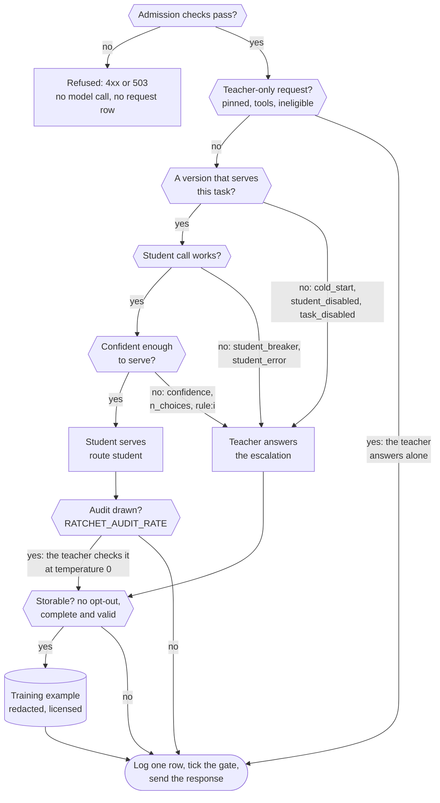
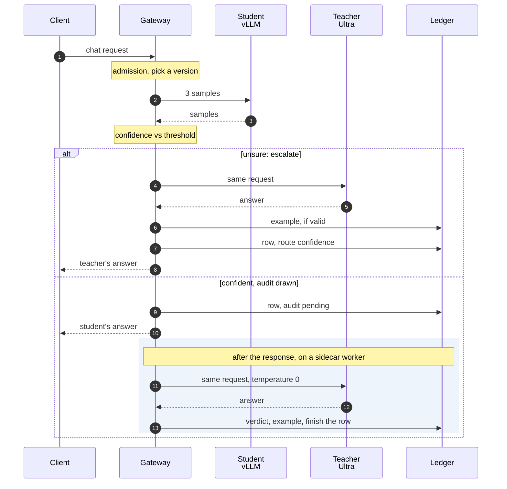
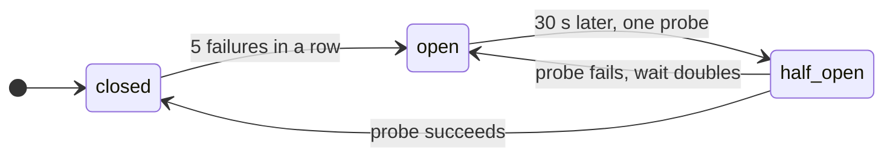

import { Steps, Aside } from '@astrojs/starlight/components';
import Summary from '../../../components/Summary.astro';
import Eli10 from '../../../components/Eli10.astro';
import Who from '../../../components/Who.astro';
import Stat from '../../../components/Stat.astro';
import StatRow from '../../../components/StatRow.astro';
import PathCard from '../../../components/PathCard.astro';
import PathGrid from '../../../components/PathGrid.astro';
import FadeContent from '../../../components/ui/FadeContent.astro';
import Stepper from '../../../components/ui/Stepper.astro';

<Summary>A request enters at `POST /v1/chat/completions`, passes the gateway's admission checks, goes through `Ratchet.handle` (the student first, the teacher when the student is unsure), is logged as one ledger row with a route that says why it was served that way, and comes back as a normal OpenAI response with a `ratchet` block.</Summary>

<Eli10>

An order arrives at **the pass**. First a quick check: is the slip readable, is the guest allowed in, is this table over its limit tonight? A refused order is turned away before anyone touches a pan, and costs nothing.

The slip names the dish (the task). Some dishes always go straight to **the head chef** (pinned tasks). For everything else **the apprentice** cooks the dish three times. If all three plates match and the apprentice is sure, one goes out, and now and then **the inspector** asks the head chef to cook the same dish to check it.

If the apprentice is unsure, the head chef cooks instead, and that dish goes into **the recipe book** with the head chef's name and a note that copying it is allowed.

Every order gets one line in the book: who served it, why, and what it cost. The plate goes out with a small slip on the side (the `ratchet` block) saying who cooked it and what the head chef alone would have cost.

If the apprentice's stove breaks, the head chef simply cooks. If the head chef cannot come, the guest gets an apology (an error), unless you arranged a stand-in in advance.

</Eli10>

<StatRow cols={3} label="One request in numbers">
  <Stat value={10} count={false} label="admission checks" note="All run before any model call. A refused request costs nothing." />
  <Stat value={3} count={false} label="student samples" note="One call to the endpoint, at temperature 0.7 with token logprobs." tone="owned" />
  <Stat value={1} count={false} label="ledger row per request" note="Metadata only: who served it, the route, confidence and cost. Never the prompt." />
</StatRow>

## How it really works

### Every decision on the way

<figure class="rt-diagram">



<figcaption>

**Reading this diagram.** Each hexagon is one check, in the order the code runs it. A refusal at admission costs nothing and calls no model. Teacher-only requests (a pinned task, a tool request, a request the student must not see) skip the student entirely and are not stored. Otherwise the student gets its chance, and each "no" on the way down sends the request to the teacher with a route that names the reason, the labels on the arrows. A confident student serves, and one random draw decides whether the teacher also checks that answer. Both teacher paths meet at the same storage check before anything becomes training data. Every path but a refusal ends in one ledger row; a teacher failure when its answer is needed ends in an error instead ([When something fails](#when-something-fails)).

<ul class="rt-key">
  <li class="gate">A check</li>
  <li class="student">The student serves</li>
  <li class="teacher">The teacher answers</li>
  <li class="store">Kept as data</li>
  <li class="danger">Refused</li>
</ul>

</figcaption>
</figure>

### An escalation, and an audit after the response

<figure class="rt-diagram">



<figcaption>

**Reading this diagram.** Steps 1 to 3 are the same for both outcomes: one call to the student endpoint returns 3 samples at temperature 0.7 with token logprobs, and the gateway scores them. In the upper branch the student is unsure, so the teacher answers (4, 5), its answer is stored if it is complete and valid (6), the row is logged with route `confidence` (7) and the client gets the teacher's answer (8). In the lower branch the student is confident and the audit draw comes up. In live mode the row is logged with the audit pending (9) and the client gets the student's answer at once (10). The shaded part runs afterwards on a sidecar worker: the teacher answers the same request at temperature 0, and the verdict, the stored example and the costs finish the row (11 to 13). In mock mode, and for Scout, the same audit runs before the response.

</figcaption>
</figure>

A shadow's work runs after the response in live mode too. The audit draw itself is always made on the request path, so the same draws happen whether the audit runs before or after the response. See [Escalation and audits](/guides/escalation-and-audits/).

### Before the cascade: admission

The gateway runs these checks in this order. A request refused here calls no model, writes no request row and costs nothing (a 401, 413, 429 or 503 leaves a row in the `failures` table; a 400 only a metric).

| Order | Check | Refused with | Setting (default) |
|---|---|---|---|
| 1 | Declared body size | 413 `request_too_large` | `RATCHET_MAX_BODY_BYTES` (2 MiB) |
| 2 | API key | 401 `invalid_api_key` | `RATCHET_API_KEYS` |
| 3 | Requests a minute, per key (per client IP on a gateway without keys) | 429 `rate_limit_exceeded` | `RATCHET_API_KEY_RPM` (off), `RATCHET_IP_RPM` (120 in live mode) |
| 4 | Body read and counted | 413 for a chunked body over the limit | |
| 5 | Requests in flight: the gateway's cap, then the key's | 503 `overloaded`, 429 `rate_limit_exceeded` | `RATCHET_MAX_INFLIGHT` (32), `RATCHET_API_KEY_CONCURRENCY` (off) |
| 6 | `Idempotency-Key` and JSON | 400; a finished answer for the same key and body is sent again with `Idempotent-Replayed: true` | `RATCHET_IDEMPOTENCY_TTL_S` (600 s) |
| 7 | Validation and normalisation | 400 with `param` and `code` | `RATCHET_MAX_MESSAGES` (256), `RATCHET_MAX_INPUT_CHARS` (120,000), `RATCHET_MAX_N` (4) |
| 8 | Task selection and the key's task scope | 400 `unknown_task`, 403 `task_not_allowed` | `RATCHET_UNKNOWN_TASKS` (`distill`) |
| 9 | Daily request quota | 429 `daily_quota_exceeded` | `RATCHET_API_KEY_DAILY_REQUESTS` (off) |
| 10 | US dollar budgets, per key and for the gateway | 429 `budget_exceeded`, `gateway_budget_exceeded` | `RATCHET_API_KEY_DAILY_USD`, `RATCHET_DAILY_BUDGET_USD` (off) |

**Validation** ([`ratchet/openai_compat.py`](https://github.com/harshbhx/ratchet/blob/main/ratchet/openai_compat.py)) follows OpenAI's rules and answers in OpenAI's error envelope. Normalisation turns a `developer` message into `system` and text content parts into one string, so the cascade and the ledger see plain messages. The request's `model` field is ignored: Ratchet chooses the model.

**Task selection.** The `X-Ratchet-Task` header wins over `metadata.ratchet_task`. With neither, a `response_format` json_schema request gets an auto task derived from its schema, and anything else is `default`. A name that is not registered follows `RATCHET_UNKNOWN_TASKS`: `distill` (the default) makes a task without fields that compares whole answers, `teacher` sends the request to the teacher alone, `reject` is a 400. A task whose `clients` list does not name the key is a 403. No header or field can pin a task; only an operator's spec does.

After admission the rest runs in a worker thread, so the ledger's lock never blocks the event loop.

### Inside the cascade: `Ratchet.handle`

Step through it one decision at a time, or read every rule in the numbered list under it.

<Stepper
  label="One request through the cascade"
  steps={[
    { title: "Settle the request's terms", body: "The operator's runtime switches and task pins are read once (`Ledger.flags`), the client's parameters are split by role, and whether this request's teacher answers may be stored is decided now." },
    { title: 'Teacher-only paths', body: 'A pinned task, a tool request or a request the student must not see goes to the teacher alone. Nothing from it is stored as training data.', tone: 'rented' },
    { title: 'Pick a version', body: 'A canary is picked with probability `traffic_pct / 100` (10% or 50%), otherwise the live version. With neither, the teacher answers (route `cold_start`).' },
    { title: 'Skip a task the version cannot serve', body: 'If the version holds the task back, the student is not called at all, and the teacher answers (route `task_disabled`).' },
    { title: 'Sample the student', body: 'One call to the endpoint for **3** samples at temperature 0.7 with token logprobs. If the call fails or the breaker is open, the teacher answers.', tone: 'owned' },
    { title: 'Score confidence', body: 'Confidence is `0.4 × p + 0.6 × agreement` over the 3 samples. A sample that is empty, cut off or invalid under the task gets no vote.', tone: 'owned' },
    { title: 'Compare with the threshold', body: "At or above the version's threshold for the task, the student serves (route `student`). Below it, the request escalates (route `confidence`).", tone: 'owned' },
    { title: 'Maybe audit', body: "When the student serves, one random draw (**5%** by default) decides whether the teacher also answers, at temperature 0, to check it. The student's answer is served either way.", tone: 'rented' },
    { title: 'Escalate otherwise', body: 'The teacher answers and its answer is served. It becomes a training example only when it is complete and valid, after PII redaction.', tone: 'rented' },
    { title: 'Run the shadow', body: 'A version in shadow is sampled and scored silently. A disagreement with the live answer is settled by the teacher.' },
    { title: 'Log one row', body: 'Task, who served, version, confidence, costs, route and ids go into the ledger: metadata only, never the prompt or the answer.' },
    { title: 'Back in the gateway', body: "The spend meter adds the request's cost, the release gate ticks, and the response goes back with its `ratchet` block." },
  ]}
/>

<Steps>

1. **Read the switches and settle the request's terms.** The operator's runtime switches and task pins are read once (`Ledger.flags`). A `response_format` is bound to the task as a contract. The client's generation parameters are split by role (`GenPolicy`): what the student may receive, what the serving teacher may receive, and the audit's fixed parameters. Whether the request's teacher answers may be stored is settled now (`store_opt_out`: zero retention, a no-store task, the key's `store=0`, `store: false`, or a no-train end user).

2. **Teacher-only paths.** Some requests never reach the student. An unregistered task under `RATCHET_UNKNOWN_TASKS=teacher` (route `unknown_task`), a pinned task (route `pinned`), and a tool request, meaning tools offered or tool calls in the messages (route `tools`), all go to `_teacher_only`: the teacher answers, the request is logged, and nothing is stored as training data. A request the student must not see takes the same kind of path through `_ineligible` (route `ineligible:<reason>`): a content part only the teacher reads (`content_type`), or more input than the task's `student_max_input_tokens` (`input_tokens`); only an over-length request on a task with `store_ineligible` may be stored. No student, audit or shadow call on any of these.

3. **Pick a version** (`_pick_version`). If an operator turned the student off, none (route `student_disabled`). If a version is in canary, it is picked with probability `traffic_pct / 100` (10% or 50%); otherwise the live version. With neither (cold start) the teacher answers (route `cold_start`), and its answer is stored as usual.

4. **Skip a task the version cannot serve.** If the version's per-task record holds the task back (the release gate disabled it on that version, or there was no held-out row for it), the student is not called at all: the teacher answers (route `task_disabled`).

5. **Sample the student** (`_sample`). One call to the endpoint for `max(3, n)` samples at temperature 0.7 with token logprobs (`confidence.STUDENT_SAMPLING`), with only the client's shaping fields (`max_tokens`, `stop`, `seed`, `response_format`, `logit_bias`, `top_logprobs`), capped at 1,024 output tokens. The model name sent is the adapter's (`student-vN`). The call goes through the student's circuit breaker first. If the breaker is open the teacher answers (route `student_breaker`); if the call fails the teacher answers (route `student_error`), and a vLLM 404 naming the adapter queues an automatic reload.

6. **Score confidence** (`confidence.score`) on the first 3 samples, exactly as at calibration. A sample that is empty, cut off, unparseable or invalid under the task's spec gets no vote. Agreement is counted on the task's fields (for `ticket-triage`: `category` and `priority`). Confidence is `0.4 × p + 0.6 × agreement`, where `p` is the best agreeing sample's mean token probability; without logprobs it is agreement alone. See [Confidence](/guides/confidence/).

7. **Compare with the threshold** (`Ratchet.threshold`). Each version carries its own threshold per task, calibrated on half of its golden set. The hosted fallback model gets `RATCHET_CONFIDENCE_THRESHOLD` (0.80); a task whose spec changed since the version was scored gets 1.01, which nothing reaches. The student serves when at least one sample is valid, confidence is at or above the threshold, and, for `n` choices, at least `n` samples agree (route `student`). A confident student without `n` agreeing samples escalates (route `n_choices`); an unsure one escalates (route `confidence`). A task's `escalate_when` rules can still send a confident answer to the teacher (route `rule:<i>`, for the rule that held).

8. **Maybe audit.** When the student serves, one random draw decides an audit: probability `RATCHET_AUDIT_RATE` (0.05; at least 0.10 in mock mode), or `RATCHET_CANARY_AUDIT_RATE` for a canary when set, or an operator's runtime rate. If drawn, the teacher answers the same request at temperature 0 and its answer is compared with the student's. The student's answer is served either way.

9. **Escalate otherwise** (`_call_teacher`). The teacher answers under the serving parameters: the client's temperature or 0, and 0.7 for `n` choices when the client set none, capped at 8,192 output tokens. The answer is cleaned (reasoning removed), served, and stored as a training example only when it is complete and valid. If the teacher fails, see [When something fails](#when-something-fails) below.

10. **Run the shadow.** If a version is in shadow, it is sampled and scored the same way, silently. Its verdict (would it serve, and does it agree with the best reference) goes into the row; a disagreement with the live student's answer is settled by the teacher (arbitration). A request answered by a stand-in runs no shadow.

11. **Log one row** (`Ledger.log_request`): task, who served, version, confidence, whether it escalated or was audited, the shadow's verdict, latency and `wall_ms`, `cost_usd` with its student and teacher parts, the all-teacher baseline, `stored`, `route`, the threshold used, `label_p` (the audit rate the answer was drawn at) and the request's ids. The row holds metadata only, never the prompt or the answer.

12. **Back in the gateway.** The spend meter adds the request's cost to its key, the release gate ticks (at most once every 5 s in live mode, `RATCHET_TICK_INTERVAL_S`), and the response is built from the router's `Result`.

</Steps>

Scout's agents call `handle(messages, task)` directly. They skip the chat route's admission checks (Scout has its own budget guard), and their audits always run inline.

### Every route

Every row gets a `route` (`router.ROUTES`). `/ratchet/stats` counts them per task, so you can see why each request went where it went.

| Route | Served by | Why | Training example? |
|---|---|---|---|
| `student` | student | Confidence reached the threshold (and `n` samples agreed) | Only from an audit's teacher answer |
| `confidence` | teacher | The student was unsure, had no valid sample, or the task's spec changed | Yes, if valid |
| `n_choices` | teacher | Confident, but fewer than `n` samples agreed | Yes, choice 0 only |
| `cold_start` | teacher | No live version, and the canary was not picked | Yes, if valid |
| `student_disabled` | teacher | An operator turned the student off | Yes, as on a cold start |
| `task_disabled` | teacher | The version's per-task record serves nothing, so no student call | Yes, if valid |
| `student_error` | teacher | The student call failed (timeout, connection, error status, lost adapter) | Yes, if valid |
| `student_breaker` | teacher | The student's circuit breaker was open | Yes, if valid |
| `fallback_teacher` | teacher | The primary teacher was unavailable, so the fallback teacher answered | Only with `RATCHET_STORE_FALLBACK_TEACHER=1` |
| `degraded` | student | Unsure student, unavailable teacher, `RATCHET_ON_TEACHER_FAILURE=serve_student` | Never |
| `pinned` | teacher | The task is pinned by its spec or by an operator | Never |
| `unknown_task` | teacher | Unregistered task under `RATCHET_UNKNOWN_TASKS=teacher` | Never |
| `tools` | teacher | A tool request; the teacher answers with the tools | Never |
| `rule:<i>` | teacher | Rule `i` of the task's `escalate_when` held for the confident student's answer | Yes, if valid |
| `ineligible:<reason>` | teacher | The student must not see the request: a content part only the teacher reads (`content_type`, `RATCHET_TEACHER_MODALITIES`) or too much input (`input_tokens`) | Only an over-length request on a task with `store_ineligible` |
| `multimodal` | teacher | Set by a caller of `Ratchet.teacher_only` for a part only the teacher reads; the chat route uses `ineligible:content_type` | Never |

"If valid" also means no storage opt-out applies. Rows written before v0.5 have no route and are counted as `unrecorded`.

### The response

A standard `chat.completion` with every field OpenAI's has, plus a `ratchet` block. This example is from the [API reference](/reference/api/#post-v1chatcompletions) (illustrative values):

```json
{
"ratchet": {
  "served_by": "student",
  "student_version": 5,
  "confidence": 0.951,
  "escalated": false,
  "cost_usd": 0.0000312,
  "all_teacher_cost_usd": 0.00131,
  "latency_ms": 311.4,
  "usage_breakdown": {
    "student_samples": {"in": 104, "out": 93},
    "served": {"in": 104, "out": 31},
    "audit": null, "shadow": null, "arbitration": null, "repair": null
  },
  "degraded": null,
  "stored": false,
  "store_opt_out": null,
  "request_id": "req_3f1c0a9b8e7d6c5b4a3f2e1d0c9b8a79",
  "row_id": 4512,
  "task": "ticket-triage",
  "schema_valid": null
}
}
```

| Field | Meaning |
|---|---|
| `served_by` | `student` or `teacher` |
| `student_version` | The version that answered; `null` when the teacher answered |
| `confidence` | The student's confidence when it was sampled, else `null` |
| `escalated` | `true` when a version was picked but the teacher answered instead (unsure, too few agreeing samples, a failed or skipped student call, a task held back); stays `true` on a degraded answer |
| `cost_usd` | What this request cost: every model call, the student priced per token. With `overhead_pending`, only what serving cost |
| `all_teacher_cost_usd` | What the teacher alone would have cost: its own bill when it answered, else an estimate from the student's tokens plus 300 assumed reasoning tokens (`RATCHET_TEACHER_REASONING_TOKENS`) |
| `usage_breakdown` | Every model call, in tokens: `student_samples`, `served`, `audit`, `shadow`, `arbitration`, `repair` |
| `degraded` | `"teacher_unavailable"` on a degraded answer, else `null` |
| `stored`, `store_opt_out` | Whether a teacher answer of this request became (or matched) a training example, and why not if opted out |
| `request_id`, `row_id` | The request's id (`req_` and 32 hex, as in `x-request-id`; feedback names it) and its ledger row (a savings receipt proves it by this) |
| `task`, `schema_valid` | The resolved task, and whether every choice meets the `response_format` |
| `overhead_pending` | Present and `true` only when the audit or shadow runs after the response |

`usage` is the served answer's own tokens, as if its model had answered alone; Ratchet's extra calls are in `usage_breakdown` and priced in `cost_usd`. `model` names who wrote the answer (the adapter `student-vN`, the hosted Nano 30B's id, the teacher's id, or the fallback teacher's), and `system_fingerprint` changes when a promotion or rollback puts another version in front.

Headers: `X-Ratchet-Served-By`, `X-Ratchet-Request-Id` (the ledger row), `X-Ratchet-Degraded` on a degraded answer, and on every response `x-request-id` and `openai-processing-ms`.

### Streaming

With `stream: true` the gateway sends OpenAI `chat.completion.chunk` events, a few words per chunk, and the `ratchet` block rides on the last finish chunk (or on a final usage chunk with `stream_options.include_usage`). But the cascade must see the student's whole answer to score it, so the answer is complete before the first chunk: time to first token equals the full latency. Streaming exists so streaming clients work unchanged. Errors come back as normal JSON before the stream starts.

### When something fails

Only a teacher call whose answer is needed can fail a request. Everything else fails open.

**The student fails: the teacher answers.** A student call on the request path waits 15 s to answer and 2 s to connect (`RATCHET_STUDENT_TIMEOUT_S`, `RATCHET_STUDENT_CONNECT_TIMEOUT_S`) and is never retried: the teacher is its retry. After 5 endpoint failures in a row (timeouts, connection errors, 5xx, 408, 429) the student's circuit breaker opens and requests go straight to the teacher without waiting:

<figure class="rt-diagram">



<figcaption>

**Reading this diagram.** While the breaker is `closed`, every request tries the student. Five endpoint failures in a row (timeouts, connection errors, 5xx, 408, 429) open it, and requests go straight to the teacher with route `student_breaker`, without waiting for a timeout. After the wait exactly one request probes the endpoint (`half_open`): success closes the breaker and resets the wait to 30 s, failure opens it again for twice as long, up to 300 s. Each move writes a `circuit` event.

</figcaption>
</figure>

A shadow has its own breaker, so a bad staging adapter cannot open the one live traffic depends on. When vLLM forgets an adapter after a restart, its 404 queues a reload from `RATCHET_ADAPTER_ROOT` (at most once a minute per adapter).

**The teacher fails on an audit or a shadow arbitration: the student's answer is served anyway**. The failure is counted and the audit simply does not count.

**The teacher fails when its answer is needed** (an escalation, a cold start, a pinned or teacher-only request). The teacher gets up to 2 retries within 180 s (`RATCHET_TEACHER_RETRIES`, `RATCHET_TEACHER_DEADLINE_S`; a 120 s read timeout), on connection failures and 408, 409, 429 and 5xx. If it still fails, no request row is written; a `failures` row records what the student's samples spent, which also counts against the key's budget. The gateway maps the cause (`_map_upstream`):

| Status | `code` | When |
|---|---|---|
| 400 | the teacher's, such as `context_length_exceeded` | The teacher refused the request itself (upstream 400, 413 or 422); `X-Should-Retry: false` |
| 429 | `upstream_rate_limited` | Token Factory rate-limited the call; `Retry-After` is its wait, 1 to 60 s |
| 502 | `teacher_unavailable` | The call failed after its retries |
| 502 | `upstream_auth_error`, `upstream_not_found` | The gateway's own key or model setting is wrong; `X-Should-Retry: false` |
| 502 | `tool_calls_unsupported` | The teacher answered a request without tools with a tool call |
| 503 | `teacher_circuit_open` | The teacher's breaker is open after 5 failed calls in a row; answered at once with `Retry-After` |
| 504 | `teacher_timeout` | The teacher did not answer in time |

Two opt-in stand-ins answer instead of an error. A **fallback teacher** (`RATCHET_TEACHER_FALLBACK_MODEL`, licensed at startup like any teacher) answers, when the primary is unavailable, any request whose teacher answer will be served (route `fallback_teacher`); audits and arbitrations never use it. **Degraded mode** (`RATCHET_ON_TEACHER_FAILURE=serve_student`) serves the student's own valid, below-threshold answer to an escalation, marked `ratchet.degraded` and `X-Ratchet-Degraded` (route `degraded`). Neither covers a 400 about the request. A stand-in's answer is never audited or shadowed, and a degraded answer is never stored, so neither can move a release.

## For engineers

| File | Functions |
|---|---|
| [`ratchet/gateway.py`](https://github.com/harshbhx/ratchet/blob/main/ratchet/gateway.py) | `chat` (key, rate, body, in-flight caps), `_complete` (validation, `_request_meta`, task, quota, budgets, cascade, response), `_map_upstream`, `_envelope` |
| [`ratchet/openai_compat.py`](https://github.com/harshbhx/ratchet/blob/main/ratchet/openai_compat.py) | `validate_chat_request`, `normalize_messages`, `APIError` |
| [`ratchet/router.py`](https://github.com/harshbhx/ratchet/blob/main/ratchet/router.py) | `Ratchet.handle`, `_pick_version`, `_sample`, `threshold`, `_audit`, `_call_teacher`, `_store_example`, `_shadow`, `_teacher_only`, `_may_degrade`, `ROUTES` |
| [`ratchet/confidence.py`](https://github.com/harshbhx/ratchet/blob/main/ratchet/confidence.py) | `score`, `majority`, `STUDENT_SAMPLING` |
| [`ratchet/resilience.py`](https://github.com/harshbhx/ratchet/blob/main/ratchet/resilience.py) | `Breaker`, `retry_call`, `endpoint_down`, `teacher_unavailable` |
| [`ratchet/ledger.py`](https://github.com/harshbhx/ratchet/blob/main/ratchet/ledger.py) | `log_request`, `add_example`, `flags` |

| Setting | Default | Effect on the journey |
|---|---|---|
| `RATCHET_SAMPLES` | 3 | Student samples per request, and per golden row at calibration |
| `RATCHET_CONFIDENCE_THRESHOLD` | 0.80 | Threshold for the hosted fallback, or a version without a calibrated one |
| `RATCHET_AUDIT_RATE` | 0.05 | Share of student answers the teacher also checks (at least 0.10 in mock mode) |
| `RATCHET_CANARY_AUDIT_RATE` | unset | A canary's own audit rate |
| `RATCHET_STUDENT_TIMEOUT_S`, `RATCHET_STUDENT_CONNECT_TIMEOUT_S` | 15, 2 | Student call limits; never retried |
| `RATCHET_TEACHER_TIMEOUT_S`, `RATCHET_TEACHER_RETRIES`, `RATCHET_TEACHER_DEADLINE_S` | 120, 2, 180 | Teacher read timeout, retries and overall deadline |
| `RATCHET_STUDENT_BREAKER_FAILURES`, `RATCHET_STUDENT_BREAKER_COOLDOWN_S` | 5, 30 | Student breaker (0 failures turns it off) |
| `RATCHET_TEACHER_BREAKER_FAILURES`, `RATCHET_TEACHER_BREAKER_COOLDOWN_S` | 5, 30 | Teacher breaker |
| `RATCHET_TEACHER_FALLBACK_MODEL` | empty | Opt-in fallback teacher |
| `RATCHET_ON_TEACHER_FAILURE` | `error` | `serve_student` turns on degraded mode |
| `RATCHET_STUDENT_MAX_TOKENS`, `RATCHET_TEACHER_MAX_TOKENS` | 1,024, 8,192 | Output caps per call |
| `RATCHET_SIDECAR_WORKERS` | 4 live, 0 mock | Audits and shadows after the response |
| `RATCHET_TICK_INTERVAL_S` | 5 live, 0 mock | Least time between two gate ticks from requests |

All of them are in the [configuration reference](/reference/configuration/). Look a request up afterwards with `GET /v1/ratchet/requests/{id}` (an API key, its own requests) or `GET /ratchet/requests/{id}` (the dashboard API), by the `req_` id or the `chatcmpl-` id.

```bash
curl -si http://localhost:8000/v1/chat/completions \
  -H 'content-type: application/json' \
  -H 'X-Ratchet-Task: ticket-triage' \
  -d '{"model":"ratchet","messages":[{"role":"user","content":"I was charged twice for my Pro plan this month."}]}'
# look for X-Ratchet-Served-By, X-Ratchet-Request-Id and the "ratchet" block
```

## Common questions

### Can a client force the student or the teacher?

No. The request's `model` field is ignored, and no header or field can pin a task. Only an operator's task spec, or a runtime pin through the admin API, sends a task to the teacher alone.

### Does streaming make answers arrive sooner?

No. The student's whole answer must be scored before Ratchet decides who serves, so the first chunk comes when the answer is complete.

### Why three samples, not one?

Small models are poorly calibrated, so one token probability does not tell right from wrong. Agreement across three samples plus token probability is the signal the threshold is calibrated on. The cost is the student's output tokens three times, small next to one teacher call.

### Is my prompt stored?

The request row holds metadata only. Prompt and answer text is stored only as a training example from a teacher answer, after PII redaction (emails, phone and card numbers and similar; names and street addresses are not caught yet), and not at all under a storage opt-out. Pinned, tool and multimodal requests are never stored. See [Security](/guides/security/).

### What does a request cost me?

`ratchet.cost_usd` is the full price of every call the request made, at list prices that are unverified until the day-1 checks pass. `usage` is only the served answer's tokens, so you can bill your own users for the answer they got.

### What if the student is wrong but confident?

It is served. A random audit may catch it, and audits drive the canary's rollback and the live version's alert. Precision means agreement with Nemotron 3 Ultra, not ground truth.

### Has this path run against real endpoints?

Partly. The teacher runs on Nebius Token Factory. The student side is tested offline and ran once by hand on Nebius on 28 Oct 2026 (the golden gate rejected that student): the live gateway has no student endpoint yet, so the teacher answers every request, and the paths through vLLM are tested with fake HTTP transports, ready to run with `make nebius-up`. Model ids and prices stay unverified until `scripts/day1_check.py` passes with a real key.

## Related

<FadeContent distance={16}>
<PathGrid cols={2} label="Related guides">
  <PathCard title="Confidence" href="/guides/confidence/" icon="scale" eyebrow="Steps 6 and 7" description="How the score and the threshold are computed, and checked on held-out rows." />
  <PathCard title="Escalation and audits" href="/guides/escalation-and-audits/" icon="check" eyebrow="Steps 8 and 9" tone="rented" description="When the teacher steps in, and what its random audits measure." />
  <PathCard title="The ledger" href="/guides/ledger/" icon="database" eyebrow="Step 11" tone="neutral" description="What the request row and the stored examples hold, and what is never kept." />
  <PathCard title="API reference" href="/reference/api/" icon="code" eyebrow="Reference" tone="neutral" description="Every field, header and error of the chat route." />
</PathGrid>
</FadeContent>
