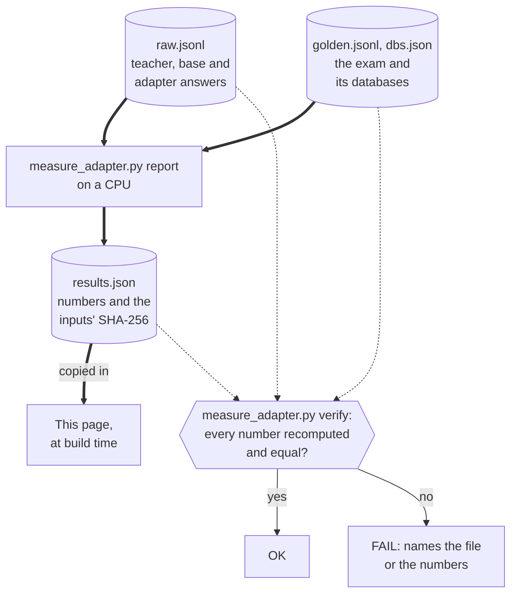
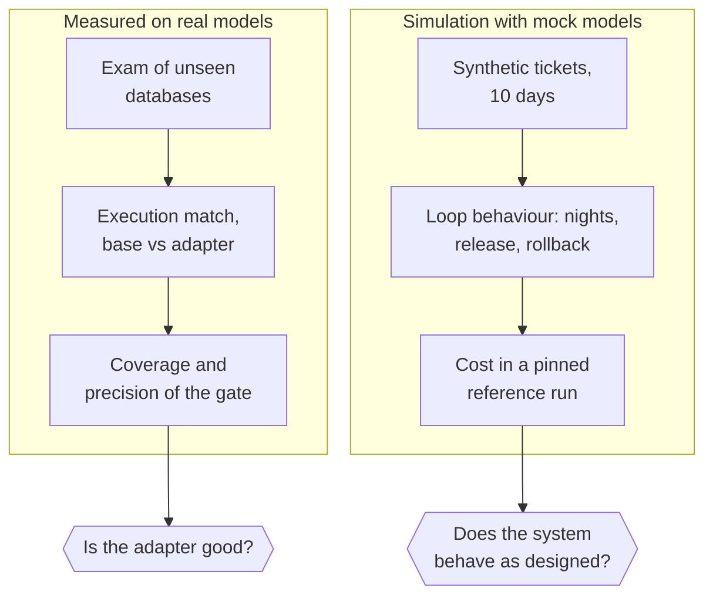

import { Steps, Aside } from '@astrojs/starlight/components';
import Summary from '../../../components/Summary.astro';
import Eli10 from '../../../components/Eli10.astro';
import SqlResults from '../../../components/SqlResults.astro';
import Stat from '../../../components/Stat.astro';
import StatRow from '../../../components/StatRow.astro';
import sqlResults from '../../../data/sql-results.json';
import extra from '../../../data/sql-extra.json';
import ExamCharts from '../../../components/ExamCharts.astro';

export const run = sqlResults;
export const measured = run?.status !== 'pending' && run?.mode === 'sql';
export const pct = (c) => (100 * c.agree / c.n).toFixed(1) + '%';
export const rng = (c) => (100 * c.wilson95[0]).toFixed(1) + ' to ' + (100 * c.wilson95[1]).toFixed(1) + '%';
export const A = extra.all_rows;
export const lines = [
  ['Base model', A.base_v1, A.base_v2],
  ['Teacher answering the exam prompt', A.teacher, null],
  ['Adapter', A.adapter_v1, A.adapter_v2],
];

This page shows what the text-to-SQL adapter measured on an exam of databases it never trained on, read straight from the run's results file, and keeps those numbers apart from the simulation numbers used elsewhere in these docs.

<Eli10>

A report card is only useful if you know what test it came from. Here the test is a set of questions about databases the student has never opened. The score is "how often does the student's query return the same rows as the teacher's query".

Every score comes with a range, like "somewhere between 64% and 82%". A small exam gives a wide range. That is not a flaw in the report. It is the honest size of the doubt.

</Eli10>

<StatRow cols={3} label="What these results are">
  <Stat value="Unseen databases" label="the exam" note="Whole databases, some from industries never in training." />
  <Stat value="Rented T4 GPUs" label="where the adapters trained" note="A free Colab T4 (round 1) and a Modal T4 (round 2 and tool calling). Never on Nebius GPUs. The teacher ran on Token Factory." />
  <Stat value="CPU only" label="to recompute every number" note="From the raw answers, with one command." />
</StatRow>

## The adapter's results

Status: {run?.sample === true
  ? Sample data, not a result
  : measured
    ? Measured, read from the run's results file
    : Pending: the run's results file is not in yet}

Round 1, the half of the exam that measures the confidence gate (86 of 172 questions). Round 2 and the second exam are below.

<SqlResults />

## What the first real run showed

Same exam, same scoring, all {A.n} questions. A query is right when running it returns the same rows as the teacher's stored query on the same database.

<table>
  <thead><tr><th>Who answered</th><th>Original prompt</th><th>With one extra line (prompt v2)</th></tr></thead>
  <tbody>
    {lines.map(([name, v1, v2]) => (
      <tr><td>{name}</td><td>{v1.agree} of {v1.n} = <strong>{pct(v1)}</strong> ({rng(v1)})</td><td>{v2 ? <>{v2.agree} of {v2.n} = <strong>{pct(v2)}</strong> ({rng(v2)})</> : 'not run'}</td></tr>
    ))}
  </tbody>
</table>

Prompt v2 adds "Select only the columns the question asks for." to the end of every question, for both models. The ranges are 95% Wilson ranges.

- **The adapter is 2.6 to 3.1 times the base model's score** under both prompts, and the ranges do not overlap.
- **The adapter is in the same range as the teacher, not above it.** The teacher itself returns the stored query's rows only {pct(A.teacher)} of the time, because each question has one stored query, written together with the question. A correct query with other columns or another sort order counts as a miss. The adapter learned the stored queries' style, so we do not claim it beats the teacher.
- **Prompt v2 changed nothing that holds up.** Row by row the adapter gained a few questions and lost a few. Treat the two prompts as one result: about a third of the questions for the adapter, about an eighth for the base model.
- **The adapter does not yet replace the teacher.** At the 95% precision target only {extra.gate_v1.answered} of {extra.gate_v1.of} test questions pass the confidence gate and {extra.gate_v1.right} of those are right, so the cost saved at that coverage is {extra.gate_v1.saved_pct}%. Token probability does not tell the adapter's right answers from its wrong ones.
- **No exam question leaked into training:** {extra.leakage.exam_prompts_in_training} of {extra.leakage.of} exam prompts, questions, stored queries or table-name sets appear in the training data.

Training: {extra.training.rows} teacher-labelled rows, {extra.training.steps} steps, {extra.training.minutes} minutes on a {extra.training.gpu}; teacher labels cost ${extra.teacher_labels_cost_usd}. The files behind every number, and the command that recomputes them, are in `evidence/text2sql-round1` in the repository.

## What the second run showed

Round 2 trained a second adapter on {extra.round2.training.rows.toLocaleString('en-US')} rows (the first run's 821 plus {extra.round2.training.new_rows.toLocaleString('en-US')} new teacher-labelled rows) and answered the same {A.n}-question exam, scored the same way.

<table>
  <thead><tr><th>Who answered</th><th>Right</th><th>95% range</th></tr></thead>
  <tbody>
    <tr><td>Base model</td><td>{A.base_v1.agree} of {A.n} = <strong>{pct(A.base_v1)}</strong></td><td>{rng(A.base_v1)}</td></tr>
    <tr><td>Teacher answering the exam prompt</td><td>{A.teacher.agree} of {A.n} = <strong>{pct(A.teacher)}</strong></td><td>{rng(A.teacher)}</td></tr>
    <tr><td>Adapter, round 1 (821 rows)</td><td>{A.adapter_v1.agree} of {A.n} = <strong>{pct(A.adapter_v1)}</strong></td><td>{rng(A.adapter_v1)}</td></tr>
    <tr><td>Adapter, round 2 ({extra.round2.training.rows.toLocaleString('en-US')} rows)</td><td>{extra.round2.adapter.agree} of {A.n} = <strong>{pct(extra.round2.adapter)}</strong></td><td>{rng(extra.round2.adapter)}</td></tr>
  </tbody>
</table>

- **Better than round 1, but the exam cannot call it settled.** Row by row, {extra.round2.flips_vs_round1.wrong_to_right} questions went from wrong to right and {extra.round2.flips_vs_round1.right_to_wrong} from right to wrong. The two ranges overlap, and a test on those changes gives p = {extra.round2.flips_vs_round1.two_sided_p}, so some of the gain could be chance.
- **The gain is on familiar industries.** On industries seen in training the adapter went from {extra.round2.round1_by_domain.seen[0]} to {extra.round2.by_domain.seen[0]} of {extra.round2.by_domain.seen[1]}. On the two industries it never saw it stayed at {extra.round2.by_domain.unseen[0]} of {extra.round2.by_domain.unseen[1]}.
- **By difficulty:** simple {extra.round2.by_difficulty.simple[0]} of {extra.round2.by_difficulty.simple[1]}, join {extra.round2.by_difficulty.join[0]} of {extra.round2.by_difficulty.join[1]}, aggregate {extra.round2.by_difficulty.aggregate[0]} of {extra.round2.by_difficulty.aggregate[1]}, hard {extra.round2.by_difficulty.hard[0]} of {extra.round2.by_difficulty.hard[1]}.
- **The point estimate is above the teacher's, but we do not claim it beats the teacher.** The exam has one stored query per question, written together with the question, and the two 95% ranges still overlap a little (adapter 32.0 to 46.4%, teacher 19.6 to 32.6%).
- **The confidence gate did not improve.** At the 95% precision target {extra.round2.gate.answered} of {extra.round2.gate.of} test questions pass, so the cost saved at that coverage is {extra.round2.gate.saved_pct}%. The adapter still does not replace the teacher.
- **No exam question leaked into training:** {extra.round2.leakage.exam_prompts_in_training} of {extra.round2.leakage.of} for prompts, questions, stored queries and table-name sets. Six generated rows that shared a question or a query with the exam were removed before training.

Training: {extra.round2.training.steps.toLocaleString('en-US')} steps over {extra.round2.training.epochs} epochs in {extra.round2.training.hours} hours on a {extra.round2.training.gpu}, loss {extra.round2.training.loss_first} to {extra.round2.training.loss_last}; the extra teacher labels cost ${extra.round2.teacher_labels_cost_usd}. Neither run used Nebius GPUs. The files and the recompute command are in `evidence/text2sql-round2` in the repository.

## A second exam, written by a different model

The first exam was written by the same teacher that wrote the training labels, which flatters the teacher and anything trained to copy it. So we built a second exam: {extra.exam2.rows} questions on 10 industries that appear neither in training nor in the first exam, with the databases and the questions written by Claude Sonnet 5.5, used for evaluation only. Every reference query was run and kept only if it worked, nothing overlaps with the training data, and its fingerprint was recorded before any model answered. The same four models answered it, scored the same strict way.

<table>
  <thead><tr><th>Who answered</th><th>Exam 1 (172, written by Ultra)</th><th>Exam 2 ({extra.exam2.rows}, written by Claude)</th></tr></thead>
  <tbody>
    <tr><td>Base model</td><td>{A.base_v1.agree} = {pct(A.base_v1)}</td><td>{extra.exam2.base.agree} = <strong>{pct(extra.exam2.base)}</strong> ({rng(extra.exam2.base)})</td></tr>
    <tr><td>Teacher answering the exam prompt</td><td>{A.teacher.agree} = {pct(A.teacher)}</td><td>{extra.exam2.teacher.agree} = <strong>{pct(extra.exam2.teacher)}</strong> ({rng(extra.exam2.teacher)})</td></tr>
    <tr><td>Adapter, round 1 (821 rows)</td><td>{A.adapter_v1.agree} = {pct(A.adapter_v1)}</td><td>{extra.exam2.adapter_v1.agree} = <strong>{pct(extra.exam2.adapter_v1)}</strong> ({rng(extra.exam2.adapter_v1)})</td></tr>
    <tr><td>Adapter, round 2 ({extra.round2.training.rows.toLocaleString('en-US')} rows)</td><td>{extra.round2.adapter.agree} = {pct(extra.round2.adapter)}</td><td>{extra.exam2.adapter_v2.agree} = <strong>{pct(extra.exam2.adapter_v2)}</strong> ({rng(extra.exam2.adapter_v2)})</td></tr>
  </tbody>
</table>

- **The training effect shows up on an exam the adapter's data never touched.** The base model scores about the same on both ({pct(A.base_v1)} and {pct(extra.exam2.base)}), and the round 2 adapter is about {(extra.exam2.adapter_v2.agree / extra.exam2.base.agree).toFixed(1)} times the base model on the new exam.
- **Round 2 beat round 1 on both exams,** by 10 questions each time. On exam 2, {extra.exam2.v1_to_v2.wrong_to_right} questions went from wrong to right and {extra.exam2.v1_to_v2.right_to_wrong} from right to wrong (p = {extra.exam2.v1_to_v2.two_sided_p}). The direction repeats, but neither exam alone settles it.
- **Both adapters score 5 to 6 points lower than on exam 1,** as expected on an exam from a different author.
- **By difficulty on exam 2** (base, round 1, round 2): simple {extra.exam2.by_difficulty.simple.base}, {extra.exam2.by_difficulty.simple.v1}, {extra.exam2.by_difficulty.simple.v2} of {extra.exam2.by_difficulty.simple.n}; join {extra.exam2.by_difficulty.join.base}, {extra.exam2.by_difficulty.join.v1}, {extra.exam2.by_difficulty.join.v2} of {extra.exam2.by_difficulty.join.n}; aggregate {extra.exam2.by_difficulty.aggregate.base}, {extra.exam2.by_difficulty.aggregate.v1}, {extra.exam2.by_difficulty.aggregate.v2} of {extra.exam2.by_difficulty.aggregate.n}; hard {extra.exam2.by_difficulty.hard.base}, {extra.exam2.by_difficulty.hard.v1}, {extra.exam2.by_difficulty.hard.v2} of {extra.exam2.by_difficulty.hard.n}. Join questions improved most, again.
- **The teacher scores low here for a reason of shape, not skill.** Of its {extra.exam2.rows} answers, {extra.exam2.teacher_miss_shape.right_rows_different_columns} return the right number of rows with a different number of columns, which the strict exam marks wrong. We do not claim the adapter beats the teacher.
- **The confidence gate still does not pass at the 95% precision target:** {extra.exam2.gate.answered} of {extra.exam2.gate.of} questions on the measurement half, for either adapter. The adapter does not yet replace the teacher.

### Who wrote what

Three sets of questions are involved, and they are kept apart. The training examples teach the adapter. Exam 1 and exam 2 only test it. Exam 1 was written by the teacher, the same model that wrote the training examples, which flatters the teacher and anything trained to copy it. Exam 2 was written afterwards by a different model from a different lab, for testing only.

<ExamCharts kind="authors" />

### The scores as charts

Each bar is how many of that exam's questions the model got exactly right. The line on a bar is its 95% range: with 172 to 200 questions a score is good to about 7 points either way.

**Exam 1, written by the teacher**

<ExamCharts kind="scores" exam="exam1" />

**Exam 2, written by a different model**

<ExamCharts kind="scores" exam="exam2" />

### Where it does well and badly

Join questions improved most from round 1 to round 2. Simple questions did not improve, and the aggregate questions were already the adapter's strongest.

**Exam 1**

<ExamCharts kind="difficulty" exam="exam1" />

**Exam 2**

<ExamCharts kind="difficulty" exam="exam2" />

### Round 1 against round 2, question by question

<ExamCharts kind="flips" />

The exam, its fingerprint, every answer and the command that recomputes the scores are in `evidence/text2sql-exam2` in the repository.

## How it really works

<Steps>

1. **A run ends with a `results.json`.** `measure_adapter.py report` reads the raw answers and writes every number into that file, with the SHA-256 of each input file.

2. **The file is copied into the docs site.** The site reads `src/data/sql-results.json` when it is built, so no number on this page is typed by hand. If the file says the run is pending, the panel above says so.

3. **`verify` recomputes it.** Anyone with the raw answers, the exam and the exam databases can run `measure_adapter.py verify` and get `OK` or a `FAIL:` line. See [Proof you can run](/guides/proof/).

</Steps>

<figure class="rt-diagram">

<figcaption>

**Reading this diagram.** The thick arrows make the numbers and the dotted ones check them, and both start from the same three files. The page is fed from the results file by a build step (it is copied to `docs-site/src/data/sql-results.json`), not by hand. The check does not trust the results file at all: it recomputes everything from the raw answers and compares.

<ul class="rt-key">
  <li class="store">A file</li>
  <li class="gate">The check</li>
  <li class="edge-main">Makes the numbers</li>
  <li class="edge-optional">Checks them</li>
</ul>

</figcaption>
</figure>

## How to read the numbers

- **Match with the teacher** is execution match: the student's query and the teacher's query return the same rows on the same database. It is not "the answer is right".
- **The 95% range** is a Wilson interval. If the exam were drawn again many times, about 19 of 20 such ranges would contain the true rate. With a small exam it is wide, and two bars whose ranges overlap should not be called different.
- **Base model against adapter** is the point of the work. Both answer the same questions with the same prompt and the same limits. The gap is what the adapter added.
- **The split by difficulty and by industry** shows where the adapter helps. Each cell has few questions, so read the ranges before the bars. "Industry never seen in training" is the fairest test of whether it learned SQL or memorised.
- **Coverage and precision when it answers** describe the confidence gate. Coverage is the share of questions the student answers on its own. Precision is how often those answers match the teacher. A higher threshold raises precision and lowers coverage.
- **The estimated cost** is an estimate: token counts are measured, the prices are inputs (Nemotron 3 Ultra at $1 and $3 per million tokens in and out, and a student price you set), and no student endpoint was run, so no GPU-hour bill is in it. See [Cost and savings](/guides/cost-and-savings/).
- **The data is synthetic.** The teacher wrote the databases and the questions. These numbers say how well the adapter copies the teacher on queries that run, not how well it serves your real users.

<Aside type="caution" title="What this page cannot tell you">
It cannot tell you how the adapter does on your schema, in another SQL dialect, or on questions a person would phrase badly. Run your own held-out questions through `measure_adapter.py` to find out.
</Aside>

## Simulation numbers are a different thing

Elsewhere in these docs you will see numbers such as "69% saved per token". Those come from **mock models** in the simulator (`python -m sim.simulate`). They show that the loop works: the student starts at zero share of traffic, takes over as nights pass, a corrupted version is rolled back, and a launch day sends new questions to the teacher. They say nothing about how good a real model is.

| | The adapter results above | The simulation |
|---|---|---|
| Models | A real student and a real teacher | Mock models with scripted behaviour |
| Data | Synthetic databases, every SQL executed | Synthetic support tickets |
| Measures | Execution match on unseen databases | Student share, escalations, audit agreement, cost |
| Reproduce | `measure_adapter.py verify` | `python -m sim.simulate --days 10 --requests 2000 --bad-deploy-version 3` (seed 7) |
| Shown as | Measured | Always labelled simulation |

**Simulation.** The reference run's headline figures are on the [cost page](/guides/cost-and-savings/#what-it-looks-like-in-the-simulation): student share 0% on day 1 and 98% on day 3, a corrupted version 3 rolled back on day 4, and a per-token saving of 69% over ten days that turns into a loss by GPU-hours at that volume. These are simulation outputs.

<figure class="rt-diagram">

<figcaption>

**Reading this diagram.** The two boxes answer two different questions. The measured side tells you about model quality and is the only side that can support a claim about the adapter. The simulation side tests the machinery around the model and never claims model quality. Mixing them would make the simulation's tidy percentages look like a result.

<ul class="rt-key">
  <li class="student">The adapter, measured on real models</li>
  <li class="outline">Simulation, mock models</li>
</ul>

</figcaption>
</figure>

## For engineers

| What | Where |
|---|---|
| The panel | `docs-site/src/components/SqlResults.astro`, reads `docs-site/src/data/sql-results.json` |
| Layout test data | `docs-site/src/data/sql-results.sample.json` (made up, never shown unless copied over, and then bannered `SAMPLE DATA`) |
| Feed a real run | `cp run/out/results.json docs-site/src/data/sql-results.json`, then rebuild |
| The numbers' code | `measure_adapter.py`: `agreement`, `wilson`, `calibrate`, `build_report` |
| Simulation | `python -m sim.simulate`, `make reference`; see the repository's `docs/TESTING.md` |

## Tool calling, round 3

A tool-calling adapter on Nemotron 3 Nano 4B (2,940 training rows, about $2.33 in all), scored strictly on two exams. These are measured results on real models, not the simulation (2026-10-24).

| | Hard exam (150) | BFCL exam (300) |
|---|---|---|
| Untrained Nano 4B | 94 of 150 (62.7%, 95% range 54.7 to 70.0%) | 232 of 300 (77.3%, 95% range 72.3 to 81.7%) |
| Teacher (Nemotron 3 Ultra) | 137 of 150 (91.3%, 95% range 85.7 to 94.9%) | 265 of 300 (88.3%, 95% range 84.2 to 91.5%) |
| Tool-calling adapter | 136 of 150 (90.7%, 95% range 84.9 to 94.4%) | 241 of 300 (80.3%, 95% range 75.5 to 84.4%) |

On the hard exam the adapter is above the untrained model: 90.7% against 62.7%, and the 95% ranges do not overlap. It is about the same as the teacher: 90.7% against 91.3% (lower by point estimate, but the 95% ranges overlap, so the exam cannot tell them apart).

On the BFCL exam the adapter is about the same as the untrained model: 80.3% against 77.3% (higher by point estimate, but the 95% ranges overlap, so the exam cannot tell them apart). It is lower than the teacher: 80.3% against 88.3% (241/300 against 265/300; the 95% ranges overlap only slightly, so part of the gap could be chance).

Hard exam: question by question against the untrained model, the adapter fixed 42 and broke 0 (exact sign test p < 0.0001). BFCL exam: question by question against the untrained model, the adapter fixed 15 and broke 6 (exact sign test p = 0.0784).

Strict scoring: an answer counts only if it is one JSON object with the right tool and arguments; a reply with text around the JSON is wrong. Free-text arguments are a known weak spot in the training data: the strict scorer cannot agree on free text, so tools such as create_ticket (15 training rows), search_files, send_payment and search_inbox are thin. The hard exam uses 20 tools that were never in training. The adapter was trained on a rented Modal T4, not on Nebius GPUs, on synthetic data. The hard exam (150 questions, 20 new tools) was written by Claude Sonnet 5.5 for evaluation only and is never training data; the second exam (300 questions) is drawn from the Berkeley Function Calling Leaderboard (Apache-2.0).

Every number comes from `evidence/toolcall/results.json`, which `python scripts/toolcall_results.py --check` recomputes from the saved answers.

## Common questions

### The panel says results are pending. Is something broken?

No. It means the training run has not produced a `results.json` yet. Nothing on the page is a stand-in for it.

### Why not just show one accuracy number?

One number hides the sample size and the slices. The range shows how much to trust it, and the slice by unseen industry shows whether it generalises.

### Why is the exam only partly used for scoring?

Half of the exam rows set the confidence threshold and the other half grade it. The comparison between the base model and the adapter is also scored on the graded half, so both are measured on the same questions.

### Can I check these numbers without a GPU?

Yes. Scoring and `verify` run on a CPU from the raw answers. Only generating the raw answers needs a GPU.

### Are the simulation numbers a forecast?

No. They come from mock models and a pinned seed. Use them to understand how the loop behaves, not to predict savings.

## Related

- [A text-to-SQL adapter you can check](/guides/text-to-sql/)
- [Proof you can run](/guides/proof/)
- [Cost and savings](/guides/cost-and-savings/)
- [Evidence you can check](/guides/evidence/)
