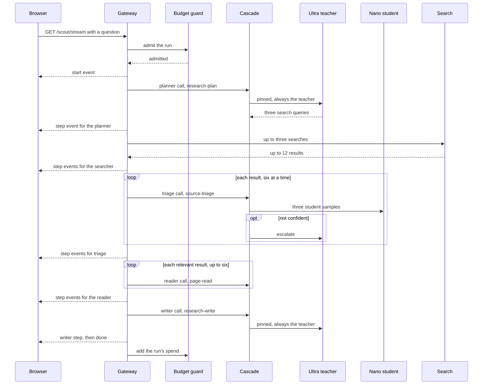
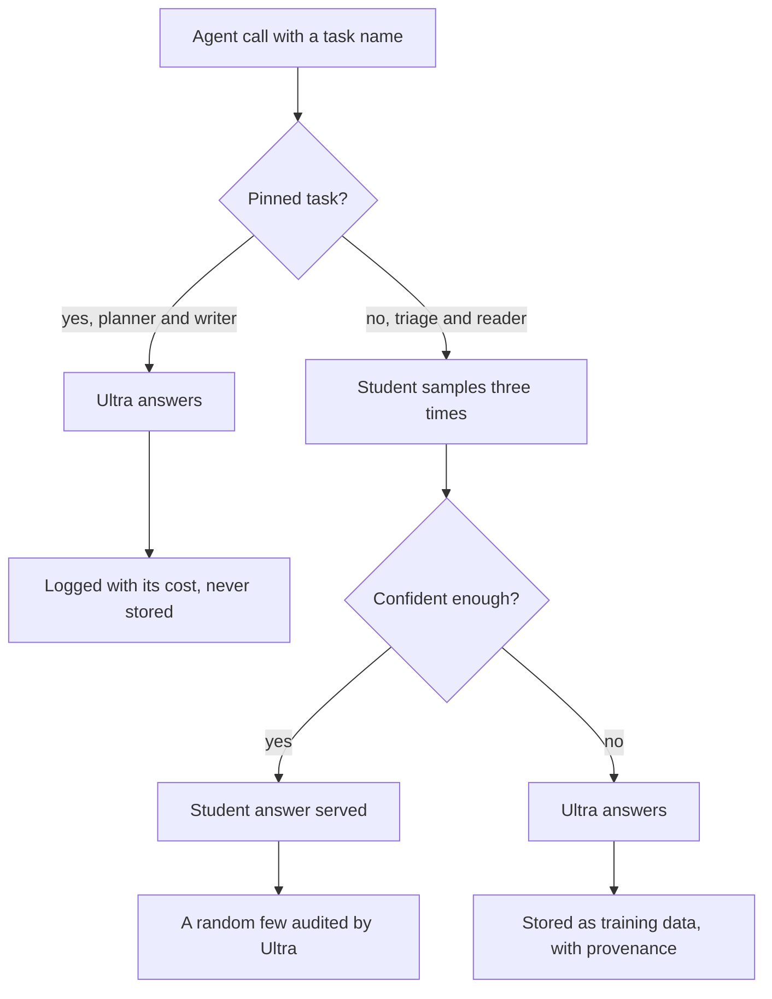

import { Steps, Tabs, TabItem, Card, CardGrid, LinkCard, Aside, Badge, FileTree } from '@astrojs/starlight/components';
import Summary from '../../../components/Summary.astro';
import Eli10 from '../../../components/Eli10.astro';
import Who from '../../../components/Who.astro';

<Summary>Scout is a small multi-agent research demo built on Ratchet: five agents answer a question from the web, the many short triage and reading calls move to the student, and the open-ended planning and writing stay pinned to the teacher.</Summary>

<Eli10>

The restaurant takes a catering order: "find out what LoRA fine-tuning is and write it up". Five helpers work on it, and every dish still goes through the pass.

- **The planner** decides what to shop for: three search queries. Only the head chef from the agency does this, because it needs judgement.
- **The searcher** is the runner who goes to the market (a web search). Nobody cooks here, so nobody is paid by the dish.
- **The triage helper** looks at each bag from the market and says "useful or not, and what kind of shop it came from". That is a dozen small, repetitive jobs per order. The apprentice chef learns these from the head chef's answers and soon does most of them.
- **The reader** opens each useful bag and writes down the one fact that matters. Also small and repetitive, so the apprentice learns it too.
- **The writer** plates the final answer with its sources. Only the head chef does this.

The head chef's planning and plating notes are never copied into the recipe book, so the apprentice never studies them. And because the restaurant is open to anyone, it only takes so many catering orders a day, with a few held back for the food critics (the hackathon judges).

</Eli10>

## How it really works

<Steps>

1. **A question arrives.** The browser opens `GET /scout/stream?q=...` (or a client calls `POST /scout/run`). The gateway checks it: not empty, at most 300 characters, one of the eight example questions in mock mode, and a Tavily key in live mode. Then the budget guard decides whether the run may start (`Guard.admit`).

2. **The planner writes three search queries.** One call with the task `research-plan`. The task is pinned, so Nemotron 3 Ultra answers it directly, with no student sample. Its JSON answer is `{"queries": [...]}`.

3. **The searcher runs the queries.** It is a tool, not a model. In live mode it calls the [Tavily Search API](https://docs.tavily.com) at basic depth (1 credit a search), up to `RATCHET_SCOUT_MAX_RESULTS` (4) results per query. In mock mode it returns simulated results. Duplicate URLs are skipped, and at most 12 results go on.

4. **Triage labels every result.** One call per result (up to 12) with the task `source-triage`, run 6 at a time in a thread pool. The answer is `relevant`, `source_type` and a one-sentence `reason`. Only `relevant` and `source_type` are compared when Ratchet decides whether two answers agree.

5. **The reader pulls one fact from each relevant result.** One call per relevant result (up to 6) with the task `page-read`. The answer is `answers_question`, `fact_type` and a free-text `key_fact`. Only the first two are compared.

6. **The writer answers with citations.** One call with the task `research-write`, also pinned to Ultra. It writes 2 to 4 sentences from the numbered facts and cites them as `[n]`, or says the facts do not answer the question.

7. **Everything streams to the page, then the spend is counted.** Each finished call is sent as a `step` event, then a `done` event with totals. When the run ends, successfully or not, the guard adds its spend (`Guard.add_spend`).

</Steps>



In the gateway each agent call is `Ratchet.handle` in the same process. From outside, the [Scout CLI](#for-engineers) sends the same calls to `/v1/chat/completions` with an `X-Ratchet-Task` header, like any OpenAI client.

### Pinned and distilled calls, and why



**Pinned** (`research-plan`, `research-write`): planning queries and writing an answer are open-ended. There are no label fields to compare, so the student and the teacher would almost never "agree", calibration would end up serving nothing, and every call would still pay for student samples. Training a 4B model on long free text would also dilute what it learns for the labelled tasks ([ADR 0008](/reference/adr/0008-pinned-tasks/)). So a pinned task goes straight to the teacher, with no student sample, audit or shadow. It is logged in the ledger like any other call, so the cost and the all-teacher baseline stay complete, but it is **never stored as a training example**. That is invariant 10. Only an operator's task spec can pin a task, never a request header.

**Distilled** (`source-triage`, `page-read`): one short labelling call per search result and one per relevant page. Each run makes up to 18 of them, they repeat in shape from question to question, and their label fields can be compared exactly. That is where the student takes over. Before a trained student is live (the cold start), these calls go to the teacher too, and its answers become the training data.

The savings Scout shows include the pinned calls, so the percentage is honest about the part that cannot move.

### Live mode and mock mode

| | Mock mode | Live mode |
|---|---|---|
| Search | Simulated results from `sim/research.py`, labelled "Simulated search results" on the page | Tavily Search API (`TAVILY_API_KEY`); without a key, live Scout answers 503 |
| Questions | Only the 8 example questions (`GET /scout/examples`) | Any question up to 300 characters |
| Models | Mock teacher and mock students | Ultra on Token Factory; the student on the GPU endpoint, or the hosted fallback |
| Budget | No spend cap, no run cap; the per-IP limit is 10 times the live one | The full budget guard below |

The mock research world has 8 questions about well-established ML ideas: LoRA, knowledge distillation, model cascades, the Wilson score interval, vLLM PagedAttention, Mamba state-space models, self-consistency and model collapse. Each has 3 planned queries and a pool of 72 simulated results (12 result templates, 6 variants each) on `example.org`, so nothing pretends to be a real page. The simulator and the agents build their messages with the same functions in `ratchet/scout/prompts.py`, which lets the mock models look up each request by its exact text.

### The event stream

`GET /scout/stream` sends Server-Sent Events: one JSON object per `data:` line, in this order.

| Event | When | Main fields |
|---|---|---|
| `start` | The run was admitted | `run_id`, `question`, `mode` |
| `step` | An agent call finished (parallel steps arrive in any order) | `agent`, `task`, `served_by` (`student`, `teacher` or `tool`), `model`, `confidence`, `escalated`, `cost_usd`, `baseline_usd`, `latency_ms`, `detail` |
| `done` | The writer finished | `answer`, `citations`, `totals` (calls, student and teacher calls, cost, baseline, savings), `search` |
| `error` | Anything failed, before or during the run | `message`; it ends the stream |

The stream always answers HTTP 200, because a browser's `EventSource` cannot read status codes; a refusal or a failure arrives as an `error` event. While waiting it sends a keep-alive comment every 15 seconds. `POST /scout/run` returns the same events in one JSON body and uses status codes instead: 400 for a bad question, 429 when the guard refuses, 503 without a Tavily key in live mode, 502 when a model call fails. The full contract is in [SCOUT.md](/reference/scout/#event-objects-sse-data-payloads-in-order).

### Who answered each call

The page puts a badge on every step. A student step from a Night School adapter (`student-vN`) is <Who as="student" />. A teacher step is <Who as="teacher" />. When the GPU endpoint is off in live mode, student calls go to the untuned Nemotron 3 Nano 30B on Token Factory, and those steps say <Who as="fallback" />, held to the default confidence threshold and not covered by the adapter's precision certificate. Only the step's `model` tells the two student cases apart, so the page compares it with `fallback_student` from `GET /scout/status`.

### The budget guard

Scout is the one public path on the demo that spends money, so live mode guards it ([ADR 0120](/reference/adr/0120-judge-access-and-a-persistent-scout-guard/)). Invariant 11: every run, judge runs included, goes through `Guard.admit` before it starts and `Guard.add_spend` after it ends, also on failure. Live mode must never run without it.

- **A daily spend cap**: `RATCHET_SCOUT_DAILY_BUDGET_USD` (code default $3.00; the demo VM's `.env` sets $0.50, so the 48 days from Oct 29 to Dec 15 cost at most $24, plus runs in flight). Spend is the `cost_usd` of every step, audits and shadow calls included, so a run that fails halfway still counts what it spent.
- **A daily run cap**: `RATCHET_SCOUT_MAX_RUNS_PER_DAY` (30), all visitors together. It also caps Tavily credits: about 3 searches a run.
- **A per-IP hourly limit**: `RATCHET_SCOUT_RUNS_PER_HOUR` (6) per client address, in memory only, so no IP is stored.
- **Kept across restarts**: each admitted run writes a `scout_run` row to the ledger's `spend` table, updated after every model call and closed with its outcome. At startup `Guard.restore()` rebuilds today's counters from those rows, so an update or a crash does not reset the caps. The rows hold no IP, question, URL, error message or code, and their `usd` stays 0 because the model calls are already counted in `requests`.
- **A judges' reserve**: `RATCHET_SCOUT_JUDGE_RUNS_PER_DAY` (and an optional `RATCHET_SCOUT_JUDGE_BUDGET_USD`) holds part of each day back. With the day's total T, the reserve J, public use P and judge use U, a public run starts only while P + max(0, U − J) is below T − J (for spend, the largest finished run today is added to the left side as a margin, so public runs in flight cannot spill into the reserve), and a judge run while P + U is below T. Judges get at least their reserve and can use public room that is left.
- **An access code**: a judge sends `RATCHET_SCOUT_JUDGE_CODE` once, in the body of `POST /scout/judge`, never in a URL or header (access logs record both). The gateway keeps only its SHA-256 digest and a derived key, allows 10 attempts per IP per hour, and answers with a signed `ratchet_judge` cookie (`HttpOnly`, `SameSite=Strict`, `Secure` in live mode, 7 days by default). Rotating the code ends every session. No refusal message hints that a code exists. The code goes in the submission's testing instructions only.
- **Paced Tavily credits**: with `RATCHET_TAVILY_MONTHLY_CREDITS` set, every search reserves its credits first and settles them after the call. The public's allowance is spread evenly per UTC day until `RATCHET_TAVILY_PACE_UNTIL`, with a share held for judges. After Tavily answers 432 or 433 (plan or pay-as-you-go limit), searching pauses for an hour.

The guard's limits: it covers Scout only, not `/v1/chat/completions` (API keys or the Caddy guard protect that, see [Security](/guides/security/)). Many IP addresses can still use up the public share early; the judges' reserve is held back from them. And the cap is checked when a run starts, so the worst case is the cap plus the runs already in flight (a few cents each).

### When search fails

A search that fails (any HTTP or transport error, such as a revoked key's 401 or Tavily's 432) or that the credit meter refuses does not end the run:

- The searcher step carries `detail.unavailable` with a fixed reason or the error's class and status, never its message or URL. No more queries are made.
- Triage and reader run on whatever earlier queries found. With nothing found they make no calls.
- The writer still answers, without (some) sources, and its step says `search_unavailable: true`. The `done` event's `search` is `{"available": false, "partial": ..., "reason": ...}`, and the page labels the run "search unavailable".
- The planner, pinned to the teacher, ran before any search, so every admitted run makes a real Token Factory call in live mode, with or without search.
- Failures (not credit refusals) are counted in `/scout/status` and written as a `search_error` event on the 1st, 10th, 100th and 1000th, so a broken key stays visible.

### What the simulation shows

These are **simulation** numbers (mock models), from the README and [TESTING.md](/reference/testing/#workloads-research-and-mixed). `python -m sim.simulate --workload research --days 8 --requests 1500` sends only Scout's triage and reader calls (the distilled ones), seed 7:

| Setting | Student share, day 8 | Saved on day 8 | Saved over all 8 days |
|---|---|---|---|
| Per-task calibration on (the default) | 92% | 81% | 62% ($5.11 vs $13.58 all-Ultra) |
| One pooled threshold (`RATCHET_PER_TASK_CALIBRATION=0`) | 96% | 85% | 63% |

Across seeds 1, 2, 3, 7 and 11 with the default, the final student share ranged from 65% to 97% and the total savings from 19% to 65%, with the first version live between day 2 and day 6. Because these runs leave out the pinned calls, a full Scout run saves less than the triage-and-reader figure. With `RATCHET_MOCK_WARMUP_DAYS=4` the mock demo opens on a student that answers about 80 to 90% of a run's model calls: 14 to 18 of 17 to 20 calls per example question, 72 to 86% cheaper than all-Ultra (simulation, [SCOUT.md](/reference/scout/)).

<Aside type="caution" title="Not run on Nebius yet">
As of Oct 21, 2026, live Scout (Tavily plus the real cascade on Token Factory) is written and tested offline but has not run against real accounts. The live Scout figures in the [hackathon submission](/reference/hackathon-submission/) are still `[LIVE NUMBER]` placeholders.
</Aside>

## For engineers

**Code** (links to `main`):

| File | What |
|---|---|
| [`ratchet/scout/agents.py`](https://github.com/harshbhx/ratchet/blob/main/ratchet/scout/agents.py) | `Scout.run(question, emit, mode, run_id)`: planner, searcher, triage, reader, writer; emits `start`, `step`, `done`. `Call`, `http_caller` (any gateway over HTTP). A `SearchUnavailable` or `httpx.HTTPError` from search ends the searching, not the run |
| [`ratchet/scout/prompts.py`](https://github.com/harshbhx/ratchet/blob/main/ratchet/scout/prompts.py) | System prompts and message builders (`plan_messages`, `triage_messages`, `read_messages`, `write_messages`), `EXAMPLE_QUESTIONS`. Shared with the simulator: never build Scout messages anywhere else |
| [`ratchet/scout/search.py`](https://github.com/harshbhx/ratchet/blob/main/ratchet/scout/search.py) | `TavilySearch` (live), `MockSearch` (simulated), `SearchUnavailable` |
| [`ratchet/scout/guard.py`](https://github.com/harshbhx/ratchet/blob/main/ratchet/scout/guard.py) | `Guard`: `admit`, `progress`, `add_spend`, `restore`, the pool rule for the judges' reserve |
| [`ratchet/scout/judge.py`](https://github.com/harshbhx/ratchet/blob/main/ratchet/scout/judge.py) | `JudgeAccess` (digest and derived cookie key, never the code), `AttemptLimiter` |
| [`ratchet/scout/credits.py`](https://github.com/harshbhx/ratchet/blob/main/ratchet/scout/credits.py) | `CreditMeter` (monthly credits, daily pacing, judge share, `reserve` and `settle`), `MeteredSearch` |
| [`ratchet/gateway.py`](https://github.com/harshbhx/ratchet/blob/main/ratchet/gateway.py) | `_scout_precheck` (calls `Guard.admit`), `_run_scout` (`Guard.add_spend` in a `finally`), `Runtime.scout`, the `/scout/*` routes |
| [`ratchet/tasks.py`](https://github.com/harshbhx/ratchet/blob/main/ratchet/tasks.py) | The four built-in Scout tasks: `source-triage` and `page-read` with their label fields, `research-plan` and `research-write` with `pinned=True` |
| [`sim/research.py`](https://github.com/harshbhx/ratchet/blob/main/sim/research.py) | The mock research world |

**Settings** (from `ratchet/config.py` and [CONFIGURATION.md](/reference/configuration/)):

| Variable | Default | Meaning |
|---|---|---|
| `TAVILY_API_KEY` | empty | Tavily key; live Scout answers 503 without it |
| `RATCHET_SCOUT_DAILY_BUDGET_USD` | `3.00` | Scout spend per UTC day (live mode) |
| `RATCHET_SCOUT_MAX_RUNS_PER_DAY` | `30` | Runs per UTC day, everyone together (live mode) |
| `RATCHET_SCOUT_RUNS_PER_HOUR` | `6` | Runs per client IP per rolling hour (10 times this in mock mode) |
| `RATCHET_SCOUT_MAX_RESULTS` | `4` | Tavily results per query |
| `RATCHET_SCOUT_JUDGE_CODE` | empty | Judge access code, 16 to 256 characters; set it if and only if judge runs are above 0 |
| `RATCHET_SCOUT_JUDGE_RUNS_PER_DAY` | `0` | Runs held back for judges |
| `RATCHET_SCOUT_JUDGE_BUDGET_USD` | unset | USD held back for judges; unset means their share of the daily budget |
| `RATCHET_SCOUT_JUDGE_SESSION_S` | `604800` | Judge cookie lifetime (7 days) |
| `RATCHET_TAVILY_MONTHLY_CREDITS` | `0` | Credits per cycle; 0 counts without a cap |
| `RATCHET_TAVILY_JUDGE_CREDITS` | unset | Credits held for judges |
| `RATCHET_TAVILY_CYCLE_DAY` | `1` | Day of the month the credit cycle starts (00:00 UTC) |
| `RATCHET_TAVILY_PACE_UNTIL` | unset | Date to spread the public allowance until, such as `2026-12-15` |
| `RATCHET_MOCK_WARMUP_DAYS` | `0` | Mock mode: simulated days run at startup, so Scout opens on a trained student |
| `RATCHET_MOCK_PACE` | `0.25` | Mock mode: share of each call's simulated latency the stream waits, so agents visibly work |

**Endpoints** ([API.md](/reference/api/#scout-endpoints)): `GET /scout/examples`, `GET /scout/status` (budget, runs, judges' reserve, search and credits, `fallback_student`, `student_serving`), `GET /scout/stream?q=`, `POST /scout/run`, `POST /scout/judge`, `DELETE /scout/judge`. All are public; the guard protects them.

**CLI**, Scout as an outside client:

```bash
python -m ratchet.scout "What is LoRA fine-tuning?" --base-url http://localhost:8000/v1
# also --api-key (default $RATCHET_API_KEY or "unused") and --max-results (default 4)
```

Search runs on your machine: Tavily when `TAVILY_API_KEY` is set, else simulated results, which only cover the example questions and only make sense against a mock-mode gateway. These calls are plain `/v1` traffic: they pass through API keys and spend limits, not through the Scout guard or the credit meter. The command exits 0 when the run finishes, also with search unavailable, and 1 when a model call fails.

**Events** in the release log: `search_error`, `tavily_exhausted`, `judge` (a session opened, with no IP and no code).

## Common questions

### Why not let the student try the planner and writer too?

Their answers are free text with nothing to compare exactly, so Ratchet could never certify the student on them, and every call would still pay for student samples. Pinning keeps those calls on the teacher and keeps their text out of the training data.

### What happens when the student is wrong on a triage call?

If it is unsure, the call escalates to Ultra before anything is served. If it is confidently wrong, a random audit may catch it, and audited precision drives the release gate and rollback. Reader precision covers `answers_question` and `fact_type` only: the free-text `key_fact` the writer cites is not checked. That limit is stated in the README.

### What does a live run cost?

A run makes 1 planner call, up to 12 triage calls, up to 6 reader calls and 1 writer call. At list prices that is roughly $0.02 to $0.03 per run before the student is trained, and under $0.01 after (estimate, [demo VM guide](/reference/deploy-nebius-vm/), prices as of Oct 2026, unverified). Tavily adds about 3 credits a run.

### Can someone run up my bill through Scout?

Only up to the daily spend cap, plus the runs already in flight when it is reached. Runs per day and per IP are capped too, and the counters survive restarts. The guard does not cover `/v1/chat/completions`; protect that with API keys or the Caddy guard.

### Why is a judge code needed at all?

The project gallery is public. Without a reserve, any visitor could use the day's runs before a judge arrived. A judge without the code still gets the public pool, and a run without search still calls Token Factory.

### Does Scout store the questions people ask?

The ledger stores no question and no client IP for Scout runs: the spend rows hold only the pool, amounts and outcome. Questions do appear in the uvicorn and Caddy access logs, because `/scout/stream?q=` carries them in the URL; on the demo VM those logs rotate. In live mode the search queries go to Tavily under Tavily's terms, so do not type personal data into the public demo.

## Related

- [For judges](/guides/for-judges/)
- [The request journey](/guides/request-journey/)
- [Security and safety](/guides/security/)
- [SCOUT.md: agents, events and the guard](/reference/scout/)
- [ADR 0008: pinned tasks](/reference/adr/0008-pinned-tasks/)
- [ADR 0120: judge access and a persistent Scout guard](/reference/adr/0120-judge-access-and-a-persistent-scout-guard/)
