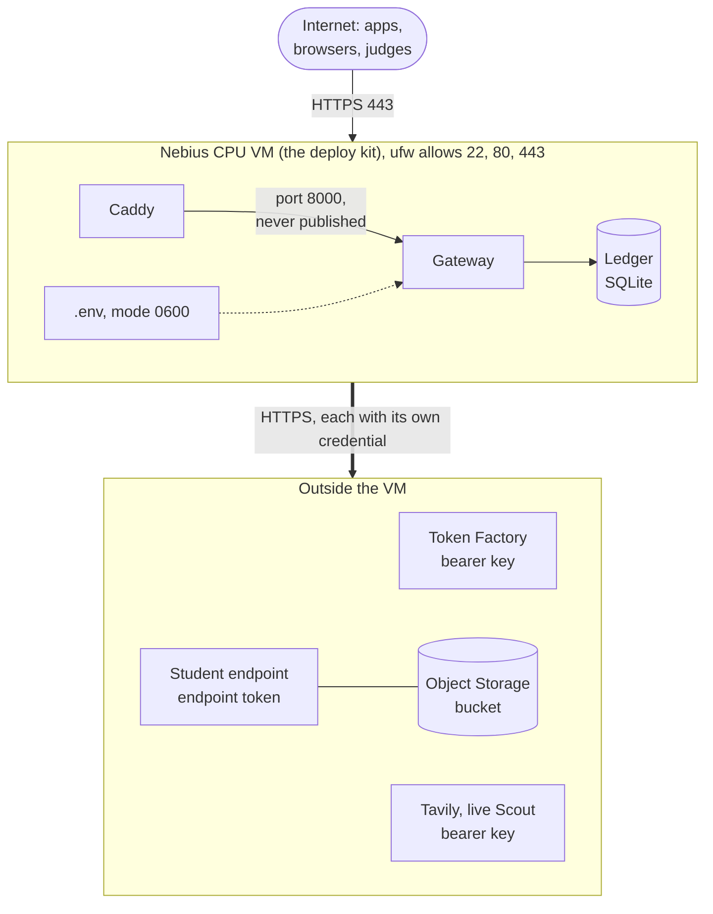
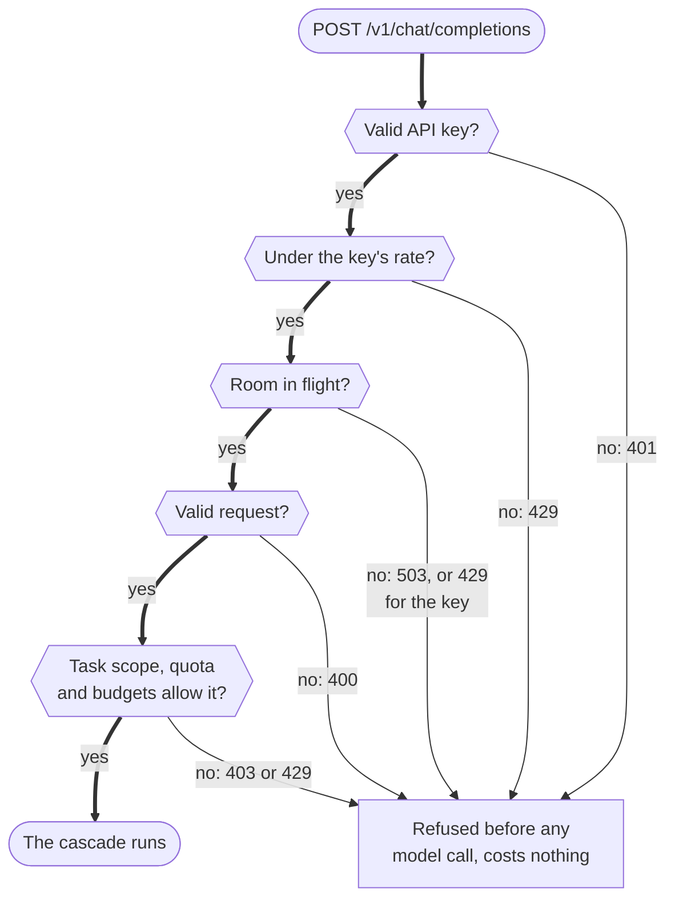
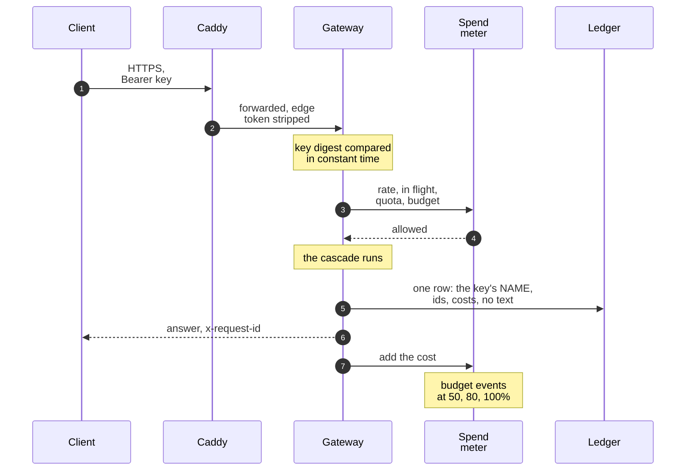
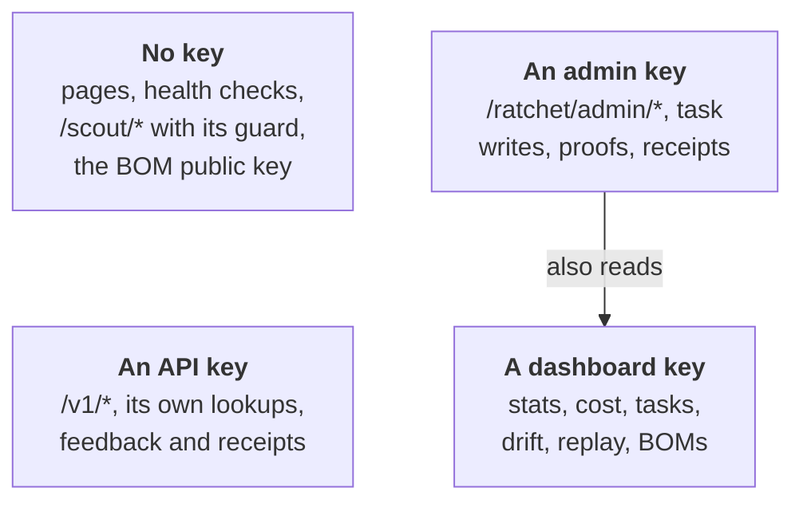

import { Steps, Aside } from '@astrojs/starlight/components';
import Summary from '../../../components/Summary.astro';
import Eli10 from '../../../components/Eli10.astro';
import Stat from '../../../components/Stat.astro';
import StatRow from '../../../components/StatRow.astro';
import PathCard from '../../../components/PathCard.astro';
import PathGrid from '../../../components/PathGrid.astro';
import FadeContent from '../../../components/ui/FadeContent.astro';
import Term from '../../../components/Term.astro';

This page covers the controls that keep a Ratchet gateway from being used, billed or read by the wrong people, and the safety rules that keep its learning loop honest.

<Eli10>

The restaurant has a door to the street, and a doorman stands there (Caddy). Behind him is the pass, where every order is decided (the gateway).

- To place an order you need a staff badge (an API key). Each badge has a name, a daily limit and a spending limit. The restaurant writes down whose badge placed each order, but never copies the badge itself.
- The manager's key (an admin key) opens the office where the rules change. The bookkeeper's badge (a dashboard key) can read the books but cannot change anything.
- When the restaurant opens for real (live mode), it refuses to open the door at all unless badges are being checked, by the pass itself or by the doorman.
- Before an order is copied into the recipe book, customers' email addresses, phone numbers and card numbers are blacked out. (Names are not caught yet; the rules below say so.)
- The kitchen also has house rules it never breaks: never copy recipes from a chef whose contract forbids it, the apprentice never studies its own dishes, and the sealed exam stays sealed.

</Eli10>

<StatRow cols={3} label="Security at a glance">
  <Stat value={4} count={false} label="kinds of secret, one role each" note="API, admin and dashboard keys and a metrics token. A key in two roles stops startup." />
  <Stat value={7} count={false} label="access levels" note="Every route has one. A route nobody classified counts as dashboard level, so it starts private." />
  <Stat value={0} count={false} label="prompt text in logs and metrics" note="Logs, metrics and request rows carry ids, names, numbers and statuses only." />
</StatRow>

## How it really works

A request to a gateway run from the Nebius VM kit crosses several boundaries (the live gateway today is on Cloudflare; this page describes the VM kit). Each one has its own check.

<figure class="rt-diagram">

<figcaption>

**Reading this diagram.** Every arrow that crosses the boundary of the VM is HTTPS with a credential. Inbound there is one door: Caddy on 443. Outbound, the thick arrow stands for three connections, each with its own key: a bearer key for Token Factory and for <Term t="tavily">Tavily</Term>, the endpoint token for the student endpoint. The dotted line is the one file of secrets, readable only by the service user. The gateway's port 8000 has no way in from outside: only Caddy can reach it.

</figcaption>
</figure>

<Steps>

1. **The edge.** In the VM kit, Caddy serves HTTPS with automatic certificates, adds security headers (`Strict-Transport-Security`, `X-Content-Type-Options`, `X-Frame-Options: DENY`, a referrer and a permissions policy) and, with `RATCHET_API_GUARD=guarded`, blocks the paid and management paths unless a request carries the edge token. The gateway's port 8000 is only reachable from Caddy.

2. **Keys and access levels.** The gateway gives every route one access level (`ratchet/access.py`) and checks the caller's key for it. <Term t="live-mode">Live mode</Term> refuses to start without API keys unless you say something else checks callers.

3. **Limits, before any model call.** A chat request passes a rate limit, an in-flight cap, validation, the key's task scope, its daily quota and its dollar budgets, and the gateway's own daily budget. A refusal calls no model and costs nothing.

4. **Ids, logs and metrics without content.** Every response carries a request id. Live mode writes one JSON log line per chat request with ids, names, numbers and statuses, never prompt or answer text, URLs or keys.

5. **Retries do not pay twice.** An `Idempotency-Key` makes a retry return the first answer, and an SDK's retry never counts as a repeat of the request.

6. **Storage is minimal.** Personal data is replaced with placeholders before anything becomes training data, and clients and end users can opt out of storage.

7. **Secrets stay off git and off the logs.** Keys live in one file on the VM with mode 0600. Keys, the edge token and the judge code are compared as digests and never stored or echoed.

</Steps>

Here is the order of checks on one `/v1` chat request:

<figure class="rt-diagram">

<figcaption>

**Reading this diagram.** Follow the thick path down. The checks run from cheapest to most expensive, and every refusal happens before a single model call, so a refused request costs nothing; the status on each arrow is what the client gets. The key and the rate limit come first, even before the body is read, so a flood of oversized bodies is turned away early. Quotas and budgets come last because they need the parsed request (its task, its size).

</figcaption>
</figure>

The same path as a conversation between the parts, including what is written down:

<figure class="rt-diagram">

<figcaption>

**Reading this diagram.** The key is used once, to look up a name, and then it is gone: the <Term t="ledger">ledger</Term> and the logs see only the name. The spend meter is in memory and is filled from the ledger at startup, so the request path never runs a query for it and a restart does not reset it. The last step is why a leaked key spends at most its own budget.

</figcaption>
</figure>

### The access-level map

<figure class="rt-diagram">

<figcaption>

**Reading this diagram.** Each box is an access level from `ratchet/access.py`. An admin key can do everything a dashboard key can, which is the arrow. An API key is deliberately a different kind of key: it can spend money but cannot read the dashboard or reach admin. A route nobody has classified falls into the reader level, so it is private in live mode by default. The full table, with the `bom` and `metrics` levels, is under [Keys and who may call what](#keys-and-who-may-call-what).

</figcaption>
</figure>

### The admin API leaves a trail

Every manual change (rollback, retire, promote, freeze releases, turn the student off, pause training, set the audit rate, pin a task, erase) goes through `ratchet/admin.py`. It needs a reason of 3 to 500 characters, checks the move against a table, and writes the change, an `admin_actions` row (who, what, why, before and after) and an `admin` event in one transaction. The actor is the admin key's name, never the key. Two processes cannot make the same move twice, because each move is a compare-and-set. See [The release gate](/guides/release-gate/#operator-holds-and-the-admin-api).

### What can go wrong

| Failure | What the system does | Where you see it |
|---|---|---|
| A request has no valid key | 401 `invalid_api_key`, no model call | the response; no ledger row for spend |
| A key passes its quota or budget | 429, no model call | `budget` events at 50, 80, 100% |
| The gateway's daily budget is spent | `block`: 429 for every chat request. `student_only`: confident student answers still go out, anything needing the teacher is a 429 | the response, `budget` events |
| Too many requests in flight | 503 at once, no queue | the response |
| Caddy's edge token is missing or too short | Guarded paths are blocked for everyone | 403 from Caddy |
| A live gateway starts without API keys | It refuses to start (unless `RATCHET_ALLOW_UNAUTHENTICATED=1`) | startup error |
| A setting is wrong | One `ConfigError` lists every bad variable before anything opens | startup, `python -m ratchet.config check` |
| The ledger cannot be written or no teacher can answer | `/readyz` answers 503 | `GET /readyz` |
| Someone sends the same key twice with different bodies | 400 `idempotency_key_reused` | the response |

On a gateway without API keys, the rate limit is per client address instead (`RATCHET_IP_RPM`, 120 a minute in live mode).

### Keys and who may call what

Four kinds of secret, each with one role. A key that appears in two roles stops startup.

| Secret | Variable | What it opens |
|---|---|---|
| API key | `RATCHET_API_KEYS` (`name:key,...`) | `/v1/*`, the OpenAI-compatible API; a key also reads its own savings receipts |
| Admin key | `RATCHET_ADMIN_KEYS` | Management writes: task specs, `POST /ratchet/cost/endpoint`, everything under `/ratchet/admin/`, training-set proofs; it also reads the dashboard API |
| Dashboard key | `RATCHET_DASHBOARD_KEYS` | Reads the dashboard API, writes nothing |
| Metrics token | `RATCHET_METRICS_TOKEN` | `GET /metrics` only, for a Prometheus scraper |

Keys are at least 16 characters, sent as `Authorization: Bearer <key>` or `X-API-Key`, and compared as <Term t="sha-256">SHA-256</Term> digests in constant time (`KeyRing.identify`). The ledger, the logs and `/ratchet/stats` see the key's **name** only (`acme`), never the key.

Every route has one access level:

| Level | Who may call it | Examples |
|---|---|---|
| `public` | Anyone | The pages, `/healthz`, `/livez`, `/readyz`, `/ratchet/bom/public-key`, `/scout/*` |
| `api` | An API key when `RATCHET_API_KEYS` is set | `/v1/*` |
| `dashboard` | Anyone with `RATCHET_PUBLIC_DASHBOARD=1` ; else an admin or dashboard key (the live default) | `/ratchet/stats`, `/ratchet/cost`, `/ratchet/redact`, `GET /ratchet/tasks` |
| `bom` | As `dashboard`, or anyone with `RATCHET_PUBLIC_BOM=1` | `/ratchet/bom`, `/ratchet/versions/{id}/bom` |
| `metrics` | As `dashboard`, or the metrics token | `/metrics` |
| `admin` | An admin key; nobody in live mode without admin keys | `/ratchet/admin/*`, task writes |

A route the table does not know counts as `dashboard`, so a new endpoint is private in live mode until someone classifies it, and a test fails until they do. When a live dashboard is public, anonymous readers get client pseudonyms (`client-1`, ...), event details without URLs or error messages, and no dollar caps. `/docs` and `/openapi.json` are off in live mode. Every response carries `X-Content-Type-Options: nosniff` and `Referrer-Policy: no-referrer`; `RATCHET_CSP` adds a Content-Security-Policy.

### Live mode refuses to start open

A live gateway with no `RATCHET_API_KEYS` stops at startup: `/v1/*` would answer anyone, on your Token Factory credits. To run without app keys you must set `RATCHET_ALLOW_UNAUTHENTICATED=1`, which says something in front of the gateway checks every caller: the Caddy guard or a private network.

### The Caddy edge guard

With `RATCHET_API_GUARD=guarded` in `deploy/vm/.env`, Caddy answers 403 ("Forbidden: this path needs X-Ratchet-Admin-Token") on `/v1/*` and `/ratchet/admin/*`, unless the request carries `X-Ratchet-Admin-Token` equal to `RATCHET_ADMIN_TOKEN`.

- The token must be hex and at least 32 characters (`openssl rand -hex 32`). If it is empty or shorter, the guarded paths are blocked for everyone, so a forgotten token cannot open the API.
- Caddy strips the header before the request reaches the gateway, and its access log deletes it, because Caddy only redacts the cookie and authorization headers by default.
- The pages, `/scout*`, `/dashboard`, `/ratchet/stats` and `/ratchet/bom` stay public at the edge. Whether the gateway answers the last two without a key is `RATCHET_PUBLIC_DASHBOARD`.

The guard is independent of the app's keys. Use either or both.

### Spend and rate limits

All off by default except the in-flight cap and the live per-IP rate:

- **Per key** (`RATCHET_KEY_LIMITS` over the `RATCHET_API_KEY_*` defaults): chat requests per UTC day, US dollars per UTC day and month, requests a minute, requests in flight, the tasks it may send, and whether its traffic may be stored as training data.
- **Per gateway**: `RATCHET_DAILY_BUDGET_USD` for all `/v1` spend; `RATCHET_BUDGET_MODE=block` refuses every chat request past it, `student_only` keeps serving confident student answers and refuses only what needs the teacher. `RATCHET_MAX_INFLIGHT` (32) answers 503 at once instead of queueing.
- **Alerts**: a `budget` event at 50, 80 and 100% of each cap by default.

The meter lives in memory and reads the ledger at startup, so a restart forgets nothing and the request path runs no query for it. A leaked key spends at most its own budget. The limits count per-token list prices, not GPU-hours ([Cost and savings](/guides/cost-and-savings/)), and a request in flight can overshoot a cap by its own cost.

### The Scout budget guard and the judge code

Scout is public and spends money, so in live mode it has its own guard: a daily spend cap, a daily run cap and a per-IP hourly limit, kept in the ledger across restarts, with a reserve for evaluators unlocked by an access code. The code is sent once in a POST body, kept only as a digest, limited to 10 attempts per IP per hour, and turned into a signed `HttpOnly`, `SameSite=Strict`, `Secure` cookie. Never put it on the public project page, in the video or in a URL. Full details: [Scout](/guides/scout/).

### Request ids, logs and metrics

The request ID, failure and metrics behaviour:

- **Request ids.** Every response carries `x-request-id` (`req_` and 32 hex digits) and `openai-processing-ms`. The same id names the request's ledger row, its log line and any `failures` rows. A client's own `X-Request-Id` is kept only when it matches `^[A-Za-z0-9._-]{1,128}$`. An API key can look up only its own requests; another key's request id is the same 404 as one that never existed.
- **Logs without content.** In live mode, one JSON line per chat request (`RATCHET_LOG_FORMAT`, `RATCHET_LOG_LEVEL`), plus a warning per failed model call naming the exception class and status. No message or answer text, no URL (an HTTP client's error message carries one), no key.
- **Failures with what they spent.** A failed request gets a `failures` row with its stage, error class, status and spend, and that spend counts against the savings.
- **Metrics.** `GET /metrics` serves Prometheus text format. Labels are bounded (registered task names, key names), so no request can add a series.

### Retries and idempotency

A chat request with an `Idempotency-Key` header runs once per API key. A retry with the same key and body gets the first answer again with `Idempotent-Replayed: true`, and makes no model call, ledger row or quota use. The same key with a different body is a 400 `idempotency_key_reused`. Answers are kept in memory only, for `RATCHET_IDEMPOTENCY_TTL_S` (600 s); an error is never kept, so a retry after a failure runs again.

Separately, a retry never counts as a repeat of the request. A request whose `x-stainless-retry-count` is above 0 (OpenAI's SDKs send it) does not add to an example's repeat count, and the same client's repeat within `RATCHET_SEEN_DEDUP_S` (300 s in live mode) counts once. That matters because a request seen 3 times leaves the sealed <Term t="golden-set">golden set</Term> for training: retries must not drain it.

### PII redaction and storage opt-outs

Before a request and the teacher's answer are stored as a training example, `ratchet/redact.py` replaces emails, phone numbers, card numbers (Luhn-checked), IBANs, Aadhaar numbers, US SSNs, Indian PANs and GSTINs, UPI ids, IPv4 addresses and API secrets with placeholders such as `[EMAIL]` (or `[EMAIL_1]` or a look-alike value, with `RATCHET_REDACT_STYLE`) (`RATCHET_REDACT_PII=1`, the default). The teacher still sees the original. **Names and street addresses are not detected by the patterns**; a detector plugin (`RATCHET_REDACT_PLUGIN`) can add them. You can paste text into the dashboard's redactor (`POST /ratchet/redact`) to see what would be stored. Clients and end users can keep requests out of storage (`store: false`, a key's `store=0`, no-train end users), end users are kept only as keyed hashes, and stored examples can be erased for good. Ratchet cannot remove what an existing adapter already memorised; it lists the versions that may hold erased text.

### Secrets and the host

From the [VM kit guide](/reference/deploy-nebius-vm/#security-notes):

- **No secrets in git.** Keys live only in `deploy/vm/.env` on the VM, mode 0600, owned by the `ratchet` user. `.gitignore` ignores `.env` files at any depth. Never paste keys into `cloud-init.yaml` or `create_vm.sh`.
- **Port 8000 is never published.** The compose file uses `expose`, not `ports`, so only Caddy on the internal network reaches the gateway. That is also why uvicorn may trust `X-Forwarded-For` from any forwarder there: Caddy replaces any client-sent value with the real address.
- **Firewall.** `ufw` allows only 22, 80 and 443. The default Nebius security group allows all traffic, so `ufw` is the filter that matters.
- **SSH.** Key login only; the `ratchet` service user cannot log in.
- **One worker.** The ledger is one SQLite file behind one lock, and the Scout guard and limits are per process, so the compose file pins `--workers 1`.

### After judging

Rotate `NEBIUS_API_KEY`, `TAVILY_API_KEY`, `RATCHET_STUDENT_KEY`, `RATCHET_ADMIN_TOKEN`, `RATCHET_API_KEYS`, `RATCHET_ADMIN_KEYS` and `RATCHET_DASHBOARD_KEYS`, and revoke any GitHub token used for cloning. Keep `RATCHET_BOM_SIGNING_KEY`, or at least its public key, if old bills of materials should stay verifiable.

### The threat model in brief

From [THREAT_MODEL.md](/reference/threat-model/), which says plainly what exists today and what is planned.

**Assets**: customer request text (stored examples, the training file in the bucket, and what adapters memorise), teacher outputs and their license <Term t="provenance">provenance</Term>, the adapters the customer owns, the ledger, the API keys, the <Term t="bom">BOM</Term> signing key, the spend budget, and the release decisions that choose which model answers users.

**Trust boundaries**: client to gateway (keys); gateway to Token Factory (HTTPS, bearer key); gateway to the <Term t="vllm">vLLM</Term> endpoint (HTTPS, endpoint token); the cron host to the Nebius CLI (local credentials); job and endpoint to the bucket (a Nebius-managed mount); gateway to Tavily (search results are **untrusted web content**); internet to Caddy in the VM kit.

| Threat | Present today | Planned |
|---|---|---|
| Anyone using the gateway and spending credits (T1, T19) | API keys, access levels, live mode refuses to start open, the Caddy guard, per-key and gateway budgets | Per-key token budgets, a key prompt in the dashboard page |
| Poisoned training data from crafted prompts (T2, T16) | The teacher writes every label; answers under sampling fields that steer it are never stored; golden gate and audits catch broad drops | Per-tenant datasets, anomaly detection, per-client caps, optional human review |
| Rare-trigger backdoors (T3) | Random audits, which may miss a rare trigger | Trigger scanning, higher audit rates on rare patterns |
| PII in training data (T4) | Pattern redaction, opt-outs, erasure with tombstones, logs without text | Name and address detection, Token Factory zero-data-retention settings |
| Key leakage (T5) | Keys from the environment only; `.env` git-ignored | A secrets manager, separate keys, spend alerts |
| Training on a teacher whose terms forbid it (T6) | Closed teachers refused in code; teacher and license recorded per example and signed into each adapter's BOM | A license registry kept current with model cards, legal review per teacher |
| Token Factory terms §5(f) (T7) | Written clarification requested Oct 19, 2026; no answer received as of 29 Oct 2026 | Act on Nebius's answer |
| Unauthorised adapter loading on the endpoint (T9) | The endpoint token only | An allow-list of adapter paths, a separate admin path |
| Denial of wallet (T11, T17) | Body, message and output caps; spend and rate limits; the Scout guard | Escalation-rate alerts, per-user quotas behind a login |
| Prompt injection from search results (T15) | Results are data in a user message, never a system prompt; the writer is pinned to the teacher; no agent runs tools or code from model output | Stricter delimiting, shorter excerpts |
| Stolen BOM signing key (T21) | Read from the environment only; only the public half is served | A secrets manager, signing on a separate machine |

<Aside type="tip" title="What ran on Nebius, 27 to 28 Oct 2026">
- **27 Oct 2026:** the round-2 text-to-SQL recipe was retrained by hand as a Serverless Job on a spot <Term t="l40s">L40S</Term>: 40.7% on exam 1 and 34.5% on exam 2, which reproduces the original adapter ([evidence](https://github.com/harshbhx/ratchet/tree/main/evidence/text2sql-round2-nebius)).
- **27 to 28 Oct 2026:** the student was served from a Nebius Serverless Endpoint for speed tests, then the endpoint was deleted ([evidence](https://github.com/harshbhx/ratchet/tree/main/evidence/student-endpoint-nebius)).
- **28 Oct 2026:** Night School ran end to end once, by hand: the gateway on a Nebius CPU VM, a spot L40S training job and a Serverless Endpoint. The golden gate rejected the student, so it was never made live ([evidence](https://github.com/harshbhx/ratchet/tree/main/evidence/nightschool-nebius)).
</Aside>

<Aside type="caution" title="What is still unchecked or not run">
As of Oct 29, 2026, the teacher runs on Nebius Token Factory, and the student endpoint and the training job are tested offline and ran once by hand on 28 Oct 2026 (Night School, rejected by the golden gate), with the one-command host ready to run with `make nebius-up`; the live gateway answers every request with a real Token Factory call. Items marked "verify on day 1" in the VM guide, such as `caddy validate` with the log filter, have not been checked on a real VM.
</Aside>

### The safety rules the loop never breaks

The project keeps a list of rules that code and tests enforce. The ones about the learning loop and the live gateway, in plain words:

<strong>The student never learns from its own answers.</strong> Training targets are teacher answers or customer-attested human labels, never student outputs, which avoids model collapse.

- **Only teachers whose license allows training on their outputs.** Every teacher passes `licenses.require_distillable`. Closed models such as GPT are refused, because their terms forbid training competing models ([OpenAI Business Terms §3.3(e)](https://openai.com/policies/business-terms/)).
- **The sealed exam stays sealed.** Golden examples are never trained on, except requests seen 3 or more times, which move to training and leave the golden set.
- **<Term t="champion-challenger">Champion and challenger</Term> sit the same exam.** Each night the live version is re-scored on the current golden set before a candidate is compared with it.
- **No training while a release is in flight.** Nothing trains while a version is in shadow or canary.
- **Precision is measured on <Term t="held-out">held-out</Term> data.** The threshold is calibrated on even golden rows and precision measured on odd rows.
- **A student failure never fails the request.** It falls back to the teacher. A teacher failure on the serving path returns a mapped status (400 or 429 for client causes, 502, 503 or 504 otherwise).
- **Model ids and prices are unverified until the day-1 check passes** with a real key.
- **Pinned tasks never become training data** and never reach the student.
- **The Scout budget guard stays on in live mode.** Every Scout run goes through the guard before it starts and adds its spend after it ends, also on failure.

Others that matter for security: text is redacted before it is stored; API keys are never stored or logged; committed training sets and sealed receipts are append-only; an admin key typed into the dashboard stays in the page's memory; opt-outs only reduce storage; end-user identifiers are never stored or logged; and an erased example is gone for good. The repository maps every rule to its code and tests.

## For engineers

**Code** (links to `main`):

| File | What |
|---|---|
| [`ratchet/auth.py`](https://github.com/harshbhx/ratchet/blob/main/ratchet/auth.py) | `KeyRing` (named keys, digests, `identify`, `shared`), `Token` (metrics token), `bearer`, `KeyLimits`, `parse_key_limits` |
| [`ratchet/access.py`](https://github.com/harshbhx/ratchet/blob/main/ratchet/access.py) | `ROUTES`, `PREFIXES`, `route_access`; scrubbing for anonymous readers (`pseudonyms`, `scrub_stats`, `scrub_event`, `scrub_detail`) |
| [`ratchet/gateway.py`](https://github.com/harshbhx/ratchet/blob/main/ratchet/gateway.py) | `_access` (the one gate for reader levels), `_client`, `_admin`, `_mock_only`, `_rate`, `_hold`, `Runtime._set_access` (the live auth guard), `SecurityHeadersMiddleware`, `ObservabilityMiddleware` |
| [`ratchet/spend.py`](https://github.com/harshbhx/ratchet/blob/main/ratchet/spend.py), [`ratchet/ratelimit.py`](https://github.com/harshbhx/ratchet/blob/main/ratchet/ratelimit.py) | `SpendMeter`, `BudgetExceeded`; `TokenBucket`, `RateLimiter`, `Limiter` |
| [`ratchet/obs.py`](https://github.com/harshbhx/ratchet/blob/main/ratchet/obs.py), [`ratchet/metrics.py`](https://github.com/harshbhx/ratchet/blob/main/ratchet/metrics.py) | Request ids, trace context, logs without content; Prometheus metrics |
| [`ratchet/idem.py`](https://github.com/harshbhx/ratchet/blob/main/ratchet/idem.py) | `IdemCache`, `SeenWindow` |
| [`ratchet/redact.py`](https://github.com/harshbhx/ratchet/blob/main/ratchet/redact.py), [`ratchet/privacy.py`](https://github.com/harshbhx/ratchet/blob/main/ratchet/privacy.py) | PII placeholders; opt-outs, end-user hashes, erasure |
| [`deploy/vm/Caddyfile`](https://github.com/harshbhx/ratchet/blob/main/deploy/vm/Caddyfile), [`deploy/vm/docker-compose.yml`](https://github.com/harshbhx/ratchet/blob/main/deploy/vm/docker-compose.yml) | The edge guard, headers and log filter; one worker, port 8000 exposed only internally |

**Settings** (from `ratchet/config.py` and [CONFIGURATION.md](/reference/configuration/)):

| Variable | Default | Meaning |
|---|---|---|
| `RATCHET_API_KEYS` | empty | API keys, `name:key,...`; required to start in live mode |
| `RATCHET_ADMIN_KEYS` | empty | Admin keys; without them the admin API is off in live mode |
| `RATCHET_DASHBOARD_KEYS` | empty | Read-only dashboard keys |
| `RATCHET_METRICS_TOKEN` | empty | A scraper's token for `/metrics` |
| `RATCHET_PUBLIC_DASHBOARD` | `0` live | Whether the dashboard API needs a key |
| `RATCHET_PUBLIC_BOM` | `0` | Keep the BOMs public while the dashboard is private |
| `RATCHET_ALLOW_UNAUTHENTICATED` | `0` | Let live mode start without API keys, behind a guard |
| `RATCHET_OPENAPI` | `0` live | Serve `/docs` and `/openapi.json` |
| `RATCHET_CSP` | empty | A Content-Security-Policy for every response |
| `RATCHET_REDACT_PII` | `1` | Redact before storing |
| `RATCHET_IP_RPM` | `120` live | Requests a minute per client address on a gateway without keys |
| `RATCHET_MAX_INFLIGHT` | `32` | Chat requests in flight before a 503 |
| `RATCHET_IDEMPOTENCY_TTL_S` | `600` | How long an idempotent answer is kept |
| `RATCHET_API_GUARD`, `RATCHET_ADMIN_TOKEN` | `open`, empty | Caddy only, read from `deploy/vm/.env` |

**Endpoints**: access levels are listed per route in [API.md](/reference/api/#access-levels). Request lookups: `GET /ratchet/requests/{id}` (dashboard level) and `GET /v1/ratchet/requests/{id}` (an API key's own requests only).

**Events**: `budget` (cap shares reached), `admin` (every manual change, with the admin's name and reason), `endpoint` (recorded uptime changes), `judge` (a judge session opened, with no IP and no code).

**Tests**: endpoint access, scrubbing, the live auth guard and security headers are in `tests/test_security.py`; ids, failures, logs and metrics in `tests/test_observability.py`; limits in `tests/test_limits.py`.

To report a vulnerability, see [SECURITY.md](https://github.com/harshbhx/ratchet/blob/main/SECURITY.md).

## Common questions

### Is `/v1/chat/completions` open on the live gateway?

No. The VM guide requires app API keys, the Caddy guard, or both. A live gateway with neither refuses to start, unless someone sets `RATCHET_ALLOW_UNAUTHENTICATED=1` without the guard, which the guide says not to do.

### What can a leaked API key do?

Send chat requests until its own limits stop it: its daily quota, its dollar budgets, its rate, and only the tasks it is scoped to. It cannot read other clients' requests or receipts, read the dashboard API of a private gateway, or reach the admin API. It can still do what its client could: send feedback on that client's own requests (a correction can become a training label) and erase that client's end users' examples. Remove it from `RATCHET_API_KEYS` (and from `RATCHET_KEY_LIMITS`) and restart to revoke it.

### Does Ratchet log what people send?

No prompt or answer text goes into logs, metrics or `failures` rows. Request text is stored only in training examples, redacted first, unless an <Term t="opt-out">opt-out</Term> keeps it out. Scout questions do appear in the web servers' access logs, because the stream URL carries them.

### What is not protected yet?

Names and street addresses are not redacted. A rare-trigger backdoor may never be audited. Runtime adapter loading on the endpoint is protected only by the endpoint token. The dashboard page sends a key only for task writes, not for reads, so a private live dashboard is read through the API. Unlearning is out of scope: an adapter trained on erased text keeps what it learned. All of these are listed as planned work in the threat model.

### Can someone fake their IP to get around the Scout limit?

Not in the Nebius VM kit: Caddy overwrites `X-Forwarded-For`, and the gateway trusts it only because port 8000 is not published. Not on the live gateway either, which runs on Cloudflare Workers with Containers: the Worker overwrites `X-Forwarded-For` with the address Cloudflare saw (`CF-Connecting-IP`) before it passes a request to the container, and it caps spend whatever the address (the gateway at $2.50 a day, the site's key at $1.50 a day and Scout at $1.50 a day, set in `deploy/cloudflare-live/src/index.ts`, and Scout at 30 runs a day, the code default). Elsewhere, `RATCHET_TRUST_PROXY` is off by default. Many real addresses can still use up the public share early; the judges' reserve is held back from them.

### Could the gateway train on a closed model's answers by mistake?

Closed teachers and unknown models are refused at startup, and an open teacher added by configuration (`RATCHET_TEACHER_LICENSES`) must use an allowed license and may not name a closed model family or a router alias the check recognises. A model id the check does not recognise rests on the operator's claim; the adapter's signed bill of materials and its NOTICE.md mark such a teacher `config`, so whoever receives the adapter can see it. Every stored example records its teacher and license. See [Licenses](/guides/licenses/).

## Related

<FadeContent distance={16}>
<PathGrid cols={2} label="Related guides">
  <PathCard title="Scout and its budget guard" href="/guides/scout/" icon="search" eyebrow="The public path" tone="neutral" description="The daily caps, the judges' reserve and the access code." />
  <PathCard title="Host it on Nebius" href="/guides/host-on-nebius/" icon="server" eyebrow="The VM kit" tone="neutral" description="Caddy's edge guard, the firewall and secrets on the VM." />
  <PathCard title="Licenses" href="/guides/licenses/" icon="scale" eyebrow="Which teachers" tone="neutral" description="Why closed teachers are refused, and what travels with the adapter." />
  <PathCard title="Threat model" href="/reference/threat-model/" icon="shield" eyebrow="Reference" tone="neutral" description="Assets, trust boundaries and every threat, present and planned." />
</PathGrid>
</FadeContent>

More detail: [VM kit security notes](/reference/deploy-nebius-vm/#security-notes) and [API access levels](/reference/api/#access-levels).
