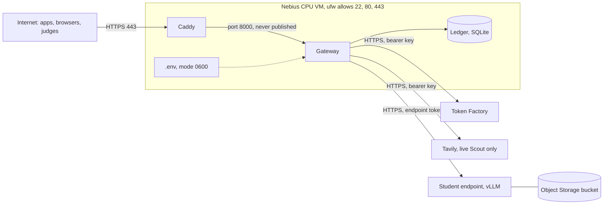
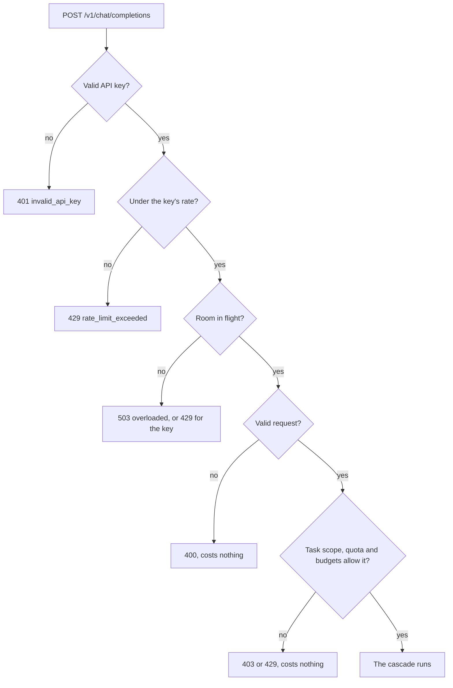

import { Steps, Tabs, TabItem, Card, CardGrid, LinkCard, Aside, Badge, FileTree } from '@astrojs/starlight/components';
import Summary from '../../../components/Summary.astro';
import Eli10 from '../../../components/Eli10.astro';
import Who from '../../../components/Who.astro';

This page covers the controls that keep a Ratchet gateway from being used, billed or read by the wrong people, and the safety rules that keep its learning loop honest.

<Eli10>

The restaurant has a door to the street, and a doorman stands there (Caddy). Behind him is the pass, where every order is decided (the gateway).

- To place an order you need a staff badge (an API key). Each badge has a name, a daily limit and a spending limit. The restaurant writes down whose badge placed each order, but never copies the badge itself.
- The manager's key (an admin key) opens the office where the rules change. The bookkeeper's badge (a dashboard key) can read the books but cannot change anything.
- When the restaurant opens for real (live mode), it refuses to open the door at all unless badges are being checked, by the pass itself or by the doorman.
- Before an order is copied into the recipe book, customers' email addresses, phone numbers and card numbers are blacked out. (Names are not caught yet; the rules below say so.)
- The kitchen also has house rules it never breaks: never copy recipes from a chef whose contract forbids it, the apprentice never studies its own dishes, and the sealed exam stays sealed.

</Eli10>

## How it really works

A request to the demo crosses several boundaries. Each one has its own check.

<Steps>

1. **The edge.** On the demo VM, Caddy serves HTTPS with automatic certificates, adds security headers (`Strict-Transport-Security`, `X-Content-Type-Options`, `X-Frame-Options: DENY`, a referrer and a permissions policy) and, with `RATCHET_API_GUARD=guarded`, blocks the paid and management paths unless a request carries the edge token. The gateway's port 8000 is only reachable from Caddy.

2. **Keys and access levels.** The gateway gives every route one access level (`ratchet/access.py`) and checks the caller's key for it. Live mode refuses to start without API keys unless you say something else checks callers.

3. **Limits, before any model call.** A chat request passes a rate limit, an in-flight cap, validation, the key's task scope, its daily quota and its dollar budgets, and the gateway's own daily budget. A refusal calls no model and costs nothing.

4. **Ids, logs and metrics without content.** Every response carries a request id. Live mode writes one JSON log line per chat request with ids, names, numbers and statuses, never prompt or answer text, URLs or keys.

5. **Retries do not pay twice.** An `Idempotency-Key` makes a retry return the first answer, and an SDK's retry never counts as a repeat of the request.

6. **Storage is minimal.** Personal data is replaced with placeholders before anything becomes training data, and clients and end users can opt out of storage.

7. **Secrets stay off git and off the logs.** Keys live in one file on the VM with mode 0600. Keys, the edge token and the judge code are compared as digests and never stored or echoed.

</Steps>

Here is the order of checks on one `/v1` chat request:

On a gateway without API keys, the rate limit is per client address instead (`RATCHET_IP_RPM`, 120 a minute in live mode).

### Keys and who may call what

Four kinds of secret, each with one role. A key that appears in two roles stops startup.

| Secret | Variable | What it opens |
|---|---|---|
| API key | `RATCHET_API_KEYS` (`name:key,...`) | `/v1/*`, the OpenAI-compatible API; a key also reads its own savings receipts |
| Admin key | `RATCHET_ADMIN_KEYS` | Management writes: task specs, `POST /ratchet/cost/endpoint`, everything under `/ratchet/admin/`, training-set proofs; it also reads the dashboard API |
| Dashboard key | `RATCHET_DASHBOARD_KEYS` | Reads the dashboard API, writes nothing |
| Metrics token | `RATCHET_METRICS_TOKEN` | `GET /metrics` only, for a Prometheus scraper |

Keys are at least 16 characters, sent as `Authorization: Bearer <key>` or `X-API-Key`, and compared as SHA-256 digests in constant time (`KeyRing.identify`). The ledger, the logs and `/ratchet/stats` see the key's **name** only (`acme`), never the key (invariant 13).

Every route has one access level ([ADR 0061](/reference/adr/0061-endpoint-access-levels/)):

| Level | Who may call it | Examples |
|---|---|---|
| `public` | Anyone | The pages, `/healthz`, `/livez`, `/readyz`, `/ratchet/bom/public-key`, `/scout/*` |
| `api` | An API key when `RATCHET_API_KEYS` is set | `/v1/*` |
| `dashboard` | Anyone with `RATCHET_PUBLIC_DASHBOARD=1` (the mock default); else an admin or dashboard key (the live default) | `/ratchet/stats`, `/ratchet/cost`, `/ratchet/redact`, `GET /ratchet/tasks` |
| `bom` | As `dashboard`, or anyone with `RATCHET_PUBLIC_BOM=1` | `/ratchet/bom`, `/ratchet/versions/{id}/bom` |
| `metrics` | As `dashboard`, or the metrics token | `/metrics` |
| `admin` | An admin key; nobody in live mode without admin keys | `/ratchet/admin/*`, task writes |
| `mock` | Anyone, in mock mode only (invariant 8) | `/ratchet/demo/*` |

A route the table does not know counts as `dashboard`, so a new endpoint is private in live mode until someone classifies it, and a test fails until they do. When a live dashboard is public, anonymous readers get client pseudonyms (`client-1`, ...), event details without URLs or error messages, and no dollar caps. `/docs` and `/openapi.json` are off in live mode. Every response carries `X-Content-Type-Options: nosniff` and `Referrer-Policy: no-referrer`; `RATCHET_CSP` adds a Content-Security-Policy.

### Live mode refuses to start open

A live gateway with no `RATCHET_API_KEYS` stops at startup: `/v1/*` would answer anyone, on your Token Factory credits. To run without app keys you must set `RATCHET_ALLOW_UNAUTHENTICATED=1`, which says something in front of the gateway checks every caller: the Caddy guard or a private network. Mock mode ignores it.

### The Caddy edge guard

With `RATCHET_API_GUARD=guarded` in `deploy/vm/.env`, Caddy answers 403 ("Forbidden: this path needs X-Ratchet-Admin-Token") on `/v1/*`, `/ratchet/demo/*` and `/ratchet/admin/*`, unless the request carries `X-Ratchet-Admin-Token` equal to `RATCHET_ADMIN_TOKEN`.

- The token must be hex and at least 32 characters (`openssl rand -hex 32`). If it is empty or shorter, the guarded paths are blocked for everyone, so a forgotten token cannot open the API.
- Caddy strips the header before the request reaches the gateway, and its access log deletes it, because Caddy only redacts the cookie and authorization headers by default.
- The pages, `/scout*`, `/dashboard`, `/ratchet/stats` and `/ratchet/bom` stay public at the edge. Whether the gateway answers the last two without a key is `RATCHET_PUBLIC_DASHBOARD`.
- In mock mode the guard also disables the dashboard's demo buttons, which call `/ratchet/demo/*`. Use `open` for the mock demo and `guarded` in live mode.

The guard is independent of the app's keys. Use either or both.

### Spend and rate limits

From [ADR 0063](/reference/adr/0063-spend-and-rate-limits/), all off by default except the in-flight cap and the live per-IP rate:

- **Per key** (`RATCHET_KEY_LIMITS` over the `RATCHET_API_KEY_*` defaults): chat requests per UTC day, US dollars per UTC day and month, requests a minute, requests in flight, the tasks it may send, and whether its traffic may be stored as training data.
- **Per gateway**: `RATCHET_DAILY_BUDGET_USD` for all `/v1` spend; `RATCHET_BUDGET_MODE=block` refuses every chat request past it, `student_only` keeps serving confident student answers and refuses only what needs the teacher. `RATCHET_MAX_INFLIGHT` (32) answers 503 at once instead of queueing.
- **Alerts**: a `budget` event at 50, 80 and 100% of each cap by default.

The meter lives in memory and reads the ledger at startup, so a restart forgets nothing and the request path runs no query for it. A leaked key spends at most its own budget. The limits count per-token list prices, not GPU-hours ([Cost and savings](/guides/cost-and-savings/)), and a request in flight can overshoot a cap by its own cost.

### The Scout budget guard and the judge code

Scout is public and spends money, so in live mode it has its own guard (invariant 11): a daily spend cap, a daily run cap and a per-IP hourly limit, kept in the ledger across restarts, with a reserve for hackathon judges unlocked by an access code. The code is sent once in a POST body, kept only as a digest, limited to 10 attempts per IP per hour, and turned into a signed `HttpOnly`, `SameSite=Strict`, `Secure` cookie. Never put it on the public project page, in the video or in a URL. Full details: [Scout](/guides/scout/).

### Request ids, logs and metrics

From [ADR 0062](/reference/adr/0062-request-ids-failures-logs-and-metrics/):

- **Request ids.** Every response carries `x-request-id` (`req_` and 32 hex digits) and `openai-processing-ms`. The same id names the request's ledger row, its log line and any `failures` rows. A client's own `X-Request-Id` is kept only when it matches `^[A-Za-z0-9._-]{1,128}$`. An API key can look up only its own requests; another key's request id is the same 404 as one that never existed.
- **Logs without content.** In live mode, one JSON line per chat request (`RATCHET_LOG_FORMAT`, `RATCHET_LOG_LEVEL`), plus a warning per failed model call naming the exception class and status. No message or answer text, no URL (an HTTP client's error message carries one), no key.
- **Failures with what they spent.** A failed request gets a `failures` row with its stage, error class, status and spend, and that spend counts against the savings.
- **Metrics.** `GET /metrics` serves Prometheus text format. Labels are bounded (registered task names, key names), so no request can add a series.

### Retries and idempotency

From [ADR 0071](/reference/adr/0071-idempotency-keys-and-retry-de-duplication/): a chat request with an `Idempotency-Key` header runs once per API key. A retry with the same key and body gets the first answer again with `Idempotent-Replayed: true`, and makes no model call, ledger row or quota use. The same key with a different body is a 400 `idempotency_key_reused`. Answers are kept in memory only, for `RATCHET_IDEMPOTENCY_TTL_S` (600 s); an error is never kept, so a retry after a failure runs again.

Separately, a retry never counts as a repeat of the request. A request whose `x-stainless-retry-count` is above 0 (OpenAI's SDKs send it) does not add to an example's repeat count, and the same client's repeat within `RATCHET_SEEN_DEDUP_S` (300 s in live mode) counts once. That matters because a request seen 3 times leaves the sealed golden set for training: retries must not drain it.

### PII redaction and storage opt-outs

Before a request and the teacher's answer are stored as a training example, `ratchet/redact.py` replaces emails, phone numbers, card numbers (Luhn-checked), IBANs, Aadhaar numbers, US SSNs, Indian PANs, IPv4 addresses and API secrets with placeholders such as `[EMAIL]` (`RATCHET_REDACT_PII=1`, the default; invariant 12). The teacher still sees the original. **Names and street addresses are not detected yet.** You can paste text into the dashboard's redactor (`POST /ratchet/redact`) to see what would be stored. Clients and end users can keep requests out of storage (`store: false`, a key's `store=0`, no-train end users), end users are kept only as keyed hashes, and stored examples can be erased for good. Ratchet cannot remove what an existing adapter already memorised; it lists the versions that may hold erased text.

### Secrets and the host

From the [demo VM guide](/reference/deploy-nebius-vm/#security-notes):

- **No secrets in git.** Keys live only in `deploy/vm/.env` on the VM, mode 0600, owned by the `ratchet` user. `.gitignore` ignores `.env` files at any depth. Never paste keys into `cloud-init.yaml` or `create_vm.sh`.
- **Port 8000 is never published.** The compose file uses `expose`, not `ports`, so only Caddy on the internal network reaches the gateway. That is also why uvicorn may trust `X-Forwarded-For` from any forwarder there: Caddy replaces any client-sent value with the real address.
- **Firewall.** `ufw` allows only 22, 80 and 443. The default Nebius security group allows all traffic, so `ufw` is the filter that matters.
- **SSH.** Key login only; the `ratchet` service user cannot log in.
- **One worker.** The ledger is one SQLite file behind one lock, and the Scout guard and limits are per process, so the compose file pins `--workers 1`.

### After judging

Rotate `NEBIUS_API_KEY`, `TAVILY_API_KEY`, `RATCHET_STUDENT_KEY`, `RATCHET_ADMIN_TOKEN`, `RATCHET_API_KEYS`, `RATCHET_ADMIN_KEYS` and `RATCHET_DASHBOARD_KEYS`, and revoke any GitHub token used for cloning. Keep `RATCHET_BOM_SIGNING_KEY`, or at least its public key, if old bills of materials should stay verifiable.

### The threat model in brief

From [THREAT_MODEL.md](/reference/threat-model/), which says plainly what exists today and what is planned.

**Assets**: customer request text (stored examples, the training file in the bucket, and what adapters memorise), teacher outputs and their license provenance, the adapters the customer owns, the ledger, the API keys, the BOM signing key, the demo budget, and the release decisions that choose which model answers users.

**Trust boundaries**: client to gateway (keys); gateway to Token Factory (HTTPS, bearer key); gateway to the vLLM endpoint (HTTPS, endpoint token); the cron host to the Nebius CLI (local credentials); job and endpoint to the bucket (a Nebius-managed mount); gateway to Tavily (search results are **untrusted web content**); internet to Caddy on the demo VM.

| Threat | Present today | Planned |
|---|---|---|
| Anyone using the gateway and spending credits (T1, T19) | API keys, access levels, live mode refuses to start open, the Caddy guard, per-key and gateway budgets | Per-key token budgets, a key prompt in the dashboard page |
| Poisoned training data from crafted prompts (T2, T16) | The teacher writes every label; answers under sampling fields that steer it are never stored; golden gate and audits catch broad drops | Per-tenant datasets, anomaly detection, per-client caps, optional human review |
| Rare-trigger backdoors (T3) | Random audits, which may miss a rare trigger | Trigger scanning, higher audit rates on rare patterns |
| PII in training data (T4) | Pattern redaction, opt-outs, erasure with tombstones, logs without text | Name and address detection, Token Factory zero-data-retention settings |
| Key leakage (T5) | Keys from the environment only; `.env` git-ignored | A secrets manager, separate keys, spend alerts |
| Training on a teacher whose terms forbid it (T6) | Closed teachers refused in code; teacher and license recorded per example and signed into each adapter's BOM | A license registry kept current with model cards, legal review per teacher |
| Token Factory terms §5(f) (T7) | Written clarification requested Oct 19, 2026 | Act on Nebius's answer |
| Unauthorised adapter loading on the endpoint (T9) | The endpoint token only | An allow-list of adapter paths, a separate admin path |
| Denial of wallet (T11, T17) | Body, message and output caps; spend and rate limits; the Scout guard | Escalation-rate alerts, per-user quotas behind a login |
| Prompt injection from search results (T15) | Results are data in a user message, never a system prompt; the writer is pinned to the teacher; no agent runs tools or code from model output | Stricter delimiting, shorter excerpts |
| Stolen BOM signing key (T21) | Read from the environment only; only the public half is served | A secrets manager, signing on a separate machine |

<Aside type="caution" title="Not run on Nebius yet">
As of Oct 21, 2026, live mode, the student endpoint, the training job and the demo VM kit are written and tested offline, not run against a real Nebius account. Items marked "verify on day 1" in the VM guide, such as `caddy validate` with the log filter, have not been checked on a real VM yet.
</Aside>

### The safety rules the loop never breaks

The project keeps a numbered list of invariants that tests and code enforce. These are the first eleven, in plain words:

1. **Only teachers whose license allows training on their outputs.** Every teacher passes `licenses.require_distillable`. Closed models such as GPT are refused, because their terms forbid training competing models ([OpenAI Business Terms §3.3(e)](https://openai.com/policies/business-terms/)).
2. **The student never learns from its own answers.** Training targets are teacher answers or customer-attested human labels, never student outputs, which avoids model collapse.
3. **The sealed exam stays sealed.** Golden examples are never trained on, except requests seen 3 or more times, which move to training and leave the golden set.
4. **Champion and challenger sit the same exam.** Each night the live version is re-scored on the current golden set before a candidate is compared with it.
5. **No training while a release is in flight.** Nothing trains while a version is in shadow or canary.
6. **Precision is measured on held-out data.** The threshold is calibrated on even golden rows and precision measured on odd rows.
7. **A student failure never fails the request.** It falls back to the teacher. A teacher failure on the serving path returns a mapped status (400 or 429 for client causes, 502, 503 or 504 otherwise).
8. **Demo controls stay mock-only.** `/ratchet/demo/*` answers 403 in live mode.
9. **Model ids and prices are unverified until the day-1 check passes** with a real key.
10. **Pinned tasks never become training data** and never reach the student.
11. **The demo budget guard stays on in live mode.** Every Scout run goes through the guard before it starts and adds its spend after it ends, also on failure.

The list has grown to 26. Later ones that matter for security include: redact before storing (12); API keys never stored or logged (13); committed training sets and sealed receipts are append-only (17); an admin key typed into the dashboard stays in the page's memory (18); opt-outs only reduce storage (22); end-user identifiers are never stored or logged (23); an erased example is gone for good (24). The full list, each mapped to its code and tests, is in the [requirements matrix](/reference/requirements/#invariants-do-not-break-these).

## For engineers

**Code** (links to `main`):

| File | What |
|---|---|
| [`ratchet/auth.py`](https://github.com/harshbhx/ratchet/blob/main/ratchet/auth.py) | `KeyRing` (named keys, digests, `identify`, `shared`), `Token` (metrics token), `bearer`, `KeyLimits`, `parse_key_limits` |
| [`ratchet/access.py`](https://github.com/harshbhx/ratchet/blob/main/ratchet/access.py) | `ROUTES`, `PREFIXES`, `route_access`; scrubbing for anonymous readers (`pseudonyms`, `scrub_stats`, `scrub_event`, `scrub_detail`) |
| [`ratchet/gateway.py`](https://github.com/harshbhx/ratchet/blob/main/ratchet/gateway.py) | `_access` (the one gate for reader levels), `_client`, `_admin`, `_mock_only`, `_rate`, `_hold`, `Runtime._set_access` (the live auth guard), `SecurityHeadersMiddleware`, `ObservabilityMiddleware` |
| [`ratchet/spend.py`](https://github.com/harshbhx/ratchet/blob/main/ratchet/spend.py), [`ratchet/ratelimit.py`](https://github.com/harshbhx/ratchet/blob/main/ratchet/ratelimit.py) | `SpendMeter`, `BudgetExceeded`; `TokenBucket`, `RateLimiter`, `Limiter` |
| [`ratchet/obs.py`](https://github.com/harshbhx/ratchet/blob/main/ratchet/obs.py), [`ratchet/metrics.py`](https://github.com/harshbhx/ratchet/blob/main/ratchet/metrics.py) | Request ids, trace context, logs without content; Prometheus metrics |
| [`ratchet/idem.py`](https://github.com/harshbhx/ratchet/blob/main/ratchet/idem.py) | `IdemCache`, `SeenWindow` |
| [`ratchet/redact.py`](https://github.com/harshbhx/ratchet/blob/main/ratchet/redact.py), [`ratchet/privacy.py`](https://github.com/harshbhx/ratchet/blob/main/ratchet/privacy.py) | PII placeholders; opt-outs, end-user hashes, erasure |
| [`deploy/vm/Caddyfile`](https://github.com/harshbhx/ratchet/blob/main/deploy/vm/Caddyfile), [`deploy/vm/docker-compose.yml`](https://github.com/harshbhx/ratchet/blob/main/deploy/vm/docker-compose.yml) | The edge guard, headers and log filter; one worker, port 8000 exposed only internally |

**Settings** (from `ratchet/config.py` and [CONFIGURATION.md](/reference/configuration/)):

| Variable | Default | Meaning |
|---|---|---|
| `RATCHET_API_KEYS` | empty | API keys, `name:key,...`; required to start in live mode |
| `RATCHET_ADMIN_KEYS` | empty | Admin keys; without them the admin API is off in live mode, open in mock mode |
| `RATCHET_DASHBOARD_KEYS` | empty | Read-only dashboard keys |
| `RATCHET_METRICS_TOKEN` | empty | A scraper's token for `/metrics` |
| `RATCHET_PUBLIC_DASHBOARD` | `1` mock, `0` live | Whether the dashboard API needs a key |
| `RATCHET_PUBLIC_BOM` | `0` | Keep the BOMs public while the dashboard is private |
| `RATCHET_ALLOW_UNAUTHENTICATED` | `0` | Let live mode start without API keys, behind a guard |
| `RATCHET_OPENAPI` | `1` mock, `0` live | Serve `/docs` and `/openapi.json` |
| `RATCHET_CSP` | empty | A Content-Security-Policy for every response |
| `RATCHET_REDACT_PII` | `1` | Redact before storing |
| `RATCHET_IP_RPM` | `0` mock, `120` live | Requests a minute per client address on a gateway without keys |
| `RATCHET_MAX_INFLIGHT` | `32` | Chat requests in flight before a 503 |
| `RATCHET_IDEMPOTENCY_TTL_S` | `600` | How long an idempotent answer is kept |
| `RATCHET_API_GUARD`, `RATCHET_ADMIN_TOKEN` | `open`, empty | Caddy only, read from `deploy/vm/.env` |

**Endpoints**: access levels are listed per route in [API.md](/reference/api/#access-levels). Request lookups: `GET /ratchet/requests/{id}` (dashboard level) and `GET /v1/ratchet/requests/{id}` (an API key's own requests only).

**Events**: `budget` (cap shares reached), `admin` (every manual change, with the admin's name and reason), `endpoint` (recorded uptime changes), `judge` (a judge session opened, with no IP and no code).

**Tests**: endpoint access, scrubbing, the live auth guard and security headers are in `tests/test_security.py`; ids, failures, logs and metrics in `tests/test_observability.py`; limits in `tests/test_limits.py`.

To report a vulnerability, see [SECURITY.md](https://github.com/harshbhx/ratchet/blob/main/SECURITY.md).

## Common questions

### Is `/v1/chat/completions` open on the demo?

In mock mode it calls no model and costs nothing, so the mock demo may leave it open. In live mode the VM guide requires app API keys, the Caddy guard, or both. A live gateway with neither refuses to start, unless someone sets `RATCHET_ALLOW_UNAUTHENTICATED=1` without the guard, which the guide says not to do.

### What can a leaked API key do?

Send chat requests until its own limits stop it: its daily quota, its dollar budgets, its rate, and only the tasks it is scoped to. It cannot read other clients' requests or receipts, read the dashboard API of a private gateway, or reach the admin API. It can still do what its client could: send feedback on that client's own requests (a correction can become a training label) and erase that client's end users' examples. Remove it from `RATCHET_API_KEYS` (and from `RATCHET_KEY_LIMITS`) and restart to revoke it.

### Does Ratchet log what people send?

No prompt or answer text goes into logs, metrics or `failures` rows. Request text is stored only in training examples, redacted first, unless an opt-out keeps it out. Scout questions do appear in the web servers' access logs, because the stream URL carries them.

### What is not protected yet?

Names and street addresses are not redacted. A rare-trigger backdoor may never be audited. Runtime adapter loading on the endpoint is protected only by the endpoint token. The dashboard page cannot send a key yet, so a private live dashboard is read through the API. Unlearning is out of scope: an adapter trained on erased text keeps what it learned. All of these are listed as planned work in the threat model.

### Can someone fake their IP to get around the Scout limit?

Not on the demo VM: Caddy overwrites `X-Forwarded-For`, and the gateway trusts it only because port 8000 is not published. Elsewhere, `RATCHET_TRUST_PROXY` is off by default. Many real addresses can still use up the public share early; the judges' reserve is held back from them.

### Could the gateway train on a closed model's answers by mistake?

Closed teachers and unknown models are refused at startup, and an open teacher added by configuration (`RATCHET_TEACHER_LICENSES`) must use an allowed license and may not name a closed model family or a router alias the check recognises. A model id the check does not recognise rests on the operator's claim; the adapter's signed bill of materials and its NOTICE.md mark such a teacher `config`, so whoever receives the adapter can see it. Every stored example records its teacher and license. See [Licenses](/guides/licenses/).

## Related

- [Scout and its budget guard](/guides/scout/)
- [Host it on Nebius](/guides/host-on-nebius/)
- [Licenses](/guides/licenses/)
- [Threat model](/reference/threat-model/)
- [Demo VM: security notes](/reference/deploy-nebius-vm/#security-notes)
- [API: access levels](/reference/api/#access-levels)
