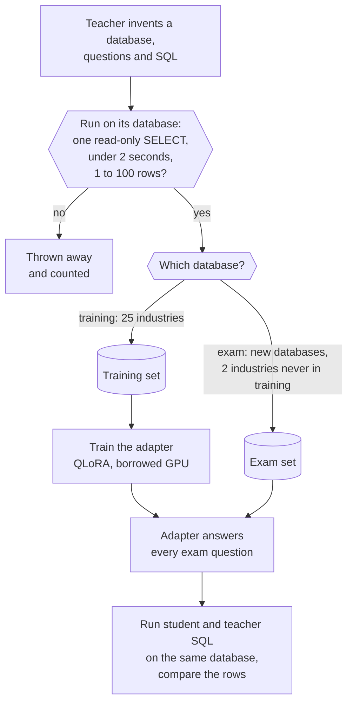
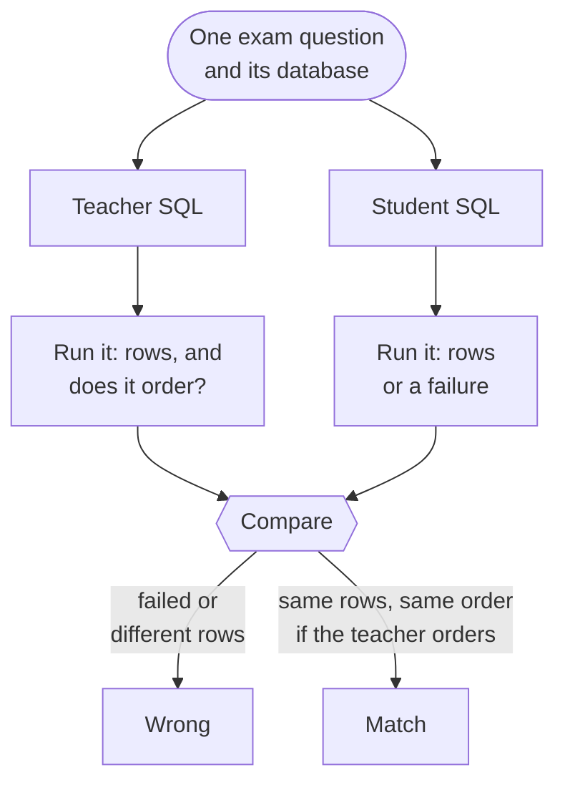
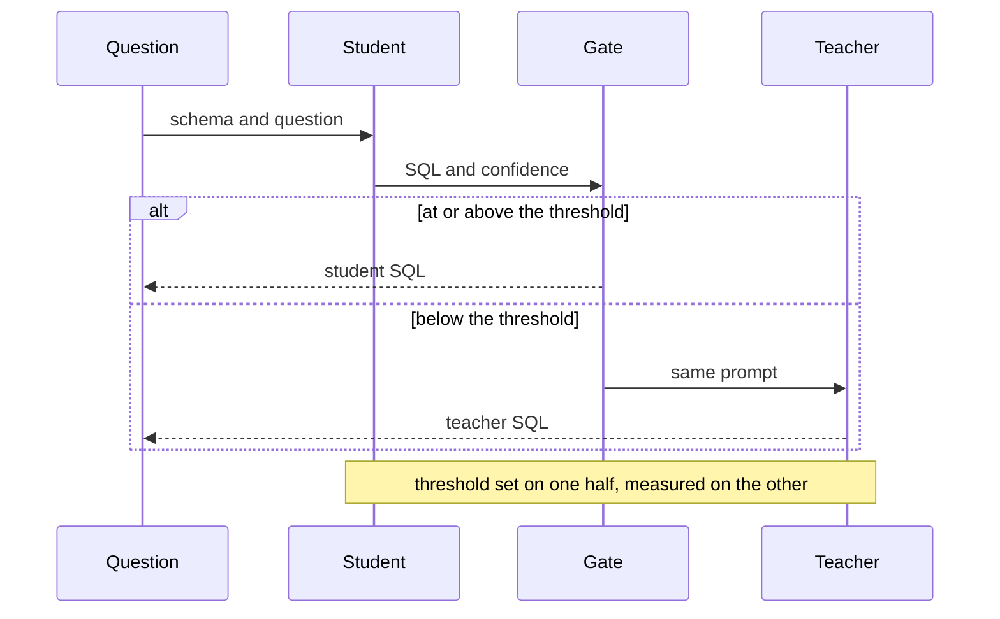

import { Steps, Aside } from '@astrojs/starlight/components';
import Summary from '../../../components/Summary.astro';
import Eli10 from '../../../components/Eli10.astro';
import Who from '../../../components/Who.astro';
import SqlResults from '../../../components/SqlResults.astro';
import Flow from '../../../components/Flow.astro';
import FlowStep from '../../../components/FlowStep.astro';
import Compare from '../../../components/Compare.astro';
import extra from '../../../data/sql-extra.json';
import exams from '../../../data/exams.json';

export const S = exams.scores;
export const pct = (c) => (100 * c.agree / c.n).toFixed(1) + '%';

<Summary>A small open model learned to write SQLite queries from a bigger open model's answers, but only from answers that were actually run on a database, and its score comes from whole databases it never trained on, so anyone can recompute that score.</Summary>

<Eli10>

Think of a new analyst joining a company. People ask them questions like "which five customers spent the most last quarter?", and they must write the query that answers it.

A senior analyst (the teacher) writes practice questions and model answers. Before an answer goes into the study pile, someone **runs it** on the practice database. If it crashes, changes data, or returns nothing, it is thrown away.

Then comes the exam. It uses databases the new analyst has never seen, and some of them come from industries that were never in the study pile. The exam is marked by running the new analyst's query and the senior's query on the same database and comparing the rows they return.

Anyone who gets the answer sheet can mark the exam again and must get the same score.

</Eli10>

<Flow label="The pipeline">
  <FlowStep title="The teacher writes the data" tone="rented" meta="Ultra on Token Factory">Databases, business questions and SQL answers.</FlowStep>
  <FlowStep title="Every answer is run" meta="a read-only sandbox">Kept only if it runs and returns 1 to 100 rows.</FlowStep>
  <FlowStep title="The student trains" tone="owned" meta="Nano 4B + LoRA">On the kept rows, on a borrowed GPU.</FlowStep>
  <FlowStep title="The exam" meta="unseen databases">Scored by running queries, on a CPU.</FlowStep>
</Flow>

## The problem

Teams that keep data in a SQL database get questions all day. A large model can answer them, but two things hurt:

<Compare before="A large model for every question" after="A small model you run">
  <div slot="before">**Cost.** Every question is a paid call to a big model. **Exposure.** Every call carries your table and column names to someone else's endpoint.</div>
  <div slot="after">A small model on a GPU you control fixes both: no bill per question, and the schema stays with you. But only if it is good enough.</div>
</Compare>

The honest question is "good enough at what, measured how?" This page and the [Results](/guides/results/) page answer that in a way you can repeat.

## What was built

- A **teacher**, Nemotron 3 Ultra on Nebius Token Factory, that invents SQLite databases, business questions and SQL answers. See [Licenses](/guides/licenses/) for why this teacher is allowed.
- A **checker** that runs every SQL answer and keeps only the ones that pass.
- A **student**: Nemotron 3 Nano 4B with a small LoRA adapter, trained on the kept rows.
- An **exam** made of databases that are never in training, and a **scorer** that anyone can rerun on a CPU.
- A **confidence gate**: the adapter answers only when it is confident, and the rest go to the teacher.

## How it really works

<Steps>

1. **The teacher invents a database.** For each industry (online retail, retail banking, clinic appointments, freight and logistics and 26 others) the teacher is asked for 3 to 5 SQLite tables with keys and 10 to 15 realistic rows each. The script runs the teacher's `CREATE` and `INSERT` statements in memory and drops the database unless it ends up with 3 to 7 tables of at least 5 rows each.

2. **The teacher writes questions and SQL.** For each database it writes questions a business user might ask, mixed across four levels: `simple` (one table), `join`, `aggregate` and `hard` (subquery, `HAVING`, three tables, `CASE` or a date calculation).

3. **Every SQL is run.** The SQL goes into a sandbox on that database. It is kept only if it is one read-only `SELECT` (or `WITH`) that finishes inside 2 seconds and returns 1 to 100 rows. Duplicate questions on the same database are dropped. Everything else is counted as rejected and thrown away.

4. **The exam is kept apart by database.** Training uses 25 industries. The exam uses whole databases that never appear in training: about two thirds come from industries that are in training (but a different, new database) and 57 of the 172 questions (33%) from two industries that are never in training (airline operations and pharmacy inventory). The script stops if one database ends up on both sides.

5. **The student is trained.** QLoRA on a borrowed GPU: the Nano 4B base loaded in 4-bit, LoRA rank 16, fp16, two epochs, with the loss counted on the SQL only.

6. **The exam is answered, then scored on a CPU.** The base model alone and the base model with the adapter each answer every exam question, and the raw answers are saved. A separate step runs each student query and the teacher's query on the same database and compares the rows.

7. **The confidence gate is set and measured on different rows.** Half of the exam rows (the even ones) set the confidence threshold. The other half (the odd ones) measure it. Nothing is graded on rows that tuned it.

8. **The score is recomputed by `verify`.** It reads the raw answers again and fails if any number in `results.json` differs, or if an input file is not the one the results were computed from.

</Steps>

<div class="rt-callout rt-callout--note">

**Where it was trained.** On a borrowed GPU (both published rounds). On 27 Oct 2026 the round-2 recipe was retrained once on Nebius AI Cloud, as a Serverless Job on one preemptible L40S (new adapter SHA-256 `68b9ed06d984a2ec38a32b58090c246a56ae12ba65f3277f66b5d74227ea25d5`; exam scores {'<<NEBIUS_EXAM1>>'} and {'<<NEBIUS_EXAM2>>'}). The teacher ran on Nebius: real calls to Nemotron 3 Ultra on Token Factory built this data on Oct 22, 2026.

</div>

<figure class="rt-diagram">



<figcaption>

**Reading this diagram.** Read from the top. The teacher writes everything, but nothing it writes is trusted: the first check runs each query on the database it was written for, and only queries that pass reach the training or exam pile. The split between training and exam happens by database, not by row, so the student cannot have seen the exam's tables. The last box is the only place a number is made, and it is made by running queries, not by asking a model whether they look right. Each database has 3 to 7 tables of at least 5 rows; the questions mix four levels: simple, join, aggregate and hard.

<ul class="rt-key">
  <li class="teacher">The teacher, Nemotron 3 Ultra</li>
  <li class="student">The student and its adapter</li>
  <li class="gate">A check</li>
  <li class="store">A data set</li>
  <li class="danger">Rejected</li>
</ul>

</figcaption>
</figure>

### The sandbox

A model's SQL is untrusted code, so it runs in a locked room.

- **Read only.** An SQLite authorizer allows reading, `SELECT`, functions and recursive queries, and denies every other action. An `INSERT`, `UPDATE`, `DELETE`, `DROP` or `ATTACH` is refused by the database itself.
- **Fast.** A progress handler stops any query that runs longer than 2 seconds.
- **In memory.** Each database is built from its script in memory and thrown away.
- **Small answers.** Training rows must return 1 to 100 rows, so a query that returns everything or nothing is not a good example.

The Ratchet gateway has the same idea built in for tasks of format `sql`: [`ratchet/sqlcheck.py`](https://github.com/harshbhx/ratchet/blob/main/ratchet/sqlcheck.py) runs two answers on a fixture database and calls them the same when they return the same rows. The data scripts for this run are standalone and enforce the same rules for the same reason.

### How an answer is scored

Two queries are the same answer when they return the same rows on the same database. This is called execution match.

- Column names are ignored, because `total` and `sum_spent` can mean the same thing.
- Decimal numbers are compared after rounding to 6 places.
- Row order matters only when the teacher's query has an `ORDER BY`. Otherwise the rows are compared as a set, sorted.
- A query that does not run, is not a read-only `SELECT`, or takes more than 2 seconds counts as wrong.

<figure class="rt-diagram">



<figcaption>

**Reading this diagram.** Both queries are run on the same database, so the only thing that can make them match is giving the same rows. The order rule sits in the comparison: if the teacher's query sorts, the student must sort the same way, and if it does not, order is ignored. A student query that crashes counts as wrong.

</figcaption>
</figure>

### The confidence gate

The adapter's confidence in an answer is the average probability of its tokens. The threshold is the lowest confidence at which the answers on the calibration half reach the target precision (95% unless set otherwise). On the measured half, an answer above the threshold is served by the student, and the rest would go to the teacher. Three numbers come out: **coverage** (how much the student answers), **precision when it answers** (how often those answers match the teacher) and an **estimated cost** against sending everything to the teacher.

If no threshold reaches the target on the calibration half, the report says so. In that case the adapter would answer nothing on its own at that target.

<figure class="rt-diagram">



<figcaption>

**Reading this diagram.** The student always tries first, and its confidence is the average probability of the tokens it wrote. The gate compares that confidence with the threshold. A confident answer goes straight back, and an unsure one is handed to the teacher, which costs more but is the safer answer. The note at the bottom is the honesty rule: the rows that set the threshold are never the rows that grade it.

</figcaption>
</figure>

## What it scored

The numbers below are read from the runs' results files when the site is built. Nothing here is typed by hand.

The headline is the round 2 adapter on two exams: exam 1, written by the teacher, and exam 2, written by a different model on industries that appear in neither the training data nor exam 1. Every question is scored strictly by running the query.

<table>
  <thead><tr><th>Who answered</th><th>Exam 1 ({S.exam1.base.n} questions)</th><th>Exam 2 ({S.exam2.base.n} questions)</th></tr></thead>
  <tbody>
    {[['Base model (untrained Nano 4B)', 'base'], ['Teacher (Nemotron 3 Ultra)', 'teacher'], ['Adapter, round 2', 'r2']].map(([name, id]) => (
      <tr><td>{name}</td><td>{S.exam1[id].agree} of {S.exam1[id].n} = <strong>{pct(S.exam1[id])}</strong></td><td>{S.exam2[id].agree} of {S.exam2[id].n} = <strong>{pct(S.exam2[id])}</strong></td></tr>
    ))}
  </tbody>
</table>

At the 95% precision target the round 2 adapter answers {extra.round2.gate.answered} of {extra.round2.gate.of} questions on exam 1's measurement half and {extra.exam2.gate.answered} of {extra.exam2.gate.of} on exam 2's, so it does not replace the teacher yet. The ranges, round 1 and the details are on the [Results](/guides/results/) page.

### Round 1

The round 1 adapter on the half of exam 1 that measures the confidence gate (86 of 172 questions). Round 2 and the second exam are in the table above and on the [Results](/guides/results/) page.

<SqlResults />

More on how to read them is on the [Results](/guides/results/) page, and the full chain of checks is on [Proof you can run](/guides/proof/).

## Reproduce it and check it

Where the code lives: the data and training scripts are in the repository under [`scripts/text2sql/`](https://github.com/harshbhx/ratchet/tree/main/scripts/text2sql) (`gen_sql_data.py` and the training script), and the scoring script with the SQL checks is `scripts/measure_adapter.py`. They are tools you run by hand, not part of the gateway. The three commands that matter:

```bash
# 1. Build the data (needs a Token Factory key; the teacher is paid per token, capped by --max-usd)
python scripts/text2sql/gen_sql_data.py --out out/sql --max-usd 3

# 2. Train on a GPU and answer the exam
#    the training script in scripts/text2sql/ trains the adapter, then runs: scripts/measure_adapter.py generate ...

# 3. Score and verify (CPU only; this is the part anyone can rerun)
python scripts/measure_adapter.py report --raw raw.jsonl --golden golden.jsonl --dbs dbs.json \
  --adapter ./adapter --out results.json
python scripts/measure_adapter.py verify --raw raw.jsonl --results results.json \
  --golden golden.jsonl --dbs dbs.json
# exact arguments for the published runs: evidence/text2sql-round2/README.md, "Check it yourself"
```

`verify` prints `OK: every number in results.json was recomputed from raw.jsonl and matches`, or exits with a line starting `FAIL:` that says which file is wrong or which numbers differ. The report holds the SHA-256 of the raw answers, the exam, the exam databases and the adapter, so a swapped file is caught.

## What it does not show

- **The data is synthetic.** A model wrote the databases and the questions. Real schemas are messier.
- **The exam is small, so the ranges are wide.** The 95% range shown on each bar is the honest size of the doubt.
- **Only SQLite.** Other dialects are not tested.
- **"Matches the teacher" is not "is what the user meant".** The teacher is a model too and can be wrong. The score measures how well the student copies the teacher, on queries that run.
- **Small slices mean little.** The split by difficulty or by industry has few questions per cell.
- **The cost is an estimate.** Token counts are measured. Prices are inputs. No student endpoint was run, so no GPU-hour bill is included. See [Cost and savings](/guides/cost-and-savings/).
- **Trained on a borrowed GPU.** Both rounds were trained on a borrowed GPU with the training script in `scripts/text2sql/`; the teacher ran on Nebius Token Factory. Night School's Nebius Serverless Job is separate: it trains with `ratchet.nightschool.train` through `deploy/train_job.sh`, scripted and tested offline, ready to run with `make nebius-up`.

## The license chain

| Piece | License or terms | Where it is recorded |
|---|---|---|
| Base model, Nemotron 3 Nano 4B | NVIDIA Nemotron Open Model License | The adapter's model card and its `NOTICE.md` |
| Labels (the SQL answers) | Written by Nemotron 3 Ultra, OpenMDW-1.1 | The data manifest (`teacher_manifest.json`) |
| Other models' outputs | None used: no closed-model output is in the data | Ratchet refuses closed teachers, see [Licenses](/guides/licenses/) |

## For engineers

| What | Where |
|---|---|
| Data generation and sandbox | `gen_sql_data.py`: `build_db`, `run_select`, `make_db`, `HELD_OUT_DOMAINS`, the `teacher_manifest.json` it writes |
| Training | The training script in `scripts/text2sql/` (QLoRA, rank 16, fp16, 4-bit nf4, completion-only loss), run on a borrowed GPU |
| Scoring | `scripts/measure_adapter.py`: `report` runs each answer and the reference query on the same database and compares the rows; `verify` recomputes every number from the raw answers |
| The second exam | `gen_exam2.py` (a different model writes databases, questions and reference queries; every query is run before it is kept), `teacher_selfcheck.py` (the teacher answers an exam) |
| The numbers on the pages | `exam_numbers.py` scores the saved answers of both exams and writes the data the landing page, the judges' page and these docs read; a test fails when they drift |
| In-gateway SQL tasks | [`ratchet/sqlcheck.py`](https://github.com/harshbhx/ratchet/blob/main/ratchet/sqlcheck.py): `SqlSpec`, `Sandbox`, `parse_query` |
| Statistics used for the ranges | Wilson 95% interval in `measure_adapter.py`; exact intervals in [`ratchet/stats.py`](https://github.com/harshbhx/ratchet/blob/main/ratchet/stats.py) |

## Common questions

### Why run the SQL instead of asking a model if it looks right?

A model that judges SQL can be fooled by SQL that looks right and returns the wrong rows. Running it on a database gives a fact. A query either returns those rows or it does not.

### Why are some exam databases from industries the student never saw?

To test whether it learned to write SQL or just learned the shape of its training databases. The results page splits the score by seen and unseen industry for this reason.

### Can a query in the training data change a database or read a file?

No. The sandbox's authorizer refuses anything that is not a read, and a query over 2 seconds is stopped. The databases are built in memory from the teacher's script.

### Why only half the exam measures the confidence gate?

If the same rows set the threshold and graded it, the result would look better than it is. Even rows set the threshold and odd rows measure it.

### Is this the same code the gateway uses?

Not the same file. The gateway's `sql` task format in `ratchet/sqlcheck.py` follows the same rules (read-only, time limit, same rows). The scripts for this run are standalone so that anyone can rerun the scoring without the gateway.

### Where do the numbers come from?

From the runs' files in `evidence/`, copied into the site at build time. The Round 1 panel reads the `results.json` that `measure_adapter.py report` wrote; the headline table reads the exam scores that `scripts/text2sql/exam_numbers.py` computes from the saved answers (its `--check` fails when the copy differs).

## Related

- [Results](/guides/results/)
- [Proof you can run](/guides/proof/)
- [Confidence](/guides/confidence/)
- [Licenses](/guides/licenses/)
- [Night School](/guides/night-school/)
