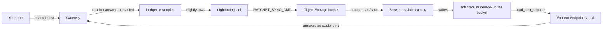
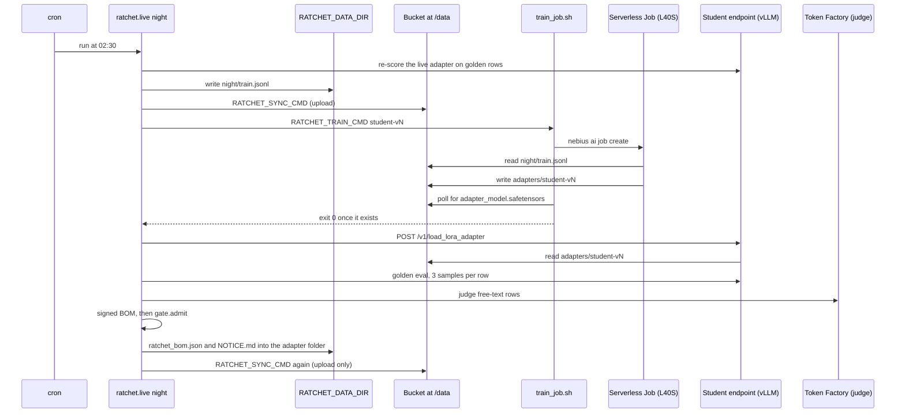

import { Steps, Aside, FileTree } from '@astrojs/starlight/components';
import Summary from '../../../components/Summary.astro';
import Eli10 from '../../../components/Eli10.astro';
import Who from '../../../components/Who.astro';
import NebiusDeployment from '../../../components/diagrams/NebiusDeployment.astro';

<Summary>The student endpoint only answers requests; training happens somewhere else: the gateway stores the teacher's answers to your traffic, and every night a Nebius Serverless Job trains a new LoRA adapter from them, which the endpoint then loads from your bucket.</Summary>

<Aside type="caution" title="Not run on Nebius yet">
As of Oct 21, 2026, everything on this page is written and tested offline, but **none of it has run against a real Nebius account**: not the training image, not a training job, not the endpoint. The `nebius ai` commands follow the Nebius CLI reference (pages auto generated on Oct 19, 2026, read Oct 21, 2026). Run both deploy scripts with `DRY_RUN=1` first, and run the first-run checks on Token Factory (`scripts/day1_check.py`) before relying on any of it. There are no live results yet.
</Aside>

<Eli10>

The **apprentice chef** has a cooking station: the GPU endpoint. The station only **cooks**. The apprentice never studies while cooking orders, and nothing the apprentice cooks is written into the recipe book.

Every time the **head chef from the agency** cooks a dish, the pass writes it into the **recipe book** (the ledger), with phone numbers and emails blacked out.

At night, a copy of the study pages goes into a **shared locker** (the storage bucket). A separate **classroom** is rented for about an hour (the training job). The apprentice studies the whole book there and writes a new **notebook of techniques** (the LoRA adapter), which is put back in the locker. Then the station picks the new notebook up from the locker and takes the **sealed exam**. If it passes, it starts a trial shift.

When the station is **closed to save money**, a different, untrained cook from the agency takes the easy orders, and the menu says so. The notebook is yours: you can take it to another kitchen, with its certificate and the license notes for the apprentice's original training.

</Eli10>

## How it really works

### The path from a request to a loaded adapter

<Steps>

1. **Your app sends a request** to the gateway's `/v1/chat/completions`, ideally with a task name (`X-Ratchet-Task` or `metadata.ratchet_task`). See [the request journey](/guides/request-journey/).

2. **The gateway stores teacher answers, never student answers.** When <Who as="teacher" /> answers (an escalation, a cold start, a random audit or a shadow arbitration), the answer is checked, the prompt and answer are redacted, and both are stored in the ledger with their provenance: teacher, license, hash, redaction count. When <Who as="student" /> serves an answer, only metadata is logged. Details: [the ledger](/guides/ledger/).

3. **Every night, cron runs `python -m ratchet.live night`** on the gateway's host. It runs Night School's checks (paused, storage off, a release in flight, fewer than 50 new examples, no golden rows) and skips the night if one applies. Otherwise it re-scores the live adapter on tonight's golden rows and goes on. See [Night School](/guides/night-school/).

4. **It writes the training file.** `RATCHET_DATA_DIR/night/train.jsonl` holds one prompt-completion row per training example: the stored messages, the teacher's stored answer, and `chat_template_kwargs` with thinking off, plus the row's task and provenance. Golden rows are not written there; they stay on the gateway's host.

5. **It uploads the file.** `RATCHET_SYNC_CMD` (for example `aws s3 sync ./data s3://<bucket> --endpoint-url ...`) copies `RATCHET_DATA_DIR` to the Object Storage bucket. It must only upload, never delete.

6. **It starts the training job.** `RATCHET_TRAIN_CMD` (default `bash deploy/train_job.sh {version}`, with `{version}` = `student-vN`) submits a Nebius Serverless Job: `nebius ai job create`, platform `gpu-l40s-a`, preset `1gpu-8vcpu-32gb`, the bucket mounted at `/data`, a 200 GiB disk and `--timeout 2h`.

7. **The job trains.** In the training image it runs `python -m ratchet.nightschool.train --data /data/night/train.jsonl --base nvidia/NVIDIA-Nemotron-3-Nano-4B-BF16 --out /data/adapters/student-vN`. It checks every row, writes `versions.json`, checks the chat template, trains the LoRA adapter from the base model, and saves the adapter, the tokenizer files, `ratchet_manifest.json` and `NOTICE.md` into `/data/adapters/student-vN/`.

8. **The script waits for the adapter.** With `RATCHET_BUCKET_S3` set, `train_job.sh` polls the bucket for `adapters/student-vN/adapter_model.safetensors` every 30 seconds, for up to 2 hours, and exits when it appears. Without `RATCHET_BUCKET_S3` it returns right after submitting, so the adapter load that follows would run before the job has written anything: set it when the script is your `RATCHET_TRAIN_CMD`.

9. **The adapter is hot-loaded.** `ratchet.live` calls the endpoint's `POST /v1/load_lora_adapter` with `{"lora_name": "student-vN", "lora_path": "/data/adapters/student-vN"}` (the path is `RATCHET_ADAPTER_ROOT/<name>`). vLLM reads the files from the same bucket, mounted at `/data` in the endpoint. No restart. An "already loaded" answer is fine.

10. **The golden eval runs on the endpoint.** `LiveEvaluator` sends each golden prompt to the new adapter (3 samples, as production does), calibrates the threshold on half the rows and measures precision on the other half. Free-text tasks also get a score from <Who as="judge" />, which is recorded but does not gate.

11. **The adapter's BOM is signed and the gate decides.** The bill of materials (teachers, licenses, the base model's license, the NOTICE text, the dataset hashes, the eval, the set roots) is written once, and signed when `RATCHET_BOM_SIGNING_KEY` is set. Then the release gate admits the candidate to **shadow**, **canary 10%** on a cold start, or **rejects** it. See [the release gate](/guides/release-gate/).

12. **The licenses join the weights.** `ratchet.live` writes `ratchet_bom.json` and the BOM's `NOTICE.md` into `RATCHET_DATA_DIR/adapters/student-vN/` and runs `RATCHET_SYNC_CMD` again, so the bucket folder holds the weights and their licenses together. If this second sync fails, the version still stands, a `sync_failed` event is written, and the command exits non-zero so cron notices.

13. **The gateway serves the adapter by name.** As the gate moves the version through shadow and canary to live, the gateway sends student calls to the endpoint with `model` set to `student-vN`. vLLM serves each loaded adapter under its own name.

</Steps>

### The Nebius pieces

<NebiusDeployment />

### Where your data goes



### One live night, with the real commands



### The student endpoint only answers

The endpoint is a Nebius Serverless Endpoint running vLLM with runtime LoRA loading. It serves the base model `nvidia/NVIDIA-Nemotron-3-Nano-4B-BF16` plus whichever adapters were loaded into it. It never trains, never writes to the ledger, and never sees the training file. `bash deploy/student_endpoint.sh create` (once) sets:

| Setting | Value | Why |
|---|---|---|
| Image | `vllm/vllm-openai:v0.18.0-cu130` (`RATCHET_VLLM_IMAGE`) | `v0.18.0` without `-cu130` is the CUDA 12 build, for an older host driver |
| Platform, preset | `gpu-l40s-a`, `1gpu-8vcpu-32gb` | One L40S |
| Port, shared memory | `--container-port 8000`, `--shm-size 16Gi` | |
| Storage | `--volume <bucket id>:/data` | vLLM reads adapters from the same bucket the job writes |
| Auth | `--auth token --token $RATCHET_STUDENT_KEY` | The gateway sends this token; the script never prints it |
| Runtime LoRA | `--env VLLM_ALLOW_RUNTIME_LORA_UPDATING=True`, `--enable-lora --max-lora-rank 16 --max-loras 4` | New adapters load without a restart; up to four adapters in one batch, enough for live, canary and shadow |
| Model code | `--trust-remote-code`, `--mamba_ssm_cache_dtype float32` | The second is the model card's flag (read Oct 21, 2026) |
| Limits | `--max-model-len 8192`, `--max-num-seqs 64` | The card's example uses 262,144 tokens; ticket prompts are short, and a longer one gets vLLM's 400 and escalates to the teacher |
| Thinking off | `--default-chat-template-kwargs '{"enable_thinking":false}'` | The student answers without reasoning, on the same prompt it was trained on |
| Reasoning parser (optional) | `--reasoning-parser-plugin ... --reasoning-parser nano_v3` with `RATCHET_REASONING_PARSER_PLUGIN` | The card's parser, uploaded to the bucket |

The other actions reuse the same endpoint (same URL, same token): `start` (the default; creates it when none has the name), `stop`, and `status`, which prints `<id> <state>`. `start` and `stop` find the endpoint's id by name (`RATCHET_ENDPOINT_NAME`, default `ratchet-student`) in `nebius ai endpoint list --format json`, or use `RATCHET_ENDPOINT_ID`. The lookup never guesses: output that is not JSON, two endpoints with the name, or a name missing from a list with more pages stops the script before anything starts, stops or is created. Each `create`, `start` and `stop` also records the endpoint's uptime in the ledger for the cost report (`python -m ratchet.cost endpoint up` or `down`); that step is best effort and never fails the deploy. Full details: [Deployment, step 4](/reference/deployment/#step-4-student-endpoint-vllm-with-runtime-lora).

### What becomes training data

Only teacher answers (and labels a person attested, from [feedback corrections or an import](/guides/ledger/)) become training targets. A teacher answer is stored only when it is complete (`finish_reason` `stop` or `tool_calls`), valid under the task's spec, not under a storage opt-out, not for a pinned task or a tool request, and after PII redaction. Each one records the teacher model, its license and license URL, its hash and the number of placeholders. You can keep any request, key, task or end user out of training with an [opt-out](/guides/ledger/), and switch storage off entirely with `RATCHET_STORE_EXAMPLES=0`.

### The training file

`dataset.write_training` writes TRL's conversational prompt-completion format. One row, shown on several lines (the content is illustrative):

```json
{
  "task": "ticket-triage",
  "params": null,
  "seen": 1,
  "provenance": {"teacher": "nvidia/Nemotron-3-Ultra-550b-a55b", "license": "OpenMDW-1.1",
                 "hash": "…", "redactions": 1, "origin": "live"},
  "prompt": [{"role": "user", "content": "Where is my refund for order 1234? Mail me at [EMAIL]"}],
  "completion": [{"role": "assistant", "content": "{\"category\": \"refund\", \"priority\": \"low\"}"}],
  "chat_template_kwargs": {"enable_thinking": false}
}
```

`train.py` gives TRL only `prompt`, `completion` and `chat_template_kwargs`, so stored conditions never reach the template, and the loss covers the teacher's answer only. The same `{"enable_thinking": false}` lives in three places (the dataset writer, `train.py` and the endpoint script), and a test keeps them equal. Rows left out of training (a client's `stop`, a literal think tag, an answer the current spec refuses, a pinned task, a purged row) are listed on [Night School](/guides/night-school/#rows-left-out-of-training).

### The bucket

One Object Storage bucket in the same region as the GPUs, mounted at `/data` in both the job and the endpoint. `RATCHET_DATA_DIR` (default `./data`) is the local mirror that `RATCHET_SYNC_CMD` uploads ([Deployment, step 2](/reference/deployment/#step-2-object-storage-bucket)):

<FileTree>

- data/
  - night/
    - train.jsonl rewritten by ratchet.live each night that trains
  - boms/
    - student-v3.json the adapter's BOM, written after the night
  - adapters/
    - student-v3/
      - adapter_config.json written by the training job
      - adapter_model.safetensors the LoRA weights
      - versions.json Python, CUDA and library versions
      - ratchet_manifest.json base model, teachers and licenses, template arguments
      - NOTICE.md the licenses; replaced after the night by the text the BOM signed
      - ratchet_bom.json the BOM, synced after the night

</FileTree>

The job also saves the tokenizer files next to the weights. Keep every adapter a `live` version uses, for rollback. A mounted bucket is billed even while the endpoint is stopped.

### The training job

`deploy/train_job.sh <version>` builds and runs this command ([Deployment, step 5](/reference/deployment/#step-5-training-job)):

```bash
nebius ai job create --name ratchet-<version> --image $RATCHET_TRAIN_IMAGE \
  --platform gpu-l40s-a --preset 1gpu-8vcpu-32gb --volume $RATCHET_BUCKET_ID:/data \
  --disk-size 200Gi --timeout 2h --container-command bash \
  --args "-c 'python -m ratchet.nightschool.train --data /data/night/train.jsonl --base <base> --out /data/adapters/<version>'"
  # plus --subnet-id $RATCHET_SUBNET_ID and --registry-secret $RATCHET_REGISTRY_SECRET when set
```

- `nebius ai job create` is the scripted command; `nebius ai create` is the interactive wizard.
- `--timeout 2h` is the job's own limit (1 h to 168 h, default 24 h), so a stuck job's GPU time is capped at the 2 hours the script waits.
- The version name and base model are checked against a strict pattern first, because they go into the job's `bash -c` line.
- `DRY_RUN=1` adds `--dry-run`: Nebius validates the request and submits nothing. Any value other than `0` or `1` is refused, so `DRY_RUN=true` can never submit a paid job.

Training defaults in `train.py`: 2 epochs, learning rate 2e-4, LoRA rank 16 with alpha 32, max sequence 2048, batch 8, bf16, loss on the answer only, targets including the Mamba projections (with an attention-and-MLP fallback if vLLM refuses them on day 1). See [What LoRA is](/guides/night-school/#what-lora-is).

**When the job fails.** A refused job request fails the script at once. A job that runs but writes no adapter makes the script time out after 2 hours and exit 1. Either way `ratchet.live` stops the night: no version is created, the training compute interval is closed with a "training failed" note (any GPU time the job used is still billed), and the command exits non-zero. Inside the job, `check_rows` and `check_prefix` stop a bad file or a chat-template mismatch within seconds, before the GPU trains anything (`row N: ...` or `TemplateMismatch` in the job's log).

**When the endpoint is not set.** `NebiusTrainer` checks `RATCHET_STUDENT_BASE` before it syncs or starts the paid job: an adapter with no endpoint to load into cannot be evaluated. Without it, the night stops before any spend.

### The training image

`deploy/Dockerfile.train` builds from `nvidia/cuda:12.8.0-devel-ubuntu24.04` and installs exact versions, listed again in `deploy/train-versions.txt` and read as pip constraints, so the two files disagreeing fails the build ([Deployment, step 3](/reference/deployment/#step-3-training-image)):

| Package | Version |
|---|---|
| torch | 2.11.0 (CUDA 12.8 index) |
| transformers | 4.57.6 |
| trl | 1.16.0 |
| peft | 0.21.2 |
| accelerate | 1.15.0 |
| datasets | 4.8.5 |
| causal-conv1d | 1.6.2.post1 |
| mamba-ssm | 2.3.2.post1 |
| ninja, packaging, setuptools, wheel | 1.13.0, 26.2, 82.0.1, 0.47.0 |

These are candidates read on Oct 21, 2026. The first-run smoke job (about 200 rows through `deploy/train_job.sh test`) confirms them, or its `versions.json` replaces them in both files. The last build step imports the Mamba kernels, so an image without them fails to build instead of failing on the GPU. There is no Unsloth: its Oct 19, 2026 release needs an older TRL. Build from the repository root:

```bash
docker build -f deploy/Dockerfile.train -t <registry>/ratchet-train:0.1 .
docker push <registry>/ratchet-train:0.1
export RATCHET_TRAIN_IMAGE=<registry>/ratchet-train:0.1
```

If the image cannot build at all, the documented fallbacks are an NGC PyTorch base image with the same pins, or Nebius's fine-tuning tutorial image with this repository copied in.

### Loading the adapter, and after a restart

`ratchet.live.load_adapter` posts to `{root}/v1/load_lora_adapter`, where `root` is `RATCHET_STUDENT_BASE` without its `/v1`, with the endpoint token and a 300-second timeout. The endpoint must have been started with `--enable-lora` and `VLLM_ALLOW_RUNTIME_LORA_UPDATING=True`.

vLLM **forgets runtime-loaded adapters when the endpoint restarts**, and answers 404 for them. The gateway handles that by itself: a 404 naming a version's adapter queues a reload on a background thread, at most once per adapter per minute, and writes `adapter_reloaded` or `adapter_reload_failed`. The request that hit the 404 is answered by the teacher, so it still succeeds, at teacher cost. If reloads keep failing, `python -m ratchet.live reload` loads every `live`, `canary` and `shadow` adapter by hand. The [runbook](/reference/runbook/#student-endpoint-down-or-adapters-lost) has the steps.

### When the endpoint is off: the hosted fallback

With `RATCHET_STUDENT_BASE` unset, student calls for a trained version go to <Who as="fallback" />: the untuned `nvidia/NVIDIA-Nemotron-3-Nano-30B-A3B` on Token Factory (`RATCHET_FALLBACK_STUDENT`), paid per token instead of per GPU-hour.

- It is **not** the adapter you own and **not** covered by the adapter's precision certificate. It was never calibrated, so it is held to the global `RATCHET_CONFIDENCE_THRESHOLD` (default 0.80), not the version's calibrated threshold. Precision may be lower; the teacher's random audits will show it.
- The ledger still records these answers as `served_by: student`; the response's `model` field names the hosted model, and the pages label them "Nano 30B · hosted", never as the adapter.
- Night School cannot train or grade a new adapter in this state (see above).

### Stop the endpoint when idle, start it for the night

A stopped Serverless Endpoint is not billed for compute or its own storage; a mounted bucket still is ([Nebius Serverless overview](https://docs.nebius.com/serverless/overview), read Oct 21, 2026).

```bash
bash deploy/student_endpoint.sh stop     # when idle
bash deploy/student_endpoint.sh start    # the same endpoint again: same URL, same token
bash deploy/student_endpoint.sh status   # prints "<id> <state>"
```

Night School needs the endpoint **running** while it re-scores the live adapter, loads the new one and grades it. With the endpoint stopped most of the time, start it before the night run (with `RATCHET_STUDENT_BASE` set in the night job's environment) and stop it after. Each start and stop is recorded, and answers in hours without uptime count as the hosted fallback's in the cost report.

Whether running the endpoint pays at all depends on volume. With unverified list prices (an L40S at about $1.55 an hour, about $0.001 of teacher spend avoided per ticket-triage answer in the simulation), break-even is about 1,500 student answers an hour; at the demo's volume a 24/7 endpoint loses money, and `python -m ratchet.cost report` says so ([cost and savings](/guides/cost-and-savings/)). Estimates from the repo's [deployment guide](/reference/deployment/#4-cost-estimates), same unverified prices: about $0.80 to $1.60 per training night, about $37 per full day if the endpoint is left on.

### Exporting the adapter you own

You own the LoRA adapter and its signed training lineage. The base model stays under the NVIDIA Nemotron Open Model License. To hand the adapter over in one folder, with its licenses:

```bash
aws s3 sync s3://<bucket>/adapters/student-v3 ./data/adapters/student-v3 --endpoint-url $RATCHET_S3_ENDPOINT   # weights, if not local
python -m ratchet.live export --version 3 --out ./student-v3-export
python -m ratchet.bom verify student-v3-export/ratchet_bom.json --public-key <yours> --notice student-v3-export/NOTICE.md
```

The export checks the stored BOM against its own SHA-256 and signature first, copies the adapter files when they are on this machine, writes the BOM and the exact `NOTICE.md` it signed, and prints the BOM's `sha256`. Without the weights it says where in the bucket to copy them from. The output folder must be new or empty and outside `RATCHET_DATA_DIR` (the next sync would upload it). Keep `NOTICE.md` with the adapter wherever it goes. See [licenses](/guides/licenses/).

### What is verified and what is not

| Part | Status (Oct 21, 2026) |
|---|---|
| `ratchet.live` commands, `NebiusTrainer`, `LiveEvaluator`, the reloader, the export | Tested offline in `tests/test_live.py` and `tests/test_licensing.py`, against fake endpoints |
| `train_job.sh`, `student_endpoint.sh` | Run in tests with a fake `nebius` CLI; the exact commands are asserted against the CLI reference as read, not a real account |
| `train.py`'s arguments, row checks, loss setting and chat-template prefix check | Tested offline with the vendored Nano 4B chat template; `main` needs a GPU and is not run in tests |
| The training image | Not built yet; pins are candidates  |
| A real training job, vLLM serving Nano 4B with LoRA, runtime loading, LoRA on the Mamba projections | Not run yet  |
| The endpoint's arguments as the container splits them, thinking off | Not checked yet  |
| Serverless pricing, the S3 endpoint URL | Unverified (the S3 URL format in the docs is an assumption) |
| Live numbers | None yet; `[LIVE NUMBER]` placeholders stay empty until a real run |

## For engineers

### Code

| File | What |
|---|---|
| [`ratchet/live.py`](https://github.com/harshbhx/ratchet/blob/main/ratchet/live.py) | `main` (`night`, `tick`, `reload`, `purge`, `export`, `seal`), `NebiusTrainer.train`, `load_adapter`, `AdapterReloader`, `reload_adapters`, `write_boms`, `publish_bom`, `export` |
| [`ratchet/nightschool/dataset.py`](https://github.com/harshbhx/ratchet/blob/main/ratchet/nightschool/dataset.py) | `rows`, `training_record`, `write_training`, `TRAIN_TEMPLATE_KWARGS` |
| [`ratchet/nightschool/train.py`](https://github.com/harshbhx/ratchet/blob/main/ratchet/nightschool/train.py) | The job's script: `parse_args`, `check_rows`, `check_prefix`, `columns`, `write_metadata`, `versions` |
| [`ratchet/nightschool/evaluate.py`](https://github.com/harshbhx/ratchet/blob/main/ratchet/nightschool/evaluate.py) | `LiveEvaluator`, `cascade_eval` |
| [`deploy/train_job.sh`](https://github.com/harshbhx/ratchet/blob/main/deploy/train_job.sh) | Submits the job and waits for the adapter |
| [`deploy/student_endpoint.sh`](https://github.com/harshbhx/ratchet/blob/main/deploy/student_endpoint.sh) | `create`, `start`, `stop`, `status` |
| [`deploy/Dockerfile.train`](https://github.com/harshbhx/ratchet/blob/main/deploy/Dockerfile.train), [`deploy/train-versions.txt`](https://github.com/harshbhx/ratchet/blob/main/deploy/train-versions.txt) | The pinned training image |

### Settings read by the gateway and `ratchet.live`

| Variable | Default | Meaning |
|---|---|---|
| `RATCHET_STUDENT_BASE` | empty | The endpoint's OpenAI base URL, `https://<endpoint host>/v1`. Empty: student calls go to the hosted fallback, and Night School cannot train |
| `RATCHET_STUDENT_KEY` | empty | The endpoint's token |
| `RATCHET_STUDENT_BASE_MODEL` | `nvidia/NVIDIA-Nemotron-3-Nano-4B-BF16` | The base every adapter is trained from (also read by both scripts) |
| `RATCHET_FALLBACK_STUDENT` | `nvidia/NVIDIA-Nemotron-3-Nano-30B-A3B` | The hosted, untuned model for student calls when the endpoint is not set |
| `RATCHET_CONFIDENCE_THRESHOLD` | `0.80` | The threshold the hosted fallback is held to |
| `RATCHET_DATA_DIR` | `data` | Local mirror of the bucket: `night/`, `boms/`, `adapters/<name>/` |
| `RATCHET_SYNC_CMD` | empty | Uploads `RATCHET_DATA_DIR` to the bucket, before the job and after a night that trained. Upload only: a `--delete` would remove the weights the job wrote |
| `RATCHET_TRAIN_CMD` | `bash deploy/train_job.sh {version}` | Runs training and **waits** for it; `{version}` and `{data}` are substituted |
| `RATCHET_ADAPTER_ROOT` | `/data/adapters` | Where the endpoint sees adapters (`lora_path` = root + `/` + name); also used by the gateway's reloader |
| `RATCHET_TRAIN_GPU_USD_PER_HOUR`, `RATCHET_STUDENT_GPU_USD_PER_HOUR` | `1.55` | Prices for the cost report (unverified list prices) |

`RATCHET_SYNC_CMD` and `RATCHET_TRAIN_CMD` are split with `shlex.split` and run without a shell, so pipes and `&&` do not work; wrap them in a script.

### Settings read by the deploy scripts

| Variable | Used by | Default |
|---|---|---|
| `RATCHET_BUCKET_ID` | both | required (job; endpoint `create`) |
| `RATCHET_BUCKET_S3` | `train_job.sh` | empty; set it (`s3://bucket[/prefix]`) so the script waits for the adapter |
| `RATCHET_S3_ENDPOINT` | `train_job.sh` | empty; the Object Storage S3 URL (copy it from the console) |
| `RATCHET_TRAIN_IMAGE` | `train_job.sh` | required |
| `RATCHET_TRAIN_PLATFORM`, `RATCHET_TRAIN_PRESET` | `train_job.sh` | `gpu-l40s-a`, `1gpu-8vcpu-32gb` |
| `RATCHET_SUBNET_ID` | both | empty (the project's default subnet) |
| `RATCHET_REGISTRY_SECRET` | `train_job.sh` | empty; a MysteryBox secret for a private image |
| `RATCHET_STUDENT_KEY` | `student_endpoint.sh` | required for `create` |
| `RATCHET_ENDPOINT_NAME`, `RATCHET_ENDPOINT_ID` | `student_endpoint.sh` | `ratchet-student`, empty |
| `RATCHET_SERVE_PLATFORM`, `RATCHET_SERVE_PRESET` | `student_endpoint.sh` | `gpu-l40s-a`, `1gpu-8vcpu-32gb` |
| `RATCHET_VLLM_IMAGE` | `student_endpoint.sh` | `vllm/vllm-openai:v0.18.0-cu130` |
| `RATCHET_SERVE_MAX_LEN`, `RATCHET_SERVE_MAX_SEQS` | `student_endpoint.sh` | `8192`, `64` |
| `RATCHET_SERVE_TEMPLATE_KWARGS` | `student_endpoint.sh` | `{"enable_thinking":false}` |
| `RATCHET_REASONING_PARSER_PLUGIN` | `student_endpoint.sh` | empty |
| `RATCHET_PYTHON` | `student_endpoint.sh` | `python` |
| `DRY_RUN` | both | `0` |

Full descriptions: [Configuration, deploy scripts](/reference/configuration/#deploy-scripts-deploy).

### Setup, in order

```bash
export NEBIUS_API_KEY=...                    # Token Factory key
python scripts/day1_check.py                 # model ids, logprobs, JSON mode
export RATCHET_BUCKET_ID=... RATCHET_BUCKET_S3=s3://<bucket> RATCHET_S3_ENDPOINT=<from the console>
export RATCHET_DATA_DIR=./data RATCHET_SYNC_CMD="aws s3 sync ./data s3://<bucket> --endpoint-url <S3 endpoint>"
export RATCHET_TRAIN_IMAGE=<registry>/ratchet-train:0.1
export RATCHET_STUDENT_KEY=$(openssl rand -hex 24)
DRY_RUN=1 bash deploy/train_job.sh test      # nebius validates the job, submits nothing
DRY_RUN=1 bash deploy/student_endpoint.sh create
bash deploy/student_endpoint.sh create       # once
export RATCHET_STUDENT_BASE=https://<endpoint host>/v1
export RATCHET_MODE=live RATCHET_DB=/var/lib/ratchet/ratchet.db
export RATCHET_API_KEYS="app:$(openssl rand -hex 24)"   # live mode does not start without API keys
python -m ratchet.config check               # exit 0 clean, 1 warnings, 2 errors
uvicorn ratchet.gateway:app --port 8000 --workers 1
```

Cron, on the gateway's host (it needs the `nebius` and `aws` CLIs, the same `RATCHET_DB` file and network access to the endpoint):

```bash
30 2 * * *  cd /opt/ratchet && . ./.env && python -m ratchet.live night >> /var/log/ratchet-night.log 2>&1
*/5 * * * * cd /opt/ratchet && . ./.env && python -m ratchet.live tick  >> /var/log/ratchet-tick.log 2>&1
```

### Events

`trained`, `skip`, `sync_failed`, `adapter_reloaded`, `adapter_reload_failed`, `endpoint` (an uptime change recorded), `circuit` (the student breaker). Meanings: [runbook](/reference/runbook/).

## Common questions

### Does the endpoint learn from my traffic while it serves?

No. The endpoint only answers. Training happens in a separate Serverless Job, at night, on teacher answers stored in the ledger. The student's own answers are never stored, so it never trains on them.

### Can I train on labels I already have?

Yes, as attested human labels or as an open teacher's outputs: `python -m ratchet.importer labels.jsonl --task T --source human --attest "..."` (or `--source teacher:<open model>`; closed models are refused). Users can also send corrections with `POST /v1/ratchet/feedback`. Every label is redacted and checked against the task's spec. Human labels carry the provenance `human` and are listed apart from the teachers in the BOM; an imported teacher's outputs keep that teacher and its license. See [the ledger](/guides/ledger/) and [licenses](/guides/licenses/).

### What does it cost?

Estimates only, from the repo's deployment guide with unverified list prices: about $0.80 to $1.60 per night that trains (an L40S for 30 to 60 minutes), about $37 per full day for an endpoint left on, plus the bucket. Nights that skip cost nothing. Below about 1,500 student answers an hour, a 24/7 endpoint costs more than it saves; use the hosted fallback or stop the endpoint between uses.

### What if the endpoint restarts?

It forgets its loaded adapters. The gateway reloads each one by itself on its first 404, at most once a minute per adapter. A few requests go to the teacher meanwhile and still succeed.

### Do I have to keep the endpoint running?

No. Stop it when idle; the hosted fallback answers student calls meanwhile, labelled as such. But Night School needs it running during the night to load and grade a new adapter.

### Can I take the adapter somewhere else?

Yes. `python -m ratchet.live export` gives you the weights with the signed BOM and `NOTICE.md`. The adapter runs on the Nemotron 3 Nano 4B base, which stays under NVIDIA's license; keep that license with any copy of the base model.

### What if the training job breaks on the first real run?

That is what the day-1 checks are for. The script dry runs, the image's build-time kernel check, `check_rows` and `check_prefix` are all there to fail fast and cheaply. The fallbacks (another base image, LoRA on the attention and MLP layers only, merging the adapter into the base weights if runtime LoRA fails) are listed in `train.py`.

### Has this run on Nebius?

No, not as of Oct 21, 2026. It is written and tested offline only. Treat every command here as a plan until the day-1 checks pass.

## Related

- [Night School](/guides/night-school/): the nightly checks, the golden set and LoRA
- [Host on Nebius](/guides/host-on-nebius/): the gateway VM and the rest of the stack
- [The ledger](/guides/ledger/): what is stored, redaction and opt-outs
- [Licenses](/guides/licenses/): what you own and what travels with the adapter
- [Cost and savings](/guides/cost-and-savings/): when self-hosting pays
- [Deployment](/reference/deployment/)
