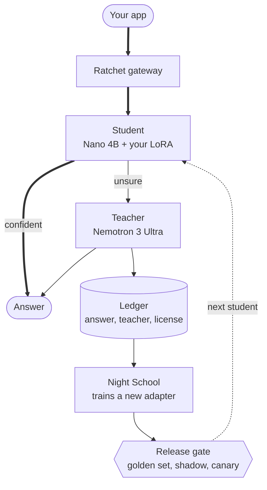
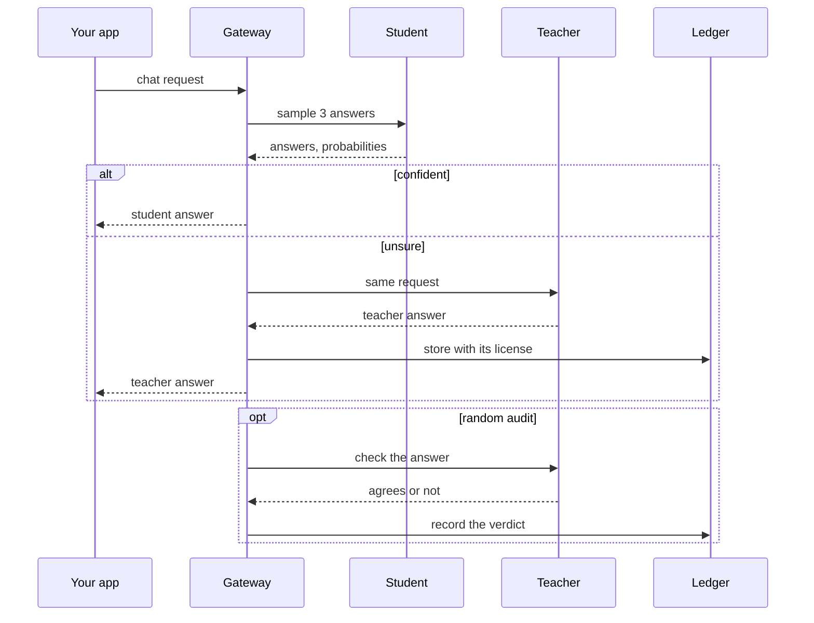

import { Aside } from '@astrojs/starlight/components';
import Summary from '../../../components/Summary.astro';
import PlainWords from '../../../components/PlainWords.astro';
import Who from '../../../components/Who.astro';
import Stat from '../../../components/Stat.astro';
import StatRow from '../../../components/StatRow.astro';
import Compare from '../../../components/Compare.astro';
import Flow from '../../../components/Flow.astro';
import FlowStep from '../../../components/FlowStep.astro';
import PathCard from '../../../components/PathCard.astro';
import PathGrid from '../../../components/PathGrid.astro';
import GradientText from '../../../components/ui/GradientText.astro';

Ratchet is a gateway you point your OpenAI client at. A small Nemotron model with your LoRA adapter on top answers the requests it is sure about. A large open model answers the rest, and its answers become training data. Every night a new small model is trained and is released only if it passes a held-out exam, a silent trial and a staged rollout.

<PlainWords>

Your app is a busy restaurant. Today every dish is cooked by a famous head chef from an agency that charges per plate, even when the order is toast for the hundredth time.

Ratchet puts an apprentice next to the head chef. The apprentice cooks each dish a few times. If the results agree and the apprentice is sure, the plate goes out. If not, the head chef cooks it, and the dish goes in a recipe book with the chef's name and a note that copying it is allowed. At night the apprentice studies the book. The next morning's apprentice cooks only if it passes a sealed exam first.

</PlainWords>

<Aside type="note" title="Built on NVIDIA Nemotron and Nebius">
Every model call on the live site runs on Nebius Token Factory, the adapter was [retrained on Nebius AI Cloud](https://github.com/harshbhx/ratchet/tree/main/evidence/text2sql-round2-nebius), and the student was served from a Nebius Serverless Endpoint [in a measured test](https://github.com/harshbhx/ratchet/tree/main/evidence/student-endpoint-nebius).
</Aside>

<StatRow cols={3} label="Ratchet at a glance">
  <Stat value={1934} label="tests in the suite" note="They run offline, with no network and no GPU." />
  <Stat value={95} suffix="%" count={false} label="held-out precision floor" tone="owned" note="A new adapter must reach it on golden rows it never trained on." />
  <Stat value="Open teachers only" label="license-clean, in code" note="Closed models are refused as teachers." />
</StatRow>

## The problem, in numbers you can check

- **The bill grows with traffic.** Enterprise spend on model APIs was $12.5B in 2025 ([Menlo Ventures](https://menlovc.com/perspective/2025-the-state-of-generative-ai-in-the-enterprise/), report of Dec 9, 2025, read Oct 26, 2026). Much of it is narrow and repetitive: labelling, extraction, ticket triage, steps inside agents.
- **The obvious fix is often not allowed.** Training a cheaper model on a closed model's answers breaks the terms of the largest vendors. [OpenAI Business Terms §3.3(e)](https://openai.com/policies/business-terms/) and [Anthropic Commercial Terms §D.4(a)](https://www.anthropic.com/legal/commercial-terms) (both pages read Oct 21, 2026) forbid using outputs to train competing models. A tool that distills that traffic puts its users at risk. Not legal advice.
- **Doing it by hand is slow.** Logging, cleaning, fine-tuning, evaluating, deploying and watching for regressions are separate chores, and most tools cover one.

<Compare before="Renting a large model for every call" after="With Ratchet">
  
Every request, repeated or not, is a paid call to the teacher. Distilling by hand is slow, and closed models forbid training on their outputs.

  
A student with your adapter answers what it is sure about, the teacher answers the rest, and a better student is trained every night from open teachers only.

</Compare>

## The idea

Learn from the traffic you already have, but only from teachers whose license allows it, and <GradientText text="never ship a new model on faith" tone="owned" />.

Change one line, your base URL, and four parts start working:

<Flow loop loopLabel="Every night, again" label="The four parts">
  <FlowStep title="The student answers first" tone="owned" meta="Nano 4B + your LoRA">Sampled 3 times; its confidence decides.</FlowStep>
  <FlowStep title="The teacher answers the rest" tone="rented" meta="Ultra on Token Factory">And checks a random 5% of the student's answers.</FlowStep>
  <FlowStep title="Answers become training data" meta="with provenance">Each with its teacher and license, after redaction.</FlowStep>
  <FlowStep title="Released through gates" meta="every night">Golden set, shadow, canary 10%, 50%, 100%, rollback.</FlowStep>
</Flow>

In more detail:

| Part | What it does |
|---|---|
| **The student** | <Who as="student" /> NVIDIA Nemotron 3 Nano 4B with a LoRA adapter you own. It answers first and is sampled three times. Its confidence mixes agreement across samples with token probabilities |
| **The teacher** | <Who as="teacher" /> NVIDIA Nemotron 3 Ultra on Nebius Token Factory. It answers when the student is unsure, and checks a random share of the student's answers (audits) |
| **The ledger** | Every teacher answer is stored, after personal data is redacted, with the teacher that wrote it and the license that permits training on it. Closed models are refused as teachers in code |
| **Night School and the gate** | Each night a new adapter is trained from teacher answers only and scored on a held-out golden set. It then goes through shadow mode, a canary at 10%, 50% and 100%, and rolls back automatically if audited precision drops |

<figure class="rt-diagram">

<figcaption>

**Reading this diagram.** Start at the top: every request reaches the student first, and the thick path is the cheap one, where a confident student answers at once. Only unsure requests go to the teacher, and every teacher answer also flows down into the ledger. The dotted line closes the loop: what the ledger collects trains the next student, and the gate decides whether that student replaces the current one. That loop is why the share of rented answers can shrink over time.

<ul class="rt-key">
  <li class="student">The student: Nano plus your adapter</li>
  <li class="teacher">The teacher, rented per token</li>
  <li class="store">Stored data</li>
  <li class="gate">A check that can stop a release</li>
  <li class="edge-main">Main path</li>
  <li class="edge-optional">Once a night</li>
</ul>

</figcaption>
</figure>

The same flow for one request, step by step:

<figure class="rt-diagram">

<figcaption>

**Reading this diagram.** Time runs downward. The gateway always asks the student first. The `alt` block is the fork: a confident answer returns at once and costs the teacher nothing, while an unsure one is answered by the teacher and stored with its provenance. The `opt` block at the bottom is the audit: on a random share of confident answers the teacher quietly checks the student, so wrong-but-sure answers show up in the numbers instead of staying hidden. For the full detail see [One request's journey](/guides/request-journey/).

</figcaption>
</figure>

Ratchet also reports the bill honestly: savings per token and by GPU-hours actually paid, and a plain warning when a GPU endpoint costs more than it saves. See [Why it matters](/guides/why-it-matters/).

## What is real today

| Part | Status |
|---|---|
| Gateway, cascade, ledger, Night School, release gate, Scout, dashboard | Built, with 1,934 tests that need no network and no GPU |
| Teacher calls | Real Nemotron 3 Ultra on Nebius Token Factory. Real teacher calls built the text-to-SQL data on Oct 22, 2026 |
| Student endpoint | **Served once, by hand, on a Nebius Serverless Endpoint for a speed test (27 Oct 2026, [evidence](https://github.com/harshbhx/ratchet/tree/main/evidence/student-endpoint-nebius)); the endpoint script is tested offline, ready to run with `make nebius-up`. On 28 Oct 2026 the adapter from Night School's first end-to-end run, by hand, was served from a Nebius Serverless Endpoint too, and the golden gate rejected it (81.8% precision against the 95% target), so it was never made live ([evidence](https://github.com/harshbhx/ratchet/tree/main/evidence/nightschool-nebius)).** The live gateway is not connected to a student endpoint, so the teacher answers every request. If a trained version were live without a GPU endpoint, its calls would go to the hosted, untuned Nano 30B <Who as="fallback" />, and pages would say so |
| A text-to-SQL adapter | The published adapters were trained on a borrowed GPU. The round-2 recipe was also retrained once on Nebius AI Cloud (a Serverless Job on one L40S, 27 Oct 2026); it scored 40.7% (70 of 172) on exam 1 and 34.5% (69 of 200) on exam 2, against 39.0% and 33.0% for the original adapter: the result reproduces (the row-by-row differences are within chance). The measured results of the published adapters are on [Results](/guides/results/) |
| A tool-calling adapter | Trained on a borrowed GPU (not retrained on Nebius). Hard exam 136 of 150 (90.7%) against 94 of 150 (62.7%) untrained and 137 of 150 (91.3%) for Ultra; BFCL exam 241 of 300 (80.3%) against 232 (77.3%) untrained and 265 (88.3%) for Ultra. SQL stays the headline result. See [Results](/guides/results/) |
| Model ids and list prices in `ratchet/config.py` | Unverified until `scripts/day1_check.py` passes with a real key |
| Token Factory Terms of Service §5(f) ("competing service") | **Open question.** Asked Nebius support in writing on Oct 19, 2026; no final answer. Not legal advice |

## Where to go next

<PathGrid cols={2} label="Where to go next">
  <PathCard title="Why it matters" href="/guides/why-it-matters/" icon="scale" tone="neutral" description="The value in depth, by audience." />
  <PathCard title="One request's journey" href="/guides/request-journey/" icon="loop" description="What happens to a single API call." />
  <PathCard title="Proof you can run" href="/guides/proof/" icon="check" tone="neutral" description="Check a claim with one command." />
  <PathCard title="For judges" href="/guides/for-judges/" icon="start" tone="neutral" description="A ten-minute tour." />
</PathGrid>

<Aside type="note" title="Common questions">
Is the student as good as the teacher? It is held to agreement with the teacher on held-out rows, not to ground truth (see [Escalation and audits](/guides/escalation-and-audits/)). Does it always save money? No, see [Cost and savings](/guides/cost-and-savings/). What do you own? The adapter and its signed bill of materials; the Nano base stays under NVIDIA's license. More in the [FAQ](/guides/faq/).
</Aside>
