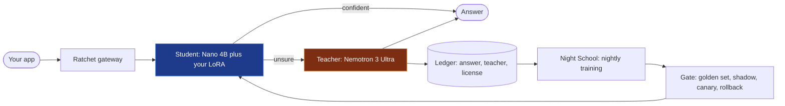
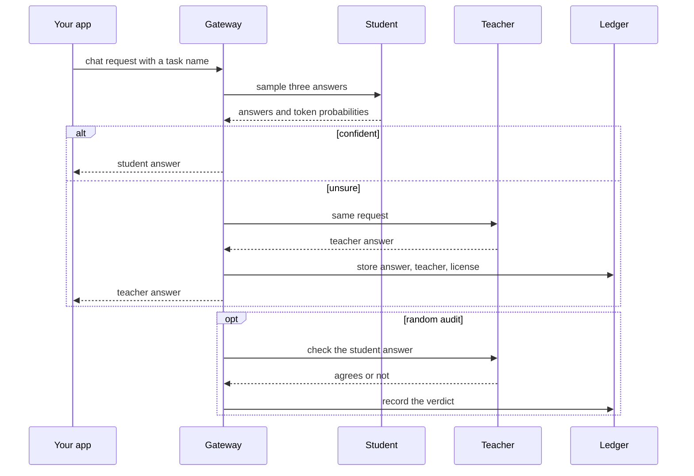

import { Aside, LinkCard, CardGrid } from '@astrojs/starlight/components';
import Summary from '../../../components/Summary.astro';
import Who from '../../../components/Who.astro';

Ratchet is a gateway you point your OpenAI client at. A small model you own answers the requests it is sure about. A large open model answers the rest, and its answers become training data. Every night a new small model is trained and is released only if it passes a held-out exam, a silent trial and a staged rollout.

## In plain words

Your app is a busy restaurant. Today every dish is cooked by a famous head chef from an agency that charges per plate, even when the order is toast for the hundredth time.

Ratchet puts an apprentice next to the head chef. The apprentice cooks each dish a few times. If the results agree and the apprentice is sure, the plate goes out. If not, the head chef cooks it, and the dish goes in a recipe book with the chef's name and a note that copying it is allowed. At night the apprentice studies the book. The next morning's apprentice cooks only if it passes a sealed exam first.

## The problem, in numbers you can check

- **The bill grows with traffic.** Enterprise spend on model APIs was $12.5B in 2025 ([Menlo Ventures](https://menlovc.com/perspective/2025-the-state-of-generative-ai-in-the-enterprise/), 2025 report). Much of it is narrow and repetitive: labelling, extraction, ticket triage, steps inside agents.
- **The obvious fix is often not allowed.** Training a cheaper model on a closed model's answers breaks the terms of the largest vendors. [OpenAI Business Terms §3.3(e)](https://openai.com/policies/business-terms/) and [Anthropic Commercial Terms §D.4(a)](https://www.anthropic.com/legal/commercial-terms) (both pages read Oct 21, 2026) forbid using outputs to train competing models. A tool that distills that traffic puts its users at risk. Not legal advice.
- **Doing it by hand is slow.** Logging, cleaning, fine-tuning, evaluating, deploying and watching for regressions are separate chores, and most tools cover one.

## The idea

Learn from the traffic you already have, but only from teachers whose license allows it, and never ship a new model on faith.

Change one line, your base URL, and four parts start working:

| Part | What it does |
|---|---|
| **The student** | <Who as="student" /> NVIDIA Nemotron 3 Nano 4B with a LoRA adapter you own. It answers first and is sampled three times. Its confidence mixes agreement across samples with token probabilities |
| **The teacher** | <Who as="teacher" /> NVIDIA Nemotron 3 Ultra on Nebius Token Factory. It answers when the student is unsure, and checks a random share of the student's answers (audits) |
| **The ledger** | Every teacher answer is stored, after personal data is redacted, with the teacher that wrote it and the license that permits training on it. Closed models are refused as teachers in code |
| **Night School and the gate** | Each night a new adapter is trained from teacher answers only and scored on a held-out golden set. It then goes through shadow mode, a canary at 10%, 50% and 100%, and rolls back automatically if audited precision drops |

**Reading this diagram.** The blue box is the part you own and the orange box is the part you rent. Requests flow left to right and leave as soon as the student is confident. Only the unsure ones reach the teacher, and every teacher answer also flows down into the ledger. The loop closes at the right: what the ledger collects trains the next student, and the gate decides whether that student replaces the current one. The loop is why the share of rented answers can shrink over time.

The same flow for one request, step by step:

**Reading this diagram.** Time runs downward. The gateway always asks the student first. The `alt` block is the fork: a confident answer returns at once and costs the teacher nothing, while an unsure one is answered by the teacher and stored with its provenance. The `opt` block at the bottom is the audit: on a random share of confident answers the teacher quietly checks the student, so wrong-but-sure answers show up in the numbers instead of staying hidden. For the full detail see [One request's journey](/guides/request-journey/).

Ratchet also reports the bill honestly: savings per token and by GPU-hours actually paid, and a plain warning when a GPU endpoint costs more than it saves. See [Why it matters](/guides/why-it-matters/).

## What is real today and what is simulated

| Part | Status |
|---|---|
| Gateway, cascade, ledger, Night School, release gate, Scout, dashboard | Built, with more than 1,700 tests that need no network and no GPU |
| Teacher calls | Real: Nemotron 3 Ultra on Nebius Token Factory |
| Student endpoint | **Not served on a Nebius GPU yet.** Until it is, a trained version's calls go to a hosted, untuned Nano model, and pages say so |
| A text-to-SQL adapter | Trained on a free Colab T4 (not on Nebius). Results are on [Results](/guides/results/) |
| Savings and precision figures from `sim.simulate` and the story page | **Simulation**: mock models show how the loop behaves, not real model quality |
| Model ids and prices in `ratchet/config.py` | Unverified until the day-1 check passes with a real key |
| Token Factory Terms of Service §5(f) ("competing service") | **Open question.** Asked Nebius support in writing on Oct 19, 2026; no final answer. Not legal advice |

In the reference simulation (**simulation**, mock models, 2,000 tickets a day, a corrupted deploy of v3): the teacher answers everything on day 1, the student serves 98% of requests by day 3, the corrupted v3 is rolled back automatically on day 4, and on day 10 the cost is $0.147 per 1,000 requests against $1.093 for all-Ultra, 87% saved at unverified list prices.

## Where to go next

<CardGrid>
  <LinkCard title="Why it matters" href="/guides/why-it-matters/" description="The value in depth, by audience." />
  <LinkCard title="One request's journey" href="/guides/request-journey/" description="What happens to a single API call." />
  <LinkCard title="Proof you can run" href="/guides/proof/" description="Check a claim with one command." />
  <LinkCard title="For judges" href="/guides/for-judges/" description="A ten-minute tour." />
</CardGrid>

<Aside type="note" title="Common questions">
Is the student as good as the teacher? It is held to agreement with the teacher on held-out rows, not to ground truth (see [Escalation and audits](/guides/escalation-and-audits/)). Does it always save money? No, see [Cost and savings](/guides/cost-and-savings/). What do you own? The adapter and its signed bill of materials; the Nano base stays under NVIDIA's license. More in the [FAQ](/guides/faq/).
</Aside>
