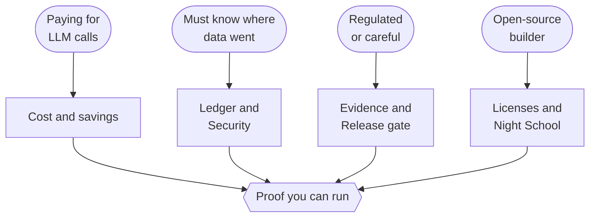
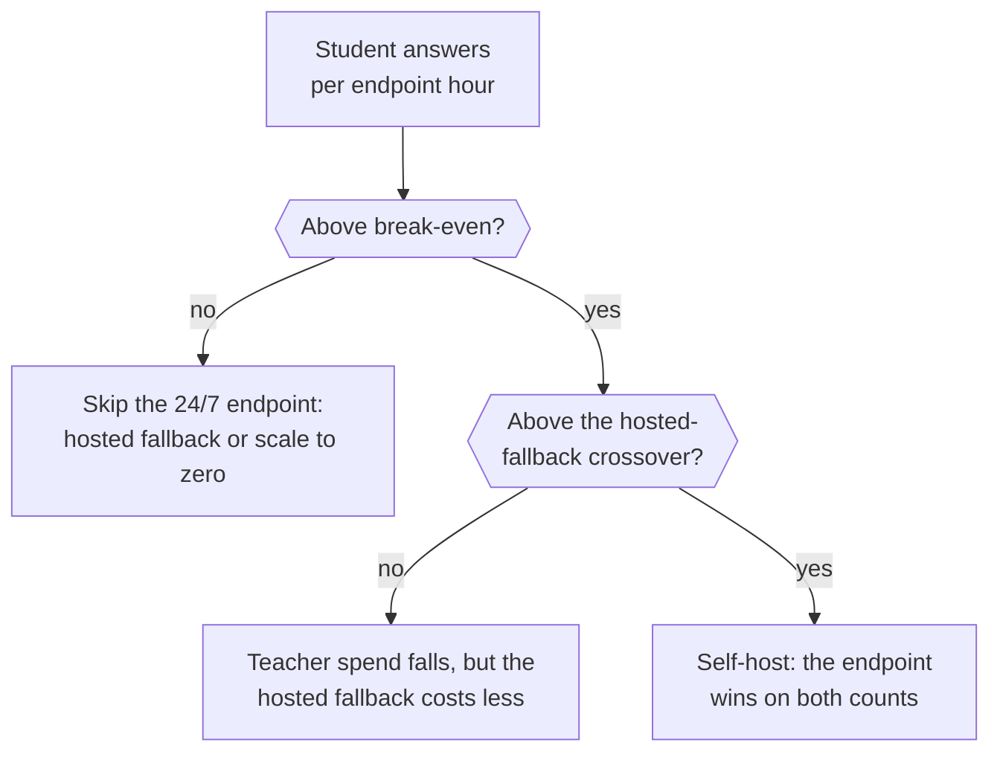
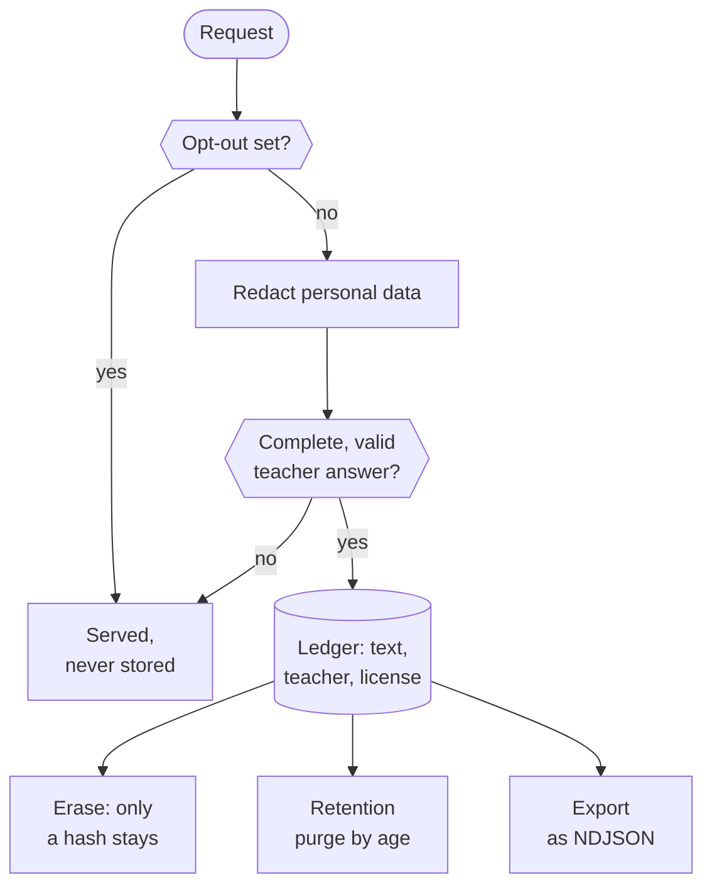
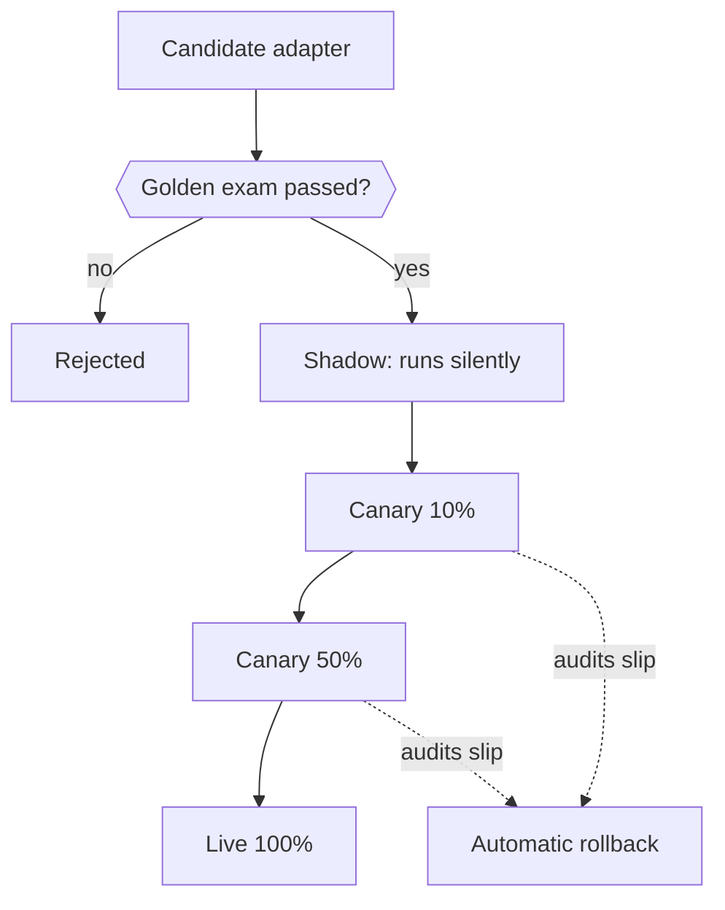

import Summary from '../../../components/Summary.astro';
import PathCard from '../../../components/PathCard.astro';
import PathGrid from '../../../components/PathGrid.astro';

<Summary>Ratchet matters for four kinds of reader: the team with a growing LLM bill, the team that must show where its data went, the team that must show a model is safe to ship, and the builder who wants to own the model and its license trail. Each section below says what you get and links to the page that backs it.</Summary>

<PathGrid cols={2} label="Four reasons, one per reader">
  <PathCard title="If you pay for LLM calls" href="#if-you-pay-for-llm-calls" icon="coin" tone="neutral" eyebrow="Cost" description="The easy share of the traffic moves to a small model, and every request records what it cost and what the teacher alone would have cost." />
  <PathCard title="If you must know where your data went" href="#if-you-must-know-where-your-data-went" icon="shield" tone="neutral" eyebrow="Data" description="Redaction before storage, opt-outs, final erasure and export, with the teacher and license on every example." />
  <PathCard title="If you are regulated or careful" href="#if-you-are-regulated-or-careful" icon="gate" tone="neutral" eyebrow="Safe releases" description="A held-out exam, a silent trial and a staged rollout, each leaving a record a reviewer can check." />
  <PathCard title="If you build on open models" href="#if-you-build-on-open-models" icon="key" eyebrow="License-clean, owned" description="Open teachers only, and an adapter you own that carries its licenses and signed lineage." />
</PathGrid>

<figure class="rt-diagram">



<figcaption>

**Reading this diagram.** The rounded boxes at the top are the four readers and the boxes under them are the pages that hold the evidence for each. Every path ends at the same place: a page of commands you can run yourself. The rest of this page follows the same four paths. Pages: [Cost and savings](/guides/cost-and-savings/), [Ledger](/guides/ledger/), [Security](/guides/security/), [Training on your data](/guides/training-on-your-data/), [Evidence](/guides/evidence/), [Release gate](/guides/release-gate/), [Licenses](/guides/licenses/), [Night School](/guides/night-school/), [Proof you can run](/guides/proof/).

</figcaption>
</figure>

## If you pay for LLM calls

Your bill is price per token times traffic. Much of that traffic is the same narrow task again and again. Ratchet moves the easy share of it to a small model and keeps the hard share on the teacher. Every request records what it cost and what the teacher alone would have cost, so the saving is a measured number, not a promise.

The catch is that a self-hosted model runs on a GPU that bills by the hour, busy or idle. So Ratchet counts both views:

| View | What it counts | Can it be negative? |
|---|---|---|
| Per token | The price of each call actually made | No |
| By GPU-hours paid | Teacher spend, plus every hour the endpoint and the training jobs ran | **Yes**, and it is never clamped to zero |

The break-even is the number of student answers per endpoint hour at which the GPU pays for itself:

```text
break-even = GPU price per hour / teacher spend avoided per student answer
```

With estimated prices (an L40S at $1.35 a GPU-hour on demand, [Nebius pricing](https://docs.nebius.com/compute/resources/pricing), read Oct 22, 2026, and about $0.001 of teacher spend avoided per ticket-triage answer in the simulation), that is about 1,350 student answers an hour, roughly 32,000 a day. All figures here are **estimates**, not measurements.

| Traffic | Student answers an hour, against break-even (about 1,350) | What Ratchet's report says |
|---|---|---|
| The demo, 1,500 requests a day | About 60: far below | A 24/7 endpoint loses money. Use the hosted fallback or stop the endpoint when idle |
| 10M requests a month | About 14,000: about ten times above | Self-hosting beats the teacher, but an untuned hosted Nano may cost less per answer. It then recommends the hosted fallback and says the comparison assumes the hosted model covers as many requests |
| Very high volume | Over about 52,000 (estimate): above the hosted-fallback crossover too | Self-host |

<figure class="rt-diagram">



<figcaption>

**Reading this diagram.** The cost curve has two thresholds, not one. Below break-even the GPU costs more than the teacher spend it saves. Between break-even and the crossover the student does save money against the teacher, but a pay-per-token hosted model would save more. Only above both does owning a GPU win. Ratchet's cost report places your traffic on this chart and writes the answer in words, including when the answer is "this loses money". Full method: [Cost and savings](/guides/cost-and-savings/).

<ul class="rt-key">
  <li class="gate">A threshold</li>
  <li class="danger">Loses money</li>
  <li class="outline">The hosted fallback wins</li>
  <li class="ok">Self-hosting wins</li>
</ul>

</figcaption>
</figure>

<div class="rt-callout rt-callout--sim">

**Simulation.** The reference simulation shows a 69% saving per token and a loss by GPU-hours at low volume, using mock models. Treat every figure as a demonstration of how the accounting works.

</div>

## If you must know where your data went

Every example Ratchet keeps carries its history. The ledger stores, for each training example, the teacher that wrote the answer and the license that permits training on it, after personal data has been redacted.

- **Redaction before storage.** Emails, phone numbers, card numbers (checksum-validated), Indian identifiers such as UPI and GSTIN, and similar patterns are replaced before anything is stored. Names and street addresses are **not** caught yet.
- **Opt-outs only reduce storage.** A request can ask not to be stored (`store: false`), and a key, a task or an end user can be set to never train. Nothing in a request can undo an opt-out.
- **End users are never stored as typed.** An end-user identifier is kept only as a keyed hash scoped to the API key.
- **Erasure is final.** An erased example leaves only a hash, so it cannot be stored again. Retention windows purge old rows on a schedule.
- **Export.** Stored data can be exported as NDJSON with its provenance.

<figure class="rt-diagram">



<figcaption>

**Reading this diagram.** Read it as the checks a request passes before it is allowed to become training data. Two gates can stop it: an opt-out, and a check that the teacher's answer is complete and valid. Whatever passes is redacted and stored with its provenance. From the ledger, three exits exist for the data owner: erase it, let it age out, or export it. The student's own answers are never stored as training data. Details: [Ledger](/guides/ledger/), [Security](/guides/security/), [Training on your data](/guides/training-on-your-data/).

</figcaption>
</figure>

## If you are regulated or careful

You need to show a model was tested before it served real users, and that you can reproduce the evidence.

| Evidence | What it says | Where |
|---|---|---|
| Signed bill of materials | For each adapter: every training source, its license, the base model's license, a fingerprint of the dataset, signed with Ed25519 and checkable offline | [Evidence](/guides/evidence/) |
| Held-out exam | Thresholds are calibrated on half of the golden set and measured on the other half. A candidate must reach 95% precision and not regress against the live model, re-scored the same night | [Release gate](/guides/release-gate/) |
| Certified precision | An exact one-sided lower bound on the precision of what the version serves, with the assumptions stated | [Evidence](/guides/evidence/) |
| Staged release | Shadow, then canary at 10%, 50% and 100%, with automatic rollback when the 95% upper bound of audited precision falls below 92% | [Release gate](/guides/release-gate/) |
| Savings receipts | One signed receipt per day and API client, chained, that a third party can verify | [Evidence](/guides/evidence/) |

**What this does not show.** Precision means agreement with the teacher, not ground truth. A signed bill of materials is the operator's signed statement: it proves nothing changed after signing, not that the weights were trained on that data. See [Escalation and audits](/guides/escalation-and-audits/).

<figure class="rt-diagram">



<figcaption>

**Reading this diagram.** A new student only moves down when evidence allows it, and each canary stage can send it back. The first gate is the held-out exam, then a silent trial on real traffic, then growing shares of live traffic judged by teacher audits. Because every step leaves a record in the ledger, a reviewer can ask which version served which request and why it was promoted.

<ul class="rt-key">
  <li class="student">The new student, on trial</li>
  <li class="gate">The held-out exam</li>
  <li class="ok">Live</li>
  <li class="danger">Rejected or rolled back</li>
</ul>

</figcaption>
</figure>

## If you build on open models

- **License-clean teachers.** Ratchet distills only from teachers whose license allows it. Nemotron 3 Ultra is under [OpenMDW-1.1](https://huggingface.co/nvidia/NVIDIA-Nemotron-3-Ultra-550B-A55B-BF16), which places no restrictions on outputs (license page checked Oct 21, 2026). Closed models are refused as teachers in code. Not legal advice.
- **The adapter you own.** What Night School produces is a LoRA adapter plus its signed lineage. The base model, Nemotron 3 Nano 4B, stays under the NVIDIA Nemotron Open Model License.
- **Licenses travel with the adapter.** The bill of materials names the base model's license, and a `NOTICE.md` next to the weights lists the licenses of the base and each teacher.
- **Open code.** Apache-2.0, with a mock mode that runs the whole loop with no keys and no GPU. See [Quickstart](/guides/quickstart/).

## What is and is not shown today

<div class="rt-callout rt-callout--note">

The loop is built and tested offline. Real teacher calls on Nebius Token Factory built the text-to-SQL data on Oct 22, 2026; the gateway's own live mode stays unverified until `scripts/day1_check.py` passes with a real key. The student endpoint has not been served on a Nebius GPU yet, and a text-to-SQL adapter was trained on a free Colab T4. Simulation figures use mock models and are labelled. Open question: Token Factory Terms of Service §5(f), asked of Nebius support on Oct 19, 2026. See [What is Ratchet](/guides/what-is-ratchet/) and [Results](/guides/results/).

</div>
