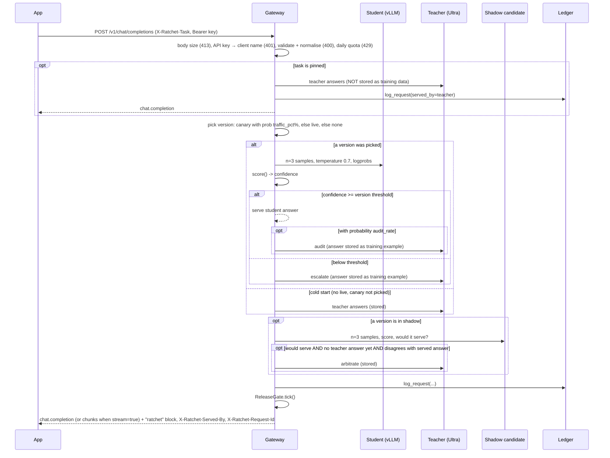
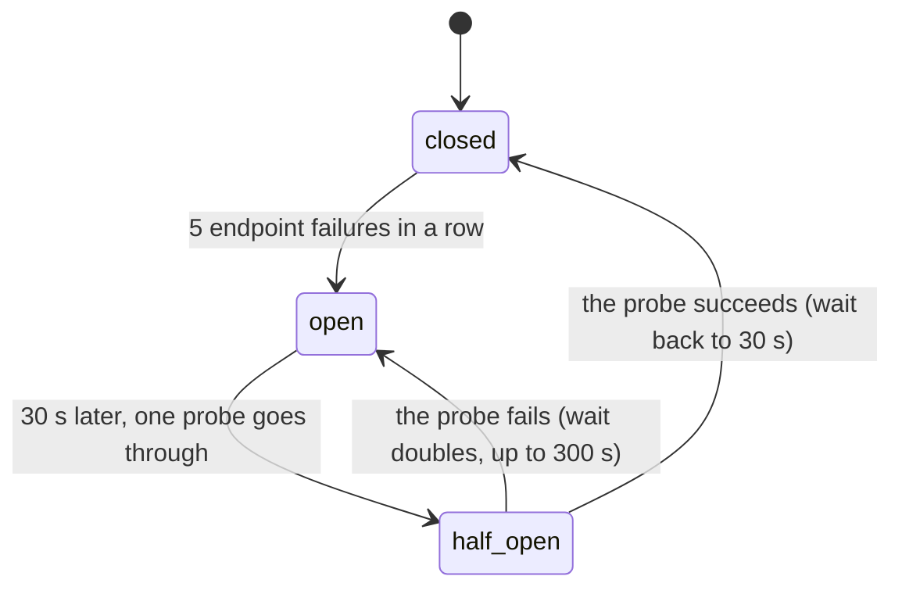
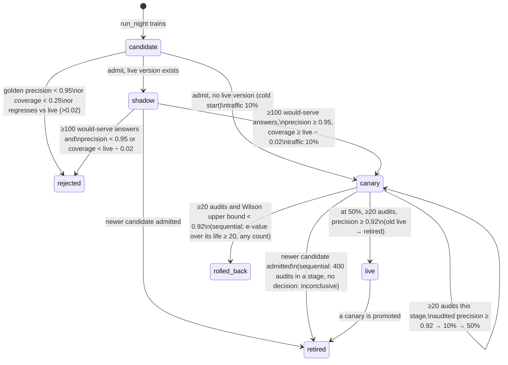

# Architecture

Ratchet is a gateway that sits between your app and a large "teacher" model. A small "student" model you own answers each request first. If it is unsure, the request goes to the teacher. Every teacher answer is stored with its license, and every night a new student is trained on those answers and released through a series of safety gates.

This page describes v0.2.0 as implemented in `ratchet/`. Product context is in [PRD.md](PRD.md); the reasoning behind each choice is in the [ADRs](adr/README.md).

## 1. Components

```
                         ┌──────────────────────────────── Nebius Token Factory ─────────┐
                         │  Teacher: nvidia/Nemotron-3-Ultra-550b-a55b                   │
                         │  Judge:   nvidia/nemotron-3-super-120b-a12b (free-text eval)  │
                         │  Fallback student: nvidia/NVIDIA-Nemotron-3-Nano-30B-A3B      │
                         └──────────────▲────────────────────────────────────────────────┘
                                        │ OpenAI-compatible HTTPS
┌──────────┐   /v1/chat/completions   ┌─┴──────────────────────────────┐
│ Your app │ ───────────────────────▶ │ Gateway  (ratchet/gateway.py)  │──── SQLite ledger (ratchet/ledger.py)
└──────────┘ ◀─────────────────────── │  Ratchet router (router.py)    │      requests · examples · versions · events
                                      │  ReleaseGate.tick (release.py) │
                                      │  Pages: /, /scout, /dashboard  │
                                      │  Scout agents (scout/)  ───────┼──── Tavily Search API (live Scout only)
                                      └─┬──────────────────────────────┘
                                        │ OpenAI-compatible HTTPS (model = adapter name)
                         ┌──────────────▼──── Nebius AI Cloud ─────────────────────────────┐
                         │ Serverless Endpoint: vLLM + nvidia/NVIDIA-Nemotron-3-Nano-4B-BF16 │
                         │   LoRA adapters loaded at runtime (/v1/load_lora_adapter)         │
                         │ Serverless Job (nightly): ratchet.nightschool.train (TRL + PEFT)  │
                         │ Object Storage bucket mounted at /data: night/train.jsonl,        │
                         │   adapters/<version>/                                             │
                         └───────────────────────────────────────────────────────────────────┘
          Night School driver: python -m ratchet.live night | tick   (ratchet/live.py, cron)
```

| Module | Responsibility |
|---|---|
| `ratchet/config.py` | `Settings` (read from environment variables) and the `Price` table |
| `ratchet/providers.py` | `Completion`, the `Provider` protocol, and `OpenAICompatProvider` (httpx client for Token Factory and vLLM; every failure raises `UpstreamError`) |
| `ratchet/resilience.py` | `RetryPolicy` and `retry_call` (full-jitter backoff, `Retry-After`, a deadline, a read timeout retried once), `UpstreamError`, per-role `timeouts`, and the student circuit breaker (`Breaker`, `CircuitOpen`, `AdapterMissing`, `endpoint_down`) |
| `ratchet/tasks.py` | `Task` definitions: which answer fields must match for two answers to "agree", which answers are valid (`Task.key`, `match`, `check`), answer cleaning, the built-in tasks (`BUILTIN`) and the registry (`REGISTRY`, `register`, `get`; [ADR 0022](adr/0022-task-registry.md)) |
| `ratchet/taskspec.py` | Task specs as data: parses `RATCHET_TASKS_FILE` (JSON or YAML) and admin API bodies into `Task`s, listing every error with its path; `extends`; `install()` builds the registry at startup from the built-in, file and stored API tasks |
| `ratchet/compare.py` | `FieldSpec`: typed field comparators (`label`, `number`, `date`, `set`, `records`, ...) that normalise a value once and compare two ([ADR 0021](adr/0021-field-comparators-and-task-specs.md)); standard library only |
| `ratchet/vocab.py` | The built-in tasks' label vocabularies, shared with the prompts in `sim/tickets.py` and `ratchet/scout/prompts.py` |
| `ratchet/confidence.py` | `score()` (confidence from samples, agreement counted pairwise) and `calibrate_threshold()` |
| `ratchet/router.py` | `Ratchet.handle()`: the per-request cascade, audits, shadow, cost accounting |
| `ratchet/release.py` | `ReleaseGate` (golden gate with the opt-in certified floor and paired gate, shadow, canary, rollback, the anytime-valid canary rule and live alert, `evidence()`) and `wilson()` |
| `ratchet/ledger.py` | `Ledger`: SQLite storage, provenance, stats |
| `ratchet/licenses.py` | Teacher license registry; refuses teachers that forbid distillation. `BUILTIN` (code) plus the open teachers of `RATCHET_TEACHER_LICENSES` (`install()` at startup: allowed licenses only, never a closed model family or router alias it recognises), and `BASE_MODELS`, the base models' licenses ([ADR 0090](adr/0090-licenses-travel-with-the-adapter.md)) |
| `ratchet/redact.py` | `redact()`, `redact_messages()`: PII placeholders before examples are stored |
| `ratchet/auth.py` | `KeyRing` (named gateway API keys, and admin keys for management writes) and `bearer()` |
| `ratchet/openai_compat.py` | `validate_chat_request()` (typed `ChatRequest`), `normalize_messages()`, `APIError` and OpenAI's error envelope; standard library only |
| `ratchet/bom.py` | Per-adapter bill of materials: `manifest()`, `document()`, Ed25519 `Signer`, `verify()`, CLI (`keygen`, `verify`) |
| `ratchet/cost.py` | Utilization-aware cost accounting ([§7](#7-cost-accounting), [ADR 0023](adr/0023-utilization-aware-cost-accounting.md)): `cost_report()` (savings per token and by GPU-hours paid, break-even, the hosted-fallback crossover, a recommendation), interval merging (`segments`), the simulator's compute (`record_simulated_day`), CLI (`report`, `endpoint up\|down`, `close`) |
| `ratchet/nightschool/dataset.py` | Builds train and golden sets from the ledger |
| `ratchet/nightschool/train.py` | LoRA fine-tune script, run inside the Serverless Job: checks the prompt-completion rows and their rendering, then trains with TRL + PEFT; saves `ratchet_manifest.json`, `versions.json` and `NOTICE.md` next to the weights |
| `ratchet/nightschool/notices.py` | `NOTICE.md` for an adapter folder: the base model's license, each teacher's, teacher outputs only and the Ratchet version (`write_notices`, `render`); the BOM and NOTICE files of a version (`write_adapter_files`) |
| `ratchet/nightschool/evaluate.py` | `cascade_eval()` and `LiveEvaluator`: golden-set precision, coverage and threshold (point rule or Learn-then-Test), and the certificate |
| `ratchet/replay.py` | The ledger time machine ([§7](#calibrated-baseline-and-the-ledger-replay-replaypy), [ADR 0028](adr/0028-designed-propensity-replay.md)): one version's logged traffic replayed at another threshold or audit rate (`load`, `at`, `sweep`, `frontier`), Hajek precision weighted by 1 / `label_p`, the calibrated baseline (`ratio`), the advisory `suggest`, CLI |
| `ratchet/receipts.py` | Verified savings receipts ([§7](#verified-savings-receipts-receiptspy), [ADR 0029](adr/0029-verified-savings-receipts.md)): leaves of request metadata (`leaf`), the per-task ratio estimator (`calibrate`) and the bill on its lower bound (`compute`), sealing once per day and client (`seal_due`, `seal`), the offline verifiers (`verify_receipt`, `verify_chain`, `verify_proof`, `recheck`) and the CLI `python -m ratchet.receipt verify\|seal` (`ratchet/receipt.py` runs it) |
| `ratchet/certificate.py` | Certified precision ([§6](#certified-precision-ratchetcertificatepy), [ADR 0026](adr/0026-certified-thresholds-and-a-paired-release-gate.md)): the Clopper–Pearson certificate, the frontier, per-task bounds, the per-row outcomes, the paired comparison and `recheck()` (what `python -m ratchet.stats check` runs); standard library and `stats` only |
| `ratchet/nightschool/orchestrate.py` | `run_night()`: one night of training and release; `paired_evidence()` (the candidate against the re-scored live version) |
| `ratchet/live.py` | Live Night School on Nebius (`NebiusTrainer`, `load_adapter`, `write_boms` and `publish_bom`, CLI incl. `export`) and the gateway's `AdapterReloader` |
| `ratchet/gateway.py` | FastAPI app: OpenAI-compatible API (with API keys, quotas, request validation, body limit, OpenAI error envelope and streaming), stats, BOM and redaction endpoints, pages (`/`, `/scout`, `/dashboard`), mock-only demo controls, Scout endpoints |
| `ratchet/scout/agents.py` | `Scout`: planner → searcher → triage (parallel) → reader (parallel) → writer; `Call`, `http_caller` |
| `ratchet/scout/prompts.py` | System prompts, message builders and example questions, shared with the simulator |
| `ratchet/scout/search.py` | `TavilySearch` (live) and `MockSearch` (simulated results from `sim/research.py`) |
| `ratchet/scout/guard.py` | `Guard`: daily spend cap, daily run cap, per-IP hourly limit for the public demo |
| `ratchet/scout/__main__.py` | CLI: `python -m ratchet.scout "<question>" --base-url <gateway>/v1` |
| `ratchet/web/` | `landing.html` and `scout.html`: static pages, no build step |
| `sim/` | Synthetic tickets, the mock research world (`research.py`), workloads (`world.py`), mock teacher/student for the offline simulation and tests |

There are two runtime modes, chosen by `RATCHET_MODE`:

- **mock** (default): in-memory ledger, mock teacher and students from `sim/`, demo controls enabled, simulated search for Scout. No network or keys. `RATCHET_MOCK_WARMUP_DAYS` runs simulated days at startup.
- **live**: SQLite file at `RATCHET_DB`, real teacher on Token Factory, student on your vLLM endpoint (or the hosted fallback model when `RATCHET_STUDENT_BASE` is empty), Tavily for Scout when `TAVILY_API_KEY` is set.

## 2. Request path

`Ratchet.handle(messages, task, client, params, meta)` in `router.py`. Before it runs, the gateway checks the body size, the API key (when `RATCHET_API_KEYS` is set), validates and normalises the request (`openai_compat.py`), and checks the key's daily quota, in that order; it passes the key's name as `client` and the request's generation parameters as `params` (`providers.GenParams`). A request refused by any of these is not logged and costs nothing:



Details that matter:

- **Validation and normalisation** (`openai_compat.py`, [ADR 0012](adr/0012-openai-request-validation-and-error-envelope.md)): a malformed request gets a 400 in OpenAI's error envelope before any model call. `developer` becomes `system` and text content parts become one string, so the cascade, the mock models and the ledger see the same plain messages as before; plain messages pass through as the same objects, so example hashes do not change. A request with a non-text part listed in `RATCHET_TEACHER_MODALITIES` takes the pinned path below (`Ratchet.teacher_only`): teacher only, never stored. Validation, the quota check and the cascade run in a worker thread.
0. **Task admission** (`Ratchet.task_for`, in the gateway before the quota): an unregistered name under `RATCHET_UNKNOWN_TASKS=reject` is a 400 `unknown_task`, and a task whose `clients` do not name the request's API key is a 403 `task_not_allowed`; neither is logged. Under `teacher`, an unregistered task takes the teacher-only path below with route `unknown_task`. **Pinned tasks** (`Task.pinned`, `_teacher_only`): checked first in `handle`. The teacher answers, the request is logged with `served_by=teacher`, no student version, and `cost_usd = baseline_cost_usd`. The answer is **not** passed to `add_example`, so it never becomes training data. No student, audit or shadow call is made. Scout's planner and writer (`research-plan`, `research-write`) are pinned; see [§10](#10-scout-multi-agent-demo).
1. **Version choice** (`_pick_version`): if a version is in `canary`, it is chosen with probability `traffic_pct / 100`; otherwise the `live` version is used. With no live version (cold start) and the canary not picked, the request goes straight to the teacher.
2. **Student sampling** (`_sample`): one call with `n = Settings.samples` (default 3) and `confidence.STUDENT_SAMPLING` (`temperature=0.7`, `logprobs=True`), the constant the golden eval also uses, plus the request's generation parameters as the student's role allows (below). The model name sent is whatever the resolver returns. In live mode that is `version.adapter_uri`, which is the LoRA adapter name. A request for `n` > `Settings.samples` choices draws `n` samples in the same call, but the confidence is scored on the first `Settings.samples` of them, the statistic the threshold was calibrated on ([n choices](#n-choices-and-token-logprobs)).
3. **Threshold**: `Ratchet.threshold(version, model, task)` returns `version.eval["threshold"]` (calibrated at training time), falling back to `Settings.confidence_threshold` (default 0.80). When the version's eval records another `spec_hash` for the task than its current one (`eval["spec_hashes"]`, `Ratchet.spec_changed`), the threshold is 1.01: the student serves nothing for that task until a night scores the version under the new spec. A sample set with no valid answer (`Scored.valid` false: every sample unparseable, empty or cut off) is never served, whatever the threshold. For `n` > 1 choices, at least `n` samples must also share the majority answer (`confidence.majority`); a confident student that cannot fill them escalates with route `n_choices`.
4. **Audits**: when the student serves, the teacher is also called with probability `audit_rate` (default 0.05; mock mode raises it to at least 0.10). The audit result (`audit_agree`) is the live quality signal for canary and live versions, and the teacher's answer also becomes training data. A teacher answer that cannot be stored ([below](#storage-rules)) is not an audit: `audited=0`.
5. **Teacher calls** (`_call_teacher` → `_ask_teacher`, then `_store_example`): the teacher answer is cleaned (`tasks.clean_answer`), checked against the [storage rules](#storage-rules), the messages, the answer and the stored conditions are redacted ([PII redaction](#pii-redaction)), and they are stored with `Ledger.add_example(task, messages, completion, teacher_model, license_name, license_url, redactions, params)`. The license comes from `Ratchet.licenses`, built when `Ratchet` is constructed with `licenses.require_distillable` for the teacher and the fallback teacher (if set), and looked up by the configured model that wrote the answer. A closed teacher raises `LicenseError` at startup.
6. **Shadow**: see [state machine](#5-version-state-machine). The shadow candidate never serves.
7. **Logging**: one row in `requests` per call (columns below), with the API client's name when keys are on, and what the ledger replay reads ([ADR 0028](adr/0028-designed-propensity-replay.md)): the threshold the student's answer was held to, `label_p` (the audit rate it was drawn at when served, 1.0 when it escalated), `student_agree` (from the escalation's or a random audit's primary-teacher answer, never from an arbitration, and from an escalation only when the teacher answered it under an audit's conditions: one choice at temperature 0, without the client's sampling parameters) and `baseline_est_usd` (the formula's all-teacher cost). Logging only: no extra model call and no random draw.
8. **Gate tick**: the gateway calls `rt.tick()` (which runs `gate.tick()` under a lock) after every `/v1/chat/completions` request and after every Scout run. In live mode, `python -m ratchet.live tick` can also be run from cron.

**Generation parameters** ([ADR 0017](adr/0017-generation-parameters-by-role.md)). `Settings.gen_policy()` (`providers.GenPolicy`) turns the client's parameters into a `GenPlan` once per request (a request without any, from Scout or the simulator, reuses one built at startup): the student's (`RATCHET_STUDENT_PARAMS`: `max_tokens`, `stop`, `seed`, `response_format`, `logit_bias`, `top_logprobs`; never its temperature, logprobs or `n`), the serving teacher's (`RATCHET_TEACHER_PARAMS`: every standard field but the tool-call fields, which the gateway cannot return yet, at the client's temperature or 0, or 0.7 for `n` > 1 choices; `logprobs` and `top_logprobs` only when the client sends them) and the audit's and arbitration's (the same at temperature 0, without `top_p`, `seed`, the penalties, `logit_bias` and logprobs). Every call has an output cap: `RATCHET_STUDENT_MAX_TOKENS` (1,024) and `RATCHET_TEACHER_MAX_TOKENS` (8,192), and the teacher gets `RATCHET_TEACHER_REASONING_HEADROOM` (0) tokens above the client's `max_tokens` for reasoning; when it does, a visible answer longer than the client's limit is marked `length` (served whole, not stored). The model is never the client's: always `Settings.teacher_model` or the version's adapter. The golden eval builds its student calls with the same policy from the conditions stored with each example (FR-5.1). `Result.finish_reason` is the served answer's, and the gateway returns it (never `tool_calls`: a teacher answer that is a tool call is a 502 `tool_calls_unsupported` until tool calls are passed through).

**Upstream calls** ([ADR 0014](adr/0014-upstream-failure-semantics.md)). Each role has its own client settings. The teacher and judge: a 120 s read timeout (`RATCHET_TEACHER_TIMEOUT_S`), 5 s to connect, and up to two retries (`RATCHET_TEACHER_RETRIES`) within 180 s (`RATCHET_TEACHER_DEADLINE_S`). The student on the request path: 15 s to answer and 2 s to connect (`RATCHET_STUDENT_TIMEOUT_S`, `RATCHET_STUDENT_CONNECT_TIMEOUT_S`) and no retries, because the teacher is its retry; the hosted fallback model plays the student with the same settings. `resilience.retry_call` retries connection failures and 408, 409, 429 and 5xx, waiting full jitter (`uniform(0, min(8, 0.5 × 2^i))` seconds) or the server's `Retry-After` (a wait over 8 s, or one that would end past the deadline, returns the error at once); a read timeout is retried once, because those tokens may be billed; any other 4xx and an unreadable 2xx body never. The deadline also caps each attempt's timeouts. Whatever fails ends as an `UpstreamError` with a status, the endpoint's OpenAI `type`, `code` and `param`, and a clipped message, never the URL.

**Failure handling** (INV-7, INV-15, [ADR 0013](adr/0013-optional-teacher-calls-fail-open.md), [ADR 0014](adr/0014-upstream-failure-semantics.md), [ADR 0019](adr/0019-teacher-breaker-degraded-mode-and-fallback-teacher.md)). A request fails only when the call whose answer it needs fails: the teacher on the escalation, cold-start, pinned or teacher-only path, when no opt-in stand-in answers instead ([below](#when-the-teacher-is-down)). That raises out of `handle`, and the gateway's `_map_upstream` answers by cause: 400 with the teacher's message and code when the request cannot succeed (an upstream 400, 413 or 422, such as `context_length_exceeded`), 429 with the teacher's `Retry-After` for a rate limit, 504 `teacher_timeout`, 502 `upstream_auth_error` or `upstream_not_found` for the gateway's own key or model setting, 503 `teacher_circuit_open` with the breaker's wait while the teacher's breaker is open, and 502 `teacher_unavailable` otherwise; `X-Should-Retry: false` where a retry cannot help. Nothing is logged for the request. Every other upstream call fails open:

| Call | When it raises | Recorded |
|---|---|---|
| Student samples | Escalate to the teacher; a 404 for the adapter also queues its reload | `escalated=1`, route `student_error`; `student_errors`; `student_error` event; the student breaker counts it when the endpoint looks down ([below](#student-circuit-breaker)) |
| Teacher audit | Serve the student's answer; no arbitration call for this request either, since the teacher just failed | `audited=0`, `audit_agree` NULL, no cost for the call; `audit_errors`; `audit_error` event (none of these while the teacher's breaker is open: the call is skipped, not made) |
| Shadow samples | Serve as if no shadow ran | No shadow fields; `shadow_errors`; `shadow_error` event (`sampling`); counted by the shadow's own breaker |
| Shadow arbitration | Serve the live answer | `shadow_serve=1`, `shadow_agree` NULL; `shadow_errors`; `shadow_error` event (`arbitration`); skipped without a count while the teacher's breaker is open |

The counters are per process and thread-safe; `Ratchet.health()` returns them. Each event is written on the 1st, 10th, 100th and 1000th failure of its kind, so an outage cannot flood the release log, and an optional-call event names the exception class and HTTP status, never the message (an httpx message holds the endpoint URL). In the release gate, a failed audit is simply not an audit: audits are sampled at random, so dropping one shrinks the sample without biasing it. A failed arbitration is different, because arbitration only runs when the shadow disagrees with the served answer: `Ledger.shadow_quality` counts such a row in `n`, coverage and the would-serve evidence, and as a disagreement in precision (`unarbitrated` in its result), so a failing teacher can get a candidate rejected but never promoted. A row whose shadow verdict is unknown (`shadow_serve` NULL) counts toward nothing.

### n choices and token logprobs

[ADR 0020](adr/0020-n-choices-and-token-logprobs.md), FR-1.14. `handle(..., n=k)` (the gateway passes the request's `n`, at most `RATCHET_MAX_N`) puts `k` in the `GenPlan` (`plan.n`). The student's call asks for `max(Settings.samples, k)` samples; `score` runs on the first `Settings.samples`, and `confidence.majority` picks the choices: the scored best sample, then the other samples with the same canonical answer by token probability, or None when fewer than `k` agree. When the teacher answers, `_ask_teacher` asks it for `k` choices (`CHOICES_TEMPERATURE`, 0.7, when the client set no temperature) and `_call_teacher` stores only choice 0 (`TeacherAnswer.choices` holds them all), so a request still adds or bumps at most one example. Audits and arbitrations are one answer at temperature 0 and judge choice 0, the shadow samples `Settings.samples` as calibrated, and a degraded answer needs `k` agreeing samples. `Result.choices` holds the `router.Choice` objects (`text`, `finish_reason`, `logprobs`); `usage` adds up the choices, `usage_breakdown.served` lists them, cost prices whole calls and the baseline is one teacher answer per choice. With `params.logprobs`, `providers.served_logprobs` turns each served completion's `logprobs_content` (the server's list, kept as it came) into OpenAI's entries: it keeps only the tokens that spell the served text, dropping the ones `clean_answer` removed (reasoning, a fence, edge whitespace; a token is cut only by whitespace), and gives None when they cannot be told apart. The gateway writes `logprobs: {content, refusal: null}` for a client that asked, and streams each choice in turn with a few tokens and their logprobs per content chunk.

### Student circuit breaker

A student endpoint that hangs would hold every request for its timeouts (2 s to connect, 15 s to answer) before the teacher answers. `resilience.Breaker` ([ADR 0015](adr/0015-student-circuit-breaker-and-adapter-reload.md)) stops that after a few failures:



- **What counts.** `resilience.endpoint_down` reads each failure: a timeout, a connection or protocol error, an unreadable answer, a 5xx, 408 or 429 means the endpoint looks down and counts. Any other 4xx (a prompt too long for the student, a lost adapter) is the endpoint answering about this request, so it counts as a success for the endpoint's health. An error that is not an HTTP failure (a bug in a provider, the mock world not knowing a request) counts neither way. `RATCHET_STUDENT_BREAKER_FAILURES` (5) failures in a row open the breaker; `0` turns it off.
- **Open.** `_sample` checks `allow()` before calling and raises `CircuitOpen` when the breaker is open. `handle` escalates to the teacher with `escalated=1`, `confidence` NULL and route `student_breaker`; nothing is billed for the student, and it is not another `student_error`. After `RATCHET_STUDENT_BREAKER_COOLDOWN_S` (30 s) exactly one request probes the endpoint; concurrent requests still see the breaker open. A failed probe doubles the wait, up to 300 s; a successful one closes the breaker and resets the wait. A probe that never reports back is presumed lost after the longer of the wait and the student call's own longest time (its pool, connect, write and read timeouts plus 5 s, 37 s by default), so a probe on a hanging endpoint is never replaced while it can still be running; a lost probe that reports while the breaker is still half-open decides as the probe would. Only a probe's own thread decides, so a late result from a call that began before the breaker opened is ignored.
- **One breaker per failure domain.** Breakers are made on first use, keyed by role and endpoint: the provider's `base_url`, or its class when it has none (a resolver may build a new provider object per call, as the mock fleet does). Live and canary on one endpoint share the `student` breaker. Shadow calls use their own `shadow` breaker, so a bad staging adapter cannot open the breaker live traffic depends on; while it is open the shadow collects no evidence, as when its samples fail. Another endpoint in the same role gets `student-2`, and so on.
- **Lost adapters.** vLLM forgets adapters loaded at runtime when the endpoint restarts, and answers 404 ``The model `student-v3` does not exist.`` A 404 that names the version's adapter becomes `AdapterMissing`: the request escalates (route `student_error`), the breaker records the endpoint as healthy, and `Ratchet.on_adapter_missing(version)` is called. In live mode with an endpoint that is `live.AdapterReloader.request`, which loads the adapter again on one daemon thread (`live.load_adapter`, path `RATCHET_ADAPTER_ROOT/<name>`), at most once per adapter per 60 s, and writes `adapter_reloaded` or `adapter_reload_failed`. `python -m ratchet.live reload` stays as the manual fallback.
- **Events and health.** Transitions write `circuit` events (`student: closed->open after 5 failures (ReadTimeout)`, `student: open->half_open after 30 s; one probe`, `student: half_open->open for 60 s after a failed probe (...)`, `student: half_open->closed after a successful probe`), naming the failure's class and status, never its message. Once the wait is at 300 s, the repeated `open->half_open` / `half_open->open` pair is written only for the 1st, 10th, 100th and 1000th probe at that wait, so a long outage cannot push the release history out of the dashboard's last 40 events. `Ratchet.health()["breakers"]` has each breaker's `snapshot()`. No endpoint serves that snapshot yet, so the dashboard's Resilience panel reads each breaker's state from its latest `circuit` event (one probe behind at most, at the longest wait) and parses the wording above; `test_resilience_panel_contract` checks the panel's grammar against these events ([ADR 0100](adr/0100-dashboard-task-writes-and-derived-breaker-state.md)).
- **Cost on the hot path.** While a breaker is closed, `allow()` and a successful `record()` read attributes without taking a lock; the lookup is one dictionary read. Locks are taken only while failures are being counted or the breaker is open.

The mock-only `POST /ratchet/demo/student-outage` takes the mock production endpoint down for 5 to 300 s, to show the breaker open and close again ([API.md](API.md#post-ratchetdemostudent-outageseconds60)).

### When the teacher is down

[ADR 0019](adr/0019-teacher-breaker-degraded-mode-and-fallback-teacher.md). Three layers, only the first on by default:

1. **The teacher's breaker.** `Ratchet._teacher_complete` sends every teacher call through a `resilience.Breaker` named `teacher` (the fallback teacher has its own, `fallback_teacher`), made in `Ratchet.__init__` with `Settings.teacher_breaker()` (`RATCHET_TEACHER_BREAKER_FAILURES` 5, `RATCHET_TEACHER_BREAKER_COOLDOWN_S` 30 s) and the student breaker's rules: a failed call counts once, after the provider's retries, when `endpoint_down` says the teacher looks down (a timeout, no connection, an unreadable or 5xx answer, 408, 429); a 400 about the request, a 401 or a tool-call answer is the teacher answering. While open, the call raises `CircuitOpen` (503 `teacher_circuit_open`, `retry_after` from `Breaker.retry_in()`) without calling: a request that needs the teacher gets a 503 with `Retry-After` at once instead of holding a worker thread for the 180 s deadline, and an audit or arbitration is skipped as a failure would be, without counting as one. One request per wait probes the teacher; transitions are `circuit` events (`teacher: closed->open after 5 failures (UpstreamError 503)`).
2. **A fallback teacher** (`RATCHET_TEACHER_FALLBACK_MODEL`, opt-in). `_serve_teacher` asks it only for an answer that will be served (escalation, cold start, pinned, teacher-only) and only when the primary is unavailable (`resilience.teacher_unavailable`: any HTTP failure or the open breaker, but not a 400, 413 or 422 about the request or a tool-call answer). Licensed at startup (invariant 1); served with route `fallback_teacher`, its own model id and fingerprint, priced at its own price; a throttled `fallback_teacher` event names the primary's failure. Its answers are stored only with `RATCHET_STORE_FALLBACK_TEACHER=1`, then with its own license. When it fails too, the primary's error is raised. Audits and arbitrations never use it: they are the release gate's evidence and the training labels, so they are the primary's or nothing.
3. **Degraded mode** (`RATCHET_ON_TEACHER_FAILURE=serve_student`, opt-in). When an escalation still has no teacher answer and the teacher is unavailable, `handle` serves the student's own answer if it had at least one valid sample (`_may_degrade`): route `degraded`, `served_by` `student`, `escalated` 1, `audited` 0, nothing stored, `Result.degraded` `teacher_unavailable` (the response's `ratchet.degraded` and `X-Ratchet-Degraded`), and a throttled `degraded` event. Never for a request with `tools`, a cold start, a request whose student call failed or was skipped, or the pinned and teacher-only paths, which have no student answer.

A request a stand-in answered (route `degraded` or `fallback_teacher`, `router.STAND_IN_ROUTES`) runs no shadow: its only reference would be a below-threshold student answer or another model's. With `audited` 0 too, these requests never move a release. `stats_by_day` counts them per day (`degraded`, `fallback_teacher`), and `Ratchet.health()` has `degraded_answers`, `fallback_answers` and the teacher breakers' snapshots.

### Storage rules

Every training example is a teacher answer (INV-2) that is complete and valid (INV-16, [ADR 0016](adr/0016-store-only-complete-valid-teacher-answers.md)). `Ratchet._store_example` is the only caller of `Ledger.add_example`; it runs on every teacher call (escalation, cold start, audit, shadow arbitration), never on the pinned and teacher-only path (INV-10).

1. **Clean** (`tasks.clean_answer`, FR-2.7). `strip_reasoning` removes complete `<think>…</think>` blocks in any case, then everything up to the last remaining `</think>` (a chat template that opens the reasoning in the prompt, so the output has only the closing tag), then an opening `<think>` still left at the start of what remains together with everything after it (an answer cut off while reasoning); an opening tag after answer text is content (a reply that mentions the tag), since a model reasons before it answers. For a JSON task (`Task.structured`: format `json`, the default for a task with fields), an answer that is one JSON object (bare or in one fence, as it is or after what follows its first `</think>`) is kept whole, so a tag quoted in its strings survives; otherwise one code fence that is the whole answer is unwrapped when its body parses as JSON; a free-text answer keeps its fences, since a code block is content there. The provider never reads `reasoning_content` or `reasoning` (vLLM's and Token Factory's reasoning parsers), so reasoning cannot arrive another way.
2. **Check** (`GenParams.unstorable`, `router.answer_problem`). The answer is skipped when it was written under a client's `logit_bias`, a non-zero penalty, a temperature above 1 or a vendor field (`client logit_bias`, ...: the client may choose its answer, not the label; threat model T2), when its `finish_reason` is not `stop` or `tool_calls` (`finish_reason length`: cut off by the token limit), when nothing is left after cleaning (`empty answer`), when a JSON task's answer does not parse (`invalid answer`), or when a field of the task's spec is missing, null where it may not be, or does not normalise, such as a label outside its vocabulary (`invalid field category`; `Task.check`, FR-2.14). String operations only, so the check costs microseconds.
3. **Redact**, then check once more (`Task.check`): a placeholder can break a structured answer (a card-like number outside quotes becomes `[CARD]`, an identifier inside a checked field becomes a label outside its vocabulary), and such an answer is skipped (`invalid after redaction`).
4. **Store** with its license and its conditions (`examples.params`: the `response_format`, `tools`, `tool_choice` and `stop` the teacher answered under, `ledger.STORED_PARAM_KEYS`; for an audit the audit's), or bump `seen` for a duplicate. The golden or train split comes from the task and messages alone, so every variant of a prompt shares it (`Ledger._split`). Under a storage opt-out nothing is stored, and that is not a skip (below). `requests.stored` is 1 for a request whose teacher answer was stored or bumped, 0 otherwise (including pinned requests), NULL for rows from before v0.5.

**Storage opt-outs** (FR-13.1, [ADR 0080](adr/0080-storage-opt-outs-and-pseudonymous-end-users.md)). `Ratchet.store_opt_out(task, meta)` says why a request's teacher answers may not be stored, broadest first (`privacy.OPT_OUTS`): `global` (`RATCHET_STORE_EXAMPLES=0`), `task` (the spec's `store: false`, or `RATCHET_NO_STORE_TASKS`), the caller's verdict (`meta.storable` False with `meta.store_opt_out`: `key` for an API key with `store=0` in `RATCHET_KEY_LIMITS`, `request` for `store: false`, `X-Ratchet-Store: none` or `metadata.ratchet_store` `"false"`; the gateway decides these in `_request_meta`), or `end_user` (any hash the request's end user may be registered under is in `no_train`: its attributed hash, its `user` beside its `safety_identifier`, and the every-client scope; one query). `handle` settles it once at the start on its own copy of the meta (`_opted_out`), logs it in `requests.store_opt_out` and returns it in `Result.store_opt_out`; `_store_example` asks again before writing, so an end user registered while the request waited for the teacher is still kept out and reported as `end_user`, and an opted-out request never reaches the lookup twice. Everything else runs as it would: the student may serve, audits record `audit_agree`, shadows are arbitrated (release safety does not depend on storage), costs are counted. Nothing in a request can turn an opt-out back into storage (`store: true` is the default spelled out), and an opted-out duplicate neither bumps `seen` nor adds its client.

**End users** (FR-13.2). The gateway hashes the request's `safety_identifier`, else its `user`, with `privacy.EndUsers.hash`: HMAC-SHA256 under the deployment's key (`RATCHET_END_USER_KEY`, or 32 random bytes generated once into the ledger's `meta` table by `privacy.end_users`), over the API key's name, a NUL and the value, cut to 16 hex digits. Only that hash reaches the router (`RequestMeta.end_user`), `requests.end_user` and `examples.end_user`; the raw value never leaves `gateway._request_meta`. Scoping by key name keeps one client's end users apart from another's: the same identifier from two clients is two hashes, so the operator cannot link them and one client cannot opt out another's users. An admin's no-train registration for every client is one hash in the `*` scope (`privacy.EVERY_CLIENT`), which every request also looks up, so keys added later are covered. Renaming a key unlinks its client's registrations; at startup `privacy.check_no_train_scopes` counts registrations no current scope matches and writes a `no_train_unmatched` event once per change. A changed key unlinks earlier hashes, and `privacy.end_users` writes an `end_user_key` event with the number of no-train registrations that stopped matching. Examples record their first sender (`examples.client`, `examples.end_user`); a duplicate from another client adds a row to `example_clients`.

A skipped answer is still served (the client asked for it, and with `finish_reason length` it is all there is), but it is not an audit (`audited=0`, counted neither for nor against the student, and the shadow is compared with the served answer as if no audit had run) and an escalation or arbitration answer like that settles no shadow disagreement (`shadow_agree` NULL, which the gate counts against the shadow, as for a failed arbitration). Each skip writes a `skip_example` event (`ticket-triage: finish_reason length`) on the 1st, 10th, 100th and 1000th skip of each reason, counted per process under the same lock as the failure counters; the detail never quotes the answer. On the student side, a sample whose `finish_reason` is not `stop` or `tool_calls` (the same rule) gets no vote in `confidence.score`, and an empty answer is invalid for every task.

The response text is the served answer after `tasks.clean_answer`: no reasoning, and for a structured task bare JSON. With `stream: true` the gateway sends it as OpenAI `chat.completion.chunk` events after the cascade has decided; the cascade cannot stream the student's tokens as they arrive, because confidence is scored on the whole answer ([API.md](API.md#streaming)).

The response has every field of OpenAI's ([ADR 0018](adr/0018-usage-reports-the-served-answer.md), FR-1.12). `usage` is the served answer's, as if its model had answered alone: the chosen student sample's tokens, or the teacher's call with its reasoning tokens (part of `completion_tokens`) and cached prompt tokens; a count the model did not report is estimated at about 4 characters a token. `ratchet.usage_breakdown` lists every call of the request (`student_samples`, `served`, `audit`, `shadow`, `arbitration`), which `cost_usd` prices. `system_fingerprint` is a hash of what decides the answer (`router.fingerprint`: the student's adapter, version, training-set hash and threshold, or the teacher's model), so it changes when a promotion or rollback puts another version in front. The router computes all of it in `Result` from the completions it already holds; the gateway only shapes it (`openai_compat.usage_object`, `gateway._envelope`). With `stream_options.include_usage` the stream ends with a chunk that has no choices, the usage and the `ratchet` block.

### Human labels and feedback

People's verdicts and labels reach the ledger without the student's text ever becoming a target ([ADR 0091](adr/0091-human-labels-as-a-provenance-source.md), FR-13.30, FR-13.31, FR-3.54). The gateway gives every chat request an id (`req_` + 32 hex, `requests.request_id`, returned as `ratchet.request_id`; the completion id has the same digits). `POST /v1/ratchet/feedback` (`feedback.submit`) records a verdict on one of the caller's requests in the `feedback` table, one row per request; human precision per version (route `student` only) is reported with Wilson bounds and alerted on with an anytime-valid e-value (`human_alert`, once per version), never read by the release gate. A correction (with the request's messages, conditions and every end-user identifier the request carried) goes through the chat route's validation and normalisation, then `feedback.prepare` (clean, `Task.check`, redact, hash) and `feedback.store_label`, the only writer of human and imported labels besides `Ratchet._store_example`: a pinned task, the opt-outs (`privacy.store_opt_out` and, for a correction, the request's recorded opt-out and `Ratchet.store_opt_out`) and an erased hash keep it out; on an existing example a label replaces the stored one only when it ranks higher (teacher < correction < import) or ranks the same and comes from the same writer. `store_label` reads the stored label, decides and writes in one write transaction (`Ledger.atomic`: the ledger's lock and `BEGIN IMMEDIATE`), so the importer and the gateway sharing the file cannot interleave. `python -m ratchet.importer` feeds files through the same `prepare` and `store_label`, as attested human labels or an open teacher's outputs (`licenses.require_distillable`, closed families refused); `--golden-only` rows are golden for good, each checked against the ledger as it is when that row is written (`Ledger.prompt_status`, in the same transaction). A label that is no occurrence of its request (an import, a correction of a request already counted) is inserted with `seen` 0, so only real requests move a prompt to FREQUENT.

### Retention and erasure

FR-13.3 to FR-13.5, [ADR 0081](adr/0081-retention-tombstones-erasure-and-export.md). Stored data can be removed without stopping anything, and without breaking Night School's rules.

- **Tombstones.** `Ledger.purge_examples` removes an example's `messages`, `completion` and `params` and keeps the row: hash, task, split, seen count, teacher, license and client stay, with `purged_ts`, `purge_reason` and `purged_train`. A row with conditions keeps its prompt key (`prompt_hash`), so `dataset.rows` still adds its `seen` to its request's frequency (INV-3: a purge never moves another variant of a frequent request back to golden) while leaving the row out of both sets.
- **Erasure** (`privacy.erase`; `POST /ratchet/admin/privacy/erase`, `DELETE /v1/ratchet/examples`, `python -m ratchet.admin erase`). Selects by `client` (first sender or `example_clients`), end user (HMACs in the key's scope), `hashes` and `contains` (LIKE on the stored text, wildcards escaped), each narrowing the scope; under the ledger's lock it computes, per row, whether it counted as a training row (`dataset.counts_as_train`) and whether it is shared with another client (`RATCHET_ERASURE_SHARED`: `delete` purges, `keep` unlinks the erased party), then `Ledger.record_erasure` writes everything in one transaction: the purge (also clearing `end_user`), `tombstones`, `erasure_items`, the unlinking, the erased end users' request rows (`end_user` and `end_user_secondary` cleared) and the `erasures` row. `add_example` refuses a tombstoned hash from then on (returns None; the router skips it as `erased`). A dry run computes the same counts and writes nothing.
- **Affected versions** (`Ledger.affected_versions`): a version with a committed training set (`version_leaves`) by membership; otherwise every version created after the example was stored, for examples that counted as training rows. Reported in the result, the `erasures.tainted` column and the `erase` event; versions and their signed BOMs are never changed (INV-14).
- **Retention** (`privacy.apply_retention`). Examples whose `last_seen_ts` is older than `RATCHET_EXAMPLE_RETENTION_DAYS` are purged with reason `retention` (a later storable duplicate restores the text with its own provenance, `add_example`). Request rows older than `RATCHET_REQUEST_RETENTION_DAYS` are folded by `Ledger.fold_requests` into `daily_rollup` and deleted, `FOLD_CHUNK` rows per transaction, never past the `stage_since` of a version in shadow or canary, and never a row such a version served or shadowed in an earlier stage (the anytime-valid canary rule counts a version's whole life, [ADR 0025](adr/0025-anytime-valid-release-gate.md)). `stats_by_day`, `stats_by_task`, `stats_by_client`, `totals`, `opt_out_stats` and `cost_by_day` add the folded sums back (`_merge`), and run their old queries unchanged while `daily_rollup` is empty. Runs hourly in the live gateway (`Runtime.maybe_purge`, on its own thread, started from the tick a request runs), at the start of every live night (`run_night(retention=)`), and from `python -m ratchet.live purge`.
- **Night School after deletions.** `run_night` counts new data as the training rows now, less `Ledger.train_rows_kept` (for each version, its training rows less its own rows with `purged_train` stored before it and purged after it; the largest of those): a deletion neither stops training nor starts it (FR-4.4), and without purges the count is v0.4's.
- **Export** (`Ledger.export_page`, `privacy.export_lines`): NDJSON per table, a page of 500 rows per ledger call; examples with their provenance and clients, without end-user hashes.

### PII redaction

`ratchet/redact.py` ([ADR 0009](adr/0009-pattern-based-pii-redaction.md)) replaces identifiers with `[LABEL]` placeholders before anything is stored as training data. Patterns run in a fixed order, so specific formats win over the broad phone pattern:

| Label | Matches | Extra check |
|---|---|---|
| `SECRET` | `sk-…`, `tvly-…`, `AKIA…`, `ghp_…`, `xox…-…`, the token after `Bearer ` | |
| `EMAIL` | `name@domain.tld` | |
| `IBAN` | country code, 2 check digits, 11–30 characters | mod-97 |
| `CARD` | 13–19 digits with optional spaces or dashes | Luhn |
| `AADHAAR` | 12 digits, first digit 2–9 | Verhoeff |
| `SSN` | `123-45-6789` (excluding invalid areas) | |
| `PAN` | Indian PAN `ABCPE1234F` | |
| `IP` | IPv4 | |
| `PHONE` | optional `+country`, optional `(area)`, digit groups | 10–15 digits |

Only `_store_example` redacts, and it redacts everything it stores: the messages (`redact_messages`), the answer (`redact`) and every string value in the stored conditions, such as a stop string or a tool description (`redact_json`, which keeps object keys); the teacher itself receives the original. `examples.redactions` counts the placeholders per example, `Ledger.privacy_stats()` sums them for `/ratchet/stats`, and each adapter BOM reports `examples_with_pii_redacted`. `POST /ratchet/redact` previews the result for any text. The redactor does not find names or street addresses.

## 3. Nightly loop (Night School)

`run_night(ledger, trainer, evaluator, gate, base_model, min_new_examples=50, task=None, retention=None)` in `nightschool/orchestrate.py`:

```
 ┌─ retention windows set? (live mode) ── yes ──▶ apply them first (privacy.apply_retention): event "purge"
 ├─ storage disabled? (RATCHET_STORE_EXAMPLES=0, zero retention) ── yes ──▶ event "skip", stop ("storage disabled")
 ├─ release in flight? (any version in shadow or canary) ── yes ──▶ event "skip", stop
 │ no
 ├─ dataset.build(): train rows + golden rows (license-checked)
 ├─ new = train_examples − max(train_examples of all previous versions) + its training rows purged since
 │     new < min_new_examples (50) ───────────────────────────────▶ event "skip" (re-score the live
 │                                       version first when a golden task's spec changed: "rescored"), stop
 │     no golden rows ────────────────────────────────────────────▶ event "skip", stop
 ├─ champion re-check: evaluate the LIVE version on today's golden set, overwrite its eval (+ spec_hashes)
 ├─ dataset.commitment(train_rows), dataset.commitment(golden_rows): root, size and sorted leaves of each
 │     split's set commitment (a duplicate key stops the night here, before any GPU time)
 ├─ trainer.train(train_rows, base_model, name="student-v{N+1}") → adapter_uri
 ├─ ledger.create_version(state="candidate")
 ├─ ledger.set_version_leaves(): the train and golden leaves, written once (append-only, INV-17)
 ├─ evaluator.evaluate(adapter_uri, golden_rows) → {precision, coverage, threshold, certificate, ...} + spec_hashes
 ├─ live version? paired_evidence(): the candidate's test vector vs the re-check's → eval["paired"]
 ├─ ledger.update_eval(), then ledger.set_bom(): bill of materials from the exact train and golden rows,
 │     with the eval (certificate, frontier, paired counts) and both set commitments, signed if a key is set
 ├─ event "trained"
 └─ gate.admit(version) → rejected | canary 10% (cold start) | shadow
```

- **Mock mode**: `MockFleet` (in `sim/mock_models.py`) is both trainer and evaluator.
- **Live mode**: `NebiusTrainer` (`ratchet/live.py`) first checks that `RATCHET_STUDENT_BASE` is set (an adapter with no endpoint cannot be evaluated, so it stops before any spend). Then it does four things. It writes `RATCHET_DATA_DIR/night/train.jsonl`, runs `RATCHET_SYNC_CMD` (if set), runs `RATCHET_TRAIN_CMD` (default `bash deploy/train_job.sh {version}`), then hot-loads the adapter into vLLM with `POST {root}/v1/load_lora_adapter` (an "already loaded" answer is fine). `LiveEvaluator` then scores it. After a night that trained, `python -m ratchet.live night` writes the BOM to `RATCHET_DATA_DIR/boms/student-vN.json` and, with the `NOTICE.md` it signed, into the adapter's folder `RATCHET_DATA_DIR/adapters/<name>/` (`ratchet_bom.json`, `NOTICE.md`; `live.write_boms` and `publish_bom`), then runs `RATCHET_SYNC_CMD` again, so the bucket's copy of the adapter carries its provenance and its licenses (a failed sync is a `sync_failed` event and a non-zero exit).

### Datasets (`nightschool/dataset.py`)

- Every example gets a fixed split when first stored: `golden` if `int(sha256[:8], 16) / 0xFFFFFFFF < golden_fraction` (default 0.10), else `train`. The split never changes, so evaluation data cannot leak into training through re-splitting.
- **Frequent requests:** an example whose `seen` count is at least `FREQUENT = 3` is treated as `train`, even if its stored split is `golden`. Requests that keep repeating are too valuable to hold out ([ADR 0007](adr/0007-golden-set-split-and-frequent-requests.md)).
- Rows whose provenance is unknown or not distillable (per `licenses.lookup_source`: a teacher in the registry, or `human`, a label a person wrote) are dropped.
- **Golden-only rows** (`examples.golden_only`, imported with `--golden-only`; FR-4.50) are golden whatever their split or `seen` count, and so is every other variant of their prompt (the same task and messages under other conditions), because the trainer sees only the messages.
- Rows of a task that is pinned **now** are dropped from both sets and counted (`excluded_pinned` in `manifest.json`), and `cascade_eval` skips any it is handed (invariant 10 at read time): a task pinned after it had data neither trains the student nor calibrates its threshold. Unpinning brings the rows back.
- Train rows whose answer is not valid under the task's current spec (`Task.valid`: a vocabulary shrank, a field became required) are dropped and counted (`skipped_invalid` in `manifest.json`); the ledger keeps them, so loosening the spec brings them back. Golden rows stay in the set, and `cascade_eval` skips the ones it cannot grade with (`golden_invalid_refs`).
- Purged rows (retention or erasure) have no text and are in neither set; their `seen` still counts toward their request's frequency ([Retention and erasure](#retention-and-erasure)).
- Training is cumulative: each night trains from the **base model** on every train row so far ([ADR 0004](adr/0004-retrain-from-base-cumulative.md)).
- Train rows whose answer holds a literal `<think>` or `</think>` are dropped and counted (`skipped_think_tag`): Nemotron's chat template renders such an answer without the empty think block the served prompt ends in (FR-8.42). They stay golden rows.
- `build()` also writes `manifest.json`: train and golden counts, `dataset_sha256` (a hash of the train rows' example hashes), `skipped_invalid`, `skipped_think_tag`, `excluded_pinned`, and the bill of materials.

### Training format (`nightschool/train.py`, [ADR 0145](adr/0145-train-on-the-served-prompt.md))

The student must be trained on the prompt vLLM renders for it. Nemotron 3 Nano's chat template turns thinking on unless told otherwise (the generation prompt then ends in `<think>\n`), while the endpoint serves with `--default-chat-template-kwargs '{"enable_thinking":false}'` (the prompt ends in `<think></think>`), and TRL only warns when the two renderings disagree. So:

- `train.jsonl` (`dataset.write_training`) holds TRL's conversational prompt-completion rows: `prompt` (the stored messages), `completion` (the teacher's stored answer as one assistant message) and `chat_template_kwargs: {"enable_thinking": false}` (`dataset.TRAIN_TEMPLATE_KWARGS`, equal to `train.TEMPLATE_KWARGS` and the endpoint's default, which a test keeps equal), plus `task`, `params`, `seen` and `provenance`. `golden.jsonl` and every in-memory consumer keep the `messages` rows.
- `train.py` refuses a row that would train another prompt before the model loads (`check_rows`), then renders every row with the tokenizer as TRL will and stops when the prompt is not a prefix of prompt + answer or differs from the prompt rendered for the request (`check_prefix`). TRL gets the three columns only (`columns`), with `completion_only_loss=True`: the loss covers the teacher's answer and its end-of-turn token.
- It writes `versions.json` (Python, CUDA and every pinned package) and `ratchet_manifest.json` (base model, licenses, template arguments) beside the adapter; neither is part of the signed BOM.
- `deploy/Dockerfile.train` installs the exact versions in `deploy/train-versions.txt` (TRL 1.16.0, no Unsloth), read as pip constraints after torch, and fails its build when the Mamba kernels do not import.

## 4. Data model (SQLite)

Created by `SCHEMA` in `ledger.py` (`CREATE TABLE IF NOT EXISTS`).

### `requests`: one row per gateway call

| Column | Type | Meaning |
|---|---|---|
| `id` | INTEGER PK | Auto-increment. Also used as the "since" marker for stages |
| `ts` | REAL | Unix time |
| `day` | INTEGER | `Ledger.day` at the time (set by the simulator or demo; see note) |
| `task` | TEXT | Task name |
| `served_by` | TEXT | `student` or `teacher` |
| `student_version` | INTEGER | Version that was tried first; NULL on cold start |
| `confidence` | REAL | Student confidence; NULL if no student was tried |
| `escalated` | INTEGER | 1 if the student was below threshold |
| `audited` | INTEGER | 1 if the teacher double-checked a student answer (0 when the audit call failed or its answer could not be stored) |
| `audit_agree` | INTEGER | 1/0 for audited rows, NULL otherwise |
| `shadow_version` | INTEGER | Shadow candidate that ran, if any |
| `shadow_serve` | INTEGER | 1 if the shadow would have served |
| `shadow_agree` | INTEGER | 1 if the shadow agreed with the best available reference; NULL when its disagreement could not be arbitrated, or the teacher's reference could not be stored |
| `latency_ms` | REAL | Student latency (max over samples) plus teacher latency if called |
| `cost_usd` | REAL | Actual cost of this request (student + teacher + audit + shadow + arbitration), the student priced per token |
| `baseline_cost_usd` | REAL | Estimated cost if the teacher had answered alone |
| `student_cost_usd`, `teacher_cost_usd` | REAL | `cost_usd`'s two parts: the student's samples (live and shadow) and the teacher's calls (escalation, audit, arbitration, pinned); their sum is `cost_usd` up to float rounding. NULL in rows written before v0.5 ([§7](#7-cost-accounting)) |
| `student_in_tokens`, `student_out_tokens` | INTEGER | The student calls' tokens (the prompt once per call, every sample's output), which price the hosted fallback student in the cost report; 0 when the student was not sampled, NULL before v0.5 |
| `client` | TEXT | API key name that sent the request; NULL when keys are off and for internal calls (Scout, demo). Indexed with `ts` for the daily quota |
| `route` | TEXT | How the request was served (`router.ROUTES`): `student`, `confidence`, `cold_start`, `pinned`, `student_error`, `student_breaker`, `degraded`, `fallback_teacher` ([API.md](API.md#get-ratchetstats)). NULL in rows written before v0.5; `stats_by_task` reports those as `unrecorded` |
| `stored` | INTEGER | 1 if a teacher answer from this request was stored as an example (inserted, or a duplicate's `seen` bumped); 0 if none was (student-served without audit, pinned, or a skipped answer, see [Storage rules](#storage-rules)); NULL in rows written before v0.5 |
| `label_p` | REAL | The designed probability that a teacher label of the student's answer is observed: the audit rate this request was drawn at when the student served (`RATCHET_CANARY_AUDIT_RATE` for a canary when set, else `RATCHET_AUDIT_RATE`), 1.0 when the student answered and the request escalated, NULL without a student answer (cold start, a failed or skipped student call, pinned) and in rows written before v0.5 ([ADR 0025](adr/0025-anytime-valid-release-gate.md)); the ledger replay weights by 1 / `label_p` ([ADR 0028](adr/0028-designed-propensity-replay.md)) |
| `threshold` | REAL | The threshold the student's answer was compared with (`Ratchet.threshold`: the version's, the global one for the hosted fallback model, 1.01 for a task whose spec changed). NULL when the student did not answer (no version, a failed call, an open breaker, pinned) and in older rows (FR-16.5) |
| `student_agree` | INTEGER | 1/0: whether the student's answer agreed with the primary teacher's valid answer from this request's escalation or random audit (equal to `audit_agree` on audited rows). NULL when no such label exists: a served answer nobody audited, an arbitration (not a random draw), a fallback-teacher or degraded answer, an invalid student or teacher answer, an escalation the teacher answered under the client's sampling parameters or for n > 1 choices (not the audit's deterministic answer), no student answer, older rows (FR-16.5) |
| `baseline_est_usd` | REAL | The all-teacher cost by the token formula (the student's prompt tokens, each choice's output tokens plus `RATCHET_TEACHER_REASONING_TOKENS`, at the teacher's price) for every student answer, also when the teacher was called; equal to `baseline_cost_usd` when the student served without a teacher call. The replay calibrates it on audited rows ([§7](#calibrated-baseline-and-the-ledger-replay-replaypy)). NULL without a student answer and in older rows |
| `optional_failed` | INTEGER | 1 when an optional teacher call of the request (audit, arbitration) failed; NULL until live readiness writes it |
| `end_user` | TEXT | The end user's 16-hex HMAC (`privacy.EndUsers.hash`, scoped to `client`), never the raw `user` or `safety_identifier`; NULL when the request named none and in older rows. Indexed with `ts` (FR-13.2) |
| `request_id` | TEXT | The gateway's id for the request (`req_` + 32 hex, `ratchet.request_id`; the completion id has the same digits), which feedback names it by; NULL for internal calls (Scout, the simulator) and in older rows. Indexed (FR-13.30) |
| `end_user_secondary` | TEXT | The 16-hex HMAC of the second end-user identifier the request carried (`user` beside `safety_identifier`), in the same scope as `end_user`; a correction must name it too, so a no-train registration made with it applies. NULL with one identifier or none and in older rows; never exported; an erasure of the end user by either identifier clears both hashes. Indexed (FR-13.30) |
| `store_opt_out` | TEXT | Why the request's teacher answers could not be stored: `global`, `task`, `key`, `request` or `end_user` (`privacy.OPT_OUTS`, broadest first); NULL when no opt-out applied and in older rows (FR-13.1) |

### `examples`: teacher-written training data with provenance

| Column | Type | Meaning |
|---|---|---|
| `id` | INTEGER PK | |
| `ts`, `day`, `task` | | When and for which task it was first stored |
| `hash` | TEXT UNIQUE | `sha256(json({"task","messages"}, sort_keys))`, with `"params"` added to the object only when the example has conditions (so every hash from before v0.5 is unchanged); deduplicates identical requests under identical conditions |
| `messages` | TEXT | JSON request messages |
| `completion` | TEXT | Teacher answer, reasoning removed |
| `teacher_model` | TEXT | Model ID of the teacher |
| `license`, `license_url` | TEXT | License that permits training on this output |
| `split` | TEXT | `train` or `golden` (fixed from the hash) |
| `seen` | INTEGER | Times this exact request was answered by the teacher (starts at 1, +1 per duplicate) |
| `redactions` | INTEGER | PII placeholders inserted before storing (0 when none were found or redaction is off) |
| `params` | TEXT | JSON: the conditions the teacher answered under that define the target (`response_format`, `tools`, `tool_choice`, `stop`), redacted like the messages; NULL when there were none and in rows from before v0.5. `dataset.rows` returns it as `params` |
| `origin`, `job` | TEXT | Where the example came from (`escalation`, `audit`, `arbitration`, `backfill`; NULL: not recorded, read as `live`) and the backfill job that wrote it (FR-16.8). NULL until that feature writes them |
| `contested`, `checked_epoch` | INTEGER | The teacher watch (FR-16.7): 1 when a later teacher label of the same request disagreed (quarantined from training), and the epoch of its last self-consistency check; 0 by default and in older rows |
| `client`, `end_user` | TEXT | The API key name and the end user's hash of the request it was first stored from; NULL for internal calls (Scout, the simulator) and in older rows. Later senders from other clients are in `example_clients` (FR-13.2) |
| `last_seen_ts` | REAL | When it was stored or last seen again (a duplicate moves it); retention counts from it. Older rows get their `ts` on migration (FR-13.4) |
| `purged_ts`, `purge_reason` | REAL, TEXT | When its text was removed, and why: `retention` (a later duplicate that may be stored brings it back) or `erasure` (never stored again); NULL while it is kept ([Retention and erasure](#retention-and-erasure)) |
| `purged_train` | INTEGER | 1 when it counted as a training row as it was purged (`dataset.counts_as_train`); Night School's new-data count and an erasure's affected versions read it after the text is gone |
| `verified` | INTEGER | 1 when a person wrote the label (`teacher_model` `human`: a feedback correction or a human import, FR-3.54); 0 for teacher answers and in older rows |
| `golden_only` | INTEGER | 1 for a row held out for good (an import with `--golden-only`, FR-4.50): golden whatever its hash says, even past FREQUENT, with every variant of its prompt; sticky on a duplicate |
| `prompt_hash` | TEXT | A purged row's prompt key (`ledger.prompt_key`: its task and messages without conditions), written by the purge for rows with conditions, so its `seen` still counts toward its request's frequency (INV-3) |

### `versions`: student models

| Column | Type | Meaning |
|---|---|---|
| `id` | INTEGER PK | Version number (`v{id}` in the UI) |
| `created_ts`, `day` | | Creation time |
| `base_model` | TEXT | Base model ID |
| `adapter_uri` | TEXT | Adapter name, e.g. `student-v3` (also the vLLM model name) |
| `train_examples` | INTEGER | Size of the train set used |
| `dataset_hash` | TEXT | `dataset_sha256` from the manifest |
| `eval` | TEXT (JSON) | `golden_n`, `golden_agreement`, `threshold`, `coverage`, `precision`, `test_n`, optional `judge_pass_rate`, `rechecked_day` |
| `state` | TEXT | `candidate`, `rejected`, `shadow`, `canary`, `live`, `retired`, `rolled_back` |
| `traffic_pct` | INTEGER | 10 or 50 in canary, 100 when live, 0 otherwise |
| `stage_since` | INTEGER | Max `requests.id` when the current stage began; a stage's audits are counted only after it (`Ledger.audit_counts(id, stage_since)`; the sequential rollback counts from 0) |
| `bom` | TEXT (JSON) | This adapter's bill of materials document (`manifest`, `sha256`, `signature`), written at training time |

### `tasks`: tasks written through the admin API

`name` (primary key), `spec` (JSON: the task as a spec file writes it, `taskspec.document`, in its own key order, because the order of `fields` is part of the spec hash), `spec_hash`, `source` (`api`; `auto` is reserved for tasks derived from requests), `created_ts`, `updated_ts`, `updated_by` (the admin key's name, never the key). Registered again at every start (`taskspec.install`); built-in and file tasks are never stored. A new table, so older files gain it on open with no migration. Deleting a task removes its row and keeps its examples.

### `compute_intervals`: when GPUs ran

`id`, `kind` (`student_endpoint`, `training_job` or `eval_job`), `start_ts`, `end_ts` (NULL while it runs), `usd_per_hour` (per GPU, as recorded, so a later price change never reprices history), `gpus`, `version` (the version a training job produced), `source` (`cli`, `api`, `deploy`, `night` or `simulation`) and `note`. Timestamps are on the ledger's clock (`Ledger.now()`): wall-clock time in a live ledger, a synthetic clock in simulations and tests (day N starts at N x 86400 s). Indexed on `(kind, start_ts)`. A new table, so older files gain it on open. Written by `compute_start` (idempotent for a student endpoint that is up, in one transaction), `compute_stop` (every open interval of the kind, or one by id) and `compute_record` (a closed interval of its own, for the simulator; it never touches an open one); rates 0 to $1,000 per GPU-hour and 0 to 1,024 GPUs. Read by `compute_intervals(kind, since, until)` and [the cost report](#7-cost-accounting).

### Evidence tables

Created by `SCHEMA` for the evidence features, so later items change no migration ([ADR 0024](adr/0024-evidence-foundations.md)). `version_leaves` is written by committed training sets (FR-16.4, [ADR 0027](adr/0027-committed-training-sets.md)): `run_night` writes each new version's leaves once, right after `create_version`; nothing writes the other tables yet.

| Table | Columns | Feature |
|---|---|---|
| `version_leaves` | `version_id`, `split` (`train` or `golden`), `key` (the example hash, hex), `value` (sha256 of its label, teacher, license and redaction count); primary key (version, split, key), indexed by `key` | Committed training sets (FR-16.4) |
| `teacher_checks` | `id`, `ts`, `day`, `epoch`, `task`, `source` (`duplicate` or `probe`), `agree`, `model`; indexed by `epoch` | Teacher watch (FR-16.7) |
| `meta` | `key`, `value` | Small ledger-wide state (the teacher epoch, a training freeze) |
| `receipts` | `period` (ledger day), `client` (`''` for the whole gateway), `created_ts`, `doc` (the signed JSON); primary key (period, client). Written once per day and client by `receipts.seal_due` ([§7](#verified-savings-receipts-receiptspy)) | Savings receipts (FR-15.5) |
| `spend` | `id`, `ts`, `day`, `kind`, `ref`, `usd`, `realtime_usd`, `in_tokens`, `out_tokens`, `detail` | Money spent outside requests, e.g. backfill labelling (FR-16.8) |
| `backfill_jobs` | `job`, `ts`, `backend`, `teacher`, `license`, `prompts`, `unique_prompts`, `outputs_discarded`, `source_models` (JSON), `status`, `usd`, `realtime_usd` | Clean-room backfill (FR-16.8) |
| `tombstones` | `key`, `erasure_id`, `ts`, `suppressed` | Example hashes an erasure removed, never stored again; `suppressed` counts the refusals (written by FR-13.3; FR-16.9 proves their absence) |
| `erasures` | `id` (never reused), `ts`, `day`, `key`, `tainted` (JSON version ids that may hold the data), `status` (`pending` while there are some, else `complete`), `replacement`, `certificate` (JSON), and FR-13.3's `actor`, `reason` (redacted), `scope` (JSON: end users as HMACs, `contains` as its SHA-256), `purged`, `kept`; indexed by `status` | Erasure requests (FR-13.3); `key`, `replacement` and `certificate` are for provable erasure (FR-16.9) |

`version_leaves` and `receipts` are **append-only** (INV-17): triggers refuse UPDATE, DELETE and an INSERT that would replace a row, on every connection, because the signed roots and receipt chains are built from those rows. Their key columns are NOT NULL.

New indexes on `requests`: (`student_version`, `audited`, `id`) for a version's audits, `shadow_version` for the shadow's rows and `day` for per-day statistics; before them, each gate tick scanned the whole table.

### Data governance tables

New tables, so older files gain them on open ([ADR 0080](adr/0080-storage-opt-outs-and-pseudonymous-end-users.md)). Hashes and key names only.

| Table | Columns | Meaning |
|---|---|---|
| `example_clients` | `hash` (`examples.hash`), `client` (API key name); primary key (hash, client) | Other clients whose requests matched a stored example; `examples.client` holds the first and is never listed here (`Ledger.example_clients(hash)` returns all of them) |
| `no_train` | `end_user_hash` (primary key), `ts`, `client` (the key name the hash is scoped to; NULL for keyless requests; `*` for an admin's registration for every client), `admin` (the admin's name when an admin registered it) | End users whose requests are never stored (`POST /v1/ratchet/no-train`). A row an admin made can only be removed by an admin |
| `erasure_items` | `erasure_id`, `hash`, `task`, `split`; primary key (erasure, hash) | The examples each erasure purged: hashes, never text (FR-13.3) |
| `daily_rollup` | `day`, `task`, `client`, `route`, `store_opt_out` and the sums of the request rows folded by retention: `requests`, `student_served`, `teacher_served`, `escalated`, `cost`, `baseline`, `teacher_cost`, `student_cost`, `split_unknown`, `split_unknown_cost`, `sampled`, `avoided`, the student tokens, `served_with_tokens`, `audited`, `audit_agree_sum`, `audit_n`, `wall_ms_sum`, `latency_n`, `stored_sum`, `stored_n`, `folded_ts`; indexed by `day` | Request rows older than `RATCHET_REQUEST_RETENTION_DAYS` (FR-13.4). A fold may leave several rows per key; readers sum them. No end user is kept |

Indexes for retention and erasure: `requests(ts)`, `examples(last_seen_ts)`, `examples(client)`, `examples(end_user)` and `example_clients(client)`.

The `feedback` table ([ADR 0091](adr/0091-human-labels-as-a-provenance-source.md), FR-13.30) holds one verdict per request: `request_id` (unique), `client` (the key name), `verdict` (`correct` or `incorrect`), `corrected_present`, the request's `task`, `version`, `served_by` and `route` (copied, so the statistics outlive the request row), `stored` and `example_hash` (the correction stored for it). Ids, names and flags only, never text. Indexes: `requests(request_id)`, `requests(end_user_secondary)`, `feedback(version)`. The `meta` table also holds `human_alert:v<id>` once a version's `human_alert` event was written.

The `meta` table also holds `day_origin` once request retention first folds rows: when day 1 started, so day numbers do not shift when the oldest rows go.

The `meta` table also holds `end_user_key` (the generated HMAC key, hex, when `RATCHET_END_USER_KEY` is not set) and `end_user_key_id` (an HMAC of a fixed label under the key last used, to notice a change).

### `events`: release log

`id`, `ts`, `day`, `kind`, `detail`. The kinds written by the code are `trained`, `skip`, `rejected`, `shadow`, `canary`, `live`, `retired`, `rollback`, `inconclusive`, `alert`, `student_error`, `audit_error`, `shadow_error`, `skip_example`, `circuit`, `adapter_reloaded`, `adapter_reload_failed`, `gateway_error`, `task_registered`, `task_changed`, `task_deleted`, `task_skipped`, `rescored`, `rescore_failed`, `endpoint`, `integrity`, `sync_failed`, `no_train`, `no_train_unmatched`, `end_user_key`, `erase`, `purge`, `purge_failed`, `human_alert`, `import`, `receipt_skipped`, `fault` (demo only) and `warmup` (mock warm-up only). Their meanings are in [RUNBOOK.md](RUNBOOK.md#event-kinds).

> Note on concurrency: every public `Ledger` method holds one re-entrant lock (`_locked`), because Scout's triage and reader agents call `Ratchet.handle` from several threads at once and all share one SQLite connection (`check_same_thread=False`). This makes one gateway process safe; it does not make several processes safe, so run one uvicorn worker ([ADR 0006](adr/0006-sqlite-ledger-for-v0.md)).

> Note on `day`: the simulator and the mock demo endpoint set `Ledger.day` themselves. In live mode the ledger is opened with `auto_day=True`: day 1 starts at the first logged request and a new day begins every 24 hours. Existing database files are migrated on open (`Ledger._migrate()` adds columns introduced after v0.1).

## 5. Version state machine

Thresholds are the `ReleasePolicy` defaults in `release.py`: `min_precision=0.95`, `min_coverage=0.25`, `tolerance=0.02`, `min_shadow=100`, `min_audits=20`, `live_floor=0.92`. Canary steps are `CANARY_STEPS = [10, 50]`, then 100. The canary transitions below are the default (Wilson) rule; with `RATCHET_SEQUENTIAL=1` the anytime-valid rule decides them instead ([ADR 0025](adr/0025-anytime-valid-release-gate.md)), as the notes in parentheses say.



### Golden gate: `ReleaseGate.admit(vid)`

Using the candidate's `eval` (calibrated on half of the golden set, measured on the other half):

1. Reject if `precision < 0.95`.
2. Reject if `coverage < 0.25`.
3. With `min_certified_precision` > 0 (`RATCHET_MIN_CERTIFIED_PRECISION`, opt-in), reject if the certified lower bound, recomputed from the certificate's counts, is below it, or if the eval has no certificate ([§6](#certified-precision-ratchetcertificatepy)).
4. If a live version exists, check for a regression against it. The live numbers were re-measured on the same golden set the same night ([§3](#3-nightly-loop-night-school)).
   - Default: reject if `precision < live.precision − 0.02` **or** `coverage < live.coverage − 0.02`.
   - With `paired_gate=1` and the candidate's `paired` record against this live version: reject only if more than `tolerance` of the rows are lost from coverage (`(b − c)/n`) with McNemar `p_cov < regression_alpha`, if more than `tolerance` of the rows are newly answered wrong (`(neg_flips − pos_flips)/n`) with `p_err < regression_alpha`, or if `max_nfr` < 1 and the negative flip rate's 95% Wilson lower bound is above it. Without such a record, the default rule.
5. Otherwise every version in `shadow` or `canary` is set to `retired` (event `retired`). Then:
   - no live version → `canary` at 10% (event `canary`, "first student");
   - live version exists → `shadow` (event `shadow`; with the paired gate it appends `serves +c−b of n vs live vL (McNemar p=…); nf negative flips, pf positive flips`).

   Both events append `; certified >= 95% (lcb 96.4%, delta 0.05)` when the candidate's certificate holds (recomputed from its counts).

In practice step 5's retire branch rarely runs, because `run_night` skips training while a shadow or canary exists. With the defaults (no certified floor, no paired gate) this is v0.4's gate exactly.

### Ticks: `ReleaseGate.tick()`

Run after every gateway request and by `python -m ratchet.live tick`. It is five steps in a fixed order, each in its own method so each later feature edits only its own (`_tick_drift`, `_tick_live`, `_tick_shadow`, `_tick_canary`, `_tick_watchers`; [ADR 0024](adr/0024-evidence-foundations.md)). The live version is read once, before the first. The drift monitor (FR-16.6) will run first and the teacher watch (FR-16.7) last; both steps are empty today.

1. **Live watch:** take the audits of the live version since it became live (`audit_counts(id, stage_since)`: `s` agreements of `n`). By default (`alert_eprocess=1`, FR-16.2), if `n > 0` and the e-value against "precision ≥ `live_floor`" reaches 1/`alpha_alert` (100), write one `alert` event per version, with the e-value and the 95% confidence sequence ([§6](#anytime-valid-evidence-statslog_e_bernoulli-statsconfidence_sequence)). With `alert_eprocess=0`: at least `min_audits` and the Wilson upper bound below `live_floor`. No automatic action is taken on the live version.
2. **Shadow:** `shadow_quality(id)` returns `served` (would-serve count), `precision` (mean `shadow_agree` where `shadow_serve=1`, an unarbitrated NULL counting as 0), `coverage = served / n`, `live_coverage` (share of the same requests the live student actually served, leaving out those it never answered: route `student_breaker` or `student_error`, ADR 0015) and `unarbitrated`, over the rows with a shadow verdict (`shadow_serve` not NULL). Once `served ≥ min_shadow` (100):
   - precision < 0.95 → `rejected` (the reason adds "N unarbitrated counted as disagreements" when N > 0);
   - coverage < live_coverage − 0.02 → `rejected`;
   - otherwise → `canary` at 10%.
3. **Canary:** `version_live_quality(id)` counts audits of answers this version served since `stage_since`. With `n ≥ min_audits` (20) and audited precision `p`:
   - Wilson upper bound of `p` below `live_floor` (0.92) → `rolled_back` (event `rollback`). Traffic returns to the live version, or to the teacher on cold start.
   - else if `p < 0.92` → hold (no change; keep auditing).
   - else if traffic is 10% → 50% (event `canary`); the stage counter resets because `set_version` updates `stage_since`.
   - else → old live set to `retired`, canary set to `live` at 100% (event `live`).

   With `sequential=1` (`_sequential_canary`), in order; no audit means no decision:
   - **Rollback:** the e-value against "precision ≥ floor" over every audit the canary has had (`audit_counts(id)`, never reset per stage) reaches 1/`alpha_rollback` (20) → `rolled_back` (event `rollback` with the counts, the e-value and the confidence sequence). No minimum count: 0 of 2 agreeing is enough (e-value 29.8).
   - **Promotion,** on this stage's audits once there are `min_audits`: the point estimate ≥ floor, or with `promote_evidence=1` the e-value against "precision ≤ floor" over this stage reaching 1/`alpha_promote` (56 agreeing audits at a 0.92 floor). Then advance or promote as above; the event appends the evidence.
   - **Futility:** `max_stage_audits` (400) audits in this stage and no decision → `retired`, traffic back as on a rollback (event `inconclusive`). It counts audits, not time: a canary without audits holds.
   - else hold.

### Shadow reference and arbitration

For each request while a shadow exists, the shadow candidate is sampled and scored like a real student. `shadow_serve = confidence ≥ shadow threshold`. The reference for agreement is chosen in this order:

1. The teacher's answer, if the teacher was called for this request (escalation or audit). An audit answer that breaks the [storage rules](#storage-rules) (cut off, empty, or invalid for the task) is not an audit, so it is no reference: the next steps apply as if no audit had run.
2. If the shadow would serve and disagrees with the served answer, the teacher is called to **arbitrate** (stored as training data) and its answer is the reference. If that call fails, or is skipped because the audit already failed in this request, there is no reference: `shadow_agree` stays NULL and the gate counts it as a disagreement.
   An escalation answer (step 1) or an arbitration answer (step 2) that breaks the storage rules is no reference either: `shadow_agree` stays NULL.
3. Otherwise the served answer (the live student's).

So disagreements are always settled by the teacher (or counted against the shadow when it cannot be reached), while agreements with the live student are accepted as-is.

## 6. Confidence and calibration

### Score (`confidence.score`)

Given `n` samples and a `Task` ([ADR 0021](adr/0021-field-comparators-and-task-specs.md)):

1. Each sample's key is computed once by `Task.key()`, after `tasks.clean_answer` ([Storage rules](#storage-rules)): each field of the task's spec normalised by its comparator (`compare.FieldSpec`), e.g. `ticket-triage` → `category` and `priority` as labels over their vocabularies. A task without fields keeps the whole answer: its canonical JSON when it is a JSON object or array, and its text with reasoning removed, lower-cased and whitespace collapsed. An answer that does not parse, lacks a required field, has a value that does not normalise (a label outside its vocabulary), is empty, or did not end by itself (`finish_reason` other than `stop` or `tool_calls`: `length`, `content_filter`, vLLM's `abort`) is invalid and gets no vote.
2. If every sample is invalid, confidence is 0 and the answer is never served (`Scored.valid` is false), even with a threshold of 0.
3. Votes are pairwise: each valid sample's votes are the valid samples whose key it matches (`Task.match`), itself included; comparators are symmetric, so each pair is compared once (at most n(n+1)/2 comparisons, no I/O). The majority is the first sample with the most votes, and `agreement = its votes / n`.
4. The best sample is, among the samples the majority matches that have as many votes, the one with the highest mean token probability, `p = exp(mean(token logprobs))` (the first on ties).
5. `confidence = 0.4 · p + 0.6 · agreement`, or `agreement` alone if no logprobs were returned.

For comparators that are transitive (equality on normalised values, as in every built-in task) the matching samples are one group of equal answers, so steps 3 and 4 give exactly the old count of equal canonical answers, with `Counter.most_common`'s tie-break. A tolerance makes agreement non-transitive: for 0, 0.6 and 1.2 under `abs_tol=1`, 0.6 matches all three (agreement 1.0) while the ends do not match each other, and step 4 serves 0.6, the only sample with three votes. The served sample always has the top vote count itself, so `agreement` is its own; with four or more samples it need not match every member (0, 0.6, 1.2 and 1.8: 0.6 and 1.2 both have three votes, and 1.2 does not match 0). A sample whose key does not even match itself gets no vote, and when none has a vote the score is 0. `confidence.majority` picks a request's `n` choices the same way: the best sample, then the samples that match it.

### Threshold calibration (`calibrate_threshold`, `cascade_eval`)

`cascade_eval(sample, golden_rows, samples=3, target_precision=0.97, floor=0.5, calibration='point', cert_target=0.95, cert_delta=0.05)`:

1. Score each golden row with the candidate. Even-indexed rows go to a calibration set, odd-indexed rows to a test set; each point is `(confidence, agrees_with_teacher)`.
2. `calibration='point'` (the default): `calibrate_threshold(calib, 0.97)` sorts points by confidence (descending) and walks down **in groups of equal confidence** (ties included before checking). It returns the lowest confidence at which cumulative precision is still ≥ 0.97, or `inf` if none qualifies. `calibration='ltt'` (`RATCHET_CALIBRATION=ltt`): `stats.ltt_fixed_sequence(calib, CERT_GRID, cert_target, cert_delta)`, below.
3. `threshold = min(1.01, max(0.5, calibrated))`. The value 1.01 means "serve nothing". It is stored exactly (before v0.5 it was rounded to 4 decimals, which could round up past the confidence it was calibrated at), so the router serves at the threshold the eval measured.
4. On the **test** half: `coverage = share with confidence ≥ threshold`, and `precision = agreement rate among those`; then the certificate, the frontier, the per-task bounds and the test vector, below.

A row whose reference (the stored teacher answer) is not valid under its task's current spec is skipped before the student is sampled; the halves alternate over the rows that are scored.

Returned keys: `golden_n`, `golden_agreement` (majority-answer agreement over all rows), `threshold`, `coverage`, `precision`, `test_n`, `refused_n`, `golden_invalid_refs` (rows skipped for an invalid reference), `certificate`, `frontier`, `per_task`, `test_vector`, plus `judge_pass_rate` from `LiveEvaluator` when tasks without fields exist, and `paired` added by `run_night` for a candidate trained while a version is live.

### Certified precision (`ratchet/certificate.py`)

The threshold comes from the calibration half only, so the test half's counts at it are one exact binomial experiment ([ADR 0026](adr/0026-certified-thresholds-and-a-paired-release-gate.md)). With `s` agreeing answers among `m` served test rows:

```
lcb        = cp_lower(s, m, delta)      # the p with P(X >= s) = delta, X ~ Binomial(m, p); bisection, rounded down
certified  = lcb >= target              # RATCHET_CERT_TARGET (0.95), RATCHET_CERT_DELTA (0.05)
frontier   = for lam in CERT_GRID (0.95 .. 0.50): the same counts at lam, lcb at delta / 10   # Bonferroni: all hold at once
per_task   = the counts per task at the threshold, each at delta                             # diagnostic only
test_vector = 'S' served and right, 'W' served and wrong, 'E' escalated, one per test row
```

- With probability at least 1 − delta, the precision of what the version serves at its threshold is at least `lcb`, assuming the golden rows are exchangeable with traffic (they over-represent hard requests), with precision meaning agreement with the teacher. 59 served rows with no error is the smallest 95% certificate (`python -m ratchet.stats plan`).
- **Learn-then-Test** (`stats.ltt_fixed_sequence`): from 0.95 down the fixed grid, the exact p-value `precision_pvalue(k, n, target)` of the calibration answers at or above each threshold; keep going while it is ≤ delta, stop at the first that is not, serve at the lowest kept (1.01 when the first fails). Fixed-sequence testing needs no correction. The grid is fixed in advance: one built from the observed confidences would start with a one-point group and certify nothing. Conformal risk control does not apply, because selective precision is not monotone in the threshold.
- **Paired comparison** (`certificate.paired`, `run_night`'s `paired_evidence`): the candidate's test vector against the re-scored live version's, same rows, same order. `b`/`c` rows only live / only the candidate serves, `p_cov = mcnemar_one_sided(b, c)`; `neg_flips` rows where the candidate serves a wrong answer and live's answer was right (served or escalated), `pos_flips` the reverse, `p_err = mcnemar_one_sided(neg_flips, pos_flips)`; the negative flip rate (live served right, the candidate serves wrong) with its 95% Wilson interval. The opt-in paired gate reads it ([§5](#golden-gate-releasegateadmitvid)).
- `certificate.recheck(eval)` recomputes every number from the counts (and the counts from the test vector, the per-task rows' sums and Learn-then-Test's trace); `python -m ratchet.stats check bom.json` runs it on a signed BOM. `GET /ratchet/versions/{id}/certificate` serves the signed and the latest certificate with the gate's evidence and the assumptions.

Reference run (seed 7, simulation): the training certificates' lower bounds go from 0.875 (46/48, v1) to 0.964 (129/130, v7); v2 (70/70), v6 and v7 are certified at 95%, though the default gate rejects v2 for regressing against v1.

### Wilson score interval (`stats.wilson`, also `release.wilson`)

For `s` successes out of `n` and `z = 1.96`:

```
p      = s / n
denom  = 1 + z² / n
centre = (p + z² / (2n)) / denom
half   = z · sqrt( p(1−p)/n + z²/(4n²) ) / denom
bounds = [max(0, centre − half), min(1, centre + half)]
```

Rollback requires the **upper** bound to be below the floor, which means strong evidence the version is worse. With 20 audits and a true precision of 96%, the chance of a false rollback is negligible. With a raw "point estimate < 92%" rule it would have been about 19%. Example: 19/20 gives roughly [0.76, 0.99], so no rollback; 10/20 gives roughly [0.30, 0.70], so rollback.

The interval's 2.5% one-sided error holds for one look at a fixed sample. The gate looks after every request: at a true precision exactly on the floor, checked after every audit, it rolls back about 22% of such versions within 400 audits (simulation, `tests/test_stats.py`, [ADR 0025](adr/0025-anytime-valid-release-gate.md)). The Wilson rule stays the canary's default, so the reference runs do not move; the anytime-valid rule below fixes this when switched on (`RATCHET_SEQUENTIAL=1`).

### Anytime-valid evidence (`stats.log_e_bernoulli`, `stats.confidence_sequence`)

The sequential canary rule and the live alert decide from two integers per version, audits `n` and agreements `s` (`Ledger.audit_counts`), with a mixture e-value ([ADR 0025](adr/0025-anytime-valid-release-gate.md)):

```
alternatives  q_j, w_j = stats.alt_grid(p0, side)      # 'below': half the weight on p0 - 0.01 ... p0 - 0.10,
                                                       #          half on 20 points spread over (0, p0)
log e(s, n)  = logsumexp_j( ln w_j + s·ln(q_j / p0) + (n − s)·ln((1 − q_j) / (1 − p0)) )     # 0 when n = 0
```

- `side='below'` tests H0 "precision ≥ p0" (rollback, alert); `'above'` tests H0 "precision ≤ p0" (promotion). The e-value depends on the counts only, not their order, so anyone can recompute it.
- **Validity:** under H0 each audit multiplies every component by a factor whose conditional mean is at most 1 (for `'below'`: 1 + (q − p0)(q_j/p0 − (1 − q_j)/(1 − p0)) ≤ 1 when q ≥ p0 > q_j), with no independence assumption. So the mixture is a nonnegative supermartingale starting at 1, and by Ville's inequality P(it ever reaches 1/α) ≤ α however often the gate looks.
- Thresholds: rollback 1/`alpha_rollback` = 20, promotion 1/`alpha_promote` = 20, live alert 1/`alpha_alert` = 100. Reported e-values are capped at e^690, so they stay finite in JSON.
- **Confidence sequence:** the p on a 0.001 grid where neither `log e(s, n, p, 'below')` nor `'above'` reaches ln(2/0.05); the true precision stays inside at every `n` at once with probability ≥ 95%. Every gate event and `ReleaseGate.evidence()` report it as `95% CS [lo, hi]`; a scan costs about 20 ms and is cached by counts.
- `ReleaseGate.evidence(v)` (in `/ratchet/stats` for the canary and the live version) recomputes everything from the counts: the rules in force, the floor, `n`/`s` over the version's life and `n_stage`/`s_stage` in its current stage, `e_rollback` (life, `'below'`), `e_alert` (stage, `'below'`), `e_promote` (stage, `'above'`), their thresholds, the confidence sequence over its life and the Wilson interval of its stage.

Examples at a 0.92 floor: 0/2 agreeing → 29.8 (a sequential rollback); 0/3 → 268 (a live alert); 7/17 → 2.6 × 10^5; 20/20 → 2.57 against "precision ≤ 0.92" (no promotion yet); 60/60 → 27.6.

## 7. Cost accounting

Ratchet reports cost two ways ([ADR 0023](adr/0023-utilization-aware-cost-accounting.md)). Every list price (tokens and GPUs) is unverified until the day-1 checks pass, and the report says so until `RATCHET_PRICES_VERIFIED=1`.

### Per request (`router.py`)

`Price(input, output)` is in USD per 1M tokens (`config.DEFAULT_PRICES`). Each call's price goes into `cost_usd` and into one of its two parts:

- **Student** (`student_cost_usd`): `price("student").cost(in_tokens of the first sample, sum of out_tokens over samples)`, for the live samples and the shadow's. The prompt is counted once and every sample's output is counted. `student` is a per-token **proxy** at the hosted Nano price; the student's tokens are kept too (`student_in_tokens`, `student_out_tokens`).
- **Teacher** (`teacher_cost_usd`): escalation, audit, arbitration and pinned calls, `price(teacher_model).cost(in, out)`, with `out` summed over the call's choices when the client asked for `n` > 1. The `out` count includes reasoning tokens, as Token Factory reports them in usage; the mock teacher adds `teacher_reasoning_tokens`. An answer from the fallback teacher is priced at `price(fallback model)`.
- **Shadow:** the candidate's sampling cost, plus any arbitration, is added. Shadowing is not free.
- **Baseline:** if the teacher was called, the baseline is that call's cost (for the fallback teacher's answer, the teacher's price for the same tokens; for an audit of an `n`-choice student answer, `n` times the audit's output). Otherwise (the student served, degraded answers included) it is estimated as `teacher price × (student in_tokens, student out_tokens + teacher_reasoning_tokens)` (default 300 reasoning tokens), summed over the served choices.

`cost_usd` is summed call by call exactly as before v0.5, so it equals `student_cost_usd + teacher_cost_usd` up to float rounding and no stored number moved. A failed call adds nothing. The response's `usage` is not this bill: it counts only the served answer (ADR 0018), while `cost_usd` prices every call in `ratchet.usage_breakdown`.

`stats_by_day()` derives `cost_per_1k`, `baseline_per_1k` and `savings_pct = 1 − cost/baseline`; `stats_by_task()` gives the same per task over all days; `totals()` gives `saved_usd`. These are all the **per-token view** (`/ratchet/stats` names it in `totals.cost_model`). Pinned requests have cost equal to baseline, so they count fully in both and save nothing (unless the fallback teacher answered one at a lower price).

### Compute time (`compute_intervals`)

A self-hosted endpoint bills GPU-hours while it runs, so the per-token view flatters it whenever it sits idle. The ledger records when GPUs ran ([§4](#compute_intervals-when-gpus-ran)): the student endpoint (`python -m ratchet.cost endpoint up|down`, `POST /ratchet/cost/endpoint`, `deploy/student_endpoint.sh`), Night School's training job (`run_night(train_gpu=...)` around `trainer.train()` in live mode: wall-clock time, closed also when training raises, an upper bound on the job's billed time), and in simulations one endpoint interval per day of `RATCHET_MOCK_ENDPOINT_HOURS` and one training job per trained version (600 s + 0.05 s per training example from 22:00 of the simulated day; simulation assumptions). Intervals of one kind are merged into disjoint segments (`cost.segments`); where records overlap the segment is billed at the highest rate among them, so nothing is counted twice. An open interval runs to now.

### The report (`cost.py`)

`cost_report(ledger, settings, since, until, now, days)` covers ledger days `since` to `until` (or the last `days`): requests by their `day`, intervals clipped to the window's days on the ledger's clock. With `B` the all-teacher baseline, `T` the teacher spend (rows from before v0.5 count their whole `cost_usd` here), `E` and `J` the endpoint's and training jobs' GPU cost (hours × per-GPU price × GPUs, each interval at its recorded rate), `H` the student's per-token spend in buckets with no recorded endpoint uptime, `S` the student-served requests and `R` the endpoint's USD per hour as recorded (`E` / endpoint hours, `endpoint_usd_per_hour`; `RATCHET_STUDENT_GPU_USD_PER_HOUR × RATCHET_STUDENT_GPUS` while no uptime is recorded). A bucket (`idle_granularity`) is an hour on a live ledger, where requests and intervals share the wall clock, and a whole ledger day on the synthetic clock:

```
per-token view:   total = Σ cost_usd                       savings = B − total
GPU-hour view:    total = T + E + J + H                    savings = B − total   (negative below break-even; never clamped)
s̄  = Σ over student-served requests (baseline − teacher spend) / S          avoided teacher spend per student answer
break-even        = R / s̄                                  student answers per endpoint hour (null when s̄ ≤ 0; training not included)
h̄  = fallback price × (Σ student tokens) / S                the hosted fallback's bill per student answer (rows with tokens)
crossover         = R / h̄                                  above it, the endpoint is cheaper per answer (equal coverage assumed)
observed          = student answers in buckets with uptime / endpoint hours
utilization       = observed / break-even
idle hours        = endpoint hours in buckets when no request reached the student
```

The recommendation (`_recommend`): `self_host` when observed ≥ break-even and ≥ the crossover; otherwise `scale_to_zero` when more than half the endpoint hours were idle; `insufficient_data` with no recorded uptime or no student answer yet; `hosted_fallback` when observed is below the crossover; else `scale_to_zero` (below break-even with a hosted fallback that costs more, so the endpoint has to run fewer hours). The `explanation` gives the numbers and says separately whether observed covers the endpoint's hours (at or above break-even) and whether the window lost money by GPU-hours: between break-even and the crossover it says self-hosting beats the teacher while the hosted fallback costs less per answer, and it never says "pays" when the GPU-hour savings are negative (training jobs are not in the break-even). The crossover compares price per answer only; the untuned hosted model may serve fewer requests than the tuned student, and every `hosted_fallback` explanation says so (`cost.CROSSOVER_CAVEAT`). `RATCHET_STUDENT_COST_MODEL` picks the `headline` view. On the synthetic clock idle time is counted in whole ledger days, so idle hours inside a busy simulated day are not counted; on a live ledger it is counted by hour, and an hour with any uptime is credited with all its answers. `GET /ratchet/cost`, the `cost` block of `/ratchet/stats` and `python -m ratchet.cost report` serve it ([API.md](API.md#cost)).

Worked example with unverified list prices: an L40S at $1.55 per hour and about $0.001 of Ultra spend avoided per ticket-triage answer (the simulation) give a break-even of about 1,500 student answers per endpoint hour, roughly 36,000 a day. A 24/7 endpoint at the demo's 1,500 requests a day loses money; the report says `hosted_fallback`. At about 14,000 student answers an hour (10M requests a month) the endpoint beats the teacher by a wide margin, and the report still says `hosted_fallback`, because per answer the hosted Nano (about $0.00003 with the simulation's token counts) is cheaper below roughly 52,000 an hour, if it serves as many requests.

### Calibrated baseline and the ledger replay (`replay.py`)

The baseline of a request the student served is an estimate: it assumes the teacher would have written `RATCHET_TEACHER_REASONING_TOKENS` (300) reasoning tokens. Audits measure it. On audited answers the student served, `requests.baseline_cost_usd` is what the teacher's audit really cost and `baseline_est_usd` the formula's estimate for the same request; the ratio estimator ([ADR 0028](adr/0028-designed-propensity-replay.md)) gives

```
R  = Σ w·y / Σ w·x        x = baseline_est_usd, y = baseline_cost_usd, w = 1 / label_p (audited served answers)
se = sqrt(s² / n_eff) / x̄  s² = Σ w (y − R x)² / Σ w · n / (n − 1)  (equal weights: sqrt(Σ (y − R x)² / (n (n − 1))) / x̄)
```

with R = 1 (`insufficient`) below 30 audited answers. `GET /ratchet/replay` reports it as `calibrated_baseline`. It does not change any stored baseline or `/ratchet/stats` figure; the replay prices unaudited served answers at R × `baseline_est_usd`, and the savings receipts (FR-15.5) use the same estimator.

The replay prices a version's logged traffic at threshold t and audit rate a as Σ s_i + Σ over c < t of T_i + a × Σ over c ≥ t of T_i, with s_i the logged `student_cost_usd` and T_i the request's all-teacher cost (`baseline_cost_usd` when the teacher answered the escalation or an audit, else R × `baseline_est_usd`); the baseline is Σ T_i. Precision at t is Hajek's weighted mean of `student_agree` with weights 1 / `label_p`, null without positivity (a served row with `label_p` 0); its interval is approximate (Wilson at Kish's n_eff). Coverage is exact. A request that escalated in fact is priced at the version's mean logged audit rate when it would be served. One version at a time: confidence scales differ between versions. Like every figure here it is the per-token view.

### Verified savings receipts (`receipts.py`)

What the fee is computed from ([ADR 0029](adr/0029-verified-savings-receipts.md), FR-15.5). One receipt per ledger day for the gateway and one per API client, sealed once the day is over (`closed_through`: the day before the current one on a simulated ledger, any day that ended 5 minutes ago on a live one) and never changed (INV-17).

```
leaves      = canonical JSON of each request's LEAF_KEYS (metadata, whole nano-USD), in id order; RFC 9162 tree over them
per task    R = Σ w·y / Σ w·x over its audited served answers (x = baseline_est, y = the audit's teacher bill, w = 1/label_p)
            point = R · Σ x over its N served answers;  V = N² (1 − n/N) s_r² / n_eff;  needs n ≥ RATCHET_RECEIPT_MIN_AUDITS
billable    = teacher-served requests + served answers of calibrated tasks (stand-ins, routes degraded and fallback_teacher, never)
stand-ins   = Σ min(0, baseline − cost) over the stand-ins: their losses count, a gain never does
billable_lo = (billable baseline − billable cost + stand-ins) − ⌈1.645 √Σ V⌉ − the day's spend outside requests
fee         = ⌊RATCHET_TAKE_RATE × max(0, billable_lo)⌋   (0, basis "formula", when no task is calibrated)
```

The manifest (`ratchet.receipt/v1`) carries the totals, the calibration, the savings and the bill computed from the leaves alone (so `python -m ratchet.receipt verify --rows` recomputes them), the gateway-wide receipt's GPU-hours view of the day (informational, [§7](#the-report-costpy)), the tree's root and size, and `prev_sha256`, the previous receipt of the same client, so each client's receipts form a chain. `bom.document` signs it with the BOM key. Sealing runs after each mock night (`Runtime.simulate_day`), on `python -m ratchet.live seal`, and lazily on any receipt endpoint; it reads the ledger (a day in chunks, `Ledger.period_rows`) and writes receipts only, with no model call or random draw, so no other number moves. The proof endpoint rebuilds the day's tree from the ledger and serves a request's audit path only when the tree rebuilds the signed root. Request retention (`fold_requests`, [ADR 0081](adr/0081-retention-tombstones-erasure-and-export.md)) deletes request rows, so every retention runner seals the days that have ended first (`live.seal_receipts`, `Runtime._purge`), a day folded before it was sealed is never sealed (`receipt_skipped`), and a sealed day's leaves and proofs answer 410 once its rows are folded; the receipt itself still verifies. A completion returns the row as `ratchet.row_id` and `X-Ratchet-Request-Id`; `ratchet.request_id` is the random id feedback takes.

## 8. Provenance

- `GET /ratchet/bom` returns `Ledger.bill_of_materials()`: counts grouped by teacher, license, license URL and split, plus `examples_sha256` (a SHA-256 over all example hashes in sorted order).
- **Per adapter** ([ADR 0010](adr/0010-signed-adapter-bom.md)): after training and evaluation, `run_night` builds a `ratchet.bom/v2` manifest ([ADR 0024](adr/0024-evidence-foundations.md)) from the exact rows used: sources (teacher, license, URL, count, `distill_ok`), tasks, `dataset_sha256`, a hash of the golden rows, the evaluation, the number of redacted examples, `training.origins` (rows by where they came from), `redactor` (a SHA-256 over the redaction rules and whether redaction was on) and a set commitment per split (below). Optional v2 sections come with later features: `teacher`, `backfill_jobs`, `erasures_honored`. Stored v1 documents stay as they are and still verify. `bom.document()` adds the SHA-256 of the canonical JSON and, when `RATCHET_BOM_SIGNING_KEY` is set, an Ed25519 signature with the public key and key id. It is stored in `versions.bom`, served at `/ratchet/versions/{id}/bom`, and in live mode written to `data/boms/student-vN.json` and into the adapter's folder (`data/adapters/<name>/ratchet_bom.json`, with the `NOTICE.md` it signed), both uploaded by `RATCHET_SYNC_CMD`. `python -m ratchet.bom verify` checks it offline.

  The v2 manifest, abridged (every v1 field is still there):

  ```
  schema: ratchet.bom/v2
  adapter: {version, name, base_model, day}
  training: {examples, dataset_sha256, tasks, targets, examples_with_pii_redacted, origins,
             commitment: {alg: ratchet.smt/v1, root, size}}
  golden: {examples, sha256, held_out, human_labels, commitment: {alg: ratchet.smt/v1, root, size}}
  sources: [{teacher, license, license_url, distill_ok, examples, license_origin}]
  label_sources: [{source: human, license, examples, origins}]   (only with human labels)
  base_model_license: {name, url} | {warning}
  notices: [{file: NOTICE.md, sha256, text}]
  redactor: {sha256, rules, redact_pii}
  eval: {..., certificate, frontier, per_task, test_vector, paired}
  teacher | backfill_jobs | erasures_honored: later features, optional
  ```
- **Committed training sets** (FR-16.4, [ADR 0027](adr/0027-committed-training-sets.md)). Each split's `commitment` is the root of a `merkle.KeySet` (a collapsed sparse Merkle tree) over the rows the trainer and the golden eval were handed: key = the example hash (`examples.hash`), value = `dataset.leaf_value(row)`, the SHA-256 of the canonical JSON of `{completion, teacher, license, redactions}`. `dataset.commitment(rows)` builds it before training; `Ledger.set_version_leaves` writes the sorted leaves once, right after `create_version` (append-only, INV-17; `version_leaves(vid, split)` reads them back, `versions_containing(key)` lists the versions trained on an example, on the `version_leaves_key` index); `bom.manifest(commitments=)` signs root and size, and refuses a size that is not the split's row count.
  - `POST /ratchet/versions/{id}/proof` (admin key) resolves the example key from `{"key"}` or from the chat request itself, validated, normalised and redacted as the gateway stores it (`proof.resolve_key`), and returns a membership or non-membership proof from a cached `KeySet` (`gateway._keyset`: per runtime, the last 8 trees, each cached only when it rebuilds the root and size the BOM signs, else a 500 and one `integrity` event). `GET /ratchet/versions/{id}/heldout` (admin key) returns the golden leaves and every golden key's proof of absence from the training root. Mock mode adds `GET /ratchet/demo/sample-example`, a committed example's prompt.
  - `python -m ratchet.proof verify|heldout|key` checks a proof or certificate against the root the BOM signs (never the file's own claims), with the BOM's signature, from the files alone (exit 0, 1 on a failed check, 2 on bad input). Non-membership is sound even against the operator who built the tree; a sorted-list tree would not be (ADR 0027). A proof shows the operator's signed commitment to the dataset at training time, not that the weights came from it.
- **Licenses travel with the adapter** ([ADR 0090](adr/0090-licenses-travel-with-the-adapter.md), NFR-9): the v2 manifest also carries `base_model_license` (`licenses.BASE_MODELS`; a `warning`, never an error, for a base model Ratchet does not know), each source's `license_origin` (`builtin` or `config`) and `notices`, the exact `NOTICE.md` text (`nightschool/notices.render`: base model license, each teacher's license and URL, teacher outputs only, the Ratchet version) with its SHA-256. The training job writes a `NOTICE.md` next to the weights (`train.write_metadata`); live Night School overwrites it with the BOM's text and syncs; `python -m ratchet.live export --version N --out DIR` copies the adapter folder (when it is on the machine), the BOM and that `NOTICE.md` into one folder and prints the BOM's `sha256`.
- **Configured teachers**: `RATCHET_TEACHER_LICENSES` (a JSON list of `{model, license, url, note}`) adds open teachers without a code change. `licenses.install()` checks the file and publishes a copy of the built-in registry with them, in one assignment, at every entry point's startup (`Ratchet.__init__`, the gateway's `Runtime.reset`, `python -m ratchet.live`, `python -m ratchet.admin`). An entry needs a license in `ALLOWED_LICENSES` (OpenMDW-1.1, Apache-2.0, MIT, NVIDIA Nemotron Open Model License) and a model id in no closed family (`closed_family`: no part starts with a `CLOSED` prefix or `o` and a digit, or contains `gpt`, `claude`, `gemini` or a `CLOSED_NAMES` or `CLOSED_VENDORS` name) that is no router alias (`ROUTER`: `openrouter/...`, `.../auto`); it can never relabel a built-in teacher; a bad file stops startup with every error listed. Configuration therefore cannot relabel a closed model Ratchet knows of; any other id rests on the operator's claim, which every BOM and NOTICE marks `config`.
- **Human labels** ([ADR 0091](adr/0091-human-labels-as-a-provenance-source.md)): provenance `human` (`licenses.SOURCES`, never in the teacher registry) is listed apart: `label_sources` in `/ratchet/bom` and in each adapter's BOM (examples by origin), `training.targets` naming them when they are among the targets, `golden.human_labels`, and a Human labels section in NOTICE.md (absent, and the text unchanged, for an adapter without them).
- `train.py` writes `ratchet_manifest.json` next to each adapter, listing the base model, example count, the (teacher, license) pairs and the chat-template arguments it trained under, and `versions.json` with the library versions (FR-8.42).
- `licenses.require_distillable()` refuses unknown teachers and any model whose ID (after the last `/`) starts with `gpt`, `o1`, `o3`, `o4`, `claude` or `gemini`.

## 9. Design decisions

| ADR | Decision |
|---|---|
| [0001](adr/0001-open-teacher-only.md) | Only teachers whose license allows training on outputs |
| [0002](adr/0002-student-on-nebius-serverless-not-token-factory.md) | Train and serve the student on Nebius AI Cloud, not Token Factory |
| [0003](adr/0003-per-request-cascade-with-calibrated-confidence.md) | Per-request cascade with a calibrated, per-version threshold |
| [0004](adr/0004-retrain-from-base-cumulative.md) | Retrain from the base model on the cumulative dataset nightly |
| [0005](adr/0005-shadow-canary-rollback-with-wilson-bounds.md) | Shadow → canary → live with Wilson-bound rollback |
| [0006](adr/0006-sqlite-ledger-for-v0.md) | SQLite ledger for v0 |
| [0007](adr/0007-golden-set-split-and-frequent-requests.md) | Hash-based golden split; frequent requests always train |
| [0008](adr/0008-pinned-tasks.md) | Pinned tasks stay on the teacher and are never training data |
| [0009](adr/0009-pattern-based-pii-redaction.md) | Pattern-based PII redaction before examples are stored |
| [0010](adr/0010-signed-adapter-bom.md) | A signed bill of materials per adapter |
| [0011](adr/0011-requirements-traceability.md) | Requirements traceability from PRD rows and test markers, checked in CI |
| [0012](adr/0012-openai-request-validation-and-error-envelope.md) | Validate and normalise OpenAI requests at the gateway; OpenAI's error envelope on `/v1/*` |
| [0013](adr/0013-optional-teacher-calls-fail-open.md) | Optional teacher calls fail open for the request and count against the shadow in the release gate |
| [0014](adr/0014-upstream-failure-semantics.md) | Bounded retries, one upstream error type, and statuses a client can act on |
| [0015](adr/0015-student-circuit-breaker-and-adapter-reload.md) | A circuit breaker per student endpoint, automatic adapter reloads, and a route on every request |
| [0016](adr/0016-store-only-complete-valid-teacher-answers.md) | Store only complete, valid teacher answers |
| [0017](adr/0017-generation-parameters-by-role.md) | Generation parameters by role, token caps, and the conditions stored with an example |
| [0018](adr/0018-usage-reports-the-served-answer.md) | `usage` reports the served answer; Ratchet's own calls go in a breakdown |
| [0019](adr/0019-teacher-breaker-degraded-mode-and-fallback-teacher.md) | When the teacher is down: a teacher breaker, an opt-in degraded mode and an opt-in licensed fallback teacher |
| [0020](adr/0020-n-choices-and-token-logprobs.md) | `n` choices and token logprobs without moving the calibration or the training set |
| [0021](adr/0021-field-comparators-and-task-specs.md) | Field comparators and task specs: typed fields, required by default, pairwise confidence |
| [0022](adr/0022-task-registry.md) | A task registry: specs as data, operator-only pinning, an unknown-task policy and admin keys |
| [0023](adr/0023-utilization-aware-cost-accounting.md) | Utilization-aware cost accounting: a split per request, a compute-time ledger, savings by GPU-hours and a self-host recommendation |

## 10. Scout (multi-agent demo)

Scout shows Ratchet on agent traffic. The full description and event contract are in [SCOUT.md](SCOUT.md).

```
question ─▶ Planner (research-plan, pinned) ─▶ 3 queries
          ─▶ Searcher (Tavily or MockSearch, a tool) ─▶ up to 12 results
          ─▶ Triage × results (source-triage, distillable, thread pool of 6)
          ─▶ Reader × relevant results, up to 6 (page-read, distillable, thread pool of 6)
          ─▶ Writer (research-write, pinned) ─▶ answer with citations
```

- Every agent call is `call(messages, task)`. In the gateway it is `Ratchet.handle` in-process (`Runtime.scout()`). From outside it is `http_caller`, a plain HTTP client for `/v1/chat/completions` with an `X-Ratchet-Task` header.
- Scout emits events (`start`, `step`, `done`, or `error`) through a callback. `/scout/stream` runs it in a worker thread and forwards events as Server-Sent Events; `/scout/run` collects them.
- Before a run, `Guard.admit(ip)` applies the daily budget, the daily run cap and the per-IP hourly limit. After it, `Guard.add_spend` adds the summed `cost_usd` of the steps that finished, even if the run failed.
- In mock mode, `MockSearch` returns simulated results from `sim/research.py`, and `MockTeacher` answers the planner and writer prompts by recognising their system prompts. The triage and reader requests are built with the same `prompts.py` functions the simulator uses, so the mock models can look each one up by its text.
- The demo controls (`/ratchet/demo/day?workload=tickets|research|mixed`) let the dashboard train the student on Scout's calls without running Scout itself.
