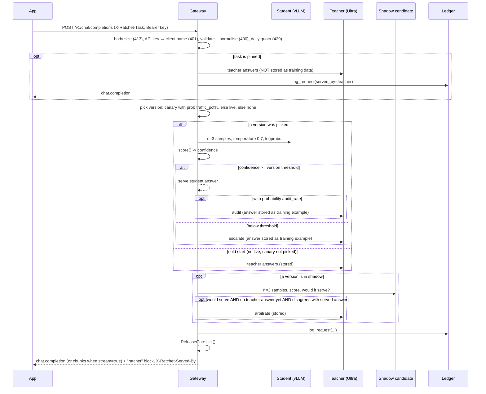
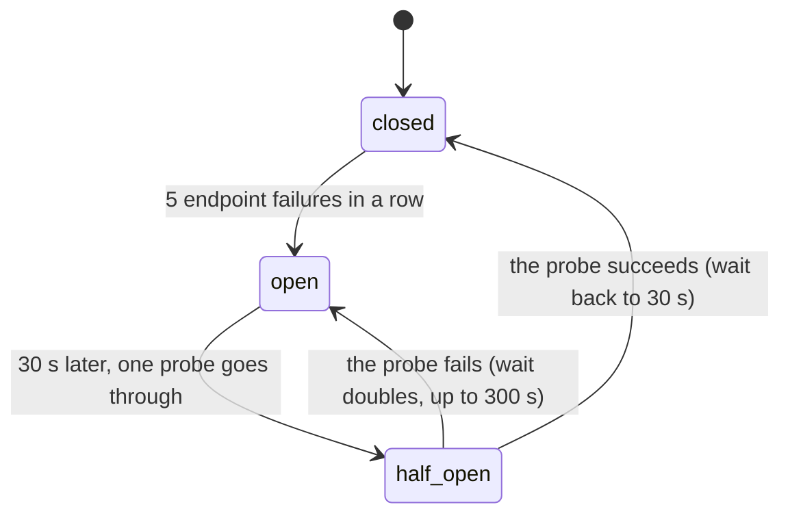
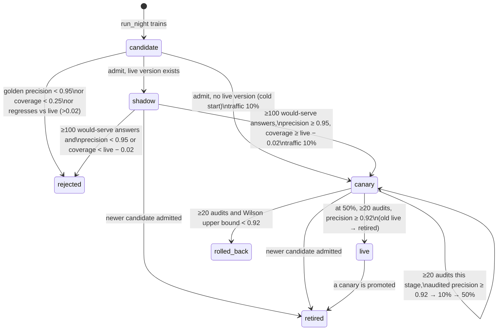

# Architecture

Ratchet is a gateway that sits between your app and a large "teacher" model. A small "student" model you own answers each request first. If it is unsure, the request goes to the teacher. Every teacher answer is stored with its license, and every night a new student is trained on those answers and released through a series of safety gates.

This page describes v0.2.0 as implemented in `ratchet/`. Product context is in [PRD.md](PRD.md); the reasoning behind each choice is in the [ADRs](adr/README.md).

## 1. Components

```
                         ┌──────────────────────────────── Nebius Token Factory ─────────┐
                         │  Teacher: nvidia/Nemotron-3-Ultra-550b-a55b                   │
                         │  Judge:   nvidia/nemotron-3-super-120b-a12b (free-text eval)  │
                         │  Fallback student: nvidia/NVIDIA-Nemotron-3-Nano-30B-A3B      │
                         └──────────────▲────────────────────────────────────────────────┘
                                        │ OpenAI-compatible HTTPS
┌──────────┐   /v1/chat/completions   ┌─┴──────────────────────────────┐
│ Your app │ ───────────────────────▶ │ Gateway  (ratchet/gateway.py)  │──── SQLite ledger (ratchet/ledger.py)
└──────────┘ ◀─────────────────────── │  Ratchet router (router.py)    │      requests · examples · versions · events
                                      │  ReleaseGate.tick (release.py) │
                                      │  Pages: /, /scout, /dashboard  │
                                      │  Scout agents (scout/)  ───────┼──── Tavily Search API (live Scout only)
                                      └─┬──────────────────────────────┘
                                        │ OpenAI-compatible HTTPS (model = adapter name)
                         ┌──────────────▼──── Nebius AI Cloud ─────────────────────────────┐
                         │ Serverless Endpoint: vLLM + nvidia/NVIDIA-Nemotron-3-Nano-4B-BF16 │
                         │   LoRA adapters loaded at runtime (/v1/load_lora_adapter)         │
                         │ Serverless Job (nightly): ratchet.nightschool.train (Unsloth)     │
                         │ Object Storage bucket mounted at /data: night/train.jsonl,        │
                         │   adapters/<version>/                                             │
                         └───────────────────────────────────────────────────────────────────┘
          Night School driver: python -m ratchet.live night | tick   (ratchet/live.py, cron)
```

| Module | Responsibility |
|---|---|
| `ratchet/config.py` | `Settings` (read from environment variables) and the `Price` table |
| `ratchet/providers.py` | `Completion`, the `Provider` protocol, and `OpenAICompatProvider` (httpx client for Token Factory and vLLM; every failure raises `UpstreamError`) |
| `ratchet/resilience.py` | `RetryPolicy` and `retry_call` (full-jitter backoff, `Retry-After`, a deadline, a read timeout retried once), `UpstreamError`, per-role `timeouts`, and the student circuit breaker (`Breaker`, `CircuitOpen`, `AdapterMissing`, `endpoint_down`) |
| `ratchet/tasks.py` | `Task` definitions: which answer fields must match for two answers to "agree", which answers are valid (`Task.key`, `match`, `check`), answer cleaning, the built-in tasks (`BUILTIN`) and the registry (`REGISTRY`, `register`, `get`; [ADR 0022](adr/0022-task-registry.md)) |
| `ratchet/taskspec.py` | Task specs as data: parses `RATCHET_TASKS_FILE` (JSON or YAML) and admin API bodies into `Task`s, listing every error with its path; `extends`; `install()` builds the registry at startup from the built-in, file and stored API tasks |
| `ratchet/compare.py` | `FieldSpec`: typed field comparators (`label`, `number`, `date`, `set`, `records`, ...) that normalise a value once and compare two ([ADR 0021](adr/0021-field-comparators-and-task-specs.md)); standard library only |
| `ratchet/vocab.py` | The built-in tasks' label vocabularies, shared with the prompts in `sim/tickets.py` and `ratchet/scout/prompts.py` |
| `ratchet/confidence.py` | `score()` (confidence from samples, agreement counted pairwise) and `calibrate_threshold()` |
| `ratchet/router.py` | `Ratchet.handle()`: the per-request cascade, audits, shadow, cost accounting |
| `ratchet/release.py` | `ReleaseGate` (golden gate, shadow, canary, rollback) and `wilson()` |
| `ratchet/ledger.py` | `Ledger`: SQLite storage, provenance, stats |
| `ratchet/licenses.py` | Teacher license registry; refuses teachers that forbid distillation |
| `ratchet/redact.py` | `redact()`, `redact_messages()`: PII placeholders before examples are stored |
| `ratchet/auth.py` | `KeyRing` (named gateway API keys, admin keys for management writes, read-only dashboard keys) and `bearer()` |
| `ratchet/access.py` | Who may call each route ([ADR 0061](adr/0061-endpoint-access-levels.md)): one table of access levels (`route_access`: public, api, dashboard, bom, admin, mock; unknown routes count as dashboard) and the scrubbing of anonymous public reads (`pseudonyms`, `scrub_stats`, `scrub_task`, `scrub_detail`); standard library only |
| `ratchet/obs.py` | Request ids, W3C trace context and structured logs without content ([§12](#12-observability), [ADR 0062](adr/0062-request-ids-failures-logs-and-metrics.md)): `RequestContext` in the `request_ctx` context variable, `new_context`, `upstream_headers`, `log`, `upstream_failure`, `mirror_event`, the JSON and text formatters, `configure` |
| `ratchet/metrics.py` | Prometheus metrics, standard library only: `Counter`, `Gauge`, `Histogram`, `Registry.render` (text format 0.0.4) and Ratchet's metrics with bounded labels (`client_label`) |
| `ratchet/openai_compat.py` | `validate_chat_request()` (typed `ChatRequest`), `normalize_messages()`, `APIError` and OpenAI's error envelope; standard library only |
| `ratchet/bom.py` | Per-adapter bill of materials: `manifest()`, `document()`, Ed25519 `Signer`, `verify()`, CLI (`keygen`, `verify`) |
| `ratchet/cost.py` | Utilization-aware cost accounting ([§7](#7-cost-accounting), [ADR 0023](adr/0023-utilization-aware-cost-accounting.md)): `cost_report()` (savings per token and by GPU-hours paid, break-even, the hosted-fallback crossover, a recommendation), interval merging (`segments`), the simulator's compute (`record_simulated_day`), CLI (`report`, `endpoint up\|down`, `close`) |
| `ratchet/nightschool/dataset.py` | Builds train and golden sets from the ledger |
| `ratchet/nightschool/train.py` | LoRA fine-tune script, run inside the Serverless Job |
| `ratchet/nightschool/evaluate.py` | `cascade_eval()` and `LiveEvaluator`: golden-set precision, coverage and threshold |
| `ratchet/nightschool/orchestrate.py` | `run_night()`: one night of training and release |
| `ratchet/live.py` | Live Night School on Nebius (`NebiusTrainer`, `load_adapter`, CLI) and the gateway's `AdapterReloader` |
| `ratchet/gateway.py` | FastAPI app: OpenAI-compatible API (with API keys, quotas, request validation, body limit, OpenAI error envelope and streaming), request ids and failures rows (`ObservabilityMiddleware`), request lookups, `/metrics`, stats, BOM and redaction endpoints, pages (`/`, `/scout`, `/dashboard`), mock-only demo controls, Scout endpoints |
| `ratchet/scout/agents.py` | `Scout`: planner → searcher → triage (parallel) → reader (parallel) → writer; `Call`, `http_caller` |
| `ratchet/scout/prompts.py` | System prompts, message builders and example questions, shared with the simulator |
| `ratchet/scout/search.py` | `TavilySearch` (live) and `MockSearch` (simulated results from `sim/research.py`) |
| `ratchet/scout/guard.py` | `Guard`: daily spend cap, daily run cap, per-IP hourly limit for the public demo |
| `ratchet/scout/__main__.py` | CLI: `python -m ratchet.scout "<question>" --base-url <gateway>/v1` |
| `ratchet/web/` | `landing.html` and `scout.html`: static pages, no build step |
| `sim/` | Synthetic tickets, the mock research world (`research.py`), workloads (`world.py`), mock teacher/student for the offline simulation and tests |

There are two runtime modes, chosen by `RATCHET_MODE`:

- **mock** (default): in-memory ledger, mock teacher and students from `sim/`, demo controls enabled, simulated search for Scout. No network or keys. `RATCHET_MOCK_WARMUP_DAYS` runs simulated days at startup.
- **live**: SQLite file at `RATCHET_DB`, real teacher on Token Factory, student on your vLLM endpoint (or the hosted fallback model when `RATCHET_STUDENT_BASE` is empty), Tavily for Scout when `TAVILY_API_KEY` is set.

## 2. Request path

`Ratchet.handle(messages, task, client, params, meta)` in `router.py`. Before it runs, the gateway checks the body size, the route's access level (`_access`, one dictionary lookup for `/v1/*`, whose level checks its own key; [ADR 0061](adr/0061-endpoint-access-levels.md)), the API key (when `RATCHET_API_KEYS` is set), validates and normalises the request (`openai_compat.py`), and checks the key's daily quota, in that order; it passes the key's name as `client` and the request's generation parameters as `params` (`providers.GenParams`). A request refused by any of these is not logged as a request and costs nothing (a 401, 413 or 429 leaves a `failures` row, a 400 only a metric; [§12](#12-observability)):



Details that matter:

- **Validation and normalisation** (`openai_compat.py`, [ADR 0012](adr/0012-openai-request-validation-and-error-envelope.md)): a malformed request gets a 400 in OpenAI's error envelope before any model call. `developer` becomes `system` and text content parts become one string, so the cascade, the mock models and the ledger see the same plain messages as before; plain messages pass through as the same objects, so example hashes do not change. A request with a non-text part listed in `RATCHET_TEACHER_MODALITIES` takes the pinned path below (`Ratchet.teacher_only`): teacher only, never stored. Validation, the quota check and the cascade run in a worker thread.
0. **Task admission** (`Ratchet.task_for`, in the gateway before the quota): an unregistered name under `RATCHET_UNKNOWN_TASKS=reject` is a 400 `unknown_task`, and a task whose `clients` do not name the request's API key is a 403 `task_not_allowed`; neither is logged. Under `teacher`, an unregistered task takes the teacher-only path below with route `unknown_task`. **Pinned tasks** (`Task.pinned`, `_teacher_only`): checked first in `handle`. The teacher answers, the request is logged with `served_by=teacher`, no student version, and `cost_usd = baseline_cost_usd`. The answer is **not** passed to `add_example`, so it never becomes training data. No student, audit or shadow call is made. Scout's planner and writer (`research-plan`, `research-write`) are pinned; see [§10](#10-scout-multi-agent-demo).
1. **Version choice** (`_pick_version`): if a version is in `canary`, it is chosen with probability `traffic_pct / 100`; otherwise the `live` version is used. With no live version (cold start) and the canary not picked, the request goes straight to the teacher.
2. **Student sampling** (`_sample`): one call with `n = Settings.samples` (default 3) and `confidence.STUDENT_SAMPLING` (`temperature=0.7`, `logprobs=True`), the constant the golden eval also uses, plus the request's generation parameters as the student's role allows (below). The model name sent is whatever the resolver returns. In live mode that is `version.adapter_uri`, which is the LoRA adapter name. A request for `n` > `Settings.samples` choices draws `n` samples in the same call, but the confidence is scored on the first `Settings.samples` of them, the statistic the threshold was calibrated on ([n choices](#n-choices-and-token-logprobs)).
3. **Threshold**: `Ratchet.threshold(version, model, task)` returns `version.eval["threshold"]` (calibrated at training time), falling back to `Settings.confidence_threshold` (default 0.80). When the version's eval records another `spec_hash` for the task than its current one (`eval["spec_hashes"]`, `Ratchet.spec_changed`), the threshold is 1.01: the student serves nothing for that task until a night scores the version under the new spec. A sample set with no valid answer (`Scored.valid` false: every sample unparseable, empty or cut off) is never served, whatever the threshold. For `n` > 1 choices, at least `n` samples must also share the majority answer (`confidence.majority`); a confident student that cannot fill them escalates with route `n_choices`.
4. **Audits**: when the student serves, the teacher is also called with probability `audit_rate` (default 0.05; mock mode raises it to at least 0.10). The audit result (`audit_agree`) is the live quality signal for canary and live versions, and the teacher's answer also becomes training data. A teacher answer that cannot be stored ([below](#storage-rules)) is not an audit: `audited=0`.
5. **Teacher calls** (`_call_teacher` → `_ask_teacher`, then `_store_example`): the teacher answer is cleaned (`tasks.clean_answer`), checked against the [storage rules](#storage-rules), the messages, the answer and the stored conditions are redacted ([PII redaction](#pii-redaction)), and they are stored with `Ledger.add_example(task, messages, completion, teacher_model, license_name, license_url, redactions, params)`. The license comes from `Ratchet.licenses`, built when `Ratchet` is constructed with `licenses.require_distillable` for the teacher and the fallback teacher (if set), and looked up by the configured model that wrote the answer. A closed teacher raises `LicenseError` at startup.
6. **Shadow**: see [state machine](#5-version-state-machine). The shadow candidate never serves.
7. **Logging**: one row in `requests` per call (columns below), with the API client's name when keys are on.
8. **Gate tick**: the gateway calls `rt.tick()` after every `/v1/chat/completions` request and after every Scout run. It runs `gate.tick()` under a lock at most once per `RATCHET_TICK_INTERVAL_S` (live mode 5 s; mock mode every call) and skips, without waiting, while another thread is ticking ([§11](#11-hot-path-and-performance)). In live mode, `python -m ratchet.live tick` can also be run from cron.

**Generation parameters** ([ADR 0017](adr/0017-generation-parameters-by-role.md)). `Settings.gen_policy()` (`providers.GenPolicy`) turns the client's parameters into a `GenPlan` once per request (a request without any, from Scout or the simulator, reuses one built at startup): the student's (`RATCHET_STUDENT_PARAMS`: `max_tokens`, `stop`, `seed`, `response_format`, `logit_bias`, `top_logprobs`; never its temperature, logprobs or `n`), the serving teacher's (`RATCHET_TEACHER_PARAMS`: every standard field but the tool-call fields, which the gateway cannot return yet, at the client's temperature or 0, or 0.7 for `n` > 1 choices; `logprobs` and `top_logprobs` only when the client sends them) and the audit's and arbitration's (the same at temperature 0, without `top_p`, `seed`, the penalties, `logit_bias` and logprobs). Every call has an output cap: `RATCHET_STUDENT_MAX_TOKENS` (1,024) and `RATCHET_TEACHER_MAX_TOKENS` (8,192), and the teacher gets `RATCHET_TEACHER_REASONING_HEADROOM` (0) tokens above the client's `max_tokens` for reasoning; when it does, a visible answer longer than the client's limit is marked `length` (served whole, not stored). The model is never the client's: always `Settings.teacher_model` or the version's adapter. The golden eval builds its student calls with the same policy from the conditions stored with each example (FR-5.1). `Result.finish_reason` is the served answer's, and the gateway returns it (never `tool_calls`: a teacher answer that is a tool call is a 502 `tool_calls_unsupported` until tool calls are passed through).

**Upstream calls** ([ADR 0014](adr/0014-upstream-failure-semantics.md)). Each role has its own client settings. The teacher and judge: a 120 s read timeout (`RATCHET_TEACHER_TIMEOUT_S`), 5 s to connect, and up to two retries (`RATCHET_TEACHER_RETRIES`) within 180 s (`RATCHET_TEACHER_DEADLINE_S`). The student on the request path: 15 s to answer and 2 s to connect (`RATCHET_STUDENT_TIMEOUT_S`, `RATCHET_STUDENT_CONNECT_TIMEOUT_S`) and no retries, because the teacher is its retry; the hosted fallback model plays the student with the same settings. `resilience.retry_call` retries connection failures and 408, 409, 429 and 5xx, waiting full jitter (`uniform(0, min(8, 0.5 × 2^i))` seconds) or the server's `Retry-After` (a wait over 8 s, or one that would end past the deadline, returns the error at once); a read timeout is retried once, because those tokens may be billed; any other 4xx and an unreadable 2xx body never. The deadline also caps each attempt's timeouts. Whatever fails ends as an `UpstreamError` with a status, the endpoint's OpenAI `type`, `code` and `param`, and a clipped message, never the URL.

**Failure handling** (INV-7, INV-15, [ADR 0013](adr/0013-optional-teacher-calls-fail-open.md), [ADR 0014](adr/0014-upstream-failure-semantics.md), [ADR 0019](adr/0019-teacher-breaker-degraded-mode-and-fallback-teacher.md)). A request fails only when the call whose answer it needs fails: the teacher on the escalation, cold-start, pinned or teacher-only path, when no opt-in stand-in answers instead ([below](#when-the-teacher-is-down)). That raises out of `handle`, and the gateway's `_map_upstream` answers by cause: 400 with the teacher's message and code when the request cannot succeed (an upstream 400, 413 or 422, such as `context_length_exceeded`), 429 with the teacher's `Retry-After` for a rate limit, 504 `teacher_timeout`, 502 `upstream_auth_error` or `upstream_not_found` for the gateway's own key or model setting, 503 `teacher_circuit_open` with the breaker's wait while the teacher's breaker is open, and 502 `teacher_unavailable` otherwise; `X-Should-Retry: false` where a retry cannot help. Nothing is logged for the request. Every other upstream call fails open:

| Call | When it raises | Recorded |
|---|---|---|
| Student samples | Escalate to the teacher; a 404 for the adapter also queues its reload | `escalated=1`, route `student_error`; `student_errors`; `student_error` event; the student breaker counts it when the endpoint looks down ([below](#student-circuit-breaker)) |
| Teacher audit | Serve the student's answer; no arbitration call for this request either, since the teacher just failed | `audited=0`, `audit_agree` NULL, no cost for the call; `audit_errors`; `audit_error` event (none of these while the teacher's breaker is open: the call is skipped, not made) |
| Shadow samples | Serve as if no shadow ran | No shadow fields; `shadow_errors`; `shadow_error` event (`sampling`); counted by the shadow's own breaker |
| Shadow arbitration | Serve the live answer | `shadow_serve=1`, `shadow_agree` NULL; `shadow_errors`; `shadow_error` event (`arbitration`); skipped without a count while the teacher's breaker is open |

The counters are per process and thread-safe; `Ratchet.health()` returns them. Each event is written on the 1st, 10th, 100th and 1000th failure of its kind, so an outage cannot flood the release log, and an optional-call event names the exception class and HTTP status, never the message (an httpx message holds the endpoint URL). In the release gate, a failed audit is simply not an audit: audits are sampled at random, so dropping one shrinks the sample without biasing it. A failed arbitration is different, because arbitration only runs when the shadow disagrees with the served answer: `Ledger.shadow_quality` counts such a row in `n`, coverage and the would-serve evidence, and as a disagreement in precision (`unarbitrated` in its result), so a failing teacher can get a candidate rejected but never promoted. A row whose shadow verdict is unknown (`shadow_serve` NULL) counts toward nothing.

### n choices and token logprobs

[ADR 0020](adr/0020-n-choices-and-token-logprobs.md), FR-1.14. `handle(..., n=k)` (the gateway passes the request's `n`, at most `RATCHET_MAX_N`) puts `k` in the `GenPlan` (`plan.n`). The student's call asks for `max(Settings.samples, k)` samples; `score` runs on the first `Settings.samples`, and `confidence.majority` picks the choices: the scored best sample, then the other samples with the same canonical answer by token probability, or None when fewer than `k` agree. When the teacher answers, `_ask_teacher` asks it for `k` choices (`CHOICES_TEMPERATURE`, 0.7, when the client set no temperature) and `_call_teacher` stores only choice 0 (`TeacherAnswer.choices` holds them all), so a request still adds or bumps at most one example. Audits and arbitrations are one answer at temperature 0 and judge choice 0, the shadow samples `Settings.samples` as calibrated, and a degraded answer needs `k` agreeing samples. `Result.choices` holds the `router.Choice` objects (`text`, `finish_reason`, `logprobs`); `usage` adds up the choices, `usage_breakdown.served` lists them, cost prices whole calls and the baseline is one teacher answer per choice. With `params.logprobs`, `providers.served_logprobs` turns each served completion's `logprobs_content` (the server's list, kept as it came) into OpenAI's entries: it keeps only the tokens that spell the served text, dropping the ones `clean_answer` removed (reasoning, a fence, edge whitespace; a token is cut only by whitespace), and gives None when they cannot be told apart. The gateway writes `logprobs: {content, refusal: null}` for a client that asked, and streams each choice in turn with a few tokens and their logprobs per content chunk.

### Student circuit breaker

A student endpoint that hangs would hold every request for its timeouts (2 s to connect, 15 s to answer) before the teacher answers. `resilience.Breaker` ([ADR 0015](adr/0015-student-circuit-breaker-and-adapter-reload.md)) stops that after a few failures:



- **What counts.** `resilience.endpoint_down` reads each failure: a timeout, a connection or protocol error, an unreadable answer, a 5xx, 408 or 429 means the endpoint looks down and counts. Any other 4xx (a prompt too long for the student, a lost adapter) is the endpoint answering about this request, so it counts as a success for the endpoint's health. An error that is not an HTTP failure (a bug in a provider, the mock world not knowing a request) counts neither way. `RATCHET_STUDENT_BREAKER_FAILURES` (5) failures in a row open the breaker; `0` turns it off.
- **Open.** `_sample` checks `allow()` before calling and raises `CircuitOpen` when the breaker is open. `handle` escalates to the teacher with `escalated=1`, `confidence` NULL and route `student_breaker`; nothing is billed for the student, and it is not another `student_error`. After `RATCHET_STUDENT_BREAKER_COOLDOWN_S` (30 s) exactly one request probes the endpoint; concurrent requests still see the breaker open. A failed probe doubles the wait, up to 300 s; a successful one closes the breaker and resets the wait. A probe that never reports back is presumed lost after the longer of the wait and the student call's own longest time (its pool, connect, write and read timeouts plus 5 s, 37 s by default), so a probe on a hanging endpoint is never replaced while it can still be running; a lost probe that reports while the breaker is still half-open decides as the probe would. Only a probe's own thread decides, so a late result from a call that began before the breaker opened is ignored.
- **One breaker per failure domain.** Breakers are made on first use, keyed by role and endpoint: the provider's `base_url`, or its class when it has none (a resolver may build a new provider object per call, as the mock fleet does). Live and canary on one endpoint share the `student` breaker. Shadow calls use their own `shadow` breaker, so a bad staging adapter cannot open the breaker live traffic depends on; while it is open the shadow collects no evidence, as when its samples fail. Another endpoint in the same role gets `student-2`, and so on.
- **Lost adapters.** vLLM forgets adapters loaded at runtime when the endpoint restarts, and answers 404 ``The model `student-v3` does not exist.`` A 404 that names the version's adapter becomes `AdapterMissing`: the request escalates (route `student_error`), the breaker records the endpoint as healthy, and `Ratchet.on_adapter_missing(version)` is called. In live mode with an endpoint that is `live.AdapterReloader.request`, which loads the adapter again on one daemon thread (`live.load_adapter`, path `RATCHET_ADAPTER_ROOT/<name>`), at most once per adapter per 60 s, and writes `adapter_reloaded` or `adapter_reload_failed`. `python -m ratchet.live reload` stays as the manual fallback.
- **Events and health.** Transitions write `circuit` events (`student: closed->open after 5 failures (ReadTimeout)`, `student: open->half_open after 30 s; one probe`, `student: half_open->open for 60 s after a failed probe (...)`, `student: half_open->closed after a successful probe`), naming the failure's class and status, never its message. Once the wait is at 300 s, the repeated `open->half_open` / `half_open->open` pair is written only for the 1st, 10th, 100th and 1000th probe at that wait, so a long outage cannot push the release history out of the dashboard's last 40 events. `Ratchet.health()["breakers"]` has each breaker's `snapshot()`.
- **Cost on the hot path.** While a breaker is closed, `allow()` and a successful `record()` read attributes without taking a lock; the lookup is one dictionary read. Locks are taken only while failures are being counted or the breaker is open.

The mock-only `POST /ratchet/demo/student-outage` takes the mock production endpoint down for 5 to 300 s, to show the breaker open and close again ([API.md](API.md#post-ratchetdemostudent-outageseconds60)).

### When the teacher is down

[ADR 0019](adr/0019-teacher-breaker-degraded-mode-and-fallback-teacher.md). Three layers, only the first on by default:

1. **The teacher's breaker.** `Ratchet._teacher_complete` sends every teacher call through a `resilience.Breaker` named `teacher` (the fallback teacher has its own, `fallback_teacher`), made in `Ratchet.__init__` with `Settings.teacher_breaker()` (`RATCHET_TEACHER_BREAKER_FAILURES` 5, `RATCHET_TEACHER_BREAKER_COOLDOWN_S` 30 s) and the student breaker's rules: a failed call counts once, after the provider's retries, when `endpoint_down` says the teacher looks down (a timeout, no connection, an unreadable or 5xx answer, 408, 429); a 400 about the request, a 401 or a tool-call answer is the teacher answering. While open, the call raises `CircuitOpen` (503 `teacher_circuit_open`, `retry_after` from `Breaker.retry_in()`) without calling: a request that needs the teacher gets a 503 with `Retry-After` at once instead of holding a worker thread for the 180 s deadline, and an audit or arbitration is skipped as a failure would be, without counting as one. One request per wait probes the teacher; transitions are `circuit` events (`teacher: closed->open after 5 failures (UpstreamError 503)`).
2. **A fallback teacher** (`RATCHET_TEACHER_FALLBACK_MODEL`, opt-in). `_serve_teacher` asks it only for an answer that will be served (escalation, cold start, pinned, teacher-only) and only when the primary is unavailable (`resilience.teacher_unavailable`: any HTTP failure or the open breaker, but not a 400, 413 or 422 about the request or a tool-call answer). Licensed at startup (invariant 1); served with route `fallback_teacher`, its own model id and fingerprint, priced at its own price; a throttled `fallback_teacher` event names the primary's failure. Its answers are stored only with `RATCHET_STORE_FALLBACK_TEACHER=1`, then with its own license. When it fails too, the primary's error is raised. Audits and arbitrations never use it: they are the release gate's evidence and the training labels, so they are the primary's or nothing.
3. **Degraded mode** (`RATCHET_ON_TEACHER_FAILURE=serve_student`, opt-in). When an escalation still has no teacher answer and the teacher is unavailable, `handle` serves the student's own answer if it had at least one valid sample (`_may_degrade`): route `degraded`, `served_by` `student`, `escalated` 1, `audited` 0, nothing stored, `Result.degraded` `teacher_unavailable` (the response's `ratchet.degraded` and `X-Ratchet-Degraded`), and a throttled `degraded` event. Never for a request with `tools`, a cold start, a request whose student call failed or was skipped, or the pinned and teacher-only paths, which have no student answer.

A request a stand-in answered (route `degraded` or `fallback_teacher`, `router.STAND_IN_ROUTES`) runs no shadow: its only reference would be a below-threshold student answer or another model's. With `audited` 0 too, these requests never move a release. `stats_by_day` counts them per day (`degraded`, `fallback_teacher`), and `Ratchet.health()` has `degraded_answers`, `fallback_answers` and the teacher breakers' snapshots.

### Storage rules

Every training example is a teacher answer (INV-2) that is complete and valid (INV-16, [ADR 0016](adr/0016-store-only-complete-valid-teacher-answers.md)). `Ratchet._store_example` is the only caller of `Ledger.add_example`; it runs on every teacher call (escalation, cold start, audit, shadow arbitration), never on the pinned and teacher-only path (INV-10).

1. **Clean** (`tasks.clean_answer`, FR-2.7). `strip_reasoning` removes complete `<think>…</think>` blocks in any case, then everything up to the last remaining `</think>` (a chat template that opens the reasoning in the prompt, so the output has only the closing tag), then an opening `<think>` still left at the start of what remains together with everything after it (an answer cut off while reasoning); an opening tag after answer text is content (a reply that mentions the tag), since a model reasons before it answers. For a JSON task (`Task.structured`: format `json`, the default for a task with fields), an answer that is one JSON object (bare or in one fence, as it is or after what follows its first `</think>`) is kept whole, so a tag quoted in its strings survives; otherwise one code fence that is the whole answer is unwrapped when its body parses as JSON; a free-text answer keeps its fences, since a code block is content there. The provider never reads `reasoning_content` or `reasoning` (vLLM's and Token Factory's reasoning parsers), so reasoning cannot arrive another way.
2. **Check** (`GenParams.unstorable`, `router.answer_problem`). The answer is skipped when it was written under a client's `logit_bias`, a non-zero penalty, a temperature above 1 or a vendor field (`client logit_bias`, ...: the client may choose its answer, not the label; threat model T2), when its `finish_reason` is not `stop` or `tool_calls` (`finish_reason length`: cut off by the token limit), when nothing is left after cleaning (`empty answer`), when a JSON task's answer does not parse (`invalid answer`), or when a field of the task's spec is missing, null where it may not be, or does not normalise, such as a label outside its vocabulary (`invalid field category`; `Task.check`, FR-2.14). String operations only, so the check costs microseconds.
3. **Redact**, then check once more (`Task.check`): a placeholder can break a structured answer (a card-like number outside quotes becomes `[CARD]`, an identifier inside a checked field becomes a label outside its vocabulary), and such an answer is skipped (`invalid after redaction`).
4. **Store** with its license and its conditions (`examples.params`: the `response_format`, `tools`, `tool_choice` and `stop` the teacher answered under, `ledger.STORED_PARAM_KEYS`; for an audit the audit's), or bump `seen` for a duplicate. The golden or train split comes from the task and messages alone, so every variant of a prompt shares it (`Ledger._split`). A request whose `RequestMeta.storable` is False stores nothing, and neither does a task with `store=False`; neither is a skip. `requests.stored` is 1 for a request whose teacher answer was stored or bumped, 0 otherwise (including pinned requests), NULL for rows from before v0.5.

A skipped answer is still served (the client asked for it, and with `finish_reason length` it is all there is), but it is not an audit (`audited=0`, counted neither for nor against the student, and the shadow is compared with the served answer as if no audit had run) and an escalation or arbitration answer like that settles no shadow disagreement (`shadow_agree` NULL, which the gate counts against the shadow, as for a failed arbitration). Each skip writes a `skip_example` event (`ticket-triage: finish_reason length`) on the 1st, 10th, 100th and 1000th skip of each reason, counted per process under the same lock as the failure counters; the detail never quotes the answer. On the student side, a sample whose `finish_reason` is not `stop` or `tool_calls` (the same rule) gets no vote in `confidence.score`, and an empty answer is invalid for every task.

The response text is the served answer after `tasks.clean_answer`: no reasoning, and for a structured task bare JSON. With `stream: true` the gateway sends it as OpenAI `chat.completion.chunk` events after the cascade has decided; the cascade cannot stream the student's tokens as they arrive, because confidence is scored on the whole answer ([API.md](API.md#streaming)).

The response has every field of OpenAI's ([ADR 0018](adr/0018-usage-reports-the-served-answer.md), FR-1.12). `usage` is the served answer's, as if its model had answered alone: the chosen student sample's tokens, or the teacher's call with its reasoning tokens (part of `completion_tokens`) and cached prompt tokens; a count the model did not report is estimated at about 4 characters a token. `ratchet.usage_breakdown` lists every call of the request (`student_samples`, `served`, `audit`, `shadow`, `arbitration`), which `cost_usd` prices. `system_fingerprint` is a hash of what decides the answer (`router.fingerprint`: the student's adapter, version, training-set hash and threshold, or the teacher's model), so it changes when a promotion or rollback puts another version in front. The router computes all of it in `Result` from the completions it already holds; the gateway only shapes it (`openai_compat.usage_object`, `gateway._envelope`). With `stream_options.include_usage` the stream ends with a chunk that has no choices, the usage and the `ratchet` block.

### PII redaction

`ratchet/redact.py` ([ADR 0009](adr/0009-pattern-based-pii-redaction.md)) replaces identifiers with `[LABEL]` placeholders before anything is stored as training data. Patterns run in a fixed order, so specific formats win over the broad phone pattern:

| Label | Matches | Extra check |
|---|---|---|
| `SECRET` | `sk-…`, `tvly-…`, `AKIA…`, `ghp_…`, `xox…-…`, the token after `Bearer ` | |
| `EMAIL` | `name@domain.tld` | |
| `IBAN` | country code, 2 check digits, 11–30 characters | mod-97 |
| `CARD` | 13–19 digits with optional spaces or dashes | Luhn |
| `AADHAAR` | 12 digits, first digit 2–9 | Verhoeff |
| `SSN` | `123-45-6789` (excluding invalid areas) | |
| `PAN` | Indian PAN `ABCPE1234F` | |
| `IP` | IPv4 | |
| `PHONE` | optional `+country`, optional `(area)`, digit groups | 10–15 digits |

Only `_store_example` redacts, and it redacts everything it stores: the messages (`redact_messages`), the answer (`redact`) and every string value in the stored conditions, such as a stop string or a tool description (`redact_json`, which keeps object keys); the teacher itself receives the original. `examples.redactions` counts the placeholders per example, `Ledger.privacy_stats()` sums them for `/ratchet/stats`, and each adapter BOM reports `examples_with_pii_redacted`. `POST /ratchet/redact` previews the result for any text. The redactor does not find names or street addresses.

## 3. Nightly loop (Night School)

`run_night(ledger, trainer, evaluator, gate, base_model, min_new_examples=50, task=None)` in `nightschool/orchestrate.py`:

```
 ┌─ release in flight? (any version in shadow or canary) ── yes ──▶ event "skip", stop
 │ no
 ├─ dataset.build(): train rows + golden rows (license-checked)
 ├─ new = train_examples − max(train_examples of all previous versions)
 │     new < min_new_examples (50) ───────────────────────────────▶ event "skip" (re-score the live
 │                                       version first when a golden task's spec changed: "rescored"), stop
 │     no golden rows ────────────────────────────────────────────▶ event "skip", stop
 ├─ champion re-check: evaluate the LIVE version on today's golden set, overwrite its eval (+ spec_hashes)
 ├─ trainer.train(train_rows, base_model, name="student-v{N+1}") → adapter_uri
 ├─ ledger.create_version(state="candidate")
 ├─ evaluator.evaluate(adapter_uri, golden_rows) → {precision, coverage, threshold, ...} + spec_hashes
 ├─ ledger.set_bom(): bill of materials from the exact train and golden rows, signed if a key is set
 ├─ event "trained"
 └─ gate.admit(version) → rejected | canary 10% (cold start) | shadow
```

- **Mock mode**: `MockFleet` (in `sim/mock_models.py`) is both trainer and evaluator.
- **Live mode**: `NebiusTrainer` (`ratchet/live.py`) first checks that `RATCHET_STUDENT_BASE` is set (an adapter with no endpoint cannot be evaluated, so it stops before any spend). Then it does four things. It writes `RATCHET_DATA_DIR/night/train.jsonl`, runs `RATCHET_SYNC_CMD` (if set), runs `RATCHET_TRAIN_CMD` (default `bash deploy/train_job.sh {version}`), then hot-loads the adapter into vLLM with `POST {root}/v1/load_lora_adapter` (an "already loaded" answer is fine). `LiveEvaluator` then scores it.

### Datasets (`nightschool/dataset.py`)

- Every example gets a fixed split when first stored: `golden` if `int(sha256[:8], 16) / 0xFFFFFFFF < golden_fraction` (default 0.10), else `train`. The split never changes, so evaluation data cannot leak into training through re-splitting.
- **Frequent requests:** an example whose `seen` count is at least `FREQUENT = 3` is treated as `train`, even if its stored split is `golden`. Requests that keep repeating are too valuable to hold out ([ADR 0007](adr/0007-golden-set-split-and-frequent-requests.md)).
- Rows whose teacher is unknown or not distillable (per `licenses.lookup`) are dropped.
- Rows of a task that is pinned **now** are dropped from both sets and counted (`excluded_pinned` in `manifest.json`), and `cascade_eval` skips any it is handed (invariant 10 at read time): a task pinned after it had data neither trains the student nor calibrates its threshold. Unpinning brings the rows back.
- Train rows whose answer is not valid under the task's current spec (`Task.valid`: a vocabulary shrank, a field became required) are dropped and counted (`skipped_invalid` in `manifest.json`); the ledger keeps them, so loosening the spec brings them back. Golden rows stay in the set, and `cascade_eval` skips the ones it cannot grade with (`golden_invalid_refs`).
- Training is cumulative: each night trains from the **base model** on every train row so far ([ADR 0004](adr/0004-retrain-from-base-cumulative.md)).
- `build()` also writes `manifest.json`: train and golden counts, `dataset_sha256` (a hash of the train rows' example hashes), `skipped_invalid`, `excluded_pinned`, and the bill of materials.

## 4. Data model (SQLite)

Created by `SCHEMA` in `ledger.py` (`CREATE TABLE IF NOT EXISTS`).

### `requests`: one row per gateway call

| Column | Type | Meaning |
|---|---|---|
| `id` | INTEGER PK | Auto-increment. Also used as the "since" marker for stages |
| `ts` | REAL | Unix time |
| `day` | INTEGER | `Ledger.day` at the time (set by the simulator or demo; see note) |
| `task` | TEXT | Task name |
| `served_by` | TEXT | `student` or `teacher` |
| `student_version` | INTEGER | Version that was tried first; NULL on cold start |
| `confidence` | REAL | Student confidence; NULL if no student was tried |
| `escalated` | INTEGER | 1 if the student was below threshold |
| `audited` | INTEGER | 1 if the teacher double-checked a student answer (0 when the audit call failed or its answer could not be stored) |
| `audit_agree` | INTEGER | 1/0 for audited rows, NULL otherwise |
| `shadow_version` | INTEGER | Shadow candidate that ran, if any |
| `shadow_serve` | INTEGER | 1 if the shadow would have served |
| `shadow_agree` | INTEGER | 1 if the shadow agreed with the best available reference; NULL when its disagreement could not be arbitrated, or the teacher's reference could not be stored |
| `latency_ms` | REAL | The providers' time: student latency (max over samples) plus teacher latency if called (as each provider measured or reported it) |
| `cost_usd` | REAL | Actual cost of this request (student + teacher + audit + shadow + arbitration), the student priced per token |
| `baseline_cost_usd` | REAL | Estimated cost if the teacher had answered alone |
| `student_cost_usd`, `teacher_cost_usd` | REAL | `cost_usd`'s two parts: the student's samples (live and shadow) and the teacher's calls (escalation, audit, arbitration, pinned); their sum is `cost_usd` up to float rounding. NULL in rows written before v0.5 ([§7](#7-cost-accounting)) |
| `student_in_tokens`, `student_out_tokens` | INTEGER | The student calls' tokens (the prompt once per call, every sample's output), which price the hosted fallback student in the cost report; 0 when the student was not sampled, NULL before v0.5 |
| `client` | TEXT | API key name that sent the request; NULL when keys are off and for internal calls (Scout, demo). Indexed with `ts` for the daily quota |
| `route` | TEXT | How the request was served (`router.ROUTES`): `student`, `confidence`, `cold_start`, `pinned`, `student_error`, `student_breaker`, `degraded`, `fallback_teacher` ([API.md](API.md#get-ratchetstats)). NULL in rows written before v0.5; `stats_by_task` reports those as `unrecorded` |
| `stored` | INTEGER | 1 if a teacher answer from this request was stored as an example (inserted, or a duplicate: its `seen` bumped, or not for a retry, [§14](#14-retries-and-idempotency)); 0 if none was (student-served without audit, pinned, or a skipped answer, see [Storage rules](#storage-rules)); NULL in rows written before v0.5 |
| `threshold`, `label_p`, `student_agree`, `baseline_est_usd` | REAL, REAL, INTEGER, REAL | For the ledger replay (FR-16.5): the threshold the student was held to, the probability a teacher label of its answer was observed (1 when escalated, the audit rate when served), whether its answer agreed with the escalation's or a random audit's teacher answer, and the all-teacher cost by the token formula. NULL until that feature writes them ([ADR 0024](adr/0024-evidence-foundations.md)) |
| `optional_failed` | INTEGER | 1 when an optional teacher call of the request (audit, arbitration) failed; NULL until live readiness writes it |
| `request_id`, `client_request_id` | TEXT | The gateway's id for the request (`req_` and 32 hex digits, also `x-request-id`; index `requests_request_id`) and the client's own `X-Request-Id` or `X-Client-Request-Id` when it was well formed. NULL for internal calls (Scout, the simulator) and rows written before v0.5 ([§12](#12-observability)) |
| `wall_ms` | REAL | The whole cascade on the gateway's clock (`time.perf_counter`, from the start of `handle` or `teacher_only` to the ledger write), every model call included; `wall_ms - latency_ms` is Ratchet's own time. NULL in rows written before v0.5 ([§11](#11-hot-path-and-performance)) |
| `retry_count` | INTEGER | The client SDK's attempt number (`x-stainless-retry-count`): 0 for a first attempt, an internal call, a client that does not send it, and rows written before v0.5 ([§14](#14-retries-and-idempotency)) |

### `examples`: teacher-written training data with provenance

| Column | Type | Meaning |
|---|---|---|
| `id` | INTEGER PK | |
| `ts`, `day`, `task` | | When and for which task it was first stored |
| `hash` | TEXT UNIQUE | `sha256(json({"task","messages"}, sort_keys))`, with `"params"` added to the object only when the example has conditions (so every hash from before v0.5 is unchanged); deduplicates identical requests under identical conditions |
| `messages` | TEXT | JSON request messages |
| `completion` | TEXT | Teacher answer, reasoning removed |
| `teacher_model` | TEXT | Model ID of the teacher |
| `license`, `license_url` | TEXT | License that permits training on this output |
| `split` | TEXT | `train` or `golden` (fixed from the hash) |
| `seen` | INTEGER | Times this exact request was answered by the teacher (starts at 1, +1 per duplicate) |
| `redactions` | INTEGER | PII placeholders inserted before storing (0 when none were found or redaction is off) |
| `params` | TEXT | JSON: the conditions the teacher answered under that define the target (`response_format`, `tools`, `tool_choice`, `stop`), redacted like the messages; NULL when there were none and in rows from before v0.5. `dataset.rows` returns it as `params` |
| `origin`, `job` | TEXT | Where the example came from (`escalation`, `audit`, `arbitration`, `backfill`; NULL: not recorded, read as `live`) and the backfill job that wrote it (FR-16.8). NULL until that feature writes them |
| `contested`, `checked_epoch` | INTEGER | The teacher watch (FR-16.7): 1 when a later teacher label of the same request disagreed (quarantined from training), and the epoch of its last self-consistency check; 0 by default and in older rows |

### `versions`: student models

| Column | Type | Meaning |
|---|---|---|
| `id` | INTEGER PK | Version number (`v{id}` in the UI) |
| `created_ts`, `day` | | Creation time |
| `base_model` | TEXT | Base model ID |
| `adapter_uri` | TEXT | Adapter name, e.g. `student-v3` (also the vLLM model name) |
| `train_examples` | INTEGER | Size of the train set used |
| `dataset_hash` | TEXT | `dataset_sha256` from the manifest |
| `eval` | TEXT (JSON) | `golden_n`, `golden_agreement`, `threshold`, `coverage`, `precision`, `test_n`, optional `judge_pass_rate`, `rechecked_day` |
| `state` | TEXT | `candidate`, `rejected`, `shadow`, `canary`, `live`, `retired`, `rolled_back` |
| `traffic_pct` | INTEGER | 10 or 50 in canary, 100 when live, 0 otherwise |
| `stage_since` | INTEGER | Max `requests.id` when the current stage began; audits are counted only after it |
| `bom` | TEXT (JSON) | This adapter's bill of materials document (`manifest`, `sha256`, `signature`), written at training time |

### `tasks`: tasks written through the admin API

`name` (primary key), `spec` (JSON: the task as a spec file writes it, `taskspec.document`, in its own key order, because the order of `fields` is part of the spec hash), `spec_hash`, `source` (`api`; `auto` is reserved for tasks derived from requests), `created_ts`, `updated_ts`, `updated_by` (the admin key's name, never the key). Registered again at every start (`taskspec.install`); built-in and file tasks are never stored. A new table, so older files gain it on open with no migration. Deleting a task removes its row and keeps its examples.

### `compute_intervals`: when GPUs ran

`id`, `kind` (`student_endpoint`, `training_job` or `eval_job`), `start_ts`, `end_ts` (NULL while it runs), `usd_per_hour` (per GPU, as recorded, so a later price change never reprices history), `gpus`, `version` (the version a training job produced), `source` (`cli`, `api`, `deploy`, `night` or `simulation`) and `note`. Timestamps are on the ledger's clock (`Ledger.now()`): wall-clock time in a live ledger, a synthetic clock in simulations and tests (day N starts at N x 86400 s). Indexed on `(kind, start_ts)`. A new table, so older files gain it on open. Written by `compute_start` (idempotent for a student endpoint that is up, in one transaction) and `compute_stop` (every open interval of the kind, or one by id); read by `compute_intervals(kind, since, until)` and [the cost report](#7-cost-accounting).

### Evidence tables

Created by `SCHEMA` for the evidence features, so later items change no migration; nothing writes them yet ([ADR 0024](adr/0024-evidence-foundations.md)).

| Table | Columns | Feature |
|---|---|---|
| `version_leaves` | `version_id`, `split` (`train` or `golden`), `key` (the example hash, hex), `value` (sha256 of its label, teacher, license and redaction count); primary key (version, split, key), indexed by `key` | Committed training sets (FR-16.4) |
| `teacher_checks` | `id`, `ts`, `day`, `epoch`, `task`, `source` (`duplicate` or `probe`), `agree`, `model`; indexed by `epoch` | Teacher watch (FR-16.7) |
| `meta` | `key`, `value` | Small ledger-wide state (the teacher epoch, a training freeze) |
| `receipts` | `period` (ledger day), `client` (`''` for the whole gateway), `created_ts`, `doc` (the signed JSON); primary key (period, client) | Savings receipts (FR-15.5) |
| `spend` | `id`, `ts`, `day`, `kind`, `ref`, `usd`, `realtime_usd`, `in_tokens`, `out_tokens`, `detail` | Money spent outside requests, e.g. backfill labelling (FR-16.8) |
| `backfill_jobs` | `job`, `ts`, `backend`, `teacher`, `license`, `prompts`, `unique_prompts`, `outputs_discarded`, `source_models` (JSON), `status`, `usd`, `realtime_usd` | Clean-room backfill (FR-16.8) |
| `tombstones` | `key`, `erasure_id`, `ts`, `suppressed` | Provable erasure (FR-16.9): keys never stored again |
| `erasures` | `id` (never reused), `ts`, `day`, `key`, `tainted` (JSON version ids), `status` (`pending`, `complete`), `replacement`, `certificate` (JSON); indexed by `status` | Provable erasure (FR-16.9) |

`version_leaves` and `receipts` are **append-only** (INV-17): triggers refuse UPDATE, DELETE and an INSERT that would replace a row, on every connection, because the signed roots and receipt chains are built from those rows. Their key columns are NOT NULL.

New indexes on `requests`: (`student_version`, `audited`, `id`) for a version's audits, `shadow_version` for the shadow's rows and `day` for per-day statistics; before them, each gate tick scanned the whole table. `versions_state` (ADR 0060) serves the routing snapshot's rebuild.

### `failures`: what failed, and what it spent

`id`, `ts`, `day`, `request_id`, `client`, `task`, `stage`, `error`, `status`, `latency_ms`, `cost_usd` ([§12](#12-observability), [ADR 0062](adr/0062-request-ids-failures-logs-and-metrics.md)). `stage` is one of `ledger.FAILURE_STAGES`; `error` is the exception's class, status and code, never a message; `cost_usd` is what a request that left no `requests` row spent (the student's samples before a teacher failure), 0 for a failure around an answered request, whose cost is in its own row. `Ledger.totals()` adds it as `failed_cost_usd`. Indexes `failures_request_id`, `failures_ts` and `failures_client_ts`. Written by `Ledger.log_failure` only.

### `events`: release log

`id`, `ts`, `day`, `kind`, `detail`. The kinds written by the code are `trained`, `skip`, `rejected`, `shadow`, `canary`, `live`, `live_retired`, `retired`, `rollback`, `alert`, `student_error`, `audit_error`, `shadow_error`, `skip_example`, `circuit`, `adapter_reloaded`, `adapter_reload_failed`, `gateway_error`, `task_registered`, `task_changed`, `task_deleted`, `task_skipped`, `rescored`, `rescore_failed`, `endpoint`, `fault` (demo only) and `warmup` (mock warm-up only). Their meanings are in [RUNBOOK.md](RUNBOOK.md#event-kinds).

> Note on concurrency: every public `Ledger` method that writes, or that the request path and the release gate read, holds one re-entrant lock (`_locked`), because Scout's triage and reader agents call `Ratchet.handle` from several threads at once and all share one SQLite connection (`check_same_thread=False`). Stats and report queries (`_reads`) use a second, read-only connection with its own lock on a WAL file ([§11](#11-hot-path-and-performance)). This makes one gateway process safe; it does not make several processes safe, so run one uvicorn worker ([ADR 0006](adr/0006-sqlite-ledger-for-v0.md)).

> Note on `day`: the simulator and the mock demo endpoint set `Ledger.day` themselves. In live mode the ledger is opened with `auto_day=True`: day 1 starts at the first logged request and a new day begins every 24 hours. Existing database files are migrated on open (`Ledger._migrate()` adds columns introduced after v0.1).

## 5. Version state machine

Thresholds are the `ReleasePolicy` defaults in `release.py`: `min_precision=0.95`, `min_coverage=0.25`, `tolerance=0.02`, `min_shadow=100`, `min_audits=20`, `live_floor=0.92`. Canary steps are `CANARY_STEPS = [10, 50]`, then 100.



### Golden gate: `ReleaseGate.admit(vid)`

Using the candidate's `eval` (calibrated on half of the golden set, measured on the other half):

1. Reject if `precision < 0.95`.
2. Reject if `coverage < 0.25`.
3. If a live version exists, reject if `precision < live.precision − 0.02` **or** `coverage < live.coverage − 0.02`. The live numbers were re-measured on the same golden set the same night ([§3](#3-nightly-loop-night-school)).
4. Otherwise every version in `shadow` or `canary` is set to `retired` (event `retired`). Then:
   - no live version → `canary` at 10% (event `canary`, "first student");
   - live version exists → `shadow` (event `shadow`).

In practice step 4's retire branch rarely runs, because `run_night` skips training while a shadow or canary exists.

### Ticks: `ReleaseGate.tick()`

Run from the request path (at most once per `RATCHET_TICK_INTERVAL_S`: 5 s in live mode, every request in mock mode; [§11](#11-hot-path-and-performance)) and by `python -m ratchet.live tick`. It is five steps in a fixed order, each in its own method so each later feature edits only its own (`_tick_drift`, `_tick_live`, `_tick_shadow`, `_tick_canary`, `_tick_watchers`; [ADR 0024](adr/0024-evidence-foundations.md)). The live version is read once, before the first. The drift monitor (FR-16.6) will run first and the teacher watch (FR-16.7) last; both steps are empty today.

1. **Live watch:** take the audits of the live version since it became live. If there are at least `min_audits` and the Wilson upper bound of precision is below `live_floor`, write an `alert` event. No automatic action is taken on the live version.
2. **Shadow:** `shadow_quality(id)` returns `served` (would-serve count), `precision` (mean `shadow_agree` where `shadow_serve=1`, an unarbitrated NULL counting as 0), `coverage = served / n`, `live_coverage` (share of the same requests the live student actually served, leaving out those it never answered: route `student_breaker` or `student_error`, ADR 0015) and `unarbitrated`, over the rows with a shadow verdict (`shadow_serve` not NULL). Once `served ≥ min_shadow` (100):
   - precision < 0.95 → `rejected` (the reason adds "N unarbitrated counted as disagreements" when N > 0);
   - coverage < live_coverage − 0.02 → `rejected`;
   - otherwise → `canary` at 10%.
3. **Canary:** `version_live_quality(id)` counts audits of answers this version served since `stage_since`. With `n ≥ min_audits` (20) and audited precision `p`:
   - Wilson upper bound of `p` below `live_floor` (0.92) → `rolled_back` (event `rollback`). Traffic returns to the live version, or to the teacher on cold start.
   - else if `p < 0.92` → hold (no change; keep auditing).
   - else if traffic is 10% → 50% (event `canary`); the stage counter resets because `set_version` updates `stage_since`.
   - else → old live set to `retired`, canary set to `live` at 100% (event `live`).

### Shadow reference and arbitration

For each request while a shadow exists, the shadow candidate is sampled and scored like a real student. `shadow_serve = confidence ≥ shadow threshold`. The reference for agreement is chosen in this order:

1. The teacher's answer, if the teacher was called for this request (escalation or audit). An audit answer that breaks the [storage rules](#storage-rules) (cut off, empty, or invalid for the task) is not an audit, so it is no reference: the next steps apply as if no audit had run.
2. If the shadow would serve and disagrees with the served answer, the teacher is called to **arbitrate** (stored as training data) and its answer is the reference. If that call fails, or is skipped because the audit already failed in this request, there is no reference: `shadow_agree` stays NULL and the gate counts it as a disagreement.
   An escalation answer (step 1) or an arbitration answer (step 2) that breaks the storage rules is no reference either: `shadow_agree` stays NULL.
3. Otherwise the served answer (the live student's).

So disagreements are always settled by the teacher (or counted against the shadow when it cannot be reached), while agreements with the live student are accepted as-is.

## 6. Confidence and calibration

### Score (`confidence.score`)

Given `n` samples and a `Task` ([ADR 0021](adr/0021-field-comparators-and-task-specs.md)):

1. Each sample's key is computed once by `Task.key()`, after `tasks.clean_answer` ([Storage rules](#storage-rules)): each field of the task's spec normalised by its comparator (`compare.FieldSpec`), e.g. `ticket-triage` → `category` and `priority` as labels over their vocabularies. A task without fields keeps the whole answer: its canonical JSON when it is a JSON object or array, and its text with reasoning removed, lower-cased and whitespace collapsed. An answer that does not parse, lacks a required field, has a value that does not normalise (a label outside its vocabulary), is empty, or did not end by itself (`finish_reason` other than `stop` or `tool_calls`: `length`, `content_filter`, vLLM's `abort`) is invalid and gets no vote.
2. If every sample is invalid, confidence is 0 and the answer is never served (`Scored.valid` is false), even with a threshold of 0.
3. Votes are pairwise: each valid sample's votes are the valid samples whose key it matches (`Task.match`), itself included; comparators are symmetric, so each pair is compared once (at most n(n+1)/2 comparisons, no I/O). The majority is the first sample with the most votes, and `agreement = its votes / n`.
4. The best sample is, among the samples the majority matches that have as many votes, the one with the highest mean token probability, `p = exp(mean(token logprobs))` (the first on ties).
5. `confidence = 0.4 · p + 0.6 · agreement`, or `agreement` alone if no logprobs were returned.

For comparators that are transitive (equality on normalised values, as in every built-in task) the matching samples are one group of equal answers, so steps 3 and 4 give exactly the old count of equal canonical answers, with `Counter.most_common`'s tie-break. A tolerance makes agreement non-transitive: for 0, 0.6 and 1.2 under `abs_tol=1`, 0.6 matches all three (agreement 1.0) while the ends do not match each other, and step 4 serves 0.6, the only sample with three votes. The served sample always has the top vote count itself, so `agreement` is its own; with four or more samples it need not match every member (0, 0.6, 1.2 and 1.8: 0.6 and 1.2 both have three votes, and 1.2 does not match 0). A sample whose key does not even match itself gets no vote, and when none has a vote the score is 0. `confidence.majority` picks a request's `n` choices the same way: the best sample, then the samples that match it.

### Threshold calibration (`calibrate_threshold`, `cascade_eval`)

`cascade_eval(sample, golden_rows, samples=3, target_precision=0.97, floor=0.5)`:

1. Score each golden row with the candidate. Even-indexed rows go to a calibration set, odd-indexed rows to a test set; each point is `(confidence, agrees_with_teacher)`.
2. `calibrate_threshold(calib, 0.97)` sorts points by confidence (descending) and walks down **in groups of equal confidence** (ties included before checking). It returns the lowest confidence at which cumulative precision is still ≥ 0.97, or `inf` if none qualifies.
3. `threshold = min(1.01, max(0.5, calibrated))`. The value 1.01 means "serve nothing".
4. On the **test** half: `coverage = share with confidence ≥ threshold`, and `precision = agreement rate among those`.

A row whose reference (the stored teacher answer) is not valid under its task's current spec is skipped before the student is sampled; the halves alternate over the rows that are scored.

Returned keys: `golden_n`, `golden_agreement` (majority-answer agreement over all rows), `threshold`, `coverage`, `precision`, `test_n`, `refused_n`, `golden_invalid_refs` (rows skipped for an invalid reference), plus `judge_pass_rate` from `LiveEvaluator` when tasks without fields exist.

### Wilson score interval (`stats.wilson`, also `release.wilson`)

For `s` successes out of `n` and `z = 1.96`:

```
p      = s / n
denom  = 1 + z² / n
centre = (p + z² / (2n)) / denom
half   = z · sqrt( p(1−p)/n + z²/(4n²) ) / denom
bounds = [max(0, centre − half), min(1, centre + half)]
```

Rollback requires the **upper** bound to be below the floor, which means strong evidence the version is worse. With 20 audits and a true precision of 96%, the chance of a false rollback is negligible. With a raw "point estimate < 92%" rule it would have been about 19%. Example: 19/20 gives roughly [0.76, 0.99], so no rollback; 10/20 gives roughly [0.30, 0.70], so rollback.

The interval's 2.5% one-sided error holds for one look at a fixed sample. The gate looks after every request: at a true precision exactly on the floor, checked after every audit, it rolls back about 23% of such versions (simulation, `tests/test_stats.py`). `ratchet/stats.py` has the exact and anytime-valid tools the evidence features use instead (Clopper-Pearson bounds, mixture e-values valid however often they are looked at, confidence sequences; [ADR 0024](adr/0024-evidence-foundations.md)); the gate itself is unchanged until the anytime-valid release gate (FR-16.1) lands.

## 7. Cost accounting

Ratchet reports cost two ways ([ADR 0023](adr/0023-utilization-aware-cost-accounting.md)). Every list price (tokens and GPUs) is unverified until the day-1 checks pass, and the report says so until `RATCHET_PRICES_VERIFIED=1`.

### Per request (`router.py`)

`Price(input, output)` is in USD per 1M tokens (`config.DEFAULT_PRICES`). Each call's price goes into `cost_usd` and into one of its two parts:

- **Student** (`student_cost_usd`): `price("student").cost(in_tokens of the first sample, sum of out_tokens over samples)`, for the live samples and the shadow's. The prompt is counted once and every sample's output is counted. `student` is a per-token **proxy** at the hosted Nano price; the student's tokens are kept too (`student_in_tokens`, `student_out_tokens`).
- **Teacher** (`teacher_cost_usd`): escalation, audit, arbitration and pinned calls, `price(teacher_model).cost(in, out)`, with `out` summed over the call's choices when the client asked for `n` > 1. The `out` count includes reasoning tokens, as Token Factory reports them in usage; the mock teacher adds `teacher_reasoning_tokens`. An answer from the fallback teacher is priced at `price(fallback model)`.
- **Shadow:** the candidate's sampling cost, plus any arbitration, is added. Shadowing is not free.
- **Baseline:** if the teacher was called, the baseline is that call's cost (for the fallback teacher's answer, the teacher's price for the same tokens; for an audit of an `n`-choice student answer, `n` times the audit's output). Otherwise (the student served, degraded answers included) it is estimated as `teacher price × (student in_tokens, student out_tokens + teacher_reasoning_tokens)` (default 300 reasoning tokens), summed over the served choices.

`cost_usd` is summed call by call exactly as before v0.5, so it equals `student_cost_usd + teacher_cost_usd` up to float rounding and no stored number moved. A failed call adds nothing. The response's `usage` is not this bill: it counts only the served answer (ADR 0018), while `cost_usd` prices every call in `ratchet.usage_breakdown`.

`stats_by_day()` derives `cost_per_1k`, `baseline_per_1k` and `savings_pct = 1 − cost/baseline`; `stats_by_task()` gives the same per task over all days; `totals()` gives `saved_usd`. These are all the **per-token view** (`/ratchet/stats` names it in `totals.cost_model`). Pinned requests have cost equal to baseline, so they count fully in both and save nothing (unless the fallback teacher answered one at a lower price).

### Compute time (`compute_intervals`)

A self-hosted endpoint bills GPU-hours while it runs, so the per-token view flatters it whenever it sits idle. The ledger records when GPUs ran ([§4](#compute_intervals-when-gpus-ran)): the student endpoint (`python -m ratchet.cost endpoint up|down`, `POST /ratchet/cost/endpoint`, `deploy/student_endpoint.sh`), Night School's training job (`run_night(train_gpu=...)` around `trainer.train()` in live mode: wall-clock time, closed also when training raises, an upper bound on the job's billed time), and in simulations one endpoint interval per day of `RATCHET_MOCK_ENDPOINT_HOURS` and one training job per trained version (600 s + 0.05 s per training example from 22:00 of the simulated day; simulation assumptions). Intervals of one kind are merged into disjoint segments (`cost.segments`); where records overlap the segment is billed at the highest rate among them, so nothing is counted twice. An open interval runs to now.

### The report (`cost.py`)

`cost_report(ledger, settings, since, until, now, days)` covers ledger days `since` to `until` (or the last `days`): requests by their `day`, intervals clipped to the window's days on the ledger's clock. With `B` the all-teacher baseline, `T` the teacher spend (rows from before v0.5 count their whole `cost_usd` here), `E` and `J` the endpoint's and training jobs' GPU cost (hours × per-GPU price × GPUs, each interval at its recorded rate), `H` the student's per-token spend on days with no recorded endpoint uptime, `S` the student-served requests and `R` the endpoint's USD per hour now (`RATCHET_STUDENT_GPU_USD_PER_HOUR × RATCHET_STUDENT_GPUS`):

```
per-token view:   total = Σ cost_usd                       savings = B − total
GPU-hour view:    total = T + E + J + H                    savings = B − total   (negative below break-even; never clamped)
s̄  = Σ over student-served requests (baseline − teacher spend) / S          avoided teacher spend per student answer
break-even        = R / s̄                                  student answers per endpoint hour (null when s̄ ≤ 0)
h̄  = fallback price × (Σ student tokens) / S                the hosted fallback's bill per student answer (rows with tokens)
crossover         = R / h̄                                  above it, the endpoint is cheaper than the hosted fallback
observed          = student answers on days with uptime / endpoint hours
utilization       = observed / break-even
idle hours        = endpoint hours on days when no request reached the student
```

The recommendation (`_recommend`): `self_host` when observed ≥ break-even and ≥ the crossover; otherwise `scale_to_zero` when more than half the endpoint hours were idle; `insufficient_data` with no recorded uptime or no student answer yet; `hosted_fallback` when observed is below the crossover; else `scale_to_zero` (below break-even with a hosted fallback that costs more, so the endpoint has to run fewer hours). The `explanation` gives the numbers. `RATCHET_STUDENT_COST_MODEL` picks the `headline` view. Idle time is counted in whole ledger days, so idle hours inside a busy day are not counted. `GET /ratchet/cost`, the `cost` block of `/ratchet/stats` and `python -m ratchet.cost report` serve it ([API.md](API.md#cost)).

Worked example with unverified list prices: an L40S at $1.55 per hour and about $0.001 of Ultra spend avoided per ticket-triage answer (the simulation) give a break-even of about 1,500 student answers per endpoint hour, roughly 36,000 a day. A 24/7 endpoint at the demo's 1,500 requests a day loses money; the report says `hosted_fallback`.

## 8. Provenance

- `GET /ratchet/bom` returns `Ledger.bill_of_materials()`: counts grouped by teacher, license, license URL and split, plus `examples_sha256` (a SHA-256 over all example hashes in sorted order).
- **Per adapter** ([ADR 0010](adr/0010-signed-adapter-bom.md)): after training and evaluation, `run_night` builds a `ratchet.bom/v2` manifest ([ADR 0024](adr/0024-evidence-foundations.md)) from the exact rows used: sources (teacher, license, URL, count, `distill_ok`), tasks, `dataset_sha256`, a hash of the golden rows, the evaluation, the number of redacted examples, `training.origins` (rows by where they came from) and `redactor` (a SHA-256 over the redaction rules and whether redaction was on). Optional v2 sections come with later features: a set commitment per split (`training.commitment`, `golden.commitment`: `{alg: ratchet.smt/v1, root, size}`, a `merkle.KeySet` root) and `teacher`, `backfill_jobs`, `erasures_honored`. Stored v1 documents stay as they are and still verify. `bom.document()` adds the SHA-256 of the canonical JSON and, when `RATCHET_BOM_SIGNING_KEY` is set, an Ed25519 signature with the public key and key id. It is stored in `versions.bom`, served at `/ratchet/versions/{id}/bom`, and in live mode written to `data/boms/student-vN.json`. `python -m ratchet.bom verify` checks it offline.
- `train.py` writes `ratchet_manifest.json` next to each adapter, listing the base model, example count and the (teacher, license) pairs.
- `licenses.require_distillable()` refuses unknown teachers and any model whose ID (after the last `/`) starts with `gpt`, `o1`, `o3`, `o4`, `claude` or `gemini`.

## 9. Design decisions

| ADR | Decision |
|---|---|
| [0001](adr/0001-open-teacher-only.md) | Only teachers whose license allows training on outputs |
| [0002](adr/0002-student-on-nebius-serverless-not-token-factory.md) | Train and serve the student on Nebius AI Cloud, not Token Factory |
| [0003](adr/0003-per-request-cascade-with-calibrated-confidence.md) | Per-request cascade with a calibrated, per-version threshold |
| [0004](adr/0004-retrain-from-base-cumulative.md) | Retrain from the base model on the cumulative dataset nightly |
| [0005](adr/0005-shadow-canary-rollback-with-wilson-bounds.md) | Shadow → canary → live with Wilson-bound rollback |
| [0006](adr/0006-sqlite-ledger-for-v0.md) | SQLite ledger for v0 |
| [0007](adr/0007-golden-set-split-and-frequent-requests.md) | Hash-based golden split; frequent requests always train |
| [0008](adr/0008-pinned-tasks.md) | Pinned tasks stay on the teacher and are never training data |
| [0009](adr/0009-pattern-based-pii-redaction.md) | Pattern-based PII redaction before examples are stored |
| [0010](adr/0010-signed-adapter-bom.md) | A signed bill of materials per adapter |
| [0011](adr/0011-requirements-traceability.md) | Requirements traceability from PRD rows and test markers, checked in CI |
| [0012](adr/0012-openai-request-validation-and-error-envelope.md) | Validate and normalise OpenAI requests at the gateway; OpenAI's error envelope on `/v1/*` |
| [0013](adr/0013-optional-teacher-calls-fail-open.md) | Optional teacher calls fail open for the request and count against the shadow in the release gate |
| [0014](adr/0014-upstream-failure-semantics.md) | Bounded retries, one upstream error type, and statuses a client can act on |
| [0015](adr/0015-student-circuit-breaker-and-adapter-reload.md) | A circuit breaker per student endpoint, automatic adapter reloads, and a route on every request |
| [0016](adr/0016-store-only-complete-valid-teacher-answers.md) | Store only complete, valid teacher answers |
| [0017](adr/0017-generation-parameters-by-role.md) | Generation parameters by role, token caps, and the conditions stored with an example |
| [0018](adr/0018-usage-reports-the-served-answer.md) | `usage` reports the served answer; Ratchet's own calls go in a breakdown |
| [0019](adr/0019-teacher-breaker-degraded-mode-and-fallback-teacher.md) | When the teacher is down: a teacher breaker, an opt-in degraded mode and an opt-in licensed fallback teacher |
| [0020](adr/0020-n-choices-and-token-logprobs.md) | `n` choices and token logprobs without moving the calibration or the training set |
| [0021](adr/0021-field-comparators-and-task-specs.md) | Field comparators and task specs: typed fields, required by default, pairwise confidence |
| [0022](adr/0022-task-registry.md) | A task registry: specs as data, operator-only pinning, an unknown-task policy and admin keys |
| [0023](adr/0023-utilization-aware-cost-accounting.md) | Utilization-aware cost accounting: a split per request, a compute-time ledger, savings by GPU-hours and a self-host recommendation |
| [0060](adr/0060-hot-path-caches-and-throttled-tick.md) | The hot path: a WAL ledger with a read-only stats connection, a version routing snapshot, incremental audit tallies, a throttled tick, cached stats and `wall_ms` |
| [0070](adr/0070-configuration-checks-and-readiness.md) | Configuration checks that list every bad variable before anything opens, a config check CLI, liveness apart from readiness, and `/readyz` with cached, bounded dependency probes |

## 10. Scout (multi-agent demo)

Scout shows Ratchet on agent traffic. The full description and event contract are in [SCOUT.md](SCOUT.md).

```
question ─▶ Planner (research-plan, pinned) ─▶ 3 queries
          ─▶ Searcher (Tavily or MockSearch, a tool) ─▶ up to 12 results
          ─▶ Triage × results (source-triage, distillable, thread pool of 6)
          ─▶ Reader × relevant results, up to 6 (page-read, distillable, thread pool of 6)
          ─▶ Writer (research-write, pinned) ─▶ answer with citations
```

- Every agent call is `call(messages, task)`. In the gateway it is `Ratchet.handle` in-process (`Runtime.scout()`). From outside it is `http_caller`, a plain HTTP client for `/v1/chat/completions` with an `X-Ratchet-Task` header.
- Scout emits events (`start`, `step`, `done`, or `error`) through a callback. `/scout/stream` runs it in a worker thread and forwards events as Server-Sent Events; `/scout/run` collects them.
- Before a run, `Guard.admit(ip)` applies the daily budget, the daily run cap and the per-IP hourly limit. After it, `Guard.add_spend` adds the summed `cost_usd` of the steps that finished, even if the run failed.
- In mock mode, `MockSearch` returns simulated results from `sim/research.py`, and `MockTeacher` answers the planner and writer prompts by recognising their system prompts. The triage and reader requests are built with the same `prompts.py` functions the simulator uses, so the mock models can look each one up by its text.
- The demo controls (`/ratchet/demo/day?workload=tickets|research|mixed`) let the dashboard train the student on Scout's calls without running Scout itself.

## 11. Hot path and performance

What a request and a dashboard read cost, and why it does not grow with the ledger ([ADR 0060](adr/0060-hot-path-caches-and-throttled-tick.md), FR-12.8, NFR-1).

**The journal.** A ledger file runs in SQLite's WAL journal with `synchronous=NORMAL` and a 5 s busy timeout (`RATCHET_DB_SYNC=NORMAL`, the default). A commit appends to the `-wal` file and does not wait for the disk, so logging a request takes about a tenth of a millisecond instead of an fsync's millisecond or more; readers never wait for the writer, and the writer never waits for readers. The trade-off: a power cut or an operating-system crash can lose the last commits (never corrupt the file; a crash of the gateway process loses nothing). WAL needs shared memory between the processes that open the file, so the gateway, the cron jobs and the cost CLI must run on one host with the ledger on a local disk, never on a network or bucket mount; there, `RATCHET_DB_SYNC=FULL` keeps v0.4's rollback journal with `synchronous=FULL`. Back up with SQLite's backup API (`deploy/vm/backup.sh`, `sqlite3 ... ".backup ..."`), never by copying the file, whose recent commits may still be in `ratchet.db-wal`; before restoring a copy, remove the old `-wal` and `-shm` files.

**Two connections.** The writer (`Ledger.db`) serves every write and every read the request path and the release gate make, under the ledger's lock. Stats and report queries (`_reads`: `stats_by_day`, `stats_by_task`, `stats_by_client`, `totals`, `privacy_stats`, `bill_of_materials`, `bom_status`, `events`, `cost_by_day`, `latency_percentiles`) run on a read-only connection (`mode=ro`) under their own lock, each inside one read transaction, so a dashboard read sees one snapshot, never waits for a request and never makes one wait. An in-memory ledger (mock mode) and a `FULL` ledger have one connection, as before.

**The routing snapshot.** Every request reads the live, canary and shadow versions (`live()`, `by_state()`). Before ADR 0060 each read loaded every version row and parsed its eval, three times a request, so a year of nightly versions cost milliseconds per request. Now the ledger keeps the newest row of each routed state and rebuilds it only when a version was written: on its own connection, a TEMP trigger on `versions` (which exists only on that connection and fires for every write through it, a Ledger method or raw SQL) bumps a generation; for another connection (the cron tick, the cost CLI) `PRAGMA data_version` changes. A read costs one PRAGMA and one `json.loads` of the eval; each caller gets a fresh `Version`. `versions()` still reads every row (stats, Night School).

**Incremental audit tallies.** `version_live_quality` (the canary's and the live alert's evidence, read every tick) keeps, per version and stage, the audit count and sum up to the last request id it read, and each call reads only the rows above it through `requests_version_audited`. SQLite assigns ids in commit order, so no row can appear below a tally later; a deleted or rewritten request on this connection, or any commit by another connection, starts the tally again. The numbers are exactly `COUNT(*)` and `AVG(audit_agree)` over the stage, so release decisions and the reference simulation do not move. `shadow_quality` keeps one aggregate over the shadow's rows, which stay few: the shadow is decided once it would have served `min_shadow` answers.

**The throttled tick.** `Runtime.tick()` runs the gate at most once per `RATCHET_TICK_INTERVAL_S` (5 s in live mode) and skips, without waiting, while another thread ticks, so requests pay for a tick at most once per interval. A rollback can wait up to the interval; the cron tick runs regardless. Mock mode keeps an interval of 0, a tick per request, and the mock demo's simulated days tick ten times a day with `force=True`, so simulations and tests behave as before.

**Cached stats.** `/ratchet/stats` is computed at most once per `RATCHET_STATS_TTL_S` (2 s in live mode, 0 in mock) by one caller at a time (`SnapshotCache`); while one recomputes, the others get the previous payload. Within a computation, `bill_of_materials` hashes every example only when the examples' count, highest id or rewrite generation moved, and `stats_by_day` sorts a day's `wall_ms` for its percentiles only when that day's count or highest id moved: a read after a day of traffic sorts today's rows only. A cache key never includes a generation the writer may not have committed yet (`Ledger._settled`). The events list reads only the 40 newest rows.

**Latency.** `requests.wall_ms` is the whole cascade on the gateway's clock; `latency_ms` stays the providers' time, so `wall_ms - latency_ms` is Ratchet's overhead. `Ledger.latency_percentiles(day, served_by, qs)` gives nearest-rank percentiles (`ORDER BY wall_ms LIMIT 1 OFFSET k`, no SQLite extension), and `stats_by_day` reports each day's `p50_student_ms` and `p95_ms`, the numbers NFR-1's target is checked against. `tests/test_perf.py` holds a request's own time flat with 365 versions and 200,000 request rows (zero-latency models; under 5 ms a request and 20 ms a warm tick, several times what a laptop measures).

## 12. Observability

How one request is followed, and what is counted ([ADR 0062](adr/0062-request-ids-failures-logs-and-metrics.md), FR-1.60, FR-12.4, NFR-6).

**Request ids.** `ObservabilityMiddleware`, the outermost of the gateway's middlewares, gives every HTTP request a `RequestContext` (`obs.new_context`): the gateway's id (`req_` and 32 hex digits), the client's `X-Request-Id` or `X-Client-Request-Id` when it matches `^[A-Za-z0-9._-]{1,128}$`, and the trace id and flags of a valid W3C `traceparent`. It sits in the `obs.request_ctx` context variable for the request's lifetime; `anyio.to_thread.run_sync` copies it into the worker thread the chat route runs in, so the router and the provider read it without the id being passed through every call (a plain `threading.Thread`, such as Scout's stream worker, starts without it). The gateway passes the ids to `handle` in `RequestMeta`, and the router writes them into the request's row. Every response gets `x-request-id` and `openai-processing-ms`; Starlette sends a 500 outside every middleware, so `_unhandled_error` adds them from `scope["state"]`. The completion's `id` is `chatcmpl-` and the same digits, so either finds the row (`GET /ratchet/requests/{id}`, `GET /v1/ratchet/requests/{id}`).

**Trace context.** `OpenAICompatProvider.complete` asks `obs.upstream_headers()` for headers on every HTTP attempt: inside a request that came with a valid `traceparent`, its trace id with a new span id and the same flags (and the `tracestate`), so a collector can join Ratchet's teacher and student calls to the client's trace; otherwise nothing. No span is exported: the OpenTelemetry SDK is deferred.

**Failures.** The router knows which failures it swallowed and what a failed request spent; the gateway knows which requests it refused. So the router writes a `failures` row for each student, audit and shadow failure it covered (a breaker's refusal one time in ten per stage) and for a teacher failure on the serving path, with the student's spend in `cost_usd`, and marks the request's context as decided; once the response is sent, `_after_response` writes a row for any other 401, 413, 429 or 5xx, in a worker thread so the event loop never waits for the ledger's lock, at most 120 per stage a minute (`FailureThrottle`). A 400 from validation writes nothing. All rows go through `Ledger.log_failure`; `errors.last_hour` in `/ratchet/stats` groups the last hour's rows by stage, and `totals.failed_cost_usd` sums their spend, which counts against the savings.

**Logs.** `obs.configure` installs one handler on the `ratchet` logger (`RATCHET_LOG_FORMAT`, `RATCHET_LOG_LEVEL`; JSON and INFO in live mode, text and WARNING in mock mode). `obs.log(level, event, **fields)` adds the request's id and trace id from the context and costs one level check when the line would not be written. What is logged: the chat route's one `chat` line per request (written after the response, from the fields `_complete` left on the context), an `upstream_error` warning per failed model call (role, exception class, status; an httpx message names the URL, so it is never logged), and every ledger event through `Ledger.add_event_listener(obs.mirror_event)`, scrubbed by `access.scrub_detail`. A formatter shows an attached exception as its class only. Nothing logged is message or answer text, a URL or a key.

**Metrics.** `ratchet/metrics.py` keeps process-wide counters, gauges and histograms, each behind its own lock (a few dictionary operations per update). `handle` gains counter increments only: `_count_request` after the request's row is written (requests, latency, cost and baseline by client, escalations), the upstream counters and latency around each model call in `_sample` and `_teacher_complete` (`circuit_open` when a breaker refused), audits by result, new examples by split, failures by stage (unsampled) and a failed request's spend. The gateway counts a chat request that ended in an error (`served_by="none"`) and a refusal before the cascade by reason. `GET /metrics` sets the scrape-time gauges from the runtime (breakers from `Ratchet.health()`, the routed versions, today's spend by client from `Ledger.spend_since`, one indexed range per key and table) and renders the registry. A task label is a registered name, `other` or `none` (`router.task_label`); a client label a key name, `none` or `other` (`metrics.client_label`); so no request can add a series. An anonymous read of a public live dashboard gets client pseudonyms (`Registry.render(relabel=...)`).

**Version transitions.** Every `set_version` the release gate makes is followed by an event naming the version; the old live version's retirement on a promotion is `live_retired`, a kind the pinned reference runs skip, so v0.4's release log is unchanged.

## 13. Configuration checks and readiness

How a gateway refuses a bad configuration, and how a load balancer learns whether it can serve ([ADR 0070](adr/0070-configuration-checks-and-readiness.md), FR-12.30, NFR-35, NFR-2).

**Startup.** `Runtime.__init__` reads the settings with `config.load()`, which collects a variable that does not parse instead of raising at the first (the setting keeps its default meanwhile), then runs `config.check`: `Settings.validate` (ranges, URLs, the license registry for the teacher, judge and fallback teacher, every setting's own reader, the key rings, and in live mode the teacher key, the ledger file and the student token; then unknown, mock-only and loosely spelled variables in the environment) and, in live mode, `ReleasePolicy.from_env().validate()` (the rules across fields that building a policy does not check, so tests and simulations keep any value). Errors raise one `ConfigError` before `reset()` opens the ledger or builds a provider; it is also a `LicenseError` when a teacher is refused, so code that catches either still does. Warnings stay in `Runtime.config_warnings` and are logged once, by variable name; `RATCHET_STRICT_CONFIG=1` raises them too. `python -m ratchet.config check` runs the same functions in its own process, plus the tasks file, and exits 0, 1 or 2. `config.KNOWN_ENV` is the list the unknown-variable warning compares against; `scripts/reqtrace.py` checks it against every variable the package reads.

**Liveness.** `/healthz` and `/livez` are `async def` routes on the event loop, so they answer while AnyIO's worker threads (which run every sync route and the chat cascade) are all busy, and they read nothing but the settings: a restart policy on them never follows a slow dependency.

**Readiness.** `/readyz` awaits `Runtime.readiness.report()` (`ratchet/readiness.py`). Each probe is a blocking function run on a probe thread, never a request thread: the ledger's (`Ledger.probe`: `SELECT 1`, then `BEGIN IMMEDIATE`, a write of `user_version` to its own value and `ROLLBACK`, waiting at most 2 s for the ledger's lock and for SQLite's) on a thread of its own, and the teacher's and the student's `GET /models` (a fresh `httpx.Client` on the runtime's transport, a 2 s timeout) on a pool of two, so two hung endpoints can never make the ledger look unwritable. `ProbeCache` keeps each result for 15 s on the runtime's clock and shares one run between every caller that arrives while it runs; a caller waits at most 2 s (`asyncio.wait`, never a cancel, so a shared run is never cut short) and reports a slower probe as `timeout`, and the run's result is kept when it ends. Breaker states, the config warnings and the flags are read on the event loop on every call (each a short lock). The student probe compares the endpoint's model list with the adapters of the live, canary and shadow versions and hands each missing one to `AdapterReloader.request`, the same queue a vLLM 404 uses (ADR 0015); its ok result is kept for 5 minutes (`STUDENT_PROBE_TTL_S`), a failed one for 15 s. A load balancer sends nothing to a 503 instance, so nothing that needs a request may be needed to leave `not_ready`: a teacher breaker that would let the next call through as its probe (open past its wait, or half-open; `_way_through`) counts as a way through while the teacher's endpoint answers `/models` below 500, and a busy ledger (`locked`, `lock_timeout`, `timeout`) is `degraded` until two probes in a row find it busy. `Runtime.reset()` makes a new `Readiness`, so a mock demo reset forgets the old ledger's results. A 503 marks its request's context as decided, so `_after_response` writes no `failures` row for it.

## 14. Retries and idempotency

How a client's retry is kept from paying twice and from counting as a repeat ([ADR 0071](adr/0071-idempotency-keys-and-retry-de-duplication.md), FR-1.70, INV-3).

**Idempotency keys (`ratchet/idem.py`, `gateway._complete_idempotent`).** A chat request with an `Idempotency-Key` header (when `RATCHET_IDEMPOTENCY_CACHE` is above 0) goes through `IdemCache.begin(scope, key, fingerprint, wait_s)` after its body parsed and before validation, the quota and the cascade. The scope is the API key's name ('' with keys off), never the key; the fingerprint is the sha256 of the parsed body with sorted keys and the `X-Ratchet-Task` header. The cache is an `OrderedDict` in least-recently-used order under one lock: an entry is running (an owner and a `threading.Event`) or finished (the answer as sent: the JSON bytes, or every Server-Sent Event of a stream, with the headers that describe the answer, the task and the log line's fields). A fingerprint that cannot be computed (a body nested just under what `parse_body` accepts, which `json.dumps` cannot encode again) is the same 400 `invalid_json` as a body that does not parse, before the key is claimed. `begin` returns a claim the request owns (it then runs `_complete` and calls `finish` in a `finally`: the answer to keep, or None to release the key), or a finished answer to send again (`_replay`: `Idempotent-Replayed: true`, no cascade, ledger row, quota or tick); it raises `KeyReused` for another fingerprint and `InFlight` when a wait for a running owner (at most `RATCHET_TEACHER_DEADLINE_S` of real time, on the worker thread the request already holds) runs out, or at once when `MAX_WAITERS_PER_KEY` (4) requests already wait for that key (a waiter holds a worker thread and uses no quota). A waiter wakes when the owner finishes: with its answer even when it is not kept (TTL 0, larger than the 64 MiB budget), or, when the owner failed, to claim the key itself. Finished answers expire `RATCHET_IDEMPOTENCY_TTL_S` after they finished, on the runtime's clock (a sweep at most once per half TTL frees expired ones); the least recently used finished answer goes first when the count or the bytes (each answer's body plus `ENTRY_OVERHEAD`, 2 KiB for the entry itself) are over; a running entry is never dropped. A stream with a key is rendered before its first event (`BufferedStream`), as it always was in substance (the cascade decides before streaming), so the same events can be kept; a stream without a key is sent as before, and a response that is not a 200 JSON body or a buffered stream is never kept. A replay's log line repeats `served_by`, `route` and `version`, names the request that ran (`replay_of`) and has `cost_usd` 0. Everything is in memory (answers carry request-derived text, INV-12) and per process; `Runtime.reset()` makes a new cache.

**The seen window (`Ledger.add_example`, `idem.SeenWindow`).** `seen` counts how often a request occurred, and an example seen `FREQUENT` (3) times moves from the golden set to training (`dataset.rows`, ADR 0007). `Ratchet._store_example` passes `count_seen=False` when `RequestMeta.retry_count` (the gateway's reading of `x-stainless-retry-count`) is above 0, and the sender: the API key's name ('' with keys off) of the request the gateway is serving (`Ratchet._own_context`), or None outside one (Scout's agents, the simulator, the mock warm-up). Under the ledger's lock, a new example records (hash, sender) in the window; a duplicate bumps `seen` only when `count_seen` is true and the window (when the sender is not None and RATCHET_SEEN_DEDUP_S is above 0) has no count of that pair within the window, which it then records. A skipped repeat does not restart the window, so a client retrying every few minutes still counts once per window. The window remembers at most 10,000 pairs, the least recently counted forgotten first; a refused INSERT's transaction is committed either way. The request itself is still logged, with `requests.retry_count`, and its answer served; only `seen` is protected.

