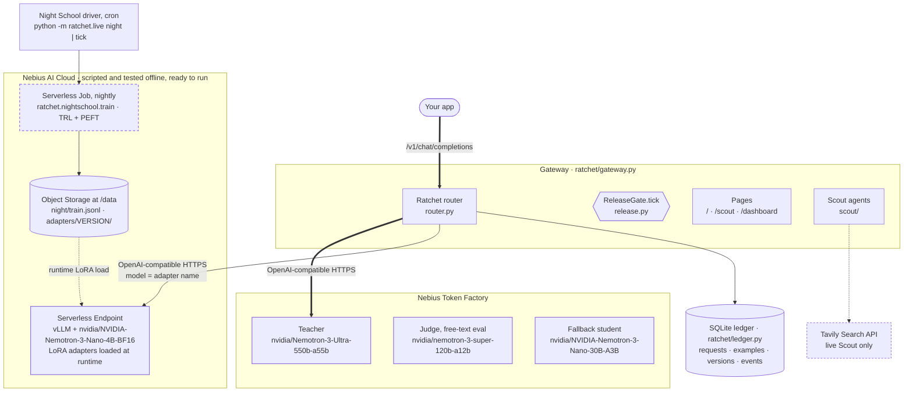
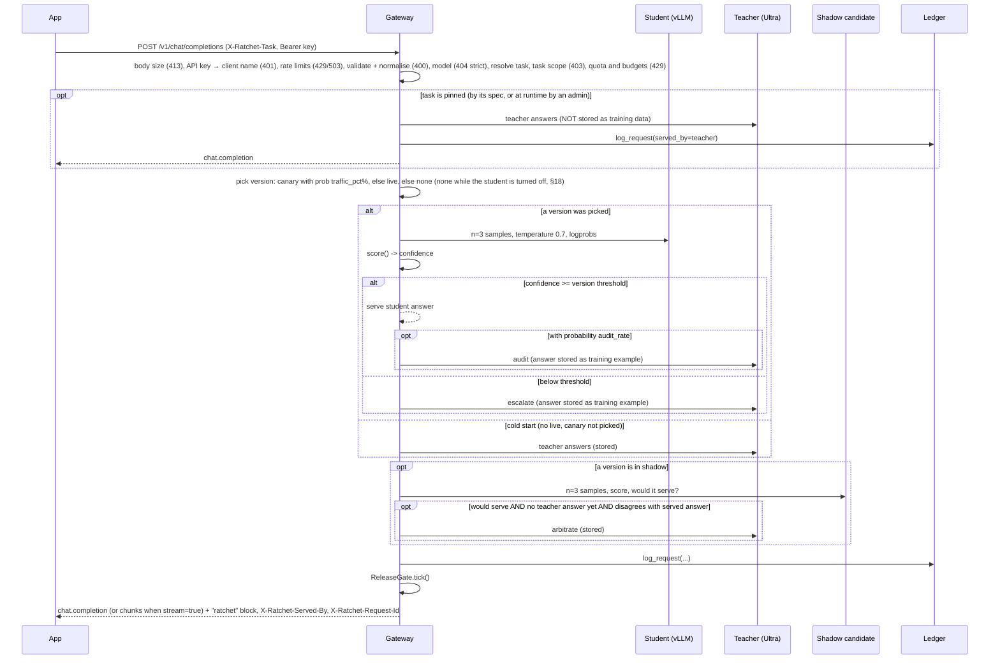
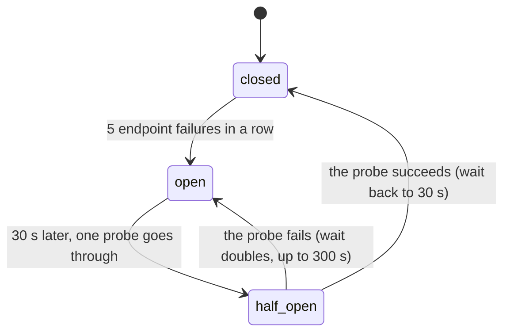
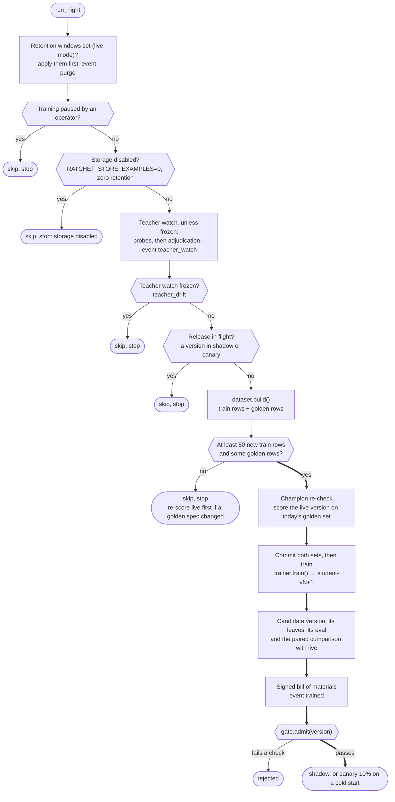
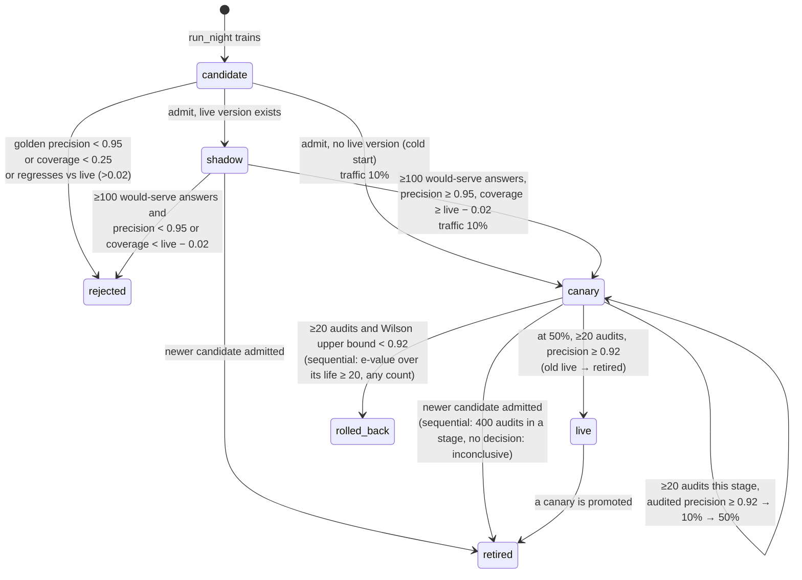
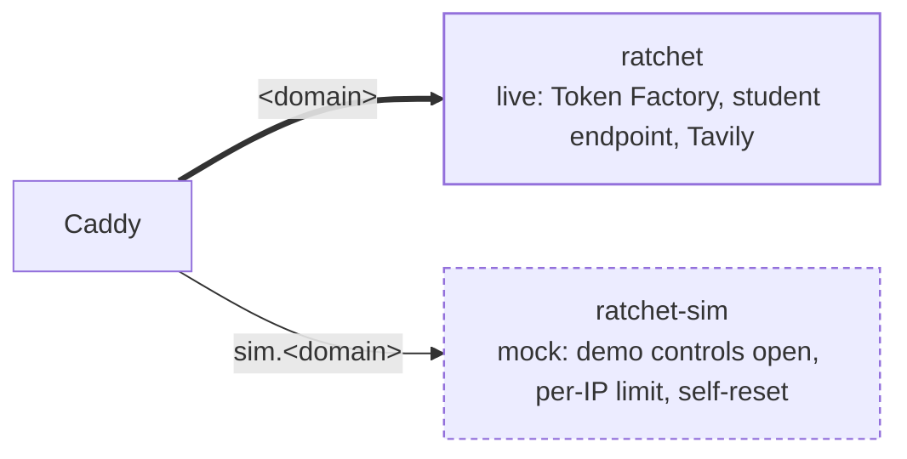

# Architecture

Ratchet is a gateway that sits between your app and a large "teacher" model. A small "student" model, NVIDIA's open Nano base with a LoRA adapter you own, answers each request first. If it is unsure, the request goes to the teacher. Every teacher answer is stored with its license, and every night a new student is trained on those answers and released through a series of safety gates.

This page describes the code in `ratchet/` as of v0.5.0 (which includes the work listed in [AGENTS.md](../AGENTS.md#current-status-oct-25-2026)). Product context is in [PRD.md](PRD.md); the reasoning behind each choice is in the [ADRs](adr/README.md).

Terms (shadow, canary, Wilson interval, e-value) are in [GLOSSARY.md](GLOSSARY.md); FR-, NFR- and INV- ids are requirement and invariant ids ([REQUIREMENTS.md](REQUIREMENTS.md)). A one-page overview is in [README.md](../README.md).

## 1. Components


The picture shows the design. The diagram below names the files and services.



Status: the Nebius Serverless Job and Endpoint scripts in `deploy/` are written and offline-tested, ready to run with `make nebius-plan`. The adapters behind the measured numbers in [evidence/](../evidence/) were trained on a borrowed GPU. The teacher and the judge do run on Nebius Token Factory. Simulation numbers are labelled Simulation.

| Module | Responsibility |
|---|---|
| `ratchet/config.py` | `Settings` (read from environment variables) and the `Price` table |
| `ratchet/providers.py` | `Completion`, the `Provider` protocol, and `OpenAICompatProvider` (httpx client for Token Factory and vLLM; every failure raises `UpstreamError`) |
| `ratchet/resilience.py` | `RetryPolicy` and `retry_call` (full-jitter backoff, `Retry-After`, a deadline, a read timeout, dropped connection or 504 retried once at most in all), `UpstreamError`, per-role `timeouts`, and the student circuit breaker (`Breaker`, `CircuitOpen`, `AdapterMissing`, `endpoint_down`) |
| `ratchet/tasks.py` | `Task` definitions: which answer fields must match for two answers to "agree", which answers are valid (`Task.key`, `match`, `check`), answer cleaning, the built-in tasks (`BUILTIN`) and the registry (`REGISTRY`, `register`, `get`; [ADR 0022](adr/0022-task-registry.md)) |
| `ratchet/taskspec.py` | Task specs as data: parses `RATCHET_TASKS_FILE` (JSON or YAML) and admin API bodies into `Task`s, listing every error with its path; `extends`; `install()` builds the registry at startup from the built-in, file and stored API tasks |
| `ratchet/jsonschema_lite.py` | A JSON Schema validator for OpenAI's strict structured-outputs subset, standard library only: errors name schema paths, never answer values; a step budget bounds a check ([ADR 0042](adr/0042-auto-tasks-from-response-format-schemas.md)) |
| `ratchet/schema_tasks.py` | Structured outputs: the `Contract` a `response_format` sets (`contract_for`), fields derived from a json_schema (`derive`), auto task names and tasks (`auto_name`, `auto_task`), `x-ratchet` stripping (`forwardable`), and the json_object fallback and repair conversations (`downgrade`, `repair_messages`) |
| `ratchet/compare.py` | `FieldSpec`: typed field comparators (`label`, `number`, `date`, `set`, `records`, ...) that normalise a value once and compare two ([ADR 0021](adr/0021-field-comparators-and-task-specs.md)); standard library only |
| `ratchet/sqlcheck.py` | Text-to-SQL tasks (format `sql`): `SqlSpec` (a fixture in `RATCHET_FIXTURES_DIR` and how results compare), `parse_query` (one statement), `Sandbox` (a private in-memory SQLite database per fixture text that runs read-only queries under an authorizer, step, time, memory and size limits) ([ADR 0055](adr/0055-sql-tasks-compared-by-execution.md)); standard library only |
| `ratchet/vocab.py` | The built-in tasks' label vocabularies, shared with the prompts in `sim/tickets.py` and `ratchet/scout/prompts.py` |
| `ratchet/confidence.py` | `score()` (confidence from samples, agreement counted pairwise) and `calibrate_threshold()` |
| `ratchet/calibration.py` | Reads a version's per-task calibration records (`eval['tasks']`): the threshold rule the router applies per task, spec-change checks, records a re-score must keep disabled ([§6](#per-task-calibration), [ADR 0040](adr/0040-per-task-calibration.md)) |
| `ratchet/router.py` | `Ratchet.handle()`: the per-request cascade, audits, shadow, cost accounting |
| `ratchet/release.py` | `ReleaseGate` (golden gate with the opt-in certified floor and paired gate, shadow, canary, rollback, the anytime-valid canary rule and live alert, `evidence()`) and `wilson()` |
| `ratchet/ledger.py` | `Ledger`: SQLite storage, provenance, stats |
| `ratchet/licenses.py` | Teacher license registry; refuses teachers that forbid distillation. `BUILTIN` (code) plus the open teachers of `RATCHET_TEACHER_LICENSES` (`install()` at startup: allowed licenses only, never a closed model family or router alias it recognises), and `BASE_MODELS`, the base models' licenses ([ADR 0090](adr/0090-licenses-travel-with-the-adapter.md)) |
| `ratchet/redact.py` | `redact()`, `redact_messages()`: PII placeholders before examples are stored |
| `ratchet/auth.py` | `KeyRing` (named gateway API keys, admin keys for management writes, read-only dashboard keys) and `bearer()` |
| `ratchet/access.py` | Who may call each route ([ADR 0061](adr/0061-endpoint-access-levels.md)): one table of access levels (`route_access`: public, api, dashboard, bom, metrics, admin, mock; unknown routes count as dashboard) and the scrubbing of anonymous public reads (`pseudonyms`, `scrub_stats`, `scrub_task`, `scrub_detail`); standard library only |
| `ratchet/obs.py` | Request ids, W3C trace context and structured logs without content ([§12](#12-observability), [ADR 0062](adr/0062-request-ids-failures-logs-and-metrics.md)): `RequestContext` in the `request_ctx` context variable, `new_context`, `upstream_headers`, `log`, `upstream_failure`, `mirror_event`, the JSON and text formatters, `configure` |
| `ratchet/metrics.py` | Prometheus metrics, standard library only: `Counter`, `Gauge`, `Histogram`, `Registry.render` (text format 0.0.4) and Ratchet's metrics with bounded labels (`client_label`) |
| `ratchet/openai_compat.py` | `validate_chat_request()` (typed `ChatRequest`), `normalize_messages()`, `APIError` and OpenAI's error envelope; standard library only |
| `ratchet/bom.py` | Per-adapter bill of materials: `manifest()`, `document()`, Ed25519 `Signer`, `verify()`, CLI (`keygen`, `verify`) |
| `ratchet/cost.py` | Utilization-aware cost accounting ([§7](#7-cost-accounting), [ADR 0023](adr/0023-utilization-aware-cost-accounting.md)): `cost_report()` (savings per token and by GPU-hours paid, break-even, the hosted-fallback crossover, a recommendation), interval merging (`segments`), the simulator's compute (`record_simulated_day`), CLI (`report`, `endpoint up\|down`, `close`) |
| `ratchet/kpis.py` | Success metrics ([§7](#success-metrics-kpispy), [ADR 0083](adr/0083-success-metrics-from-the-ledger.md)): PRD §8.1's SM-1 to SM-5 and NFR-1's latency target from ledger rows (`report`, one pure function per metric, `SM_TARGETS`), for `GET /ratchet/kpis`, the `kpis` block of `/ratchet/stats` and the simulator |
| `ratchet/nightschool/dataset.py` | Builds train and golden sets from the ledger |
| `ratchet/nightschool/train.py` | LoRA fine-tune script, run inside the Serverless Job: checks the prompt-completion rows and their rendering, then trains with TRL + PEFT; saves `ratchet_manifest.json`, `versions.json` and `NOTICE.md` next to the weights |
| `ratchet/nightschool/notices.py` | `NOTICE.md` for an adapter folder: the base model's license, each teacher's, teacher outputs only and the Ratchet version (`write_notices`, `render`); the BOM and NOTICE files of a version (`write_adapter_files`) |
| `ratchet/nightschool/evaluate.py` | `cascade_eval()` and `LiveEvaluator`: golden-set precision, coverage and threshold (point rule or Learn-then-Test), and the certificate |
| `ratchet/replay.py` | The ledger time machine ([§7](#calibrated-baseline-and-the-ledger-replay-replaypy), [ADR 0028](adr/0028-designed-propensity-replay.md)): one version's logged traffic replayed at another threshold or audit rate (`load`, `at`, `sweep`, `frontier`), Hajek precision weighted by 1 / `label_p`, the calibrated baseline (`ratio`), the advisory `suggest`, CLI |
| `ratchet/receipts.py` | Verified savings receipts ([§7](#verified-savings-receipts-receiptspy), [ADR 0029](adr/0029-verified-savings-receipts.md)): leaves of request metadata (`leaf`), the per-task ratio estimator (`calibrate`) and the bill on its lower bound (`compute`), sealing once per day and client (`seal_due`, `seal`), the offline verifiers (`verify_receipt`, `verify_chain`, `verify_proof`, `recheck`) and the CLI `python -m ratchet.receipt verify\|seal` (`ratchet/receipt.py` runs it) |
| `ratchet/certificate.py` | Certified precision ([§6](#certified-precision-ratchetcertificatepy), [ADR 0026](adr/0026-certified-thresholds-and-a-paired-release-gate.md)): the Clopper–Pearson certificate, the frontier, per-task bounds, the per-row outcomes, the paired comparison and `recheck()` (what `python -m ratchet.stats check` runs); standard library and `stats` only |
| `ratchet/nightschool/orchestrate.py` | `run_night()`: one night of training and release; `paired_evidence()` (the candidate against the re-scored live version) |
| `ratchet/live.py` | Live Night School on Nebius (`NebiusTrainer`, `load_adapter`, `write_boms` and `publish_bom`, CLI incl. `export`) and the gateway's `AdapterReloader` |
| `ratchet/gateway.py` | FastAPI app: OpenAI-compatible API (with API keys, quotas, request validation, body limit, OpenAI error envelope and streaming), request ids and failures rows (`ObservabilityMiddleware`), request lookups, `/metrics`, stats, BOM and redaction endpoints, pages (`/`, `/scout`, `/dashboard`), mock-only demo controls, Scout endpoints |
| `ratchet/scout/agents.py` | `Scout`: planner → searcher → triage (parallel) → reader (parallel) → writer; `Call`, `http_caller` |
| `ratchet/scout/prompts.py` | System prompts, message builders and example questions, shared with the simulator |
| `ratchet/scout/search.py` | `TavilySearch` (live) and `MockSearch` (simulated results from `sim/research.py`), `SearchUnavailable` |
| `ratchet/scout/guard.py` | `Guard`: daily spend cap, daily run cap, per-IP hourly limit and the judges' reserve for the public demo; live mode keeps its counters in `spend` rows and restores them at startup |
| `ratchet/scout/judge.py` | `JudgeAccess` (the judge code's digest and a derived cookie key) and `AttemptLimiter` |
| `ratchet/scout/credits.py` | `CreditMeter` (monthly Tavily credits paced per UTC day, a judge share) and `MeteredSearch` |
| `ratchet/scout/__main__.py` | CLI: `python -m ratchet.scout "<question>" --base-url <gateway>/v1` |
| `ratchet/web/` | `dist/` (the committed build of the React app in `web/`) and the hand-written fallback pages `landing.html` and `scout.html`, served at `/lite*` and when the build is missing |
| `sim/` | Synthetic tickets, the mock research world (`research.py`), the generic mock world for every other request (`generic.py`: free text, schema instances, tool calls; [ADR 0041](adr/0041-generic-mock-world.md)), workloads (`world.py`), mock teacher/student for the offline simulation and tests |

The table lists the main modules. Every module is listed in the repo map in [AGENTS.md](../AGENTS.md#repo-map).

There are two runtime modes, chosen by `RATCHET_MODE`:

- **mock** (default): in-memory ledger, mock teacher and students from `sim/`, demo controls enabled, simulated search for Scout. No network or keys. `RATCHET_MOCK_WARMUP_DAYS` runs simulated days at startup. The mock models answer the demo's tickets and Scout's calls from their registries and every other request from the generic mock world (free text, an instance of its `response_format` schema, a tool call; [ADR 0041](adr/0041-generic-mock-world.md)), deterministically from its text; `RATCHET_MOCK_STRICT=1` makes anything else a 400.
- **live**: SQLite file at `RATCHET_DB`, real teacher on Token Factory, student on your vLLM endpoint (or the hosted fallback model when `RATCHET_STUDENT_BASE` is empty), Tavily for Scout when `TAVILY_API_KEY` is set.

## 2. Request path

`Ratchet.handle(messages, task, client, params, meta)` in `router.py`. Before it runs, the gateway checks the body size, the route's access level (`_access`, one dictionary lookup for `/v1/*`, whose level checks its own key; [ADR 0061](adr/0061-endpoint-access-levels.md)), the API key (when `RATCHET_API_KEYS` is set), checks the gateway's rate limits (the in-flight cap, the key's requests in flight and a minute; [§17](#17-spend-and-rate-limits)), validates and normalises the request (`openai_compat.py`), checks the task (the key's scope included), the key's daily quota and the US dollar budgets, in that order; it passes the key's name as `client` and the request's generation parameters as `params` (`providers.GenParams`). A request refused by any of these is not logged as a request and costs nothing (a 401, 413, 429 or 503 leaves a `failures` row, a 400 only a metric; [§12](#12-observability)):



With `RATCHET_SIDECAR_WORKERS` above 0 (live mode's default), the audit and the shadow above run after the response instead, on the sidecar: the audit is still drawn where the diagram draws it, the row is logged with the checks pending, and the sidecar finishes it ([§15](#15-off-path-quality-checks)).

Details that matter:

- **Validation and normalisation** (`openai_compat.py`, [ADR 0012](adr/0012-openai-request-validation-and-error-envelope.md)): a malformed request gets a 400 in OpenAI's error envelope before any model call. `developer` becomes `system` and text content parts become one string, so the cascade, the mock models and the ledger see the same plain messages as before; plain messages pass through as the same objects, so example hashes do not change. A request with a non-text part listed in `RATCHET_TEACHER_MODALITIES` is ineligible for the student (risk-aware routing below, [CONFIGURATION.md](CONFIGURATION.md#risk-aware-routing); route `ineligible:content_type`): teacher only, never stored. The legacy `functions` and `function_call` become `tools` and `tool_choice` (`openai_compat.tool_params`), and a tool request's legacy turns become tool turns (`legacy_history`). Validation, the quota check and the cascade run in a worker thread.
0. **Task resolution** (`openai_compat.resolve_task`, in the gateway after validation, [ADR 0048](adr/0048-model-field-routing.md)): the header, then `metadata.ratchet_task`, then a `model` of `ratchet/<task>` (or, on the Azure-style route `/openai/deployments/{deployment}/chat/completions`, the deployment), then a model alias, then the first registered task whose `match` rules all hold, then a `response_format` json_schema's auto task (ADR 0042; `gateway._schema_auto` and `Ratchet.resolve`), then (opt-in, `RATCHET_AUTO_TASK=system_prompt`) an auto task per first system message, then `default`. Pure: one regex match in full, dict lookups and plain string comparisons. Before it, `check_model` refuses a `model` Ratchet does not know with a 404 under `RATCHET_MODEL_POLICY=strict` (under `lenient` it is served as `ratchet`). The request's `model` is read nowhere else: the teacher always gets `Settings.teacher_model` and the student its adapter name. A new auto task is registered and stored (`Runtime.keep_auto_task`, under the registry lock) only once the request has passed its quota. **Task admission** (`Ratchet.task_for`, in the gateway before the quota): an unregistered name under `RATCHET_UNKNOWN_TASKS=reject` is a 400 `unknown_task`, and a task whose `clients` do not name the request's API key is a 403 `task_not_allowed`; neither is logged. Under `teacher`, an unregistered task takes the teacher-only path below with route `unknown_task`. **Pinned tasks** (`Task.pinned`, `_teacher_only`): checked first in `handle`. The teacher answers, the request is logged with `served_by=teacher`, no student version, and `cost_usd = baseline_cost_usd`. The answer is **not** passed to `add_example`, so it never becomes training data. No student, audit or shadow call is made. Scout's planner and writer (`research-plan`, `research-write`) are pinned; see [§10](#10-scout-multi-agent-demo). **Tool requests** (`router.uses_tools`: `params.tools`, or tool calls or results in the messages; FR-1.41, [ADR 0043](adr/0043-tool-calls-teacher-only-by-default.md)) take the same path next, with route `tools`: the teacher gets the tools (`_ask_teacher(..., tool_calls=True)` lets its answer be tool calls, which `Choice.tool_calls` returns as the provider read them), nothing is stored, and no student, audit or shadow call is made. Everywhere else a teacher tool call is a 502 `tool_calls_unsupported`.
1. **Version choice** (`_pick_version`): if a version is in `canary`, it is chosen with probability `traffic_pct / 100`; otherwise the `live` version is used. With no live version (cold start) and the canary not picked, the request goes straight to the teacher.
2. **Student sampling** (`_sample`): one call with `n` = the task's `policy.samples`, else `Settings.samples` (default 3; `Task.sample_count`, FR-2.55, so a task is served with the sample count it was calibrated on; the shadow draws the same) and `confidence.STUDENT_SAMPLING` (`temperature=0.7`, `logprobs=True`), the constant the golden eval also uses, plus the request's generation parameters as the student's role allows (below). The model name sent is whatever the resolver returns. In live mode that is `version.adapter_uri`, which is the LoRA adapter name. A request for `n` > `Settings.samples` choices draws `n` samples in the same call, but the confidence is scored on the first `Settings.samples` of them, the statistic the threshold was calibrated on ([n choices](#n-choices-and-token-logprobs)). When the version's current per-task record for the task serves nothing (the release gate disabled it, or the eval had no held-out row of it; `calibration.held_back`), the student is not called: the request escalates with route `task_disabled`, costs no student samples and has no student answer for degraded mode to serve. The shadow still runs.
3. **Threshold**: `Ratchet.threshold(version, model, task)` (`calibration.threshold`) returns the task's own threshold when the version's eval has a per-task record for it under the task's current spec (`eval["tasks"][task]["threshold"]`, [per-task calibration](#per-task-calibration)); 1.01 when that record, or the older `eval["spec_hashes"]`, names another `spec_hash` than the task's current one (`Ratchet.spec_changed`): the student serves nothing for that task until a night scores the version under the new spec; otherwise the version's global `version.eval["threshold"]` (calibrated at training time), falling back to `Settings.confidence_threshold` (default 0.80). A record the release gate disabled, or one without held-out rows, holds 1.01 too. The hosted untuned fallback student always gets `Settings.confidence_threshold`. A sample set with no valid answer (`Scored.valid` false: every sample unparseable, empty or cut off) is never served, whatever the threshold. For `n` > 1 choices, at least `n` samples must also share the majority answer (`confidence.majority`); a confident student that cannot fill them escalates with route `n_choices`.
4. **Audits** (`_audit`): when the student serves, the teacher is also called with probability `audit_rate` (default 0.05; mock mode raises it to at least 0.10). The audit result (`audit_agree`) is the live quality signal for canary and live versions, and the teacher's answer also becomes training data. A teacher answer that cannot be stored ([below](#storage-rules)) is not an audit: `audited=0`. With `RATCHET_DRIFT_AUDIT_BOOST` above 1, a version with an open drift alarm is audited at its rate times the boost, up to 0.5 (`Ratchet.audit_boost`, which the release gate fills; [§6](#drift-monitor-ratchetdriftpy)); still one draw per served answer, and the boosted rate is its `label_p`. The draw is always made here; with sidecar workers the call itself runs after the response ([§15](#15-off-path-quality-checks)).
5. **Teacher calls** (`_call_teacher` → `_ask_teacher`, then `_store_example`): the teacher answer is cleaned (`tasks.clean_answer`), checked against the [storage rules](#storage-rules), the messages, the stored conditions and the answer are redacted with one placeholder mapping ([PII redaction](#pii-redaction)), and they are stored with `Ledger.add_example(task, messages, completion, teacher_model, license_name, license_url, redactions, params)`. The license comes from `Ratchet.licenses`, built when `Ratchet` is constructed with `licenses.require_distillable` for the teacher and the fallback teacher (if set), and looked up by the configured model that wrote the answer. A closed teacher raises `LicenseError` at startup.
6. **Shadow** (`_shadow`): see [state machine](#5-version-state-machine). The shadow candidate never serves. With sidecar workers it runs after the response, after the request's audit ([§15](#15-off-path-quality-checks)).
7. **Logging**: one row in `requests` per call (columns below), with the API client's name when keys are on, and what the ledger replay reads ([ADR 0028](adr/0028-designed-propensity-replay.md)): the threshold the student's answer was held to, `label_p` (the audit rate it was drawn at when served, 1.0 when it escalated), `student_agree` (from the escalation's or a random audit's primary-teacher answer, never from an arbitration, and from an escalation only when the teacher answered it under an audit's conditions: one choice at temperature 0, without the client's sampling parameters) and `baseline_est_usd` (the formula's all-teacher cost). Logging only: no extra model call and no random draw.
8. **Gate tick**: the gateway calls `rt.tick()` after every chat-path request (`/v1/chat/completions`, each prompt of `/v1/completions`, `/v1/responses`) and after every Scout run. It runs `gate.tick()` under a lock at most once per `RATCHET_TICK_INTERVAL_S` (live mode 5 s; mock mode every call) and skips, without waiting, while another thread is ticking ([§11](#11-hot-path-and-performance)). In live mode, `python -m ratchet.live tick` can also be run from cron.

**Risk-aware routing** (FR-2.50, [ADR 0049](adr/0049-risk-aware-routing.md), `ratchet/routing.py`). A task's `routing` block is parsed once, when the task is defined (`Task.routing_rules`), so `handle` runs it in this order: pinned or teacher-only (step 0) → **eligibility** (`Routing.ineligible`: more input than `student_max_input_tokens`, or a content part the student does not read, such as an image admitted by `RATCHET_TEACHER_MODALITIES`; the teacher answers through `Ratchet._ineligible`, route `ineligible:<reason>`, before a version is picked, so no canary draw, no student call, no audit or shadow; stored only for an over-length request with `store_ineligible`, through `_store_example` and its rules) → version choice (step 1) → sampling (step 2) → the task's threshold (step 3) → **`escalate_when`** (`Routing.escalation` on the key `confidence.score` already computed for the served sample: the first rule that holds sends a confident answer to the teacher, route `rule:<i>`, stored as any escalation, never answered in degraded mode) → serve, with the task's `policy.audit_rate` in place of `audit_rate` (step 4), or escalate. The shadow applies the same rules to its own answer. A task with **critical classes** is answered by the student only on a version whose per-task record measured them (`calibration.critical_measured`; else route `task_disabled`, and never by the hosted untuned model, which `_held_back` keeps from being sampled for it); the golden eval writes those measurements (`Routing.misses`, `eval['tasks'][task]['critical']`) and the release gate enforces them at admit (`ReleaseGate.critical_failure`, in `task_failures`) and at a night's re-score (`ReleaseGate.critical_holds`, applied by `orchestrate.rescore` in the same write). The gateway sends a request with a part only the teacher reads through `handle` too, so its route says why the student did not answer.

**Generation parameters** ([ADR 0017](adr/0017-generation-parameters-by-role.md)). `Settings.gen_policy()` (`providers.GenPolicy`) turns the client's parameters into a `GenPlan` once per request (a request without any, from Scout or the simulator, reuses one built at startup): the student's (`RATCHET_STUDENT_PARAMS`: `max_tokens`, `stop`, `seed`, `response_format`, `top_logprobs`; never its temperature, `logit_bias`, logprobs or `n`), the serving teacher's (`RATCHET_TEACHER_PARAMS`: every standard field, the tool-call fields included since FR-1.41, at the client's temperature or 0, or 0.7 for `n` > 1 choices; `logprobs` and `top_logprobs` only when the client sends them) and the audit's and arbitration's (the same at temperature 0, without `top_p`, `seed`, the penalties, `logit_bias` and logprobs). Every call has an output cap: `RATCHET_STUDENT_MAX_TOKENS` (1,024) and `RATCHET_TEACHER_MAX_TOKENS` (8,192), and the teacher gets `RATCHET_TEACHER_REASONING_HEADROOM` (0) tokens above the client's `max_tokens` for reasoning; when it does, a visible answer longer than the client's limit is marked `length` (served whole, not stored). The model is never the client's: always `Settings.teacher_model` or the version's adapter. The golden eval builds its student calls with the same policy from the conditions stored with each example (FR-5.1). `Result.finish_reason` is the served answer's, and the gateway returns it (`tool_calls` only for a choice with tool calls, `function_call` for a legacy request; a teacher tool call to a request without tools is a 502 `tool_calls_unsupported`).

**Upstream calls** ([ADR 0014](adr/0014-upstream-failure-semantics.md)). Each role has its own client settings. The teacher and judge: a 120 s read timeout (`RATCHET_TEACHER_TIMEOUT_S`), 5 s to connect, and up to two retries (`RATCHET_TEACHER_RETRIES`) within 180 s (`RATCHET_TEACHER_DEADLINE_S`). The student on the request path: 15 s to answer and 2 s to connect (`RATCHET_STUDENT_TIMEOUT_S`, `RATCHET_STUDENT_CONNECT_TIMEOUT_S`) and no retries, because the teacher is its retry; the hosted fallback model plays the student with the same settings. `resilience.retry_call` retries connection failures and 408, 409, 429 and 5xx, waiting full jitter (`uniform(0, min(8, 0.5 × 2^i))` seconds) or the server's `Retry-After` (a wait over 8 s, or one that would end past the deadline, returns the error at once); a read timeout is retried once, because those tokens may be billed; any other 4xx and an unreadable 2xx body never. The deadline also caps each attempt's timeouts. Whatever fails ends as an `UpstreamError` with a status, the endpoint's OpenAI `type`, `code` and `param`, and a clipped message, never the URL.

**Failure handling** (INV-7, INV-15, [ADR 0013](adr/0013-optional-teacher-calls-fail-open.md), [ADR 0014](adr/0014-upstream-failure-semantics.md), [ADR 0019](adr/0019-teacher-breaker-degraded-mode-and-fallback-teacher.md)). A request fails only when the call whose answer it needs fails: the teacher on the escalation, cold-start, pinned or teacher-only path, when no opt-in stand-in answers instead ([below](#when-the-teacher-is-down)). That raises out of `handle`, and the gateway's `_map_upstream` answers by cause: 400 with the teacher's message and code when the request cannot succeed (an upstream 400, 413 or 422, such as `context_length_exceeded`), 429 with the teacher's `Retry-After` for a rate limit, 504 `teacher_timeout`, 502 `upstream_auth_error` or `upstream_not_found` for the gateway's own key or model setting, 503 `teacher_circuit_open` with the breaker's wait while the teacher's breaker is open, and 502 `teacher_unavailable` otherwise; `X-Should-Retry: false` where a retry cannot help. Nothing is logged for the request. Every other upstream call fails open:

| Call | When it raises | Recorded |
|---|---|---|
| Student samples | Escalate to the teacher; a 404 for the adapter also queues its reload | `escalated=1`, route `student_error`; `student_errors`; `student_error` event; the student breaker counts it when the endpoint looks down ([below](#student-circuit-breaker)) |
| Teacher audit | Serve the student's answer; no arbitration call for this request either, since the teacher just failed | `audited=0`, `audit_agree` NULL, no cost for the call; `audit_errors`; `audit_error` event (none of these while the teacher's breaker is open: the call is skipped, not made) |
| Shadow samples | Serve as if no shadow ran | No shadow fields; `shadow_errors`; `shadow_error` event (`sampling`); counted by the shadow's own breaker |
| Shadow arbitration | Serve the live answer | `shadow_serve=1`, `shadow_agree` NULL; `shadow_errors`; `shadow_error` event (`arbitration`); skipped without a count while the teacher's breaker is open |

The counters are per process and thread-safe; `Ratchet.health()` returns them. Each event is written on the 1st, 10th, 100th and 1000th failure of its kind, so an outage cannot flood the release log, and an optional-call event names the exception class and HTTP status, never the message (an httpx message holds the endpoint URL). In the release gate, a failed audit is simply not an audit: audits are sampled at random, so dropping one shrinks the sample without biasing it. A failed arbitration is different, because arbitration only runs when the shadow disagrees with the served answer: `Ledger.shadow_quality` counts such a row in `n`, coverage and the would-serve evidence, and as a disagreement in precision (`unarbitrated` in its result), so a failing teacher can get a candidate rejected but never promoted. A row whose shadow verdict is unknown (`shadow_serve` NULL) counts toward nothing.

### Other OpenAI endpoints

[ADR 0050](adr/0050-adjacent-openai-endpoints.md), FR-1.51. `gateway._serve` is the chat path after validation: normalisation, the model check, task resolution and admission, the quota, `Ratchet.handle`, `rt.tick()` and the `ratchet` block. Three routes call it:

- `/v1/chat/completions` (and the Azure-style route): `validate_chat_request`, then `_serve`, then `_chat_response` builds the `chat.completion` or its chunks.
- `/v1/completions`: `validate_completion_request` turns each prompt into a `ChatRequest` with one user message (`CompletionRequest.requests()`); `_legacy_complete` runs `_serve` once per prompt, in order, the first call checking the quota for the whole batch (`_quota(client, need)`), starting a prompt only while the batch has run for less than `RATCHET_TEACHER_DEADLINE_S` (on `Runtime.clock`); an error after the first prompt becomes `_batch_stopped` (the cause's status and code, a message naming the prompts already answered, `X-Should-Retry: false` in place of `Retry-After`), so an SDK does not resend prompts that were billed and stored; then `_completion_response` builds the `text_completion` (choice `p * n + j`) or its chunks with `_stream_pieces`, as the chat stream does.
- `/v1/responses`: `validate_responses_request` turns `instructions`, `input` items, `text.format`, function tools and the sampling fields into one `ChatRequest` (errors renamed to the Responses field by `as_responses_error`); `_respond` runs `_serve` and builds the `response` object (`response_output`, `response_object`). Nothing is kept: no response id can be looked up again.

So a completion or a response is answered, audited, logged and stored exactly as the chat request it becomes, and whatever changes the chat path changes them too. `/v1/embeddings` does not run the cascade: `_embed` validates, checks the model against `RATCHET_MODEL_POLICY` (`check_embeddings_model`; the configured model always answers), checks the quota, calls `Runtime.embedder` (`OpenAICompatProvider.embed` with the teacher's timeouts and retries, or `sim.mock_models.MockEmbedder`), and logs one row (task `embeddings`, reserved in `tasks.RESERVED_NAMES`; served_by `upstream`; route `passthrough`; cost = baseline in the teacher column; `stored` 0). `/v1/moderations` and `/v1/responses/{id}` answer 404 `unsupported_endpoint`; any other `/v1/*` path stays `unknown_url`.

### n choices and token logprobs

[ADR 0020](adr/0020-n-choices-and-token-logprobs.md), FR-1.14. `handle(..., n=k)` (the gateway passes the request's `n`, at most `RATCHET_MAX_N`) puts `k` in the `GenPlan` (`plan.n`). The student's call asks for `max(Settings.samples, k)` samples; `score` runs on the first `Settings.samples`, and `confidence.majority` picks the choices: the scored best sample, then the other samples with the same canonical answer by token probability, or None when fewer than `k` agree. When the teacher answers, `_ask_teacher` asks it for `k` choices (`CHOICES_TEMPERATURE`, 0.7, when the client set no temperature) and `_call_teacher` stores only choice 0 (`TeacherAnswer.choices` holds them all), so a request still adds or bumps at most one example. Audits and arbitrations are one answer at temperature 0 and judge choice 0, the shadow samples `Settings.samples` as calibrated, and a degraded answer needs `k` agreeing samples. `Result.choices` holds the `router.Choice` objects (`text`, `finish_reason`, `logprobs`); `usage` adds up the choices, `usage_breakdown.served` lists them, cost prices whole calls and the baseline is one teacher answer per choice. With `params.logprobs`, `providers.served_logprobs` turns each served completion's `logprobs_content` (the server's list, kept as it came) into OpenAI's entries: it keeps only the tokens that spell the served text, dropping the ones `clean_answer` removed (reasoning, a fence, edge whitespace; a token is cut only by whitespace), and gives None when they cannot be told apart. The gateway writes `logprobs: {content, refusal: null}` for a client that asked, and streams each choice in turn with a few tokens and their logprobs per content chunk.

### Structured outputs

[ADR 0042](adr/0042-auto-tasks-from-response-format-schemas.md), FR-1.40, FR-14.2. `Ratchet.resolve(task, params)` (the gateway calls it through `task_for`, before the quota) turns a request's `response_format` into a `schema_tasks.Contract` and binds it to the request's task (`Task.bound`: a copy with the same rules and `spec_hash`, so thresholds, per-task records and the registry see the same task). A registered name wins; otherwise a json_schema request gets its auto task, derived from the schema (`schema_tasks.derive`), registered and stored under the gateway's `tasks_lock` the first time (`_auto_task`; capped by `RATCHET_MAX_AUTO_TASKS`) and a dictionary lookup afterwards. `schema_tasks.forwardable` strips `x-ratchet` annotations before any model call and before the conditions are stored.

Under a bound task an answer is invalid when it breaks the contract (`Task.check`: `invalid answer`, `schema mismatch at <path>`), so the existing rules apply unchanged: a student sample gets no vote, a teacher answer is not stored, not an audit and not a reference (INV-16). `tasks.clean_answer` serves the JSON the answer holds (`tasks.json_span`, a substring, never re-serialised). `Contract.problem` remembers each answer's result by its SHA-256, so the votes, the agreement checks and the served choice check one answer once; `jsonschema_lite.MAX_STEPS` bounds a check.

`_call_teacher` and `_teacher_only` run `_repair` on a complete teacher answer that breaks the contract (`RATCHET_SCHEMA_REPAIR`): one more call to the same teacher (or fallback teacher) with the same parameters, its own answer as an assistant turn and a user turn naming the errors. The repair's answer replaces the first unless it was cut off or is empty. `TeacherAnswer.rejected` carries the unused answer, which is priced into `cost_usd` and `teacher_cost_usd` and listed in `usage_breakdown.repair`; `TeacherAnswer.first` is the first call's answer, whose prompt counts the baseline and the client's `usage.prompt_tokens` read (`router._asked`), so the repair conversation never inflates the savings; `latency_ms` adds both calls. A repair call that raises is optional (`repair_errors`, a throttled `schema_repair_error` event); an open breaker skips it. `_teacher_complete` handles a teacher that refuses json_schema: a 400 naming `response_format` or `json_schema` is retried at once, within the same breaker slot, as json_object with the schema appended to the leading system message (`schema_tasks.downgrade`); the refused schema's digest is remembered per endpoint, and after `JSON_SCHEMA_STRIKES` (3) different schemas the endpoint is probed once with `schema_tasks.PROBE_FORMAT` (`_probe_json_schema`); only a refused probe sets the provider's `supports_json_schema` False. `resolve` uses a registered auto task only for a schema that derives its `spec_hash` (`_derives`), so one client's schema never sets the fields of another's (`auto_task_collision`). Night School binds a stored row the same way from `examples.params` (`tasks.for_row`, in `dataset.rows` and `cascade_eval`), so the eval grades as production does (INV-6). `Result.task` and `Result.schema_valid` reach the response's `ratchet` block.

### Student circuit breaker

A student endpoint that hangs would hold every request for its timeouts (2 s to connect, 15 s to answer) before the teacher answers. `resilience.Breaker` ([ADR 0015](adr/0015-student-circuit-breaker-and-adapter-reload.md)) stops that after a few failures:



- **What counts.** `resilience.endpoint_down` reads each failure: a timeout, a connection or protocol error, an unreadable answer, a 5xx, 408 or 429 means the endpoint looks down and counts. Any other 4xx (a prompt too long for the student, a lost adapter) is the endpoint answering about this request, so it counts as a success for the endpoint's health. An error that is not an HTTP failure (a bug in a provider, the mock world not knowing a request) counts neither way. `RATCHET_STUDENT_BREAKER_FAILURES` (5) failures in a row open the breaker; `0` turns it off.
- **Open.** `_sample` checks `allow()` before calling and raises `CircuitOpen` when the breaker is open. `handle` escalates to the teacher with `escalated=1`, `confidence` NULL and route `student_breaker`; nothing is billed for the student, and it is not another `student_error`. After `RATCHET_STUDENT_BREAKER_COOLDOWN_S` (30 s) exactly one request probes the endpoint; concurrent requests still see the breaker open. A failed probe doubles the wait, up to 300 s; a successful one closes the breaker and resets the wait. A probe that never reports back is presumed lost after the longer of the wait and the student call's own longest time (its pool, connect, write and read timeouts plus 5 s, 37 s by default), so a probe on a hanging endpoint is never replaced while it can still be running; a lost probe that reports while the breaker is still half-open decides as the probe would. Only a probe's own thread decides, so a late result from a call that began before the breaker opened is ignored.
- **One breaker per failure domain.** Breakers are made on first use, keyed by role and endpoint: the provider's `base_url`, or its class when it has none (a resolver may build a new provider object per call, as the mock fleet does). Live and canary on one endpoint share the `student` breaker. Shadow calls use their own `shadow` breaker, so a bad staging adapter cannot open the breaker live traffic depends on; while it is open the shadow collects no evidence, as when its samples fail. Another endpoint in the same role gets `student-2`, and so on.
- **Lost adapters.** vLLM forgets adapters loaded at runtime when the endpoint restarts, and answers 404 ``The model `student-v3` does not exist.`` A 404 that names the version's adapter becomes `AdapterMissing`: the request escalates (route `student_error`), the breaker records the endpoint as healthy, and `Ratchet.on_adapter_missing(version)` is called. In live mode with an endpoint that is `live.AdapterReloader.request`, which loads the adapter again on one daemon thread (`live.load_adapter`, path `RATCHET_ADAPTER_ROOT/<name>`), at most once per adapter per 60 s, and writes `adapter_reloaded` or `adapter_reload_failed`. `python -m ratchet.live reload` stays as the manual fallback.
- **Events and health.** Transitions write `circuit` events (`student: closed->open after 5 failures (ReadTimeout)`, `student: open->half_open after 30 s; one probe`, `student: half_open->open for 60 s after a failed probe (...)`, `student: half_open->closed after a successful probe`), naming the failure's class and status, never its message. Once the wait is at 300 s, the repeated `open->half_open` / `half_open->open` pair is written only for the 1st, 10th, 100th and 1000th probe at that wait, so a long outage cannot push the release history out of the dashboard's last 40 events. `Ratchet.health()["breakers"]` has each breaker's `snapshot()`. `/readyz` reports each breaker's state too, but it is a public readiness probe and not part of `/ratchet/stats`, so the dashboard's Resilience panel reads each breaker's state from its latest `circuit` event (one probe behind at most, at the longest wait) and parses the wording above; `test_resilience_panel_contract` checks the panel's grammar against these events ([ADR 0100](adr/0100-dashboard-task-writes-and-derived-breaker-state.md)).
- **Cost on the hot path.** While a breaker is closed, `allow()` and a successful `record()` read attributes without taking a lock; the lookup is one dictionary read. Locks are taken only while failures are being counted or the breaker is open.

The mock-only `POST /ratchet/demo/student-outage` takes the mock production endpoint down for 5 to 300 s, to show the breaker open and close again ([API.md](API.md#post-ratchetdemostudent-outageseconds60)).

### When the teacher is down

[ADR 0019](adr/0019-teacher-breaker-degraded-mode-and-fallback-teacher.md). Three layers, only the first on by default:

1. **The teacher's breaker.** `Ratchet._teacher_complete` sends every teacher call through a `resilience.Breaker` named `teacher` (the fallback teacher has its own, `fallback_teacher`), made in `Ratchet.__init__` with `Settings.teacher_breaker()` (`RATCHET_TEACHER_BREAKER_FAILURES` 5, `RATCHET_TEACHER_BREAKER_COOLDOWN_S` 30 s) and the student breaker's rules: a failed call counts once, after the provider's retries, when `endpoint_down` says the teacher looks down (a timeout, no connection, an unreadable or 5xx answer, 408, 429); a 400 about the request, a 401 or a tool-call answer is the teacher answering. While open, the call raises `CircuitOpen` (503 `teacher_circuit_open`, `retry_after` from `Breaker.retry_in()`) without calling: a request that needs the teacher gets a 503 with `Retry-After` at once instead of holding a worker thread for the 180 s deadline, and an audit or arbitration is skipped as a failure would be, without counting as one. One request per wait probes the teacher; transitions are `circuit` events (`teacher: closed->open after 5 failures (UpstreamError 503)`).
2. **A fallback teacher** (`RATCHET_TEACHER_FALLBACK_MODEL`, opt-in). `_serve_teacher` asks it only for an answer that will be served (escalation, cold start, pinned, teacher-only) and only when the primary is unavailable (`resilience.teacher_unavailable`: any HTTP failure or the open breaker, but not a 400, 413 or 422 about the request or a tool-call answer). Licensed at startup (invariant 1); served with route `fallback_teacher`, its own model id and fingerprint, priced at its own price; a throttled `fallback_teacher` event names the primary's failure. Its answers are stored only with `RATCHET_STORE_FALLBACK_TEACHER=1`, then with its own license. When it fails too, the primary's error is raised. Audits and arbitrations never use it: they are the release gate's evidence and the training labels, so they are the primary's or nothing.
3. **Degraded mode** (`RATCHET_ON_TEACHER_FAILURE=serve_student`, opt-in). When an escalation still has no teacher answer and the teacher is unavailable, `handle` serves the student's own answer if it had at least one valid sample (`_may_degrade`): route `degraded`, `served_by` `student`, `escalated` 1, `audited` 0, nothing stored, `Result.degraded` `teacher_unavailable` (the response's `ratchet.degraded` and `X-Ratchet-Degraded`), and a throttled `degraded` event. Never for a request with `tools`, a cold start, a request whose student call failed or was skipped, an answer an `escalate_when` rule holds for (FR-2.50), or the pinned, teacher-only and ineligible paths, which have no student answer.

A request a stand-in answered (route `degraded` or `fallback_teacher`, `router.STAND_IN_ROUTES`) runs no shadow: its only reference would be a below-threshold student answer or another model's. With `audited` 0 too, these requests never move a release. `stats_by_day` counts them per day (`degraded`, `fallback_teacher`), and `Ratchet.health()` has `degraded_answers`, `fallback_answers` and the teacher breakers' snapshots.

### Storage rules

Every training example is a teacher answer (INV-2) that is complete and valid (INV-16, [ADR 0016](adr/0016-store-only-complete-valid-teacher-answers.md)). `Ratchet._store_example` is the only caller of `Ledger.add_example`; it runs on every teacher call (escalation, cold start, audit, shadow arbitration), never on the pinned and teacher-only path (INV-10).

1. **Clean** (`tasks.clean_answer`, FR-2.7). `strip_reasoning` removes complete `<think>…</think>` blocks in any case, then everything up to the last remaining `</think>` (a chat template that opens the reasoning in the prompt, so the output has only the closing tag), then an opening `<think>` still left at the start of what remains together with everything after it (an answer cut off while reasoning); an opening tag after answer text is content (a reply that mentions the tag), since a model reasons before it answers. For a JSON task (`Task.structured`: format `json`, the default for a task with fields), an answer that is one JSON object (bare or in one fence, as it is or after what follows its first `</think>`) is kept whole, so a tag quoted in its strings survives; otherwise one code fence that is the whole answer is unwrapped when its body parses as JSON; a free-text answer keeps its fences, since a code block is content there. The provider never reads `reasoning_content` or `reasoning` (vLLM's and Token Factory's reasoning parsers), so reasoning cannot arrive another way.
2. **Check** (`GenParams.unstorable`, `router.answer_problem`). The answer is skipped when it was written under a client's `logit_bias`, a non-zero penalty, a temperature above 1 or a vendor field (`client logit_bias`, ...: the client may choose its answer, not the label; threat model T2), when its `finish_reason` is not `stop` or `tool_calls` (`finish_reason length`: cut off by the token limit), when nothing is left after cleaning (`empty answer`), when a JSON task's answer does not parse (`invalid answer`), or when a field of the task's spec is missing, null where it may not be, or does not normalise, such as a label outside its vocabulary (`invalid field category`; `Task.check`, FR-2.14). String operations only, so the check costs microseconds.
3. **Redact**, then check once more (`Task.check`): a placeholder can break a structured answer (a card-like number outside quotes becomes `[CARD]`, an identifier inside a checked field becomes a label outside its vocabulary), and such an answer is skipped (`invalid after redaction`).
4. **Store** with its license and its conditions (`examples.params`: the `response_format`, `tools`, `tool_choice` and `stop` the teacher answered under, `ledger.STORED_PARAM_KEYS`; for an audit the audit's), or bump `seen` for a duplicate. The golden or train split comes from the task and messages alone, so every variant of a prompt shares it (`Ledger._split`). Under a storage opt-out nothing is stored, and that is not a skip (below). `requests.stored` is 1 for a request whose teacher answer was stored or bumped, 0 otherwise (including pinned requests), NULL for rows from before v0.5.

**Storage opt-outs** (FR-13.1, [ADR 0080](adr/0080-storage-opt-outs-and-pseudonymous-end-users.md)). `Ratchet.store_opt_out(task, meta)` says why a request's teacher answers may not be stored, broadest first (`privacy.OPT_OUTS`): `global` (`RATCHET_STORE_EXAMPLES=0`), `task` (the spec's `store: false`, or `RATCHET_NO_STORE_TASKS`), the caller's verdict (`meta.storable` False with `meta.store_opt_out`: `key` for an API key with `store=0` in `RATCHET_KEY_LIMITS`, `request` for `store: false`, `X-Ratchet-Store: none` or `metadata.ratchet_store` `"false"`; the gateway decides these in `_request_meta`), or `end_user` (any hash the request's end user may be registered under is in `no_train`: its attributed hash, its `user` beside its `safety_identifier`, and the every-client scope; one query). `handle` settles it once at the start on its own copy of the meta (`_opted_out`), logs it in `requests.store_opt_out` and returns it in `Result.store_opt_out`; `_store_example` asks again before writing, so an end user registered while the request waited for the teacher is still kept out and reported as `end_user`, and an opted-out request never reaches the lookup twice. Everything else runs as it would: the student may serve, audits record `audit_agree`, shadows are arbitrated (release safety does not depend on storage), costs are counted. Nothing in a request can turn an opt-out back into storage (`store: true` is the default spelled out), and an opted-out duplicate neither bumps `seen` nor adds its client.

**End users** (FR-13.2). The gateway hashes the request's `safety_identifier`, else its `user`, with `privacy.EndUsers.hash`: HMAC-SHA256 under the deployment's key (`RATCHET_END_USER_KEY`, or 32 random bytes generated once into the ledger's `meta` table by `privacy.end_users`), over the API key's name, a NUL and the value, cut to 16 hex digits. Only that hash reaches the router (`RequestMeta.end_user`), `requests.end_user` and `examples.end_user`; the raw value never leaves `gateway._request_meta`. Scoping by key name keeps one client's end users apart from another's: the same identifier from two clients is two hashes, so the operator cannot link them and one client cannot opt out another's users. An admin's no-train registration for every client is one hash in the `*` scope (`privacy.EVERY_CLIENT`), which every request also looks up, so keys added later are covered. Renaming a key unlinks its client's registrations; at startup `privacy.check_no_train_scopes` counts registrations no current scope matches and writes a `no_train_unmatched` event once per change. A changed key unlinks earlier hashes, and `privacy.end_users` writes an `end_user_key` event with the number of no-train registrations that stopped matching. Examples record their first sender (`examples.client`, `examples.end_user`); a duplicate from another client adds a row to `example_clients`.

A skipped answer is still served (the client asked for it, and with `finish_reason length` it is all there is), but it is not an audit (`audited=0`, counted neither for nor against the student, and the shadow is compared with the served answer as if no audit had run) and an escalation or arbitration answer like that settles no shadow disagreement (`shadow_agree` NULL, which the gate counts against the shadow, as for a failed arbitration). Each skip writes a `skip_example` event (`ticket-triage: finish_reason length`) on the 1st, 10th, 100th and 1000th skip of each reason, counted per process under the same lock as the failure counters; the detail never quotes the answer. On the student side, a sample whose `finish_reason` is not `stop` or `tool_calls` (the same rule) gets no vote in `confidence.score`, and an empty answer is invalid for every task.

The response text is the served answer after `tasks.clean_answer`: no reasoning, and for a structured task bare JSON. With `stream: true` the gateway sends it as OpenAI `chat.completion.chunk` events after the cascade has decided; the cascade cannot stream the student's tokens as they arrive, because confidence is scored on the whole answer ([API.md](API.md#streaming)).

The response has every field of OpenAI's ([ADR 0018](adr/0018-usage-reports-the-served-answer.md), FR-1.12). `usage` is the served answer's, as if its model had answered alone: the chosen student sample's tokens, or the teacher's call with its reasoning tokens (part of `completion_tokens`) and cached prompt tokens; a count the model did not report is estimated at about 4 characters a token. `ratchet.usage_breakdown` lists every call of the request (`student_samples`, `served`, `audit`, `shadow`, `arbitration`, and `repair` for teacher answers a schema repair left unused), which `cost_usd` prices. `system_fingerprint` is a hash of what decides the answer (`router.fingerprint`: the student's adapter, version, training-set hash and threshold, or the teacher's model), so it changes when a promotion or rollback puts another version in front. The router computes all of it in `Result` from the completions it already holds; the gateway only shapes it (`openai_compat.usage_object`, `gateway._envelope`). With `stream_options.include_usage` the stream ends with a chunk that has no choices, the usage and the `ratchet` block.

### Human labels and feedback

People's verdicts and labels reach the ledger without the student's text ever becoming a target ([ADR 0091](adr/0091-human-labels-as-a-provenance-source.md), FR-13.30, FR-13.31, FR-3.54). The gateway gives every chat request an id (`req_` + 32 hex, `requests.request_id`, returned as `ratchet.request_id`; the completion id has the same digits). `POST /v1/ratchet/feedback` (`feedback.submit`) records a verdict on one of the caller's requests in the `feedback` table, one row per request; human precision per version (route `student` only) is reported with Wilson bounds and alerted on with an anytime-valid e-value (`human_alert`, once per version), never read by the release gate. A correction (with the request's messages, conditions and every end-user identifier the request carried) goes through the chat route's validation and normalisation, then `feedback.prepare` (clean, `Task.check`, redact, hash) and `feedback.store_label`, the only writer of human and imported labels besides `Ratchet._store_example`: a pinned task, the opt-outs (`privacy.store_opt_out` and, for a correction, the request's recorded opt-out and `Ratchet.store_opt_out`) and an erased hash keep it out; on an existing example a label replaces the stored one only when it ranks higher (teacher < correction < import) or ranks the same and comes from the same writer. `store_label` reads the stored label, decides and writes in one write transaction (`Ledger.atomic`: the ledger's lock and `BEGIN IMMEDIATE`), so the importer and the gateway sharing the file cannot interleave. `python -m ratchet.importer` feeds files through the same `prepare` and `store_label`, as attested human labels or an open teacher's outputs (`licenses.require_distillable`, closed families refused); `--golden-only` rows are golden for good, each checked against the ledger as it is when that row is written (`Ledger.prompt_status`, in the same transaction). A label that is no occurrence of its request (an import, a correction of a request already counted) is inserted with `seen` 0, so only real requests move a prompt to FREQUENT.

### Retention and erasure

FR-13.3 to FR-13.5, [ADR 0081](adr/0081-retention-tombstones-erasure-and-export.md). Stored data can be removed without stopping anything, and without breaking Night School's rules.

- **Tombstones.** `Ledger.purge_examples` removes an example's `messages`, `completion` and `params` and keeps the row: hash, task, split, seen count, teacher, license, client and `canon_hash` stay, with `purged_ts`, `purge_reason` and `purged_train`. A row with conditions keeps its prompt key (`prompt_hash`), so `dataset.rows` still adds its `seen` to its request's frequency (INV-3: a purge never moves another variant of a frequent request back to golden) while leaving the row out of both sets.
- **Erasure** (`privacy.erase`; `POST /ratchet/admin/privacy/erase`, `DELETE /v1/ratchet/examples`, `python -m ratchet.admin erase`). Selects by `client` (first sender or `example_clients`), end user (HMACs in the key's scope), `hashes` and `contains` (LIKE on the stored text, wildcards escaped), each narrowing the scope; under the ledger's lock it computes, per row, whether it counted as a training row (`dataset.counts_as_train`) and whether it is shared with another client (`RATCHET_ERASURE_SHARED`: `delete` purges, `keep` unlinks the erased party), then `Ledger.record_erasure` writes everything in one transaction: the purge (also clearing `end_user`), `tombstones`, `erasure_items`, the unlinking, the erased end users' request rows (`end_user` and `end_user_secondary` cleared) and the `erasures` row. `add_example` refuses a tombstoned hash from then on (returns None; the router skips it as `erased`). A row stored in another redaction style or with the detector plugin also has its key under the default redaction (`canon_hash`); the erasure tombstones it too and `add_example` checks both, so a style or plugin change never lets an erased example back (ADR 0082). A dry run computes the same counts and writes nothing.
- **Affected versions** (`Ledger.affected_versions`): a version with a committed training set (`version_leaves`) by membership; otherwise every version created after the example was stored, for examples that counted as training rows. Reported in the result, the `erasures.tainted` column and the `erase` event; versions and their signed BOMs are never changed (INV-14). A night reads its rows once (`dataset.read_snapshot`): the manifest, the trainer's rows and the commitments come from that read. Right before training it drops the rows an erasure tombstoned since (`erasure_honoured`), and once the version's leaves are written, an erasure recorded since the read that purged one of them is marked pending with the version tainted (`Ledger.taint_late_erasures`, event `erasure_tainted`): an erasure during training cannot take its example out of that run, and its own list of affected versions could not name the version yet.
- **Retention** (`privacy.apply_retention`). Examples whose `last_seen_ts` is older than `RATCHET_EXAMPLE_RETENTION_DAYS` are purged with reason `retention` (a later storable duplicate restores the text with its own provenance, `add_example`). Request rows older than `RATCHET_REQUEST_RETENTION_DAYS` are folded by `Ledger.fold_requests` into `daily_rollup` and deleted, `FOLD_CHUNK` rows per transaction, never past the `stage_since` of a version in shadow or canary, and never a row such a version served or shadowed in an earlier stage (the anytime-valid canary rule counts a version's whole life, [ADR 0025](adr/0025-anytime-valid-release-gate.md)). `stats_by_day`, `stats_by_task`, `stats_by_client`, `totals`, `opt_out_stats` and `cost_by_day` add the folded sums back (`_merge`), and run their old queries unchanged while `daily_rollup` is empty. Runs hourly in the live gateway (`Runtime.maybe_purge`, on its own thread, started from the tick a request runs), at the start of every live night (`run_night(retention=)`), and from `python -m ratchet.live purge`.
- **Night School after deletions.** `run_night` counts new data as the training rows now, less `Ledger.train_rows_kept` (for each version, its training rows less its own rows with `purged_train` stored before it and purged after it; the largest of those): a deletion neither stops training nor starts it (FR-4.4), and without purges the count is v0.4's.
- **Export** (`Ledger.export_page`, `privacy.export_lines`): NDJSON per table, a page of 500 rows per ledger call; examples with their provenance and clients, without end-user hashes.

### PII redaction

`ratchet/redact.py` ([ADR 0009](adr/0009-pattern-based-pii-redaction.md), [ADR 0082](adr/0082-placeholder-styles-detector-plugin-and-indian-identifiers.md)) replaces identifiers with placeholders before anything is stored as training data. Patterns run in a fixed order, so specific formats win over the broad phone pattern:

| Label | Matches | Extra check |
|---|---|---|
| `SECRET` | `sk-…`, `tvly-…`, `AKIA…`, `ghp_…`, `xox…-…`, the token after `Bearer ` | |
| `EMAIL` | `name@domain.tld` | |
| `UPI` | UPI id `name@okicici`, `9876543210@ybl`: a handle with no domain after it (v0.5) | not a package tag (`react@latest`) |
| `IBAN` | country code, 2 check digits, 11–30 characters | mod-97 |
| `CARD` | 13–19 digits with optional spaces or dashes | Luhn |
| `AADHAAR` | 12 digits, first digit 2–9 | Verhoeff |
| `SSN` | `123-45-6789` (excluding invalid areas) | |
| `GSTIN` | Indian GSTIN `27AAPFU0939F1ZV`: state code, the holder's PAN, entity, `Z`, check character (v0.5) | |
| `PAN` | Indian PAN `ABCPE1234F` | |
| `IP` | IPv4 | |
| `PHONE` | optional `+country`, optional `(area)`, digit groups | 10–15 digits |

`redact.spans` runs each pattern once, in order, each seeing the earlier ones' matches masked, which is v0.4's replacement pattern by pattern. One addition: a match the `CARD` or `IBAN` checksum refuses is tried again shorter (ending at a space inside it, longest first) and kept when nothing joins it to the text before and either 1 to 4 characters of its run follow it, which nothing joins to more text (a CVV, an expiry month, a year), or the rest is the start of the next word; so a card typed with its CVV or expiry is found. Nothing else is retried, so a long reference number redacts exactly as in v0.4. A detector plugin (`RATCHET_REDACT_PLUGIN`, a `redact.Detector`, imported at startup) adds spans the patterns cannot find, such as names; overlapping spans merge (the earlier, then the longer, then the pattern's wins).

Each span becomes a placeholder in the task's style (its spec's `privacy.redact_style`, else `RATCHET_REDACT_STYLE`): `label` (`[EMAIL]`, the default), `numbered` (`[EMAIL_1]`) or `surrogate` (`person1@example.com`). `_store_example` makes one `redact.Pseudonymizer` per example and redacts the messages (`redact_messages`), then every string value in the stored conditions, such as a stop string or a tool description (`redact_json`, which keeps object keys), then the answer (`redact`) with it, so one value gets one placeholder across the three and the example's hash never depends on the answer; it is dropped after the example is stored. A detector that fails stores nothing (`skip_example` `redaction failed`). The teacher itself receives the original. `examples.redactions` counts the placeholders per example, `Ledger.privacy_stats()` sums them for `/ratchet/stats` (with the style, the tasks that override it and whether a plugin runs), and each adapter BOM reports `examples_with_pii_redacted`. `POST /ratchet/redact` previews the result for any text, in any style. Without a plugin the redactor does not find names or street addresses.

## 3. Nightly loop (Night School)

`run_night(ledger, trainer, evaluator, gate, base_model, min_new_examples=50, task=None, retention=None, relabel=None)` in `nightschool/orchestrate.py`:



In detail, in the order the code runs:

1. **Retention.** With windows set (live mode), apply them first (`privacy.apply_retention`): event `purge`.
2. **Operator pause.** `training_paused` (the admin API or CLI) skips the night before anything else.
3. **Storage disabled** (`RATCHET_STORE_EXAMPLES=0`, zero retention): event `skip`, stop (`storage disabled`).
4. **Teacher watch**, unless frozen: probes, then adjudication (`relabel`; this also runs during a release): event `teacher_watch`. Frozen (`teacher_drift`): event `skip`, stop.
5. **Release in flight** (any version in shadow or canary): event `skip`, stop.
6. **`dataset.build()`**: train rows and golden rows, license-checked, with contested rows left out.
7. **New data**: new = train_examples − max(train_examples of every earlier version) + that version's training rows purged since. Below `min_new_examples` (50): event `skip`, stop, after re-scoring the live version when a golden task's spec changed (`rescored`). No golden rows: event `skip`, stop.
8. **Champion re-check**: evaluate the LIVE version on today's golden set and overwrite its eval (with `spec_hashes`; tasks the gate disabled on it stay disabled). Examples erased while it ran are dropped from the training rows (`erasure_honoured`).
9. **Set commitments**: `dataset.commitment(train_rows)` and `dataset.commitment(golden_rows)` (root, size and sorted leaves of each split). A duplicate key stops the night here, before any GPU time.
10. **`trainer.train(train_rows, base_model, name="student-v{N+1}")`** → `adapter_uri`.
11. **`ledger.create_version(state="candidate")`**, then `ledger.set_version_leaves()`: the train and golden leaves, written once (append-only, INV-17).
12. **`evaluator.evaluate(adapter_uri, golden_rows)`** → `{precision, coverage, threshold, tasks: {...}, certificate, ...}` + `spec_hashes`.
13. **With a live version, `paired_evidence()`**: the candidate's test vector against the re-check's → `eval["paired"]`.
14. **`ledger.update_eval()`, then `ledger.set_bom()`**: the bill of materials from the exact train and golden rows, with the eval (certificate, frontier, paired counts), both set commitments and the teacher's self-agreement, signed if a key is set.
15. **Event `trained`.**
16. **`gate.admit(version)`** → rejected, or canary 10% (cold start), or shadow (tasks that fail their own check are disabled).

- **Mock mode**: `MockFleet` (in `sim/mock_models.py`) is both trainer and evaluator. It finds each row's template from its messages and stored conditions, so a generic row (a schema, free text) trains like a ticket.
- **Teacher watch** (`teacher_watch.night`, FR-5.40, FR-5.41, [ADR 0033](adr/0033-teacher-watch.md)): first, unless the watch is frozen. Probes ask the teacher again about up to `RATCHET_TEACHER_PROBES` (20) stored labels not yet re-tested in the current check epoch (the configured teacher's, no redaction placeholders, a checkable task, not contested; in hash order), as an audit asks (temperature 0, the example's stored conditions); each answer that could be stored is compared with the stored label as that request's first re-test of the epoch. Adjudication gives up to `RATCHET_ADJUDICATE_MAX` (50) contested labels two more teacher answers each: a strict majority of the three becomes the label (the same teacher, so provenance and license stay), and without one the label stays quarantined as unresolved, behind the ones never adjudicated. Both are evidence, not training, so they run while a release is in flight too; the first teacher error stops them, not the night. Then the release gate's freeze rule runs once more (tonight's probes may tip it), and a frozen watch skips the night before anything else: only an operator lifts it (`POST /ratchet/teacher/ack`). With `RATCHET_TEACHER_WATCH=0` none of this happens and contested rows stay in the sets.
- **Early night** (`early_night`, `drift_early_night=1`, FR-6.41): after the in-flight check, so never during a release (INV-5), Night School brings the drift monitor up to date and, when a `drift` event is newer than the last `trained` one, needs `max(1, min_new_examples // 2)` new examples instead of `min_new_examples`. The `skip` and `trained` events say so.
- **Live mode**: `NebiusTrainer` (`ratchet/live.py`) first checks that `RATCHET_STUDENT_BASE` is set (an adapter with no endpoint cannot be evaluated, so it stops before any spend). Then it does four things. It writes `RATCHET_DATA_DIR/night/train.jsonl`, runs `RATCHET_SYNC_CMD` (if set), runs `RATCHET_TRAIN_CMD` (default `bash deploy/train_job.sh {version}`), then hot-loads the adapter into vLLM with `POST {root}/v1/load_lora_adapter` (an "already loaded" answer is fine). `LiveEvaluator` then scores it. After a night that trained, `python -m ratchet.live night` writes the BOM to `RATCHET_DATA_DIR/boms/student-vN.json` and, with the `NOTICE.md` it signed, into the adapter's folder `RATCHET_DATA_DIR/adapters/<name>/` (`ratchet_bom.json`, `NOTICE.md`; `live.write_boms` and `publish_bom`), then runs `RATCHET_SYNC_CMD` again, so the bucket's copy of the adapter carries its provenance and its licenses (a failed sync is a `sync_failed` event and a non-zero exit).

### Datasets (`nightschool/dataset.py`)

- Every example gets a fixed split when first stored: `golden` if `int(sha256[:8], 16) / 0xFFFFFFFF < golden_fraction` (default 0.10), else `train`. The split never changes, so evaluation data cannot leak into training through re-splitting.
- **Frequent requests:** an example whose `seen` count is at least `FREQUENT = 3` is treated as `train`, even if its stored split is `golden`. Requests that keep repeating are too valuable to hold out ([ADR 0007](adr/0007-golden-set-split-and-frequent-requests.md)).
- **One prompt, every task:** `dataset.rows` groups examples by the prompt itself (`ledger.content_key`: the messages, whatever the task or conditions). `seen` adds up over the group, and a prompt whose copy under another task is golden (and not yet frequent) is golden under this one too, so one adapter never trains on a prompt that any task holds out ([ADR 0131](adr/0131-golden-prompts-are-golden-in-every-task.md)).
- Rows whose provenance is unknown or not distillable (per `licenses.lookup_source`: a teacher in the registry, or `human`, a label a person wrote) are dropped.
- **Golden-only rows** (`examples.golden_only`, imported with `--golden-only`; FR-4.50) are golden whatever their split or `seen` count, and so is every other variant of their prompt (the same task and messages under other conditions), because the trainer sees only the messages.
- Rows of a task that is pinned **now** are dropped from both sets and counted (`excluded_pinned` in `manifest.json`), and `cascade_eval` skips any it is handed (invariant 10 at read time): a task pinned after it had data neither trains the student nor calibrates its threshold. Unpinning brings the rows back.
- Train rows whose answer is not valid under the task's current spec (`Task.valid`: a vocabulary shrank, a field became required) are dropped and counted (`skipped_invalid` in `manifest.json`); the ledger keeps them, so loosening the spec brings them back. Golden rows stay in the set, and `cascade_eval` skips the ones it cannot grade with (`golden_invalid_refs`).
- Purged rows (retention or erasure) have no text and are in neither set; their `seen` still counts toward their request's frequency ([Retention and erasure](#retention-and-erasure)).
- Training is cumulative: each night trains from the **base model** on every train row so far ([ADR 0004](adr/0004-retrain-from-base-cumulative.md)).
- Train rows whose answer holds a literal `<think>` or `</think>` are dropped and counted (`skipped_think_tag`): Nemotron's chat template renders such an answer without the empty think block the served prompt ends in (FR-8.42). They stay golden rows.
- Contested rows (a later teacher label of the same request disagreed; the teacher watch, FR-16.7) are dropped from both sets and counted (`excluded_contested` in `manifest.json`) until an adjudication settles their label. `exclude_contested=False` (`RATCHET_TEACHER_WATCH=0`) keeps them.
- `build()` also writes `manifest.json`: train and golden counts, `dataset_sha256` (a hash of the train rows' example hashes), `skipped_invalid`, `skipped_think_tag`, `excluded_pinned`, `excluded_contested`, and the bill of materials.

### Training format (`nightschool/train.py`, [ADR 0145](adr/0145-train-on-the-served-prompt.md))

The student must be trained on the prompt vLLM renders for it. Nemotron 3 Nano's chat template turns thinking on unless told otherwise (the generation prompt then ends in `<think>\n`), while the endpoint serves with `--default-chat-template-kwargs '{"enable_thinking":false}'` (the prompt ends in `<think></think>`), and TRL only warns when the two renderings disagree. So:

- `train.jsonl` (`dataset.write_training`) holds TRL's conversational prompt-completion rows: `prompt` (the stored messages), `completion` (the teacher's stored answer as one assistant message) and `chat_template_kwargs: {"enable_thinking": false}` (`dataset.TRAIN_TEMPLATE_KWARGS`, equal to `train.TEMPLATE_KWARGS` and the endpoint's default, which a test keeps equal), plus `task`, `params`, `seen` and `provenance`. `golden.jsonl` and every in-memory consumer keep the `messages` rows.
- `train.py` refuses a row that would train another prompt before the model loads (`check_rows`), then renders every row with the tokenizer as TRL will and stops when the prompt is not a prefix of prompt + answer or differs from the prompt rendered for the request (`check_prefix`). TRL gets the three columns only (`columns`), with `completion_only_loss=True`: the loss covers the teacher's answer and its end-of-turn token.
- It writes `versions.json` (Python, CUDA and every pinned package) and `ratchet_manifest.json` (base model, licenses, template arguments) beside the adapter; neither is part of the signed BOM.
- `deploy/Dockerfile.train` installs the exact versions in `deploy/train-versions.txt` (TRL 1.16.0, no Unsloth), read as pip constraints after torch, and fails its build when the Mamba kernels do not import.

## 4. Data model (SQLite)

Created by `SCHEMA` in `ledger.py` (`CREATE TABLE IF NOT EXISTS`).

### `requests`: one row per gateway call

| Column | Type | Meaning |
|---|---|---|
| `id` | INTEGER PK | Auto-increment. Also used as the "since" marker for stages |
| `ts` | REAL | Unix time |
| `day` | INTEGER | `Ledger.day` at the time (set by the simulator or demo; see note) |
| `task` | TEXT | Task name, as resolved ([request path](#2-request-path)). Indexed as `(task, ts)` and `(client, task, ts)` for `GET /v1/models` (`Ledger.recent_tasks` and `task_seen` probe them one task name at a time) |
| `served_by` | TEXT | `student` or `teacher`; `upstream` for a `/v1/embeddings` pass-through (task `embeddings`, route `passthrough`, [other OpenAI endpoints](#other-openai-endpoints)) |
| `student_version` | INTEGER | Version that was tried first; NULL on cold start |
| `confidence` | REAL | Student confidence; NULL if no student was tried |
| `escalated` | INTEGER | 1 if the student was below threshold |
| `audited` | INTEGER | 1 if the teacher double-checked a student answer (0 when the audit call failed or its answer could not be stored) |
| `audit_agree` | INTEGER | 1/0 for audited rows, NULL otherwise. `audited` 1 with `audit_agree` NULL is an off-path audit still pending ([§15](#15-off-path-quality-checks)), which no statistic counts |
| `shadow_version` | INTEGER | Shadow candidate that ran, if any |
| `shadow_serve` | INTEGER | 1 if the shadow would have served; NULL with `shadow_version` set while an off-path shadow is pending |
| `shadow_agree` | INTEGER | 1 if the shadow agreed with the best available reference; NULL when its disagreement could not be arbitrated, or the teacher's reference could not be stored |
| `student_model`, `shadow_model` | TEXT | The model the resolver named for the student's samples (set when they came back) and for the shadow's (set with `shadow_version`): the version's adapter, or the hosted fallback student's id without `RATCHET_STUDENT_BASE`. A version's release statistics count only rows whose model is its adapter, or NULL (rows written before v0.5) ([§16](#16-fallback-attribution)) |
| `latency_ms` | REAL | The providers' time: student latency (max over samples) plus teacher latency if called (as each provider measured or reported it) |
| `cost_usd` | REAL | Actual cost of this request (student + teacher + audit + shadow + arbitration), the student priced per token. With off-path checks, the serving cost until they end, then the same total an inline run writes ([§15](#15-off-path-quality-checks)) |
| `baseline_cost_usd` | REAL | Estimated cost if the teacher had answered alone |
| `student_cost_usd`, `teacher_cost_usd` | REAL | `cost_usd`'s two parts: the student's samples (live and shadow) and the teacher's calls (escalation, audit, arbitration, pinned); their sum is `cost_usd` up to float rounding. NULL in rows written before v0.5 ([§7](#7-cost-accounting)) |
| `student_in_tokens`, `student_out_tokens` | INTEGER | The student calls' tokens (the prompt once per call, every sample's output), which price the hosted fallback student in the cost report; 0 when the student was not sampled, NULL before v0.5 |
| `client` | TEXT | API key name that sent the request; NULL when keys are off and for internal calls (Scout, demo). Indexed with `ts` for the daily quota |
| `route` | TEXT | How the request was served (`router.ROUTES`): `student`, `confidence`, `cold_start`, `pinned`, `student_error`, `student_breaker`, `degraded`, `fallback_teacher`, `tools`, `multimodal`, ... ([API.md](API.md#get-ratchetstats)). NULL in rows written before v0.5; `stats_by_task` reports those as `unrecorded` |
| `stored` | INTEGER | 1 if a teacher answer from this request was stored as an example (inserted, or a duplicate: its `seen` bumped, or not for a retry, [§14](#14-retries-and-idempotency)); 0 if none was (student-served without audit, pinned, or a skipped answer, see [Storage rules](#storage-rules)); NULL in rows written before v0.5 |
| `uses_tools` | INTEGER | 1 for a tool request (tools offered, or tool calls or results in its messages; FR-1.41), whatever its route; 0 on the cascade; NULL in older rows and for internal rows that do not set it. `stats_by_task` counts it as `tool_requests` |
| `label_p` | REAL | The designed probability that a teacher label of the student's answer is observed: the audit rate this request was drawn at when the student served (`RATCHET_CANARY_AUDIT_RATE` for a canary when set, else `RATCHET_AUDIT_RATE`, times a drift boost when one applies), 1.0 when the student answered and the request escalated, NULL without a student answer (cold start, a failed or skipped student call, pinned) and in rows written before v0.5 ([ADR 0025](adr/0025-anytime-valid-release-gate.md)); the ledger replay weights by 1 / `label_p` ([ADR 0028](adr/0028-designed-propensity-replay.md)) |
| `threshold` | REAL | The threshold the student's answer was compared with (`Ratchet.threshold`: the version's, the global one for the hosted fallback model, 1.01 for a task whose spec changed). NULL when the student did not answer (no version, a failed call, an open breaker, pinned) and in older rows (FR-16.5) |
| `student_agree` | INTEGER | 1/0: whether the student's answer agreed with the primary teacher's valid answer from this request's escalation or random audit (equal to `audit_agree` on audited rows). NULL when no such label exists: a served answer nobody audited, an arbitration (not a random draw), a fallback-teacher or degraded answer, an invalid student or teacher answer, an escalation the teacher answered under the client's sampling parameters or for n > 1 choices (not the audit's deterministic answer), no student answer, older rows (FR-16.5) |
| `baseline_est_usd` | REAL | The all-teacher cost by the token formula (the student's prompt tokens, each choice's output tokens plus `RATCHET_TEACHER_REASONING_TOKENS`, at the teacher's price) for every student answer, also when the teacher was called; equal to `baseline_cost_usd` when the student served without a teacher call. The replay calibrates it on audited rows ([§7](#calibrated-baseline-and-the-ledger-replay-replaypy)). NULL without a student answer and in older rows |
| `optional_failed` | INTEGER | 1 when an optional teacher call of the request (audit, arbitration) failed; NULL until live readiness writes it |
| `end_user` | TEXT | The end user's 16-hex HMAC (`privacy.EndUsers.hash`, scoped to `client`), never the raw `user` or `safety_identifier`; NULL when the request named none and in older rows. Indexed with `ts` (FR-13.2) |
| `request_id` | TEXT | The gateway's id for the request (`req_` + 32 hex, `ratchet.request_id`; the completion id has the same digits), which feedback names it by; NULL for internal calls (Scout, the simulator) and in older rows. Indexed (FR-13.30) |
| `end_user_secondary` | TEXT | The 16-hex HMAC of the second end-user identifier the request carried (`user` beside `safety_identifier`), in the same scope as `end_user`; a correction must name it too, so a no-train registration made with it applies. NULL with one identifier or none and in older rows; never exported; an erasure of the end user by either identifier clears both hashes. Indexed (FR-13.30) |
| `store_opt_out` | TEXT | Why the request's teacher answers could not be stored: `global`, `task`, `key`, `request` or `end_user` (`privacy.OPT_OUTS`, broadest first); NULL when no opt-out applied and in older rows (FR-13.1) |
| `client_request_id` (with `request_id`, above) | TEXT | The gateway's id for the request (`req_` and 32 hex digits, also `x-request-id`; index `requests_request_id`) and the client's own `X-Request-Id` or `X-Client-Request-Id` when it was well formed. NULL for internal calls (Scout, the simulator) and rows written before v0.5 ([§12](#12-observability)) |
| `wall_ms` | REAL | The whole cascade on the gateway's clock (`time.perf_counter`, from the start of `handle` or `teacher_only` to the ledger write), every model call included; `wall_ms - latency_ms` is Ratchet's own time. NULL in rows written before v0.5 ([§11](#11-hot-path-and-performance)) |
| `retry_count` | INTEGER | The client SDK's attempt number (`x-stainless-retry-count`): 0 for a first attempt, an internal call, a client that does not send it, and rows written before v0.5 ([§14](#14-retries-and-idempotency)) |

### `examples`: teacher-written training data with provenance

| Column | Type | Meaning |
|---|---|---|
| `id` | INTEGER PK | |
| `ts`, `day`, `task` | | When and for which task it was first stored |
| `hash` | TEXT UNIQUE | `sha256(json({"task","messages"}, sort_keys))`, with `"params"` added to the object only when the example has conditions (so every hash from before v0.5 is unchanged); deduplicates identical requests under identical conditions |
| `messages` | TEXT | JSON request messages |
| `completion` | TEXT | Teacher answer, reasoning removed |
| `teacher_model` | TEXT | Model ID of the teacher |
| `license`, `license_url` | TEXT | License that permits training on this output |
| `split` | TEXT | `train` or `golden` (fixed from the hash) |
| `seen` | INTEGER | Times this exact request was answered by the teacher (starts at 1, +1 per duplicate) |
| `redactions` | INTEGER | PII placeholders inserted before storing (0 when none were found or redaction is off) |
| `params` | TEXT | JSON: the conditions the teacher answered under that define the target (`response_format`, `tools`, `tool_choice`, `stop`), redacted like the messages; NULL when there were none and in rows from before v0.5. `dataset.rows` returns it as `params` |
| `origin`, `job` | TEXT | Where the example came from (`escalation`, `audit`, `arbitration`, `backfill`; NULL: not recorded, read as `live`) and the backfill job that wrote it (FR-16.8). NULL until that feature writes them |
| `contested`, `checked_epoch` | INTEGER | The teacher watch (FR-16.7, [ADR 0033](adr/0033-teacher-watch.md)). `contested`: 0, or 1 when a later teacher label of the same request disagreed (quarantined from training and the golden set until adjudicated), or 2 when an adjudication found no strict majority (still quarantined); indexed with `task`. `checked_epoch`: the check epoch of its one comparison (each label is compared at most once per epoch), 0 before any, or −1 (`ledger.UNCHECKABLE`) for a label that is not one independent greedy teacher answer (sampled above temperature 0 or under a reasoning effort, or chosen by an adjudication) and so is never compared. 0 by default and in older rows |
| `client`, `end_user` | TEXT | The API key name and the end user's hash of the request it was first stored from; NULL for internal calls (Scout, the simulator) and in older rows. Later senders from other clients are in `example_clients` (FR-13.2) |
| `last_seen_ts` | REAL | When it was stored or last seen again (a duplicate moves it); retention counts from it. Older rows get their `ts` on migration (FR-13.4) |
| `purged_ts`, `purge_reason` | REAL, TEXT | When its text was removed, and why: `retention` (a later duplicate that may be stored brings it back) or `erasure` (never stored again); NULL while it is kept ([Retention and erasure](#retention-and-erasure)) |
| `purged_train` | INTEGER | 1 when it counted as a training row as it was purged (`dataset.counts_as_train`); Night School's new-data count and an erasure's affected versions read it after the text is gone |
| `verified` | INTEGER | 1 when a person wrote the label (`teacher_model` `human`: a feedback correction or a human import, FR-3.54); 0 for teacher answers and in older rows |
| `golden_only` | INTEGER | 1 for a row held out for good (an import with `--golden-only`, FR-4.50): golden whatever its hash says, even past FREQUENT, with every variant of its prompt; sticky on a duplicate |
| `prompt_hash` | TEXT | A purged row's prompt key (`ledger.prompt_key`: its task and messages without conditions), written by the purge for rows with conditions, so its `seen` still counts toward its request's frequency (INV-3) |
| `content_hash` | TEXT | SHA-256 of the stored messages, the same whatever the task or conditions: groups one prompt across tasks for the golden split and the frequent rule ([ADR 0131](adr/0131-golden-prompts-are-golden-in-every-task.md)); kept when a purge removes the text |
| `canon_hash` | TEXT | The example's key under the default redaction (`label` style, no detector plugin) when it was stored in another style or with the plugin and that key differs from `hash`; NULL otherwise. An erasure tombstones it with the hash, so the example stays erased under any style or plugin setting ([ADR 0082](adr/0082-placeholder-styles-detector-plugin-and-indian-identifiers.md)) |

### `versions`: student models

| Column | Type | Meaning |
|---|---|---|
| `id` | INTEGER PK | Version number (`v{id}` in the UI) |
| `created_ts`, `day` | | Creation time |
| `base_model` | TEXT | Base model ID |
| `adapter_uri` | TEXT | Adapter name, e.g. `student-v3` (also the vLLM model name) |
| `train_examples` | INTEGER | Size of the train set used |
| `dataset_hash` | TEXT | `dataset_sha256` from the manifest |
| `eval` | TEXT (JSON) | `golden_n`, `golden_agreement`, `threshold`, `coverage`, `precision`, `test_n`, `refused_n`, `golden_invalid_refs`, `tasks` (one record per task, [§6](#per-task-calibration)), `spec_hashes`, `precision_kind`, optional `judge_n` and `judge_pass_rate`, `rechecked_day` |
| `state` | TEXT | `candidate`, `rejected`, `shadow`, `canary`, `live`, `retired`, `rolled_back`; `hosted` for the hosted student's row ([§16](#16-fallback-attribution)), which no release move touches |
| `traffic_pct` | INTEGER | 10 or 50 in canary, 100 when live, 0 otherwise |
| `stage_since` | INTEGER | Max `requests.id` when the current stage began; a stage's audits are counted only after it (`Ledger.audit_counts(id, stage_since)`; the sequential rollback counts from 0) |
| `bom` | TEXT (JSON) | This adapter's bill of materials document (`manifest`, `sha256`, `signature`), written at training time |

### `tasks`: tasks written through the admin API, and auto tasks

`name` (primary key), `spec` (JSON: the task as a spec file writes it, `taskspec.document`, in its own key order, because the order of `fields` is part of the spec hash), `spec_hash`, `source` (`api`, or `auto` for a task made from requests: derived from a `response_format` schema, FR-14.2, or one per system prompt with `RATCHET_AUTO_TASK=system_prompt`, FR-1.50, whose `updated_by` is `auto`), `created_ts`, `updated_ts`, `updated_by` (the admin key's name, never the key; NULL for an auto task). Registered again at every start (`taskspec.install`); built-in and file tasks are never stored. A new table, so older files gain it on open with no migration. Deleting a task removes its row and keeps its examples.

### `compute_intervals`: when GPUs ran

`id`, `kind` (`student_endpoint`, `training_job` or `eval_job`), `start_ts`, `end_ts` (NULL while it runs), `usd_per_hour` (per GPU, as recorded, so a later price change never reprices history), `gpus`, `version` (the version a training job produced), `source` (`cli`, `api`, `deploy`, `night` or `simulation`) and `note`. Timestamps are on the ledger's clock (`Ledger.now()`): wall-clock time in a live ledger, a synthetic clock in simulations and tests (day N starts at N x 86400 s). Indexed on `(kind, start_ts)`. A new table, so older files gain it on open. Written by `compute_start` (idempotent for a student endpoint that is up, in one transaction), `compute_stop` (every open interval of the kind, or one by id) and `compute_record` (a closed interval of its own, for the simulator; it never touches an open one); rates 0 to $1,000 per GPU-hour and 0 to 1,024 GPUs. Read by `compute_intervals(kind, since, until)` and [the cost report](#7-cost-accounting).

### Evidence tables

Created by `SCHEMA` for the evidence features, so later items change no migration ([ADR 0024](adr/0024-evidence-foundations.md)). `version_leaves` is written by committed training sets (FR-16.4, [ADR 0027](adr/0027-committed-training-sets.md)): `run_night` writes each new version's leaves once, right after `create_version`. The drift monitor, the teacher watch, the receipts, the Scout guard and erasure write the other tables; only the clean-room backfill (`backfill_jobs`, FR-16.8) is still waiting for its feature.

| Table | Columns | Feature |
|---|---|---|
| `version_leaves` | `version_id`, `split` (`train` or `golden`), `key` (the example hash, hex), `value` (sha256 of its label, teacher, license and redaction count); primary key (version, split, key), indexed by `key` | Committed training sets (FR-16.4) |
| `teacher_checks` | `id`, `ts`, `day`, `epoch`, `task`, `source` (`duplicate` or `probe`), `agree`, `model` (the configured teacher); indexed by `epoch`. One row per comparison of a stored label with its first re-test in an epoch (`Ledger._check_label`) | Teacher watch (FR-16.7) |
| `meta` | `key`, `value` | Small ledger-wide state. The teacher watch keeps `teacher_epoch` (1 when unset), `teacher_epoch_day`, `teacher_frozen` (`1` while Night School is frozen), `teacher_model` (the id the teacher's responses last reported, at most 200 characters) and `teacher_model_ids` (the ids reported in this epoch, a JSON list) here, each changed in one transaction with its event. The drift monitor records each alarm's event here (`drift:<version>:<task>` → the event id, the alarm's request and its day), so it is written once across processes and restarts (`Ledger.event_once`) |
| `receipts` | `period` (ledger day), `client` (`''` for the whole gateway), `created_ts`, `doc` (the signed JSON); primary key (period, client). Written once per day and client by `receipts.seal_due` ([§7](#verified-savings-receipts-receiptspy)) | Savings receipts (FR-15.5) |
| `spend` | `id`, `ts`, `day`, `kind`, `ref`, `usd`, `realtime_usd`, `in_tokens`, `out_tokens`, `detail` | Money spent outside requests, e.g. backfill labelling (FR-16.8). Scout's rows (`scout_run`: one per run, `{"judge", "llm_usd", "status"}`; `tavily`: one per search, `{"judge", "credits", "depth", "http", "counted"}`) keep `usd` 0, because their model calls are already in `requests`; indexed on `(kind, ts)` ([ADR 0120](adr/0120-judge-access-and-a-persistent-scout-guard.md)) |
| `backfill_jobs` | `job`, `ts`, `backend`, `teacher`, `license`, `prompts`, `unique_prompts`, `outputs_discarded`, `source_models` (JSON), `status`, `usd`, `realtime_usd` | Clean-room backfill (FR-16.8) |
| `tombstones` | `key`, `erasure_id`, `ts`, `suppressed` | Example hashes an erasure removed, never stored again; `suppressed` counts the refusals (written by FR-13.3; FR-16.9 proves their absence) |
| `erasures` | `id` (never reused), `ts`, `day`, `key`, `tainted` (JSON version ids that may hold the data), `status` (`pending` while there are some, else `complete`), `replacement`, `certificate` (JSON), and FR-13.3's `actor`, `reason` (redacted), `scope` (JSON: end users as HMACs, `contains` as its SHA-256), `purged`, `kept`; indexed by `status` | Erasure requests (FR-13.3); `key`, `replacement` and `certificate` are for provable erasure (FR-16.9) |

`version_leaves` and `receipts` are **append-only** (INV-17): triggers refuse UPDATE, DELETE and an INSERT that would replace a row, on every connection, because the signed roots and receipt chains are built from those rows. Their key columns are NOT NULL.

New indexes on `requests`: (`student_version`, `audited`, `id`) for a version's audits, `shadow_version` for the shadow's rows and `day` for per-day statistics; before them, each gate tick scanned the whole table. `versions_state` (ADR 0060) serves the routing snapshot's rebuild.

### `admin_actions`, `runtime_flags`, `task_overrides`: manual changes

`admin_actions`: `id`, `ts`, `actor` (`api:<admin key name>` or `cli:<OS user>`, never a key), `action` (`rollback`, `retire`, `promote`, `set_flag`, `pin_task`, `unpin_task`, `tick`), `target` (`v7`, a switch, a task, `gate`), `reason` (redacted), `before` and `after` (JSON: the target's state), `request_id` (the admin call's; NULL from the CLI). `runtime_flags`: `name` (primary key: `student_disabled`, `releases_frozen`, `training_paused`, `audit_rate`), `value`, `ts`, `actor`; a missing row is the default. `task_overrides`: `task` (primary key), `pinned`, `ts`, `actor`, `reason`. Written only through `ratchet/admin.py` ([§18](#18-admin-api-and-runtime-switches), [ADR 0064](adr/0064-admin-api-compare-and-set-and-audit-trail.md)); new tables, so an old file gains them on open.

### `failures`: what failed, and what it spent

`id`, `ts`, `day`, `request_id`, `client`, `task`, `stage`, `error`, `status`, `latency_ms`, `cost_usd` ([§12](#12-observability), [ADR 0062](adr/0062-request-ids-failures-logs-and-metrics.md)). `stage` is one of `ledger.FAILURE_STAGES`; `error` is the exception's class, status and code, never a message; `cost_usd` is what a request that left no `requests` row spent (the student's samples before a teacher failure), 0 for a failure around an answered request, whose cost is in its own row. `Ledger.totals()` adds it as `failed_cost_usd`. Indexes `failures_request_id`, `failures_ts` and `failures_client_ts`. Written by `Ledger.log_failure` only.

### Data governance tables

New tables, so older files gain them on open ([ADR 0080](adr/0080-storage-opt-outs-and-pseudonymous-end-users.md)). Hashes and key names only.

| Table | Columns | Meaning |
|---|---|---|
| `example_clients` | `hash` (`examples.hash`), `client` (API key name); primary key (hash, client) | Other clients whose requests matched a stored example; `examples.client` holds the first and is never listed here (`Ledger.example_clients(hash)` returns all of them) |
| `no_train` | `end_user_hash` (primary key), `ts`, `client` (the key name the hash is scoped to; NULL for keyless requests; `*` for an admin's registration for every client), `admin` (the admin's name when an admin registered it) | End users whose requests are never stored (`POST /v1/ratchet/no-train`). A row an admin made can only be removed by an admin |
| `erasure_items` | `erasure_id`, `hash`, `task`, `split`; primary key (erasure, hash) | The examples each erasure purged: hashes, never text (FR-13.3) |
| `daily_rollup` | `day`, `task`, `client`, `route`, `store_opt_out` and the sums of the request rows folded by retention: `requests`, `student_served`, `teacher_served`, `escalated`, `cost`, `baseline`, `teacher_cost`, `student_cost`, `split_unknown`, `split_unknown_cost`, `sampled`, `avoided`, the student tokens, `served_with_tokens`, `audited`, `audit_agree_sum`, `audit_n`, `wall_ms_sum`, `latency_n`, `stored_sum`, `stored_n`, `answered` and `answered_escalated` (requests the student judged, and of those the ones it escalated: SM-5), `folded_ts`; indexed by `day` | Request rows older than `RATCHET_REQUEST_RETENTION_DAYS` (FR-13.4). A fold may leave several rows per key; readers sum them. No end user is kept |

Indexes for retention and erasure: `requests(ts)`, `examples(last_seen_ts)`, `examples(client)`, `examples(end_user)` and `example_clients(client)`.

The `feedback` table ([ADR 0091](adr/0091-human-labels-as-a-provenance-source.md), FR-13.30) holds one verdict per request: `request_id` (unique), `client` (the key name), `verdict` (`correct` or `incorrect`), `corrected_present`, the request's `task`, `version`, `served_by` and `route` (copied, so the statistics outlive the request row), `stored` and `example_hash` (the correction stored for it). Ids, names and flags only, never text. Indexes: `requests(request_id)`, `requests(end_user_secondary)`, `feedback(version)`. The `meta` table also holds `human_alert:v<id>` once a version's `human_alert` event was written.

The `meta` table also holds `day_origin` once request retention first folds rows: when day 1 started, so day numbers do not shift when the oldest rows go.

The `meta` table also holds `end_user_key` (the generated HMAC key, hex, when `RATCHET_END_USER_KEY` is not set) and `end_user_key_id` (an HMAC of a fixed label under the key last used, to notice a change).

### `events`: release log

`id`, `ts`, `day`, `kind`, `detail`. The main kinds written by the code are `trained`, `skip`, `rejected`, `shadow`, `canary`, `live`, `live_retired`, `retired`, `rollback`, `inconclusive`, `alert`, `drift`, `teacher_drift`, `teacher_model_changed`, `teacher_watch`, `teacher_ack`, `warning`, `student_error`, `audit_error`, `shadow_error`, `skip_example`, `circuit`, `adapter_reloaded`, `adapter_reload_failed`, `gateway_error`, `task_registered`, `task_changed`, `task_deleted`, `task_skipped`, `task_disabled`, `schema_repair_error`, `json_schema_fallback`, `auto_task_cap`, `auto_task_skipped`, `rescored`, `rescore_failed`, `endpoint`, `integrity`, `sync_failed`, `no_train`, `no_train_unmatched`, `end_user_key`, `erase`, `purge`, `purge_failed`, `human_alert`, `import`, `receipt_skipped`, `sidecar_inline`, `sidecar_dropped`, `budget`, `admin` (every manual change, [§18](#18-admin-api-and-runtime-switches)), `conflict`, `fault` (demo only), `warmup` (mock warm-up only), `erasure_honoured`, `judge`, `search_error`, `tavily_exhausted`, `unattributed`, `demo_reset` (mock demo only) and `liverun_start`, `liverun_round`, `liverun_stop` (the live-run harness). Their meanings are in [RUNBOOK.md](RUNBOOK.md#event-kinds).

> Note on concurrency: every public `Ledger` method that writes, or that the request path and the release gate read, holds one re-entrant lock (`_locked`), because Scout's triage and reader agents call `Ratchet.handle` from several threads at once and all share one SQLite connection (`check_same_thread=False`). Stats and report queries (`_reads`) use a second, read-only connection with its own lock on a WAL file ([§11](#11-hot-path-and-performance)). This makes one gateway process safe; it does not make several processes safe, so run one uvicorn worker ([ADR 0006](adr/0006-sqlite-ledger-for-v0.md)).

> Note on `day`: the simulator and the mock demo endpoint set `Ledger.day` themselves. In live mode the ledger is opened with `auto_day=True`: day 1 starts at the first logged request and a new day begins every 24 hours. Existing database files are migrated on open (`Ledger._migrate()` adds columns introduced after v0.1).

## 5. Version state machine

Thresholds are the `ReleasePolicy` defaults in `release.py`: `min_precision=0.95`, `min_coverage=0.25`, `tolerance=0.02`, `min_shadow=100`, `min_audits=20`, `live_floor=0.92`. Canary steps are `CANARY_STEPS = [10, 50]`, then 100. The canary transitions below are the default (Wilson) rule; with `RATCHET_SEQUENTIAL=1` the anytime-valid rule decides them instead ([ADR 0025](adr/0025-anytime-valid-release-gate.md)), as the notes in parentheses say.



### Golden gate: `ReleaseGate.admit(vid)`

Using the candidate's `eval` (calibrated on half of the golden set, measured on the other half):

1. Reject if `precision < 0.95`.
2. Reject if `coverage < 0.25`.
3. With `min_certified_precision` > 0 (`RATCHET_MIN_CERTIFIED_PRECISION`, opt-in), reject if the certified lower bound, recomputed from the certificate's counts, is below it, or if the eval has no certificate ([§6](#certified-precision-ratchetcertificatepy)).
4. If a live version exists, check for a regression against it. The live numbers were re-measured on the same golden set the same night ([§3](#3-nightly-loop-night-school)).
   - Default: reject if `precision < live.precision − 0.02` **or** `coverage < live.coverage − 0.02`.
   - With `paired_gate=1` and the candidate's `paired` record against this live version: reject only if more than `tolerance` of the rows are lost from coverage (`(b − c)/n`) with McNemar `p_cov < regression_alpha`, if more than `tolerance` of the rows are newly answered wrong (`(neg_flips − pos_flips)/n`) with `p_err < regression_alpha`, or if `max_nfr` < 1 and the negative flip rate's 95% Wilson lower bound is above it. Without such a record, the default rule.
5. With `min_judge_pass` above 0 (`RATCHET_MIN_JUDGE_PASS`, FR-14.40, [free-text tasks](#free-text-tasks)), reject if the eval's `judge_pass_rate` is below it, or if no judge graded a free-text task the candidate would answer (`ReleaseGate.judge_problem`).
6. Per task (`ReleaseGate.task_failures`, FR-14.1), for each per-task record with at least `min_task_test_n` (10) held-out rows that the candidate would answer: the task fails when its held-out precision (over the answers it would serve) is below its floor (`policy.min_precision`, else `min_precision`), or below the live version's precision on that task less `tolerance` (only where live answers the task under the same spec with as many rows): the global gate's point-estimate rule on the task's own rows. A task that answers none of its held-out rows fails too, since it has no precision to show. With the judge gate on, a free-text task with as many held-out rows fails when its own `judge_pass_rate` is below `min_judge_pass` or it was not judged (`ReleaseGate.judge_failures`). With `task_mode=reject` a failing task rejects the candidate. With `disable` (the default) it is disabled on the candidate: `Ledger.merge_task_eval` sets its threshold to 1.01 and `disabled` to the reason, and a `task_disabled` event is written. Either way, a candidate with per-task records is rejected when the share of its held-out rows it would still answer, each task at its own threshold and the failing ones off, is below `min_coverage`: a version that serves (almost) nothing would wait in shadow or canary forever, and no night trains meanwhile. With per-task calibration off only the critical tasks have records, and the eval's `other_tasks` (the other tasks' held-out rows and how many the global threshold serves) counts in that share too. A task with critical classes (FR-2.50, `ReleaseGate.critical_failure`) is checked first, whatever its row count: each class needs at least `min_task_test_n` held-out rows whose teacher reference is in it and a miss rate whose 95% Wilson upper bound is at most its `max_miss_rate`, else the task fails the same way (a record that did not measure the current classes fails too).
7. Otherwise every version in `shadow` or `canary` is set to `retired` (event `retired`). Then:
   - no live version → `canary` at 10% (event `canary`, "first student");
   - live version exists → `shadow` (event `shadow`; with the paired gate it appends `serves +c−b of n vs live vL (McNemar p=…); nf negative flips, pf positive flips`).

   Both events append `; certified >= 95% (lcb 96.4%, delta 0.05)` when the candidate's certificate holds (recomputed from its counts).

In practice step 7's retire branch rarely runs, because `run_night` skips training while a shadow or canary exists. With the defaults (no certified floor, no paired gate) this is v0.4's gate exactly. The whole of `admit` is one transaction (`Ledger.transaction`), and it acts only on a `candidate`: one an admin moved while it was being scored is left as it is, with a `conflict` event. While an operator holds releases (`releases_frozen`, or a runtime audit rate of 0), a cold-start candidate goes to `shadow` against the teacher instead of canary.

**Every move compares and sets** ([ADR 0064](adr/0064-admin-api-compare-and-set-and-audit-trail.md), FR-12.9). The gate and the admin API move versions only with `Ledger.transition(vid, from_state, from_pct, to_state, to_pct, event)`, an `UPDATE ... WHERE id=? AND state=? AND traffic_pct=?` inside `BEGIN IMMEDIATE` that writes its event only when the row changed, and `Ledger.promote_live`, which makes a canary live and retires the live version the caller saw, both compared, in one transaction. A move into shadow or canary is refused while another version is in either. So the gateway's tick and the cron tick (two processes on one file) make each decision once, and at most one version is live and one in flight. `set_version` is for tests and migrations only.

Before step 1 the teacher watch may write an advisory `warning` (FR-6.43, `teacher_watch.ceiling_warning`): with at least 30 checks in the current epoch and `min_precision` above the agreement ceiling (the square root of the upper 95% Wilson bound of the teacher's self-agreement), no student can reach the floor at full coverage against this teacher. Per request a student agrees with a fresh teacher label at most max_y p_y ≤ sqrt(sum_y p_y²) of the time, and over requests E[max p] ≤ sqrt(E[sum p²]) by Jensen. It changes no decision.

### Ticks: `ReleaseGate.tick()`

Run from the request path (at most once per `RATCHET_TICK_INTERVAL_S`: 5 s in live mode, every request in mock mode; [§11](#11-hot-path-and-performance)) and by `python -m ratchet.live tick`. It is six steps in a fixed order, each in its own method so each later feature edits only its own (`_tick_drift`, `_tick_live`, `_tick_tasks`, `_tick_shadow`, `_tick_canary`, `_tick_watchers`; [ADR 0024](adr/0024-evidence-foundations.md)). The live version is read once, before the first. The teacher watch (FR-16.7) runs last.

0. **Drift** (`_tick_drift` → `check_drift`, FR-16.6): one primary-key range query, `Ledger.confidence_stream(after_id)`, reads the student confidences logged since the last tick, and the drift monitor feeds each to its (version, task) stream ([§6](#drift-monitor-ratchetdriftpy)). A stream whose test martingale reaches `drift_alarm` (100) writes one `drift` event, once across processes and restarts (`Ledger.event_keyed`, keyed in `meta`), and its version's certificate reads `suspended`. With `drift_audit_boost` above 1, every serving version (canary or live) with an alarm is put in `audit_boost` and every other one taken out, so a newer version going live clears it. It decides no release. The gateway also runs it once at startup, so the replay of the ledger happens before the first request, and Night School runs it before deciding on an early night.
1. **Live watch:** take the audits of the live version since it became live (`audit_counts(id, stage_since)`: `s` agreements of `n`). By default (`alert_eprocess=1`, FR-16.2), if `n > 0` and the e-value against "precision ≥ `live_floor`" reaches 1/`alpha_alert` (100), write one `alert` event per version, with the e-value and the 95% confidence sequence ([§6](#anytime-valid-evidence-statslog_e_bernoulli-statsconfidence_sequence)). With `alert_eprocess=0`: at least `min_audits` and the Wilson upper bound below `live_floor`. No automatic action is taken on the live version.
2. **Per-task watch** (FR-14.1): for the live version and the canary, the same rule per task on the audits of the current stage (`Ledger.task_live_quality`, run only when a new audit arrived since the last check, `Ledger.last_audit_id`), one `alert` per (version, task) (`v3 task page-read: ...`). A version whose audits in the stage are all one task's is left to step 1 and the canary rollback, which say the same. Once-only is read from the events in the transaction that writes the alert (`Ledger.event_once`, `BEGIN IMMEDIATE`), so neither a new gate, as each `python -m ratchet.live tick` builds, nor the gateway's tick racing a cron tick on the same file repeats it. Nothing is rolled back or disabled; rollback stays per version.
3. **Shadow:** `shadow_quality(id)` returns `served` (would-serve count), `precision` (mean `shadow_agree` where `shadow_serve=1`, an unarbitrated NULL counting as 0), `coverage = served / n`, `live_coverage` (share of the same requests the live student actually served, leaving out those it never answered: route `student_breaker` or `student_error`, ADR 0015) and `unarbitrated`, over the rows with a shadow verdict (`shadow_serve` not NULL). Once `served ≥ min_shadow` (100):
   - precision < 0.95 → `rejected` (the reason adds "N unarbitrated counted as disagreements" when N > 0);
   - coverage < live_coverage − 0.02 → `rejected`;
   - otherwise → `canary` at 10%.
4. **Canary:** `version_live_quality(id)` counts audits of answers this version's own adapter served since `stage_since` (never the hosted fallback's, [§16](#16-fallback-attribution)). With `n ≥ min_audits` (20) and audited precision `p`:
   - Wilson upper bound of `p` below `live_floor` (0.92) → `rolled_back` (event `rollback`). Traffic returns to the live version, or to the teacher on cold start.
   - else if `p < 0.92` → hold (no change; keep auditing).
   - else if releases are frozen (`releases_frozen`) → hold (a rollback above still runs).
   - else if traffic is 10% → 50% (event `canary`); the stage counter resets because the move (`Ledger.transition`) updates `stage_since`.
   - else → old live set to `retired`, canary set to `live` at 100% (event `live`).

   With `sequential=1` (`_sequential_canary`), in order; no audit means no decision:
   - **Rollback:** the e-value against "precision ≥ floor" over every audit the canary has had (`audit_counts(id)`, never reset per stage) reaches 1/`alpha_rollback` (20) → `rolled_back` (event `rollback` with the counts, the e-value and the confidence sequence). No minimum count: 0 of 2 agreeing is enough (e-value 29.8).
   - **Promotion,** on this stage's audits once there are `min_audits`: the point estimate ≥ floor, or with `promote_evidence=1` the e-value against "precision ≤ floor" over this stage reaching 1/`alpha_promote` (56 agreeing audits at a 0.92 floor). Then advance or promote as above; the event appends the evidence.
   - **Futility:** `max_stage_audits` (400) audits in this stage and no decision → `retired`, traffic back as on a rollback (event `inconclusive`). It counts audits, not time: a canary without audits holds.
   - else hold.
5. **Teacher watch** (`_tick_watchers` → `check_teacher`, FR-16.7, FR-6.42, [ADR 0033](adr/0033-teacher-watch.md)): two indexed lookups when up to date, the epoch in `meta` and the `teacher_checks` rows added since the last tick (a primary-key range), added to running counts by ledger day. When the freeze rule's e-value (§6, [Teacher watch](#teacher-watch-ratchetteacher_watchpy)) reaches 1/`alpha_teacher` (100), `Ledger.teacher_freeze` sets `teacher_frozen` and writes one `teacher_drift` event, in one transaction that re-checks the epoch, so the gateway and the nightly job write it once. A new epoch (an ack, a model change) resets the counts. It decides no release; Night School reads the freeze.

### Shadow reference and arbitration

For each request while a shadow exists, the shadow candidate is sampled and scored like a real student. `shadow_serve = confidence ≥ shadow threshold`. The reference for agreement is chosen in this order:

1. The teacher's answer, if the teacher was called for this request (escalation or audit). An audit answer that breaks the [storage rules](#storage-rules) (cut off, empty, or invalid for the task) is not an audit, so it is no reference: the next steps apply as if no audit had run.
2. If the shadow would serve and disagrees with the served answer, the teacher is called to **arbitrate** (stored as training data) and its answer is the reference. If that call fails, or is skipped because the audit already failed in this request, there is no reference: `shadow_agree` stays NULL and the gate counts it as a disagreement.
   An escalation answer (step 1) or an arbitration answer (step 2) that breaks the storage rules is no reference either: `shadow_agree` stays NULL.
3. Otherwise the served answer (the live student's).

So disagreements are always settled by the teacher (or counted against the shadow when it cannot be reached), while agreements with the live student are accepted as-is.

## 6. Confidence and calibration

### Score (`confidence.score`)

Given `n` samples and a `Task` ([ADR 0021](adr/0021-field-comparators-and-task-specs.md)):

1. Each sample's key is computed once by `Task.key()`, after `tasks.clean_answer` ([Storage rules](#storage-rules)): each field of the task's spec normalised by its comparator (`compare.FieldSpec`), e.g. `ticket-triage` → `category` and `priority` as labels over their vocabularies. A task without fields keeps the whole answer: its canonical JSON when it is a JSON object or array, and its text with reasoning removed, lower-cased and whitespace collapsed. An answer that does not parse, lacks a required field, has a value that does not normalise (a label outside its vocabulary), is empty, or did not end by itself (`finish_reason` other than `stop` or `tool_calls`: `length`, `content_filter`, vLLM's `abort`) is invalid and gets no vote.
2. If every sample is invalid, confidence is 0 and the answer is never served (`Scored.valid` is false), even with a threshold of 0.
3. Votes are pairwise: each valid sample's votes are the valid samples whose key it matches (`Task.match`), itself included; comparators are symmetric, so each pair is compared once (at most n(n+1)/2 comparisons, no I/O). The majority is the first sample with the most votes, and `agreement = its votes / n`.
4. The best sample is, among the samples the majority matches that have as many votes, the one with the highest mean token probability, `p = exp(mean(token logprobs))` (the first on ties).
5. `confidence = 0.4 · p + 0.6 · agreement`, or `agreement` alone if no logprobs were returned.

For comparators that are transitive (equality on normalised values, as in every built-in task) the matching samples are one group of equal answers, so steps 3 and 4 give exactly the old count of equal canonical answers, with `Counter.most_common`'s tie-break. A tolerance makes agreement non-transitive: for 0, 0.6 and 1.2 under `abs_tol=1`, 0.6 matches all three (agreement 1.0) while the ends do not match each other, and step 4 serves 0.6, the only sample with three votes. The served sample always has the top vote count itself, so `agreement` is its own; with four or more samples it need not match every member (0, 0.6, 1.2 and 1.8: 0.6 and 1.2 both have three votes, and 1.2 does not match 0). A sample whose key does not even match itself gets no vote, and when none has a vote the score is 0. `confidence.majority` picks a request's `n` choices the same way: the best sample, then the samples that match it.

### Threshold calibration (`calibrate_threshold`, `cascade_eval`)

`cascade_eval(sample, golden_rows, samples=3, target_precision=0.97, floor=0.5, calibration='point', cert_target=0.95, cert_delta=0.05)`:

1. Score each golden row with the candidate, sampled as many times as its task is in production (`Task.sample_count(samples)`). Even-indexed rows go to a calibration set, odd-indexed rows to a test set; each point is `(confidence, agrees_with_teacher)`.
2. `calibration='point'` (the default): `calibrate_threshold(calib, 0.97)` sorts points by confidence (descending) and walks down **in groups of equal confidence** (ties included before checking). It returns the lowest confidence at which cumulative precision is still ≥ 0.97, or `inf` if none qualifies. `calibration='ltt'` (`RATCHET_CALIBRATION=ltt`): `stats.ltt_fixed_sequence(calib, CERT_GRID, cert_target, cert_delta)`, below.
3. `threshold = min(1.01, max(0.5, calibrated))`. The value 1.01 means "serve nothing". It is stored exactly (before v0.5 it was rounded to 4 decimals, which could round up past the confidence it was calibrated at), so the router serves at the threshold the eval measured.
4. On the **test** half: `coverage = share with confidence ≥ threshold`, and `precision = agreement rate among those`; then the certificate, the frontier, the per-task bounds and the test vector, below.

A row whose reference (the stored teacher answer) is not valid under its task's current spec is skipped before the student is sampled; the halves alternate over the rows that are scored. For a task with `escalate_when` rules (FR-2.50), a point whose answer a rule sends to the teacher is scored and counted in `test_n` and coverage's denominator, but left out of steps 2 and 4: production never serves it, so it neither calibrates the threshold nor counts as served. A task without rules is scored exactly as above.

Returned keys: `golden_n`, `golden_agreement` (majority-answer agreement over all rows), `threshold`, `coverage`, `precision`, `test_n`, `refused_n`, `golden_invalid_refs` (rows skipped for an invalid reference), `certificate`, `frontier`, `per_task`, `test_vector`, `tasks` (below), plus `judge_pass_rate` from `LiveEvaluator` when tasks without fields exist, and `paired` added by `run_night` for a candidate trained while a version is live.

### Certified precision (`ratchet/certificate.py`)

The threshold comes from the calibration half only, so the test half's counts at it are one exact binomial experiment ([ADR 0026](adr/0026-certified-thresholds-and-a-paired-release-gate.md)). With `s` agreeing answers among `m` served test rows:

```
lcb        = cp_lower(s, m, delta)      # the p with P(X >= s) = delta, X ~ Binomial(m, p); bisection, rounded down
certified  = lcb >= target              # RATCHET_CERT_TARGET (0.95), RATCHET_CERT_DELTA (0.05)
frontier   = for lam in CERT_GRID (0.95 .. 0.50): the same counts at lam, lcb at delta / 10   # Bonferroni: all hold at once
per_task   = the counts per task at the threshold, each at delta                             # diagnostic only
test_vector = 'S' served and right, 'W' served and wrong, 'E' escalated, one per test row
```

- With probability at least 1 − delta, the precision of what the version serves at its threshold is at least `lcb`, assuming the golden rows are exchangeable with traffic (they over-represent hard requests), with precision meaning agreement with the teacher. 59 served rows with no error is the smallest 95% certificate (`python -m ratchet.stats plan`).
- **Learn-then-Test** (`stats.ltt_fixed_sequence`): from 0.95 down the fixed grid, the exact p-value `precision_pvalue(k, n, target)` of the calibration answers at or above each threshold; keep going while it is ≤ delta, stop at the first that is not, serve at the lowest kept (1.01 when the first fails). Fixed-sequence testing needs no correction. The grid is fixed in advance: one built from the observed confidences would start with a one-point group and certify nothing. Conformal risk control does not apply, because selective precision is not monotone in the threshold.
- **Paired comparison** (`certificate.paired`, `run_night`'s `paired_evidence`): the candidate's test vector against the re-scored live version's, same rows, same order. `b`/`c` rows only live / only the candidate serves, `p_cov = mcnemar_one_sided(b, c)`; `neg_flips` rows where the candidate serves a wrong answer and live's answer was right (served or escalated), `pos_flips` the reverse, `p_err = mcnemar_one_sided(neg_flips, pos_flips)`; the negative flip rate (live served right, the candidate serves wrong) with its 95% Wilson interval. The opt-in paired gate reads it ([§5](#golden-gate-releasegateadmitvid)).
- `certificate.recheck(eval)` recomputes every number from the counts (and the counts from the test vector, the per-task rows' sums and Learn-then-Test's trace); `python -m ratchet.stats check bom.json` runs it on a signed BOM. `GET /ratchet/versions/{id}/certificate` serves the signed and the latest certificate with the gate's evidence and the assumptions.

Reference run (seed 7, simulation): the training certificates' lower bounds go from 0.875 (46/48, v1) to 0.964 (129/130, v7); v2 (70/70), v6 and v7 are certified at 95%, though the default gate rejects v2 for regressing against v1.

Returned keys: `golden_n`, `golden_agreement` (majority-answer agreement over all rows), `threshold`, `coverage`, `precision`, `precision_kind` (`proxy` when a task with a similarity field was scored, else `exact`), `test_n`, `refused_n`, `golden_invalid_refs` (rows skipped for an invalid reference), `tasks` (below), plus `judge_n` and `judge_pass_rate` when a `judge` is passed and free-text tasks have golden rows ([free-text tasks](#free-text-tasks)).

### Per-task calibration

Several tasks can share one adapter (Scout's triage and reader calls next to support tickets, UC-06), and the student is rarely equally good at each. One threshold calibrated over the pooled rows then serves the hardest task below the target precision, because the easy tasks' right answers dilute its wrong ones, and holds the easy tasks back when the hard one pushes it up. So `cascade_eval(..., min_task_n=RATCHET_MIN_TASK_GOLDEN)` also writes one record per task with golden rows that is not pinned (FR-14.1, [ADR 0040](adr/0040-per-task-calibration.md)):

1. Each scored row's point also goes into its task's calibration or test list, by the same global parity as above. The global numbers are computed exactly as before, and a single-task eval gives the global numbers in its record.
2. The task's own threshold is `calibrate_threshold` on its calibration points at its `policy.target_precision` (else `target_precision`), floored at 0.5 and capped at 1.01 as above.
3. With at least `min_task_n` (20) calibration points that is its threshold (`calibrated: true`). With fewer it is the higher of its own and the global one (`calibrated: false`), so a few lucky rows cannot lower it; with none, the global one. With no test point it is 1.01: a task that has a per-task record is never served without held-out rows, measured on rows the threshold was not tuned on (INV-6). A task with no golden row has no record and uses the version's global threshold.
4. `precision` and `coverage` on the task's test points at its threshold; `precision_kind`; `golden_n`, `test_n`, `agreement`, `spec_hash` (the spec it was scored under), `target_precision`; for a free-text task scored with a judge, `judge_n` and `judge_pass_rate`.

The router reads the records through `calibration.threshold` ([§2](#2-request-path)), the golden gate checks them ([§5](#golden-gate-releasegateadmitvid)), `run_night` keeps disabled tasks disabled through every re-score (`calibration.keep_disabled`), and `/ratchet/stats` shows the live version's per task. A version scored before per-task calibration, or with `RATCHET_PER_TASK_CALIBRATION=0` (`cascade_eval(per_task=False)`), has no `tasks` and keeps its one threshold (with the switch off a task with critical classes still gets its record, and `other_tasks` then holds the other tasks' held-out rows and how many the global threshold serves, for the gate's coverage check). The global numbers stay at the global threshold, as the gate's global checks read them; the records say what the version serves.

### Free-text tasks

FR-2.55, FR-14.40, [ADR 0054](adr/0054-free-text-similarity-and-a-judge-gate.md). A `similarity` field (`ratchet/similarity.py`) makes two free-text answers agree when the longer is at most `max_len_ratio` times the shorter and a score reaches `threshold`: `chrf` (character n-grams 1 to 6, F-beta with beta 2, the lower of its two directions), `token_f1` (SQuAD) or `rouge_l` (bit-parallel LCS over at most 512 tokens). The normalised value (`compare.SimilarityText`) keeps each metric's features once built, so each sample's are built at most once per request. Agreement under a score is a proxy, so:

1. Each per-task record says `precision_kind` (`proxy` with a similarity field, else `exact`).
2. With a `judge` (`LiveEvaluator`: `RATCHET_JUDGE_MODEL` in JSON mode; `MockFleet.judge`: the stored truth), after calibration `cascade_eval` grades the held-out rows of free-text tasks (`Task.free_text`: no fields or a similarity field) whose answer the student would serve, at the threshold coverage is measured at (the task's own with per-task records, else the global one). The candidate is the scored answer from the samples already drawn, cleaned as served; no other student call is made. It writes `judge_n` and `judge_pass_rate` (None when nothing was served) to the eval and to each free-text task's record.
3. The golden gate reads them only when `min_judge_pass` is above 0 ([golden gate](#golden-gate-releasegateadmitvid), steps 5 and 6).

The judge never runs on the request path. A task with a similarity field must set `policy.samples` to 2 or more, since one sample always agrees with itself.

### Text-to-SQL tasks

FR-2.56, [ADR 0055](adr/0055-sql-tasks-compared-by-execution.md). A task with format `sql` has a `sql` object instead of fields (`sqlcheck.SqlSpec`), and `Task.key` hands the cleaned answer to it:

1. `clean_answer` strips reasoning and one code fence around the whole answer (served and stored without it too). `parse_query` tokenises the rest in one linear pass and keeps it only when it is one statement starting with SELECT, WITH or VALUES (a `;` may end it, comments anywhere) that does not read the clock; it also notes whether the outermost query (parenthesis depth 0) has ORDER BY, and the normalised text (words lower-cased, one space between tokens).
2. For dialect `sqlite`, `Sandbox.run` executes it on the task's fixture under the sandbox's lock and returns the column count, the row count and two sha256 digests of the rows (floats to 9 significant digits, a whole float as the integer): in order and as a sorted multiset. Outcomes that do not depend on timing are cached by statement (256 per sandbox), so samples with the same text run once.
3. The key is a `SqlKey`: the in-order digest when the outermost query has ORDER BY and there are two rows or more (`ordered: auto`), else the multiset digest, and the normalised text. Two keys match when their digests are equal, or, both empty under `empty_result: text`, when their texts are. Dialect `postgres` runs nothing and matches texts only.
4. Anything else is `compare.INVALID` with a fixed reason (`not one query`, `reads the clock`, `sql error`, `sql denied`, `sql steps exceeded`, `sql time exceeded`, `sql memory exceeded`, `sql too many rows`, `sql result too large`), so the confidence score, `_store_example` (INV-16), the golden eval and `dataset.rows` treat it like any invalid answer, and `skip_example` events carry the reason only.

The sandbox (one per fixture text, held through a weak map by every task that uses it): the fixture is read once per parse (at most 5 MB, inside `RATCHET_FIXTURES_DIR`, a regular file opened without blocking or following a symlink) and loaded with `executescript` under a load authorizer (no ATTACH, DETACH, `load_extension`, non-deterministic functions or PRAGMAs outside a short list), within 30 s and 64 MB, with `Connection.setlimit` capping a value at 100 KB and attached databases at 0. Then `PRAGMA query_only = ON`, a statement limit, and the query authorizer: SQLITE_SELECT, SQLITE_READ, SQLITE_RECURSIVE and SQLITE_FUNCTION for the deterministic functions in `sqlcheck.FUNCTIONS`; SQLITE_DENY for everything else. Each query gets a progress handler every 100 VM steps that stops it after `max_steps`, 1 s or 128 MB of resident-memory growth (Linux), and rows are fetched 100 at a time and hashed as they arrive, up to `max_rows` and 8 MB. No handler runs inside one step, so its work is bounded as well: LIKE and GLOB patterns are capped at 100 bytes (`SQLITE_LIMIT_LIKE_PATTERN_LENGTH`), and the built-ins SQLite runs in quadratic time (`instr`, `replace`, the two-argument `trim`, `ltrim` and `rtrim`) are replaced on the query connection by linear Python versions with the same results (`sqlcheck._GUARDED`; other type mixes go to SQLite's own function on a helper connection, bounded by `NATIVE_WORK`); `json_patch` and `unhex` are not allowed. `setlimit` needs Python 3.11, so on 3.10 a sqlite fixture is a spec error. A typical query on a small fixture takes about 0.1 ms.

`Task.spec()` holds the `sql` options and the fixture's sha256 (only for sql tasks, so every other hash is unchanged), so an edited fixture sends the task to the teacher until a night re-scores the version; `taskspec.install` reads fixtures again at every start, and `PUT /ratchet/tasks/{name}` treats the same body over a changed fixture as a change. An executing sql task is `verifiable` and not `free_text` (its precision is exact, measured on the fixture); a postgres one is free text, so the judge grades it at night.

### Wilson score interval (`stats.wilson`, also `release.wilson`)

For `s` successes out of `n` and `z = 1.96`:

```
p      = s / n
denom  = 1 + z² / n
centre = (p + z² / (2n)) / denom
half   = z · sqrt( p(1−p)/n + z²/(4n²) ) / denom
bounds = [max(0, centre − half), min(1, centre + half)]
```

Rollback requires the **upper** bound to be below the floor, which means strong evidence the version is worse. With 20 audits and a true precision of 96%, the chance of a false rollback is negligible. With a raw "point estimate < 92%" rule it would have been about 19%. Example: 19/20 gives roughly [0.76, 0.99], so no rollback; 10/20 gives roughly [0.30, 0.70], so rollback.

The interval's 2.5% one-sided error holds for one look at a fixed sample. The gate looks after every request: at a true precision exactly on the floor, checked after every audit, it rolls back about 22% of such versions within 400 audits (simulation, `tests/test_stats.py`, [ADR 0025](adr/0025-anytime-valid-release-gate.md)). The Wilson rule stays the canary's default, so the reference runs do not move; the anytime-valid rule below fixes this when switched on (`RATCHET_SEQUENTIAL=1`).

### Anytime-valid evidence (`stats.log_e_bernoulli`, `stats.confidence_sequence`)

The sequential canary rule and the live alert decide from two integers per version, audits `n` and agreements `s` (`Ledger.audit_counts`), with a mixture e-value ([ADR 0025](adr/0025-anytime-valid-release-gate.md)):

```
alternatives  q_j, w_j = stats.alt_grid(p0, side)      # 'below': half the weight on p0 - 0.01 ... p0 - 0.10,
                                                       #          half on 20 points spread over (0, p0)
log e(s, n)  = logsumexp_j( ln w_j + s·ln(q_j / p0) + (n − s)·ln((1 − q_j) / (1 − p0)) )     # 0 when n = 0
```

- `side='below'` tests H0 "precision ≥ p0" (rollback, alert); `'above'` tests H0 "precision ≤ p0" (promotion). The e-value depends on the counts only, not their order, so anyone can recompute it.
- **Validity:** under H0 each audit multiplies every component by a factor whose conditional mean is at most 1 (for `'below'`: 1 + (q − p0)(q_j/p0 − (1 − q_j)/(1 − p0)) ≤ 1 when q ≥ p0 > q_j), with no independence assumption. So the mixture is a nonnegative supermartingale starting at 1, and by Ville's inequality P(it ever reaches 1/α) ≤ α however often the gate looks.
- Thresholds: rollback 1/`alpha_rollback` = 20, promotion 1/`alpha_promote` = 20, live alert 1/`alpha_alert` = 100. Reported e-values are capped at e^690, so they stay finite in JSON.
- **Confidence sequence:** the p on a 0.001 grid where neither `log e(s, n, p, 'below')` nor `'above'` reaches ln(2/0.05); the true precision stays inside at every `n` at once with probability ≥ 95%. Every gate event and `ReleaseGate.evidence()` report it as `95% CS [lo, hi]`; a scan costs about 20 ms and is cached by counts.
- `ReleaseGate.evidence(v)` (in `/ratchet/stats` for the canary and the live version) recomputes everything from the counts: the rules in force, the floor, `n`/`s` over the version's life and `n_stage`/`s_stage` in its current stage, `e_rollback` (life, `'below'`), `e_alert` (stage, `'below'`), `e_promote` (stage, `'above'`), their thresholds, the confidence sequence over its life and the Wilson interval of its stage.

Examples at a 0.92 floor: 0/2 agreeing → 29.8 (a sequential rollback); 0/3 → 268 (a live alert); 7/17 → 2.6 × 10^5; 20/20 → 2.57 against "precision ≤ 0.92" (no promotion yet); 60/60 → 27.6.

### Drift monitor (`ratchet/drift.py`)

A label-free alarm for a change in the traffic a version sees ([ADR 0032](adr/0032-label-free-drift-alarm.md)). One stream per (version, task), fed in request-id order from `Ledger.confidence_stream` (rows with a confidence and a student version; pinned and teacher-only requests log none, and shadow confidences are not logged). A version gets at most 16 task streams, opened in the order it first sees each task name; the rows of every later name share one more stream of that version, task `*` ("other tasks"), so client-chosen `X-Ratchet-Task` values cannot grow the monitor ([Threat model](THREAT_MODEL.md) T12):

```
q        = min(10000, max(0, round(confidence · 10000)))            # the stream's bins, sorted, then in a Fenwick tree
p_n      = max(1e-12, (#{bin < q} + θ_n · #{bin = q}) / n),  θ_n ~ U(0, 1)   # over the stream's n so far, this one included
J_n      = min(0.01, 1/n)                                            # the switching rate
w_e      ← (1 − J_n) · w_e + J_n / 5,   e ∈ {0.05, 0.15, 0.3, 0.6, 1.0}
M_n      = Σ_e w_e · e · p_n^(e − 1);   ln C += ln M_n;   w_e ← w_e · e · p_n^(e − 1) / M_n
alarm    the first n with C ≥ drift_alarm (it latches)
```

- **Null hypothesis:** the version's requests are exchangeable (their order carries no information). The confidence is a fixed function of the request and the student's own sampling, so its stream is exchangeable too, and the smoothed conformal p-values p_n are independent and uniform on [0, 1].
- **Validity:** each betting function e · p^(e−1) integrates to 1 on [0, 1] and the weights w_e depend only on the past, so E[M_n | past] = 1 and C is a test martingale (the clamp at 1e-12 only lowers decreasing bets: a supermartingale). By Ville's inequality P(C ever ≥ c) ≤ 1/c per stream, however long it runs and however often the gate looks; across K streams, ≤ K/c, which `GET /ratchet/drift` reports.
- **One-sided:** every bet with e < 1 pays on small p-values, which come from low confidence; e = 1 is "no bet". Confidence that rises makes the capital fall.
- **Switching rate:** J = 0.01 (Vovk et al.'s Simple Jumper) for a stream's first 100 confidences, then 1/n. A constant rate moves 0.8% of the capital per request into bets that lose while nothing changes, so a version live for a long time would start a change many orders of magnitude down; with 1/n the capital shrinks only like a power of n. J depends on n alone, so validity is unchanged.
- **Determinism:** θ comes from the stream's own `random.Random(f"{seed}:{version}:{task}")`, never `Ratchet.rng`. Replaying the ledger gives the same capital to the last bit, so a restarted gateway, `python -m ratchet.live tick` and the nightly job all agree, and the `drift` event is written once (`Ledger.event_keyed`). Which task names get a stream of their own depends only on the order of the version's rows, so a replay makes the same choice.
- **Late alarms:** a monitor that replays the ledger (a restart, a lowered threshold, the nightly job in its own process) can find an alarm days after it happened. Its `drift` event is dated on the alarm's own ledger day and `meta` records its request and day; the early night counts an alarm only when its request was logged after the last `trained` event. An event the ledger refuses to write is queued and written by the next check.
- **Cost:** about 5 µs per confidence. A stream keeps its bins in a sorted array (2 bytes each, about 3 KB for a new stream with its generator) until it has seen 4,096 confidences, then in one Fenwick tree (about 80 KB, two walks of 14 steps per rank); both give the same counts. A version therefore holds at most 17 streams of at most about 100 KB each. An up-to-date monitor costs one primary-key range query per tick; the versions' states are read again every 1,000 rows to drop the counts and generators of versions that stopped serving, keeping canary, live and the most recently retired one. A compacted stream that gets new rows is replayed from the ledger first. `/ratchet/stats` reads counts the monitor keeps, not a row per stream.

### Teacher watch (`ratchet/teacher_watch.py`)

Every reported number is agreement with the teacher, so the teacher's own stability is measured ([ADR 0033](adr/0033-teacher-watch.md)). Each stored request's first re-test in a check epoch (a duplicate the teacher labels again during an escalation or audit, `Ledger.add_example`, or a Night School probe) is compared with its stored label under the task's comparators (`Task.key`, `Task.match`) and recorded in `teacher_checks`; a disagreement marks the label `contested`. Only comparable labels count: the same configured teacher, at temperature 0 without a reasoning effort (`router.comparable_label`), no redaction placeholders on either side, a registered task that names fields and is not pinned, both labels valid under its spec, and a stored label that is neither contested nor chosen by an adjudication.

- **Freeze rule.** H0: a fresh label of any request disagrees with an independent earlier label of it with probability at most `teacher_noise_max` (ε, 5%). One check per request per epoch makes every check two independent draws, so given the earlier checks (of other requests) each disagrees with probability at most ε, and `stats.e_bernoulli(D, N, ε, 'above')` is a test supermartingale. Comparing one stored label with several re-tests would break this: a minority stored label makes every re-test disagree. The rule uses a mixture over the epoch's ledger days of that e-process started at each day's first check, with weight 1/(j(j+1)) for the j-th day (they sum to 1; a day not started counts 1), so a teacher that changes after weeks of agreeing is caught without first winning back what those weeks cost a single e-process. The start times are fixed calendar days, so the mixture is still a supermartingale starting at 1, and Ville's inequality bounds a false freeze by `alpha_teacher` per epoch, however often the gate looks. `evidence()` recomputes it from (day, checks, disagreements) triples; `first_alarm()` replays the rule for tests and simulations.
- **Model ids.** `Ratchet._ask_teacher` compares each primary-teacher response's `model` with the last one (in memory, loaded from `meta`); a change reaches the ledger (`Ledger.teacher_model_seen`), which starts a new epoch with a `teacher_model_changed` event once per id new to the epoch. The fallback teacher's ids are not watched.
- **Ceiling.** `ceiling(A) = sqrt(A)`; the golden gate's warning uses the self-agreement's upper Wilson bound (§5).
- **Cost.** One indexed lookup per stored duplicate on the request path (the duplicate branch of `add_example`, in the same transaction); two indexed lookups per quiet tick; at most `RATCHET_TEACHER_PROBES` + 2 × `RATCHET_ADJUDICATE_MAX` teacher calls per night. The mock teacher at noise 0 draws nothing, so a seeded simulation's numbers do not move.

## 7. Cost accounting

Ratchet reports cost two ways ([ADR 0023](adr/0023-utilization-aware-cost-accounting.md)). Every list price (tokens and GPUs) is unverified until the day-1 checks pass, and the report says so until `RATCHET_PRICES_VERIFIED=1`.

### Per request (`router.py`)

`Price(input, output)` is in USD per 1M tokens (`config.DEFAULT_PRICES`). Each call's price goes into `cost_usd` and into one of its two parts:

- **Student** (`student_cost_usd`): `price("student").cost(in_tokens of the first sample, sum of out_tokens over samples)`, for the live samples and the shadow's. The prompt is counted once and every sample's output is counted. `student` is a per-token **proxy** at the hosted Nano price; the student's tokens are kept too (`student_in_tokens`, `student_out_tokens`).
- **Teacher** (`teacher_cost_usd`): escalation, audit, arbitration and pinned calls, `price(teacher_model).cost(in, out)`, with `out` summed over the call's choices when the client asked for `n` > 1. The `out` count includes reasoning tokens, as Token Factory reports them in usage; the mock teacher adds `teacher_reasoning_tokens`. An answer from the fallback teacher is priced at `price(fallback model)`.
- **Shadow:** the candidate's sampling cost, plus any arbitration, is added. Shadowing is not free.
- **Baseline:** if the teacher was called, the baseline is that call's cost (for the fallback teacher's answer, the teacher's price for the same tokens; for an audit of an `n`-choice student answer, `n` times the audit's output). Otherwise (the student served, degraded answers included) it is estimated as `teacher price × (student in_tokens, student out_tokens + teacher_reasoning_tokens)` (default 300 reasoning tokens), summed over the served choices.

`cost_usd` is summed call by call exactly as before v0.5, so it equals `student_cost_usd + teacher_cost_usd` up to float rounding and no stored number moved. A failed call adds nothing. The response's `usage` is not this bill: it counts only the served answer (ADR 0018), while `cost_usd` prices every call in `ratchet.usage_breakdown`.

`stats_by_day()` derives `cost_per_1k`, `baseline_per_1k` and `savings_pct = 1 − cost/baseline`; `stats_by_task()` gives the same per task over all days; `totals()` gives `saved_usd`. These are all the **per-token view** (`/ratchet/stats` names it in `totals.cost_model`). Pinned requests have cost equal to baseline, so they count fully in both and save nothing (unless the fallback teacher answered one at a lower price).

### Compute time (`compute_intervals`)

A self-hosted endpoint bills GPU-hours while it runs, so the per-token view flatters it whenever it sits idle. The ledger records when GPUs ran ([§4](#compute_intervals-when-gpus-ran)): the student endpoint (`python -m ratchet.cost endpoint up|down`, `POST /ratchet/cost/endpoint`, `deploy/student_endpoint.sh`), Night School's training job (`run_night(train_gpu=...)` around `trainer.train()` in live mode: wall-clock time, closed also when training raises, an upper bound on the job's billed time), and in simulations one endpoint interval per day of `RATCHET_MOCK_ENDPOINT_HOURS` and one training job per trained version (600 s + 0.05 s per training example from 22:00 of the simulated day; simulation assumptions). Intervals of one kind are merged into disjoint segments (`cost.segments`); where records overlap the segment is billed at the highest rate among them, so nothing is counted twice. An open interval runs to now.

### The report (`cost.py`)

`cost_report(ledger, settings, since, until, now, days)` covers ledger days `since` to `until` (or the last `days`): requests by their `day`, intervals clipped to the window's days on the ledger's clock. With `B` the all-teacher baseline, `T` the teacher spend (rows from before v0.5 count their whole `cost_usd` here), `E` and `J` the endpoint's and training jobs' GPU cost (hours × per-GPU price × GPUs, each interval at its recorded rate), `H` the student's per-token spend in buckets with no recorded endpoint uptime, `S` the student-served requests and `R` the endpoint's USD per hour as recorded (`E` / endpoint hours, `endpoint_usd_per_hour`; `RATCHET_STUDENT_GPU_USD_PER_HOUR × RATCHET_STUDENT_GPUS` while no uptime is recorded). A bucket (`idle_granularity`) is an hour on a live ledger, where requests and intervals share the wall clock, and a whole ledger day on the synthetic clock:

```
per-token view:   total = Σ cost_usd                       savings = B − total
GPU-hour view:    total = T + E + J + H                    savings = B − total   (negative below break-even; never clamped)
s̄  = Σ over student-served requests (baseline − teacher spend) / S          avoided teacher spend per student answer
break-even        = R / s̄                                  student answers per endpoint hour (null when s̄ ≤ 0; training not included)
h̄  = fallback price × (Σ student tokens) / S                the hosted fallback's bill per student answer (rows with tokens)
crossover         = R / h̄                                  above it, the endpoint is cheaper per answer (equal coverage assumed)
observed          = student answers in buckets with uptime / endpoint hours
utilization       = observed / break-even
idle hours        = endpoint hours in buckets when no request reached the student
```

The recommendation (`_recommend`): `self_host` when observed ≥ break-even and ≥ the crossover; otherwise `scale_to_zero` when more than half the endpoint hours were idle; `insufficient_data` with no recorded uptime or no student answer yet; `hosted_fallback` when observed is below the crossover; else `scale_to_zero` (below break-even with a hosted fallback that costs more, so the endpoint has to run fewer hours). The `explanation` gives the numbers and says separately whether observed covers the endpoint's hours (at or above break-even) and whether the window lost money by GPU-hours: between break-even and the crossover it says self-hosting costs less than the teacher while the hosted fallback costs less per answer, and it never says "pays" when the GPU-hour savings are negative (training jobs are not in the break-even). The crossover compares price per answer only; the untuned hosted model may serve fewer requests than the tuned student, and every `hosted_fallback` explanation says so (`cost.CROSSOVER_CAVEAT`). `RATCHET_STUDENT_COST_MODEL` picks the `headline` view. On the synthetic clock idle time is counted in whole ledger days, so idle hours inside a busy simulated day are not counted; on a live ledger it is counted by hour, and an hour with any uptime is credited with all its answers. `GET /ratchet/cost`, the `cost` block of `/ratchet/stats` and `python -m ratchet.cost report` serve it ([API.md](API.md#cost)).

Worked example with estimated prices: an L40S at $1.35 per GPU-hour on demand ([Nebius pricing](https://docs.nebius.com/compute/resources/pricing), read Oct 22, 2026) and about $0.001 of Ultra spend avoided per ticket-triage answer (the simulation) give a break-even of about 1,350 student answers per endpoint hour, roughly 32,000 a day. A 24/7 endpoint at the demo's 1,500 requests a day loses money; the report says `hosted_fallback`. At about 14,000 student answers an hour (10M requests a month) the endpoint costs far less than the teacher, and the report still says `hosted_fallback`, because per answer the hosted Nano (about $0.00003 with the simulation's token counts) is cheaper below roughly 52,000 an hour, if it serves as many requests.

### Calibrated baseline and the ledger replay (`replay.py`)

The baseline of a request the student served is an estimate: it assumes the teacher would have written `RATCHET_TEACHER_REASONING_TOKENS` (300) reasoning tokens. Audits measure it. On audited answers the student served, `requests.baseline_cost_usd` is what the teacher's audit really cost and `baseline_est_usd` the formula's estimate for the same request; the ratio estimator ([ADR 0028](adr/0028-designed-propensity-replay.md)) gives

```
R  = Σ w·y / Σ w·x        x = baseline_est_usd, y = baseline_cost_usd, w = 1 / label_p (audited served answers)
se = sqrt(s² / n_eff) / x̄  s² = Σ w (y − R x)² / Σ w · n / (n − 1)  (equal weights: sqrt(Σ (y − R x)² / (n (n − 1))) / x̄)
```

with R = 1 (`insufficient`) below 30 audited answers. `GET /ratchet/replay` reports it as `calibrated_baseline`. It does not change any stored baseline or `/ratchet/stats` figure; the replay prices unaudited served answers at R × `baseline_est_usd`, and the savings receipts (FR-15.5) use the same estimator.

The replay prices a version's logged traffic at threshold t and audit rate a as Σ s_i + Σ over c < t of T_i + a × Σ over c ≥ t of T_i, with s_i the logged `student_cost_usd` and T_i the request's all-teacher cost (`baseline_cost_usd` when the teacher answered the escalation or an audit, else R × `baseline_est_usd`); the baseline is Σ T_i. Precision at t is Hajek's weighted mean of `student_agree` with weights 1 / `label_p`, null without positivity (a served row with `label_p` 0); its interval is approximate (Wilson at Kish's n_eff). Coverage is exact. A request that escalated in fact is priced at the version's mean logged audit rate when it would be served. One version at a time: confidence scales differ between versions. Like every figure here it is the per-token view.

### Verified savings receipts (`receipts.py`)

What the fee is computed from ([ADR 0029](adr/0029-verified-savings-receipts.md), FR-15.5). One receipt per ledger day for the gateway and one per API client, sealed once the day is over (`closed_through`: the day before the current one on a simulated ledger, any day that ended 5 minutes ago on a live one) and never changed (INV-17).

```
leaves      = canonical JSON of each request's LEAF_KEYS (metadata, whole nano-USD), in id order; RFC 9162 tree over them
per task    R = Σ w·y / Σ w·x over its audited served answers (x = baseline_est, y = the audit's teacher bill, w = 1/label_p)
            point = R · Σ x over its N served answers;  V = N² (1 − n/N) s_r² / n_eff;  needs n ≥ RATCHET_RECEIPT_MIN_AUDITS
billable    = teacher-served requests + served answers of calibrated tasks (stand-ins, routes degraded and fallback_teacher, never)
stand-ins   = Σ min(0, baseline − cost) over the stand-ins: their losses count, a gain never does
billable_lo = (billable baseline − billable cost + stand-ins) − ⌈1.645 √Σ V⌉ − the day's spend outside requests
fee         = ⌊RATCHET_TAKE_RATE × max(0, billable_lo)⌋   (0, basis "formula", when no task is calibrated)
```

The manifest (`ratchet.receipt/v1`) carries the totals, the calibration, the savings and the bill computed from the leaves alone (so `python -m ratchet.receipt verify --rows` recomputes them), the gateway-wide receipt's GPU-hours view of the day (informational, [§7](#the-report-costpy)), the tree's root and size, and `prev_sha256`, the previous receipt of the same client, so each client's receipts form a chain. `bom.document` signs it with the BOM key. Sealing runs after each mock night (`Runtime.simulate_day`), on `python -m ratchet.live seal`, and lazily on any receipt endpoint; it reads the ledger (a day in chunks, `Ledger.period_rows`) and writes receipts only, with no model call or random draw, so no other number moves. The proof endpoint rebuilds the day's tree from the ledger and serves a request's audit path only when the tree rebuilds the signed root. Request retention (`fold_requests`, [ADR 0081](adr/0081-retention-tombstones-erasure-and-export.md)) deletes request rows, so every retention runner seals the days that have ended first (`live.seal_receipts`, `Runtime._purge`), a day folded before it was sealed is never sealed (`receipt_skipped`), and a sealed day's leaves and proofs answer 410 once its rows are folded; the receipt itself still verifies. A completion returns the row as `ratchet.row_id` and `X-Ratchet-Request-Id`; `ratchet.request_id` is the random id feedback takes.

### Measuring a live run (`liverun.py`)

The audit-calibrated R above uses the check role at temperature 0. The live-run harness ([ADR 0121](adr/0121-live-measurement-method.md)) measures the baseline for the serving role instead, outside the gateway: it sends rounds of synthetic workload traffic through `/v1/chat/completions` under its own key, runs `python -m ratchet.live night` and `tick` in process between rounds, and sends a Bernoulli sample of the same requests straight to the teacher with the serving teacher's parameters (never stored). Over the student-served pairs (x the recorded `all_teacher_cost_usd`, y the control call's cost) the ratio estimator gives R_s, and the measured all-teacher baseline of a window is Σx over teacher-served rows + R_s × Σx over student-served rows. A round is an id range of `requests` filtered by the key's name (`Ledger.client_window`), because a live ledger's day is wall-clock time, not a round. Accuracy is scored against the workload's own labels with the task's spec, apart from agreement with the teacher and the ledger's audited precision. Everything lands in one `results.json` with `live.*` claim ids, which `python -m ratchet.liverun verify` recomputes from the per-request records; nothing in the request path changes.

### Success metrics (`kpis.py`)

PRD §8.1's metrics come from the same ledger the cost report reads, by the same code in the simulator, the mock demo and a live gateway ([ADR 0083](adr/0083-success-metrics-from-the-ledger.md)). `kpis.report(ledger, window_days, min_audits, mode)` reads per-day sums (`Ledger.kpi_days`, folded request rows included), the window's pooled audits (`audit_totals`), failed requests' spend (`failed_cost`, from the `failures` table when the ledger has one), the median latency of student-served requests (`latency_quantile`, nearest rank) and the release events (`events_of`), then applies one pure function per metric:

```
window  = the last RATCHET_KPI_WINDOW_DAYS ledger days with requests
SM-1    = 1 − (Σ cost + failed cost) / Σ baseline                  over the window, per token
SM-2    = Σ agree / Σ audits, 95% Wilson interval                  over the window; met on the point estimate, n ≥ min audits
SM-3    = Σ student-served / Σ requests                            over the window
SM-4    = versions that reached 100% and were later alerted on or rolled back
SM-5    = longest drift episode in nights; rate(d) = escalated among judged / judged, days with ≥ 50 judged
          start: rate(d) ≥ min(rate of the 3 measured days before) + 0.05; end: first later day ≤ that baseline + 0.02
NFR-1   = median latency of the window's student-served requests (wall_ms when recorded, else latency_ms) < 1,000 ms
```

Each metric is `{name, value, target, op, unit, met, detail}`, `met` `null` while the data cannot say. `SM_TARGETS` holds the targets; `scripts/reqtrace.py` checks them against the PRD table. `GET /ratchet/kpis`, the `kpis` block of `/ratchet/stats` and `python -m sim.simulate` serve it ([API.md](API.md#get-ratchetkpisdaysn)).

## 8. Provenance

- `GET /ratchet/bom` returns `Ledger.bill_of_materials()`: counts grouped by teacher, license, license URL and split, plus `examples_sha256` (a SHA-256 over all example hashes in sorted order).
- **Per adapter** ([ADR 0010](adr/0010-signed-adapter-bom.md)): after training and evaluation, `run_night` builds a `ratchet.bom/v2` manifest ([ADR 0024](adr/0024-evidence-foundations.md)) from the exact rows used: sources (teacher, license, URL, count, `distill_ok`), tasks, `dataset_sha256`, a hash of the golden rows, the evaluation, the number of redacted examples, `training.origins` (rows by where they came from), `redactor` (a SHA-256 over the redaction rules and whether redaction was on) and a set commitment per split (below). Optional v2 sections come with later features: `teacher`, `backfill_jobs`, `erasures_honored`. Stored v1 documents stay as they are and still verify. `bom.document()` adds the SHA-256 of the canonical JSON and, when `RATCHET_BOM_SIGNING_KEY` is set, an Ed25519 signature with the public key and key id. It is stored in `versions.bom`, served at `/ratchet/versions/{id}/bom`, and in live mode written to `data/boms/student-vN.json` and into the adapter's folder (`data/adapters/<name>/ratchet_bom.json`, with the `NOTICE.md` it signed), both uploaded by `RATCHET_SYNC_CMD`. `python -m ratchet.bom verify` checks it offline.

  The v2 manifest, abridged (every v1 field is still there):

  ```
  schema: ratchet.bom/v2
  adapter: {version, name, base_model, day}
  training: {examples, dataset_sha256, tasks, targets, examples_with_pii_redacted, origins,
             commitment: {alg: ratchet.smt/v1, root, size}}
  golden: {examples, sha256, held_out, human_labels, commitment: {alg: ratchet.smt/v1, root, size}}
  sources: [{teacher, license, license_url, distill_ok, examples, license_origin}]
  label_sources: [{source: human, license, examples, origins}]   (only with human labels)
  base_model_license: {name, url} | {warning}
  notices: [{file: NOTICE.md, sha256, text}]
  redactor: {sha256, rules, redact_pii}
  eval: {..., certificate, frontier, per_task, test_vector, paired}
  teacher | backfill_jobs | erasures_honored: later features, optional
  ```
- **Committed training sets** (FR-16.4, [ADR 0027](adr/0027-committed-training-sets.md)). Each split's `commitment` is the root of a `merkle.KeySet` (a collapsed sparse Merkle tree) over the rows the trainer and the golden eval were handed: key = the example hash (`examples.hash`), value = `dataset.leaf_value(row)`, the SHA-256 of the canonical JSON of `{completion, teacher, license, redactions}`. `dataset.commitment(rows)` builds it before training; `Ledger.set_version_leaves` writes the sorted leaves once, right after `create_version` (append-only, INV-17; `version_leaves(vid, split)` reads them back, `versions_containing(key)` lists the versions trained on an example, on the `version_leaves_key` index); `bom.manifest(commitments=)` signs root and size, and refuses a size that is not the split's row count.
  - `POST /ratchet/versions/{id}/proof` (admin key) resolves the example key from `{"key"}` or from the chat request itself, validated, normalised and redacted as the gateway stores it (`proof.resolve_key`), and returns a membership or non-membership proof from a cached `KeySet` (`gateway._keyset`: per runtime, the last 8 trees, each cached only when it rebuilds the root and size the BOM signs, else a 500 and one `integrity` event). `GET /ratchet/versions/{id}/heldout` (admin key) returns the golden leaves and every golden key's proof of absence from the training root. Mock mode adds `GET /ratchet/demo/sample-example`, a committed example's prompt.
  - `python -m ratchet.proof verify|heldout|key` checks a proof or certificate against the root the BOM signs (never the file's own claims), with the BOM's signature, from the files alone (exit 0, 1 on a failed check, 2 on bad input). Non-membership is sound even against the operator who built the tree; a sorted-list tree would not be (ADR 0027). A proof shows the operator's signed commitment to the dataset at training time, not that the weights came from it.
- **Licenses travel with the adapter** ([ADR 0090](adr/0090-licenses-travel-with-the-adapter.md), NFR-9): the v2 manifest also carries `base_model_license` (`licenses.BASE_MODELS`; a `warning`, never an error, for a base model Ratchet does not know), each source's `license_origin` (`builtin` or `config`) and `notices`, the exact `NOTICE.md` text (`nightschool/notices.render`: base model license, each teacher's license and URL, teacher outputs only, the Ratchet version) with its SHA-256. The training job writes a `NOTICE.md` next to the weights (`train.write_metadata`); live Night School overwrites it with the BOM's text and syncs; `python -m ratchet.live export --version N --out DIR` copies the adapter folder (when it is on the machine), the BOM and that `NOTICE.md` into one folder and prints the BOM's `sha256`.
- **Configured teachers**: `RATCHET_TEACHER_LICENSES` (a JSON list of `{model, license, url, note}`) adds open teachers without a code change. `licenses.install()` checks the file and publishes a copy of the built-in registry with them, in one assignment, at every entry point's startup (`Ratchet.__init__`, the gateway's `Runtime.reset`, `python -m ratchet.live`, `python -m ratchet.admin`). An entry needs a license in `ALLOWED_LICENSES` (OpenMDW-1.1, Apache-2.0, MIT, NVIDIA Nemotron Open Model License) and a model id in no closed family (`closed_family`: no part starts with a `CLOSED` prefix or `o` and a digit, or contains `gpt`, `claude`, `gemini` or a `CLOSED_NAMES` or `CLOSED_VENDORS` name) that is no router alias (`ROUTER`: `openrouter/...`, `.../auto`); it can never relabel a built-in teacher; a bad file stops startup with every error listed. Configuration therefore cannot relabel a closed model Ratchet knows of; any other id rests on the operator's claim, which every BOM and NOTICE marks `config`.
- **Human labels** ([ADR 0091](adr/0091-human-labels-as-a-provenance-source.md)): provenance `human` (`licenses.SOURCES`, never in the teacher registry) is listed apart: `label_sources` in `/ratchet/bom` and in each adapter's BOM (examples by origin), `training.targets` naming them when they are among the targets, `golden.human_labels`, and a Human labels section in NOTICE.md (absent, and the text unchanged, for an adapter without them).
- `train.py` writes `ratchet_manifest.json` next to each adapter, listing the base model, example count, the (teacher, license) pairs and the chat-template arguments it trained under, and `versions.json` with the library versions (FR-8.42).
- `licenses.require_distillable()` refuses unknown teachers and any model whose ID (after the last `/`) starts with `gpt`, `o1`, `o3`, `o4`, `claude` or `gemini`.

## 9. Design decisions

This table lists some of the decisions, not all of them. The full numbered index of ADRs is in [adr/README.md](adr/README.md).

| ADR | Decision |
|---|---|
| [0001](adr/0001-open-teacher-only.md) | Only teachers whose license allows training on outputs |
| [0002](adr/0002-student-on-nebius-serverless-not-token-factory.md) | Train and serve the student on Nebius AI Cloud, not Token Factory |
| [0003](adr/0003-per-request-cascade-with-calibrated-confidence.md) | Per-request cascade with a calibrated, per-version threshold |
| [0004](adr/0004-retrain-from-base-cumulative.md) | Retrain from the base model on the cumulative dataset nightly |
| [0005](adr/0005-shadow-canary-rollback-with-wilson-bounds.md) | Shadow → canary → live with Wilson-bound rollback |
| [0006](adr/0006-sqlite-ledger-for-v0.md) | SQLite ledger for v0 |
| [0007](adr/0007-golden-set-split-and-frequent-requests.md) | Hash-based golden split; frequent requests always train |
| [0008](adr/0008-pinned-tasks.md) | Pinned tasks stay on the teacher and are never training data |
| [0009](adr/0009-pattern-based-pii-redaction.md) | Pattern-based PII redaction before examples are stored |
| [0010](adr/0010-signed-adapter-bom.md) | A signed bill of materials per adapter |
| [0011](adr/0011-requirements-traceability.md) | Requirements traceability from PRD rows and test markers, checked in CI |
| [0012](adr/0012-openai-request-validation-and-error-envelope.md) | Validate and normalise OpenAI requests at the gateway; OpenAI's error envelope on `/v1/*` |
| [0013](adr/0013-optional-teacher-calls-fail-open.md) | Optional teacher calls fail open for the request and count against the shadow in the release gate |
| [0014](adr/0014-upstream-failure-semantics.md) | Bounded retries, one upstream error type, and statuses a client can act on |
| [0015](adr/0015-student-circuit-breaker-and-adapter-reload.md) | A circuit breaker per student endpoint, automatic adapter reloads, and a route on every request |
| [0016](adr/0016-store-only-complete-valid-teacher-answers.md) | Store only complete, valid teacher answers |
| [0017](adr/0017-generation-parameters-by-role.md) | Generation parameters by role, token caps, and the conditions stored with an example |
| [0018](adr/0018-usage-reports-the-served-answer.md) | `usage` reports the served answer; Ratchet's own calls go in a breakdown |
| [0019](adr/0019-teacher-breaker-degraded-mode-and-fallback-teacher.md) | When the teacher is down: a teacher breaker, an opt-in degraded mode and an opt-in licensed fallback teacher |
| [0020](adr/0020-n-choices-and-token-logprobs.md) | `n` choices and token logprobs without moving the calibration or the training set |
| [0021](adr/0021-field-comparators-and-task-specs.md) | Field comparators and task specs: typed fields, required by default, pairwise confidence |
| [0022](adr/0022-task-registry.md) | A task registry: specs as data, operator-only pinning, an unknown-task policy and admin keys |
| [0023](adr/0023-utilization-aware-cost-accounting.md) | Utilization-aware cost accounting: a split per request, a compute-time ledger, savings by GPU-hours and a self-host recommendation |
| [0060](adr/0060-hot-path-caches-and-throttled-tick.md) | The hot path: a WAL ledger with a read-only stats connection, a version routing snapshot, incremental audit tallies, a throttled tick, cached stats and `wall_ms` |
| [0070](adr/0070-configuration-checks-and-readiness.md) | Configuration checks that list every bad variable before anything opens, a config check CLI, liveness apart from readiness, and `/readyz` with cached, bounded dependency probes |
| [0040](adr/0040-per-task-calibration.md) | Per-task calibration when several tasks share one adapter: thresholds, a per-task golden gate, per-task alerts |
| [0054](adr/0054-free-text-similarity-and-a-judge-gate.md) | Free-text tasks: a similarity comparator, per-task sample counts and a judge gate; long-form stays pinned |
| [0055](adr/0055-sql-tasks-compared-by-execution.md) | Text-to-SQL tasks compared by what their queries return, in a sandboxed in-memory SQLite fixture |
| [0032](adr/0032-label-free-drift-alarm.md) | A label-free drift alarm: a conformal test martingale on each version's own confidence stream, with opt-in actions |

## 10. Scout (multi-agent demo)

Scout shows Ratchet on agent traffic. The full description and event contract are in [SCOUT.md](SCOUT.md).

```mermaid
flowchart LR
  q(["question"]) ==> planner["Planner<br/>research-plan, pinned"]
  planner ==>|"3 queries"| searcher["Searcher<br/>Tavily or MockSearch, a tool"]
  searcher ==>|"up to 12 results"| triage["Triage × results<br/>source-triage, distillable<br/>thread pool of 6"]
  triage ==>|"relevant, up to 6"| reader["Reader × results<br/>page-read, distillable<br/>thread pool of 6"]
  reader ==> writer["Writer<br/>research-write, pinned"]
  writer ==> answer(["answer with citations"])

  class planner,writer teacher
  class triage,reader student
  class searcher outline
  classDef student stroke-width:1.5px
  classDef teacher stroke-width:1.5px
  classDef store stroke-width:1.25px
  classDef gate stroke-width:1.5px
  classDef pending stroke-width:1.5px,stroke-dasharray:5 4
  classDef outline stroke-width:1.25px,stroke-dasharray:4 3
```



- Every agent call is `call(messages, task)`. In the gateway it is `Ratchet.handle` in-process (`Runtime.scout()`). From outside it is `http_caller`, a plain HTTP client for `/v1/chat/completions` with an `X-Ratchet-Task` header.
- Scout emits events (`start`, `step`, `done`, or `error`) through a callback. `/scout/stream` runs it in a worker thread and forwards events as Server-Sent Events; `/scout/run` collects them.
- Before a run, `Guard.admit(ip, judge=, run_id=)` applies the daily budget, the daily run cap, the judges' reserve and the per-IP hourly limit. After it, `Guard.add_spend` adds the summed `cost_usd` of the steps that finished, even if the run failed. In live mode each run's `scout_run` spend row is written at admission, updated after each model call (`Guard.progress`) and closed with the outcome, and `Runtime.reset` restores today's counters from those rows ([ADR 0120](adr/0120-judge-access-and-a-persistent-scout-guard.md)). A valid `ratchet_judge` cookie (`POST /scout/judge`) makes a run a judge run.
- In live mode with Tavily, each run's searches go through `MeteredSearch`, which reserves credits from the `CreditMeter` before a call and settles them after it. A refused or failed search ends the searching, not the run: the writer answers from what was found, or without sources, and `done.search` says so. The planner has called Token Factory before any search.
- In mock mode, `MockSearch` returns simulated results from `sim/research.py`, and `MockTeacher` answers the planner and writer prompts by recognising their system prompts. The triage and reader requests are built with the same `prompts.py` functions the simulator uses, so the mock models can look each one up by its text.
- The demo controls (`/ratchet/demo/day?workload=tickets|research|mixed|schema|tools`) let the dashboard train the student on Scout's calls without running Scout itself, and on structured-output and tool requests from the generic mock world.

## 11. Hot path and performance

What a request and a dashboard read cost, and why it does not grow with the ledger ([ADR 0060](adr/0060-hot-path-caches-and-throttled-tick.md), FR-12.8, NFR-1).

**The journal.** A ledger file runs in SQLite's WAL journal with `synchronous=NORMAL` and a 5 s busy timeout (`RATCHET_DB_SYNC=NORMAL`, the default). A commit appends to the `-wal` file and does not wait for the disk, so logging a request takes about a tenth of a millisecond instead of an fsync's millisecond or more; readers never wait for the writer, and the writer never waits for readers. The trade-off: a power cut or an operating-system crash can lose the last commits (never corrupt the file; a crash of the gateway process loses nothing). WAL needs shared memory between the processes that open the file, so the gateway, the cron jobs and the cost CLI must run on one host with the ledger on a local disk, never on a network or bucket mount; there, `RATCHET_DB_SYNC=FULL` keeps v0.4's rollback journal with `synchronous=FULL`. Back up with SQLite's backup API (`deploy/vm/backup.sh`, `sqlite3 ... ".backup ..."`), never by copying the file, whose recent commits may still be in `ratchet.db-wal`; before restoring a copy, remove the old `-wal` and `-shm` files.

**Two connections.** The writer (`Ledger.db`) serves every write and every read the request path and the release gate make, under the ledger's lock. Stats and report queries (`_reads`: `stats_by_day`, `stats_by_task`, `stats_by_client`, `totals`, `privacy_stats`, `bill_of_materials`, `bom_status`, `events`, `cost_by_day`, `latency_percentiles`) run on a read-only connection (`mode=ro`) under their own lock, each inside one read transaction, so a dashboard read sees one snapshot, never waits for a request and never makes one wait. An in-memory ledger (mock mode) and a `FULL` ledger have one connection, as before.

**The routing snapshot.** Every request reads the live, canary and shadow versions (`live()`, `by_state()`). Before ADR 0060 each read loaded every version row and parsed its eval, three times a request, so a year of nightly versions cost milliseconds per request. Now the ledger keeps the newest row of each routed state and rebuilds it only when a version was written: on its own connection, a TEMP trigger on `versions` (which exists only on that connection and fires for every write through it, a Ledger method or raw SQL) bumps a generation; for another connection (the cron tick, the cost CLI) `PRAGMA data_version` changes. A read costs one PRAGMA and one `json.loads` of the eval; each caller gets a fresh `Version`. `versions()` still reads every row (stats, Night School).

**Incremental audit tallies.** `version_live_quality` (the canary's and the live alert's evidence, read every tick) keeps, per version and stage, the audit count and sum up to the last request id it read, and each call reads only the rows above it through `requests_version_audited`. SQLite assigns ids in commit order, so no row can appear below a tally later; a deleted or rewritten request on this connection, or any commit by another connection, starts the tally again. The numbers are exactly `COUNT(*)` and `AVG(audit_agree)` over the stage, so release decisions and the reference simulation do not move. `shadow_quality` keeps one aggregate over the shadow's rows, which stay few: the shadow is decided once it would have served `min_shadow` answers.

**The throttled tick.** `Runtime.tick()` runs the gate at most once per `RATCHET_TICK_INTERVAL_S` (5 s in live mode) and skips, without waiting, while another thread ticks, so requests pay for a tick at most once per interval. A rollback can wait up to the interval; the cron tick runs regardless. Mock mode keeps an interval of 0, a tick per request, and the mock demo's simulated days tick ten times a day with `force=True`, so simulations and tests behave as before.

**Cached stats.** `/ratchet/stats` is computed at most once per `RATCHET_STATS_TTL_S` (2 s in live mode, 0 in mock) by one caller at a time (`SnapshotCache`); while one recomputes, the others get the previous payload. Within a computation, `bill_of_materials` hashes every example only when the examples' count, highest id or rewrite generation moved, and `stats_by_day` sorts a day's `wall_ms` for its percentiles only when that day's count or highest id moved: a read after a day of traffic sorts today's rows only. A cache key never includes a generation the writer may not have committed yet (`Ledger._settled`). The events list reads only the 40 newest rows.

**Latency.** `requests.wall_ms` is the whole cascade on the gateway's clock; `latency_ms` stays the providers' time, so `wall_ms - latency_ms` is Ratchet's overhead. `Ledger.latency_percentiles(day, served_by, qs)` gives nearest-rank percentiles (`ORDER BY wall_ms LIMIT 1 OFFSET k`, no SQLite extension), and `stats_by_day` reports each day's `p50_student_ms` and `p95_ms`, the numbers NFR-1's target is checked against. `tests/test_perf.py` holds a request's own time flat with 365 versions and 200,000 request rows (zero-latency models; under 5 ms a request and 20 ms a warm tick, several times what a laptop measures).

## 12. Observability

How one request is followed, and what is counted ([ADR 0062](adr/0062-request-ids-failures-logs-and-metrics.md), FR-1.60, FR-12.4, NFR-6).

**Request ids.** `ObservabilityMiddleware`, the outermost of the gateway's middlewares, gives every HTTP request a `RequestContext` (`obs.new_context`): the gateway's id (`req_` and 32 hex digits), the client's `X-Request-Id` or `X-Client-Request-Id` when it matches `^[A-Za-z0-9._-]{1,128}$`, and the trace id and flags of a valid W3C `traceparent`. It sits in the `obs.request_ctx` context variable for the request's lifetime; `anyio.to_thread.run_sync` copies it into the worker thread the chat route runs in, so the router and the provider read it without the id being passed through every call (a plain `threading.Thread`, such as Scout's stream worker, starts without it). The gateway passes the ids to `handle` in `RequestMeta`, and the router writes them into the request's row. Every response gets `x-request-id` and `openai-processing-ms`; Starlette sends a 500 outside every middleware, so `_unhandled_error` adds them from `scope["state"]`. The completion's `id` is `chatcmpl-` and the same digits, so either finds the row (`GET /ratchet/requests/{id}`, `GET /v1/ratchet/requests/{id}`).

**Trace context.** `OpenAICompatProvider.complete` asks `obs.upstream_headers()` for headers on every HTTP attempt: inside a request that came with a valid `traceparent`, its trace id with a new span id and the same flags (and the `tracestate`), so a collector can join Ratchet's teacher and student calls to the client's trace; otherwise nothing. No span is exported: the OpenTelemetry SDK is deferred.

**Failures.** The router knows which failures it swallowed and what a failed request spent; the gateway knows which requests it refused. So the router writes a `failures` row for each student, audit and shadow failure it covered (a breaker's refusal one time in ten per stage) and for a teacher failure on the serving path, with the student's spend in `cost_usd`, and marks the request's context as decided. Only an HTTP failure is the teacher's: a bug on the teacher path leaves its spend on the context (`failed_cost_usd`) for the gateway's `gateway` row. Just before the response starts, `_failure_row` writes a row for any other 401, 413, 429 or 5xx, in a worker thread so the event loop never waits for the ledger's lock, at most 120 per stage a minute (`FailureThrottle`; a row with spend is never dropped), so a lookup by the response's id finds it. A failure never starts a live ledger's day 1. A 400 from validation writes nothing. All rows go through `Ledger.log_failure`; `errors.last_hour` in `/ratchet/stats` groups the last hour's rows by stage, and `totals.failed_cost_usd` sums their spend, which counts against the savings.

**Logs.** `obs.configure` installs one handler on the `ratchet` logger (`RATCHET_LOG_FORMAT`, `RATCHET_LOG_LEVEL`; JSON and INFO in live mode, text and WARNING in mock mode). `obs.log(level, event, **fields)` adds the request's id and trace id from the context and costs one level check when the line would not be written. What is logged: the chat route's one `chat` line per request (written after the response, from the fields `_complete` left on the context), an `upstream_error` warning per failed model call (role, exception class, status; an httpx message names the URL, so it is never logged), and every ledger event through `Ledger.add_event_listener(obs.mirror_event)`, scrubbed by `access.scrub_detail`. A formatter shows an attached exception as its class only. Nothing logged is message or answer text, a URL or a key.

**Metrics.** `ratchet/metrics.py` keeps process-wide counters, gauges and histograms, each behind its own lock (a few dictionary operations per update). `handle` gains counter increments only: `_count_request` after the request's row is written (requests, latency, cost and baseline by client, escalations), the upstream counters and latency around each model call in `_sample` and `_teacher_complete` (`circuit_open` when a breaker refused), audits by result, new examples by split, failures by stage (unsampled) and a failed request's spend. The gateway counts a chat request that ended in an error (`served_by="none"`) and a refusal before the cascade by reason. `GET /metrics` sets the scrape-time gauges from the runtime (breakers from `Ratchet.health()`, the routed versions, today's spend by client from `Ledger.spend_since`, one indexed range per key and table) and renders the registry. A task label is a registered name, `other` or `none` (`router.task_label`); a client label a key name, `none` or `other` (`metrics.client_label`); so no request can add a series. An anonymous read of a public live dashboard gets client pseudonyms (`Registry.render(relabel=...)`).

**Version transitions.** Every `set_version` the release gate makes is followed by an event naming the version; the old live version's retirement on a promotion is `live_retired`, a kind the pinned reference runs skip, so v0.4's release log is unchanged.

## 13. Configuration checks and readiness

How a gateway refuses a bad configuration, and how a load balancer learns whether it can serve ([ADR 0070](adr/0070-configuration-checks-and-readiness.md), FR-12.30, NFR-35, NFR-2).

**Startup.** `Runtime.__init__` reads the settings with `config.load()`, which collects a variable that does not parse instead of raising at the first (the setting keeps its default meanwhile), then runs `config.check`: `Settings.validate` (ranges, URLs, the license registry for the teacher, judge and fallback teacher, every setting's own reader, the key rings, and in live mode the teacher key, the ledger file and the student token; then unknown, mock-only and loosely spelled variables in the environment) and, in live mode, `ReleasePolicy.from_env().validate()` (the rules across fields that building a policy does not check, so tests and simulations keep any value). Errors raise one `ConfigError` before `reset()` opens the ledger or builds a provider; it is also a `LicenseError` when a teacher is refused, so code that catches either still does. Warnings stay in `Runtime.config_warnings` and are logged once, by variable name; `RATCHET_STRICT_CONFIG=1` raises them too. `python -m ratchet.config check` runs the same functions in its own process, plus the tasks file, and exits 0, 1 or 2. `config.KNOWN_ENV` is the list the unknown-variable warning compares against; `scripts/reqtrace.py` checks it against every variable the package reads.

**Liveness.** `/healthz` and `/livez` are `async def` routes on the event loop, so they answer while AnyIO's worker threads (which run every sync route and the chat cascade) are all busy, and they read nothing but the settings: a restart policy on them never follows a slow dependency.

**Readiness.** `/readyz` awaits `Runtime.readiness.report()` (`ratchet/readiness.py`). Each probe is a blocking function run on a probe thread, never a request thread: the ledger's (`Ledger.probe`: `SELECT 1`, then `BEGIN IMMEDIATE`, a write of `user_version` to its own value and `ROLLBACK`, waiting at most 2 s for the ledger's lock and for SQLite's) on a thread of its own, and the teacher's and the student's `GET /models` (a fresh `httpx.Client` on the runtime's transport, a 2 s timeout) on a pool of two, so two hung endpoints can never make the ledger look unwritable. `ProbeCache` keeps each result for 15 s on the runtime's clock and shares one run between every caller that arrives while it runs; a caller waits at most 2 s (`asyncio.wait`, never a cancel, so a shared run is never cut short) and reports a slower probe as `timeout`, and the run's result is kept when it ends. Breaker states, the config warnings and the flags are read on the event loop on every call (each a short lock). The student probe compares the endpoint's model list with the adapters of the live, canary and shadow versions and hands each missing one to `AdapterReloader.request`, the same queue a vLLM 404 uses (ADR 0015); its ok result is kept for 5 minutes (`STUDENT_PROBE_TTL_S`), a failed one for 15 s. A load balancer sends nothing to a 503 instance, so nothing that needs a request may be needed to leave `not_ready`: a teacher breaker that would let the next call through as its probe (open past its wait, or half-open; `_way_through`) counts as a way through while the teacher's endpoint answers `/models` below 500, and a busy ledger (`locked`, `lock_timeout`, `timeout`) is `degraded` until two probes in a row find it busy. `Runtime.reset()` makes a new `Readiness`, so a mock demo reset forgets the old ledger's results. A 503 marks its request's context as decided, so `_after_response` writes no `failures` row for it.

## 14. Retries and idempotency

How a client's retry is kept from paying twice and from counting as a repeat ([ADR 0071](adr/0071-idempotency-keys-and-retry-de-duplication.md), FR-1.70, INV-3).

**Idempotency keys (`ratchet/idem.py`, `gateway._complete_idempotent`).** A chat request with an `Idempotency-Key` header (when `RATCHET_IDEMPOTENCY_CACHE` is above 0) goes through `IdemCache.begin(scope, key, fingerprint, wait_s)` after its body parsed and before validation, the quota and the cascade. The scope is the API key's name ('' with keys off), never the key; the fingerprint is the sha256 of the parsed body with sorted keys and the `X-Ratchet-Task` header. The cache is an `OrderedDict` in least-recently-used order under one lock: an entry is running (an owner and a `threading.Event`) or finished (the answer as sent: the JSON bytes, or every Server-Sent Event of a stream, with the headers that describe the answer, the task and the log line's fields). A fingerprint that cannot be computed (a body nested just under what `parse_body` accepts, which `json.dumps` cannot encode again) is the same 400 `invalid_json` as a body that does not parse, before the key is claimed. `begin` returns a claim the request owns (it then runs `_complete` and calls `finish` in a `finally`: the answer to keep, or None to release the key), or a finished answer to send again (`_replay`: `Idempotent-Replayed: true`, no cascade, ledger row, quota or tick); it raises `KeyReused` for another fingerprint and `InFlight` when a wait for a running owner (at most `RATCHET_TEACHER_DEADLINE_S` of real time, on the worker thread the request already holds) runs out, or at once when `MAX_WAITERS_PER_KEY` (4) requests already wait for that key (a waiter holds a worker thread and uses no quota). A waiter wakes when the owner finishes: with its answer even when it is not kept (TTL 0, larger than the 64 MiB budget), or, when the owner failed, to claim the key itself. Finished answers expire `RATCHET_IDEMPOTENCY_TTL_S` after they finished, on the runtime's clock (a sweep at most once per half TTL frees expired ones); the least recently used finished answer goes first when the count or the bytes (each answer's body plus `ENTRY_OVERHEAD`, 2 KiB for the entry itself) are over; a running entry is never dropped. A stream with a key is rendered before its first event (`BufferedStream`), as it always was in substance (the cascade decides before streaming), so the same events can be kept; a stream without a key is sent as before, and a response that is not a 200 JSON body or a buffered stream is never kept. A replay's log line repeats `served_by`, `route` and `version`, names the request that ran (`replay_of`) and has `cost_usd` 0. Everything is in memory (answers carry request-derived text, INV-12) and per process; `Runtime.reset()` makes a new cache.

**The seen window (`Ledger.add_example`, `idem.SeenWindow`).** `seen` counts how often a request occurred, and an example seen `FREQUENT` (3) times moves from the golden set to training (`dataset.rows`, ADR 0007). `Ratchet._store_example` passes `count_seen=False` when `RequestMeta.retry_count` (the gateway's reading of `x-stainless-retry-count`) is above 0, and the sender: the API key's name ('' with keys off) of the request the gateway is serving (`Ratchet._own_context`), or None outside one (Scout's agents, the simulator, the mock warm-up). Under the ledger's lock, a new example records (hash, sender) in the window; a duplicate bumps `seen` only when `count_seen` is true and the window (when the sender is not None and RATCHET_SEEN_DEDUP_S is above 0) has no count of that pair within the window, which it then records. A skipped repeat does not restart the window, so a client retrying every few minutes still counts once per window. The window remembers at most 10,000 pairs, the least recently counted forgotten first; a refused INSERT's transaction is committed either way. The request itself is still logged, with `requests.retry_count`, and its answer served; only `seen` is protected.

## 15. Off-path quality checks

How a request's optional teacher work leaves the request path without changing the release signals ([ADR 0072](adr/0072-off-path-audits-and-shadow.md), FR-12.31, NFR-1, NFR-3, INV-15).

**Why.** An audited student-served request waited for a whole teacher call (seconds, against a few hundred milliseconds for the student), and while a shadow was in flight every request also waited for its samples and any arbitration. So the p95 of student-served requests was the teacher's latency, against NFR-1. None of that work changes the answer the client gets.

**The sidecar (`ratchet/sidecar.py`).** `SideCar(workers, max_queue)` is a bounded queue on daemon threads that start on first use. A request takes a place before it logs its row (`reserve()`, never blocking: None when the queue is full, the pool is closed or it has no workers), then hands the job over (`Slot.submit`) or gives the place back (`Slot.cancel`, when logging the row raised). `max_queue` counts places taken and jobs waiting, not running ones; the last tenth of the places (`audit_places`, at least one once the queue has two) only a job that carries an audit may take (`reserve(priority=True)`), so shadow work alone can never fill the queue against audits. Each job keeps its request's messages until it ends, so `max_bytes` (64 MiB) bounds the request text queued and running jobs hold (`reserve(size=job_bytes(messages))`, the same share kept for audits); a reservation past it is refused like one for a full queue. Each job runs in a copy of the submitting thread's context variables, so its log lines, failures rows and the ledger's seen window name the request that queued it. A job that raises is counted and logged by its exception's class. `close(timeout_s)` takes no new places, waits for the queue to empty, then gives up on the jobs still queued and returns them counted by tag; a job handed over after that is refused (`submit` returns False) and its request runs it itself.

**The request path (`Ratchet.handle`).** `_offpath(meta)` is true for a request the gateway serves (`RequestMeta.offpath`, default true) while the sidecar has workers and is open. Scout's agents, the simulator and the mock warm-up pass no meta, so their checks stay inline whatever the settings: Scout's budget guard sums `Result.cost_usd` (INV-11), and the seeded simulations keep every call in its old order. Every random draw stays on the request path in the same order (the canary pick, then the audit draw), so the same requests are audited however the work runs. When the audit is drawn, the request reserves a place with priority; when no place is left even then, the audit runs inline as before (`audits_inline`, a `sidecar_inline` event on the 1st, 10th, 100th and 1000th time): an audit is never dropped, because a sample that thinned out under load would leave the release gate a sample of quiet hours. A shadow rides with the request's audit, or takes a place of its own; with none left it does not run for that request (`shadows_dropped`, a `sidecar_dropped` event). Shadow evidence is a pre-filter before the audited canary, whose Wilson bound still decides with every drawn audit. The row is logged with `audited` 1 and `audit_agree` NULL for a pending audit, and `shadow_version` set with `shadow_serve` NULL for a pending shadow; then the job is submitted, and the `Result` says `overhead_pending` with what serving cost (`cost_usd`, its split, the formula's baseline; `audited` false; no audit, shadow or arbitration in the breakdown).

**The job (`Ratchet._finish_offpath`).** It makes the calls the request path would have made, with the same rules: `_audit` (a failure or an open breaker is no audit and stops the arbitration, INV-15; an invalid answer measures nothing, INV-16), then `_shadow` with the counted audit, or the escalation's teacher answer, as its reference, through the shadow's own breaker; the arbitration's retries end after `ARBITRATION_DEADLINE_S` (60 s; an unarbitrated disagreement counts against the shadow, so the shorter wait cannot flatter it), the audit keeps the teacher's deadline (a slow audit dropped more often than a quick one would bias the audited precision). Teacher answers are stored through `_store_example` as before (INV-2, INV-12, INV-16). Then one `Ledger.update_request(row, ...)` writes the verdicts, adds the calls' costs and tokens one after the other in the request path's order (so the finished row holds the floats an inline run writes, to the last bit), raises `stored`, and after a teacher audit sets the baseline the audit prices. The job adds its cost to `ratchet_cost_usd_total` (and an audited request's baseline to `ratchet_baseline_usd_total`, which the request left out) and writes one `offpath` log line under the request's id. `tests/test_offpath.py` runs the same traffic inline and off the path and compares every row, example, event and failure.

**The ledger.** `update_request` is `@_locked` and writes a verdict only while it is pending (`audited`=1 and `audit_agree` NULL; `shadow_version` set and `shadow_serve` NULL), so a verdict is written once; any other column raises before anything is written. Its writes rewrite no column a cache keys on, so they are left out of the `requests` generation the hot-path caches compare (`_offpath_bumps`, `_requests_gen`). `version_live_quality` counts audits with a verdict only (`COUNT(audit_agree)`, `AVG(audit_agree)`), so the count and the precision describe the same rows; its incremental tally keeps the ids of pending audits it read and settles them on each call (counted when their verdict is in, forgotten when the audit failed). `shadow_quality` already reads only rows with `shadow_serve` set, and `stats_by_day`'s audit agreement averages verdicts only.

**Shutdown.** The app's lifespan calls `Runtime.shutdown()` after the server stopped taking requests: `Ratchet.close(RATCHET_SIDECAR_DRAIN_S)` waits for the queue, then gives up on the rest. Those rows stay pending for good, which every statistic ignores, and one `sidecar_dropped` event counts them per version; a job already running finishes in its thread. After `close`, requests run their checks inline again. A demo reset closes the old cascade's sidecar without waiting. A crash loses the queued jobs the same way (their rows stay pending). `/ratchet/stats` `sidecar` reports the queue and, per routed version, what could not go through it; `/metrics` has `ratchet_sidecar_jobs_total`, `ratchet_sidecar_full_total`, `ratchet_sidecar_job_seconds` and the `ratchet_sidecar_jobs` gauge.

## 17. Spend and rate limits

What a key and the whole gateway may spend and send ([ADR 0063](adr/0063-spend-and-rate-limits.md), FR-12.2, FR-12.3). Three parts, each per process (one worker, ADR 0006) and keyed by key name, never the key (invariant 13):

**Key limits.** `auth.parse_key_limits` turns `RATCHET_KEY_LIMITS` (`acme:daily_usd=5,rpm=60,tasks=a|b;globex:store=0`) over the `RATCHET_API_KEY_*` defaults into one `KeyLimits` per key name at startup; a name that is not a key, an unknown field or a bad value stops startup. `Runtime.limits_for(client)` is a dictionary lookup.

**Rate limits (`ratchet/ratelimit.py`).** Both steps run on the event loop, so a refused request never takes a worker thread. `_rate`, after the API key and before the body is read: `Limiter.rate` takes a token from the key's bucket (`rpm`, a burst of `max(1, rpm // 6)` refilled continuously on the runtime's monotonic clock), or on a gateway without keys from the client address's bucket (`RATCHET_IP_RPM`; at most 10,000 addresses, least recently seen dropped first). `_hold`, once the body is in and just around the worker thread: `Limiter.hold` takes a slot of the global in-flight cap (`RATCHET_MAX_INFLIGHT`, 32, below the 40 threads; 503 `overloaded`), then one of the key's in-flight cap (`concurrency`; 429). A refusal gives back what it took. The caps protect the thread pool, so a client that sends its body slowly holds no slot. The slots go back when `chat` returns its response, which the cascade has finished by then (the stream only formats the answer).

**Spend (`ratchet/spend.py`).** `SpendMeter` holds, in memory and behind one lock, the answered requests and US dollars per key per UTC day, the dollars per key per UTC month and the gateway's dollars per UTC day, for gateway API requests only (the rows with a gateway request id: Scout's agents and the simulator call `handle` without one, so their spend stays under their own guard, invariant 11). It reads the ledger once, at startup (`Ledger.api_usage_since`: today's requests and failed spend, this month's when a monthly cap is set, one pass over each table's `(client, ts)` index), so the quota and budget checks in `_complete` read memory only. After each request the gateway adds its `cost_usd`, or for a failed request what it spent before failing (`RequestContext.spent_usd`, which the router fills); a job whose cost for a request lands later adds it with `requests=0`. A new UTC day or month starts from zero (re-reading the ledger then could count twice a request logged before the read and added after it); a clock that moves back to an earlier day reads the ledger again. After an add, the meter writes a `budget` event for each `RATCHET_BUDGET_ALERT_PCT` share of a cap reached for the first time in its period, outside its lock; it reads the period's `budget` events at startup, so a restart repeats none.

**The gateway's budget.** Past `RATCHET_DAILY_BUDGET_USD`, `block` refuses every chat request; `student_only` sets `RequestMeta.student_only` on each `/v1` request (a per-request flag, so Scout and the simulator are never affected), and `handle` then serves a confident student answer with no audit (the random draw is still made) and no shadow, and raises `spend.BudgetExceeded` before any teacher call for an escalation, a cold start, a pinned or unregistered task or a request with `tools`. What the student's samples cost by then gets a `budget` failures row and counts against the key, as for any failed request. The gateway maps `BudgetExceeded` to 429 `gateway_budget_exceeded`.

## 18. Admin API and runtime switches

Manual interventions go through one module, `ratchet/admin.py` ([ADR 0064](adr/0064-admin-api-compare-and-set-and-audit-trail.md), FR-12.1), which the gateway's `/ratchet/admin/*` routes (admin key; `admin` prefix in `access.py`) and `python -m ratchet.admin` (on the ledger file, actor `cli:<OS user>`) share. Each function checks its reason and actor, checks the move against `MOVES` (canary → rolled back, retired, another share or live; live → retired; shadow → retired or canary; rejected, rolled back, retired or candidate → canary only with `force`; never a version without a golden eval), and writes the change (`transition` / `promote_live`, compare-and-set), an `admin_actions` row and an `admin` event in one `Ledger.transaction()`. A refused or stale move raises `AdminConflict` (409); a call that changes nothing writes nothing. A promotion's `load_adapter` (live mode) loads the LoRA adapter into vLLM after the checks and outside the transaction, so a slow endpoint never holds the ledger.

**Runtime switches.** `Ledger.flags()` returns a `RuntimeFlags` snapshot of `runtime_flags` and `task_overrides`, rebuilt only when a write on this connection (TEMP triggers, `WATCHED`) or another process's commit (`PRAGMA data_version`) changed them, as the routing snapshot is ([§11](#11-hot-path-and-performance)); `handle` reads it once per request. Its effects:

| Switch | Effect |
|---|---|
| `student_disabled` | `_pick_version` returns none: the teacher answers (route `student_disabled`), its answer is stored as on a cold start, no student or shadow call |
| `releases_frozen` | The gate starts no version taking traffic and gives none more (no shadow → canary, no canary stage or promotion; a cold start shadows the teacher); rollbacks, rejections and the live alert run |
| `training_paused` | `run_night` writes `skip` before anything else |
| `audit_rate` | Replaces `Settings.audit_rate` for the audit draw (made either way, so the random stream is the same); at 0 the gate starts no new canary, and setting 0 during a canary needs `force` |
| Runtime pins | `flags()` publishes the names to `tasks.OVERRIDES`; `tasks.get` and `tasks.effective` return a pinned copy of the registered task (its spec's `spec_hash` kept), so the router's pinned path (`_teacher_only`, nothing stored) and Night School's read-time exclusion (`excluded_pinned`) apply as for a spec pin (invariant 10) |

A switch is seen by every process that shares the ledger on its next request, tick or night: no restart. `/ratchet/stats` shows them under `controls`.

## 16. Fallback attribution

Which answers a version's release statistics count ([ADR 0073](adr/0073-fallback-attribution.md), FR-12.32, FR-8.3, NFR-8).

**Why.** Without `RATCHET_STUDENT_BASE` the live resolver returns the hosted, untuned fallback model (`RATCHET_FALLBACK_STUDENT`) for every version, canary and shadow included. Its audited answers used to count as the routed version's, so a canary could be promoted or rolled back, and the live alert fire, on another model's answers; the shadow compared the fallback with itself.

**The rule.** An answer is a version's only when the model the resolver named for it is the version's `adapter_uri` (`Ratchet._own`). Ratchet's resolvers (the vLLM endpoint, the mock fleet) name the adapter; the fallback names its own id.

**The request path.** `handle` records the student's model (`requests.student_model`) beside the routed `student_version`. An answer another model wrote is served under the global threshold (`Ratchet.threshold`, as before) and audited as drawn, but its `Result` names no version (`version` None), `model` is the configured fallback id, and its fingerprint is `student|<model>|<threshold>` (`_student_fingerprint`). The shadow is resolved once, before any sidecar place (`_shadow_student`): if it resolves to another model it does not run; if the resolver raises, that is a failed shadow sample (INV-15). `shadow_model` is set exactly when `shadow_version` is, and an off-path shadow whose samples fail clears it with its verdict (`update_request` treats it as a verdict column). A throttled `unattributed` event names the version and the model.

**The ledger.** `OWN_STUDENT` and `OWN_SHADOW` (`student_model IS NULL OR student_model = (SELECT adapter_uri FROM versions WHERE id=?1)`) are part of `AUDIT_TALLY_SQL`, `AUDIT_PENDING_SQL` and `SHADOW_QUALITY_SQL`: the adapter is read once per query by primary key, and the requests indexes are searched as before. `stats_by_day` adds `fallback_served`.

**What follows.** While the fallback serves, no version gets evidence: the canary and the shadow hold, the live alert stays quiet, and Night School skips while that release is in flight (INV-5). Rows from before v0.5 have no model and count as they did; the reference runs are unchanged.

**The hosted student** ([ADR 0146](adr/0146-hosted-student.md), FR-12.33, off by default). With `RATCHET_HOSTED_STUDENT=1` in live mode the same hosted model can answer before any version exists. The gateway keeps one version row in state `hosted` (`Ledger.ensure_hosted`: the hosted id as base model, `adapter_uri` empty, no training examples), whose eval holds the per-task records in `ratchet/hosted.py`, and writes a `hosted` event when it makes or changes it. `Ratchet._pick_version` returns that row only while no version is live (after the canary's draw); `Ratchet.threshold` holds it to its records (`calibration.threshold` with SERVE_NOTHING as the global threshold), and `_held_back` keeps it from being sampled for a task without a serving record (route `task_disabled`). The resolver always sends it to Token Factory. Its adapter is empty, so by the rule above its answers are never its own: audited as drawn, never stored, counted by no release. `/ratchet/stats` leaves the row out of `versions`; `student_serving` reports `hosted_fallback` with each task's threshold (`tasks`) only while it answers some task. The records come from `scripts/hosted_nano_calibration.py` over `evidence/hosted-nano/` (Ultra's labels, the Nano's samples, `cascade_eval`); a task serves only at 95% held-out precision against Ultra on 20 served rows. As measured on Oct 26, 2026 none does, so the switch changes no answer yet.

## 19. Demo hosting: live and simulation

The public demo runs a live gateway and a simulation as two Cloudflare Workers with Containers (`deploy/cloudflare-live`, `deploy/cloudflare`). The Nebius VM kit, the alternative host (scripted and tested offline), serves the same two gateways from one image behind one Caddy: the live one at the root domain, and `ratchet-sim` (mock mode, in-memory ledger, no keys, 1 vCPU and 1 GiB) at `sim.<domain>`. INV-8 stays in the app, so the live host answers every demo route 403 whatever Caddy does ([ADR 0133](adr/0133-live-and-simulation-hosts.md)).



- `ratchet/demo.py` (mock mode only): `DemoPolicy`, and the `DemoJanitor` that resets the shared simulation after N simulated days or requests (on a click) or idle time (a daemon thread). `gateway._demo_limit` is an app-level dependency after `_access`: a per-IP bucket (`ratelimit.RateLimiter`) on non-GET `/ratchet/demo/*` calls.
- `ratchet/upstream.py`: the last real upstream call per role, content-free. The provider and the Tavily client report to an `observe` callback in a `finally`; the recorder sits beside the metrics (`ratchet_upstream_*`, counters by purpose) and keeps a model id, status, latency and time instead. `/ratchet/stats` carries it as `upstream`, with `links` and `demo`.
