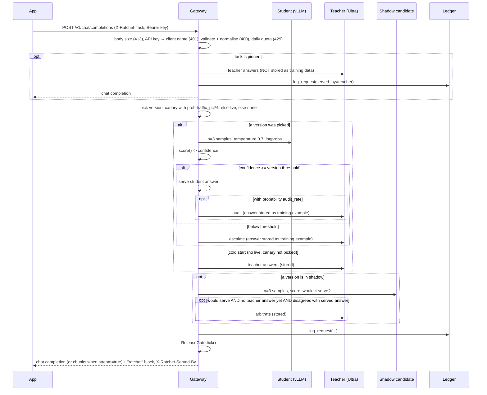
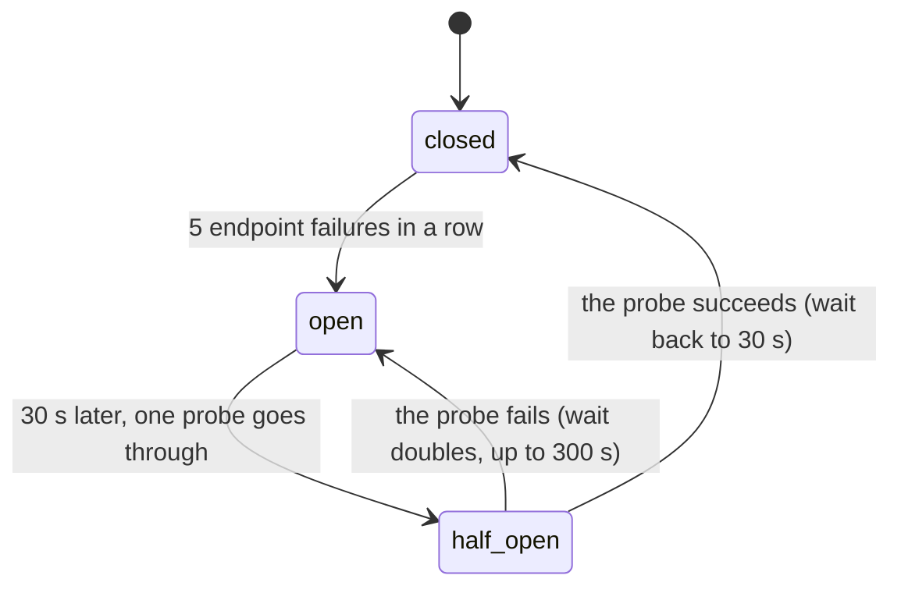
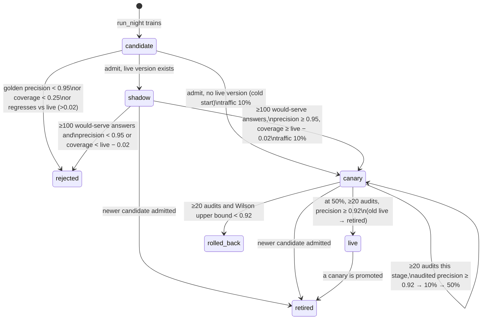

# Architecture

Ratchet is a gateway that sits between your app and a large "teacher" model. A small "student" model you own answers each request first. If it is unsure, the request goes to the teacher. Every teacher answer is stored with its license, and every night a new student is trained on those answers and released through a series of safety gates.

This page describes v0.2.0 as implemented in `ratchet/`. Product context is in [PRD.md](PRD.md); the reasoning behind each choice is in the [ADRs](adr/README.md).

## 1. Components

```
                         ┌──────────────────────────────── Nebius Token Factory ─────────┐
                         │  Teacher: nvidia/Nemotron-3-Ultra-550b-a55b                   │
                         │  Judge:   nvidia/nemotron-3-super-120b-a12b (free-text eval)  │
                         │  Fallback student: nvidia/NVIDIA-Nemotron-3-Nano-30B-A3B      │
                         └──────────────▲────────────────────────────────────────────────┘
                                        │ OpenAI-compatible HTTPS
┌──────────┐   /v1/chat/completions   ┌─┴──────────────────────────────┐
│ Your app │ ───────────────────────▶ │ Gateway  (ratchet/gateway.py)  │──── SQLite ledger (ratchet/ledger.py)
└──────────┘ ◀─────────────────────── │  Ratchet router (router.py)    │      requests · examples · versions · events
                                      │  ReleaseGate.tick (release.py) │
                                      │  Pages: /, /scout, /dashboard  │
                                      │  Scout agents (scout/)  ───────┼──── Tavily Search API (live Scout only)
                                      └─┬──────────────────────────────┘
                                        │ OpenAI-compatible HTTPS (model = adapter name)
                         ┌──────────────▼──── Nebius AI Cloud ─────────────────────────────┐
                         │ Serverless Endpoint: vLLM + nvidia/NVIDIA-Nemotron-3-Nano-4B-BF16 │
                         │   LoRA adapters loaded at runtime (/v1/load_lora_adapter)         │
                         │ Serverless Job (nightly): ratchet.nightschool.train (Unsloth)     │
                         │ Object Storage bucket mounted at /data: night/train.jsonl,        │
                         │   adapters/<version>/                                             │
                         └───────────────────────────────────────────────────────────────────┘
          Night School driver: python -m ratchet.live night | tick   (ratchet/live.py, cron)
```

| Module | Responsibility |
|---|---|
| `ratchet/config.py` | `Settings` (read from environment variables) and the `Price` table |
| `ratchet/providers.py` | `Completion`, the `Provider` protocol, and `OpenAICompatProvider` (httpx client for Token Factory and vLLM; every failure raises `UpstreamError`) |
| `ratchet/resilience.py` | `RetryPolicy` and `retry_call` (full-jitter backoff, `Retry-After`, a deadline, a read timeout retried once), `UpstreamError`, per-role `timeouts`, and the student circuit breaker (`Breaker`, `CircuitOpen`, `AdapterMissing`, `endpoint_down`) |
| `ratchet/tasks.py` | `Task` definitions: which answer fields must match for two answers to "agree" |
| `ratchet/confidence.py` | `score()` (confidence from samples) and `calibrate_threshold()` |
| `ratchet/router.py` | `Ratchet.handle()`: the per-request cascade, audits, shadow, cost accounting |
| `ratchet/release.py` | `ReleaseGate` (golden gate, shadow, canary, rollback) and `wilson()` |
| `ratchet/ledger.py` | `Ledger`: SQLite storage, provenance, stats |
| `ratchet/licenses.py` | Teacher license registry; refuses teachers that forbid distillation |
| `ratchet/redact.py` | `redact()`, `redact_messages()`: PII placeholders before examples are stored |
| `ratchet/auth.py` | `KeyRing` (named gateway API keys) and `bearer()` |
| `ratchet/openai_compat.py` | `validate_chat_request()` (typed `ChatRequest`), `normalize_messages()`, `APIError` and OpenAI's error envelope; standard library only |
| `ratchet/bom.py` | Per-adapter bill of materials: `manifest()`, `document()`, Ed25519 `Signer`, `verify()`, CLI (`keygen`, `verify`) |
| `ratchet/nightschool/dataset.py` | Builds train and golden sets from the ledger |
| `ratchet/nightschool/train.py` | LoRA fine-tune script, run inside the Serverless Job |
| `ratchet/nightschool/evaluate.py` | `cascade_eval()` and `LiveEvaluator`: golden-set precision, coverage and threshold |
| `ratchet/nightschool/orchestrate.py` | `run_night()`: one night of training and release |
| `ratchet/live.py` | Live Night School on Nebius (`NebiusTrainer`, `load_adapter`, CLI) and the gateway's `AdapterReloader` |
| `ratchet/gateway.py` | FastAPI app: OpenAI-compatible API (with API keys, quotas, request validation, body limit, OpenAI error envelope and streaming), stats, BOM and redaction endpoints, pages (`/`, `/scout`, `/dashboard`), mock-only demo controls, Scout endpoints |
| `ratchet/scout/agents.py` | `Scout`: planner → searcher → triage (parallel) → reader (parallel) → writer; `Call`, `http_caller` |
| `ratchet/scout/prompts.py` | System prompts, message builders and example questions, shared with the simulator |
| `ratchet/scout/search.py` | `TavilySearch` (live) and `MockSearch` (simulated results from `sim/research.py`) |
| `ratchet/scout/guard.py` | `Guard`: daily spend cap, daily run cap, per-IP hourly limit for the public demo |
| `ratchet/scout/__main__.py` | CLI: `python -m ratchet.scout "<question>" --base-url <gateway>/v1` |
| `ratchet/web/` | `landing.html` and `scout.html`: static pages, no build step |
| `sim/` | Synthetic tickets, the mock research world (`research.py`), workloads (`world.py`), mock teacher/student for the offline simulation and tests |

There are two runtime modes, chosen by `RATCHET_MODE`:

- **mock** (default): in-memory ledger, mock teacher and students from `sim/`, demo controls enabled, simulated search for Scout. No network or keys. `RATCHET_MOCK_WARMUP_DAYS` runs simulated days at startup.
- **live**: SQLite file at `RATCHET_DB`, real teacher on Token Factory, student on your vLLM endpoint (or the hosted fallback model when `RATCHET_STUDENT_BASE` is empty), Tavily for Scout when `TAVILY_API_KEY` is set.

## 2. Request path

`Ratchet.handle(messages, task, client, params, meta)` in `router.py`. Before it runs, the gateway checks the body size, the API key (when `RATCHET_API_KEYS` is set), validates and normalises the request (`openai_compat.py`), and checks the key's daily quota, in that order; it passes the key's name as `client` and the request's generation parameters as `params` (`providers.GenParams`). A request refused by any of these is not logged and costs nothing:



Details that matter:

- **Validation and normalisation** (`openai_compat.py`, [ADR 0012](adr/0012-openai-request-validation-and-error-envelope.md)): a malformed request gets a 400 in OpenAI's error envelope before any model call. `developer` becomes `system` and text content parts become one string, so the cascade, the mock models and the ledger see the same plain messages as before; plain messages pass through as the same objects, so example hashes do not change. A request with a non-text part listed in `RATCHET_TEACHER_MODALITIES` takes the pinned path below (`Ratchet.teacher_only`): teacher only, never stored. Validation, the quota check and the cascade run in a worker thread.
0. **Pinned tasks** (`Task.pinned`, `_pinned`): checked first. The teacher answers, the request is logged with `served_by=teacher`, no student version, and `cost_usd = baseline_cost_usd`. The answer is **not** passed to `add_example`, so it never becomes training data. No student, audit or shadow call is made. Scout's planner and writer (`research-plan`, `research-write`) are pinned; see [§10](#10-scout-multi-agent-demo).
1. **Version choice** (`_pick_version`): if a version is in `canary`, it is chosen with probability `traffic_pct / 100`; otherwise the `live` version is used. With no live version (cold start) and the canary not picked, the request goes straight to the teacher.
2. **Student sampling** (`_sample`): one call with `n = Settings.samples` (default 3) and `confidence.STUDENT_SAMPLING` (`temperature=0.7`, `logprobs=True`), the constant the golden eval also uses, plus the request's generation parameters as the student's role allows (below). The model name sent is whatever the resolver returns. In live mode that is `version.adapter_uri`, which is the LoRA adapter name.
3. **Threshold**: `Ratchet.threshold(version)` returns `version.eval["threshold"]` (calibrated at training time), falling back to `Settings.confidence_threshold` (default 0.80). A sample set with no valid answer (`Scored.valid` false: every sample unparseable, empty or cut off) is never served, whatever the threshold.
4. **Audits**: when the student serves, the teacher is also called with probability `audit_rate` (default 0.05; mock mode raises it to at least 0.10). The audit result (`audit_agree`) is the live quality signal for canary and live versions, and the teacher's answer also becomes training data. A teacher answer that cannot be stored ([below](#storage-rules)) is not an audit: `audited=0`.
5. **Teacher calls** (`_call_teacher` → `_ask_teacher`, then `_store_example`): the teacher answer is cleaned (`tasks.clean_answer`), checked against the [storage rules](#storage-rules), the messages, the answer and the stored conditions are redacted ([PII redaction](#pii-redaction)), and they are stored with `Ledger.add_example(task, messages, completion, teacher_model, license_name, license_url, redactions, params)`. The license comes from `licenses.require_distillable(settings.teacher_model)`, checked once when `Ratchet` is constructed. A closed teacher raises `LicenseError` at startup.
6. **Shadow**: see [state machine](#5-version-state-machine). The shadow candidate never serves.
7. **Logging**: one row in `requests` per call (columns below), with the API client's name when keys are on.
8. **Gate tick**: the gateway calls `rt.tick()` (which runs `gate.tick()` under a lock) after every `/v1/chat/completions` request and after every Scout run. In live mode, `python -m ratchet.live tick` can also be run from cron.

**Generation parameters** ([ADR 0017](adr/0017-generation-parameters-by-role.md)). `Settings.gen_policy()` (`providers.GenPolicy`) turns the client's parameters into a `GenPlan` once per request (a request without any, from Scout or the simulator, reuses one built at startup): the student's (`RATCHET_STUDENT_PARAMS`: `max_tokens`, `stop`, `seed`, `response_format`, `tools`, `tool_choice`, `logit_bias`, `top_logprobs`; never its temperature, logprobs or `n`), the serving teacher's (`RATCHET_TEACHER_PARAMS`: every standard field, at the client's temperature or 0) and the audit's and arbitration's (the same at temperature 0, without `top_p`, `seed`, the penalties, `logit_bias` and logprobs). Every call has an output cap: `RATCHET_STUDENT_MAX_TOKENS` (1,024) and `RATCHET_TEACHER_MAX_TOKENS` (8,192), and the teacher gets `RATCHET_TEACHER_REASONING_HEADROOM` (0) tokens above the client's `max_tokens` for reasoning; when it does, a visible answer longer than the client's limit is marked `length` (served whole, not stored). The model is never the client's: always `Settings.teacher_model` or the version's adapter. The golden eval builds its student calls with the same policy from the conditions stored with each example (FR-5.1). `Result.finish_reason` is the served answer's, and the gateway returns it.

**Upstream calls** ([ADR 0014](adr/0014-upstream-failure-semantics.md)). Each role has its own client settings. The teacher and judge: a 120 s read timeout (`RATCHET_TEACHER_TIMEOUT_S`), 5 s to connect, and up to two retries (`RATCHET_TEACHER_RETRIES`) within 180 s (`RATCHET_TEACHER_DEADLINE_S`). The student on the request path: 15 s to answer and 2 s to connect (`RATCHET_STUDENT_TIMEOUT_S`, `RATCHET_STUDENT_CONNECT_TIMEOUT_S`) and no retries, because the teacher is its retry; the hosted fallback model plays the student with the same settings. `resilience.retry_call` retries connection failures and 408, 409, 429 and 5xx, waiting full jitter (`uniform(0, min(8, 0.5 × 2^i))` seconds) or the server's `Retry-After` (a wait over 8 s, or one that would end past the deadline, returns the error at once); a read timeout is retried once, because those tokens may be billed; any other 4xx and an unreadable 2xx body never. The deadline also caps each attempt's timeouts. Whatever fails ends as an `UpstreamError` with a status, the endpoint's OpenAI `type`, `code` and `param`, and a clipped message, never the URL.

**Failure handling** (INV-7, INV-15, [ADR 0013](adr/0013-optional-teacher-calls-fail-open.md), [ADR 0014](adr/0014-upstream-failure-semantics.md)). A request fails only when the call whose answer it needs fails: the teacher on the escalation, cold-start, pinned or teacher-only path. That raises out of `handle`, and the gateway's `_map_upstream` answers by cause: 400 with the teacher's message and code when the request cannot succeed (an upstream 400, 413 or 422, such as `context_length_exceeded`), 429 with the teacher's `Retry-After` for a rate limit, 504 `teacher_timeout`, 502 `upstream_auth_error` or `upstream_not_found` for the gateway's own key or model setting, and 502 `teacher_unavailable` otherwise; `X-Should-Retry: false` where a retry cannot help. Nothing is logged for the request. Every other upstream call fails open:

| Call | When it raises | Recorded |
|---|---|---|
| Student samples | Escalate to the teacher; a 404 for the adapter also queues its reload | `escalated=1`, route `student_error`; `student_errors`; `student_error` event; the student breaker counts it when the endpoint looks down ([below](#student-circuit-breaker)) |
| Teacher audit | Serve the student's answer; no arbitration call for this request either, since the teacher just failed | `audited=0`, `audit_agree` NULL, no cost for the call; `audit_errors`; `audit_error` event |
| Shadow samples | Serve as if no shadow ran | No shadow fields; `shadow_errors`; `shadow_error` event (`sampling`); counted by the shadow's own breaker |
| Shadow arbitration | Serve the live answer | `shadow_serve=1`, `shadow_agree` NULL; `shadow_errors`; `shadow_error` event (`arbitration`) |

The counters are per process and thread-safe; `Ratchet.health()` returns them. Each event is written on the 1st, 10th, 100th and 1000th failure of its kind, so an outage cannot flood the release log, and an optional-call event names the exception class and HTTP status, never the message (an httpx message holds the endpoint URL). In the release gate, a failed audit is simply not an audit: audits are sampled at random, so dropping one shrinks the sample without biasing it. A failed arbitration is different, because arbitration only runs when the shadow disagrees with the served answer: `Ledger.shadow_quality` counts such a row in `n`, coverage and the would-serve evidence, and as a disagreement in precision (`unarbitrated` in its result), so a failing teacher can get a candidate rejected but never promoted. A row whose shadow verdict is unknown (`shadow_serve` NULL) counts toward nothing.

### Student circuit breaker

A student endpoint that hangs would hold every request for its timeouts (2 s to connect, 15 s to answer) before the teacher answers. `resilience.Breaker` ([ADR 0015](adr/0015-student-circuit-breaker-and-adapter-reload.md)) stops that after a few failures:



- **What counts.** `resilience.endpoint_down` reads each failure: a timeout, a connection or protocol error, an unreadable answer, a 5xx, 408 or 429 means the endpoint looks down and counts. Any other 4xx (a prompt too long for the student, a lost adapter) is the endpoint answering about this request, so it counts as a success for the endpoint's health. An error that is not an HTTP failure (a bug in a provider, the mock world not knowing a request) counts neither way. `RATCHET_STUDENT_BREAKER_FAILURES` (5) failures in a row open the breaker; `0` turns it off.
- **Open.** `_sample` checks `allow()` before calling and raises `CircuitOpen` when the breaker is open. `handle` escalates to the teacher with `escalated=1`, `confidence` NULL and route `student_breaker`; nothing is billed for the student, and it is not another `student_error`. After `RATCHET_STUDENT_BREAKER_COOLDOWN_S` (30 s) exactly one request probes the endpoint; concurrent requests still see the breaker open. A failed probe doubles the wait, up to 300 s; a successful one closes the breaker and resets the wait. A probe that never reports back is presumed lost after the longer of the wait and the student call's own longest time (its pool, connect, write and read timeouts plus 5 s, 37 s by default), so a probe on a hanging endpoint is never replaced while it can still be running; a lost probe that reports while the breaker is still half-open decides as the probe would. Only a probe's own thread decides, so a late result from a call that began before the breaker opened is ignored.
- **One breaker per failure domain.** Breakers are made on first use, keyed by role and endpoint: the provider's `base_url`, or its class when it has none (a resolver may build a new provider object per call, as the mock fleet does). Live and canary on one endpoint share the `student` breaker. Shadow calls use their own `shadow` breaker, so a bad staging adapter cannot open the breaker live traffic depends on; while it is open the shadow collects no evidence, as when its samples fail. Another endpoint in the same role gets `student-2`, and so on.
- **Lost adapters.** vLLM forgets adapters loaded at runtime when the endpoint restarts, and answers 404 ``The model `student-v3` does not exist.`` A 404 that names the version's adapter becomes `AdapterMissing`: the request escalates (route `student_error`), the breaker records the endpoint as healthy, and `Ratchet.on_adapter_missing(version)` is called. In live mode with an endpoint that is `live.AdapterReloader.request`, which loads the adapter again on one daemon thread (`live.load_adapter`, path `RATCHET_ADAPTER_ROOT/<name>`), at most once per adapter per 60 s, and writes `adapter_reloaded` or `adapter_reload_failed`. `python -m ratchet.live reload` stays as the manual fallback.
- **Events and health.** Transitions write `circuit` events (`student: closed->open after 5 failures (ReadTimeout)`, `student: open->half_open after 30 s; one probe`, `student: half_open->open for 60 s after a failed probe (...)`, `student: half_open->closed after a successful probe`), naming the failure's class and status, never its message. Once the wait is at 300 s, the repeated `open->half_open` / `half_open->open` pair is written only for the 1st, 10th, 100th and 1000th probe at that wait, so a long outage cannot push the release history out of the dashboard's last 40 events. `Ratchet.health()["breakers"]` has each breaker's `snapshot()`.
- **Cost on the hot path.** While a breaker is closed, `allow()` and a successful `record()` read attributes without taking a lock; the lookup is one dictionary read. Locks are taken only while failures are being counted or the breaker is open.

The mock-only `POST /ratchet/demo/student-outage` takes the mock production endpoint down for 5 to 300 s, to show the breaker open and close again ([API.md](API.md#post-ratchetdemostudent-outageseconds60)).

### Storage rules

Every training example is a teacher answer (INV-2) that is complete and valid (INV-16, [ADR 0016](adr/0016-store-only-complete-valid-teacher-answers.md)). `Ratchet._store_example` is the only caller of `Ledger.add_example`; it runs on every teacher call (escalation, cold start, audit, shadow arbitration), never on the pinned and teacher-only path (INV-10).

1. **Clean** (`tasks.clean_answer`, FR-2.7). `strip_reasoning` removes complete `<think>…</think>` blocks in any case, then everything up to the last remaining `</think>` (a chat template that opens the reasoning in the prompt, so the output has only the closing tag), then an opening `<think>` still left at the start of what remains together with everything after it (an answer cut off while reasoning); an opening tag after answer text is content (a reply that mentions the tag), since a model reasons before it answers. For a structured task (`compare_keys`), an answer that is one JSON object (bare or in one fence, as it is or after what follows its first `</think>`) is kept whole, so a tag quoted in its strings survives; otherwise one code fence that is the whole answer is unwrapped when its body parses as JSON; a free-text answer keeps its fences, since a code block is content there. The provider never reads `reasoning_content` or `reasoning` (vLLM's and Token Factory's reasoning parsers), so reasoning cannot arrive another way.
2. **Check** (`router.answer_problem`). The answer is skipped when its `finish_reason` is not `stop` or `tool_calls` (`finish_reason length`: cut off by the token limit), when nothing is left after cleaning (`empty answer`), or when a structured task's answer does not parse as a JSON object (`invalid answer`). String operations only, so the check costs microseconds.
3. **Redact**, then check once more: a placeholder can break a structured answer (a card-like number outside quotes becomes `[CARD]`), and such an answer is skipped (`invalid after redaction`).
4. **Store** with its license and its conditions (`examples.params`: the `response_format`, `tools`, `tool_choice` and `stop` the teacher answered under, `ledger.STORED_PARAM_KEYS`; for an audit the audit's), or bump `seen` for a duplicate. A request whose `RequestMeta.storable` is False stores nothing. `requests.stored` is 1 for a request whose teacher answer was stored or bumped, 0 otherwise (including pinned requests), NULL for rows from before v0.5.

A skipped answer is still served (the client asked for it, and with `finish_reason length` it is all there is), but it is not an audit (`audited=0`, counted neither for nor against the student, and the shadow is compared with the served answer as if no audit had run) and an escalation or arbitration answer like that settles no shadow disagreement (`shadow_agree` NULL, which the gate counts against the shadow, as for a failed arbitration). Each skip writes a `skip_example` event (`ticket-triage: finish_reason length`) on the 1st, 10th, 100th and 1000th skip of each reason, counted per process under the same lock as the failure counters; the detail never quotes the answer. On the student side, a sample whose `finish_reason` is not `stop` or `tool_calls` (the same rule) gets no vote in `confidence.score`, and an empty answer is invalid for every task.

The response text is the served answer after `tasks.clean_answer`: no reasoning, and for a structured task bare JSON. With `stream: true` the gateway sends it as OpenAI `chat.completion.chunk` events after the cascade has decided; the cascade cannot stream the student's tokens as they arrive, because confidence is scored on the whole answer ([API.md](API.md#streaming)).

The response has every field of OpenAI's ([ADR 0018](adr/0018-usage-reports-the-served-answer.md), FR-1.12). `usage` is the served answer's, as if its model had answered alone: the chosen student sample's tokens, or the teacher's call with its reasoning tokens (part of `completion_tokens`) and cached prompt tokens; a count the model did not report is estimated at about 4 characters a token. `ratchet.usage_breakdown` lists every call of the request (`student_samples`, `served`, `audit`, `shadow`, `arbitration`), which `cost_usd` prices. `system_fingerprint` is a hash of what decides the answer (`router.fingerprint`: the student's adapter, version, training-set hash and threshold, or the teacher's model), so it changes when a promotion or rollback puts another version in front. The router computes all of it in `Result` from the completions it already holds; the gateway only shapes it (`openai_compat.usage_object`, `gateway._envelope`). With `stream_options.include_usage` the stream ends with a chunk that has no choices, the usage and the `ratchet` block.

### PII redaction

`ratchet/redact.py` ([ADR 0009](adr/0009-pattern-based-pii-redaction.md)) replaces identifiers with `[LABEL]` placeholders before anything is stored as training data. Patterns run in a fixed order, so specific formats win over the broad phone pattern:

| Label | Matches | Extra check |
|---|---|---|
| `SECRET` | `sk-…`, `tvly-…`, `AKIA…`, `ghp_…`, `xox…-…`, the token after `Bearer ` | |
| `EMAIL` | `name@domain.tld` | |
| `IBAN` | country code, 2 check digits, 11–30 characters | mod-97 |
| `CARD` | 13–19 digits with optional spaces or dashes | Luhn |
| `AADHAAR` | 12 digits, first digit 2–9 | Verhoeff |
| `SSN` | `123-45-6789` (excluding invalid areas) | |
| `PAN` | Indian PAN `ABCPE1234F` | |
| `IP` | IPv4 | |
| `PHONE` | optional `+country`, optional `(area)`, digit groups | 10–15 digits |

Only `_store_example` redacts, and it redacts everything it stores: the messages (`redact_messages`), the answer (`redact`) and every string value in the stored conditions, such as a stop string or a tool description (`redact_json`, which keeps object keys); the teacher itself receives the original. `examples.redactions` counts the placeholders per example, `Ledger.privacy_stats()` sums them for `/ratchet/stats`, and each adapter BOM reports `examples_with_pii_redacted`. `POST /ratchet/redact` previews the result for any text. The redactor does not find names or street addresses.

## 3. Nightly loop (Night School)

`run_night(ledger, trainer, evaluator, gate, base_model, min_new_examples=50, task=None)` in `nightschool/orchestrate.py`:

```
 ┌─ release in flight? (any version in shadow or canary) ── yes ──▶ event "skip", stop
 │ no
 ├─ dataset.build(): train rows + golden rows (license-checked)
 ├─ new = train_examples − max(train_examples of all previous versions)
 │     new < min_new_examples (50) ───────────────────────────────▶ event "skip", stop
 │     no golden rows ────────────────────────────────────────────▶ event "skip", stop
 ├─ champion re-check: evaluate the LIVE version on today's golden set, overwrite its eval
 ├─ trainer.train(train_rows, base_model, name="student-v{N+1}") → adapter_uri
 ├─ ledger.create_version(state="candidate")
 ├─ evaluator.evaluate(adapter_uri, golden_rows) → {precision, coverage, threshold, ...}
 ├─ ledger.set_bom(): bill of materials from the exact train and golden rows, signed if a key is set
 ├─ event "trained"
 └─ gate.admit(version) → rejected | canary 10% (cold start) | shadow
```

- **Mock mode**: `MockFleet` (in `sim/mock_models.py`) is both trainer and evaluator.
- **Live mode**: `NebiusTrainer` (`ratchet/live.py`) first checks that `RATCHET_STUDENT_BASE` is set (an adapter with no endpoint cannot be evaluated, so it stops before any spend). Then it does four things. It writes `RATCHET_DATA_DIR/night/train.jsonl`, runs `RATCHET_SYNC_CMD` (if set), runs `RATCHET_TRAIN_CMD` (default `bash deploy/train_job.sh {version}`), then hot-loads the adapter into vLLM with `POST {root}/v1/load_lora_adapter` (an "already loaded" answer is fine). `LiveEvaluator` then scores it.

### Datasets (`nightschool/dataset.py`)

- Every example gets a fixed split when first stored: `golden` if `int(sha256[:8], 16) / 0xFFFFFFFF < golden_fraction` (default 0.10), else `train`. The split never changes, so evaluation data cannot leak into training through re-splitting.
- **Frequent requests:** an example whose `seen` count is at least `FREQUENT = 3` is treated as `train`, even if its stored split is `golden`. Requests that keep repeating are too valuable to hold out ([ADR 0007](adr/0007-golden-set-split-and-frequent-requests.md)).
- Rows whose teacher is unknown or not distillable (per `licenses.lookup`) are dropped.
- Training is cumulative: each night trains from the **base model** on every train row so far ([ADR 0004](adr/0004-retrain-from-base-cumulative.md)).
- `build()` also writes `manifest.json`: train and golden counts, `dataset_sha256` (a hash of the train rows' example hashes), and the bill of materials.

## 4. Data model (SQLite)

Created by `SCHEMA` in `ledger.py` (`CREATE TABLE IF NOT EXISTS`).

### `requests`: one row per gateway call

| Column | Type | Meaning |
|---|---|---|
| `id` | INTEGER PK | Auto-increment. Also used as the "since" marker for stages |
| `ts` | REAL | Unix time |
| `day` | INTEGER | `Ledger.day` at the time (set by the simulator or demo; see note) |
| `task` | TEXT | Task name |
| `served_by` | TEXT | `student` or `teacher` |
| `student_version` | INTEGER | Version that was tried first; NULL on cold start |
| `confidence` | REAL | Student confidence; NULL if no student was tried |
| `escalated` | INTEGER | 1 if the student was below threshold |
| `audited` | INTEGER | 1 if the teacher double-checked a student answer (0 when the audit call failed or its answer could not be stored) |
| `audit_agree` | INTEGER | 1/0 for audited rows, NULL otherwise |
| `shadow_version` | INTEGER | Shadow candidate that ran, if any |
| `shadow_serve` | INTEGER | 1 if the shadow would have served |
| `shadow_agree` | INTEGER | 1 if the shadow agreed with the best available reference; NULL when its disagreement could not be arbitrated, or the teacher's reference could not be stored |
| `latency_ms` | REAL | Student latency (max over samples) plus teacher latency if called |
| `cost_usd` | REAL | Actual cost of this request (student + teacher + audit + shadow + arbitration) |
| `baseline_cost_usd` | REAL | Estimated cost if the teacher had answered alone |
| `client` | TEXT | API key name that sent the request; NULL when keys are off and for internal calls (Scout, demo). Indexed with `ts` for the daily quota |
| `route` | TEXT | How the request was served (`router.ROUTES`): `student`, `confidence`, `cold_start`, `pinned`, `student_error`, `student_breaker` ([API.md](API.md#get-ratchetstats)). NULL in rows written before v0.5; `stats_by_task` reports those as `unrecorded` |
| `stored` | INTEGER | 1 if a teacher answer from this request was stored as an example (inserted, or a duplicate's `seen` bumped); 0 if none was (student-served without audit, pinned, or a skipped answer, see [Storage rules](#storage-rules)); NULL in rows written before v0.5 |

### `examples`: teacher-written training data with provenance

| Column | Type | Meaning |
|---|---|---|
| `id` | INTEGER PK | |
| `ts`, `day`, `task` | | When and for which task it was first stored |
| `hash` | TEXT UNIQUE | `sha256(json({"task","messages"}, sort_keys))`, with `"params"` added to the object only when the example has conditions (so every hash from before v0.5 is unchanged); deduplicates identical requests under identical conditions |
| `messages` | TEXT | JSON request messages |
| `completion` | TEXT | Teacher answer, reasoning removed |
| `teacher_model` | TEXT | Model ID of the teacher |
| `license`, `license_url` | TEXT | License that permits training on this output |
| `split` | TEXT | `train` or `golden` (fixed from the hash) |
| `seen` | INTEGER | Times this exact request was answered by the teacher (starts at 1, +1 per duplicate) |
| `redactions` | INTEGER | PII placeholders inserted before storing (0 when none were found or redaction is off) |
| `params` | TEXT | JSON: the conditions the teacher answered under that define the target (`response_format`, `tools`, `tool_choice`, `stop`), redacted like the messages; NULL when there were none and in rows from before v0.5. `dataset.rows` returns it as `params` |

### `versions`: student models

| Column | Type | Meaning |
|---|---|---|
| `id` | INTEGER PK | Version number (`v{id}` in the UI) |
| `created_ts`, `day` | | Creation time |
| `base_model` | TEXT | Base model ID |
| `adapter_uri` | TEXT | Adapter name, e.g. `student-v3` (also the vLLM model name) |
| `train_examples` | INTEGER | Size of the train set used |
| `dataset_hash` | TEXT | `dataset_sha256` from the manifest |
| `eval` | TEXT (JSON) | `golden_n`, `golden_agreement`, `threshold`, `coverage`, `precision`, `test_n`, optional `judge_pass_rate`, `rechecked_day` |
| `state` | TEXT | `candidate`, `rejected`, `shadow`, `canary`, `live`, `retired`, `rolled_back` |
| `traffic_pct` | INTEGER | 10 or 50 in canary, 100 when live, 0 otherwise |
| `stage_since` | INTEGER | Max `requests.id` when the current stage began; audits are counted only after it |
| `bom` | TEXT (JSON) | This adapter's bill of materials document (`manifest`, `sha256`, `signature`), written at training time |

### `events`: release log

`id`, `ts`, `day`, `kind`, `detail`. The kinds written by the code are `trained`, `skip`, `rejected`, `shadow`, `canary`, `live`, `retired`, `rollback`, `alert`, `student_error`, `audit_error`, `shadow_error`, `skip_example`, `circuit`, `adapter_reloaded`, `adapter_reload_failed`, `gateway_error`, `fault` (demo only) and `warmup` (mock warm-up only). Their meanings are in [RUNBOOK.md](RUNBOOK.md#event-kinds).

> Note on concurrency: every public `Ledger` method holds one re-entrant lock (`_locked`), because Scout's triage and reader agents call `Ratchet.handle` from several threads at once and all share one SQLite connection (`check_same_thread=False`). This makes one gateway process safe; it does not make several processes safe, so run one uvicorn worker ([ADR 0006](adr/0006-sqlite-ledger-for-v0.md)).

> Note on `day`: the simulator and the mock demo endpoint set `Ledger.day` themselves. In live mode the ledger is opened with `auto_day=True`: day 1 starts at the first logged request and a new day begins every 24 hours. Existing database files are migrated on open (`Ledger._migrate()` adds columns introduced after v0.1).

## 5. Version state machine

Thresholds are the `ReleasePolicy` defaults in `release.py`: `min_precision=0.95`, `min_coverage=0.25`, `tolerance=0.02`, `min_shadow=100`, `min_audits=20`, `live_floor=0.92`. Canary steps are `CANARY_STEPS = [10, 50]`, then 100.



### Golden gate: `ReleaseGate.admit(vid)`

Using the candidate's `eval` (calibrated on half of the golden set, measured on the other half):

1. Reject if `precision < 0.95`.
2. Reject if `coverage < 0.25`.
3. If a live version exists, reject if `precision < live.precision − 0.02` **or** `coverage < live.coverage − 0.02`. The live numbers were re-measured on the same golden set the same night ([§3](#3-nightly-loop-night-school)).
4. Otherwise every version in `shadow` or `canary` is set to `retired` (event `retired`). Then:
   - no live version → `canary` at 10% (event `canary`, "first student");
   - live version exists → `shadow` (event `shadow`).

In practice step 4's retire branch rarely runs, because `run_night` skips training while a shadow or canary exists.

### Ticks: `ReleaseGate.tick()`

Run after every gateway request and by `python -m ratchet.live tick`.

1. **Live watch:** take the audits of the live version since it became live. If there are at least `min_audits` and the Wilson upper bound of precision is below `live_floor`, write an `alert` event. No automatic action is taken on the live version.
2. **Shadow:** `shadow_quality(id)` returns `served` (would-serve count), `precision` (mean `shadow_agree` where `shadow_serve=1`, an unarbitrated NULL counting as 0), `coverage = served / n`, `live_coverage` (share of the same requests the live student actually served, leaving out those it never answered: route `student_breaker` or `student_error`, ADR 0015) and `unarbitrated`, over the rows with a shadow verdict (`shadow_serve` not NULL). Once `served ≥ min_shadow` (100):
   - precision < 0.95 → `rejected` (the reason adds "N unarbitrated counted as disagreements" when N > 0);
   - coverage < live_coverage − 0.02 → `rejected`;
   - otherwise → `canary` at 10%.
3. **Canary:** `version_live_quality(id)` counts audits of answers this version served since `stage_since`. With `n ≥ min_audits` (20) and audited precision `p`:
   - Wilson upper bound of `p` below `live_floor` (0.92) → `rolled_back` (event `rollback`). Traffic returns to the live version, or to the teacher on cold start.
   - else if `p < 0.92` → hold (no change; keep auditing).
   - else if traffic is 10% → 50% (event `canary`); the stage counter resets because `set_version` updates `stage_since`.
   - else → old live set to `retired`, canary set to `live` at 100% (event `live`).

### Shadow reference and arbitration

For each request while a shadow exists, the shadow candidate is sampled and scored like a real student. `shadow_serve = confidence ≥ shadow threshold`. The reference for agreement is chosen in this order:

1. The teacher's answer, if the teacher was called for this request (escalation or audit). An audit answer that breaks the [storage rules](#storage-rules) (cut off, empty, or invalid for the task) is not an audit, so it is no reference: the next steps apply as if no audit had run.
2. If the shadow would serve and disagrees with the served answer, the teacher is called to **arbitrate** (stored as training data) and its answer is the reference. If that call fails, or is skipped because the audit already failed in this request, there is no reference: `shadow_agree` stays NULL and the gate counts it as a disagreement.
   An escalation answer (step 1) or an arbitration answer (step 2) that breaks the storage rules is no reference either: `shadow_agree` stays NULL.
3. Otherwise the served answer (the live student's).

So disagreements are always settled by the teacher (or counted against the shadow when it cannot be reached), while agreements with the live student are accepted as-is.

## 6. Confidence and calibration

### Score (`confidence.score`)

Given `n` samples and a `Task`:

1. Each sample is canonicalised by `Task.canonical()`, after `tasks.clean_answer` ([Storage rules](#storage-rules)). For tasks with `compare_keys` (e.g. `ticket-triage` → `category`, `priority`), the JSON is parsed and only those fields are kept, lower-cased and trimmed. Otherwise the whole text is used, with reasoning removed and whitespace normalised. Unparseable JSON, an empty answer and a sample that did not end by itself (`finish_reason` other than `stop` or `tool_calls`: `length`, `content_filter`, vLLM's `abort`) become `<invalid>` and get no vote.
2. If every sample is invalid, confidence is 0 and the answer is never served (`Scored.valid` is false), even with a threshold of 0.
3. `agreement = votes for the majority answer / n`.
4. The best sample is the majority answer with the highest mean token probability, `p = exp(mean(token logprobs))`.
5. `confidence = 0.4 · p + 0.6 · agreement`, or `agreement` alone if no logprobs were returned.

### Threshold calibration (`calibrate_threshold`, `cascade_eval`)

`cascade_eval(sample, golden_rows, samples=3, target_precision=0.97, floor=0.5)`:

1. Score each golden row with the candidate. Even-indexed rows go to a calibration set, odd-indexed rows to a test set; each point is `(confidence, agrees_with_teacher)`.
2. `calibrate_threshold(calib, 0.97)` sorts points by confidence (descending) and walks down **in groups of equal confidence** (ties included before checking). It returns the lowest confidence at which cumulative precision is still ≥ 0.97, or `inf` if none qualifies.
3. `threshold = min(1.01, max(0.5, calibrated))`. The value 1.01 means "serve nothing".
4. On the **test** half: `coverage = share with confidence ≥ threshold`, and `precision = agreement rate among those`.

Returned keys: `golden_n`, `golden_agreement` (majority-answer agreement over all rows), `threshold`, `coverage`, `precision`, `test_n`, plus `judge_pass_rate` from `LiveEvaluator` when free-text tasks exist.

### Wilson score interval (`release.wilson`)

For `s` successes out of `n` and `z = 1.96`:

```
p      = s / n
denom  = 1 + z² / n
centre = (p + z² / (2n)) / denom
half   = z · sqrt( p(1−p)/n + z²/(4n²) ) / denom
bounds = [max(0, centre − half), min(1, centre + half)]
```

Rollback requires the **upper** bound to be below the floor, which means strong evidence the version is worse. With 20 audits and a true precision of 96%, the chance of a false rollback is negligible. With a raw "point estimate < 92%" rule it would have been about 19%. Example: 19/20 gives roughly [0.76, 0.99], so no rollback; 10/20 gives roughly [0.30, 0.70], so rollback.

## 7. Cost accounting

`Price(input, output)` is in USD per 1M tokens (`config.DEFAULT_PRICES`). Per request:

- **Student:** `price("student").cost(in_tokens of first sample, sum of out_tokens over samples)`. The prompt is counted once and every sample's output is counted.
- **Teacher** (escalation, audit or arbitration): `price(teacher_model).cost(in, out)`. The `out` count includes reasoning tokens, as Token Factory reports them in usage; the mock teacher adds `teacher_reasoning_tokens`.
- **Shadow:** the candidate's sampling cost, plus any arbitration, is added to `cost_usd`. Shadowing is not free.
- **Baseline:** if the teacher was called, the baseline is that call's cost. Otherwise it is estimated as `teacher price × (student in_tokens, student out_tokens + teacher_reasoning_tokens)` (default 300 reasoning tokens).

The response's `usage` is not this bill: it counts only the served answer (ADR 0018), while `cost_usd` prices every call in `ratchet.usage_breakdown`.

`stats_by_day()` derives `cost_per_1k`, `baseline_per_1k` and `savings_pct = 1 − cost/baseline`; `stats_by_task()` gives the same per task over all days; `totals()` gives `saved_usd`. Pinned requests have cost equal to baseline, so they count fully in both and save nothing. The student price is a **per-token proxy** set to the hosted Nano price. Real self-hosted cost is GPU-hours, so live savings should be computed from the Nebius bill too.

## 8. Provenance

- `GET /ratchet/bom` returns `Ledger.bill_of_materials()`: counts grouped by teacher, license, license URL and split, plus `examples_sha256` (a SHA-256 over all example hashes in sorted order).
- **Per adapter** ([ADR 0010](adr/0010-signed-adapter-bom.md)): after training and evaluation, `run_night` builds a `ratchet.bom/v1` manifest from the exact rows used: sources (teacher, license, URL, count, `distill_ok`), tasks, `dataset_sha256`, a hash of the golden rows, the evaluation and the number of redacted examples. `bom.document()` adds the SHA-256 of the canonical JSON and, when `RATCHET_BOM_SIGNING_KEY` is set, an Ed25519 signature with the public key and key id. It is stored in `versions.bom`, served at `/ratchet/versions/{id}/bom`, and in live mode written to `data/boms/student-vN.json`. `python -m ratchet.bom verify` checks it offline.
- `train.py` writes `ratchet_manifest.json` next to each adapter, listing the base model, example count and the (teacher, license) pairs.
- `licenses.require_distillable()` refuses unknown teachers and any model whose ID (after the last `/`) starts with `gpt`, `o1`, `o3`, `o4`, `claude` or `gemini`.

## 9. Design decisions

| ADR | Decision |
|---|---|
| [0001](adr/0001-open-teacher-only.md) | Only teachers whose license allows training on outputs |
| [0002](adr/0002-student-on-nebius-serverless-not-token-factory.md) | Train and serve the student on Nebius AI Cloud, not Token Factory |
| [0003](adr/0003-per-request-cascade-with-calibrated-confidence.md) | Per-request cascade with a calibrated, per-version threshold |
| [0004](adr/0004-retrain-from-base-cumulative.md) | Retrain from the base model on the cumulative dataset nightly |
| [0005](adr/0005-shadow-canary-rollback-with-wilson-bounds.md) | Shadow → canary → live with Wilson-bound rollback |
| [0006](adr/0006-sqlite-ledger-for-v0.md) | SQLite ledger for v0 |
| [0007](adr/0007-golden-set-split-and-frequent-requests.md) | Hash-based golden split; frequent requests always train |
| [0008](adr/0008-pinned-tasks.md) | Pinned tasks stay on the teacher and are never training data |
| [0009](adr/0009-pattern-based-pii-redaction.md) | Pattern-based PII redaction before examples are stored |
| [0010](adr/0010-signed-adapter-bom.md) | A signed bill of materials per adapter |
| [0011](adr/0011-requirements-traceability.md) | Requirements traceability from PRD rows and test markers, checked in CI |
| [0012](adr/0012-openai-request-validation-and-error-envelope.md) | Validate and normalise OpenAI requests at the gateway; OpenAI's error envelope on `/v1/*` |
| [0013](adr/0013-optional-teacher-calls-fail-open.md) | Optional teacher calls fail open for the request and count against the shadow in the release gate |
| [0014](adr/0014-upstream-failure-semantics.md) | Bounded retries, one upstream error type, and statuses a client can act on |
| [0015](adr/0015-student-circuit-breaker-and-adapter-reload.md) | A circuit breaker per student endpoint, automatic adapter reloads, and a route on every request |
| [0016](adr/0016-store-only-complete-valid-teacher-answers.md) | Store only complete, valid teacher answers |
| [0017](adr/0017-generation-parameters-by-role.md) | Generation parameters by role, token caps, and the conditions stored with an example |
| [0018](adr/0018-usage-reports-the-served-answer.md) | `usage` reports the served answer; Ratchet's own calls go in a breakdown |

## 10. Scout (multi-agent demo)

Scout shows Ratchet on agent traffic. The full description and event contract are in [SCOUT.md](SCOUT.md).

```
question ─▶ Planner (research-plan, pinned) ─▶ 3 queries
          ─▶ Searcher (Tavily or MockSearch, a tool) ─▶ up to 12 results
          ─▶ Triage × results (source-triage, distillable, thread pool of 6)
          ─▶ Reader × relevant results, up to 6 (page-read, distillable, thread pool of 6)
          ─▶ Writer (research-write, pinned) ─▶ answer with citations
```

- Every agent call is `call(messages, task)`. In the gateway it is `Ratchet.handle` in-process (`Runtime.scout()`). From outside it is `http_caller`, a plain HTTP client for `/v1/chat/completions` with an `X-Ratchet-Task` header.
- Scout emits events (`start`, `step`, `done`, or `error`) through a callback. `/scout/stream` runs it in a worker thread and forwards events as Server-Sent Events; `/scout/run` collects them.
- Before a run, `Guard.admit(ip)` applies the daily budget, the daily run cap and the per-IP hourly limit. After it, `Guard.add_spend` adds the summed `cost_usd` of the steps that finished, even if the run failed.
- In mock mode, `MockSearch` returns simulated results from `sim/research.py`, and `MockTeacher` answers the planner and writer prompts by recognising their system prompts. The triage and reader requests are built with the same `prompts.py` functions the simulator uses, so the mock models can look each one up by its text.
- The demo controls (`/ratchet/demo/day?workload=tickets|research|mixed`) let the dashboard train the student on Scout's calls without running Scout itself.
